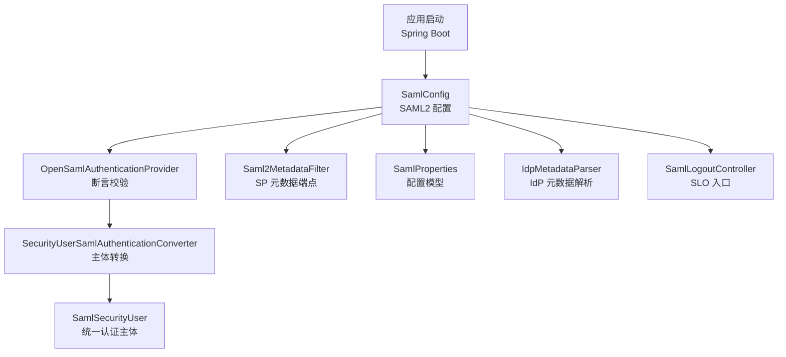
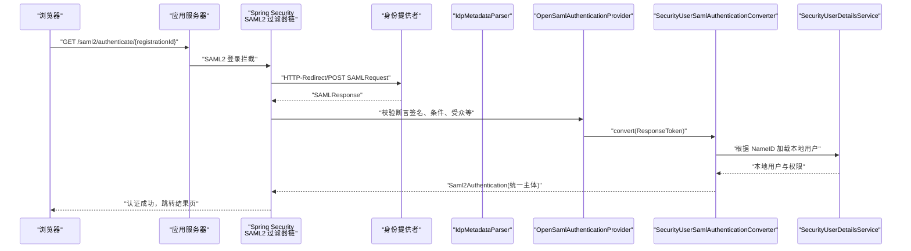
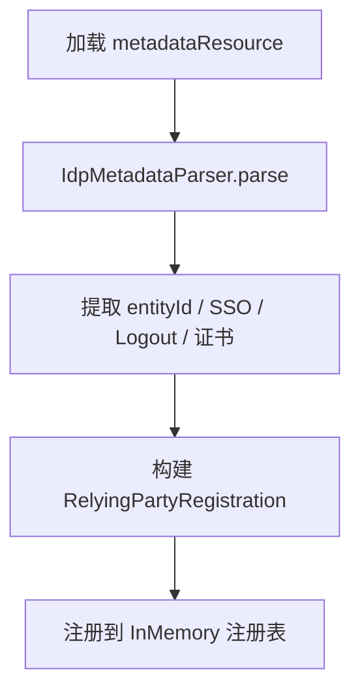
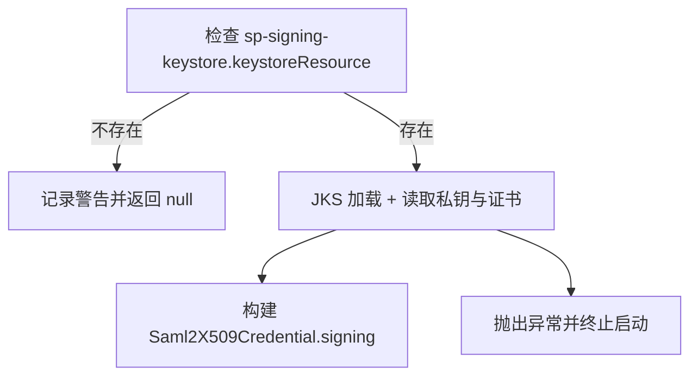
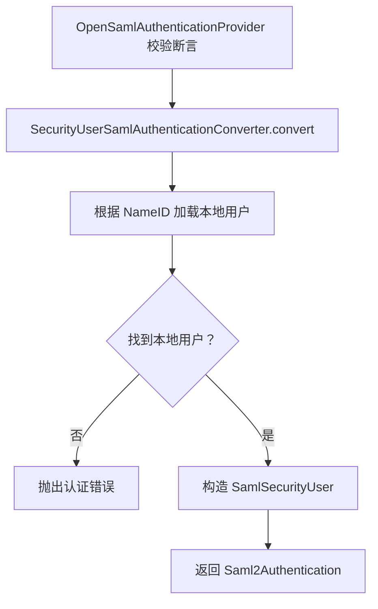
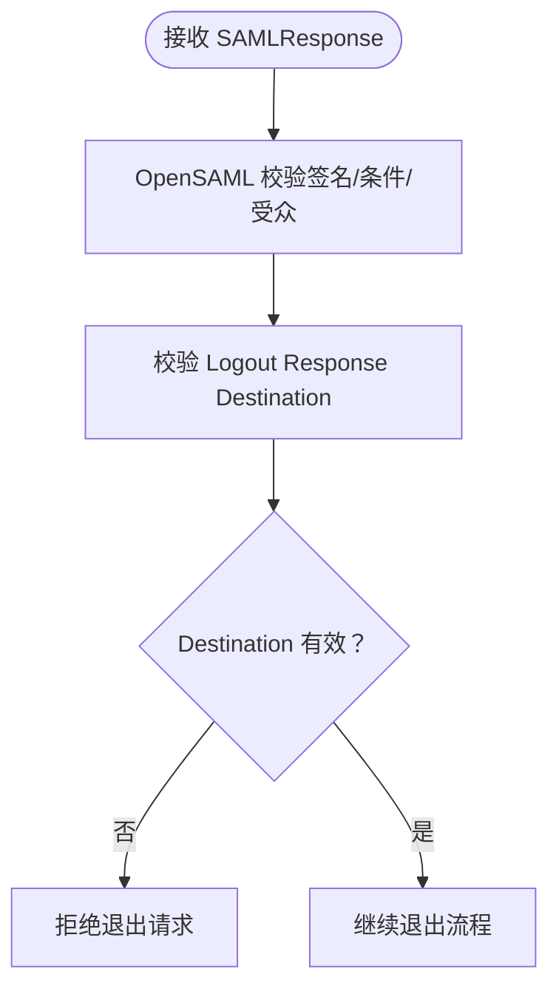
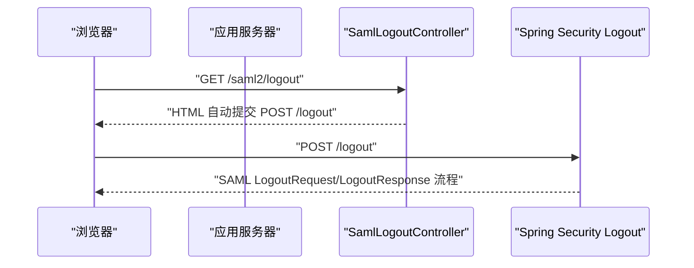
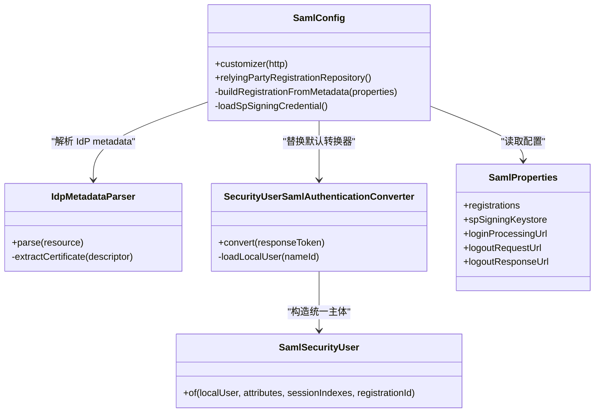

# SAML2 安全配置

<cite>
**本文引用的文件**   
- [SamlConfig.java](file://login-spring-boot-starter/src/main/java/com/cu/framework/authentication/saml/SamlConfig.java)
- [IdpMetadataParser.java](file://login-spring-boot-starter/src/main/java/com/cu/framework/authentication/saml/IdpMetadataParser.java)
- [SecurityUserSamlAuthenticationConverter.java](file://login-spring-boot-starter/src/main/java/com/cu/framework/authentication/saml/SecurityUserSamlAuthenticationConverter.java)
- [SamlSecurityUser.java](file://login-spring-boot-starter/src/main/java/com/cu/framework/authentication/saml/SamlSecurityUser.java)
- [SamlLogoutController.java](file://login-spring-boot-starter/src/main/java/com/cu/framework/authentication/saml/SamlLogoutController.java)
- [SamlProperties.java](file://login-spring-boot-starter/src/main/java/com/cu/framework/authentication/saml/properties/SamlProperties.java)
- [application.yml](file://sample/login-boot-sample/src/main/resources/application.yml)
- [idp-metadata.xml](file://sample/login-boot-sample/src/main/resources/saml/metadata/idp-metadata.xml)
- [keystore说明.md](file://sample/login-boot-sample/src/main/resources/saml/sp-keystore/keystore说明.md)
- [SAML2_SP_Metadata配置指南.md](file://docs/说明文档/SAML2_SP_Metadata配置指南.md)
</cite>

## 目录
1. [引言](#引言)
2. [项目结构](#项目结构)
3. [核心组件](#核心组件)
4. [架构总览](#架构总览)
5. [详细组件分析](#详细组件分析)
6. [依赖关系分析](#依赖关系分析)
7. [性能与可用性考虑](#性能与可用性考虑)
8. [故障排查指南](#故障排查指南)
9. [结论](#结论)

## 引言
本文面向在本仓库中集成 SAML2 单点登录的开发者，聚焦“如何正确且安全地配置 SAML2”。内容覆盖：
- SAML 元数据：SP 元数据生成、IdP 元数据导入、元数据签名验证、XML Schema 解析。
- 证书管理：公钥证书配置、私钥保护、密钥库加载、轮换注意事项。
- 断言安全：断言签名校验、NameID 处理、属性映射与安全边界。
- 请求安全：AuthnRequest 签名、Destination 校验、重放攻击防护、时间戳策略。
- 错误处理与日志脱敏：避免泄露敏感信息。
- 常见问题：时区、字符编码、网络通信异常等。

本指南以代码实现为依据，同时给出可操作的配置建议与排错路径。

## 项目结构
SAML2 相关能力集中在 `login-spring-boot-starter` 模块中，关键位置如下：
- `com.cu.framework.authentication.saml.SamlConfig`：SAML2 认证过滤器链、SP 元数据端点、RelyingParty 注册、SP 签名密钥库加载。
- `com.cu.framework.authentication.saml.IdpMetadataParser`：从 IdP metadata.xml 解析 Entity ID、SSO/Logout 地址、绑定方式、签名证书。
- `com.cu.framework.authentication.saml.SecurityUserSamlAuthenticationConverter`：接管 OpenSAML 断言组装，将统一主体注入安全上下文。
- `com.cu.framework.authentication.saml.SamlSecurityUser`：封装 NameID、断言属性、会话索引与服务注册标识。
- `com.cu.framework.authentication.saml.properties.SamlProperties`：SAML2 配置属性模型。
- `com.cu.framework.authentication.saml.SamlLogoutController`：提供 GET /saml2/logout 触发 POST /logout 的 SLO 流程。
- 示例配置：`sample/login-boot-sample/src/main/resources/application.yml` 和 `idp-metadata.xml`。



**图表来源**
- [SamlConfig.java:1-233](file://login-spring-boot-starter/src/main/java/com/cu/framework/authentication/saml/SamlConfig.java#L1-L233)
- [IdpMetadataParser.java:1-232](file://login-spring-boot-starter/src/main/java/com/cu/framework/authentication/saml/IdpMetadataParser.java#L1-L232)
- [SecurityUserSamlAuthenticationConverter.java:1-89](file://login-spring-boot-starter/src/main/java/com/cu/framework/authentication/saml/SecurityUserSamlAuthenticationConverter.java#L1-L89)
- [SamlSecurityUser.java:1-72](file://login-spring-boot-starter/src/main/java/com/cu/framework/authentication/saml/SamlSecurityUser.java#L1-L72)
- [SamlLogoutController.java:1-50](file://login-spring-boot-starter/src/main/java/com/cu/framework/authentication/saml/SamlLogoutController.java#L1-L50)
- [SamlProperties.java:1-149](file://login-spring-boot-starter/src/main/java/com/cu/framework/authentication/saml/properties/SamlProperties.java#L1-L149)

**章节来源**
- [SamlConfig.java:1-233](file://login-spring-boot-starter/src/main/java/com/cu/framework/authentication/saml/SamlConfig.java#L1-L233)
- [SamlProperties.java:1-149](file://login-spring-boot-starter/src/main/java/com/cu/framework/authentication/saml/properties/SamlProperties.java#L1-L149)

## 核心组件
- SamlConfig：通过 `HttpSecurityCustomizer` 接入 Spring Security；创建 `OpenSamlAuthenticationProvider`、替换默认响应转换器、注册 RelyingParty 注册表、添加 SP 元数据过滤器、暴露 SLO 控制器 Bean。
- IdpMetadataParser：使用 OpenSAML 解析 IdP metadata，提取 Entity ID、SSO/Logout 服务地址及绑定、签名证书与是否要求 AuthnRequest 签名。
- SecurityUserSamlAuthenticationConverter：在断言校验通过后，调用默认转换器获取已校验的属性、NameID 与 registrationId，再从本地用户服务加载权限并构造 `SamlSecurityUser`。
- SamlSecurityUser：承载本地账号信息与协议原生数据（断言属性、会话索引、registrationId），用于后续授权与单点登出。
- SamlProperties：定义 SAML2 配置项，包括 ACS 地址模板、多个 registration、SP 签名密钥库、SLO 地址。

**章节来源**
- [SamlConfig.java:1-233](file://login-spring-boot-starter/src/main/java/com/cu/framework/authentication/saml/SamlConfig.java#L1-L233)
- [IdpMetadataParser.java:1-232](file://login-spring-boot-starter/src/main/java/com/cu/framework/authentication/saml/IdpMetadataParser.java#L1-L232)
- [SecurityUserSamlAuthenticationConverter.java:1-89](file://login-spring-boot-starter/src/main/java/com/cu/framework/authentication/saml/SecurityUserSamlAuthenticationConverter.java#L1-L89)
- [SamlSecurityUser.java:1-72](file://login-spring-boot-starter/src/main/java/com/cu/framework/authentication/saml/SamlSecurityUser.java#L1-L72)
- [SamlProperties.java:1-149](file://login-spring-boot-starter/src/main/java/com/cu/framework/authentication/saml/properties/SamlProperties.java#L1-L149)

## 架构总览
SAML2 登录的关键链路：浏览器访问 `/saml2/authenticate/{registrationId}` → Spring Security 发起 SSO 请求 → IdP 返回 SAMLResponse → OpenSAML 完成签名/条件等校验 → 自定义转换器构造统一主体 → 成功处理器进入业务系统。



**图表来源**
- [SamlConfig.java:48-120](file://login-spring-boot-starter/src/main/java/com/cu/framework/authentication/saml/SamlConfig.java#L48-L120)
- [SecurityUserSamlAuthenticationConverter.java:33-89](file://login-spring-boot-starter/src/main/java/com/cu/framework/authentication/saml/SecurityUserSamlAuthenticationConverter.java#L33-L89)

**章节来源**
- [SamlConfig.java:48-120](file://login-spring-boot-starter/src/main/java/com/cu/framework/authentication/saml/SamlConfig.java#L48-L120)
- [SecurityUserSamlAuthenticationConverter.java:33-89](file://login-spring-boot-starter/src/main/java/com/cu/framework/authentication/saml/SecurityUserSamlAuthenticationConverter.java#L33-L89)

## 详细组件分析

### SAML 元数据配置

#### SP 元数据生成
- SamlConfig 在 `customizer` 中构建 `Saml2MetadataFilter`，并使用 `DefaultRelyingPartyRegistrationResolver` 与 `OpenSamlMetadataResolver` 动态生成 SP metadata。
- 默认路径为 `/saml2/service-provider-metadata/{registrationId}`，由 `registrationId` 区分不同 IdP。
- 文档 `SAML2_SP_Metadata配置指南.md` 说明了该机制的设计原因：默认不启用，以避免暴露内部配置，需显式添加过滤器。

```mermaid
flowchart TD
    Start(["请求 /saml2/service-provider-metadata/{registrationId}"]) --> Resolve["解析 registrationId"]
    Resolve --> Build["构建 RelyingPartyRegistration"]
    Build --> Generate["OpenSamlMetadataResolver 生成 XML"]
    Generate --> Return(["返回 SP Metadata"))]
```

**图表来源**
- [SamlConfig.java:100-120](file://login-spring-boot-starter/src/main/java/com/cu/framework/authentication/saml/SamlConfig.java#L100-L120)
- [SAML2_SP_Metadata配置指南.md:1-231](file://docs/说明文档/SAML2_SP_Metadata配置指南.md#L1-L231)

**章节来源**
- [SamlConfig.java:100-120](file://login-spring-boot-starter/src/main/java/com/cu/framework/authentication/saml/SamlConfig.java#L100-L120)
- [SAML2_SP_Metadata配置指南.md:1-231](file://docs/说明文档/SAML2_SP_Metadata配置指南.md#L1-L231)

#### IdP 元数据导入
- `SamlProperties.registrations[].metadataResource` 指向 classpath 中的 IdP metadata.xml。
- `SamlConfig.buildRegistrationFromMetadata` 调用 `IdpMetadataParser.parse`，读取 entityId、SSO URL、绑定、WantAuthnRequestsSigned、SingleLogoutService 地址与绑定。
- 若 IdP metadata 中存在 SingleLogoutService，则填充 SP 侧退出所需字段；否则保留空值，但登录流程不受影响。



**图表来源**
- [SamlConfig.java:122-199](file://login-spring-boot-starter/src/main/java/com/cu/framework/authentication/saml/SamlConfig.java#L122-L199)
- [IdpMetadataParser.java:39-120](file://login-spring-boot-starter/src/main/java/com/cu/framework/authentication/saml/IdpMetadataParser.java#L39-L120)

**章节来源**
- [SamlConfig.java:122-199](file://login-spring-boot-starter/src/main/java/com/cu/framework/authentication/saml/SamlConfig.java#L122-L199)
- [IdpMetadataParser.java:39-120](file://login-spring-boot-starter/src/main/java/com/cu/framework/authentication/saml/IdpMetadataParser.java#L39-L120)

#### 元数据签名验证与 XML Schema 验证
- IdP 公钥证书来自 IdP metadata 中的 KeyDescriptor；解析后以 `verification` 模式加入 registration。
- 实际断言签名验证发生在 `OpenSamlAuthenticationProvider.authenticate` 阶段，而不是在自定义转换器中。
- XML 解析基于 OpenSAML 的 `BasicParserPool` 与 `UnmarshallerFactory`，属于标准 XML 解析流程；仓库未额外启用自定义 XML Schema 白名单或外部实体限制策略。

**章节来源**
- [IdpMetadataParser.java:121-189](file://login-spring-boot-starter/src/main/java/com/cu/framework/authentication/saml/IdpMetadataParser.java#L121-L189)
- [SamlConfig.java:157-186](file://login-spring-boot-starter/src/main/java/com/cu/framework/authentication/saml/SamlConfig.java#L157-L186)

### 证书管理机制

#### 公钥证书配置
- 公钥证书来源于 IdP metadata 的 KeyDescriptor；解析过程优先选择 use=signing 的证书。
- 解析失败会抛出明确异常，便于快速定位 metadata 缺失问题。

#### 私钥文件保护与密钥库加载
- SP 签名密钥库通过 `SpSigningKeystore` 配置 keystoreResource、keystorePassword、keyAlias、keyPassword。
- 若 keystoreResource 不存在，仅记录警告并降级为不签名；若存在但密码或别名错误，则抛出 `IllegalStateException` 导致启动失败。
- 生成的 JKS 不应提交版本库，仓库 `.gitignore` 已将常见密钥库后缀排除。



**图表来源**
- [SamlConfig.java:199-233](file://login-spring-boot-starter/src/main/java/com/cu/framework/authentication/saml/SamlConfig.java#L199-L233)
- [keystore说明.md:1-68](file://sample/login-boot-sample/src/main/resources/saml/sp-keystore/keystore说明.md#L1-L68)

**章节来源**
- [SamlConfig.java:199-233](file://login-spring-boot-starter/src/main/java/com/cu/framework/authentication/saml/SamlConfig.java#L199-L233)
- [SamlProperties.java:55-84](file://login-spring-boot-starter/src/main/java/com/cu/framework/authentication/saml/properties/SamlProperties.java#L55-L84)
- [keystore说明.md:1-68](file://sample/login-boot-sample/src/main/resources/saml/sp-keystore/keystore说明.md#L1-L68)

#### 证书轮换流程建议
- 在 IdP 侧轮换公钥后，更新 IdP metadata 文件或 classpath 下的 idp-metadata.xml。
- 在 SP 侧轮换签名证书后，重新生成 JKS 并更新 `sp-signing-keystore` 配置；注意保持 alias 与密码一致。
- 建议在生产环境使用独立密钥管理服务，避免硬编码密码；当前实现支持通过配置注入资源与密码，但需要配合外部密钥管理方案实现自动化轮换。

[本节为通用操作建议，不直接分析具体代码行]

### 断言安全配置

#### 断言签名验证
- 断言签名、条件、受众等校验由 `OpenSamlAuthenticationProvider` 完成；自定义转换器仅在已通过校验后进行主体组装。
- 因此，替换转换器不会削弱协议层的安全校验。

#### NameID 格式选择与安全考虑
- NameID 作为本系统的用户名来源，最终调用 `SecurityUserDetailsService.loadUserByUsername(nameId)`。
- 若本地找不到用户，会返回明确的 `Saml2Error` 并中断认证，防止匿名会话进入。
- 示例 IdP metadata 包含 `NameIDFormat=emailAddress`，应确保 IdP 输出的 NameID 与本系统用户名一致。



**图表来源**
- [SecurityUserSamlAuthenticationConverter.java:33-89](file://login-spring-boot-starter/src/main/java/com/cu/framework/authentication/saml/SecurityUserSamlAuthenticationConverter.java#L33-L89)
- [idp-metadata.xml:1-27](file://sample/login-boot-sample/src/main/resources/saml/metadata/idp-metadata.xml#L1-L27)

**章节来源**
- [SecurityUserSamlAuthenticationConverter.java:33-89](file://login-spring-boot-starter/src/main/java/com/cu/framework/authentication/saml/SecurityUserSamlAuthenticationConverter.java#L33-L89)
- [SamlSecurityUser.java:1-72](file://login-spring-boot-starter/src/main/java/com/cu/framework/authentication/saml/SamlSecurityUser.java#L1-L72)
- [idp-metadata.xml:1-27](file://sample/login-boot-sample/src/main/resources/saml/metadata/idp-metadata.xml#L1-L27)

#### 断言加密解密
- 当前实现未显式配置断言加密或解密逻辑；主要依赖 OpenSAML 默认行为与 IdP 配置。
- 如果 IdP 对断言进行加密，需要在 Spring Security SAML2 配置中增加解密凭证；仓库中未见对应解密配置。

[本节基于现有实现结论，不附加未存在的代码片段]

### 请求安全配置

#### AuthnRequest 签名
- 当 IdP metadata 中 `WantAuthnRequestsSigned=true` 时，SP 必须提供签名密钥库；否则 AuthnRequest 不会被签名，可能被 IdP 拒绝。
- 若未配置 keystore，SamlConfig 会记录警告并继续运行；此时对要求签名的 IdP 会在登录环节失败。

#### Destination 属性校验
- SamlConfig 在构建 registration 时设置 `singleLogoutServiceLocation` 与 `singleLogoutServiceResponseLocation`，避免 Spring Security 退出流程因目标地址为空而报错。
- 注释还指出，Spring Security 的 LogoutResponseValidator 会对 Destination 做全匹配校验，因此必须保持一致。

#### Replay 攻击防护与时间戳策略
- 当前仓库未看到自定义的 `ReplayCache`、`Clock` 或显式时间窗口校验配置；这部分通常由 OpenSAML 与 Spring Security 默认行为负责。
- 生产环境中建议结合部署环境的时钟同步与 NTP，并确保 IdP 与 SP 的时区一致。



**图表来源**
- [SamlConfig.java:145-186](file://login-spring-boot-starter/src/main/java/com/cu/framework/authentication/saml/SamlConfig.java#L145-L186)

**章节来源**
- [SamlConfig.java:145-186](file://login-spring-boot-starter/src/main/java/com/cu/framework/authentication/saml/SamlConfig.java#L145-L186)

### 单点登出流程
- SamlConfig 启用 `saml2Logout`，并将 `/logout/saml2/slo` 同时作为 LogoutRequest 与 LogoutResponse 处理地址。
- SamlLogoutController 提供 GET /saml2/logout，自动提交 POST /logout，从而绕过 CSRF 对 GET 的限制并触发 SLO。



**图表来源**
- [SamlConfig.java:108-120](file://login-spring-boot-starter/src/main/java/com/cu/framework/authentication/saml/SamlConfig.java#L108-L120)
- [SamlLogoutController.java:1-50](file://login-spring-boot-starter/src/main/java/com/cu/framework/authentication/saml/SamlLogoutController.java#L1-L50)

**章节来源**
- [SamlConfig.java:108-120](file://login-spring-boot-starter/src/main/java/com/cu/framework/authentication/saml/SamlConfig.java#L108-L120)
- [SamlLogoutController.java:1-50](file://login-spring-boot-starter/src/main/java/com/cu/framework/authentication/saml/SamlLogoutController.java#L1-L50)

### 错误处理与日志脱敏

#### 认证错误
- 本地用户不存在时，转换器会构造 `Saml2Error` 并抛出 `Saml2AuthenticationException`，避免匿名用户进入。
- 成功处理器与异常处理器已在 SamlConfig 中注入，统一 SAML2 认证的成功与失败处理。

#### 日志脱敏建议
- 当前实现会将 NameID 写入错误消息；NameID 可能包含邮箱、用户名等敏感信息。
- 建议对日志中的 NameID、SAMLResponse、Assertion、Subject、属性值等进行脱敏后再输出；当前实现未内置脱敏器，需在上层日志框架或错误处理器中补充。

**章节来源**
- [SecurityUserSamlAuthenticationConverter.java:56-89](file://login-spring-boot-starter/src/main/java/com/cu/framework/authentication/saml/SecurityUserSamlAuthenticationConverter.java#L56-L89)
- [SamlConfig.java:64-120](file://login-spring-boot-starter/src/main/java/com/cu/framework/authentication/saml/SamlConfig.java#L64-L120)

## 依赖关系分析



**图表来源**
- [SamlConfig.java:1-233](file://login-spring-boot-starter/src/main/java/com/cu/framework/authentication/saml/SamlConfig.java#L1-L233)
- [IdpMetadataParser.java:1-232](file://login-spring-boot-starter/src/main/java/com/cu/framework/authentication/saml/IdpMetadataParser.java#L1-L232)
- [SecurityUserSamlAuthenticationConverter.java:1-89](file://login-spring-boot-starter/src/main/java/com/cu/framework/authentication/saml/SecurityUserSamlAuthenticationConverter.java#L1-L89)
- [SamlSecurityUser.java:1-72](file://login-spring-boot-starter/src/main/java/com/cu/framework/authentication/saml/SamlSecurityUser.java#L1-L72)
- [SamlProperties.java:1-149](file://login-spring-boot-starter/src/main/java/com/cu/framework/authentication/saml/properties/SamlProperties.java#L1-L149)

**章节来源**
- [SamlConfig.java:1-233](file://login-spring-boot-starter/src/main/java/com/cu/framework/authentication/saml/SamlConfig.java#L1-L233)
- [IdpMetadataParser.java:1-232](file://login-spring-boot-starter/src/main/java/com/cu/framework/authentication/saml/IdpMetadataParser.java#L1-L232)
- [SecurityUserSamlAuthenticationConverter.java:1-89](file://login-spring-boot-starter/src/main/java/com/cu/framework/authentication/saml/SecurityUserSamlAuthenticationConverter.java#L1-L89)
- [SamlSecurityUser.java:1-72](file://login-spring-boot-starter/src/main/java/com/cu/framework/authentication/saml/SamlSecurityUser.java#L1-L72)
- [SamlProperties.java:1-149](file://login-spring-boot-starter/src/main/java/com/cu/framework/authentication/saml/properties/SamlProperties.java#L1-L149)

## 性能与可用性考虑
- IdP metadata 解析在应用启动时执行，属于一次性开销；建议缓存解析结果或使用稳定的 classpath 资源。
- JKS 加载同样在启动阶段完成；频繁重启会增加密钥库 I/O 成本。
- SAML 报文较大，尤其是含多断言或多属性的场景；建议在网关或反向代理中合理设置请求体大小限制。
- 建议使用连接池与超时配置，避免因 IdP 不可用导致线程阻塞。

[本节为通用性能建议，不直接分析具体代码行]

## 故障排查指南

### 启动阶段问题
- **SP 签名密钥库不存在**：SamlConfig 会打印警告并降级为不签名；如果 IdP 要求签名，登录会失败。确认 `sp-signing-keystore.keystore-resource` 是否存在，以及别名和密码是否正确。
- **JKS 密码或别名错误**：会抛出 `IllegalStateException`；检查 application.yml 与实际 JKS 配置是否一致。

**章节来源**
- [SamlConfig.java:201-233](file://login-spring-boot-starter/src/main/java/com/cu/framework/authentication/saml/SamlConfig.java#L201-L233)
- [keystore说明.md:1-68](file://sample/login-boot-sample/src/main/resources/saml/sp-keystore/keystore说明.md#L1-L68)

### IdP metadata 解析失败
- **缺少 IDPSSODescriptor**：解析器会抛出异常，检查 metadata 根节点与命名空间。
- **缺少 SingleSignOnService**：优先 HTTP-POST，其次 HTTP-Redirect；检查 IdP metadata 中是否有至少一个 SSO 服务。
- **缺少签名证书**：KeyDescriptor 中无 signing 证书时会抛异常；检查证书段是否与 IdP 当前公钥一致。

**章节来源**
- [IdpMetadataParser.java:39-189](file://login-spring-boot-starter/src/main/java/com/cu/framework/authentication/saml/IdpMetadataParser.java#L39-L189)

### 登录失败
- **本地用户不存在**：转换器会根据 NameID 查找本地用户，找不到则返回明确错误；检查 IdP 输出的 NameID 是否与本系统用户名一致。
- **Audience 不匹配**：检查 `spEntityId` 与 IdP 配置的 SP Audience 是否一致。
- **ACS 地址不一致**：检查 `login-processing-url` 与 IdP 后台配置的回调地址。

**章节来源**
- [SecurityUserSamlAuthenticationConverter.java:56-89](file://login-spring-boot-starter/src/main/java/com/cu/framework/authentication/saml/SecurityUserSamlAuthenticationConverter.java#L56-L89)
- [application.yml:148-173](file://sample/login-boot-sample/src/main/resources/application.yml#L148-L173)

### 单点登出问题
- **Destination 校验失败**：确认 `logout-request-url` 与 `logout-response-url` 配置一致，并且与 IdP 后台配置的 SP SLO 地址一致。
- **无法通过 GET 触发退出**：使用 GET /saml2/logout 自动提交 POST /logout；若禁用 CSRF 或修改了 /logout，需要调整控制器与过滤器链。

**章节来源**
- [SamlConfig.java:108-120](file://login-spring-boot-starter/src/main/java/com/cu/framework/authentication/saml/SamlConfig.java#L108-L120)
- [SamlLogoutController.java:1-50](file://login-spring-boot-starter/src/main/java/com/cu/framework/authentication/saml/SamlLogoutController.java#L1-L50)

### 时区与时间戳问题
- 当前仓库未显式配置时间戳校验策略与时钟源；建议部署环境使用 NTP 同步时间，避免跨数据中心时差导致时间戳校验失败。
- 若 IdP 返回的时间戳在未来或过旧，应检查服务器时间与 IdP 时间一致性。

[本节为通用排查建议，不直接分析具体代码行]

### 字符编码问题
- SAML 报文为 UTF-8 XML；示例 metadata 与配置均按 UTF-8 处理。
- 若出现乱码，检查 Web 容器、数据库、前端展示层编码是否统一为 UTF-8。

[本节为通用排查建议，不直接分析具体代码行]

### 网络通信异常
- IdP 不可达、DNS 解析失败、代理拦截、防火墙策略都会导致 SSO 请求失败。
- 建议在网关层增加重试、熔断与告警，并在日志中记录远端地址、状态码与耗时，但避免记录完整 SAML 报文。

[本节为通用排查建议，不直接分析具体代码行]

## 结论
本仓库的 SAML2 实现以 Spring Security 5.x 的 OpenSAML 为基础，重点完成了：
- 从 IdP metadata 自动构建 RelyingParty 注册。
- 暴露 SP metadata 端点。
- 将断言校验后的主体转换为统一的 `SamlSecurityUser`。
- 支持可选的 SP 签名密钥库。
- 提供 SLO 入口与基础退出路径。

生产落地时，应重点关注：
- 严格校验 IdP metadata 的完整性与有效性。
- 在 IdP 要求签名时配置 SP 签名密钥库，并做好密钥轮换。
- 确保 NameID 与本系统用户名一致，并避免将敏感 NameID 明文写入日志。
- 核对 ACS、SLO、Audience、Destination 等关键地址与标识。
- 在网络与时间层面保证稳定性，降低 SAML 集成风险。