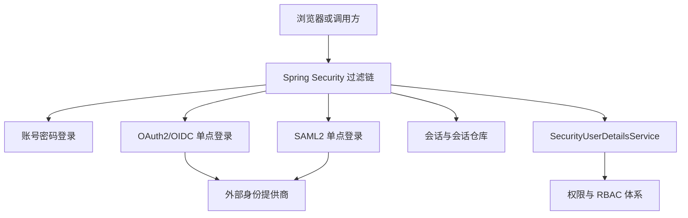
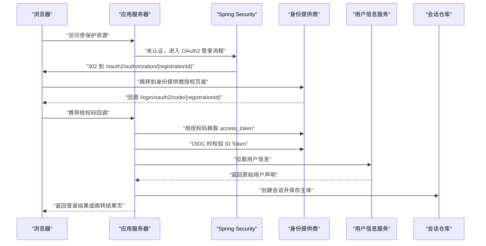
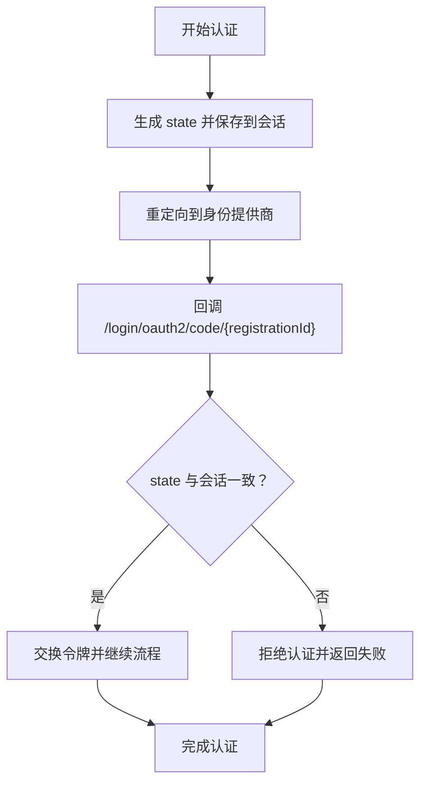
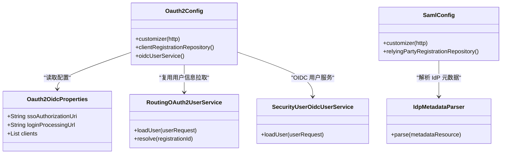

# 认证协议安全

<cite>
**本文引用的文件**   
- [README_Auth.md](file://README_Auth.md)
- [login-spring-boot-starter/README.md](file://login-spring-boot-starter/README.md)
- [login-spring-boot-starter/README-SSO.md](file://login-spring-boot-starter/README-SSO.md)
- [docs/application.yml](file://docs/application.yml)
- [login-spring-boot-starter/src/main/java/com/cu/framework/authentication/oauth2/Oauth2OidcProperties.java](file://login-spring-boot-starter/src/main/java/com/cu/framework/authentication/oauth2/Oauth2OidcProperties.java)
- [login-spring-boot-starter/src/main/java/com/cu/framework/authentication/oauth2/Oauth2Config.java](file://login-spring-boot-starter/src/main/java/com/cu/framework/authentication/oauth2/Oauth2Config.java)
- [login-spring-boot-starter/src/main/java/com/cu/framework/authentication/oauth2/RoutingOAuth2UserService.java](file://login-spring-boot-starter/src/main/java/com/cu/framework/authentication/oauth2/RoutingOAuth2UserService.java)
- [login-spring-boot-starter/src/main/java/com/cu/framework/authentication/oauth2/SecurityUserOidcUserService.java](file://login-spring-boot-starter/src/main/java/com/cu/framework/authentication/oauth2/SecurityUserOidcUserService.java)
- [login-spring-boot-starter/src/main/java/com/cu/framework/authentication/saml/SamlConfig.java](file://login-spring-boot-starter/src/main/java/com/cu/framework/authentication/saml/SamlConfig.java)
- [login-spring-boot-starter/src/main/java/com/cu/framework/authentication/saml/IdpMetadataParser.java](file://login-spring-boot-starter/src/main/java/com/cu/framework/authentication/saml/IdpMetadataParser.java)
- [login-spring-boot-starter/src/main/java/com/cu/framework/authentication/config/SecurityConfig.java](file://login-spring-boot-starter/src/main/java/com/cu/framework/authentication/config/SecurityConfig.java)
- [login-spring-boot-starter/src/main/java/com/cu/framework/authentication/config/SessionConfig.java](file://login-spring-boot-starter/src/main/java/com/cu/framework/authentication/config/SessionConfig.java)
- [login-spring-boot-starter/src/main/java/com/cu/framework/authentication/properties/SsoLoginProperties.java](file://login-spring-boot-starter/src/main/java/com/cu/framework/authentication/properties/SsoLoginProperties.java)
- [login-spring-boot-starter/src/main/java/com/cu/framework/authentication/exception/SsoErrorCodes.java](file://login-spring-boot-starter/src/main/java/com/cu/framework/authentication/exception/SsoErrorCodes.java)
</cite>

## 目录
1. [引言](#引言)
2. [项目结构与安全边界](#项目结构与安全边界)
3. [核心组件与协议总览](#核心组件与协议总览)
4. [架构概览](#架构概览)
5. [OAuth2/OIDC 令牌安全配置](#oauth2oidc-令牌安全配置)
6. [SAML2 安全配置要点](#saml2-安全配置要点)
7. [单点登录安全风险防护](#单点登录安全风险防护)
8. [身份提供商集成安全](#身份提供商集成安全)
9. [密钥管理与存储方案](#密钥管理与存储方案)
10. [依赖关系分析](#依赖关系分析)
11. [性能与安全权衡](#性能与安全权衡)
12. [常见问题排查](#常见问题排查)
13. [结论](#结论)

## 引言
本指南面向 Kewen Framework 中 `login-spring-boot-starter` 模块的安全配置人员，重点说明 OAuth2/OIDC、SAML2 以及通用单点登录行为的安全配置方法。文档基于仓库中的启动器实现、属性定义和示例配置文件进行分析，不虚构未出现的实现细节；对代码尚未提供但安全实践中重要的能力（如 PKCE、刷新令牌、SAML 断言加密）会明确标注为“当前实现未覆盖”，并给出可操作的检查清单。

该模块在同一套 Spring Security 过滤器链上并列支持账号密码登录、OAuth2/OIDC 单点登录和 SAML2 单点登录，三者共享成功处理器、异常处理器、放行 URL 汇总等基础设施，但配置前缀、端点和认证源彼此独立。

**章节来源**
- [README_Auth.md:1-60](file://README_Auth.md#L1-L60)
- [login-spring-boot-starter/README.md:1-40](file://login-spring-boot-starter/README.md#L1-L40)

## 项目结构与安全边界
Kewen Framework 的认证相关代码主要集中在以下位置：
- `login-spring-boot-starter`：统一安全入口、OAuth2/OIDC 与 SAML2 配置、会话管理、登录结果处理。
- `auth-core` / `auth-rbac`：权限模型、RBAC 实现及注解驱动鉴权，负责把认证后的主体转化为业务权限。
- `sample/login-boot-sample`：可直接运行的登录示例，用于验证 JSON 登录、未登录响应和基础安全行为。
- `docs/application.yml`：starter 配置的参考手册，包含 `cu.security.login.oauth2` 与 `cu.security.login.saml` 字段骨架。

**图示来源**
- [login-spring-boot-starter/src/main/java/com/cu/framework/authentication/config/SecurityConfig.java:70-120](file://login-spring-boot-starter/src/main/java/com/cu/framework/authentication/config/SecurityConfig.java#L70-L120)
- [login-spring-boot-starter/src/main/java/com/cu/framework/authentication/oauth2/Oauth2Config.java:55-110](file://login-spring-boot-starter/src/main/java/com/cu/framework/authentication/oauth2/Oauth2Config.java#L55-L110)
- [login-spring-boot-starter/src/main/java/com/cu/framework/authentication/saml/SamlConfig.java:70-120](file://login-spring-boot-starter/src/main/java/com/cu/framework/authentication/saml/SamlConfig.java#L70-L120)

**章节来源**
- [README_Auth.md:1-60](file://README_Auth.md#L1-L60)
- [login-spring-boot-starter/README.md:1-40](file://login-spring-boot-starter/README.md#L1-L40)

## 核心组件与协议总览
| 协议 | 配置前缀 | 关键类 | 主要安全职责 |
|---|---|---|---|
| 账号密码 | `cu.security.login.password` | `PasswordSecurityConfig`、`JsonLoginFilter` | JSON 登录、CSRF 禁用、密码编码器 |
| OAuth2/OIDC | `cu.security.login.oauth2` | `Oauth2Config`、`Oauth2OidcProperties`、`RoutingOAuth2UserService`、`SecurityUserOidcUserService` | 授权码模式、客户端注册、OIDC ID Token 校验、用户信息拉取 |
| SAML2 | `cu.security.login.saml` | `SamlConfig`、`IdpMetadataParser`、`SecurityUserSamlAuthenticationConverter` | SP 元数据、IdP 验签证书、登出端点、断言装配 |
| 通用 SSO | `cu.security.login.sso` | `SsoLoginProperties` | 统一登录结果页跳转、成功失败状态标记 |

框架默认关闭 CSRF，所有请求必须认证，静态资源通过 `WebSecurity.ignoring` 绕过安全链；单点登录成功后主体统一为 `SecurityUser`，其协议子类型保留原始声明以便审计和调试。

**章节来源**
- [login-spring-boot-starter/README.md:40-120](file://login-spring-boot-starter/README.md#L40-L120)
- [docs/application.yml:120-209](file://docs/application.yml#L120-L209)

## 架构概览
下面的序列图展示 OAuth2/OIDC 在框架中的典型流程：浏览器访问受保护资源 → 重定向到本地授权端点 → 跳转到身份提供商 → 回调本地 `/login/oauth2/code/{registrationId}` → 交换令牌 → OIDC 链路执行 ID Token 校验 → 拉取用户信息 → 转换为本系统 `SecurityUser` → 写入会话。

**图示来源**
- [login-spring-boot-starter/src/main/java/com/cu/framework/authentication/oauth2/Oauth2Config.java:80-140](file://login-spring-boot-starter/src/main/java/com/cu/framework/authentication/oauth2/Oauth2Config.java#L80-L140)
- [login-spring-boot-starter/src/main/java/com/cu/framework/authentication/oauth2/SecurityUserOidcUserService.java:1-37](file://login-spring-boot-starter/src/main/java/com/cu/framework/authentication/oauth2/SecurityUserOidcUserService.java#L1-L37)
- [login-spring-boot-starter/src/main/java/com/cu/framework/authentication/config/SessionConfig.java:20-60](file://login-spring-boot-starter/src/main/java/com/cu/framework/authentication/config/SessionConfig.java#L20-L60)

**章节来源**
- [login-spring-boot-starter/README-SSO.md:1-60](file://login-spring-boot-starter/README-SSO.md#L1-L60)
- [login-spring-boot-starter/src/main/java/com/cu/framework/authentication/oauth2/Oauth2Config.java:55-140](file://login-spring-boot-starter/src/main/java/com/cu/framework/authentication/oauth2/Oauth2Config.java#L55-L140)

## OAuth2/OIDC 令牌安全配置

### 授权码模式与端点
框架使用 Spring Security 的 `oauth2Login`，固定使用授权码模式。本地授权入口默认为 `/oauth2/authorization`，回调端点默认为 `/login/oauth2/code/*`。每个 IdP 由 `registration-id` 标识，URL 形如 `/oauth2/authorization/{registrationId}`。

安全要点：
- 只启用授权码模式，避免隐式模式等高风险方式。
- 回调地址模板使用 `{baseUrl}/login/oauth2/code/{registrationId}`，确保回调端点与 IdP 侧注册的 redirect URI 一致。
- `ignore-ssl=false` 是默认值；生产环境不得改为 `true`。

**章节来源**
- [login-spring-boot-starter/src/main/java/com/cu/framework/authentication/oauth2/Oauth2OidcProperties.java:20-60](file://login-spring-boot-starter/src/main/java/com/cu/framework/authentication/oauth2/Oauth2OidcProperties.java#L20-L60)
- [docs/application.yml:150-200](file://docs/application.yml#L150-L200)

### 访问令牌生命周期
当前实现通过 `DefaultAuthorizationCodeTokenResponseClient` 获取令牌，并在 OIDC 模式下通过 `OidcUserService` 校验 ID Token。仓库中没有看到显式的刷新令牌刷新逻辑、本地令牌缓存或自定义访问令牌过期策略。因此应把“访问令牌生命周期”理解为以身份提供商为中心：

| 关注点 | 当前实现含义 | 配置建议 |
|---|---|---|
| 访问令牌有效期 | 由 IdP 决定，框架未接管刷新流程 | 在 IdP 侧设置合理的短有效期 |
| 刷新令牌 | 未发现刷新令牌处理逻辑 | 若业务需要长期会话，优先延长本地会话或结合服务端会话控制 |
| 本地会话 | 使用 Spring Session，默认最大并发会话数可配 | 根据风险调整 `maximum-sessions` 和 `max-sessions-prevents-login` |
| 登出 | OIDC 提供 `OidcClientInitiatedLogoutSuccessHandler`，SAML 有独立登出端点 | 确认 IdP 是否支持 RP-Initiated Logout |

**章节来源**
- [login-spring-boot-starter/src/main/java/com/cu/framework/authentication/oauth2/Oauth2Config.java:60-90](file://login-spring-boot-starter/src/main/java/com/cu/framework/authentication/oauth2/Oauth2Config.java#L60-L90)
- [login-spring-boot-starter/src/main/java/com/cu/framework/authentication/oauth2/Oauth2Config.java:230-271](file://login-spring-boot-starter/src/main/java/com/cu/framework/authentication/oauth2/Oauth2Config.java#L230-L271)
- [login-spring-boot-starter/src/main/java/com/cu/framework/authentication/config/SessionConfig.java:80-124](file://login-spring-boot-starter/src/main/java/com/cu/framework/authentication/config/SessionConfig.java#L80-L124)

### 令牌签名验证
OIDC 模式的 ID Token 签名验证由 `OidcUserService` 负责，JWK Set 可通过自动发现或手动配置 `jwk-set-uri` 提供。对于 OAuth2 非 OIDC 模式，如果 IdP 返回 JWT 格式的 access_token，应通过配置 `jwk-set-uri` 配合底层 OIDC/JWT 能力进行验证；仓库注释也指出 JWK Set 主要用于 ID Token 签名验证。

安全要点：
- OIDC 模式优先使用 `issuer-uri` 自动发现端点和 JWK Set。
- 手动模式应同时配置 `authorization-uri`、`token-uri`、`user-info-uri`。
- 不要为了绕过证书问题而全局关闭 SSL 校验；`ignore-ssl` 仅影响 userinfo 请求。

**章节来源**
- [login-spring-boot-starter/src/main/java/com/cu/framework/authentication/oauth2/Oauth2OidcProperties.java:180-239](file://login-spring-boot-starter/src/main/java/com/cu/framework/authentication/oauth2/Oauth2OidcProperties.java#L180-L239)
- [login-spring-boot-starter/src/main/java/com/cu/framework/authentication/oauth2/Oauth2Config.java:200-230](file://login-spring-boot-starter/src/main/java/com/cu/framework/authentication/oauth2/Oauth2Config.java#L200-L230)

### Scope 权限控制
Scope 是向 IdP 申请的权限范围，不是本系统的最终授权依据。框架明确强调：身份源声明的角色、权限、`SCOPE_*` 不参与授权判定；认证成功后通过 `user-name-attribute-name` 指定的用户名在本系统查找账号和权限。

| 配置项 | 作用 | 安全含义 |
|---|---|---|
| `scopes` | 向 IdP 申请授权范围 | 控制 IdP 返回哪些声明，但不直接决定后端权限 |
| `user-name-attribute-name` | 映射为本系统用户名 | 必须指向能匹配本地账号的值，推荐 `preferred_username` 而非 `sub` |
| 本地权限 | 由 `SecurityUserDetailsService` 和本地 RBAC 决定 | 最终访问控制在此层完成 |

**章节来源**
- [login-spring-boot-starter/README-SSO.md:20-60](file://login-spring-boot-starter/README-SSO.md#L20-L60)
- [login-spring-boot-starter/src/main/java/com/cu/framework/authentication/oauth2/Oauth2OidcProperties.java:160-200](file://login-spring-boot-starter/src/main/java/com/cu/framework/authentication/oauth2/Oauth2OidcProperties.java#L160-L200)
- [login-spring-boot-starter/README.md:120-200](file://login-spring-boot-starter/README.md#L120-L200)

### PKCE 流程配置
当前仓库搜索未发现 `code_challenge`、`code_verifier`、PKCE 相关配置或实现。因此：
- 当前 starter 没有暴露 PKCE 配置项。
- 如果 IdP 要求 PKCE，需要在扩展层替换授权请求构建逻辑，或在网关/反向代理侧补充。
- 在未确认 IdP 是否强制 PKCE 前，不要假设授权码流程已具备防授权码拦截能力。

**章节来源**
- [login-spring-boot-starter/src/main/java/com/cu/framework/authentication/oauth2/Oauth2OidcProperties.java:1-239](file://login-spring-boot-starter/src/main/java/com/cu/framework/authentication/oauth2/Oauth2OidcProperties.java#L1-L239)
- [login-spring-boot-starter/src/main/java/com/cu/framework/authentication/oauth2/Oauth2Config.java:55-140](file://login-spring-boot-starter/src/main/java/com/cu/framework/authentication/oauth2/Oauth2Config.java#L55-L140)

## SAML2 安全配置要点

### 元数据验证与证书管理
`SamlConfig` 从 `classpath:saml/idp-metadata.xml` 解析 IdP 元数据，提取 Entity ID、SSO URL、绑定方式和签名证书。`IdpMetadataParser` 会从 `KeyDescriptor` 中提取 `UsageType.SIGNING` 的 X.509 证书，并抛出自定义异常阻止无法解析的情况。

安全要点：
- 必须提供合法的 IdP 元数据文件。
- 元数据中必须包含 `IDPSSODescriptor`、`SingleSignOnService` 和签名证书。
- 更新 IdP 证书时，应同步更新元数据文件或 Keystore。
- 不建议跳过元数据完整性校验；当前实现通过 OpenSAML 解析，生产环境应确保元数据来源可信。

**章节来源**
- [login-spring-boot-starter/src/main/java/com/cu/framework/authentication/saml/SamlConfig.java:120-180](file://login-spring-boot-starter/src/main/java/com/cu/framework/authentication/saml/SamlConfig.java#L120-L180)
- [login-spring-boot-starter/src/main/java/com/cu/framework/authentication/saml/IdpMetadataParser.java:40-120](file://login-spring-boot-starter/src/main/java/com/cu/framework/authentication/saml/IdpMetadataParser.java#L40-L120)
- [login-spring-boot-starter/src/main/java/com/cu/framework/authentication/saml/IdpMetadataParser.java:120-180](file://login-spring-boot-starter/src/main/java/com/cu/framework/authentication/saml/IdpMetadataParser.java#L120-L180)

### 断言签名验证
SAML 断言签名验证由 Spring Security SAML2 提供方实现承担。框架通过 `verificationX509Credentials` 注入从元数据解析出的 IdP 签名证书，使断言签名无效时认证失败。

安全要点：
- 不要移除或替换默认的断言签名验证逻辑。
- 如果 IdP 切换了签名证书，必须先部署新证书后再触发重新认证。
- 如需审计，可记录认证失败原因，但不应输出完整断言内容。

**章节来源**
- [login-spring-boot-starter/src/main/java/com/cu/framework/authentication/saml/SamlConfig.java:150-170](file://login-spring-boot-starter/src/main/java/com/cu/framework/authentication/saml/SamlConfig.java#L150-L170)

### NameID 格式选择
SAML 的 NameID 作为本地用户名来源，必须与本系统用户名口径一致。文档说明：服务侧发起的单点登出会把 `Authentication.getName()` 作为 NameID 发给身份源，因此两边取值必须一致；否则可能触发本地账号未找到错误。

| NameID 场景 | 建议 |
|---|---|
| 内部企业 IdP | 使用稳定且唯一的用户名，例如工号或邮箱 |
| 跨组织对接 | 避免使用临时邮箱或可变昵称 |
| 单点登出 | 确保 IdP 配置的 NameID 属性与本地用户名映射一致 |

**章节来源**
- [login-spring-boot-starter/README-SSO.md:20-60](file://login-spring-boot-starter/README-SSO.md#L20-L60)
- [login-spring-boot-starter/src/main/java/com/cu/framework/authentication/exception/SsoErrorCodes.java:1-19](file://login-spring-boot-starter/src/main/java/com/cu/framework/authentication/exception/SsoErrorCodes.java#L1-L19)

### 断言加密
当前仓库未显示对 SAML 断言加密的配置或解密逻辑。现有实现侧重于元数据解析、IdP 验签证书和 SP 签名凭证。若 IdP 要求加密断言，应在扩展层增加解密 KeyStore 配置和断言解密处理器，不能仅依赖验签。

**章节来源**
- [login-spring-boot-starter/src/main/java/com/cu/framework/authentication/saml/SamlConfig.java:100-233](file://login-spring-boot-starter/src/main/java/com/cu/framework/authentication/saml/SamlConfig.java#L100-L233)

## 单点登录安全风险防护

### 重定向 URI 白名单
框架允许配置 `redirect-uri-template`，但不会在代码层额外校验该值是否在 IdP 白名单中。因此：
- 必须在 IdP 侧严格登记回调地址。
- 不要使用通配符或模糊域名。
- 多环境部署时，测试和生产必须使用不同的 `client-id`、`client-secret` 和回调地址。

**章节来源**
- [login-spring-boot-starter/src/main/java/com/cu/framework/authentication/oauth2/Oauth2OidcProperties.java:90-120](file://login-spring-boot-starter/src/main/java/com/cu/framework/authentication/oauth2/Oauth2OidcProperties.java#L90-L120)
- [docs/application.yml:150-200](file://docs/application.yml#L150-L200)

### 状态参数与中间人攻击防护
OAuth2 授权请求中的 `state` 由 `HttpSessionOAuth2AuthorizationRequestRepository` 保存在 Session 中，回调时用于比对。SAML 的 InResponseTo 也在 SAML 认证流程中被校验，文档中已提到 InResponseTo 校验失败属于 SSO 失败场景。

安全要点：
- 保持 Session 安全，不要将敏感会话导出到日志。
- 防止跨站请求伪造：虽然本 starter 全局禁用 CSRF，但这是针对无状态 API 和 SSO 回调的设计；对外暴露的登录接口仍需确保来源可控。
- 禁止将 `state`、授权码、令牌放入 URL 日志或前端埋点。

**图示来源**
- [login-spring-boot-starter/src/main/java/com/cu/framework/authentication/oauth2/Oauth2Config.java:60-80](file://login-spring-boot-starter/src/main/java/com/cu/framework/authentication/oauth2/Oauth2Config.java#L60-L80)
- [login-spring-boot-starter/README-SSO.md:100-160](file://login-spring-boot-starter/README-SSO.md#L100-L160)

### 时间戳与受众校验
OIDC 的 ID Token 时间戳、受众等标准校验由 `OidcUserService` 承担。SAML 的 Destination、Audience、InResponseTo 等也由 Spring Security SAML2 提供方处理。框架本身没有自定义时间戳比较逻辑，因此安全基线依赖 Spring Security 和 OpenSAML。

**章节来源**
- [login-spring-boot-starter/src/main/java/com/cu/framework/authentication/oauth2/SecurityUserOidcUserService.java:1-37](file://login-spring-boot-starter/src/main/java/com/cu/framework/authentication/oauth2/SecurityUserOidcUserService.java#L1-L37)
- [login-spring-boot-starter/README-SSO.md:20-60](file://login-spring-boot-starter/README-SSO.md#L20-L60)

### 登录结果页与失败响应
当配置 `cu.security.login.sso.result-url` 后，三类 SSO 的成功与失败都会 302 跳转到该地址，并附加 `loginState=success|failure`。未配置时，OAuth2/OIDC/SAML2 的失败仍可能返回 JSON 错误体。

安全注意：
- 结果页只携带状态标记，不含会话标识与令牌。
- 前端应根据 `loginState` 判断登录成败，而不是信任 URL 参数中的其他字段。
- 如果希望前端统一处理登录结果，应启用 `result-url`，但仍需后端保证会话有效。

**章节来源**
- [login-spring-boot-starter/README.md:60-120](file://login-spring-boot-starter/README.md#L60-L120)
- [login-spring-boot-starter/src/main/java/com/cu/framework/authentication/properties/SsoLoginProperties.java:1-24](file://login-spring-boot-starter/src/main/java/com/cu/framework/authentication/properties/SsoLoginProperties.java#L1-L24)

## 身份提供商集成安全

### 网络通信加密
- OAuth2/OIDC 的 userinfo 请求支持按客户端配置 `ignore-ssl`，默认执行标准证书校验。
- OIDC Discovery 和 JWK Set 拉取走 Spring 自带 HTTP 客户端，始终执行标准证书校验；即使开启 `ignore-ssl`，Discovery 阶段失败也不能靠该开关绕过。
- 生产环境应把 IdP 证书导入 JVM 信任库，而不是关闭校验。

**章节来源**
- [login-spring-boot-starter/src/main/java/com/cu/framework/authentication/oauth2/RoutingOAuth2UserService.java:1-99](file://login-spring-boot-starter/src/main/java/com/cu/framework/authentication/oauth2/RoutingOAuth2UserService.java#L1-L99)
- [login-spring-boot-starter/src/main/java/com/cu/framework/authentication/oauth2/Oauth2OidcProperties.java:210-239](file://login-spring-boot-starter/src/main/java/com/cu/framework/authentication/oauth2/Oauth2OidcProperties.java#L210-L239)

### 连接池与错误信息泄露
`RoutingOAuth2UserService` 会为 `ignore-ssl=true` 的客户端替换 `RestOperations`，并说明该替换还用于容忍部分 IdP 的非标准 userinfo 响应。这说明框架对 IdP 容错有一定考虑，但安全上更应优先修复 IdP 响应，而不是放宽校验。

安全要点：
- 不要把 IdP 的错误 HTML 或堆栈直接返回给前端。
- 统一异常处理器会将认证异常转换为框架约定的响应结构。
- 日志中避免打印 client-secret、access_token、refresh_token、ID Token、SAML 断言和完整 metadata。

**章节来源**
- [login-spring-boot-starter/src/main/java/com/cu/framework/authentication/oauth2/RoutingOAuth2UserService.java:1-40](file://login-spring-boot-starter/src/main/java/com/cu/framework/authentication/oauth2/RoutingOAuth2UserService.java#L1-L40)
- [login-spring-boot-starter/README.md:120-200](file://login-spring-boot-starter/README.md#L120-L200)

## 密钥管理与存储方案

### 配置文件与敏感信息
`docs/application.yml` 展示了 `client-id`、`client-secret`、`issuer-uri`、`jwk-set-uri`、SP Keystore 路径等配置骨架。这些值不应提交到版本控制系统。

推荐方案：
- 开发环境：使用环境变量注入 `client-id`、`client-secret`、Keystore 密码。
- 生产环境：使用容器平台密钥管理、云厂商密钥管理服务或配置中心加密存储。
- 对明文配置文件进行最小化扫描和审计。

**章节来源**
- [docs/application.yml:150-209](file://docs/application.yml#L150-L209)
- [login-spring-boot-starter/src/main/java/com/cu/framework/authentication/saml/SamlConfig.java:190-233](file://login-spring-boot-starter/src/main/java/com/cu/framework/authentication/saml/SamlConfig.java#L190-L233)

### 硬件安全模块集成
当前代码加载 SP 签名密钥时使用 Java `KeyStore.getInstance("JKS")`，从文件流读取私钥和证书。仓库未出现 HSM、CloudHSM 或专用密钥服务 SDK 的直接集成。

如果需要 HSM：
- 替换 `loadSpSigningCredential` 附近的密钥加载逻辑，使用 HSM 提供的密钥访问接口。
- 确保证书轮换时只更新 Keystore 或 HSM 中的证书条目，而不暴露私钥。
- 对密钥加载失败采用“认证失败”语义，而不是降级为不签名。

**章节来源**
- [login-spring-boot-starter/src/main/java/com/cu/framework/authentication/saml/SamlConfig.java:190-233](file://login-spring-boot-starter/src/main/java/com/cu/framework/authentication/saml/SamlConfig.java#L190-L233)

## 依赖关系分析

**图示来源**
- [login-spring-boot-starter/src/main/java/com/cu/framework/authentication/oauth2/Oauth2OidcProperties.java:1-120](file://login-spring-boot-starter/src/main/java/com/cu/framework/authentication/oauth2/Oauth2OidcProperties.java#L1-L120)
- [login-spring-boot-starter/src/main/java/com/cu/framework/authentication/oauth2/Oauth2Config.java:55-140](file://login-spring-boot-starter/src/main/java/com/cu/framework/authentication/oauth2/Oauth2Config.java#L55-L140)
- [login-spring-boot-starter/src/main/java/com/cu/framework/authentication/oauth2/RoutingOAuth2UserService.java:1-99](file://login-spring-boot-starter/src/main/java/com/cu/framework/authentication/oauth2/RoutingOAuth2UserService.java#L1-L99)
- [login-spring-boot-starter/src/main/java/com/cu/framework/authentication/oauth2/SecurityUserOidcUserService.java:1-37](file://login-spring-boot-starter/src/main/java/com/cu/framework/authentication/oauth2/SecurityUserOidcUserService.java#L1-L37)
- [login-spring-boot-starter/src/main/java/com/cu/framework/authentication/saml/SamlConfig.java:100-233](file://login-spring-boot-starter/src/main/java/com/cu/framework/authentication/saml/SamlConfig.java#L100-L233)
- [login-spring-boot-starter/src/main/java/com/cu/framework/authentication/saml/IdpMetadataParser.java:1-120](file://login-spring-boot-starter/src/main/java/com/cu/framework/authentication/saml/IdpMetadataParser.java#L1-L120)

**章节来源**
- [login-spring-boot-starter/src/main/java/com/cu/framework/authentication/oauth2/Oauth2Config.java:55-271](file://login-spring-boot-starter/src/main/java/com/cu/framework/authentication/oauth2/Oauth2Config.java#L55-L271)
- [login-spring-boot-starter/src/main/java/com/cu/framework/authentication/saml/SamlConfig.java:70-233](file://login-spring-boot-starter/src/main/java/com/cu/framework/authentication/saml/SamlConfig.java#L70-L233)

## 性能与安全权衡
- 会话持久化依赖 `spring-session-jdbc`，适合多实例部署，但会增加数据库压力。生产环境应合理设置连接池大小和超时。
- 并发会话数默认 10，可通过 `maximum-sessions` 和 `max-sessions-prevents-login` 调整。限制过严可能导致用户体验下降，过松则提升账户接管风险。
- OIDC 的 ID Token 校验和用户信息拉取发生在认证阶段，频繁切换 IdP 或多 IdP 场景下应考虑 IdP 限流和网络超时。
- 禁用 CSRF 是为了适配前后端分离和无状态登录流程，但不能因此忽略外部入口的安全边界。

**章节来源**
- [login-spring-boot-starter/README.md:20-60](file://login-spring-boot-starter/README.md#L20-L60)
- [login-spring-boot-starter/src/main/java/com/cu/framework/authentication/config/SessionConfig.java:80-124](file://login-spring-boot-starter/src/main/java/com/cu/framework/authentication/config/SessionConfig.java#L80-L124)
- [login-spring-boot-starter/src/main/java/com/cu/framework/authentication/config/SecurityConfig.java:90-120](file://login-spring-boot-starter/src/main/java/com/cu/framework/authentication/config/SecurityConfig.java#L90-L120)

## 常见问题排查

| 现象 | 可能原因 | 排查建议 |
|---|---|---|
| OAuth2/OIDC 回调失败 | `state` 不一致、回调地址与 IdP 不一致、IdP 证书不可信 | 检查 `redirect-uri-template`、IdP 白名单、JVM 信任库 |
| OIDC 登录成功但找不到本地账号 | `user-name-attribute-name` 指向了 `sub` 或其他不匹配字段 | 改为 `preferred_username` 或能匹配本地用户的字段 |
| SAML 登录失败并提示本地账号不存在 | NameID 与本地用户名不一致 | 检查 IdP NameID 属性和单点登出配置 |
| 登录成功但权限为空 | 本地 `SecurityUserDetailsService` 未返回角色或菜单权限 | 检查 RBAC 数据和用户-角色-部门映射 |
| 会话频繁失效 | 并发会话数过小、Session 超时、Cookie 丢失 | 查看 `maximum-sessions`、Session 超时和跨域 Cookie 配置 |
| 用户信息端点证书校验失败 | IdP 证书未导入 JVM 信任库 | 不要使用 `ignore-ssl=true`，应导入证书 |
| 登录后前端仍显示未登录 | 前端未正确传递 Authorization Header 或 Cookie | 检查 `HeaderCookieHttpSessionIdResolver` 和前端请求头 |

**章节来源**
- [login-spring-boot-starter/README.md:200-350](file://login-spring-boot-starter/README.md#L200-L350)
- [login-spring-boot-starter/src/main/java/com/cu/framework/authentication/exception/SsoErrorCodes.java:1-19](file://login-spring-boot-starter/src/main/java/com/cu/framework/authentication/exception/SsoErrorCodes.java#L1-L19)
- [login-spring-boot-starter/src/main/java/com/cu/framework/authentication/config/SessionConfig.java:20-60](file://login-spring-boot-starter/src/main/java/com/cu/framework/authentication/config/SessionConfig.java#L20-L60)

## 结论
Kewen Framework 的 `login-spring-boot-starter` 提供了基于 Spring Security 的统一认证入口，OAuth2/OIDC 和 SAML2 分别由独立的配置类接入，并最终统一为 `SecurityUser` 主体。当前实现覆盖了授权码模式、OIDC ID Token 校验、SAML 元数据解析和 IdP 验签证书，但没有显式实现 PKCE、刷新令牌管理和 SAML 断言加密。

在生产环境中，应重点关注以下安全底线：
1. 使用 HTTPS 并启用证书校验，绝不全局关闭 SSL。
2. 在 IdP 侧严格登记回调地址、客户端密钥和 JWK Set。
3. 使用稳定的用户名映射字段，避免把 `sub` 当作本地用户名。
4. 把最终授权交给本地 RBAC，不把 IdP 的 scope 或角色直接作为权限依据。
5. 将敏感配置和密钥移出代码仓库，使用环境变量、密钥管理服务或 HSM。
6. 对会话、令牌、ID Token、SAML 断言和元数据进行最小化日志记录。

**章节来源**
- [login-spring-boot-starter/README.md:1-120](file://login-spring-boot-starter/README.md#L1-L120)
- [login-spring-boot-starter/src/main/java/com/cu/framework/authentication/oauth2/Oauth2Config.java:55-271](file://login-spring-boot-starter/src/main/java/com/cu/framework/authentication/oauth2/Oauth2Config.java#L55-L271)
- [login-spring-boot-starter/src/main/java/com/cu/framework/authentication/saml/SamlConfig.java:70-233](file://login-spring-boot-starter/src/main/java/com/cu/framework/authentication/saml/SamlConfig.java#L70-L233)