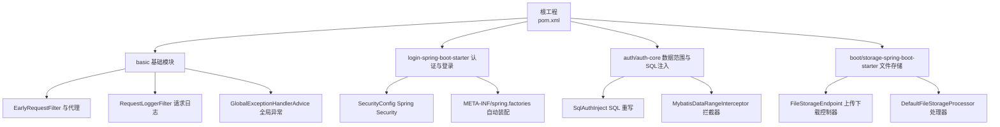
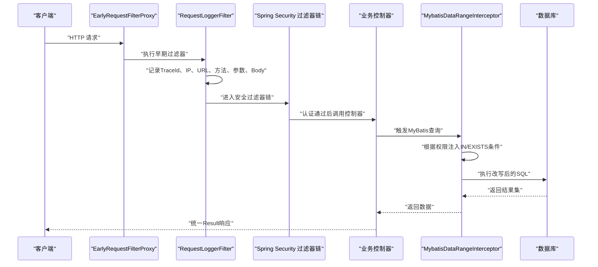
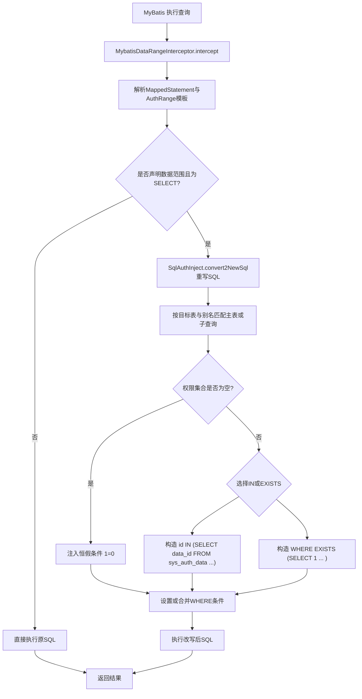
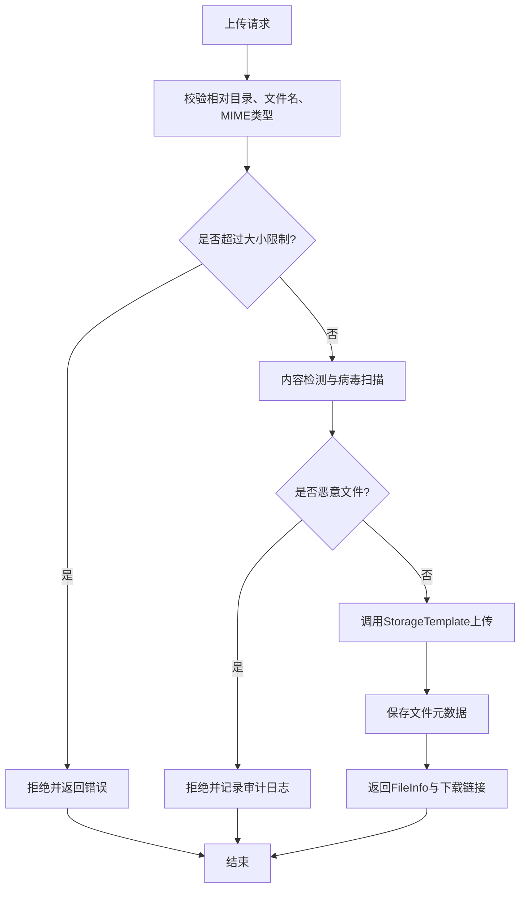
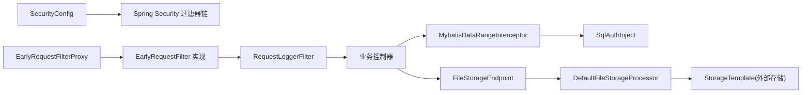

# 输入输出安全

<cite>
**本文引用的文件**   
- [pom.xml](file://pom.xml)
- [README_Auth.md](file://README_Auth.md)
- [SecurityConfig.java](file://login-spring-boot-starter/src/main/java/com/cu/framework/authentication/config/SecurityConfig.java)
- [spring.factories](file://login-spring-boot-starter/src/main/resources/META-INF/spring.factories)
- [SqlAuthInject.java](file://auth/auth-core/src/main/java/com/cu/framework/auth/core/data/range/SqlAuthInject.java)
- [MybatisDataRangeInterceptor.java](file://auth/auth-core/src/main/java/com/cu/framework/auth/core/data/range/MybatisDataRangeInterceptor.java)
- [MybatisAuthSqlInjectTest.java](file://auth/auth-core/src/test/java/com/cu/framework/auth/core/data/range/MybatisAuthSqlInjectTest.java)
- [EarlyRequestFilter.java](file://basic/src/main/java/com/cu/framework/basic/filter/EarlyRequestFilter.java)
- [EarlyRequestFilterProxy.java](file://basic/src/main/java/com/cu/framework/basic/filter/EarlyRequestFilterProxy.java)
- [TraceRequestFilter.java](file://basic/src/main/java/com/cu/framework/basic/logger/TraceRequestFilter.java)
- [RequestLoggerFilter.java](file://basic/src/main/java/com/cu/framework/basic/logger/RequestLoggerFilter.java)
- [GlobalExceptionHandlerAdvice.java](file://basic/src/main/java/com/cu/framework/basic/exception/GlobalExceptionHandlerAdvice.java)
- [FileStorageEndpoint.java](file://boot/storage-spring-boot-starter/src/main/java/com/cu/framework/storage/web/FileStorageEndpoint.java)
- [DefaultFileStorageProcessor.java](file://boot/storage-spring-boot-starter/src/main/java/com/cu/framework/storage/web/impl/DefaultFileStorageProcessor.java)
</cite>

## 目录
1. [引言](#引言)
2. [项目结构](#项目结构)
3. [核心组件](#核心组件)
4. [架构总览](#架构总览)
5. [详细组件分析](#详细组件分析)
6. [依赖关系分析](#依赖关系分析)
7. [性能与安全权衡](#性能与安全权衡)
8. [故障排查指南](#故障排查指南)
9. [结论](#结论)
10. [附录：测试与修复清单](#附录测试与修复清单)

## 引言
本指南聚焦 Kewen Framework 在“输入—处理—输出”全链路中的安全实践，结合仓库中现有实现进行逐项说明，并给出可操作的改进建议。当前仓库在以下方面已有基础能力或明确扩展点：

- SQL 注入防护：通过 MyBatis 插件拦截器 + SQL 重写器，对声明数据范围的查询自动注入权限条件，避免业务代码拼接不安全 SQL。
- 认证与访问控制：基于 Spring Security，默认关闭 CSRF，支持 URL 白名单、静态资源放行和自定义 HTTP 安全配置扩展点。
- 请求日志与追踪：提供早期过滤器入口、统一跟踪号注入、请求参数与 Body 解析及事件发布。
- 文件上传：提供服务端上传接口与存储模板抽象，但类型、大小、恶意检测等安全控制未内置。
- 全局异常与结果封装：统一返回结构，便于集中处理错误信息。

对于 XSS、CSRF Token、SameSite Cookie、Content Security Policy、API 频率限制、IP 白名单、敏感数据脱敏等主题，仓库中尚未提供完整实现，但文档会指出应放在哪些扩展点，并给出推荐方案。

## 项目结构
Kewen Framework 采用多模块 Maven 工程，与本指南相关的核心模块如下：



**图表来源**
- [pom.xml:1-80](file://pom.xml#L1-L80)
- [SecurityConfig.java:1-144](file://login-spring-boot-starter/src/main/java/com/cu/framework/authentication/config/SecurityConfig.java#L1-L144)
- [EarlyRequestFilter.java:1-23](file://basic/src/main/java/com/cu/framework/basic/filter/EarlyRequestFilter.java#L1-L23)
- [EarlyRequestFilterProxy.java:1-94](file://basic/src/main/java/com/cu/framework/basic/filter/EarlyRequestFilterProxy.java#L1-L94)
- [TraceRequestFilter.java:1-60](file://basic/src/main/java/com/cu/framework/basic/logger/TraceRequestFilter.java#L1-L60)
- [RequestLoggerFilter.java:1-133](file://basic/src/main/java/com/cu/framework/basic/logger/RequestLoggerFilter.java#L1-L133)
- [GlobalExceptionHandlerAdvice.java:1-83](file://basic/src/main/java/com/cu/framework/basic/exception/GlobalExceptionHandlerAdvice.java#L1-L83)
- [SqlAuthInject.java:1-200](file://auth/auth-core/src/main/java/com/cu/framework/auth/core/data/range/SqlAuthInject.java#L1-L200)
- [MybatisDataRangeInterceptor.java:1-216](file://auth/auth-core/src/main/java/com/cu/framework/auth/core/data/range/MybatisDataRangeInterceptor.java#L1-L216)
- [FileStorageEndpoint.java:1-98](file://boot/storage-spring-boot-starter/src/main/java/com/cu/framework/storage/web/FileStorageEndpoint.java#L1-L98)
- [DefaultFileStorageProcessor.java:1-122](file://boot/storage-spring-boot-starter/src/main/java/com/cu/framework/storage/web/impl/DefaultFileStorageProcessor.java#L1-L122)

**章节来源**
- [pom.xml:1-80](file://pom.xml#L1-L80)
- [README_Auth.md:1-60](file://README_Auth.md#L1-L60)

## 核心组件
从输入输出安全角度，本项目相关核心组件可分为五类：

| 类别 | 关键组件 | 职责 | 当前状态 |
|---|---|---|---|
| 数据库访问安全 | `MybatisDataRangeInterceptor`、`SqlAuthInject` | 拦截 MyBatis 查询语句，根据用户权限自动注入 IN 或 EXISTS 条件；提供 SQL 表匹配与重写逻辑 | 已实现，适合防止越权查询与部分 SQL 注入场景 |
| Web 安全配置 | `SecurityConfig`、`spring.factories` | 启用 Spring Security，定义静态资源放行、URL 白名单、禁用 CSRF、CORS 配置扩展点 | 已实现基础安全过滤链 |
| 请求入口与日志 | `EarlyRequestFilter`、`EarlyRequestFilterProxy`、`TraceRequestFilter`、`RequestLoggerFilter` | 在 Security 之前执行早期过滤，注入 TraceId，记录请求头、参数、Body、IP 和执行耗时 | 已实现日志与追踪，但未内置输入过滤 |
| 文件上传 | `FileStorageEndpoint`、`DefaultFileStorageProcessor` | 生成上传令牌、服务端上传、回调、下载链接 | 已实现上传流程，缺少类型、大小、恶意检测、路径隔离 |
| 全局异常与返回 | `GlobalExceptionHandlerAdvice` | 统一业务异常、参数校验异常、未知异常处理，返回统一 Result | 已实现，需注意不泄露敏感堆栈 |

**章节来源**
- [MybatisDataRangeInterceptor.java:1-216](file://auth/auth-core/src/main/java/com/cu/framework/auth/core/data/range/MybatisDataRangeInterceptor.java#L1-L216)
- [SqlAuthInject.java:1-200](file://auth/auth-core/src/main/java/com/cu/framework/auth/core/data/range/SqlAuthInject.java#L1-L200)
- [SecurityConfig.java:1-144](file://login-spring-boot-starter/src/main/java/com/cu/framework/authentication/config/SecurityConfig.java#L1-L144)
- [spring.factories:1-8](file://login-spring-boot-starter/src/main/resources/META-INF/spring.factories#L1-L8)
- [EarlyRequestFilter.java:1-23](file://basic/src/main/java/com/cu/framework/basic/filter/EarlyRequestFilter.java#L1-L23)
- [EarlyRequestFilterProxy.java:1-94](file://basic/src/main/java/com/cu/framework/basic/filter/EarlyRequestFilterProxy.java#L1-L94)
- [TraceRequestFilter.java:1-60](file://basic/src/main/java/com/cu/framework/basic/logger/TraceRequestFilter.java#L1-L60)
- [RequestLoggerFilter.java:1-133](file://basic/src/main/java/com/cu/framework/basic/logger/RequestLoggerFilter.java#L1-L133)
- [FileStorageEndpoint.java:1-98](file://boot/storage-spring-boot-starter/src/main/java/com/cu/framework/storage/web/FileStorageEndpoint.java#L1-L98)
- [DefaultFileStorageProcessor.java:1-122](file://boot/storage-spring-boot-starter/src/main/java/com/cu/framework/storage/web/impl/DefaultFileStorageProcessor.java#L1-L122)
- [GlobalExceptionHandlerAdvice.java:1-83](file://basic/src/main/java/com/cu/framework/basic/exception/GlobalExceptionHandlerAdvice.java#L1-L83)

## 架构总览
下图展示一次典型后端请求的安全处理链路，以及各层输入输出安全的关注点：



**图表来源**
- [EarlyRequestFilterProxy.java:1-94](file://basic/src/main/java/com/cu/framework/basic/filter/EarlyRequestFilterProxy.java#L1-L94)
- [RequestLoggerFilter.java:1-133](file://basic/src/main/java/com/cu/framework/basic/logger/RequestLoggerFilter.java#L1-L133)
- [SecurityConfig.java:1-144](file://login-spring-boot-starter/src/main/java/com/cu/framework/authentication/config/SecurityConfig.java#L1-L144)
- [MybatisDataRangeInterceptor.java:1-216](file://auth/auth-core/src/main/java/com/cu/framework/auth/core/data/range/MybatisDataRangeInterceptor.java#L1-L216)

## 详细组件分析

### SQL 注入防护与数据范围权限
#### 设计目标
- 禁止业务代码直接拼接用户输入到 SQL。
- 对需要数据范围控制的查询，通过注解或映射元数据声明目标表与操作，由框架自动注入权限条件。
- 当权限集合为空时，强制返回空结果，而不是放开过滤或产生语法错误。

#### 核心流程


**图表来源**
- [MybatisDataRangeInterceptor.java:1-216](file://auth/auth-core/src/main/java/com/cu/framework/auth/core/data/range/MybatisDataRangeInterceptor.java#L1-L216)
- [SqlAuthInject.java:1-200](file://auth/auth-core/src/main/java/com/cu/framework/auth/core/data/range/SqlAuthInject.java#L1-L200)

#### 关键实现要点
- 拦截点：使用 MyBatis 的 `StatementHandler.prepare`，确保每条物理 SQL 都经过权限判定。
- 语句身份：通过反射解包插件代理，定位 `MappedStatement`；无法解析时抛出异常，避免静默放行。
- 模板复制：缓存中的 `AuthRange` 模板会被复制后写入当前请求权限，避免并发污染。
- SQL 重写：基于 JSQLParser 解析 SELECT，匹配目标表与别名，支持 JOIN、嵌套子查询、WITH AS。
- 空权限语义：权限集合为空时注入 `1 = 0`，保证“不可见即拒绝”，且不会渲染出空括号导致语法问题。
- 匹配失败保护：若解析到的 SQL 找不到声明的目标表，会抛出解析异常，便于启动期或运行期发现配置错误。

#### 测试覆盖
仓库中的测试覆盖了以下行为：

| 测试场景 | 验证目标 |
|---|---|
| 简单查询转换为 IN 与 EXISTS | 基本权限注入方式正确 |
| 多表 JOIN 匹配目标表 | 能识别主表并在正确位置注入条件 |
| 嵌套子查询 | 子查询中的目标表也应用权限过滤 |
| WITH AS 子句 | CTE 内部表同样被注入权限条件 |
| 权限集合为空 | 注入恒假条件，返回零行 |

这些测试可作为后续新增 SQL 重写规则的安全基线。

#### 安全建议
- 始终优先使用参数化查询与 MyBatis-Plus 提供的安全 API，不要拼接字符串构建 SQL。
- 对复杂动态 SQL，使用 MyBatis-Plus 的 `QueryWrapper`、`UpdateWrapper` 等对象构建查询，避免手写拼接。
- 对必须手写 SQL 的场景，配合 `@AuthDataRange` 等声明机制，并通过启动期校验确保目标表可匹配。
- 将 SQL 白名单与 Mapper 方法绑定，只允许受控方法被增强；未声明数据范围的查询不应被注入，除非有额外审计策略。
- 对第三方库或外部传入的 SQL 片段（例如报表导出），应严格限制执行上下文与权限范围，必要时走只读低权限账号。

**章节来源**
- [MybatisDataRangeInterceptor.java:60-160](file://auth/auth-core/src/main/java/com/cu/framework/auth/core/data/range/MybatisDataRangeInterceptor.java#L60-L160)
- [SqlAuthInject.java:60-180](file://auth/auth-core/src/main/java/com/cu/framework/auth/core/data/range/SqlAuthInject.java#L60-L180)
- [MybatisAuthSqlInjectTest.java:30-218](file://auth/auth-core/src/test/java/com/cu/framework/auth/core/data/range/MybatisAuthSqlInjectTest.java#L30-L218)

### XSS 攻击防护
#### 现状
仓库中没有专门的 XSS 输入过滤、输出转义或 Content Security Policy 配置组件。日志过滤器会记录请求头、参数与 Body，但这属于观测能力，不是安全防护。

#### 推荐实践
- **输入过滤**：在 `EarlyRequestFilter` 或 `EarlyRequestFilterProxy` 之后、业务 Controller 之前，增加统一的输入清洗过滤器，仅保留业务允许的字符集，移除脚本标签、事件属性、危险协议。
- **输出转义**：对返回给前端的数据，在后端序列化前对 HTML 敏感字段进行转义；如果前端使用 React、Vue 等现代框架，也应遵循其默认转义策略，避免手动插入 HTML。
- **Content Security Policy**：在服务端响应头中配置 CSP，限制脚本来源、样式来源、图片来源、表单提交目标等；生产环境应禁用内联脚本，仅允许可信域名。
- **Cookie 安全**：对会话 Cookie 设置 HttpOnly、Secure、SameSite，减少 XSS 窃取 Cookie 的风险。
- **富文本场景**：如果确实需要富文本，应使用成熟的白名单 HTML 清理库，并对附件、图片等资源单独校验。

#### 接入位置建议
- 在 `EarlyRequestFilterProxy` 中注册一个优先级高于业务逻辑的早期过滤器，用于标准化输入。
- 在 `GlobalExceptionHandlerAdvice` 中避免把原始异常消息直接暴露给前端，尤其当异常消息可能包含用户输入时。
- 在统一响应封装层，对可能回显的字段做二次转义。

**章节来源**
- [EarlyRequestFilter.java:1-23](file://basic/src/main/java/com/cu/framework/basic/filter/EarlyRequestFilter.java#L1-L23)
- [EarlyRequestFilterProxy.java:1-94](file://basic/src/main/java/com/cu/framework/basic/filter/EarlyRequestFilterProxy.java#L1-L94)
- [RequestLoggerFilter.java:1-133](file://basic/src/main/java/com/cu/framework/basic/logger/RequestLoggerFilter.java#L1-L133)
- [GlobalExceptionHandlerAdvice.java:1-83](file://basic/src/main/java/com/cu/framework/basic/exception/GlobalExceptionHandlerAdvice.java#L1-L83)

### CSRF 攻击防护
#### 现状
`SecurityConfig` 中显式禁用了 Spring Security 的 CSRF：

```text
.csrf().disable()
```

这意味着传统表单 POST 不再自带 CSRF Token 校验。同时，CORS 配置示例中允许所有来源、所有头部与方法，这在开放场景中风险较高。

#### 推荐实践
- **API 型服务**：如果使用无状态 JWT、OAuth2、SSO 等机制，并且只接受 JSON 请求，保持禁用 CSRF 是可接受的，但要确保：
  - 不使用 Cookie 作为主要凭证；
  - 或使用自定义请求头校验，例如要求携带应用级签名头。
- **表单型页面**：如果仍有传统表单提交，应启用 CSRF，并结合 SameSite Cookie 属性降低跨站风险。
- **SameSite Cookie**：将会话 Cookie 设置为 `Strict` 或 `Lax`，避免第三方站点携带 Cookie 发起跨站请求。
- **自定义请求头验证**：对敏感写操作要求额外请求头，例如 `X-Request-Signature`，并在网关或服务层校验。
- **CSP**：即使禁用 CSRF，仍应配置 CSP，限制脚本来源，降低 XSS 带来的跨站攻击面。

#### 接入位置建议
- 修改 `SecurityConfig.configure(HttpSecurity)`，将 CSRF 从禁用改为按需启用。
- 在 `SecurityConfig` 的 CORS 配置中，将通配来源替换为精确白名单域名。
- 如需自定义 CSRF 验证，可在 Spring Security 过滤器链中添加自定义过滤器。

**章节来源**
- [SecurityConfig.java:70-144](file://login-spring-boot-starter/src/main/java/com/cu/framework/authentication/config/SecurityConfig.java#L70-L144)

### 文件上传安全控制
#### 现状
`FileStorageEndpoint` 提供三类接口：

| 接口 | 功能 | 当前安全控制 |
|---|---|---|
| `/storage/genUploadToken` | 生成预上传令牌 | 未对用户输入文件名做严格白名单校验 |
| `/storage/upload` | 服务端上传 | 接收相对目录、原始文件名、MIME 类型与输入流，未做类型、大小、恶意内容检查 |
| `/storage/getDownloadUrl`、`/storage/listDownloadUrl` | 获取下载信息 | 返回存储模板生成的下载链接 |

`DefaultFileStorageProcessor` 主要负责：
- 调用 `StorageTemplate` 完成上传；
- 将文件元数据写入持久层；
- 根据文件 Key 生成下载 URL。

#### 安全风险
- 文件名或相对目录可能被用于路径遍历。
- MIME 类型可由客户端伪造，不能信任。
- 文件大小没有限制，可能导致磁盘耗尽。
- 未检测恶意文件内容，如可执行脚本、WebShell、宏病毒等。
- 不同租户或用户文件未隔离存储，存在横向访问风险。

#### 推荐实践
- **文件类型白名单**：仅允许业务需要的扩展名和 MIME 类型，例如图片、PDF、Office 文档。
- **文件大小限制**：在 Servlet 层、Spring MVC 层、业务层分别限制单文件与总大小。
- **内容检测**：对上传文件内容进行二次检测，包括魔数校验、沙箱扫描、杀毒引擎扫描。
- **路径隔离**：文件名使用随机 Key 或哈希值，相对目录按租户、用户、业务维度隔离。
- **下载访问控制**：下载接口需校验权限，避免任意文件读取；对外暴露的下载链接应短期有效。
- **存储后端隔离**：云存储桶或本地目录按租户隔离，最小权限原则。

#### 流程图


**图表来源**
- [FileStorageEndpoint.java:30-98](file://boot/storage-spring-boot-starter/src/main/java/com/cu/framework/storage/web/FileStorageEndpoint.java#L30-L98)
- [DefaultFileStorageProcessor.java:20-122](file://boot/storage-spring-boot-starter/src/main/java/com/cu/framework/storage/web/impl/DefaultFileStorageProcessor.java#L20-L122)

**章节来源**
- [FileStorageEndpoint.java:1-98](file://boot/storage-spring-boot-starter/src/main/java/com/cu/framework/storage/web/FileStorageEndpoint.java#L1-L98)
- [DefaultFileStorageProcessor.java:1-122](file://boot/storage-spring-boot-starter/src/main/java/com/cu/framework/storage/web/impl/DefaultFileStorageProcessor.java#L1-L122)

### API 接口安全防护
#### 现状
- 认证：`SecurityConfig` 将所有非白名单请求设为需认证，静态资源放行。
- 日志：`RequestLoggerFilter` 记录 IP、URL、方法、参数、Body、执行时间，有助于审计与排障。
- 异常：`GlobalExceptionHandlerAdvice` 统一返回失败结构，避免直接暴露堆栈。

#### 建议补充
- **请求频率限制**：在早期过滤器或网关层实现基于 IP、用户 ID、接口的限流；可使用 Redis + 滑动窗口或令牌桶算法。
- **IP 白名单**：对管理接口、敏感接口增加 IP 白名单校验，结合 `EarlyRequestFilter` 或自定义过滤器实现。
- **敏感数据脱敏**：在 `RequestLoggerFilter` 记录日志前，对密码、身份证号、银行卡号等字段脱敏；在响应体中也应对敏感字段脱敏。
- **请求签名**：对高价值接口要求客户端签名，服务端验签后再执行业务逻辑。
- **参数校验**：充分利用 Bean Validation、正则校验、枚举校验，拒绝非法输入。

#### 接入位置
- 在 `EarlyRequestFilterProxy` 中注册频率限制、IP 白名单、签名校验过滤器。
- 在 `RequestLoggerFilter` 中增加脱敏逻辑。
- 在 `GlobalExceptionHandlerAdvice` 中统一处理鉴权失败、限流失败、签名失败等异常。

**章节来源**
- [SecurityConfig.java:70-144](file://login-spring-boot-starter/src/main/java/com/cu/framework/authentication/config/SecurityConfig.java#L70-L144)
- [RequestLoggerFilter.java:1-133](file://basic/src/main/java/com/cu/framework/basic/logger/RequestLoggerFilter.java#L1-L133)
- [GlobalExceptionHandlerAdvice.java:1-83](file://basic/src/main/java/com/cu/framework/basic/exception/GlobalExceptionHandlerAdvice.java#L1-L83)

## 依赖关系分析
从安全角度看，各模块依赖关系如下：



**图表来源**
- [SecurityConfig.java:1-144](file://login-spring-boot-starter/src/main/java/com/cu/framework/authentication/config/SecurityConfig.java#L1-L144)
- [EarlyRequestFilterProxy.java:1-94](file://basic/src/main/java/com/cu/framework/basic/filter/EarlyRequestFilterProxy.java#L1-L94)
- [RequestLoggerFilter.java:1-133](file://basic/src/main/java/com/cu/framework/basic/logger/RequestLoggerFilter.java#L1-L133)
- [MybatisDataRangeInterceptor.java:1-216](file://auth/auth-core/src/main/java/com/cu/framework/auth/core/data/range/MybatisDataRangeInterceptor.java#L1-L216)
- [SqlAuthInject.java:1-200](file://auth/auth-core/src/main/java/com/cu/framework/auth/core/data/range/SqlAuthInject.java#L1-L200)
- [FileStorageEndpoint.java:1-98](file://boot/storage-spring-boot-starter/src/main/java/com/cu/framework/storage/web/FileStorageEndpoint.java#L1-L98)
- [DefaultFileStorageProcessor.java:1-122](file://boot/storage-spring-boot-starter/src/main/java/com/cu/framework/storage/web/impl/DefaultFileStorageProcessor.java#L1-L122)

**章节来源**
- [pom.xml:1-80](file://pom.xml#L1-L80)
- [spring.factories:1-8](file://login-spring-boot-starter/src/main/resources/META-INF/spring.factories#L1-L8)

## 性能与安全权衡
- MyBatis 拦截器会在每条 SELECT 语句上执行 SQL 解析与重写，会带来一定 CPU 开销。建议只对真正需要数据范围控制的 Mapper 方法声明权限，避免全量增强。
- `SqlAuthInject` 使用 JSQLParser 解析 SQL，复杂 SQL 会增加解析成本。应避免在高频接口上使用极度复杂的动态 SQL。
- 日志过滤器会读取并解析 Body，对大 Body 会产生内存与序列化开销。建议对超大请求开启采样日志或跳过 Body 日志。
- 文件上传的内容检测与病毒扫描可能引入显著延迟，建议异步扫描与结果回调更新状态。
- 频率限制与 IP 白名单应使用高效数据结构，并考虑分布式部署下的共享状态。

[本节为通用指导，不直接分析具体文件]

## 故障排查指南
### 无法解析 MyBatis 映射语句
当插件代理链异常时，`MybatisDataRangeInterceptor` 会抛出异常，提示无法从代理对象解析 `MappedStatement`。此时应检查：

- 是否存在其他自定义 MyBatis 插件改变了代理链；
- MyBatis 版本是否与框架预期一致；
- 是否在调试环境中启用了影响插件包装的行为。

**章节来源**
- [MybatisDataRangeInterceptor.java:120-216](file://auth/auth-core/src/main/java/com/cu/framework/auth/core/data/range/MybatisDataRangeInterceptor.java#L120-L216)

### SQL 重写未命中目标表
如果 `SqlAuthInject` 报未匹配到目标表，通常原因包括：

- Mapper 方法声明的数据范围与实际 SQL 目标表不一致；
- SQL 中使用了别名，但声明未正确配置别名；
- 动态 SQL 在不同环境下生成不同表结构；
- 使用了非常规 SQL 写法，JSQLParser 无法正确解析。

建议先通过单元测试复现，再调整 `AuthRange` 声明或 SQL 写法。

**章节来源**
- [SqlAuthInject.java:60-120](file://auth/auth-core/src/main/java/com/cu/framework/auth/core/data/range/SqlAuthInject.java#L60-L120)
- [MybatisAuthSqlInjectTest.java:60-218](file://auth/auth-core/src/test/java/com/cu/framework/auth/core/data/range/MybatisAuthSqlInjectTest.java#L60-L218)

### 上传接口返回异常但看不到详细信息
`FileStorageEndpoint.upload` 捕获 `IOException` 后抛出业务异常；`GlobalExceptionHandlerAdvice` 会将业务异常转为统一失败结果。排查时应：

- 查看服务端日志中的异常堆栈；
- 检查存储后端连接、权限、磁盘空间；
- 确认传入的相对目录、文件名、MIME 类型是否合法；
- 避免直接把底层 IO 异常细节暴露给前端。

**章节来源**
- [FileStorageEndpoint.java:50-98](file://boot/storage-spring-boot-starter/src/main/java/com/cu/framework/storage/web/FileStorageEndpoint.java#L50-L98)
- [GlobalExceptionHandlerAdvice.java:1-83](file://basic/src/main/java/com/cu/framework/basic/exception/GlobalExceptionHandlerAdvice.java#L1-L83)

### 日志记录泄露敏感信息
`RequestLoggerFilter` 会记录请求头、参数与 Body。若业务未脱敏，可能存在敏感信息泄露风险。应：

- 在日志记录前对密码、证件号、银行卡号、密钥等字段脱敏；
- 对大 Body 采样记录；
- 在生产环境关闭详细 Body 日志，或仅记录摘要。

**章节来源**
- [RequestLoggerFilter.java:1-133](file://basic/src/main/java/com/cu/framework/basic/logger/RequestLoggerFilter.java#L1-L133)

## 结论
Kewen Framework 在当前仓库中已经提供了若干输入输出安全的基础能力：

- 通过 MyBatis 拦截器与 SQL 重写器，实现了数据范围驱动的查询过滤，能有效防止越权查询，并为 SQL 注入防护提供基础设施。
- 通过 Spring Security 定义了认证过滤链、静态资源放行与 URL 白名单扩展点。
- 通过早期过滤器与日志过滤器，提供了请求追踪与审计能力。
- 通过文件存储端点与处理器，提供了文件上传下载的骨架。

但在 XSS、CSRF Token、SameSite Cookie、Content Security Policy、文件类型与大小限制、恶意文件检测、API 频率限制、IP 白名单、敏感数据脱敏等方面，仍需结合业务场景补充实现。建议以现有扩展点为基础，优先补齐输入校验、输出转义、文件上传安全与 API 防护，再逐步完善可观测性与治理工具。

[本节为总结性内容，不直接分析具体文件]

## 附录：测试与修复清单

### SQL 注入与数据范围测试清单
- 对每个带数据范围的 Mapper 方法编写单元测试，覆盖正常权限、空权限、子查询、JOIN、WITH AS。
- 对未声明数据范围的查询，确认不会被误注入。
- 对非 SELECT 语句，确认不会被增强。
- 对复杂 SQL，验证 JSQLParser 解析与重写结果符合预期。

**章节来源**
- [MybatisAuthSqlInjectTest.java:30-218](file://auth/auth-core/src/test/java/com/cu/framework/auth/core/data/range/MybatisAuthSqlInjectTest.java#L30-L218)
- [MybatisDataRangeInterceptor.java:90-160](file://auth/auth-core/src/main/java/com/cu/framework/auth/core/data/range/MybatisDataRangeInterceptor.java#L90-L160)

### XSS 测试清单
- 输入 `<script>`、`onerror`、`javascript:` 等常见 payload，确认被过滤或转义。
- 输入富文本 HTML，确认仅允许白名单标签与属性。
- 前端渲染输出，确认不会执行内联脚本。
- 响应头中包含 CSP，且不含危险策略。

[本节为概念性测试建议，不直接分析具体文件]

### CSRF 测试清单
- 使用表单 POST 提交敏感操作，确认 CSRF Token 校验生效。
- 从第三方域名发起请求，确认 SameSite Cookie 与 CORS 策略阻止非法跨站请求。
- 对 JSON API，确认不使用 Cookie 作为唯一凭证，或要求自定义请求头签名。

**章节来源**
- [SecurityConfig.java:70-144](file://login-spring-boot-starter/src/main/java/com/cu/framework/authentication/config/SecurityConfig.java#L70-L144)

### 文件上传测试清单
- 上传空文件、超大文件、隐藏扩展名、可执行脚本、WebShell、含宏的 Office 文档。
- 使用路径遍历文件名，如 `../../etc/passwd`。
- 伪造 MIME 类型，尝试绕过类型白名单。
- 验证下载链接是否需要权限校验，是否具备过期机制。

**章节来源**
- [FileStorageEndpoint.java:30-98](file://boot/storage-spring-boot-starter/src/main/java/com/cu/framework/storage/web/FileStorageEndpoint.java#L30-L98)
- [DefaultFileStorageProcessor.java:20-122](file://boot/storage-spring-boot-starter/src/main/java/com/cu/framework/storage/web/impl/DefaultFileStorageProcessor.java#L20-L122)

### API 安全测试清单
- 高频调用同一接口，确认触发限流。
- 从黑名单 IP 访问管理接口，确认被拒绝。
- 调用敏感接口时不带签名或签名错误，确认被拒绝。
- 返回结果中包含身份证号、手机号、密码等敏感字段，确认已脱敏。

[本节为概念性测试建议，不直接分析具体文件]