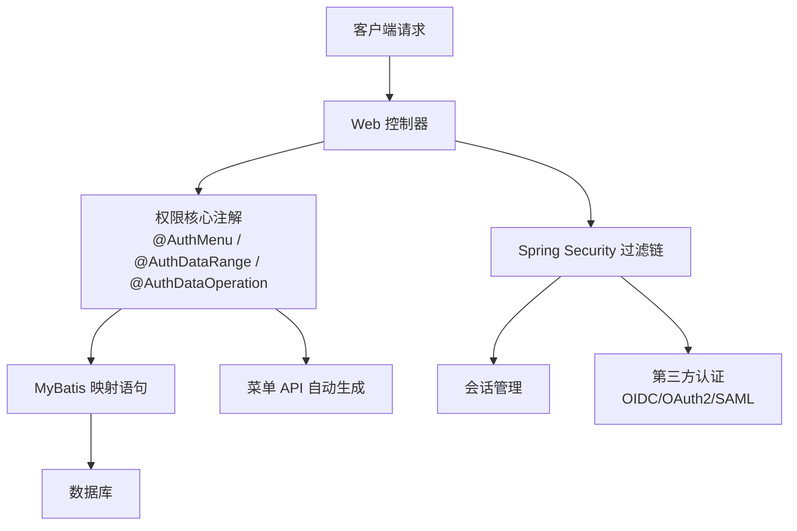
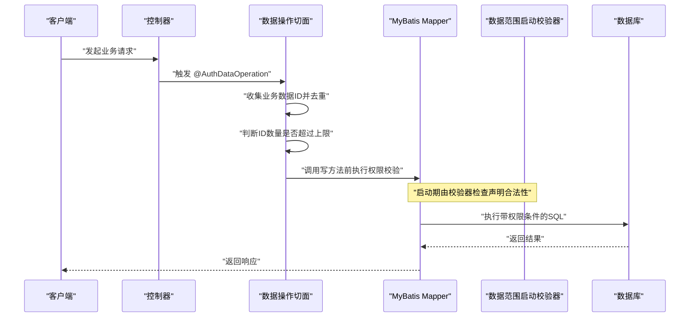
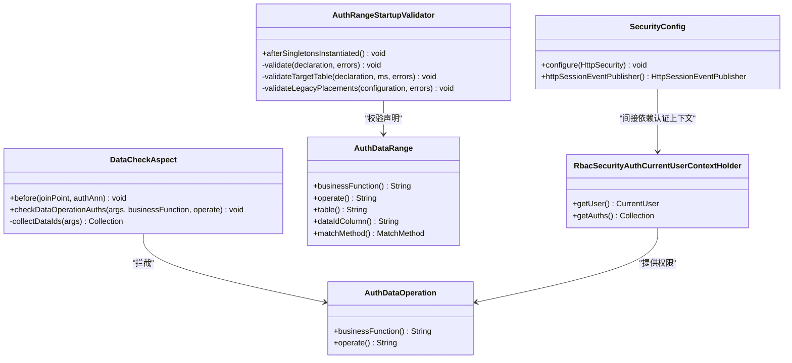
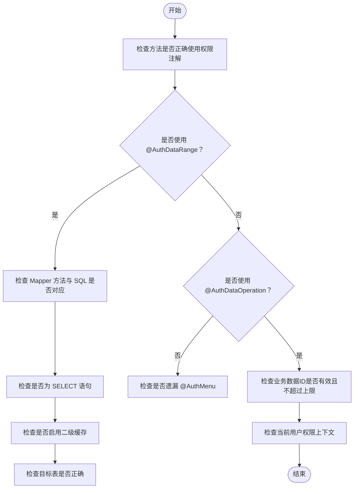

# 常见陷阱与反模式

<cite>
**本文引用的文件**   
- [README_Auth.md](file://README_Auth.md)
- [pom.xml](file://pom.xml)
- [AuthMenu.java](file://auth/auth-core/src/main/java/com/cu/framework/auth/core/AuthMenu.java)
- [AuthDataRange.java](file://auth/auth-core/src/main/java/com/cu/framework/auth/core/AuthDataRange.java)
- [AuthDataOperation.java](file://auth/auth-core/src/main/java/com/cu/framework/auth/core/AuthDataOperation.java)
- [DataCheckAspect.java](file://auth/auth-core/src/main/java/com/cu/framework/auth/core/data/edit/DataCheckAspect.java)
- [AuthRangeStartupValidator.java](file://auth/auth-core/src/main/java/com/cu/framework/auth/core/data/range/AuthRangeStartupValidator.java)
- [MenuApiGeneratorProcessor.java](file://auth/auth-core/src/main/java/com/cu/framework/auth/core/menu/MenuApiGeneratorProcessor.java)
- [SecurityConfig.java](file://login-spring-boot-starter/src/main/java/com/cu/framework/authentication/config/SecurityConfig.java)
- [TokenSessionRequestFilter.java](file://login-spring-boot-starter/src/main/java/com/cu/framework/authentication/filter/TokenSessionRequestFilter.java)
- [RbacSecurityAuthCurrentUserContextHolder.java](file://auth/auth-rbac-security-spring-boot-starter/src/main/java/com/cu/framework/auth/rbac/security/RbacSecurityAuthCurrentUserContextHolder.java)
- [GlobalExceptionHandlerAdvice.java](file://basic/src/main/java/com/cu/framework/basic/exception/GlobalExceptionHandlerAdvice.java)
- [oidc接入踩坑记录.md](file://docs/说明文档/oidc接入踩坑记录.md)
- [AuthRangeStartupFailureTest.java](file://sample/auth-core-boot-sample/src/test/java/com/cu/framework/sample/authcore/AuthRangeStartupFailureTest.java)
</cite>

## 目录
1. [引言](#引言)
2. [项目结构](#项目结构)
3. [核心组件](#核心组件)
4. [架构总览](#架构总览)
5. [详细组件分析](#详细组件分析)
6. [依赖关系分析](#依赖关系分析)
7. [性能与数据访问反模式](#性能与数据访问反模式)
8. [扩展点装配常见问题](#扩展点装配常见问题)
9. [故障诊断与排错指南](#故障诊断与排错指南)
10. [结论](#结论)

## 引言
本指南聚焦 Kewen Framework（cu-framework-auth）在权限配置、认证集成、数据处理和扩展点实现中的常见陷阱与反模式。内容基于仓库中权限注解定义、启动期校验器、安全过滤器链、OIDC 对接记录和示例测试整理，帮助开发者快速识别“看起来能跑，运行后出问题”的隐患，并给出可落地的修复路径。

框架整体以 Spring Boot 2.7.x、Spring Security 5.7.x、MyBatis Plus 为核心栈，通过 `@AuthMenu`、`@AuthDataRange`、`@AuthDataOperation` 等注解完成菜单权限与数据权限控制；同时提供登录模块、RBAC 默认实现、安全自动装配以及多个 sample 应用作为参考。

**章节来源**
- [README_Auth.md:1-120](file://README_Auth.md#L1-L120)
- [pom.xml:1-60](file://pom.xml#L1-L60)

## 项目结构
从权限与安全角度，仓库主要涉及以下层次：
- 权限核心层：注解、处理器、启动期校验、菜单 API 生成。
- RBAC 实现层：用户-角色-部门模型及默认实现。
- 登录与安全层：Spring Security 自动装配、过滤器、异常处理、第三方认证。
- 基础能力层：全局异常、日志、通用模型、工具类。
- 示例层：auth-core、auth-rbac、basic、tenant、storage 等样本工程。

该图是概念性结构示意，不直接映射具体源码文件，因此不附图表来源。

## 核心组件
- 菜单权限注解：`@AuthMenu` 用于声明某个 Controller 或方法是否受菜单权限管辖。
- 数据范围注解：`@AuthDataRange` 用于 MyBatis Mapper 查询方法，启动时做强校验，运行时注入权限条件。
- 数据操作注解：`@AuthDataOperation` 用于写方法，按业务数据 ID 进行权限判定，单次最多允许 100 条去重 ID。
- 数据操作切面：`DataCheckAspect` 负责收集参数中的业务数据 ID、去重、超限判断和权限调用。
- 数据范围启动校验器：`AuthRangeStartupValidator` 在单例初始化后扫描所有声明，发现错误直接让应用启动失败。
- 菜单 API 生成处理器：`MenuApiGeneratorProcessor` 扫描已注册路由，把带权限注解的接口批量入库为菜单。
- 安全配置：`SecurityConfig` 统一放行静态资源、白名单 URL、禁用 CSRF、注册成功与拒绝处理器。
- 会话过滤器：`TokenSessionRequestFilter` 已被标记废弃，建议改用 Spring Session 的请求头解析方案。
- 当前用户上下文适配：`RbacSecurityAuthCurrentUserContextHolder` 从 `SecurityUserContext` 读取当前用户和权限。
- 全局异常处理：`GlobalExceptionHandlerAdvice` 统一返回业务异常、参数校验异常和未处理异常。

**章节来源**
- [AuthMenu.java:1-16](file://auth/auth-core/src/main/java/com/cu/framework/auth/core/AuthMenu.java#L1-L16)
- [AuthDataRange.java:1-81](file://auth/auth-core/src/main/java/com/cu/framework/auth/core/AuthDataRange.java#L1-L81)
- [AuthDataOperation.java:1-51](file://auth/auth-core/src/main/java/com/cu/framework/auth/core/AuthDataOperation.java#L1-L51)
- [DataCheckAspect.java:1-149](file://auth/auth-core/src/main/java/com/cu/framework/auth/core/data/edit/DataCheckAspect.java#L1-L149)
- [AuthRangeStartupValidator.java:1-163](file://auth/auth-core/src/main/java/com/cu/framework/auth/core/data/range/AuthRangeStartupValidator.java#L1-L163)
- [MenuApiGeneratorProcessor.java:1-214](file://auth/auth-core/src/main/java/com/cu/framework/auth/core/menu/MenuApiGeneratorProcessor.java#L1-L214)
- [SecurityConfig.java:1-144](file://login-spring-boot-starter/src/main/java/com/cu/framework/authentication/config/SecurityConfig.java#L1-L144)
- [TokenSessionRequestFilter.java:1-210](file://login-spring-boot-starter/src/main/java/com/cu/framework/authentication/filter/TokenSessionRequestFilter.java#L1-L210)
- [RbacSecurityAuthCurrentUserContextHolder.java:1-29](file://auth/auth-rbac-security-spring-boot-starter/src/main/java/com/cu/framework/auth/rbac/security/RbacSecurityAuthCurrentUserContextHolder.java#L1-L29)
- [GlobalExceptionHandlerAdvice.java:1-83](file://basic/src/main/java/com/cu/framework/basic/exception/GlobalExceptionHandlerAdvice.java#L1-L83)

## 架构总览
下图展示一次带权限的数据查询请求在框架中的关键路径：

**图表来源**
- [DataCheckAspect.java:1-149](file://auth/auth-core/src/main/java/com/cu/framework/auth/core/data/edit/DataCheckAspect.java#L1-L149)
- [AuthRangeStartupValidator.java:1-163](file://auth/auth-core/src/main/java/com/cu/framework/auth/core/data/range/AuthRangeStartupValidator.java#L1-L163)
- [AuthDataRange.java:1-81](file://auth/auth-core/src/main/java/com/cu/framework/auth/core/AuthDataRange.java#L1-L81)

**章节来源**
- [DataCheckAspect.java:1-149](file://auth/auth-core/src/main/java/com/cu/framework/auth/core/data/edit/DataCheckAspect.java#L1-L149)
- [AuthRangeStartupValidator.java:1-163](file://auth/auth-core/src/main/java/com/cu/framework/auth/core/data/range/AuthRangeStartupValidator.java#L1-L163)

## 详细组件分析

### 权限配置中的典型错误
#### 1. 注解使用位置不当
- **现象**：把 `@AuthDataRange` 写在 Controller 或 Service 上，而不是 MyBatis Mapper 查询方法上。
- **后果**：切面删除旧位置支持后，不会报错也不会过滤数据，表现为“静默不过滤”，这是最危险的反模式。
- **修复**：将 `@AuthDataRange` 仅标注在 Mapper 接口查询方法上，并确保方法名与 XML 中 statement id 一致。
- **依据**：启动期校验器会扫描所有非 Mapper 上的残留注解并报告错误。

**章节来源**
- [AuthDataRange.java:1-81](file://auth/auth-core/src/main/java/com/cu/framework/auth/core/AuthDataRange.java#L1-L81)
- [AuthRangeStartupValidator.java:105-163](file://auth/auth-core/src/main/java/com/cu/framework/auth/core/data/range/AuthRangeStartupValidator.java#L105-L163)

#### 2. 数据范围注解缺少映射语句
- **现象**：方法上有 `@AuthDataRange`，但没有对应的 MyBatis SQL 注解或 XML 映射。
- **后果**：启动期直接失败，提示解析不到映射语句。
- **修复**：补齐 `@Select` 或 XML 中的 statement id，确保注解与方法一一对应。

**章节来源**
- [AuthRangeStartupValidator.java:47-84](file://auth/auth-core/src/main/java/com/cu/framework/auth/core/data/range/AuthRangeStartupValidator.java#L47-L84)
- [AuthRangeStartupFailureTest.java:118-145](file://sample/auth-core-boot-sample/src/test/java/com/cu/framework/sample/authcore/AuthRangeStartupFailureTest.java#L118-L145)

#### 3. 在非查询语句上使用数据范围注解
- **现象**：在 `@Update`、`@Insert`、`@Delete` 等方法上标 `@AuthDataRange`。
- **后果**：启动期失败，提示只作用于查询语句。
- **修复**：只对 SELECT 语句使用 `@AuthDataRange`；写权限交给 `@AuthDataOperation`。

**章节来源**
- [AuthRangeStartupValidator.java:70-84](file://auth/auth-core/src/main/java/com/cu/framework/auth/core/data/range/AuthRangeStartupValidator.java#L70-L84)
- [AuthRangeStartupFailureTest.java:147-156](file://sample/auth-core-boot-sample/src/test/java/com/cu/framework/sample/authcore/AuthRangeStartupFailureTest.java#L147-L156)

#### 4. 数据范围与二级缓存共存
- **现象**：在启用二级缓存的映射语句上使用 `@AuthDataRange`。
- **后果**：启动期失败，因为缓存键在权限条件注入前计算。
- **修复**：关闭该语句的二级缓存，或移除 `@AuthDataRange`。

**章节来源**
- [AuthRangeStartupValidator.java:84-96](file://auth/auth-core/src/main/java/com/cu/framework/auth/core/data/range/AuthRangeStartupValidator.java#L84-L96)
- [AuthRangeStartupFailureTest.java:158-167](file://sample/auth-core-boot-sample/src/test/java/com/cu/framework/sample/authcore/AuthRangeStartupFailureTest.java#L158-L167)

#### 5. 目标表声明与实际 SQL 不一致
- **现象**：`@AuthDataRange` 指定了 `table`，但静态 SQL 中没有该表。
- **后果**：启动期失败，指出目标表不存在。
- **修复**：修正 `table` 属性，使其匹配静态 SQL 中真实主表；动态 SQL 会在运行期由注入逻辑兜底。

**章节来源**
- [AuthRangeStartupValidator.java:96-105](file://auth/auth-core/src/main/java/com/cu/framework/auth/core/data/range/AuthRangeStartupValidator.java#L96-L105)
- [AuthRangeStartupFailureTest.java:169-178](file://sample/auth-core-boot-sample/src/test/java/com/cu/framework/sample/authcore/AuthRangeStartupFailureTest.java#L169-L178)

#### 6. 菜单权限注解缺失导致接口未入库
- **现象**：Controller 或方法没有加 `@AuthMenu`，菜单 API 生成器不会将其纳入权限管理。
- **后果**：前端看不到菜单，后台也未建立对应权限项。
- **修复**：在需要菜单权限控制的类或方法上添加 `@AuthMenu`；如需显示名称，配合 `@AuthMenuDoc`。

**章节来源**
- [AuthMenu.java:1-16](file://auth/auth-core/src/main/java/com/cu/framework/auth/core/AuthMenu.java#L1-L16)
- [MenuApiGeneratorProcessor.java:100-214](file://auth/auth-core/src/main/java/com/cu/framework/auth/core/menu/MenuApiGeneratorProcessor.java#L100-L214)

#### 7. 数据操作 ID 数量过大
- **现象**：一次写操作传入大量业务数据 ID，去重后超过 100 条。
- **后果**：切面直接抛出用法异常，提示分批提交。
- **修复**：在调用方对 ID 集合分页或分批，每批不超过 100 条。

**章节来源**
- [AuthDataOperation.java:1-51](file://auth/auth-core/src/main/java/com/cu/framework/auth/core/AuthDataOperation.java#L1-L51)
- [DataCheckAspect.java:31-45](file://auth/auth-core/src/main/java/com/cu/framework/auth/core/data/edit/DataCheckAspect.java#L31-L45)
- [DataCheckAspect.java:100-149](file://auth/auth-core/src/main/java/com/cu/framework/auth/core/data/edit/DataCheckAspect.java#L100-L149)

### 认证集成中的常见陷阱
#### 1. 会话状态管理错误
- **陷阱**：继续使用已废弃的 `TokenSessionRequestFilter` 包装请求头 token 到 session。
- **风险**：该类明确标注 `@Deprecated`，内部使用线程本地变量和本地缓存维护 token 与 session 的关系，不符合 Spring Session 标准做法，容易在分布式或多实例部署下出现会话不一致。
- **修复**：使用 Spring Session 提供的 `HttpSessionIdResolver`，例如通过请求头解析 sessionId，并把该过滤器替换为标准的 Spring Session 集成方式。

**章节来源**
- [TokenSessionRequestFilter.java:1-210](file://login-spring-boot-starter/src/main/java/com/cu/framework/authentication/filter/TokenSessionRequestFilter.java#L1-L210)

#### 2. 第三方认证配置问题
- **陷阱**：OIDC 配置中把完整 Discovery URL 当成 issuer-uri，或手动配置端点与自动发现混用。
- **现象**：启动时报无法提取响应、content type 为 text/html，或 JWT 签名校验失败。
- **根因**：
  - 自动发现会自动拼接 `/.well-known/openid-configuration`，重复拼接导致 IDP 返回 HTML。
  - 某些 IdP 的 JWKS 端点需要携带 `client_id`，而自动发现的 jwks_uri 不带参数。
- **修复**：
  - 只配置 IdP 基础地址作为 issuer-uri。
  - 对于非标准 IdP，覆盖 `jwk-set-uri`，带上必要参数。
  - 避免同时显式配置 authorizationUri、tokenUri、userInfoUri 与 oidcDiscoveryUri。

**章节来源**
- [oidc接入踩坑记录.md:1-200](file://docs/说明文档/oidc接入踩坑记录.md#L1-L200)

#### 3. 安全过滤器链配置错误
- **陷阱**：自定义 `HttpSecurityCustomizer` 顺序不当，覆盖了框架默认的放行策略或异常处理器。
- **现象**：静态资源被拦截、登录接口 401、登出无统一返回、跨域配置失效。
- **修复**：
  - 仅在 `UrlSecurityCustomizer.permitAll()` 中添加真正无需认证的 URL。
  - 不要覆盖框架注册的 `AuthenticationSuccessHandler` 和 `AccessDeniedHandler`。
  - 若需自定义 CORS，优先使用框架暴露的配置点，避免把 `/**` 全部放开。

**章节来源**
- [SecurityConfig.java:1-144](file://login-spring-boot-starter/src/main/java/com/cu/framework/authentication/config/SecurityConfig.java#L1-L144)

#### 4. 当前用户上下文为空或权限为空
- **陷阱**：自定义 `AuthCurrentUserContextHolder` 实现返回空用户或空权限集合。
- **现象**：数据范围查询可能返回空结果，数据操作权限判定直接失败。
- **修复**：确保认证通过后写入 `SecurityUserContext`，并在 `getAuths()` 中正确展开权限集合。

**章节来源**
- [RbacSecurityAuthCurrentUserContextHolder.java:1-29](file://auth/auth-rbac-security-spring-boot-starter/src/main/java/com/cu/framework/auth/rbac/security/RbacSecurityAuthCurrentUserContextHolder.java#L1-L29)

### 数据处理中的反模式
#### 1. N+1 查询问题
- **表现**：权限系统本身通过 SQL 注入权限条件，但如果业务查询在循环中逐条加载关联数据，仍会出现 N+1。
- **定位**：关注业务 Service 中在列表查询后再次逐条调用 Mapper 或远程服务。
- **修复**：
  - 使用一次性 JOIN 或批量查询。
  - 利用 MyBatis Plus 的批量查询能力，避免在内存中逐个查库。
  - 结合 `@AuthDataRange` 的 `matchMethod` 选择 IN 或 EXISTS，避免权限表过大时性能退化。

[本节为通用性能指导，不直接分析具体源码文件]

#### 2. 全量加载导致内存溢出
- **表现**：权限相关接口返回超大列表，或在启动期/异步任务中一次性加载过多菜单、权限、用户数据。
- **风险**：堆内存占用飙升，频繁 Full GC，甚至 OOM。
- **修复**：
  - 对外暴露分页接口，限制页大小。
  - 对菜单、权限等静态数据增加增量同步或缓存淘汰策略。
  - 对大数据量权限比对场景，评估是否需要引入预聚合或缓存。

[本节为通用性能指导，不直接分析具体源码文件]

#### 3. 事务边界不当
- **表现**：在权限校验切面内开启长事务，或在循环中反复提交小事务。
- **风险**：锁竞争加剧、连接池耗尽、审计日志丢失。
- **修复**：
  - 把权限校验放在事务外层或独立步骤。
  - 批量写操作使用合理的事务边界。
  - 避免在过滤器、切面中直接做复杂 IO。

[本节为通用性能指导，不直接分析具体源码文件]

### 扩展点实现的常见问题
#### 1. Bean 装配失败
- **现象**：自定义 `AuthCurrentUserContextHolder`、`MenuApiService`、`HttpSecurityCustomizer` 未被容器找到。
- **原因**：包扫描路径不对、Bean 命名冲突、条件装配不满足。
- **修复**：
  - 确认包路径被 Spring 扫描。
  - 使用明确的 Bean 名称，避免与其他实现冲突。
  - 使用 `ObjectProvider` 或可选 Bean 的场景要兼容缺失情况。

**章节来源**
- [MenuApiGeneratorProcessor.java:40-70](file://auth/auth-core/src/main/java/com/cu/framework/auth/core/menu/MenuApiGeneratorProcessor.java#L40-L70)
- [SecurityConfig.java:33-60](file://login-spring-boot-starter/src/main/java/com/cu/framework/authentication/config/SecurityConfig.java#L33-L60)

#### 2. 生命周期管理错误
- **现象**：菜单 API 生成器依赖的 `RequestMappingHandlerMapping` 或 `MenuApiService` 尚未就绪。
- **设计**：框架通过 `ApplicationContextAware` 获取映射信息，并通过 `BeanProvider` 可选注入服务；缺失服务时跳过入库。
- **修复**：不要在 Bean 构造阶段强依赖未初始化的 Web 资源，优先在 `run` 或回调中使用。

**章节来源**
- [MenuApiGeneratorProcessor.java:40-70](file://auth/auth-core/src/main/java/com/cu/framework/auth/core/menu/MenuApiGeneratorProcessor.java#L40-L70)

#### 3. 异常处理不当
- **现象**：权限异常、业务异常、参数校验异常返回格式不一致。
- **修复**：
  - 使用 `GlobalExceptionHandlerAdvice` 统一包装 `Result`。
  - 权限相关异常应在切面或处理器中抛出框架定义的异常类型，再由全局异常或 Security 异常处理器统一转换。
  - 避免在过滤器中直接写 JSON，优先交给 Spring MVC 异常处理。

**章节来源**
- [GlobalExceptionHandlerAdvice.java:1-83](file://basic/src/main/java/com/cu/framework/basic/exception/GlobalExceptionHandlerAdvice.java#L1-L83)
- [DataCheckAspect.java:61-99](file://auth/auth-core/src/main/java/com/cu/framework/auth/core/data/edit/DataCheckAspect.java#L61-L99)

## 依赖关系分析
权限核心与安全模块之间的关键依赖如下：

**图表来源**
- [DataCheckAspect.java:1-149](file://auth/auth-core/src/main/java/com/cu/framework/auth/core/data/edit/DataCheckAspect.java#L1-L149)
- [AuthDataOperation.java:1-51](file://auth/auth-core/src/main/java/com/cu/framework/auth/core/AuthDataOperation.java#L1-L51)
- [AuthRangeStartupValidator.java:1-163](file://auth/auth-core/src/main/java/com/cu/framework/auth/core/data/range/AuthRangeStartupValidator.java#L1-L163)
- [AuthDataRange.java:1-81](file://auth/auth-core/src/main/java/com/cu/framework/auth/core/AuthDataRange.java#L1-L81)
- [RbacSecurityAuthCurrentUserContextHolder.java:1-29](file://auth/auth-rbac-security-spring-boot-starter/src/main/java/com/cu/framework/auth/rbac/security/RbacSecurityAuthCurrentUserContextHolder.java#L1-L29)
- [SecurityConfig.java:1-144](file://login-spring-boot-starter/src/main/java/com/cu/framework/authentication/config/SecurityConfig.java#L1-L144)

**章节来源**
- [DataCheckAspect.java:1-149](file://auth/auth-core/src/main/java/com/cu/framework/auth/core/data/edit/DataCheckAspect.java#L1-L149)
- [AuthRangeStartupValidator.java:1-163](file://auth/auth-core/src/main/java/com/cu/framework/auth/core/data/range/AuthRangeStartupValidator.java#L1-L163)
- [SecurityConfig.java:1-144](file://login-spring-boot-starter/src/main/java/com/cu/framework/authentication/config/SecurityConfig.java#L1-L144)

## 性能与数据访问反模式
- **数据范围匹配策略选择**：当权限表较大时，优先考虑 `exists` 匹配方式，避免 `in` 子句过大。
- **避免在权限校验中加载全量用户权限**：尽量使用扁平化权限集合，并控制其规模。
- **菜单 API 生成避免重复入库**：框架已过滤数据库中已有路径，但仍应避免频繁重启导致大批量生成。
- **日志级别与敏感信息**：权限校验失败日志应包含业务功能和数据规模，但不要输出完整权限串或用户密码。

[本节为通用性能指导，不直接分析具体源码文件]

## 扩展点装配常见问题
- **可选 Bean 必须兼容缺失**：例如 `MenuApiService` 不存在时不应阻止应用启动。
- **Web 资源延迟获取**：`RequestMappingHandlerMapping` 应在运行时获取，而非构造阶段。
- **自定义 Security 配置要收敛**：通过 `HttpSecurityCustomizer` 和 `UrlSecurityCustomizer` 扩展，不要直接复制整个 `configure(HttpSecurity)`。

**章节来源**
- [MenuApiGeneratorProcessor.java:40-70](file://auth/auth-core/src/main/java/com/cu/framework/auth/core/menu/MenuApiGeneratorProcessor.java#L40-L70)
- [SecurityConfig.java:60-144](file://login-spring-boot-starter/src/main/java/com/cu/framework/authentication/config/SecurityConfig.java#L60-L144)

## 故障诊断与排错指南

### 1. 权限校验失败排查流程

**图表来源**
- [AuthDataRange.java:1-81](file://auth/auth-core/src/main/java/com/cu/framework/auth/core/AuthDataRange.java#L1-L81)
- [AuthDataOperation.java:1-51](file://auth/auth-core/src/main/java/com/cu/framework/auth/core/AuthDataOperation.java#L1-L51)
- [DataCheckAspect.java:61-149](file://auth/auth-core/src/main/java/com/cu/framework/auth/core/data/edit/DataCheckAspect.java#L61-L149)
- [AuthRangeStartupValidator.java:47-163](file://auth/auth-core/src/main/java/com/cu/framework/auth/core/data/range/AuthRangeStartupValidator.java#L47-L163)

### 2. 启动期错误快速对照
- **解析不到映射语句**：检查 Mapper 方法名、XML statement id、注解位置。
- **非查询语句**：确认只在 SELECT 上使用 `@AuthDataRange`。
- **二级缓存冲突**：关闭该语句的二级缓存。
- **目标表不存在**：修正 `table` 属性，或改为运行期兜底的动态 SQL。
- **声明残留在非 Mapper**：迁移到 Mapper 接口方法。

**章节来源**
- [AuthRangeStartupFailureTest.java:118-200](file://sample/auth-core-boot-sample/src/test/java/com/cu/framework/sample/authcore/AuthRangeStartupFailureTest.java#L118-L200)

### 3. OIDC 对接问题排查
- **Discovery 地址错误**：确认配置的是 IdP 基础地址，不是完整 `.well-known/openid-configuration`。
- **JWKS 公钥缺失**：对非标准 IdP，手动覆盖 `jwk-set-uri`，携带必要参数。
- **HTTP 客户端或 SSL 问题**：仅在确实需要自定义 HTTP 行为时配置 `accessTokenResponseClient` 或 `userService`。

**章节来源**
- [oidc接入踩坑记录.md:1-200](file://docs/说明文档/oidc接入踩坑记录.md#L1-L200)

### 4. 日志分析与断点设置建议
- **权限切面断点**：在 `DataCheckAspect.before` 和 `checkDataOperationAuths` 处设置断点，观察入参、业务功能、操作类型、ID 集合。
- **启动期校验断点**：在 `AuthRangeStartupValidator.afterSingletonsInstantiated` 设置断点，观察声明扫描和错误收集。
- **安全过滤器断点**：在 `SecurityConfig.configure(HttpSecurity)` 处查看最终放行 URL 和自定义 customizer 是否覆盖默认配置。
- **全局异常断点**：在 `GlobalExceptionHandlerAdvice` 各 `@ExceptionHandler` 处观察异常类型和消息。

**章节来源**
- [DataCheckAspect.java:61-99](file://auth/auth-core/src/main/java/com/cu/framework/auth/core/data/edit/DataCheckAspect.java#L61-L99)
- [AuthRangeStartupValidator.java:47-84](file://auth/auth-core/src/main/java/com/cu/framework/auth/core/data/range/AuthRangeStartupValidator.java#L47-L84)
- [SecurityConfig.java:60-144](file://login-spring-boot-starter/src/main/java/com/cu/framework/authentication/config/SecurityConfig.java#L60-L144)
- [GlobalExceptionHandlerAdvice.java:1-83](file://basic/src/main/java/com/cu/framework/basic/exception/GlobalExceptionHandlerAdvice.java#L1-L83)

## 结论
Kewen Framework 通过注解驱动和启动期强校验，已经把很多权限配置错误提前暴露出来。实际项目中最容易踩坑的地方集中在三类：
1. 把数据范围注解放在错误位置，或忘记绑定正确的 MyBatis 语句。
2. 使用已废弃的会话过滤器，或在 Spring Security 过滤链中错误覆盖默认配置。
3. 在第三方认证中误配 OIDC Discovery、JWKS 和端点地址。

排查时应优先看启动期错误、权限切面日志、全局异常处理和 Security 配置差异；性能问题则重点检查数据范围匹配策略、全量加载和事务边界。通过本文的案例与流程图，开发者可以在开发阶段尽早发现问题，减少线上权限泄漏、认证失败和性能退化风险。