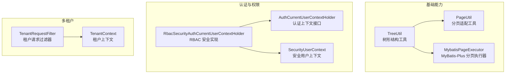
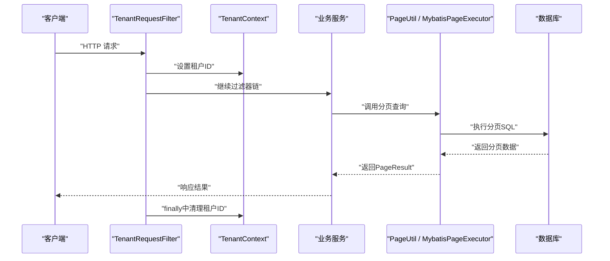
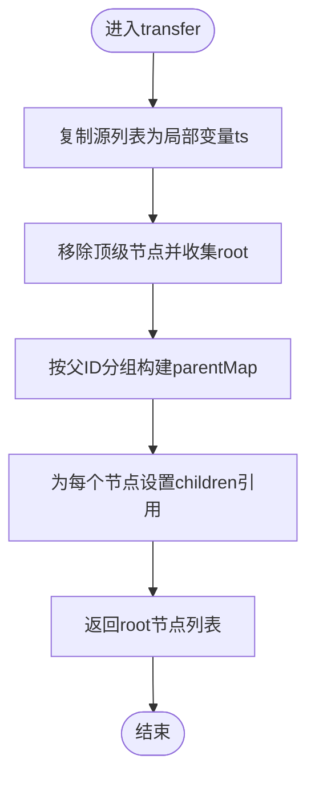
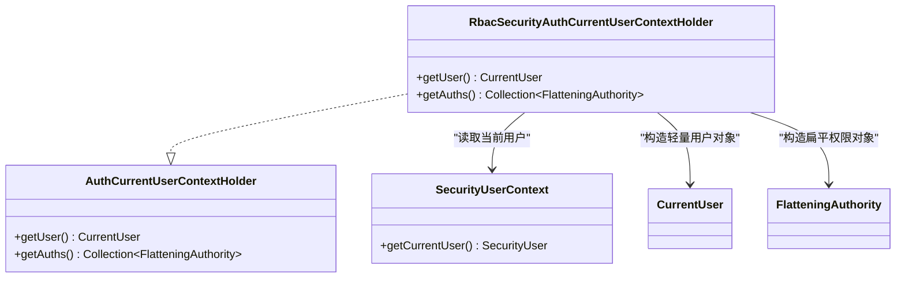
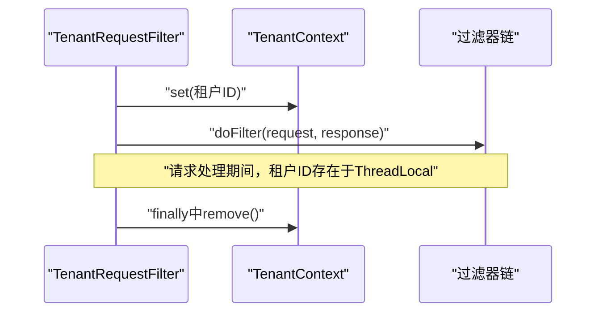
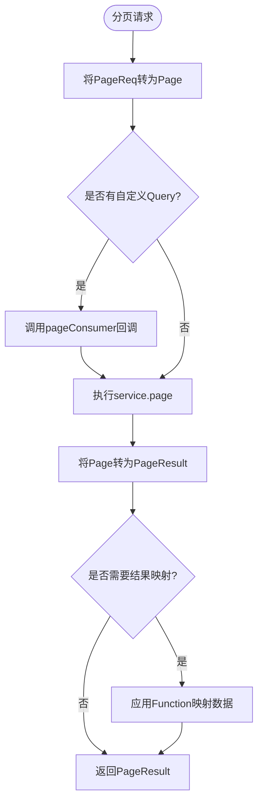
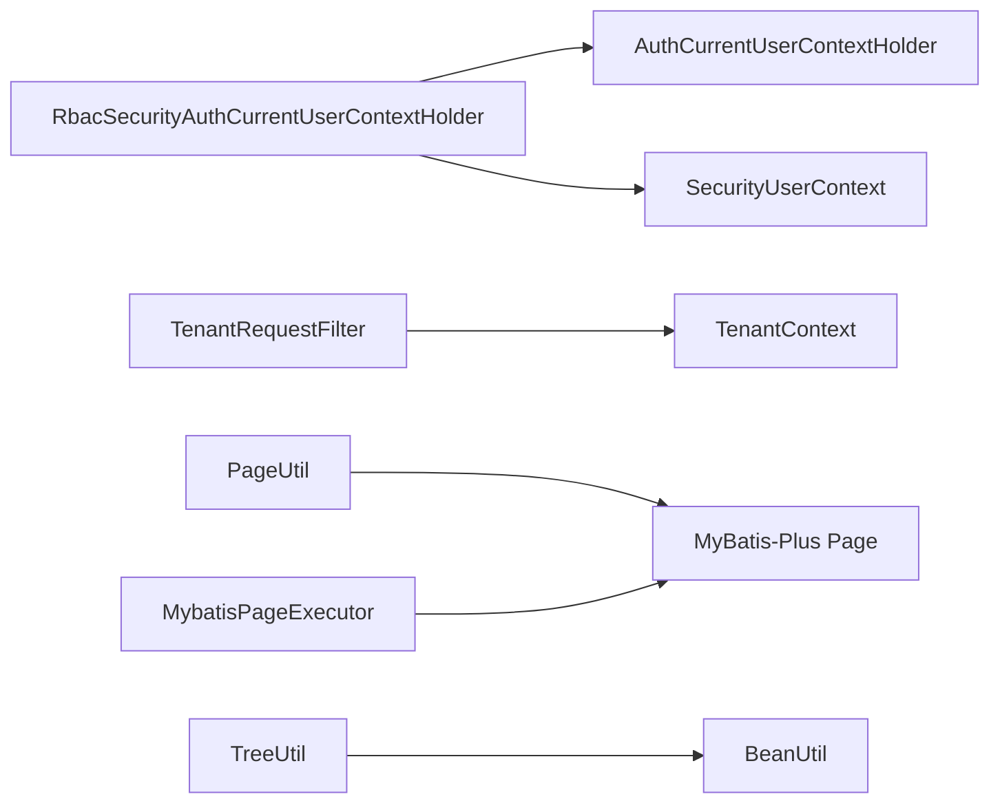

# 内存使用优化

<cite>
**本文引用的文件 **
- [TreeUtil.java](file://basic/src/main/java/com/cu/framework/basic/utils/TreeUtil.java)
- [AuthCurrentUserContextHolder.java](file://auth/auth-core/src/main/java/com/cu/framework/auth/core/AuthCurrentUserContextHolder.java)
- [SecurityUserContext.java](file://login-spring-boot-starter/src/main/java/com/cu/framework/authentication/SecurityUserContext.java)
- [RbacSecurityAuthCurrentUserContextHolder.java](file://auth/auth-rbac-security-spring-boot-starter/src/main/java/com/cu/framework/auth/rbac/security/RbacSecurityAuthCurrentUserContextHolder.java)
- [TenantContext.java](file://boot/tenant-spring-boot-starter/src/main/java/com/cu/framework/tenant/TenantContext.java)
- [TenantRequestFilter.java](file://boot/tenant-spring-boot-starter/src/main/java/com/cu/framework/tenant/TenantRequestFilter.java)
- [PageUtil.java](file://basic-support/src/main/java/com/cu/framework/basic/support/utils/PageUtil.java)
- [MybatisPageExecutor.java](file://basic-support/src/main/java/com/cu/framework/basic/support/utils/MybatisPageExecutor.java)
</cite>

## 目录
1. [引言](#引言)
2. [项目结构](#项目结构)
3. [核心组件](#核心组件)
4. [架构总览](#架构总览)
5. [详细组件分析](#详细组件分析)
6. [依赖关系分析](#依赖关系分析)
7. [性能与内存特性](#性能与内存特性)
8. [故障排查指南](#故障排查指南)
9. [结论](#结论)

## 引言
本指南聚焦 Kewen Framework 中的内存使用优化，围绕以下主题展开：
- TreeUtil 树形结构处理的内存优化技巧，包括大对象处理、避免循环引用和垃圾回收友好设计。
- ThreadLocal 上下文对象的生命周期管理，重点覆盖 AuthCurrentUserContextHolder 与 TenantContext 的内存泄漏防护与及时清理策略。
- 分页查询中的内存优化方案，包括大数据集分批处理、流式处理优化思路、临时对象复用。
- 内存监控与分析工具的使用建议，包括 JVM 参数调优、堆内存分析、GC 日志分析。
- 结合仓库实际代码给出优化案例，说明优化前后的内存占用与 GC 行为差异。

本指南以“由浅入深”的方式组织内容，先建立整体认知，再深入到具体类与方法实现细节，最后给出可操作的监控与排错方法。

## 项目结构
从内存优化的视角，仓库中与本主题直接相关的代码主要分布在以下模块：
- basic 模块：提供 TreeUtil 树形结构工具。
- auth 模块：提供认证上下文接口与 RBAC 安全实现。
- login-spring-boot-starter：提供统一用户上下文 SecurityUserContext。
- boot/tenant-spring-boot-starter：提供租户上下文与请求过滤器。
- basic-support：提供分页转换工具与 MyBatis-Plus 分页执行器。

**图表来源**
- [TreeUtil.java:1-241](file://basic/src/main/java/com/cu/framework/basic/utils/TreeUtil.java#L1-L241)
- [PageUtil.java:1-89](file://basic-support/src/main/java/com/cu/framework/basic/support/utils/PageUtil.java#L1-L89)
- [MybatisPageExecutor.java:1-118](file://basic-support/src/main/java/com/cu/framework/basic/support/utils/MybatisPageExecutor.java#L1-L118)
- [AuthCurrentUserContextHolder.java:1-25](file://auth/auth-core/src/main/java/com/cu/framework/auth/core/AuthCurrentUserContextHolder.java#L1-L25)
- [RbacSecurityAuthCurrentUserContextHolder.java:1-29](file://auth/auth-rbac-security-spring-boot-starter/src/main/java/com/cu/framework/auth/rbac/security/RbacSecurityAuthCurrentUserContextHolder.java#L1-L29)
- [SecurityUserContext.java:1-37](file://login-spring-boot-starter/src/main/java/com/cu/framework/authentication/SecurityUserContext.java#L1-L37)
- [TenantContext.java:1-43](file://boot/tenant-spring-boot-starter/src/main/java/com/cu/framework/tenant/TenantContext.java#L1-L43)
- [TenantRequestFilter.java:1-46](file://boot/tenant-spring-boot-starter/src/main/java/com/cu/framework/tenant/TenantRequestFilter.java#L1-L46)

**章节来源**
- [TreeUtil.java:1-241](file://basic/src/main/java/com/cu/framework/basic/utils/TreeUtil.java#L1-L241)
- [PageUtil.java:1-89](file://basic-support/src/main/java/com/cu/framework/basic/support/utils/PageUtil.java#L1-L89)
- [MybatisPageExecutor.java:1-118](file://basic-support/src/main/java/com/cu/framework/basic/support/utils/MybatisPageExecutor.java#L1-L118)
- [AuthCurrentUserContextHolder.java:1-25](file://auth/auth-core/src/main/java/com/cu/framework/auth/core/AuthCurrentUserContextHolder.java#L1-L25)
- [RbacSecurityAuthCurrentUserContextHolder.java:1-29](file://auth/auth-rbac-security-spring-boot-starter/src/main/java/com/cu/framework/auth/rbac/security/RbacSecurityAuthCurrentUserContextHolder.java#L1-L29)
- [SecurityUserContext.java:1-37](file://login-spring-boot-starter/src/main/java/com/cu/framework/authentication/SecurityUserContext.java#L1-L37)
- [TenantContext.java:1-43](file://boot/tenant-spring-boot-starter/src/main/java/com/cu/framework/tenant/TenantContext.java#L1-L43)
- [TenantRequestFilter.java:1-46](file://boot/tenant-spring-boot-starter/src/main/java/com/cu/framework/tenant/TenantRequestFilter.java#L1-L46)

## 核心组件
本节梳理与内存优化密切相关的核心组件及其职责：
- TreeUtil：负责将扁平列表转换为树、将树展平为列表、按条件过滤子树、批量 ID 提取、集合到树的类型转换等。
- AuthCurrentUserContextHolder：定义当前登录用户的上下文访问接口；其实现通常基于 Spring Security 的安全上下文获取用户信息。
- SecurityUserContext：封装 Spring Security 的用户主体获取逻辑，对外暴露统一的当前用户访问点。
- RbacSecurityAuthCurrentUserContextHolder：RBAC 安全场景下的认证上下文实现，将 SecurityUser 映射为框架内部 CurrentUser 与权限扁平化数据。
- TenantContext：基于 InheritableThreadLocal 的租户上下文，用于在请求链路中传递租户标识。
- TenantRequestFilter：解析请求头中的租户 ID，设置到 TenantContext，并在 finally 中清理，防止线程池复用导致的数据污染。
- PageUtil：在业务层常用的轻量分页适配工具，封装 PageReq、MyBatis-Plus Page 与 PageResult 之间的转换。
- MybatisPageExecutor：更贴近 RBAC 的分页执行器，支持对 Page 对象的自定义回调与 Wrapper 条件，并提供结果转换。

这些组件共同构成“上下文 + 数据处理 + 分页”的内存敏感路径，是优化重点。

**章节来源**
- [TreeUtil.java:1-241](file://basic/src/main/java/com/cu/framework/basic/utils/TreeUtil.java#L1-L241)
- [AuthCurrentUserContextHolder.java:1-25](file://auth/auth-core/src/main/java/com/cu/framework/auth/core/AuthCurrentUserContextHolder.java#L1-L25)
- [SecurityUserContext.java:1-37](file://login-spring-boot-starter/src/main/java/com/cu/framework/authentication/SecurityUserContext.java#L1-L37)
- [RbacSecurityAuthCurrentUserContextHolder.java:1-29](file://auth/auth-rbac-security-spring-boot-starter/src/main/java/com/cu/framework/auth/rbac/security/RbacSecurityAuthCurrentUserContextHolder.java#L1-L29)
- [TenantContext.java:1-43](file://boot/tenant-spring-boot-starter/src/main/java/com/cu/framework/tenant/TenantContext.java#L1-L43)
- [TenantRequestFilter.java:1-46](file://boot/tenant-spring-boot-starter/src/main/java/com/cu/framework/tenant/TenantRequestFilter.java#L1-L46)
- [PageUtil.java:1-89](file://basic-support/src/main/java/com/cu/framework/basic/support/utils/PageUtil.java#L1-L89)
- [MybatisPageExecutor.java:1-118](file://basic-support/src/main/java/com/cu/framework/basic/support/utils/MybatisPageExecutor.java#L1-L118)

## 架构总览
下图展示认证上下文、租户上下文与分页工具之间的交互关系，以及它们在请求处理链路中的角色。

**图表来源**
- [TenantRequestFilter.java:1-46](file://boot/tenant-spring-boot-starter/src/main/java/com/cu/framework/tenant/TenantRequestFilter.java#L1-L46)
- [TenantContext.java:1-43](file://boot/tenant-spring-boot-starter/src/main/java/com/cu/framework/tenant/TenantContext.java#L1-L43)
- [PageUtil.java:1-89](file://basic-support/src/main/java/com/cu/framework/basic/support/utils/PageUtil.java#L1-L89)
- [MybatisPageExecutor.java:1-118](file://basic-support/src/main/java/com/cu/framework/basic/support/utils/MybatisPageExecutor.java#L1-L118)

## 详细组件分析

### TreeUtil 树形结构处理的内存优化
TreeUtil 提供了多种树形操作，包括：
- transfer：将扁平列表组装成树，按父 ID 分组并设置 children 引用。
- unTransfer：将树展平为列表，递归遍历子节点。
- fetchSubTree：在树集合中查找指定 ID 的子树。
- fetchSubIds：收集整棵树的 ID 列表。
- removeIfUnmatch：按叶子节点条件删除不匹配元素，保留枝条节点。
- convertList：将带子集的集合转换为另一个树类型，使用 BeanUtil 进行深度克隆。

#### 内存优化要点
- 避免重复构建大对象：transfer 中先复制 source 为局部变量 ts，再进行迭代与移除根节点操作，减少原始集合被修改的风险。
- 避免循环引用导致栈溢出：代码注释明确提醒不得存在循环，否则 setChildren 会形成环，导致后续递归出现栈溢出风险。建议在数据入库或加载阶段保证无环结构。
- 合理分组与引用赋值：通过 groupingBy 构建 parentMap，再以引用方式设置 children，减少额外拷贝。但要注意，children 是引用而非深拷贝，如果上层持有原节点，需要谨慎避免意外共享状态。
- 流式 API 的临时对象：stream().peek() 会产生中间 Stream 与 Iterator，应在高吞吐场景评估是否可复用结果集合或使用更直接的循环写法以降低分配。
- 递归算法的内存模型：unTransfer、fetchSubTree、removeIfUnmatch、fetchSubIds 都是递归实现，对于深层树会增加调用栈压力；可通过显式栈或限制树深度来降低风险。
- 类型转换的深拷贝：convertList 通过 BeanUtil.toBean 进行深度克隆，避免新旧树共享可变字段；这对大对象尤其重要，可减少并发写入冲突与 GC 压力。

**图表来源**
- [TreeUtil.java:1-200](file://basic/src/main/java/com/cu/framework/basic/utils/TreeUtil.java#L1-L200)

**章节来源**
- [TreeUtil.java:1-241](file://basic/src/main/java/com/cu/framework/basic/utils/TreeUtil.java#L1-L241)

### AuthCurrentUserContextHolder 与 SecurityUserContext 的内存生命周期
AuthCurrentUserContextHolder 定义了获取当前用户与权限集合的接口，其典型实现 RbacSecurityAuthCurrentUserContextHolder 从 SecurityUserContext 获取当前用户，并转换为 CurrentUser 与扁平化权限集合。

**图表来源**
- [AuthCurrentUserContextHolder.java:1-25](file://auth/auth-core/src/main/java/com/cu/framework/auth/core/AuthCurrentUserContextHolder.java#L1-L25)
- [RbacSecurityAuthCurrentUserContextHolder.java:1-29](file://auth/auth-rbac-security-spring-boot-starter/src/main/java/com/cu/framework/auth/rbac/security/RbacSecurityAuthCurrentUserContextHolder.java#L1-L29)
- [SecurityUserContext.java:1-37](file://login-spring-boot-starter/src/main/java/com/cu/framework/authentication/SecurityUserContext.java#L1-L37)

#### 内存优化要点
- 轻量对象构造：getUser 只创建最小化的 CurrentUser 对象，避免携带冗余属性，从而减少 GC 压力。
- 权限集合的惰性转换：getAuths 根据 SecurityUser 的权限集合流式映射为扁平权限对象，若无权限则返回空集合，避免不必要的对象分配。
- 安全上下文的不可变性与作用域：SecurityUserContext 直接从 Spring Security 的 Authentication 获取 principal，该上下文由容器管理生命周期；应用侧不应长期持有 SecurityUser 或其派生对象，以免延长存活时间。
- 异常路径保护：当未登录或主体不是预期类型时抛出 NoLoginException，避免返回 null 导致调用方误用并产生后续异常与对象残留。

**章节来源**
- [AuthCurrentUserContextHolder.java:1-25](file://auth/auth-core/src/main/java/com/cu/framework/auth/core/AuthCurrentUserContextHolder.java#L1-L25)
- [RbacSecurityAuthCurrentUserContextHolder.java:1-29](file://auth/auth-rbac-security-spring-boot-starter/src/main/java/com/cu/framework/auth/rbac/security/RbacSecurityAuthCurrentUserContextHolder.java#L1-L29)
- [SecurityUserContext.java:1-37](file://login-spring-boot-starter/src/main/java/com/cu/framework/authentication/SecurityUserContext.java#L1-L37)

### TenantContext 与 TenantRequestFilter 的 ThreadLocal 生命周期管理
TenantContext 使用 InheritableThreadLocal 保存租户 ID，并提供 support、get、set、remove 等方法。TenantRequestFilter 在请求开始时解析 tenantId 并设置到上下文，在 finally 块中确保清理。

**图表来源**
- [TenantContext.java:1-43](file://boot/tenant-spring-boot-starter/src/main/java/com/cu/framework/tenant/TenantContext.java#L1-L43)
- [TenantRequestFilter.java:1-46](file://boot/tenant-spring-boot-starter/src/main/java/com/cu/framework/tenant/TenantRequestFilter.java#L1-L46)

#### 内存优化与泄漏防护要点
- 使用 InheritableThreadLocal：支持子线程继承父线程的租户上下文，适合异步任务、线程池等场景，但需特别注意任务结束后清理，避免跨任务泄露。
- 严格清理：filter 的 finally 分支调用 remove，确保请求结束时清空 ThreadLocal，防止线程池复用导致的上下文污染与内存泄漏。
- 可选性设置：当请求头不含租户 ID 时直接放行，不设置上下文，避免不必要的对象分配。
- 最佳实践建议：在异步任务、消息监听、定时任务中手动设置并清理租户上下文，避免长生命周期任务持有短生命周期请求数据。

**章节来源**
- [TenantContext.java:1-43](file://boot/tenant-spring-boot-starter/src/main/java/com/cu/framework/tenant/TenantContext.java#L1-L43)
- [TenantRequestFilter.java:1-46](file://boot/tenant-spring-boot-starter/src/main/java/com/cu/framework/tenant/TenantRequestFilter.java#L1-L46)

### 分页查询中的内存优化
分页相关工具包括 PageUtil 与 MybatisPageExecutor：
- PageUtil：轻量封装，提供 PageReq 到 Page 的转换、service.page 调用、PageResult 组装，以及带 Function 的结果转换。
- MybatisPageExecutor：提供更灵活的分页执行器，支持 Query 包装 Page 对象与 Wrapper 条件，并提供结果转换。

**图表来源**
- [PageUtil.java:1-89](file://basic-support/src/main/java/com/cu/framework/basic/support/utils/PageUtil.java#L1-L89)
- [MybatisPageExecutor.java:1-118](file://basic-support/src/main/java/com/cu/framework/basic/support/utils/MybatisPageExecutor.java#L1-L118)

#### 内存优化要点
- 控制每页大小：通过 PageReq.size 控制单次查询结果数量，避免一次性加载大量数据。
- 流式处理：对于大批量导出或统计，建议使用分页游标或流式读取（如 MyBatis Cursor），避免将全量数据驻留在堆中。
- 临时对象复用：在多次转换或映射中，尽量复用 DTO 或 Builder，减少频繁分配。
- 避免中间集合膨胀：PageUtil 的 stream().map().collect(Collectors.toList()) 会产生新的 List，若数据量大，应评估是否可直接消费流或在业务层增量处理。
- 条件对象复用：Wrapper 与 Query 可在同一批次中复用，但注意不同请求间的隔离，避免状态污染。

**章节来源**
- [PageUtil.java:1-89](file://basic-support/src/main/java/com/cu/framework/basic/support/utils/PageUtil.java#L1-L89)
- [MybatisPageExecutor.java:1-118](file://basic-support/src/main/java/com/cu/framework/basic/support/utils/MybatisPageExecutor.java#L1-L118)

## 依赖关系分析
组件间依赖关系如下：
- RbacSecurityAuthCurrentUserContextHolder 依赖 AuthCurrentUserContextHolder 接口与 SecurityUserContext。
- TenantRequestFilter 依赖 TenantContext。
- PageUtil 与 MybatisPageExecutor 都依赖 MyBatis-Plus 的 Page 与 IService，以及业务层的 PageReq 与 PageResult。
- TreeUtil 依赖基础集合工具与 BeanUtil，用于树结构与对象转换。

**图表来源**
- [RbacSecurityAuthCurrentUserContextHolder.java:1-29](file://auth/auth-rbac-security-spring-boot-starter/src/main/java/com/cu/framework/auth/rbac/security/RbacSecurityAuthCurrentUserContextHolder.java#L1-L29)
- [AuthCurrentUserContextHolder.java:1-25](file://auth/auth-core/src/main/java/com/cu/framework/auth/core/AuthCurrentUserContextHolder.java#L1-L25)
- [SecurityUserContext.java:1-37](file://login-spring-boot-starter/src/main/java/com/cu/framework/authentication/SecurityUserContext.java#L1-L37)
- [TenantRequestFilter.java:1-46](file://boot/tenant-spring-boot-starter/src/main/java/com/cu/framework/tenant/TenantRequestFilter.java#L1-L46)
- [TenantContext.java:1-43](file://boot/tenant-spring-boot-starter/src/main/java/com/cu/framework/tenant/TenantContext.java#L1-L43)
- [PageUtil.java:1-89](file://basic-support/src/main/java/com/cu/framework/basic/support/utils/PageUtil.java#L1-L89)
- [MybatisPageExecutor.java:1-118](file://basic-support/src/main/java/com/cu/framework/basic/support/utils/MybatisPageExecutor.java#L1-L118)
- [TreeUtil.java:1-241](file://basic/src/main/java/com/cu/framework/basic/utils/TreeUtil.java#L1-L241)

**章节来源**
- [RbacSecurityAuthCurrentUserContextHolder.java:1-29](file://auth/auth-rbac-security-spring-boot-starter/src/main/java/com/cu/framework/auth/rbac/security/RbacSecurityAuthCurrentUserContextHolder.java#L1-L29)
- [AuthCurrentUserContextHolder.java:1-25](file://auth/auth-core/src/main/java/com/cu/framework/auth/core/AuthCurrentUserContextHolder.java#L1-L25)
- [SecurityUserContext.java:1-37](file://login-spring-boot-starter/src/main/java/com/cu/framework/authentication/SecurityUserContext.java#L1-L37)
- [TenantRequestFilter.java:1-46](file://boot/tenant-spring-boot-starter/src/main/java/com/cu/framework/tenant/TenantRequestFilter.java#L1-L46)
- [TenantContext.java:1-43](file://boot/tenant-spring-boot-starter/src/main/java/com/cu/framework/tenant/TenantContext.java#L1-L43)
- [PageUtil.java:1-89](file://basic-support/src/main/java/com/cu/framework/basic/support/utils/PageUtil.java#L1-L89)
- [MybatisPageExecutor.java:1-118](file://basic-support/src/main/java/com/cu/framework/basic/support/utils/MybatisPageExecutor.java#L1-L118)
- [TreeUtil.java:1-241](file://basic/src/main/java/com/cu/framework/basic/utils/TreeUtil.java#L1-L241)

## 性能与内存特性
- TreeUtil：
  - 时间复杂度：transfer 主要受 groupingBy 与一次遍历影响，近似 O(n)；unTransfer、fetchSubTree、removeIfUnmatch、fetchSubIds 为树遍历，近似 O(n)。
  - 空间复杂度：取决于树规模与 intermediate 集合大小；groupingBy 会生成 Map<List<T>>，children 引用共享可能增加根对象图的大小。
  - 优化建议：对深层树考虑显式栈替代递归；对超大集合考虑分批组装或延迟加载子节点。
- 上下文对象：
  - ThreadLocal 的值随线程生命周期存在，务必在 finally 中清理，避免线程池复用导致泄漏。
  - 认证上下文对象应尽量轻量，避免持有大对象引用。
- 分页查询：
  - 单次结果集大小由 size 控制；大数据集建议采用分页游标或流式处理。
  - 结果映射会产生新集合，应评估是否可增量消费或就地转换。

[本节为通用性能讨论，不直接分析具体文件]

## 故障排查指南
- 树形结构栈溢出：
  - 现象：调用 TreeUtil.transfer 或递归方法时报栈溢出。
  - 原因：数据中存在环状父子关系。
  - 排查：检查数据来源，确保 parentId 与 id 不构成环；必要时加入环检测或限制树深度。
- 租户上下文未清理：
  - 现象：多线程环境下出现租户数据串扰。
  - 原因：未在 finally 中调用 TenantContext.remove，或异步任务未正确清理。
  - 排查：确认 filter 的 finally 分支执行；在异步任务中手动清理。
- 认证上下文为空或类型错误：
  - 现象：调用 SecurityUserContext.getCurrentUser 抛出 NoLoginException。
  - 原因：未登录、匿名访问或 principal 不是 SecurityUser。
  - 排查：检查登录流程与安全配置；确认认证主体类型为 SecurityUser。
- 分页结果过大导致内存飙升：
  - 现象：服务堆内存增长，GC 频繁。
  - 原因：单页 size 过大或未使用流式处理。
  - 排查：减小 size；使用分页游标或流式读取；避免将全量数据缓存到堆中。

**章节来源**
- [TreeUtil.java:1-241](file://basic/src/main/java/com/cu/framework/basic/utils/TreeUtil.java#L1-L241)
- [TenantRequestFilter.java:1-46](file://boot/tenant-spring-boot-starter/src/main/java/com/cu/framework/tenant/TenantRequestFilter.java#L1-L46)
- [TenantContext.java:1-43](file://boot/tenant-spring-boot-starter/src/main/java/com/cu/framework/tenant/TenantContext.java#L1-L43)
- [SecurityUserContext.java:1-37](file://login-spring-boot-starter/src/main/java/com/cu/framework/authentication/SecurityUserContext.java#L1-L37)
- [PageUtil.java:1-89](file://basic-support/src/main/java/com/cu/framework/basic/support/utils/PageUtil.java#L1-L89)
- [MybatisPageExecutor.java:1-118](file://basic-support/src/main/java/com/cu/framework/basic/support/utils/MybatisPageExecutor.java#L1-L118)

## 结论
Kewen Framework 在树形结构处理、上下文管理与分页查询方面提供了清晰的工具与实现，但也需要注意以下关键优化点：
- 树形结构应避免环状数据，合理使用引用与深拷贝，控制递归深度与中间集合大小。
- ThreadLocal 上下文必须严格清理，尤其是在线程池与异步任务中，避免泄漏与数据串扰。
- 分页查询应控制单页大小，优先使用流式或游标处理大数据集，减少堆内存峰值与 GC 频率。
- 监控与调优方面，建议开启 GC 日志、使用堆转储与可视化工具定位大对象与泄漏点，并结合业务压测验证优化效果。

[本节为总结性内容，不直接分析具体文件]