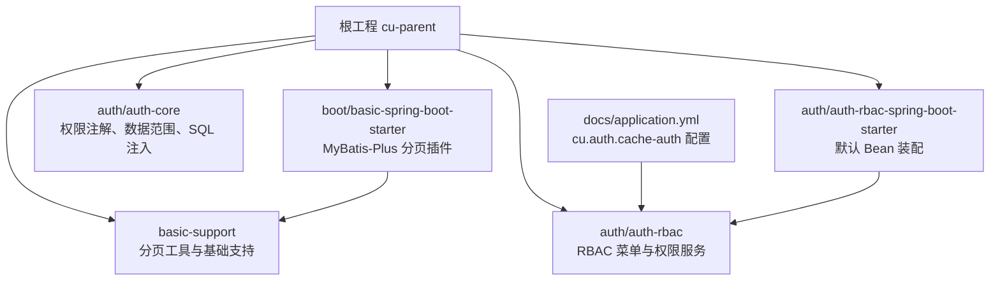
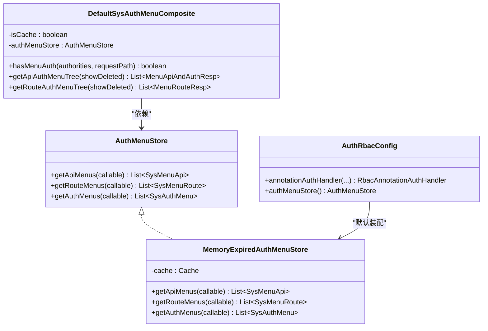
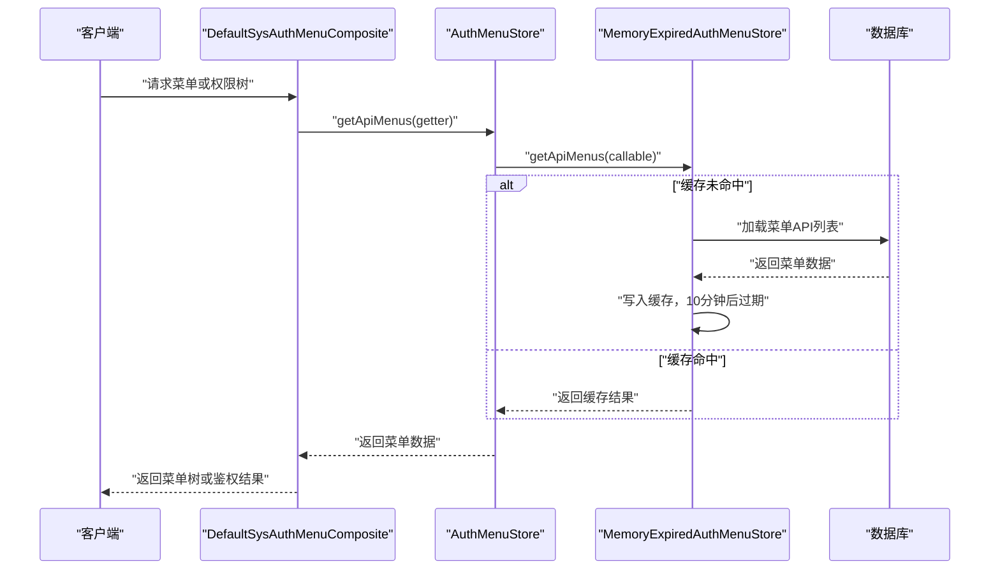
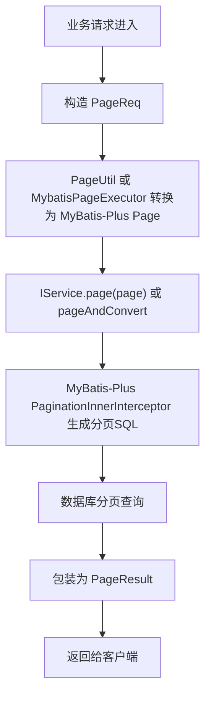
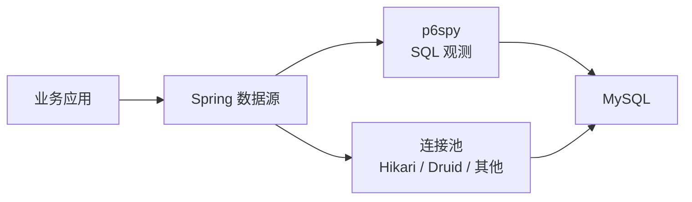

# 性能优化建议

<cite>
**本文引用的文件**   
- [pom.xml](file://pom.xml)
- [application.yml](file://docs/application.yml)
- [MybatisPlusConfig.java](file://boot/basic-spring-boot-starter/src/main/java/com/cu/framework/boot/basic/config/MybatisPlusConfig.java)
- [PageUtil.java](file://basic-support/src/main/java/com/cu/framework/basic/support/utils/PageUtil.java)
- [MybatisPageExecutor.java](file://basic-support/src/main/java/com/cu/framework/basic/support/utils/MybatisPageExecutor.java)
- [AuthMenuStore.java](file://auth/auth-rbac/src/main/java/com/cu/framework/auth/rbac/composite/AuthMenuStore.java)
- [MemoryExpiredAuthMenuStore.java](file://auth/auth-rbac/src/main/java/com/cu/framework/auth/rbac/composite/impl/MemoryExpiredAuthMenuStore.java)
- [DefaultSysAuthMenuComposite.java](file://auth/auth-rbac/src/main/java/com/cu/framework/auth/rbac/composite/impl/DefaultSysAuthMenuComposite.java)
- [AuthRbacConfig.java](file://auth/auth-rbac-spring-boot-starter/src/main/java/com/cu/framework/boot/auth/rbac/config/AuthRbacConfig.java)
- [AuthRangeCache.java](file://auth/auth-core/src/main/java/com/cu/framework/auth/core/data/range/AuthRangeCache.java)
- [MybatisDataRangeInterceptor.java](file://auth/auth-core/src/main/java/com/cu/framework/auth/core/data/range/MybatisDataRangeInterceptor.java)
- [SqlAuthInject.java](file://auth/auth-core/src/main/java/com/cu/framework/auth/core/data/range/SqlAuthInject.java)
- [AuthRangeStartupValidator.java](file://auth/auth-core/src/main/java/com/cu/framework/auth/core/data/range/AuthRangeStartupValidator.java)
</cite>

## 目录
1. [引言](#引言)
2. [项目结构与性能相关模块](#项目结构与性能相关模块)
3. [核心性能组件总览](#核心性能组件总览)
4. [权限缓存策略](#权限缓存策略)
5. [查询优化与分页实践](#查询优化与分页实践)
6. [连接池与数据库访问性能](#连接池与数据库访问性能)
7. [内存优化实践](#内存优化实践)
8. [系统监控与性能分析](#系统监控与性能分析)
9. [性能测试案例与对比方法](#性能测试案例与对比方法)
10. [常见问题与排错指南](#常见问题与排错指南)
11. [结论](#结论)

## 引言
本文面向 Kewen Framework 使用者与维护者，聚焦性能优化。仓库中已经存在若干关键基础设施：基于 MyBatis-Plus 的分页能力、可插拔的菜单权限存储接口、内存过期型菜单缓存实现、数据范围声明缓存与 SQL 注入拦截器、以及 p6spy 依赖。本文以这些代码为依据，结合框架配置和典型使用方式，给出权限缓存、查询优化、连接池、内存、监控及性能测试的系统性建议。

## 项目结构与性能相关模块
Kewen Framework 是一个多模块 Spring Boot 工程，根 `pom.xml` 统一管理 Spring Boot、Spring Cloud、MyBatis-Plus、p6spy、Fastjson、Hutool 等依赖；权限系统由 `auth-core`、`auth-rbac` 及其 Spring Boot Starter 组成；基础工具与分页适配位于 `basic-support`；MyBatis-Plus 分页插件在 `boot/basic-spring-boot-starter` 中装配。

**图表来源**
- [pom.xml:1-200](file://pom.xml#L1-L200)
- [MybatisPlusConfig.java:1-28](file://boot/basic-spring-boot-starter/src/main/java/com/cu/framework/boot/basic/config/MybatisPlusConfig.java#L1-L28)
- [AuthMenuStore.java:1-23](file://auth/auth-rbac/src/main/java/com/cu/framework/auth/rbac/composite/AuthMenuStore.java#L1-L23)
- [MemoryExpiredAuthMenuStore.java:1-69](file://auth/auth-rbac/src/main/java/com/cu/framework/auth/rbac/composite/impl/MemoryExpiredAuthMenuStore.java#L1-L69)
- [DefaultSysAuthMenuComposite.java:1-200](file://auth/auth-rbac/src/main/java/com/cu/framework/auth/rbac/composite/impl/DefaultSysAuthMenuComposite.java#L1-L200)
- [AuthRbacConfig.java:1-75](file://auth/auth-rbac-spring-boot-starter/src/main/java/com/cu/framework/boot/auth/rbac/config/AuthRbacConfig.java#L1-L75)
- [application.yml:1-200](file://docs/application.yml#L1-L200)

**章节来源**
- [pom.xml:1-200](file://pom.xml#L1-L200)
- [application.yml:1-200](file://docs/application.yml#L1-L200)

## 核心性能组件总览
- **分页适配层**：`PageUtil` 与 `MybatisPageExecutor` 将框架统一的 `PageReq`/`PageResult` 与 MyBatis-Plus 的 `Page` 转换，并封装直接执行 Service 分页的方法，减少业务层重复代码。
- **MyBatis-Plus 分页插件**：通过 `PaginationInnerInterceptor(DbType.MYSQL)` 注册分页拦截器，使 `IService.page()` 自动拼接分页 SQL。
- **权限缓存抽象**：`AuthMenuStore` 定义菜单 API、路由、权限三类数据的读取接口，支持内存或 Redis 等后端。
- **内存过期缓存实现**：`MemoryExpiredAuthMenuStore` 使用 Guava Cache 提供写入后固定时间过期的菜单缓存。
- **菜单权限组合服务**：`DefaultSysAuthMenuComposite` 根据 `cu.auth.cache-auth` 开关决定是否走缓存。
- **数据范围声明缓存**：`AuthRangeCache` 扫描 Mapper 上的数据范围注解，构建语句级模板，避免每次解析注解。
- **数据范围 SQL 注入拦截器**：`MybatisDataRangeInterceptor` + `SqlAuthInject` 在执行期按当前用户权限动态注入数据范围条件。
- **启动期校验**：`AuthRangeStartupValidator` 在应用初始化阶段校验数据范围声明与目标表是否匹配。

**章节来源**
- [PageUtil.java:1-89](file://basic-support/src/main/java/com/cu/framework/basic/support/utils/PageUtil.java#L1-L89)
- [MybatisPageExecutor.java:1-118](file://basic-support/src/main/java/com/cu/framework/basic/support/utils/MybatisPageExecutor.java#L1-L118)
- [MybatisPlusConfig.java:1-28](file://boot/basic-spring-boot-starter/src/main/java/com/cu/framework/boot/basic/config/MybatisPlusConfig.java#L1-L28)
- [AuthMenuStore.java:1-23](file://auth/auth-rbac/src/main/java/com/cu/framework/auth/rbac/composite/AuthMenuStore.java#L1-L23)
- [MemoryExpiredAuthMenuStore.java:1-69](file://auth/auth-rbac/src/main/java/com/cu/framework/auth/rbac/composite/impl/MemoryExpiredAuthMenuStore.java#L1-L69)
- [DefaultSysAuthMenuComposite.java:1-200](file://auth/auth-rbac/src/main/java/com/cu/framework/auth/rbac/composite/impl/DefaultSysAuthMenuComposite.java#L1-L200)
- [AuthRangeCache.java:1-155](file://auth/auth-core/src/main/java/com/cu/framework/auth/core/data/range/AuthRangeCache.java#L1-L155)
- [MybatisDataRangeInterceptor.java:46-152](file://auth/auth-core/src/main/java/com/cu/framework/auth/core/data/range/MybatisDataRangeInterceptor.java#L46-L152)
- [SqlAuthInject.java:64-407](file://auth/auth-core/src/main/java/com/cu/framework/auth/core/data/range/SqlAuthInject.java#L64-L407)
- [AuthRangeStartupValidator.java:34-126](file://auth/auth-core/src/main/java/com/cu/framework/auth/core/data/range/AuthRangeStartupValidator.java#L34-L126)

## 权限缓存策略

### 架构设计
权限缓存的核心是“可插拔存储 + 组合服务 + 配置开关”。`AuthMenuStore` 暴露三类数据获取方法，默认实现为 `MemoryExpiredAuthMenuStore`；`DefaultSysAuthMenuComposite` 通过 `@Value("${cu.auth.cache-auth:false}")` 控制是否启用缓存；`AuthRbacConfig` 在没有自定义 `AuthMenuStore` Bean 时注册默认实现。

**图表来源**
- [AuthMenuStore.java:1-23](file://auth/auth-rbac/src/main/java/com/cu/framework/auth/rbac/composite/AuthMenuStore.java#L1-L23)
- [MemoryExpiredAuthMenuStore.java:1-69](file://auth/auth-rbac/src/main/java/com/cu/framework/auth/rbac/composite/impl/MemoryExpiredAuthMenuStore.java#L1-L69)
- [DefaultSysAuthMenuComposite.java:1-200](file://auth/auth-rbac/src/main/java/com/cu/framework/auth/rbac/composite/impl/DefaultSysAuthMenuComposite.java#L1-L200)
- [AuthRbacConfig.java:1-75](file://auth/auth-rbac-spring-boot-starter/src/main/java/com/cu/framework/boot/auth/rbac/config/AuthRbacConfig.java#L1-L75)

### 缓存机制与更新策略
- **缓存键设计**：当前实现使用固定字符串键区分三类数据，如 `getApiMenus`、`getRouteMenus`、`getAuthMenus`。这意味着同一进程内这三类数据各自共享一个缓存条目。
- **过期策略**：采用写入后 10 分钟过期，适合菜单权限变化不频繁的场景。
- **加载回调**：通过 `Callable` 延迟加载，仅在缓存未命中时调用数据库或服务层逻辑。
- **更新入口**：框架提供了菜单权限编辑接口（如 `editMenuAuthorities`），实际部署时应在此处显式清理对应缓存键，否则会出现“写库成功但缓存仍旧”的一致性问题。

**图表来源**
- [DefaultSysAuthMenuComposite.java:1-200](file://auth/auth-rbac/src/main/java/com/cu/framework/auth/rbac/composite/impl/DefaultSysAuthMenuComposite.java#L1-L200)
- [MemoryExpiredAuthMenuStore.java:1-69](file://auth/auth-rbac/src/main/java/com/cu/framework/auth/rbac/composite/impl/MemoryExpiredAuthMenuStore.java#L1-L69)

### 穿透与雪崩防护建议
当前实现没有专门的空值缓存、互斥锁或随机抖动，因此需要注意：
- **缓存穿透**：如果菜单 API 路径不存在，且业务层允许传入任意路径进行鉴权，可能反复触发加载回调。建议在业务层先做参数校验，或在缓存层对空结果也设置短 TTL。
- **缓存雪崩**：所有三类数据共用固定键，且过期时间固定为 10 分钟，到期后若大量请求同时重建缓存，可能造成瞬时压力。建议引入带抖动的过期时间、热点键保护、降级逻辑。
- **一致性**：修改菜单权限后应主动清理对应缓存键，避免脏读。

**章节来源**
- [MemoryExpiredAuthMenuStore.java:1-69](file://auth/auth-rbac/src/main/java/com/cu/framework/auth/rbac/composite/impl/MemoryExpiredAuthMenuStore.java#L1-L69)
- [DefaultSysAuthMenuComposite.java:1-200](file://auth/auth-rbac/src/main/java/com/cu/framework/auth/rbac/composite/impl/DefaultSysAuthMenuComposite.java#L1-L200)
- [application.yml:1-200](file://docs/application.yml#L1-L200)

## 查询优化与分页实践

### MyBatis-Plus 分页查询优化
框架在启动时注册了 `PaginationInnerInterceptor(DbType.MYSQL)`，因此直接使用 `IService.page(Page)` 即可生成分页 SQL。业务层推荐使用 `PageUtil` 或 `MybatisPageExecutor` 完成参数转换与结果封装，减少样板代码。

**图表来源**
- [MybatisPlusConfig.java:1-28](file://boot/basic-spring-boot-starter/src/main/java/com/cu/framework/boot/basic/config/MybatisPlusConfig.java#L1-L28)
- [PageUtil.java:1-89](file://basic-support/src/main/java/com/cu/framework/basic/support/utils/PageUtil.java#L1-L89)
- [MybatisPageExecutor.java:1-118](file://basic-support/src/main/java/com/cu/framework/basic/support/utils/MybatisPageExecutor.java#L1-L118)

### SQL 语句优化与索引设计原则
- **优先使用主键或唯一索引查询**，避免全表扫描。
- **避免在 WHERE 子句中对字段做函数计算或隐式类型转换**，这会导致索引失效。
- **合理拆分复杂查询**：对于需要复杂聚合或多表 JOIN 的报表场景，优先考虑物化视图、定时汇总表或离线计算。
- **只选择必要字段**：大数据量下避免 `SELECT *`，减少网络传输和对象映射开销。
- **分页深度问题**：当 `page` 很大时，传统 `LIMIT offset, size` 会扫描大量无用行。可考虑基于游标或上次最大 ID 的分页方案。

### 大数据量处理方案
- **分批查询**：将一次大查询拆分为多次小批次，降低单次事务和内存压力。
- **读写分离**：将统计类、导出类查询路由到从库。
- **异步导出**：将大数据导出任务放入消息队列，完成后通知前端下载。
- **归档历史数据**：将冷数据迁移到历史库或对象存储，保持在线表规模可控。

**章节来源**
- [MybatisPlusConfig.java:1-28](file://boot/basic-spring-boot-starter/src/main/java/com/cu/framework/boot/basic/config/MybatisPlusConfig.java#L1-L28)
- [PageUtil.java:1-89](file://basic-support/src/main/java/com/cu/framework/basic/support/utils/PageUtil.java#L1-L89)
- [MybatisPageExecutor.java:1-118](file://basic-support/src/main/java/com/cu/framework/basic/support/utils/MybatisPageExecutor.java#L1-L118)

## 连接池与数据库访问性能

### 当前依赖情况
根 `pom.xml` 引入了 p6spy，用于 SQL 观测；同时统一版本管理了 MyBatis-Plus。工程中未发现内置的 HikariCP 或 Druid 连接池配置类，说明连接池通常由 Spring Boot 自动配置或业务应用自行配置。

**图表来源**
- [pom.xml:1-200](file://pom.xml#L1-L200)

### 连接池参数调优建议
- **最大连接数**：根据 CPU 核数和数据库实例规格调整，避免连接过多导致上下文切换和锁竞争。
- **最小空闲连接**：生产环境建议保留一定最小空闲连接，减少冷启动时的连接创建开销。
- **连接超时**：合理设置获取连接超时、连接空闲超时、连接存活时间，避免长时间占用资源。
- **泄漏检测**：开启连接泄漏检测，定位未正确关闭连接的代码路径。
- **慢查询阈值**：结合 p6spy 或数据库慢查询日志，记录超过阈值的 SQL。

### 连接泄漏检测与监控
- 在连接池中启用泄漏检测，输出连接获取堆栈。
- 结合 p6spy 输出完整 SQL、执行耗时、受影响行数。
- 对高频慢查询建立告警，定期复盘索引和执行计划。

**章节来源**
- [pom.xml:1-200](file://pom.xml#L1-L200)

## 内存优化实践

### 对象复用与集合优化
- **避免在循环中创建不必要的大对象**，优先复用可变对象或使用流式处理。
- **合理使用不可变集合**：`Collections.unmodifiableList`、`Collections.unmodifiableMap` 已在框架多处使用，有助于防止误修改。
- **分页结果集不宜一次性加载过大页面**：建议限制 `size`，避免单页数据过大导致堆内存峰值上升。

### 垃圾回收优化
- **减少临时对象分配**：在高频路径上尽量复用 Builder、转换器。
- **及时释放引用**：避免长生命周期对象持有短期对象引用，造成 GC 无法回收。
- **大对象外置**：大文件或大结果集建议使用流式响应、分块传输或外部存储。

### 权限数据与 SQL 模板的内存特征
- `AuthRangeCache` 缓存的是静态注解模板，不含用户态数据，内存占用稳定。
- `MemoryExpiredAuthMenuStore` 使用 Guava Cache，具有固定过期时间，适合有限大小的菜单权限数据。
- `SqlAuthInject` 在执行期动态拼接 SQL，应避免在热路径中产生大量中间字符串或大集合。

**章节来源**
- [AuthRangeCache.java:1-155](file://auth/auth-core/src/main/java/com/cu/framework/auth/core/data/range/AuthRangeCache.java#L1-L155)
- [MemoryExpiredAuthMenuStore.java:1-69](file://auth/auth-rbac/src/main/java/com/cu/framework/auth/rbac/composite/impl/MemoryExpiredAuthMenuStore.java#L1-L69)
- [SqlAuthInject.java:64-407](file://auth/auth-core/src/main/java/com/cu/framework/auth/core/data/range/SqlAuthInject.java#L64-L407)

## 系统监控与性能分析

### 慢查询日志
- **数据库侧慢查询**：开启 MySQL 慢查询日志，设定合适阈值，定期分析 TOP SQL。
- **p6spy 输出**：通过 p6spy 捕获 JDBC 层 SQL，便于定位业务调用链中的慢查询。
- **MyBatis 日志**：在生产环境谨慎开启详细 SQL 日志，避免日志膨胀。

### 性能指标收集
- **JVM 指标**：监控堆内存、非堆内存、GC 次数与耗时、线程数、CPU 使用率。
- **数据库指标**：连接池活跃连接数、等待连接数、慢查询数量、锁等待。
- **业务指标**：接口 QPS、平均响应时间、P95/P99 延迟、错误率。

### 瓶颈定位方法
- **分层排查**：先从接口响应时间入手，再判断是 CPU 密集、I/O 密集还是 GC 停顿。
- **SQL 分析**：结合 p6spy 和数据库执行计划，确认是否存在全表扫描、缺少索引、N+1 查询。
- **权限链路分析**：菜单权限命中失败时，检查是否频繁查库或未命中缓存；数据范围 SQL 注入是否正确附加条件。

**章节来源**
- [pom.xml:1-200](file://pom.xml#L1-L200)

## 性能测试案例与对比方法

### 测试目标
- 验证启用 `cu.auth.cache-auth=true` 前后，菜单权限查询的吞吐量和延迟差异。
- 验证分页查询在不同 `page`、`size` 下的响应时间和数据库负载。
- 验证数据范围注解生效时，SQL 是否包含正确的权限过滤条件。

### 测试步骤建议
1. **基准测试**：在未启用权限缓存的情况下，对菜单权限接口执行压测，记录 QPS、RT、错误率。
2. **启用缓存**：将 `cu.auth.cache-auth` 设置为 `true`，重启应用后再次压测。
3. **对比结果**：观察 RT 下降、QPS 提升、数据库连接压力和慢查询数量变化。
4. **分页压测**：分别测试小页和大页场景，关注数据库扫描行数、内存峰值和 GC 行为。
5. **数据范围压测**：模拟不同用户权限，验证 SQL 注入后的执行计划和耗时。

### 对比指标表示例
| 场景 | 指标 | 优化前 | 优化后 | 备注 |
|---|---|---|---|---|
| 菜单权限查询 | 平均响应时间 | 较高 | 较低 | 启用权限缓存 |
| 菜单权限查询 | QPS | 较低 | 较高 | 缓存命中后减少数据库访问 |
| 分页查询 | P99 延迟 | 较大 | 较小 | 合理限制页大小、优化索引 |
| 数据范围查询 | SQL 扫描行数 | 较多 | 较少 | 权限条件有效减少数据量 |

[本节为通用性能测试方法论，不直接分析具体源码，因此不附加“章节来源”]

## 常见问题与排错指南

### 权限缓存未生效
- 检查配置项 `cu.auth.cache-auth` 是否为 `true`。
- 检查是否注入了自定义 `AuthMenuStore` Bean，覆盖默认实现。
- 检查菜单权限变更接口是否清理了缓存键。

### 权限数据不一致
- 确认菜单权限更新事务提交成功后是否清理缓存。
- 确认多节点部署时是否使用分布式缓存；当前默认实现为进程内缓存，不适合多实例共享。

### 数据范围 SQL 异常
- 启动时报错时，优先查看 `AuthRangeStartupValidator` 输出的声明校验信息。
- 运行时 SQL 不符合预期时，检查 `AuthRangeCache` 是否成功扫描到注解模板。
- 检查 `SqlAuthInject` 生成的 SQL 是否被其他拦截器或插件改写。

### 分页结果不正确
- 确认 `PageReq.page` 和 `PageReq.size` 是否合法。
- 确认 MyBatis-Plus 分页插件已注册，且 `DbType` 与实际数据库一致。
- 检查是否在分页前对结果做了额外过滤，导致总数与记录数不一致。

**章节来源**
- [application.yml:1-200](file://docs/application.yml#L1-L200)
- [AuthRbacConfig.java:1-75](file://auth/auth-rbac-spring-boot-starter/src/main/java/com/cu/framework/boot/auth/rbac/config/AuthRbacConfig.java#L1-L75)
- [AuthRangeStartupValidator.java:34-126](file://auth/auth-core/src/main/java/com/cu/framework/auth/core/data/range/AuthRangeStartupValidator.java#L34-L126)
- [AuthRangeCache.java:1-155](file://auth/auth-core/src/main/java/com/cu/framework/auth/core/data/range/AuthRangeCache.java#L1-L155)
- [MybatisPlusConfig.java:1-28](file://boot/basic-spring-boot-starter/src/main/java/com/cu/framework/boot/basic/config/MybatisPlusConfig.java#L1-L28)

## 结论
Kewen Framework 已经在权限缓存抽象、分页适配、MyBatis-Plus 分页插件、数据范围声明缓存与 SQL 注入方面提供了良好基础。性能优化的关键在于：
- 在生产环境启用 `cu.auth.cache-auth`，并为菜单权限变更增加缓存清理逻辑。
- 使用 `PageUtil` 或 `MybatisPageExecutor` 统一分页，避免手写转换和 N+1 查询。
- 合理配置连接池、开启 p6spy 与数据库慢查询日志，持续跟踪慢 SQL。
- 针对大数据量场景，采用分批、异步、归档等手段控制内存和数据库压力。
- 在多实例部署时，评估当前进程内缓存的局限性，必要时替换为分布式缓存实现。