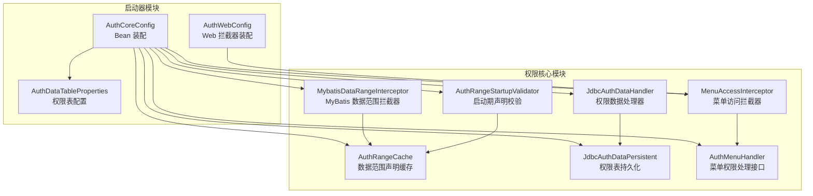
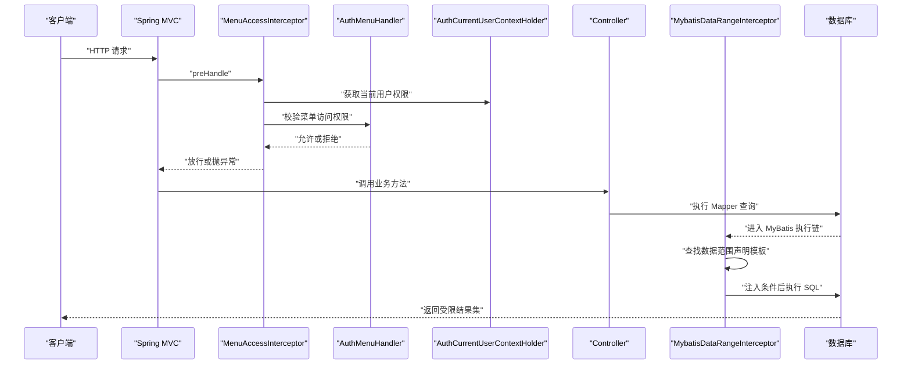
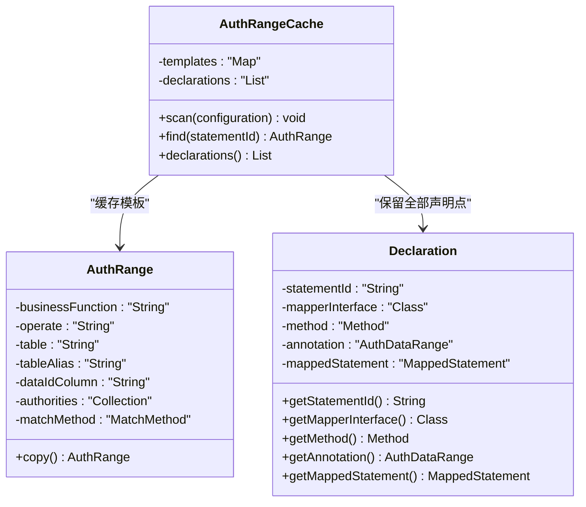
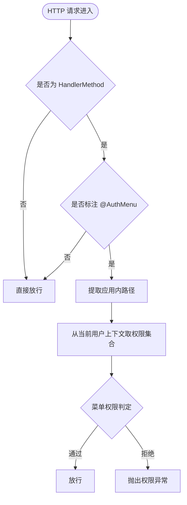
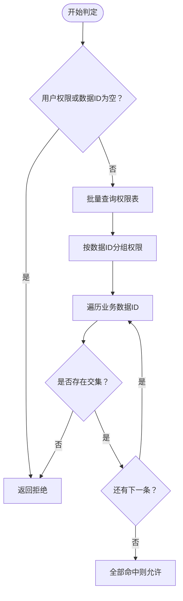
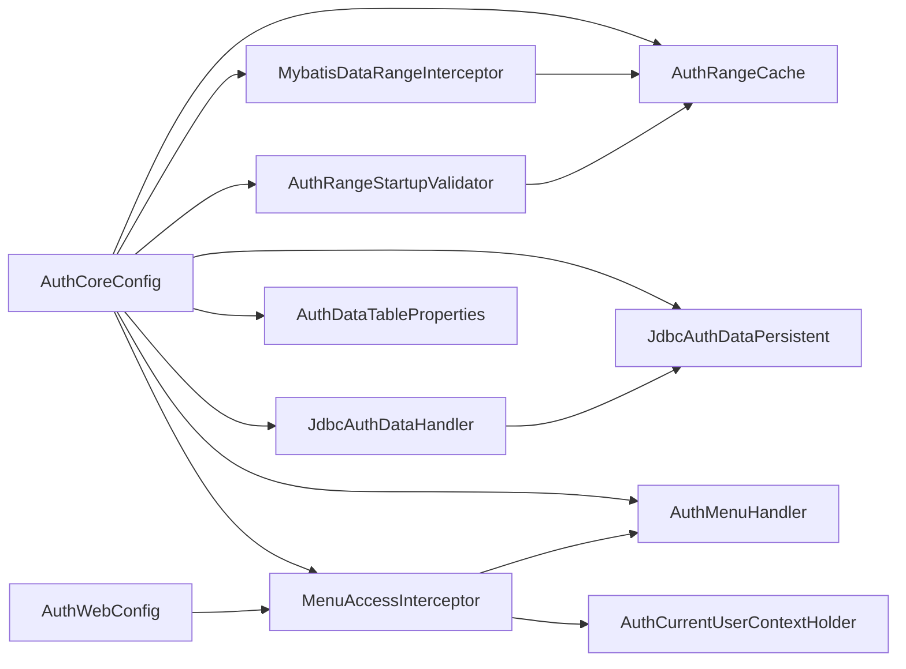

# 权限缓存策略优化

<cite>
**本文引用的文件**   
- [AuthRangeCache.java](file://auth/auth-core/src/main/java/com/cu/framework/auth/core/data/range/AuthRangeCache.java)
- [AuthRange.java](file://auth/auth-core/src/main/java/com/cu/framework/auth/core/data/range/AuthRange.java)
- [MybatisDataRangeInterceptor.java](file://auth/auth-core/src/main/java/com/cu/framework/auth/core/data/range/MybatisDataRangeInterceptor.java)
- [AuthRangeStartupValidator.java](file://auth/auth-core/src/main/java/com/cu/framework/auth/core/data/range/AuthRangeStartupValidator.java)
- [MenuAccessInterceptor.java](file://auth/auth-core/src/main/java/com/cu/framework/auth/core/menu/MenuAccessInterceptor.java)
- [AuthMenuHandler.java](file://auth/auth-core/src/main/java/com/cu/framework/auth/core/menu/AuthMenuHandler.java)
- [AuthWebConfig.java](file://auth/auth-core-spring-boot-starter/src/main/java/com/cu/framework/boot/auth/core/config/AuthWebConfig.java)
- [AuthCoreConfig.java](file://auth/auth-core-spring-boot-starter/src/main/java/com/cu/framework/boot/auth/core/config/AuthCoreConfig.java)
- [JdbcAuthDataHandler.java](file://auth/auth-core/src/main/java/com/cu/framework/auth/core/data/JdbcAuthDataHandler.java)
- [JdbcAuthDataPersistent.java](file://auth/auth-core/src/main/java/com/cu/framework/auth/core/data/JdbcAuthDataPersistent.java)
- [AuthDataTableProperties.java](file://auth/auth-core-spring-boot-starter/src/main/java/com/cu/framework/boot/auth/core/properties/AuthDataTableProperties.java)
- [AuthCurrentUserContextHolder.java](file://auth/auth-core/src/main/java/com/cu/framework/auth/core/AuthCurrentUserContextHolder.java)
</cite>

## 目录
1. [引言](#引言)
2. [项目结构定位](#项目结构定位)
3. [核心组件总览](#核心组件总览)
4. [架构总览](#架构总览)
5. [数据范围声明缓存机制](#数据范围声明缓存机制)
6. [菜单访问拦截器的缓存使用模式](#菜单访问拦截器的缓存使用模式)
7. [JdbcAuthDataHandler 与缓存的协作关系](#jdbcauthdatahandler-与缓存的协作关系)
8. [依赖关系分析](#依赖关系分析)
9. [性能特征与调优建议](#性能特征与调优建议)
10. [故障排查指南](#故障排查指南)
11. [结论](#结论)

## 引言
本文围绕 Kewen Framework 中权限相关的缓存与拦截路径展开，重点说明：
- `AuthRangeCache` 如何缓存 MyBatis Mapper 方法上的数据范围声明；
- 菜单访问拦截器如何使用当前用户权限集合进行请求级校验；
- `JdbcAuthDataHandler` 如何通过数据库持久层完成热路径查询与冷路径更新；
- 启动期扫描、运行时 SQL 注入、权限表读写之间的协作边界；
- 实际可落地的配置调优方向，以及未在当前仓库实现的缓存穿透、雪崩防护现状。

需要特别说明的是：当前仓库中的“权限缓存”主要指**数据范围声明模板缓存**和**当前用户权限上下文**，并未实现全局分布式权限结果缓存或显式过期策略。因此，关于“缓存大小限制、过期策略、内存占用控制”的建议应视为运行期约束与扩展指引，而非现有实现的默认行为。

## 项目结构定位
本次优化涉及两个层次：
- **auth-core 模块**：定义权限核心接口、数据范围声明缓存、MyBatis 数据范围注入、菜单访问拦截器和 Jdbc 权限数据处理器。
- **auth-core-spring-boot-starter 模块**：负责装配这些 Bean、注册 Web 拦截器、读取权限表配置。

**图表来源**
- [AuthCoreConfig.java:57-195](file://auth/auth-core-spring-boot-starter/src/main/java/com/cu/framework/boot/auth/core/config/AuthCoreConfig.java#L57-L195)
- [AuthWebConfig.java:1-30](file://auth/auth-core-spring-boot-starter/src/main/java/com/cu/framework/boot/auth/core/config/AuthWebConfig.java#L1-L30)
- [AuthRangeCache.java:1-155](file://auth/auth-core/src/main/java/com/cu/framework/auth/core/data/range/AuthRangeCache.java#L1-L155)
- [MybatisDataRangeInterceptor.java:1-200](file://auth/auth-core/src/main/java/com/cu/framework/auth/core/data/range/MybatisDataRangeInterceptor.java#L1-L200)
- [AuthRangeStartupValidator.java:1-163](file://auth/auth-core/src/main/java/com/cu/framework/auth/core/data/range/AuthRangeStartupValidator.java#L1-L163)
- [JdbcAuthDataHandler.java:1-119](file://auth/auth-core/src/main/java/com/cu/framework/auth/core/data/JdbcAuthDataHandler.java#L1-L119)
- [JdbcAuthDataPersistent.java:1-179](file://auth/auth-core/src/main/java/com/cu/framework/auth/core/data/JdbcAuthDataPersistent.java#L1-L179)
- [MenuAccessInterceptor.java:1-93](file://auth/auth-core/src/main/java/com/cu/framework/auth/core/menu/MenuAccessInterceptor.java#L1-L93)

**章节来源**
- [AuthCoreConfig.java:57-195](file://auth/auth-core-spring-boot-starter/src/main/java/com/cu/framework/boot/auth/core/config/AuthCoreConfig.java#L57-L195)
- [AuthWebConfig.java:1-30](file://auth/auth-core-spring-boot-starter/src/main/java/com/cu/framework/boot/auth/core/config/AuthWebConfig.java#L1-L30)

## 核心组件总览
| 组件 | 职责 | 是否包含缓存语义 | 关键输入 | 关键输出 |
|---|---|---:|---|---|
| `AuthRangeCache` | 扫描 Mapper 上标注的数据范围注解，缓存静态声明模板 | 是 | MyBatis `Configuration`、Mapper 接口方法 | 语句 id 到 `AuthRange` 模板的映射 |
| `MybatisDataRangeInterceptor` | 在物理 SQL 执行前注入数据范围条件 | 否，但消费 `AuthRangeCache` | MyBatis `StatementHandler`、当前用户权限 | 改写后的 SQL |
| `AuthRangeStartupValidator` | 启动期校验数据范围声明是否正确 | 否，但消费 `AuthRangeCache` | SqlSessionFactory、BeanFactory | 启动失败或校验日志 |
| `MenuAccessInterceptor` | 校验 Controller 方法是否具备菜单访问权限 | 否，但读取当前用户权限上下文 | HTTP 请求、当前用户权限 | 放行或抛出权限异常 |
| `JdbcAuthDataHandler` | 从权限表加载、比对、维护业务数据权限 | 否，直接走数据库 | 业务功能、数据 ID、操作类型、用户权限 | 权限判定结果、持久化变更 |
| `JdbcAuthDataPersistent` | 以 JSqlParser 构造参数化 SQL 读写权限表 | 否 | 业务功能、数据 ID 集合、操作类型 | 权限记录集合 |

**章节来源**
- [AuthRangeCache.java:1-155](file://auth/auth-core/src/main/java/com/cu/framework/auth/core/data/range/AuthRangeCache.java#L1-L155)
- [MybatisDataRangeInterceptor.java:1-200](file://auth/auth-core/src/main/java/com/cu/framework/auth/core/data/range/MybatisDataRangeInterceptor.java#L1-L200)
- [AuthRangeStartupValidator.java:1-163](file://auth/auth-core/src/main/java/com/cu/framework/auth/core/data/range/AuthRangeStartupValidator.java#L1-L163)
- [MenuAccessInterceptor.java:1-93](file://auth/auth-core/src/main/java/com/cu/framework/auth/core/menu/MenuAccessInterceptor.java#L1-L93)
- [JdbcAuthDataHandler.java:1-119](file://auth/auth-core/src/main/java/com/cu/framework/auth/core/data/JdbcAuthDataHandler.java#L1-L119)
- [JdbcAuthDataPersistent.java:1-179](file://auth/auth-core/src/main/java/com/cu/framework/auth/core/data/JdbcAuthDataPersistent.java#L1-L179)

## 架构总览
权限体系存在两条主线：
1. **行级数据范围线**：注解声明 → 启动期扫描 → 运行时 MyBatis 拦截 → SQL 注入 → 数据库查询过滤。
2. **菜单访问权限线**：HTTP 请求 → Web 拦截器 → 当前用户权限上下文 → 菜单权限判定。

**图表来源**
- [MenuAccessInterceptor.java:31-79](file://auth/auth-core/src/main/java/com/cu/framework/auth/core/menu/MenuAccessInterceptor.java#L31-L79)
- [AuthWebConfig.java:18-29](file://auth/auth-core-spring-boot-starter/src/main/java/com/cu/framework/boot/auth/core/config/AuthWebConfig.java#L18-L29)
- [MybatisDataRangeInterceptor.java:85-155](file://auth/auth-core/src/main/java/com/cu/framework/auth/core/data/range/MybatisDataRangeInterceptor.java#L85-L155)
- [AuthRangeCache.java:67-104](file://auth/auth-core/src/main/java/com/cu/framework/auth/core/data/range/AuthRangeCache.java#L67-L104)

## 数据范围声明缓存机制

### 缓存键设计
`AuthRangeCache` 的缓存键是 MyBatis 映射语句 id，即：
- 接口全限定名 + “.” + 方法名。
- 该键唯一对应一条映射语句，天然避免同名重载歧义。
- 只有 `SqlCommandType.SELECT` 且成功解析到 `MappedStatement` 的方法才会进入缓存。

这意味着：
- 非查询语句不会获得数据范围增强；
- 没有 `@AuthDataRange` 注解的方法不会命中缓存；
- 注解位置错误、方法名不匹配、SQL 无法解析等场景会在启动期被捕获。

**章节来源**
- [AuthRangeCache.java:23-31](file://auth/auth-core/src/main/java/com/cu/framework/auth/core/data/range/AuthRangeCache.java#L23-L31)
- [AuthRangeCache.java:67-104](file://auth/auth-core/src/main/java/com/cu/framework/auth/core/data/range/AuthRangeCache.java#L67-L104)

### 缓存内容结构
缓存内容是一个只读模板，不包含运行时用户权限：
| 字段 | 含义 | 可变性 |
|---|---|---|
| `businessFunction` | 应用或模块标识 | 不变 |
| `operate` | 操作类型，如查询、修改等 | 不变 |
| `table` | 目标表名 | 不变 |
| `tableAlias` | 表别名 | 不变 |
| `dataIdColumn` | 业务主键列名 | 不变 |
| `matchMethod` | 匹配方式，如 `IN` 或 `EXISTS` | 不变 |
| `authorities` | 当次请求的用户权限集合 | 每次请求复制后写入 |

模板对象本身不可变，运行时通过 `copy()` 生成副本再写入权限集合，防止不同线程共享 `authorities` 导致权限污染。

**图表来源**
- [AuthRangeCache.java:33-155](file://auth/auth-core/src/main/java/com/cu/framework/auth/core/data/range/AuthRangeCache.java#L33-L155)
- [AuthRange.java:1-64](file://auth/auth-core/src/main/java/com/cu/framework/auth/core/data/range/AuthRange.java#L1-L64)

**章节来源**
- [AuthRangeCache.java:33-155](file://auth/auth-core/src/main/java/com/cu/framework/auth/core/data/range/AuthRangeCache.java#L33-L155)
- [AuthRange.java:1-64](file://auth/auth-core/src/main/java/com/cu/framework/auth/core/data/range/AuthRange.java#L1-L64)

### 缓存更新策略
当前实现采用**启动期一次性填充、运行期只读**的策略：
1. `AuthCoreConfig` 创建 `AuthRangeCache` Bean。
2. `AuthRangeStartupValidator` 实现 Spring `SmartInitializingSingleton`，在所有单例初始化完成后调用 `scan`。
3. `scan` 遍历已注册的 Mapper 接口，收集 `@AuthDataRange` 注解并构建模板。
4. 模板放入 `volatile` 包装的不可变 Map 中。
5. 运行期由 `MybatisDataRangeInterceptor` 通过 `find` 读取。

这意味着：
- 没有动态刷新接口；
- 若业务侧修改了 Mapper 注解，需要重启应用；
- 若希望支持热更新，需额外引入外部配置中心或事件刷新机制。

**章节来源**
- [AuthCoreConfig.java:72-81](file://auth/auth-core-spring-boot-starter/src/main/java/com/cu/framework/boot/auth/core/config/AuthCoreConfig.java#L72-L81)
- [AuthCoreConfig.java:143-173](file://auth/auth-core-spring-boot-starter/src/main/java/com/cu/framework/boot/auth/core/config/AuthCoreConfig.java#L143-L173)
- [AuthRangeStartupValidator.java:38-81](file://auth/auth-core/src/main/java/com/cu/framework/auth/core/data/range/AuthRangeStartupValidator.java#L38-L81)
- [AuthRangeCache.java:67-104](file://auth/auth-core/src/main/java/com/cu/framework/auth/core/data/range/AuthRangeCache.java#L67-L104)

## 菜单访问拦截器的缓存使用模式

### 权限数据的加载时机
菜单访问拦截器本身不维护独立权限缓存，而是依赖当前用户上下文：
1. 请求进入 Spring MVC。
2. `AuthWebConfig` 注册 `MenuAccessInterceptor`。
3. `MenuAccessInterceptor.preHandle` 判断方法或类是否标注 `@AuthMenu`。
4. 如果受管辖，则从 `AuthCurrentUserContextHolder.getAuths()` 获取当前用户权限集合。
5. 调用 `AuthMenuHandler.hasMenuAccessAuth` 判断 URL 是否允许访问。

**图表来源**
- [AuthWebConfig.java:18-29](file://auth/auth-core-spring-boot-starter/src/main/java/com/cu/framework/boot/auth/core/config/AuthWebConfig.java#L18-L29)
- [MenuAccessInterceptor.java:31-79](file://auth/auth-core/src/main/java/com/cu/framework/auth/core/menu/MenuAccessInterceptor.java#L31-L79)
- [AuthMenuHandler.java:1-27](file://auth/auth-core/src/main/java/com/cu/framework/auth/core/menu/AuthMenuHandler.java#L1-L27)
- [AuthCurrentUserContextHolder.java:1-25](file://auth/auth-core/src/main/java/com/cu/framework/auth/core/AuthCurrentUserContextHolder.java#L1-L25)

### 缓存失效触发条件
当前代码中没有针对菜单权限的显式失效逻辑：
- 菜单权限来自 `AuthCurrentUserContextHolder`；
- 权限集合通常在登录成功后写入上下文；
- 登出或令牌刷新时，应由上层认证模块替换上下文中的权限集合。

因此，“缓存失效”在这里更接近**上下文切换**，而不是传统缓存的 TTL 或手动删除。

**章节来源**
- [MenuAccessInterceptor.java:31-79](file://auth/auth-core/src/main/java/com/cu/framework/auth/core/menu/MenuAccessInterceptor.java#L31-L79)
- [AuthCurrentUserContextHolder.java:1-25](file://auth/auth-core/src/main/java/com/cu/framework/auth/core/AuthCurrentUserContextHolder.java#L1-L25)

### 缓存穿透和雪崩防护现状
- **缓存穿透**：菜单访问拦截器未实现本地权限结果缓存，因此不存在典型的“空结果缓存”穿透防护。
- **雪崩防护**：由于没有集中式权限结果缓存，也不存在大量缓存同时过期的雪崩问题。
- 真正的风险集中在认证模块：如果所有用户同时重新登录，可能集中刷新上下文权限；如果 `AuthMenuHandler` 的实现每次都查库，也可能形成瞬时热点。

建议在扩展 `AuthMenuHandler` 时考虑：
- 对高频菜单路径做轻量本地缓存；
- 对空结果设置短 TTL；
- 对并发刷新加锁或退避；
- 结合鉴权网关或会话刷新策略，避免集中重建。

[本节为概念性分析，不直接分析具体源码实现]

## JdbcAuthDataHandler 与缓存的协作关系

### 热路径查询优化
`JdbcAuthDataHandler.hasDataOperateAuths` 的热路径流程是：
1. 检查用户权限集合和业务数据 ID 集合是否为空。
2. 通过 `JdbcAuthDataPersistent.listAuthData` 批量查询权限表。
3. 将返回的权限记录按归一化后的数据 ID 分组。
4. 在内存中与用户权限集合比对。
5. 任一数据 ID 缺少必要权限则返回拒绝。

这种设计的优点是：
- 把用户权限集合放在内存比对，避免把不可控大小的权限串拼入 SQL；
- 使用 `IN` 批量查询减少往返次数；
- 数据 ID 字符串归一化，避免不同类型主键被误判为不同值。

**图表来源**
- [JdbcAuthDataHandler.java:63-100](file://auth/auth-core/src/main/java/com/cu/framework/auth/core/data/JdbcAuthDataHandler.java#L63-L100)
- [JdbcAuthDataPersistent.java:116-165](file://auth/auth-core/src/main/java/com/cu/framework/auth/core/data/JdbcAuthDataPersistent.java#L116-L165)

**章节来源**
- [JdbcAuthDataHandler.java:63-100](file://auth/auth-core/src/main/java/com/cu/framework/auth/core/data/JdbcAuthDataHandler.java#L63-L100)
- [JdbcAuthDataPersistent.java:116-165](file://auth/auth-core/src/main/java/com/cu/framework/auth/core/data/JdbcAuthDataPersistent.java#L116-L165)

### 冷路径数据同步
`editDataAuths` 属于冷路径写操作，用于维护权限表：
1. 查询数据库中已有权限记录。
2. 计算需要新增和移除的记录。
3. 先批量删除不再需要的记录。
4. 再批量插入新增记录。

这保证了权限变更最终一致，但当前实现没有主动触发 `AuthRangeCache` 或菜单权限上下文刷新。因此：
- 数据范围声明（Mapper 注解）变更仍需重启；
- 业务数据权限变更后，通常依赖下一次请求重新拉取权限表数据；
- 若使用上下文缓存，需要在上层登出或权限刷新流程中清理。

**章节来源**
- [JdbcAuthDataHandler.java:33-61](file://auth/auth-core/src/main/java/com/cu/framework/auth/core/data/JdbcAuthDataHandler.java#L33-L61)
- [JdbcAuthDataPersistent.java:40-115](file://auth/auth-core/src/main/java/com/cu/framework/auth/core/data/JdbcAuthDataPersistent.java#L40-L115)

## 依赖关系分析

**图表来源**
- [AuthCoreConfig.java:57-195](file://auth/auth-core-spring-boot-starter/src/main/java/com/cu/framework/boot/auth/core/config/AuthCoreConfig.java#L57-L195)
- [AuthWebConfig.java:18-29](file://auth/auth-core-spring-boot-starter/src/main/java/com/cu/framework/boot/auth/core/config/AuthWebConfig.java#L18-L29)
- [MenuAccessInterceptor.java:11-29](file://auth/auth-core/src/main/java/com/cu/framework/auth/core/menu/MenuAccessInterceptor.java#L11-L29)
- [MybatisDataRangeInterceptor.java:55-74](file://auth/auth-core/src/main/java/com/cu/framework/auth/core/data/range/MybatisDataRangeInterceptor.java#L55-L74)
- [AuthRangeStartupValidator.java:27-36](file://auth/auth-core/src/main/java/com/cu/framework/auth/core/data/range/AuthRangeStartupValidator.java#L27-L36)
- [JdbcAuthDataHandler.java:23-31](file://auth/auth-core/src/main/java/com/cu/framework/auth/core/data/JdbcAuthDataHandler.java#L23-L31)

**章节来源**
- [AuthCoreConfig.java:57-195](file://auth/auth-core-spring-boot-starter/src/main/java/com/cu/framework/boot/auth/core/config/AuthCoreConfig.java#L57-L195)
- [AuthWebConfig.java:18-29](file://auth/auth-core-spring-boot-starter/src/main/java/com/cu/framework/boot/auth/core/config/AuthWebConfig.java#L18-L29)

## 性能特征与调优建议

### 现有性能特征
| 阶段 | 行为 | 性能影响 |
|---|---|---|
| 启动期 | 扫描 Mapper 接口、解析注解、校验 SQL | 仅一次，不影响运行期 |
| 菜单访问拦截 | 读取当前用户权限集合并调用菜单处理器 | 低开销，取决于 `AuthMenuHandler` 实现 |
| 数据范围 SQL 注入 | 查模板缓存、复制声明、改写 BoundSql | 单次反射和字符串处理，命中率高时开销很小 |
| 行级权限判定 | 批量查权限表 + 内存比对 | 热点路径依赖数据库吞吐和用户权限规模 |

### 数据范围声明缓存调优
- 当前 `AuthRangeCache` 使用 `Collections.emptyMap()` 和 `Collections.unmodifiableMap()`，适合只读模板。
- 不建议在运行期修改该 Map；如需热更新，应引入带版本号的替换逻辑，并用原子引用或双缓冲避免部分可见。
- 模板对象使用 `copy()` 隔离权限集合，这是正确做法；不要复用同一 `AuthRange` 实例。

### 菜单访问权限调优
- 当前实现未内置菜单权限本地缓存。
- 若 `AuthMenuHandler` 每次查库，应考虑：
  - 按用户维度缓存扁平化权限集合；
  - 对频繁访问的菜单路径增加路径级快速判断；
  - 对空结果设置较短 TTL；
  - 使用防抖或锁避免重复重建。

### 权限表读写调优
- `JdbcAuthDataPersistent` 使用 JSqlParser 构造参数化 SQL，能避免 SQL 注入和类型转换问题。
- `listAuthData` 支持 `IN` 批量查询，适合多数据 ID 判定。
- 如果业务数据 ID 集合过大，应考虑分页或分批查询，避免 SQL 过长。
- 对于高频读场景，可在 `JdbcAuthDataHandler` 外层增加本地权限结果缓存，键为 `(businessFunction, dataId, operate)`。

### 未实现的缓存特性与扩展建议
| 特性 | 当前状态 | 建议 |
|---|---|---|
| 缓存大小限制 | 无显式上限 | 对上下文权限集合、本地权限结果缓存设置容量上限 |
| 过期策略 | 无 | 为本地权限缓存设置 TTL；对空结果单独短过期 |
| 内存占用控制 | 依赖 JVM 堆 | 监控权限集合大小、SQL 注入对象数量 |
| 缓存穿透防护 | 无 | 对缺失权限或空结果做短期占位缓存 |
| 缓存雪崩防护 | 无 | 使用随机抖动、分段刷新、限流保护 |
| 热更新能力 | 不支持 | 引入配置中心或事件驱动刷新 `AuthRangeCache` |

### 性能测试案例设计建议
仓库中没有现成的端到端性能基准测试。可基于以下思路构建对比实验：

| 测试项 | 关闭缓存基线 | 启用缓存假设 |
|---|---|---|
| 菜单访问延迟 | 每次调用 `AuthMenuHandler` 查库 | 命中本地权限缓存后接近零开销 |
| 行级权限判定延迟 | 多次 `listAuthData` 查询 | 本地缓存命中后减少数据库往返 |
| 吞吐量 | 受数据库连接池和权限表索引限制 | 热点路径由内存承担 |
| 启动时间 | 扫描 Mapper 和校验 SQL | 启动期开销不变 |

推荐指标：
- P50、P95、P99 响应时间；
- QPS；
- 数据库慢查询数；
- 权限表 IOPS；
- JVM 堆使用和权限集合内存占用。

[本节为通用性能指导，不直接分析具体源码实现]

## 故障排查指南

### 数据范围声明无效
常见原因：
- 注解不在 Mapper 接口方法上；
- 方法名与映射语句 id 不一致；
- 注解标在非 SELECT 语句；
- 语句启用了 MyBatis 二级缓存；
- 静态 SQL 中目标表不存在；
- 动态 SQL 在运行期才暴露真实表结构。

排查步骤：
1. 查看启动日志中 `@AuthDataRange 数据范围声明启动校验器已启动`。
2. 确认校验失败的具体位置和错误信息。
3. 检查 Mapper 注解、方法名、XML 或注解 SQL 中的表名。
4. 确认未启用二级缓存。
5. 对动态 SQL，观察运行期 SQL 注入失败的异常栈。

**章节来源**
- [AuthRangeStartupValidator.java:38-163](file://auth/auth-core/src/main/java/com/cu/framework/auth/core/data/range/AuthRangeStartupValidator.java#L38-L163)

### 菜单访问被拒绝
常见原因：
- Controller 方法或类未标注 `@AuthMenu`，但期望被菜单控制；
- 请求路径与菜单路径不一致；
- 当前用户权限集合为空或权限不足；
- `AuthMenuHandler` 实现未覆盖该菜单路径。

排查步骤：
1. 确认是否命中 `isGoverned`。
2. 打印或观察被比较的请求路径。
3. 检查登录用户权限集合。
4. 检查 `AuthMenuHandler` 的具体实现。

**章节来源**
- [MenuAccessInterceptor.java:31-79](file://auth/auth-core/src/main/java/com/cu/framework/auth/core/menu/MenuAccessInterceptor.java#L31-L79)
- [AuthMenuHandler.java:1-27](file://auth/auth-core/src/main/java/com/cu/framework/auth/core/menu/AuthMenuHandler.java#L1-L27)

### 行级权限判定不准确
常见原因：
- 业务数据 ID 类型不一致导致归一化后不匹配；
- 权限表中缺少对应记录；
- 用户权限集合未包含所需权限串；
- `businessFunction`、`operate` 与业务约定不一致。

排查步骤：
1. 核对 `JdbcAuthDataHandler` 中使用的业务功能、操作类型。
2. 检查权限表中对应数据 ID 的记录。
3. 检查当前用户权限集合。
4. 关注数据 ID 归一化为字符串的行为。

**章节来源**
- [JdbcAuthDataHandler.java:63-119](file://auth/auth-core/src/main/java/com/cu/framework/auth/core/data/JdbcAuthDataHandler.java#L63-L119)

## 结论
Kewen Framework 的权限缓存优化主要体现在三个层面：
1. **声明模板缓存**：`AuthRangeCache` 在启动期扫描 Mapper 注解，提供稳定的语句级数据范围模板，避免运行期重复解析。
2. **运行时 SQL 注入**：`MybatisDataRangeInterceptor` 在每条物理 SQL 执行前查模板缓存并注入权限条件，热路径开销小且线程安全。
3. **权限数据持久化**：`JdbcAuthDataHandler` 通过 `JdbcAuthDataPersistent` 批量读写权限表，适合冷路径维护和热路径内存比对。

需要注意：
- 当前没有全局权限结果缓存、没有显式过期策略、没有大小限制；
- 菜单访问拦截器依赖当前用户上下文，而不是独立权限缓存；
- 若需要更高吞吐、更低延迟，应在上层扩展本地权限缓存、上下文刷新策略和限流保护；
- 若需要热更新数据范围声明，应引入事件驱动的缓存替换机制。