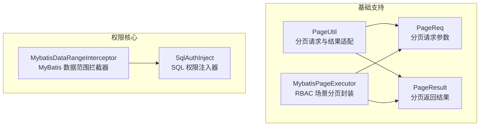
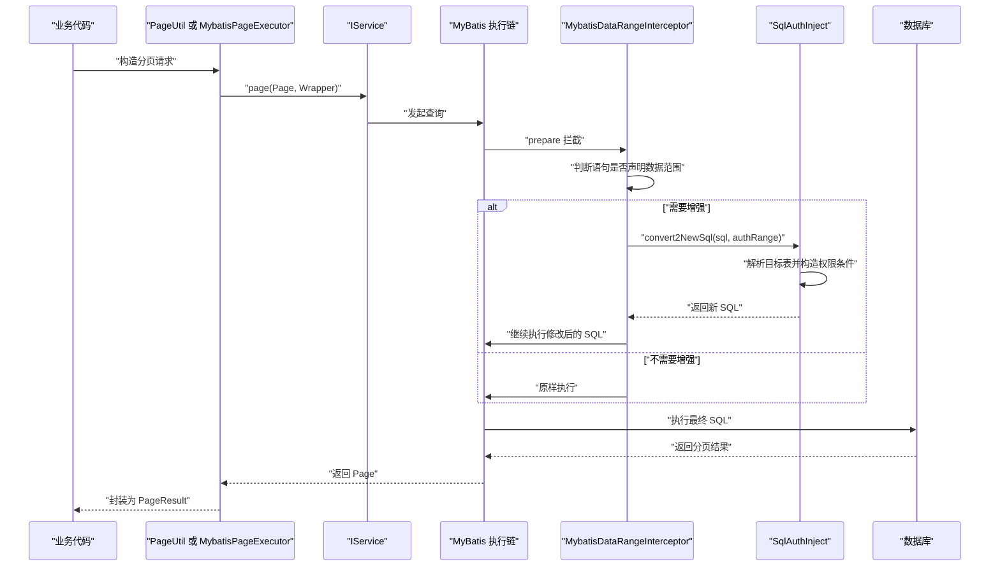
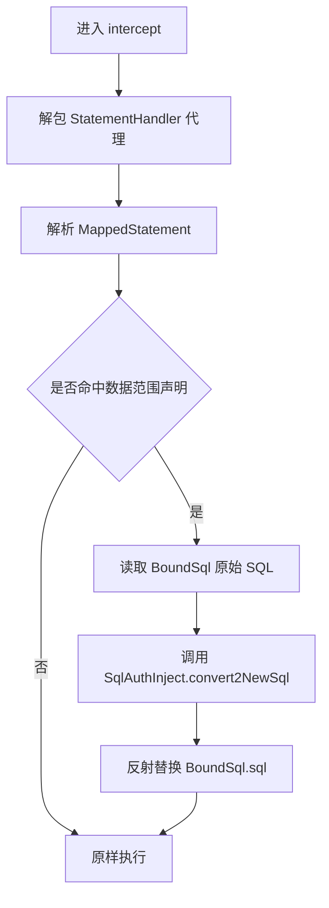
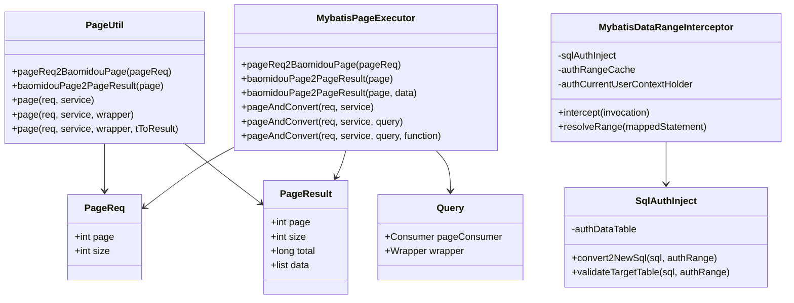

# 查询性能优化

<cite>
**本文引用的文件**   
- [PageUtil.java](file://basic-support/src/main/java/com/cu/framework/basic/support/utils/PageUtil.java)
- [MybatisPageExecutor.java](file://basic-support/src/main/java/com/cu/framework/basic/support/utils/MybatisPageExecutor.java)
- [PageReq.java](file://basic/src/main/java/com/cu/framework/basic/model/PageReq.java)
- [PageResult.java](file://basic/src/main/java/com/cu/framework/basic/model/PageResult.java)
- [MybatisDataRangeInterceptor.java](file://auth/auth-core/src/main/java/com/cu/framework/auth/core/data/range/MybatisDataRangeInterceptor.java)
- [SqlAuthInject.java](file://auth/auth-core/src/main/java/com/cu/framework/auth/core/data/range/SqlAuthInject.java)
</cite>

## 目录
1. [引言](#引言)
2. [项目结构定位](#项目结构定位)
3. [核心组件总览](#核心组件总览)
4. [架构与执行流程](#架构与执行流程)
5. [分页查询优化机制](#分页查询优化机制)
6. [数据范围拦截器分析](#数据范围拦截器分析)
7. [SQL 注入构建优化](#sql-注入构建优化)
8. [数据库索引设计原则](#数据库索引设计原则)
9. [慢查询分析与优化案例](#慢查询分析与优化案例)
10. [依赖关系分析](#依赖关系分析)
11. [性能注意事项](#性能注意事项)
12. [故障排查指南](#故障排查指南)
13. [结论](#结论)

## 引言
本文面向 Kewen Framework 的查询性能优化，重点覆盖以下能力：
- 使用 `PageUtil` 和 `MybatisPageExecutor` 将框架统一的分页请求适配到 MyBatis-Plus，减少业务层样板代码。
- 理解 `MybatisDataRangeInterceptor` 在 MyBatis 执行链路中注入数据权限 SQL 的方式、时机与风险点。
- 理解 `SqlAuthInject` 如何通过 JSqlParser 构造 `IN` 或 `EXISTS` 条件，以及空权限集合下的恒假策略。
- 给出复合索引选择、覆盖索引设计与索引维护建议，并给出可操作的慢查询分析方法与优化思路。

需要特别说明的是：当前仓库中的分页工具类本身并不直接实现“批量拉取 + 内存池化”的自定义分页算法，而是以参数转换和结果封装为主；真正的分页执行由 MyBatis-Plus 的分页插件完成。数据权限增强则通过 MyBatis 插件在物理语句准备阶段改写 SQL。

## 项目结构定位
与查询性能相关的代码主要分布在两个模块：
- `basic-support`：通用分页工具 `PageUtil`、`MybatisPageExecutor`，以及基础模型 `PageReq`、`PageResult`。
- `auth-core`：数据范围控制的核心实现，包括拦截器 `MybatisDataRangeInterceptor` 和 SQL 注入器 `SqlAuthInject`。

**图表来源**
- [PageUtil.java:1-89](file://basic-support/src/main/java/com/cu/framework/basic/support/utils/PageUtil.java#L1-L89)
- [MybatisPageExecutor.java:1-118](file://basic-support/src/main/java/com/cu/framework/basic/support/utils/MybatisPageExecutor.java#L1-L118)
- [MybatisDataRangeInterceptor.java:1-200](file://auth/auth-core/src/main/java/com/cu/framework/auth/core/data/range/MybatisDataRangeInterceptor.java#L1-L200)
- [SqlAuthInject.java:1-200](file://auth/auth-core/src/main/java/com/cu/framework/auth/core/data/range/SqlAuthInject.java#L1-L200)

**章节来源**
- [PageUtil.java:1-89](file://basic-support/src/main/java/com/cu/framework/basic/support/utils/PageUtil.java#L1-L89)
- [MybatisPageExecutor.java:1-118](file://basic-support/src/main/java/com/cu/framework/basic/support/utils/MybatisPageExecutor.java#L1-L118)
- [MybatisDataRangeInterceptor.java:1-200](file://auth/auth-core/src/main/java/com/cu/framework/auth/core/data/range/MybatisDataRangeInterceptor.java#L1-L200)
- [SqlAuthInject.java:1-200](file://auth/auth-core/src/main/java/com/cu/framework/auth/core/data/range/SqlAuthInject.java#L1-L200)

## 核心组件总览
| 组件 | 职责 | 性能相关要点 |
|---|---|---|
| `PageUtil` | 将 `PageReq` 转换为 MyBatis-Plus `Page`，并将 `Page` 转换为 `PageResult`，提供直接调用 `IService.page` 的便捷方法。 | 不改变实际 SQL；避免重复写转换逻辑；注意传入 `Wrapper` 时仍会触发一次完整分页查询。 |
| `MybatisPageExecutor` | 为 RBAC 等场景提供更灵活的分页封装，支持对 `Page` 对象预处理、携带 `Wrapper` 或直接转换结果。 | 同样委托 MyBatis-Plus 分页插件；适合需要在分页前设置额外属性的场景。 |
| `MybatisDataRangeInterceptor` | 在 MyBatis `StatementHandler.prepare` 阶段拦截真实 SQL，根据注解声明和用户权限动态改写 SQL。 | 仅 SELECT 命中；按语句 ID 缓存模板；每次请求复制权限集合，避免污染缓存。 |
| `SqlAuthInject` | 基于 JSqlParser 解析目标表，构造 `IN` 或 `EXISTS` 权限条件，并组合进 WHERE。 | 空权限集合生成恒假条件；支持子查询和 JOIN 中的目标表匹配；权限值以字面量拼接，存在潜在 SQL 注入债务。 |

**章节来源**
- [PageUtil.java:1-89](file://basic-support/src/main/java/com/cu/framework/basic/support/utils/PageUtil.java#L1-L89)
- [MybatisPageExecutor.java:1-118](file://basic-support/src/main/java/com/cu/framework/basic/support/utils/MybatisPageExecutor.java#L1-L118)
- [MybatisDataRangeInterceptor.java:1-200](file://auth/auth-core/src/main/java/com/cu/framework/auth/core/data/range/MybatisDataRangeInterceptor.java#L1-L200)
- [SqlAuthInject.java:1-200](file://auth/auth-core/src/main/java/com/cu/framework/auth/core/data/range/SqlAuthInject.java#L1-L200)

## 架构与执行流程
整体查询链路如下：
1. 业务层使用 `PageUtil` 或 `MybatisPageExecutor` 构造 MyBatis-Plus `Page`。
2. 调用 `IService.page`，进入 MyBatis 执行链。
3. `MybatisDataRangeInterceptor` 拦截 `StatementHandler.prepare`，判断是否需要数据范围增强。
4. 若命中，`SqlAuthInject` 解析 SQL 并注入权限条件。
5. MyBatis-Plus 分页插件执行带权限条件的 SQL，返回结果。
6. 工具类将结果封装为 `PageResult`。

**图表来源**
- [PageUtil.java:1-89](file://basic-support/src/main/java/com/cu/framework/basic/support/utils/PageUtil.java#L1-L89)
- [MybatisPageExecutor.java:1-118](file://basic-support/src/main/java/com/cu/framework/basic/support/utils/MybatisPageExecutor.java#L1-L118)
- [MybatisDataRangeInterceptor.java:1-200](file://auth/auth-core/src/main/java/com/cu/framework/auth/core/data/range/MybatisDataRangeInterceptor.java#L1-L200)
- [SqlAuthInject.java:1-200](file://auth/auth-core/src/main/java/com/cu/framework/auth/core/data/range/SqlAuthInject.java#L1-L200)

## 分页查询优化机制

### PageUtil 的职责与边界
`PageUtil` 的核心价值是统一分页入口：
- 将 `PageReq` 的页码和每页条数转换为 MyBatis-Plus `Page`。
- 将 `Page` 的结果转为 `PageResult`，包含页码、大小、总数和数据列表。
- 提供 `page(req, service)`、`page(req, service, wrapper)` 等重载，简化业务调用。
- 支持对返回数据做函数式映射，把实体转为视图对象。

需要注意：
- 它不自行分批读取大结果集，也不控制底层 SQL。
- 如果传入 `wrapper`，仍需保证 `wrapper` 的条件能走索引。
- 如果返回数据很大，最后的 `stream().map()` 会把整批数据加载到内存再做转换。

**章节来源**
- [PageUtil.java:1-89](file://basic-support/src/main/java/com/cu/framework/basic/support/utils/PageUtil.java#L1-L89)

### MybatisPageExecutor 的职责与边界
`MybatisPageExecutor` 更适合需要更细粒度控制分页对象的场景：
- 提供 `Query<T>`，允许在分页前对 `Page` 对象执行自定义处理。
- 支持传入 `Wrapper<T>` 作为查询条件。
- 支持对结果列表进行函数式转换。

性能相关点：
- 默认仍是一次性获取 `total` 和 `records`，由 MyBatis-Plus 分页插件决定具体 SQL。
- 如果 `Query` 的 `pageConsumer` 设置了分页参数（例如游标分页、延迟加载），应配合上层分页插件配置使用。
- 结果转换发生在内存中，大数据量下要评估对象创建和 GC 压力。

**章节来源**
- [MybatisPageExecutor.java:1-118](file://basic-support/src/main/java/com/cu/framework/basic/support/utils/MybatisPageExecutor.java#L1-L118)

### 分页参数转换与内存占用
| 阶段 | 行为 | 内存影响 | 优化建议 |
|---|---|---|---|
| 请求参数转换 | `PageReq` 转 `Page` | 极小 | 保持 `size` 合理，避免单页过大。 |
| SQL 执行 | MyBatis-Plus 分页插件生成 `LIMIT` 类分页 SQL | 取决于每页记录数和字段大小 | 只查必要列，避免 `SELECT *`。 |
| 结果封装 | `Page` 转 `PageResult` | 拷贝引用列表，本身开销较小 | 避免再次复制整个列表。 |
| 结果映射 | `List<T>` 转 `List<R>` | 新建 R 对象，可能产生大量临时对象 | 大数据列表优先在服务端投影或分批处理。 |

[本节为通用指导，不直接分析具体源码片段]

## 数据范围拦截器分析

### 拦截位置与触发条件
`MybatisDataRangeInterceptor` 注册在 MyBatis 的 `StatementHandler.prepare` 上，这是每条物理语句执行前的关键点：
- 拦截目标是真实执行的 SQL，而不是抽象的映射语句定义。
- 只有被声明数据范围的 SELECT 语句才会被增强。
- 非 SELECT 语句即使误标也不会改写，启动校验负责发现错误声明。

该设计的好处是：
- 每个语句独立判定，嵌套子查询也按自身语句 ID 判断。
- 不需要跨语句的作用域上下文，降低并发上下文污染风险。

**章节来源**
- [MybatisDataRangeInterceptor.java:1-200](file://auth/auth-core/src/main/java/com/cu/framework/auth/core/data/range/MybatisDataRangeInterceptor.java#L1-L200)

### 语句身份解析与代理解包
拦截器从被拦截目标逐层解包 MyBatis 的动态代理，再读取 `delegate.mappedStatement`：
- 如果无法解析映射语句，直接抛出异常，而不是静默放行。
- 这样能避免“因为识别失败而跳过权限过滤”的安全隐患。
- 解包过程有最大深度保护，防止异常链路下的无限循环。

**图表来源**
- [MybatisDataRangeInterceptor.java:1-200](file://auth/auth-core/src/main/java/com/cu/framework/auth/core/data/range/MybatisDataRangeInterceptor.java#L1-L200)

### 权限集合隔离与缓存复用
拦截器从 `AuthRangeCache` 取出语句级模板后，会调用 `copy()` 并设置当前请求的权限集合：
- 模板是共享的，但权限集合必须属于当前请求。
- 这避免多用户并发时权限范围互相污染。
- 权限集合为空时，后续 SQL 注入会退化为恒假条件，即“看不到任何行”。

**章节来源**
- [MybatisDataRangeInterceptor.java:1-200](file://auth/auth-core/src/main/java/com/cu/framework/auth/core/data/range/MybatisDataRangeInterceptor.java#L1-L200)

### SQL 注入优化与安全注意事项
`SqlAuthInject` 的行为可以概括为：
1. 用 JSqlParser 解析 SQL。
2. 找到声明的目标表，支持主表、JOIN 子表和子查询中的目标表。
3. 根据 `MatchMethod.IN` 或 `MatchMethod.EXISTS` 构造权限条件。
4. 将条件写入 WHERE，并与原有 WHERE 用 AND 组合。

关键优化点：
- 空权限集合不构造无意义的 `authority IN ()`，而是生成恒假条件，语义清晰且避免语法问题。
- 支持子查询递归查找，使复杂 SQL 也能正确定位目标表。
- 支持 WITH 子句、JOIN 等多种 SQL 形态。

安全风险：
- 权限值以字符串字面量直接拼入 SQL，注释中指出如果未来接入字符串类型权限 ID，可能形成 SQL 注入面。
- 当前依赖权限 ID 来自整数 ID 拼接的前提，不能因此认为天然安全。

**章节来源**
- [SqlAuthInject.java:1-200](file://auth/auth-core/src/main/java/com/cu/framework/auth/core/data/range/SqlAuthInject.java#L1-L200)
- [SqlAuthInject.java:201-441](file://auth/auth-core/src/main/java/com/cu/framework/auth/core/data/range/SqlAuthInject.java#L201-L441)

## SQL 注入构建优化

### 目标表匹配策略
`SqlAuthInject` 的表匹配顺序大致为：
1. 最外层 `FROM` 的主表。
2. `WITH` 子句中的命名查询。
3. 当前 `PlainSelect` 的主表。
4. `JOIN` 中的关联表。
5. WHERE 子查询中的目标表。

匹配规则考虑了：
- 表名相等即匹配。
- 配置了别名时，要求别名一致。
- 未配置别名时只比较表名。

这种设计让常见单表、多表 JOIN、子查询都能工作，但也意味着：
- 如果 SQL 中目标表别名与注解不一致，会抛“没有匹配到目标表”的异常。
- 复杂派生表或动态表名需要谨慎设计。

**章节来源**
- [SqlAuthInject.java:201-441](file://auth/auth-core/src/main/java/com/cu/framework/auth/core/data/range/SqlAuthInject.java#L201-L441)

### IN 模式与 EXISTS 模式
| 模式 | 生成的权限条件语义 | 适用场景 | 性能特点 |
|---|---|---|---|
| `IN` | 主表主键 IN (权限子查询) | 权限集合较小、子查询结果较少 | 子查询结果过多可能导致 IN 列表膨胀。 |
| `EXISTS` | EXISTS (权限表关联主表主键) | 权限集合较大、希望尽早短路 | 通常更容易利用索引和半连接优化。 |

`SqlAuthInject` 同时支持两种模式，由 `AuthRange.MatchMethod` 决定。

**章节来源**
- [SqlAuthInject.java:201-441](file://auth/auth-core/src/main/java/com/cu/framework/auth/core/data/range/SqlAuthInject.java#L201-L441)

### 动态条件拼接与语句复用
- 每次拦截都会重新解析 SQL 并生成新 SQL，因此不是简单复用某条静态 SQL。
- 真正复用的是语句级的数据范围模板，以及权限表的列名配置。
- 如果同一 Mapper 方法多次执行，JSqlParser 解析和表达式构造会带来一定 CPU 开销。

优化方向：
- 控制 SQL 复杂度，避免过度嵌套。
- 对热点语句确保目标表匹配稳定，减少解析分支。
- 在应用层避免频繁切换不同权限维度导致 SQL 碎片化。

**章节来源**
- [MybatisDataRangeInterceptor.java:1-200](file://auth/auth-core/src/main/java/com/cu/framework/auth/core/data/range/MybatisDataRangeInterceptor.java#L1-L200)
- [SqlAuthInject.java:1-200](file://auth/auth-core/src/main/java/com/cu/framework/auth/core/data/range/SqlAuthInject.java#L1-L200)

## 数据库索引设计原则

### 复合索引选择
数据权限注入后，典型权限表查询条件包含：
- 业务功能标识。
- 操作类型。
- 权限集合。
- 与被控业务表主键的关联关系。

建议：
- 优先建立 `(business_function, operate, authority)` 方向的复合索引，用于快速筛选权限集合。
- 如果需要高效关联业务表主键，考虑 `(data_id, business_function, operate)` 或 `(data_id, authority)` 的组合索引。
- 复合索引列顺序应按区分度、等值过滤、范围过滤和连接条件综合评估。

[本节为通用索引设计指导，不直接分析具体源码片段]

### 覆盖索引设计
当分页查询经常带上业务状态、时间等过滤条件时，可以考虑覆盖索引：
- 将常用过滤列放在索引前缀。
- 将需要返回的少量列放入覆盖索引，减少回表。
- 注意覆盖索引可能增大索引体积，需权衡写入成本和读取收益。

[本节为通用索引设计指导，不直接分析具体源码片段]

### 索引维护策略
- 监控慢查询日志，重点关注权限注入后的 SQL。
- 定期分析索引使用情况，删除长期未使用的冗余索引。
- 大批量更新权限数据后，及时统计信息更新。
- 对高频分页接口单独验证执行计划，避免新增索引反而干扰优化器。

[本节为通用索引设计指导，不直接分析具体源码片段]

## 慢查询分析与优化案例

### 慢查询分析方法
推荐按以下步骤分析：
1. 开启慢查询日志，捕获耗时超过阈值的 SQL。
2. 使用执行计划查看是否走了预期索引。
3. 检查 WHERE 条件是否与索引列顺序匹配。
4. 检查权限注入后是否出现全表扫描、临时表、文件排序。
5. 对比优化前后的执行计划、扫描行数、返回行数。

[本节为通用方法论，不直接分析具体源码片段]

### 优化案例一：IN 模式权限条件膨胀
**现象**  
权限集合很大时，`table.id IN (select data_id from sys_auth_data ...)` 导致子查询结果过多，执行计划中出现大型 IN 列表或哈希连接。

**优化建议**  
- 改用 `EXISTS` 模式，让数据库有机会使用半连接。
- 为权限表建立 `(data_id, business_function, operate, authority)` 类索引。
- 控制单用户权限数量，必要时拆分布局表或引入权限分组。

[本节为通用优化案例，不直接分析具体源码片段]

### 优化案例二：WHERE 条件与索引顺序不匹配
**现象**  
SQL 先写大范围条件，再写精确条件，但索引顺序是先精确列后范围列，导致优化器放弃索引或使用索引扫描。

**优化建议**  
- 调整复合索引列顺序，使等值列在前、范围列在后。
- 或者为不同查询模式分别建索引。
- 避免在索引列上使用函数或表达式。

[本节为通用优化案例，不直接分析具体源码片段]

### 优化案例三：分页查询返回字段过多
**现象**  
分页接口返回大量大字段，导致网络传输和对象序列化成本升高。

**优化建议**  
- 使用 DTO 投影，只查必要列。
- 列表页与详情页分离，详情页按需加载。
- 避免 `SELECT *`，尤其在 JOIN 场景中。

[本节为通用优化案例，不直接分析具体源码片段]

## 依赖关系分析

**图表来源**
- [PageUtil.java:1-89](file://basic-support/src/main/java/com/cu/framework/basic/support/utils/PageUtil.java#L1-L89)
- [MybatisPageExecutor.java:1-118](file://basic-support/src/main/java/com/cu/framework/basic/support/utils/MybatisPageExecutor.java#L1-L118)
- [MybatisDataRangeInterceptor.java:1-200](file://auth/auth-core/src/main/java/com/cu/framework/auth/core/data/range/MybatisDataRangeInterceptor.java#L1-L200)
- [SqlAuthInject.java:1-200](file://auth/auth-core/src/main/java/com/cu/framework/auth/core/data/range/SqlAuthInject.java#L1-L200)

**章节来源**
- [PageUtil.java:1-89](file://basic-support/src/main/java/com/cu/framework/basic/support/utils/PageUtil.java#L1-L89)
- [MybatisPageExecutor.java:1-118](file://basic-support/src/main/java/com/cu/framework/basic/support/utils/MybatisPageExecutor.java#L1-L118)
- [MybatisDataRangeInterceptor.java:1-200](file://auth/auth-core/src/main/java/com/cu/framework/auth/core/data/range/MybatisDataRangeInterceptor.java#L1-L200)
- [SqlAuthInject.java:1-200](file://auth/auth-core/src/main/java/com/cu/framework/auth/core/data/range/SqlAuthInject.java#L1-L200)

## 性能注意事项
- 分页大小不宜过大：默认一次性加载整页数据，过大的 `size` 会增加内存和 GC 压力。
- 谨慎使用 `Wrapper`：条件越复杂，越容易偏离索引，需要结合执行计划验证。
- 关注权限注入带来的 SQL 变化：`IN` 与 `EXISTS` 在不同数据分布下表现差异明显。
- 避免在业务层二次复制结果集：如果只需要部分字段，尽量在服务层或 SQL 层完成投影。
- 监控 JSqlParser 解析开销：对于极热路径，应避免过于复杂的 SQL 和频繁变化的权限维度。

[本节为通用性能建议，不直接分析具体源码片段]

## 故障排查指南

### 无法解析 MyBatis 映射语句
**现象**  
拦截器抛出无法解析 `MappedStatement` 的异常。

**原因**  
- MyBatis 插件链异常，导致无法拿到真实的 `StatementHandler`。
- 自定义插件包装层级过深，超出解包上限。

**处理**  
- 检查自定义插件是否正确实现和注册。
- 减少不必要的代理包装。
- 确认拦截器优先级不会破坏 MyBatis 内部结构。

**章节来源**
- [MybatisDataRangeInterceptor.java:1-200](file://auth/auth-core/src/main/java/com/cu/framework/auth/core/data/range/MybatisDataRangeInterceptor.java#L1-L200)

### 没有匹配到 SQL 对应的表
**现象**  
`SqlAuthInject` 抛出没有匹配到目标表的异常。

**原因**  
- SQL 中目标表别名与注解配置不一致。
- SQL 使用了派生表或动态表名。
- 目标表不在 FROM、JOIN、WITH 或 WHERE 子查询中能被识别的位置。

**处理**  
- 核对注解中的表名和别名。
- 简化 SQL，避免隐藏目标表。
- 对复杂 SQL 单独验证 `validateTargetTable` 是否能通过。

**章节来源**
- [SqlAuthInject.java:1-200](file://auth/auth-core/src/main/java/com/cu/framework/auth/core/data/range/SqlAuthInject.java#L1-L200)
- [SqlAuthInject.java:201-441](file://auth/auth-core/src/main/java/com/cu/framework/auth/core/data/range/SqlAuthInject.java#L201-L441)

### 权限为空导致查询结果为空
**现象**  
某些用户或角色查询不到数据。

**原因**  
- 当前用户权限集合为空。
- 权限集合中没有匹配的业务功能或操作类型。

**处理**  
- 检查当前登录用户的权限数据。
- 检查 `AuthRange` 声明的 `businessFunction` 和 `operate` 是否与权限表一致。
- 确认空权限集合确实是期望行为，而非权限数据缺失。

**章节来源**
- [SqlAuthInject.java:1-200](file://auth/auth-core/src/main/java/com/cu/framework/auth/core/data/range/SqlAuthInject.java#L1-L200)

### 分页结果数量异常
**现象**  
分页总数或列表数据不符合预期。

**原因**  
- `PageReq` 的页码或大小传错。
- `Wrapper` 条件过滤了数据。
- 权限注入进一步缩小了可见数据集。

**处理**  
- 打印最终 SQL 和执行计划。
- 分别测试无权限注入和有权限注入的 SQL。
- 检查 `PageUtil` 或 `MybatisPageExecutor` 调用链中是否修改了分页参数。

**章节来源**
- [PageUtil.java:1-89](file://basic-support/src/main/java/com/cu/framework/basic/support/utils/PageUtil.java#L1-L89)
- [MybatisPageExecutor.java:1-118](file://basic-support/src/main/java/com/cu/framework/basic/support/utils/MybatisPageExecutor.java#L1-L118)
- [MybatisDataRangeInterceptor.java:1-200](file://auth/auth-core/src/main/java/com/cu/framework/auth/core/data/range/MybatisDataRangeInterceptor.java#L1-L200)

## 结论
Kewen Framework 的查询性能优化建立在两条主线之上：
- 分页层面：通过 `PageUtil` 和 `MybatisPageExecutor` 统一适配 MyBatis-Plus，减少样板代码，但实际分页性能和 SQL 质量仍依赖合理的分页参数、索引和 SQL 设计。
- 权限层面：通过 `MybatisDataRangeInterceptor` 和 `SqlAuthInject` 在 SQL 准备阶段注入数据范围，兼顾安全性与灵活性，但也带来 SQL 解析、权限值拼接和索引匹配的额外复杂度。

实践中应优先关注：
- 分页大小、返回字段和 `Wrapper` 条件是否合理。
- 权限表索引是否覆盖 `business_function`、`operate`、`authority` 和关联主键。
- 权限注入后的 SQL 执行计划是否稳定。
- 是否存在 SQL 注入债务和安全边界，特别是在权限值来源不可信的场景。