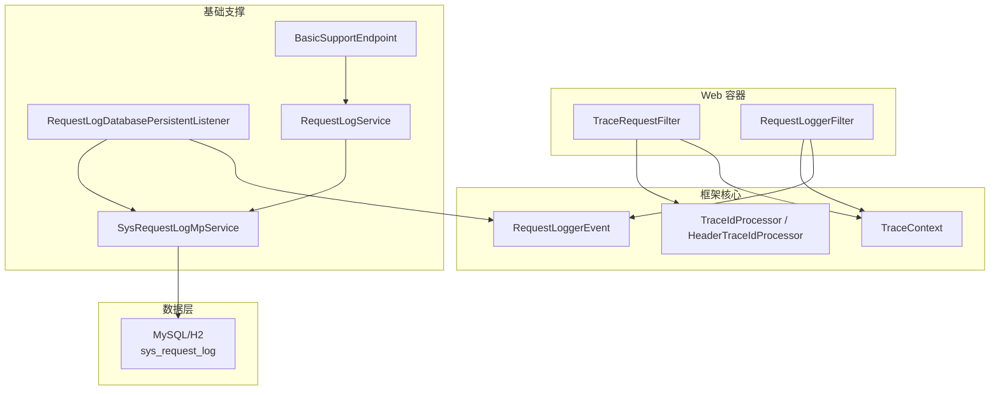
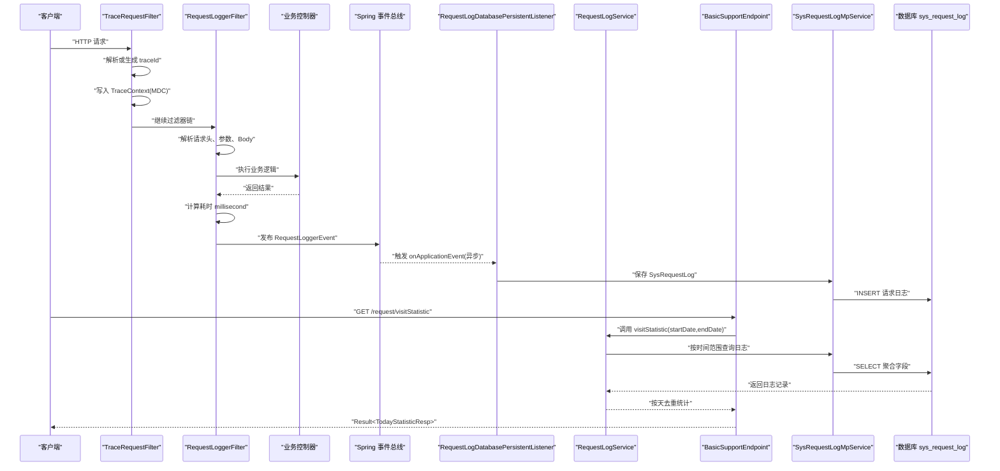
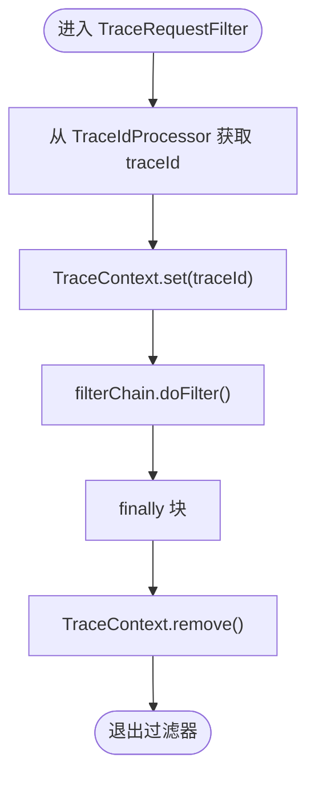
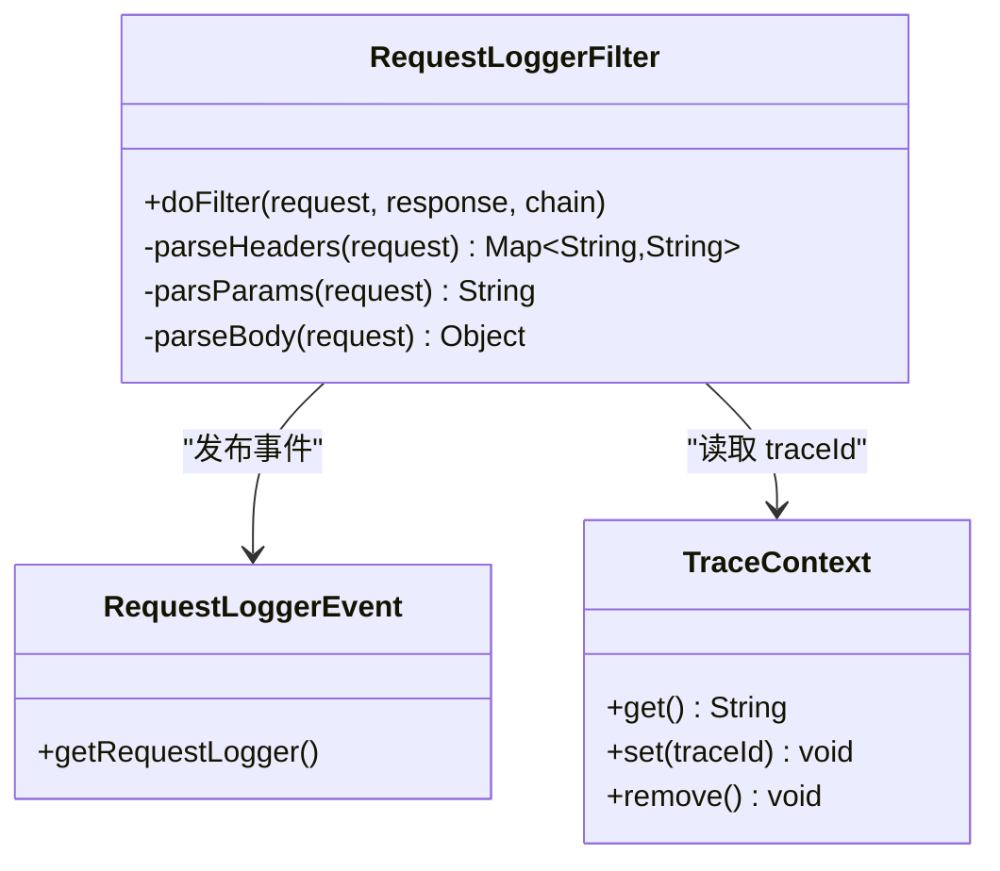
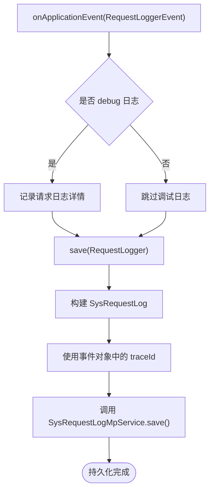
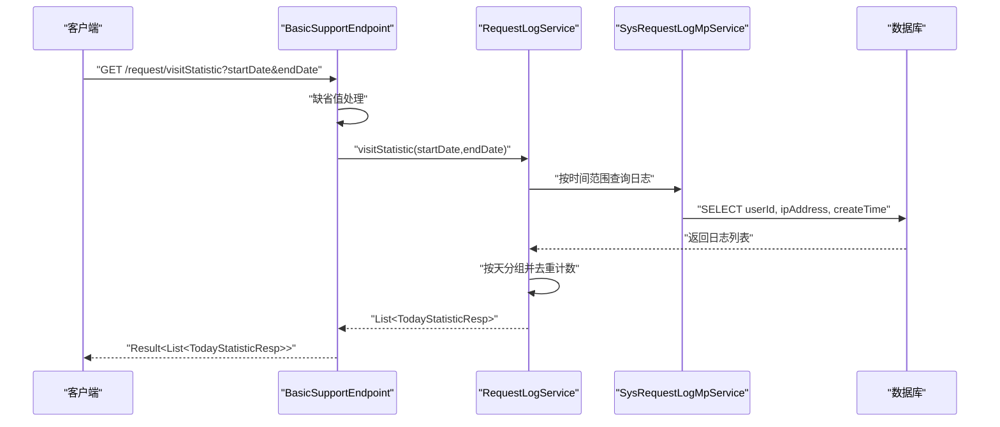
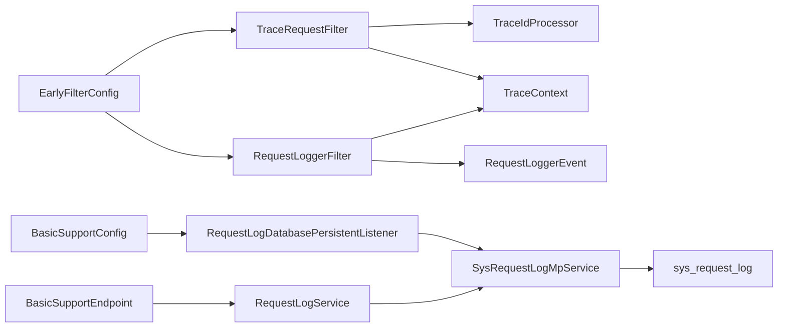

# 系统监控与性能分析

<cite>
**本文引用的文件**   
- [TraceRequestFilter.java](file://basic/src/main/java/com/cu/framework/basic/logger/TraceRequestFilter.java)
- [RequestLoggerFilter.java](file://basic/src/main/java/com/cu/framework/basic/logger/RequestLoggerFilter.java)
- [TraceContext.java](file://basic/src/main/java/com/cu/framework/basic/logger/trace/TraceContext.java)
- [TraceIdProcessor.java](file://basic/src/main/java/com/cu/framework/basic/logger/trace/TraceIdProcessor.java)
- [HeaderTraceIdProcessor.java](file://basic/src/main/java/com/cu/framework/basic/logger/trace/HeaderTraceIdProcessor.java)
- [RequestLoggerEvent.java](file://basic/src/main/java/com/cu/framework/basic/logger/request/RequestLoggerEvent.java)
- [RequestLogDatabasePersistentListener.java](file://basic-support/src/main/java/com/cu/framework/basic/support/log/RequestLogDatabasePersistentListener.java)
- [BasicSupportConfig.java](file://boot/basic-spring-boot-starter/src/main/java/com/cu/framework/boot/basic/config/BasicSupportConfig.java)
- [EarlyFilterConfig.java](file://boot/basic-spring-boot-starter/src/main/java/com/cu/framework/boot/basic/config/EarlyFilterConfig.java)
- [BasicSupportEndpoint.java](file://basic-support/src/main/java/com/cu/framework/basic/support/BasicSupportEndpoint.java)
- [RequestLogService.java](file://basic-support/src/main/java/com/cu/framework/basic/support/log/persistent/RequestLogService.java)
- [TodayStatisticResp.java](file://basic-support/src/main/java/com/cu/framework/basic/support/log/persistent/TodayStatisticResp.java)
- [basic-support.sql](file://docs/sql/basic-support.sql)
- [request-tracing/spec.md](file://openspec/specs/observability/request-tracing/spec.md)
</cite>

## 目录
1. [引言](#引言)
2. [项目结构](#项目结构)
3. [核心组件](#核心组件)
4. [架构总览](#架构总览)
5. [详细组件分析](#详细组件分析)
6. [依赖关系分析](#依赖关系分析)
7. [性能与可观测性指南](#性能与可观测性指南)
8. [监控告警配置示例](#监控告警配置示例)
9. [故障排查与定位方法论](#故障排查与定位方法论)
10. [结论](#结论)

## 引言
本文面向 Kewen Framework 的系统监控与性能分析能力，围绕请求链路追踪、请求日志持久化、基础监控接口以及 APM 与 JVM 调优实践展开。重点说明以下三类能力：
- 请求链路追踪：通过 TraceRequestFilter 注入并清理 traceId，配合 TraceContext 保障线程复用场景下的上下文隔离。
- 请求日志持久化：通过 RequestLoggerFilter 采集请求参数、响应耗时等指标，并以异步事件驱动方式写入数据库 sys_request_log。
- 基础监控接口：通过 BasicSupportEndpoint 暴露访问统计查询，结合 RequestLogService 按天汇总独立 IP 与用户数。

## 项目结构
本次文档涉及的主要模块如下：
- basic：提供通用过滤器、日志上下文、流水号处理器与请求日志事件模型。
- basic-support：提供请求日志持久化监听器、MyBatis-Plus 实体与服务、基础监控端点及统计服务。
- boot/basic-spring-boot-starter：将过滤器、监听器、端点装配为 Spring Bean，并通过条件注解启用持久化能力。
- docs/sql/basic-support.sql：定义 sys_request_log 等基础表结构。
- openspec/specs/observability/request-tracing/spec.md：定义请求流水号在生命周期内的正确行为契约。

**图表来源**
- [TraceRequestFilter.java:1-60](file://basic/src/main/java/com/cu/framework/basic/logger/TraceRequestFilter.java#L1-L60)
- [RequestLoggerFilter.java:1-133](file://basic/src/main/java/com/cu/framework/basic/logger/RequestLoggerFilter.java#L1-L133)
- [TraceContext.java:1-22](file://basic/src/main/java/com/cu/framework/basic/logger/trace/TraceContext.java#L1-L22)
- [TraceIdProcessor.java:1-18](file://basic/src/main/java/com/cu/framework/basic/logger/trace/TraceIdProcessor.java#L1-L18)
- [HeaderTraceIdProcessor.java:1-27](file://basic/src/main/java/com/cu/framework/basic/logger/trace/HeaderTraceIdProcessor.java#L1-L27)
- [RequestLoggerEvent.java:1-23](file://basic/src/main/java/com/cu/framework/basic/logger/request/RequestLoggerEvent.java#L1-L23)
- [RequestLogDatabasePersistentListener.java:1-66](file://basic-support/src/main/java/com/cu/framework/basic/support/log/RequestLogDatabasePersistentListener.java#L1-L66)
- [RequestLogService.java:1-60](file://basic-support/src/main/java/com/cu/framework/basic/support/log/persistent/RequestLogService.java#L1-L60)
- [BasicSupportEndpoint.java:1-46](file://basic-support/src/main/java/com/cu/framework/basic/support/BasicSupportEndpoint.java#L1-L46)
- [basic-support.sql:1-79](file://docs/sql/basic-support.sql#L1-L79)

**章节来源**
- [TraceRequestFilter.java:1-60](file://basic/src/main/java/com/cu/framework/basic/logger/TraceRequestFilter.java#L1-L60)
- [RequestLoggerFilter.java:1-133](file://basic/src/main/java/com/cu/framework/basic/logger/RequestLoggerFilter.java#L1-L133)
- [BasicSupportEndpoint.java:1-46](file://basic-support/src/main/java/com/cu/framework/basic/support/BasicSupportEndpoint.java#L1-L46)
- [basic-support.sql:1-79](file://docs/sql/basic-support.sql#L1-L79)

## 核心组件
- 请求链路追踪
  - TraceRequestFilter：作为最早执行的过滤器之一，负责从上游获取或生成 traceId，并将其写入 MDC 供日志输出使用；在 finally 中确保清理，避免线程复用污染。
  - TraceContext：对 MDC 的封装，提供固定键的 set/get/remove，保证日志上下文一致性。
  - TraceIdProcessor 与 HeaderTraceIdProcessor：抽象出流水号获取策略；默认实现从请求头读取，缺失时生成 UUID。
- 请求日志采集与持久化
  - RequestLoggerFilter：采集请求头、param、body、IP、URL、方法、耗时等指标，打印结构化日志，并在 finally 中发布 RequestLoggerEvent。
  - RequestLogDatabasePersistentListener：异步消费事件，将请求日志转换为 SysRequestLog 并落库；为避免异步线程丢失 TraceContext，直接使用事件对象中的 traceId。
  - RequestLogService：基于 MyBatis-Plus 聚合查询 sys_request_log，按天统计独立 IP 和独立用户数。
- 监控接口
  - BasicSupportEndpoint：暴露 /request/visitStatistic，支持按日期区间返回每日访问统计结果。

**章节来源**
- [TraceRequestFilter.java:1-60](file://basic/src/main/java/com/cu/framework/basic/logger/TraceRequestFilter.java#L1-L60)
- [TraceContext.java:1-22](file://basic/src/main/java/com/cu/framework/basic/logger/trace/TraceContext.java#L1-L22)
- [TraceIdProcessor.java:1-18](file://basic/src/main/java/com/cu/framework/basic/logger/trace/TraceIdProcessor.java#L1-L18)
- [HeaderTraceIdProcessor.java:1-27](file://basic/src/main/java/com/cu/framework/basic/logger/trace/HeaderTraceIdProcessor.java#L1-L27)
- [RequestLoggerFilter.java:1-133](file://basic/src/main/java/com/cu/framework/basic/logger/RequestLoggerFilter.java#L1-L133)
- [RequestLoggerEvent.java:1-23](file://basic/src/main/java/com/cu/framework/basic/logger/request/RequestLoggerEvent.java#L1-L23)
- [RequestLogDatabasePersistentListener.java:1-66](file://basic-support/src/main/java/com/cu/framework/basic/support/log/RequestLogDatabasePersistentListener.java#L1-L66)
- [RequestLogService.java:1-60](file://basic-support/src/main/java/com/cu/framework/basic/support/log/persistent/RequestLogService.java#L1-L60)
- [BasicSupportEndpoint.java:1-46](file://basic-support/src/main/java/com/cu/framework/basic/support/BasicSupportEndpoint.java#L1-L46)

## 架构总览
Kewen Framework 的请求监控链路遵循“过滤器采集 + 事件解耦 + 异步持久化”的模式：
- TraceRequestFilter 最先执行，建立 traceId 上下文。
- RequestLoggerFilter 随后执行，采集完整请求元信息并计算耗时。
- RequestLoggerFilter 发布 RequestLoggerEvent，由监听器异步处理。
- RequestLogDatabasePersistentListener 将日志写入 sys_request_log。
- BasicSupportEndpoint 对外暴露访问统计接口，底层由 RequestLogService 聚合查询。

**图表来源**
- [TraceRequestFilter.java:1-60](file://basic/src/main/java/com/cu/framework/basic/logger/TraceRequestFilter.java#L1-L60)
- [RequestLoggerFilter.java:1-133](file://basic/src/main/java/com/cu/framework/basic/logger/RequestLoggerFilter.java#L1-L133)
- [RequestLoggerEvent.java:1-23](file://basic/src/main/java/com/cu/framework/basic/logger/request/RequestLoggerEvent.java#L1-L23)
- [RequestLogDatabasePersistentListener.java:1-66](file://basic-support/src/main/java/com/cu/framework/basic/support/log/RequestLogDatabasePersistentListener.java#L1-L66)
- [BasicSupportEndpoint.java:1-46](file://basic-support/src/main/java/com/cu/framework/basic/support/BasicSupportEndpoint.java#L1-L46)
- [RequestLogService.java:1-60](file://basic-support/src/main/java/com/cu/framework/basic/support/log/persistent/RequestLogService.java#L1-L60)
- [basic-support.sql:1-79](file://docs/sql/basic-support.sql#L1-L79)

## 详细组件分析

### 请求链路追踪：TraceRequestFilter
TraceRequestFilter 是请求链路追踪的入口。其职责包括：
- 优先从容器中获取自定义 TraceIdProcessor，否则回退到 HeaderTraceIdProcessor。
- 从请求中提取或生成 traceId，并写入 TraceContext（MDC）。
- 在 finally 块中移除 traceId，防止线程池复用导致上下文污染。

该设计满足规范中对“流水号清除按固定键生效”“请求结束时必须清除”的要求，从而避免线程复用时的跨请求污染。

**图表来源**
- [TraceRequestFilter.java:1-60](file://basic/src/main/java/com/cu/framework/basic/logger/TraceRequestFilter.java#L1-L60)
- [TraceContext.java:1-22](file://basic/src/main/java/com/cu/framework/basic/logger/trace/TraceContext.java#L1-L22)
- [request-tracing/spec.md:1-40](file://openspec/specs/observability/request-tracing/spec.md#L1-L40)

**章节来源**
- [TraceRequestFilter.java:1-60](file://basic/src/main/java/com/cu/framework/basic/logger/TraceRequestFilter.java#L1-L60)
- [TraceContext.java:1-22](file://basic/src/main/java/com/cu/framework/basic/logger/trace/TraceContext.java#L1-L22)
- [HeaderTraceIdProcessor.java:1-27](file://basic/src/main/java/com/cu/framework/basic/logger/trace/HeaderTraceIdProcessor.java#L1-L27)
- [request-tracing/spec.md:1-40](file://openspec/specs/observability/request-tracing/spec.md#L1-L40)

### 请求日志采集：RequestLoggerFilter
RequestLoggerFilter 承担请求元数据采集与耗时统计的职责：
- 解析请求头、param、body，并包装请求以支持 body 重复读取。
- 使用 TraceContext.get() 获取当前 traceId。
- 使用 RequestIpUtil 获取客户端 IP。
- 计算请求耗时 millisecond，并打印结构化日志。
- 在 finally 中发布 RequestLoggerEvent，将请求日志交给监听器异步处理。

**图表来源**
- [RequestLoggerFilter.java:1-133](file://basic/src/main/java/com/cu/framework/basic/logger/RequestLoggerFilter.java#L1-L133)
- [RequestLoggerEvent.java:1-23](file://basic/src/main/java/com/cu/framework/basic/logger/request/RequestLoggerEvent.java#L1-L23)
- [TraceContext.java:1-22](file://basic/src/main/java/com/cu/framework/basic/logger/trace/TraceContext.java#L1-L22)

**章节来源**
- [RequestLoggerFilter.java:1-133](file://basic/src/main/java/com/cu/framework/basic/logger/RequestLoggerFilter.java#L1-L133)
- [RequestLoggerEvent.java:1-23](file://basic/src/main/java/com/cu/framework/basic/logger/request/RequestLoggerEvent.java#L1-L23)

### 请求日志持久化：RequestLogDatabasePersistentListener
该监听器通过 Spring ApplicationEvent 机制接收 RequestLoggerEvent，并使用 @Async 异步处理，以避免阻塞主请求线程。关键特性：
- 开启请求日志数据库持久化时，构造阶段会记录启动日志。
- onApplicationEvent 中调用 save，将 RequestLogger 转为 SysRequestLog 并调用 MyBatis-Plus 服务保存。
- 为避免异步线程丢失 TraceContext，save 方法直接从 event.getRequestLogger().getTraceId() 取 traceId。

**图表来源**
- [RequestLogDatabasePersistentListener.java:1-66](file://basic-support/src/main/java/com/cu/framework/basic/support/log/RequestLogDatabasePersistentListener.java#L1-L66)

**章节来源**
- [RequestLogDatabasePersistentListener.java:1-66](file://basic-support/src/main/java/com/cu/framework/basic/support/log/RequestLogDatabasePersistentListener.java#L1-L66)

### 监控接口：BasicSupportEndpoint
BasicSupportEndpoint 提供 /request/visitStatistic 接口，用于按日期区间查询每日访问统计。其特点：
- startDate 与 endDate 可选；未传入时使用当天日期。
- 返回 Result<TodayStatisticResp>，其中 TodayStatisticResp 包含 day、ipCount、userCount。
- 统计逻辑委托给 RequestLogService.visitStatistic，内部按 create_time 做闭区间查询并按天分组。

**图表来源**
- [BasicSupportEndpoint.java:1-46](file://basic-support/src/main/java/com/cu/framework/basic/support/BasicSupportEndpoint.java#L1-L46)
- [RequestLogService.java:1-60](file://basic-support/src/main/java/com/cu/framework/basic/support/log/persistent/RequestLogService.java#L1-L60)
- [TodayStatisticResp.java:1-23](file://basic-support/src/main/java/com/cu/framework/basic/support/log/persistent/TodayStatisticResp.java#L1-L23)

**章节来源**
- [BasicSupportEndpoint.java:1-46](file://basic-support/src/main/java/com/cu/framework/basic/support/BasicSupportEndpoint.java#L1-L46)
- [RequestLogService.java:1-60](file://basic-support/src/main/java/com/cu/framework/basic/support/log/persistent/RequestLogService.java#L1-L60)
- [TodayStatisticResp.java:1-23](file://basic-support/src/main/java/com/cu/framework/basic/support/log/persistent/TodayStatisticResp.java#L1-L23)

## 依赖关系分析
- 装配关系
  - EarlyFilterConfig 注册 TraceRequestFilter、RequestLoggerFilter 与 EarlyRequestFilterProxy，确保两个过滤器以期望顺序参与请求处理。
  - BasicSupportConfig 扫描 basic.support 包，注册 MyBatis-Plus Mapper，并根据条件属性启用 RequestLogDatabasePersistentListener 与方糖消息监听器。
- 运行时依赖
  - TraceRequestFilter 依赖 TraceIdProcessor（默认 HeaderTraceIdProcessor）与 TraceContext。
  - RequestLoggerFilter 依赖 TraceContext、RequestIpUtil 与 Spring ApplicationEventPublisher。
  - RequestLogDatabasePersistentListener 依赖 SysRequestLogMpService 与 TraceContext（仅用于调试日志），但持久化时直接读取事件对象的 traceId。
  - BasicSupportEndpoint 依赖 RequestLogService；RequestLogService 依赖 SysRequestLogMpService。
- 数据依赖
  - sys_request_log 表承载请求日志，包含 user_id、user_name、api_path、method、millisecond、ip_address、params、body、status、trace_id、create_time、update_time 等字段。

**图表来源**
- [EarlyFilterConfig.java:1-47](file://boot/basic-spring-boot-starter/src/main/java/com/cu/framework/boot/basic/config/EarlyFilterConfig.java#L1-L47)
- [BasicSupportConfig.java:1-45](file://boot/basic-spring-boot-starter/src/main/java/com/cu/framework/boot/basic/config/BasicSupportConfig.java#L1-L45)
- [TraceRequestFilter.java:1-60](file://basic/src/main/java/com/cu/framework/basic/logger/TraceRequestFilter.java#L1-L60)
- [RequestLoggerFilter.java:1-133](file://basic/src/main/java/com/cu/framework/basic/logger/RequestLoggerFilter.java#L1-L133)
- [RequestLogDatabasePersistentListener.java:1-66](file://basic-support/src/main/java/com/cu/framework/basic/support/log/RequestLogDatabasePersistentListener.java#L1-L66)
- [BasicSupportEndpoint.java:1-46](file://basic-support/src/main/java/com/cu/framework/basic/support/BasicSupportEndpoint.java#L1-L46)
- [RequestLogService.java:1-60](file://basic-support/src/main/java/com/cu/framework/basic/support/log/persistent/RequestLogService.java#L1-L60)
- [basic-support.sql:1-79](file://docs/sql/basic-support.sql#L1-L79)

**章节来源**
- [EarlyFilterConfig.java:1-47](file://boot/basic-spring-boot-starter/src/main/java/com/cu/framework/boot/basic/config/EarlyFilterConfig.java#L1-L47)
- [BasicSupportConfig.java:1-45](file://boot/basic-spring-boot-starter/src/main/java/com/cu/framework/boot/basic/config/BasicSupportConfig.java#L1-L45)
- [basic-support.sql:1-79](file://docs/sql/basic-support.sql#L1-L79)

## 性能与可观测性指南

### 请求追踪过滤器的性能影响
- TraceRequestFilter 仅做轻量级字符串操作与 MDC 读写，开销极低。
- 由于使用 finally 清理 MDC，即使发生异常也能保证上下文释放，避免线程池状态污染。
- 若替换 TraceIdProcessor 为更复杂的来源（如网关透传、分布式 ID 生成），应评估额外网络或序列化成本。

### 请求日志采集的性能影响
- RequestLoggerFilter 会在请求处理前后进行 JSON 解析与字符串拼接，可能带来一定 CPU 与内存压力。
- 对于大 body 或高 QPS 场景，建议：
  - 控制 body 最大长度，避免过大的 JSON 解析。
  - 调整日志级别，减少高频 DEBUG 日志。
  - 通过异步事件与数据库批写优化 I/O 瓶颈。

### 异步持久化的优势与风险
- 优势：不阻塞主请求线程，降低 P99 延迟抖动。
- 风险：
  - 异步线程无法继承主线程的 TraceContext，因此 save 方法直接使用事件对象中的 traceId，这是正确且必要的做法。
  - 如果数据库写入失败或积压，需关注监听器异常处理与重试策略。
  - 在高并发下，应避免单条插入造成数据库热点；可通过批处理或消息队列削峰。

### 统计查询的性能特征
- RequestLogService.visitStatistic 使用 between 时间范围查询并 select 必要字段，减少不必要列传输。
- 在内存中按天分组并去重计数，适用于中等规模数据；当日志量增长时，建议在数据库侧增加索引或预聚合。

### APM 工具集成建议
- 链路追踪：保持 traceId 贯穿上下游服务，可在网关或应用入口处统一注入请求头。
- 指标暴露：将 RequestLoggerFilter 的 millisecond、status 等指标接入 Prometheus/JMX，并结合业务指标构建仪表盘。
- 慢请求识别：基于 sys_request_log.millisecond 设置阈值，定期拉取慢请求明细。

### JVM 性能调优要点
- 针对高 QPS 的请求日志场景，注意：
  - 合理设置堆大小与新生代比例，减少 GC 停顿。
  - 监控线程池队列长度与拒绝策略，避免事件堆积。
  - 观察 JSON 解析导致的临时对象分配，必要时调整 GC 算法或引入零拷贝方案。

[本节为通用性能指导，不直接分析具体代码文件]

## 监控告警配置示例

### 慢请求告警
- 指标来源：sys_request_log.millisecond。
- 告警规则：
  - 近 5 分钟内，P95 超过阈值（例如 500ms）的 API 路径数量大于 N。
  - 单个 API 路径在 1 分钟内出现超过阈值的慢请求次数。
- 动作：
  - 通知运维群与值班人员。
  - 自动创建工单并附带 trace_id 与 API 路径。

### 异常率告警
- 指标来源：sys_request_log.status。
- 告警规则：
  - 近 10 分钟内，错误状态码占比超过阈值（例如 5%）。
- 动作：
  - 推送告警并附带最近错误 trace_id 样本。

### 访问量突增告警
- 指标来源：RequestLogService.visitStatistic 返回的 ipCount、userCount。
- 告警规则：
  - 相比昨日同一时间段，独立 IP 数增长超过阈值（例如 200%）。
- 动作：
  - 检查是否有爬虫、刷量或外部流量异常。

[本节为通用告警指导，不直接分析具体代码文件]

## 故障排查与定位方法论

### 常见现象
- 日志中没有 trace_id。
- 异步持久化未入库。
- 统计接口返回空或数据不准确。
- 高并发下响应变慢。

### 定位步骤
1. 确认过滤器装配顺序
   - 检查 EarlyFilterConfig 是否正确注册 TraceRequestFilter 与 RequestLoggerFilter。
   - 确认过滤器是否被其他配置覆盖或禁用。
2. 检查 trace_id 生命周期
   - 验证 TraceRequestFilter 是否在 finally 中调用 TraceContext.remove()。
   - 确认 TraceContext 使用固定键，避免误删其他上下文。
3. 检查异步持久化
   - 确认 BasicSupportConfig 已启用 cu.request.persistent.database=true。
   - 查看 RequestLogDatabasePersistentListener 是否被 @Async 异步执行。
   - 核对 SysRequestLogMpService 是否可用，数据库连接是否正常。
4. 检查统计查询
   - 确认 BasicSupportEndpoint 参数 startDate、endDate 是否正确。
   - 校验 RequestLogService 的时间范围是否为闭区间。
   - 检查 sys_request_log.create_time 索引是否合理。
5. 性能问题排查
   - 观察 RequestLoggerFilter 的 JSON 解析与日志输出频率。
   - 分析数据库写入是否成为瓶颈，考虑批处理或分库分表。
   - 检查 JVM GC 与线程池配置。

**章节来源**
- [EarlyFilterConfig.java:1-47](file://boot/basic-spring-boot-starter/src/main/java/com/cu/framework/boot/basic/config/EarlyFilterConfig.java#L1-L47)
- [TraceRequestFilter.java:1-60](file://basic/src/main/java/com/cu/framework/basic/logger/TraceRequestFilter.java#L1-L60)
- [TraceContext.java:1-22](file://basic/src/main/java/com/cu/framework/basic/logger/trace/TraceContext.java#L1-L22)
- [BasicSupportConfig.java:1-45](file://boot/basic-spring-boot-starter/src/main/java/com/cu/framework/boot/basic/config/BasicSupportConfig.java#L1-L45)
- [RequestLogDatabasePersistentListener.java:1-66](file://basic-support/src/main/java/com/cu/framework/basic/support/log/RequestLogDatabasePersistentListener.java#L1-L66)
- [BasicSupportEndpoint.java:1-46](file://basic-support/src/main/java/com/cu/framework/basic/support/BasicSupportEndpoint.java#L1-L46)
- [RequestLogService.java:1-60](file://basic-support/src/main/java/com/cu/framework/basic/support/log/persistent/RequestLogService.java#L1-L60)
- [basic-support.sql:1-79](file://docs/sql/basic-support.sql#L1-L79)

## 结论
Kewen Framework 的请求监控体系以 TraceRequestFilter 与 RequestLoggerFilter 为核心，通过 TraceContext 与 ApplicationEvent 将链路追踪与日志采集解耦，并由 RequestLogDatabasePersistentListener 异步持久化到 sys_request_log。BasicSupportEndpoint 提供访问统计查询，便于快速掌握系统运行态势。在高并发与大数据量场景下，建议结合 APM、JVM 调优与数据库索引优化，持续提升系统的可观测性与稳定性。