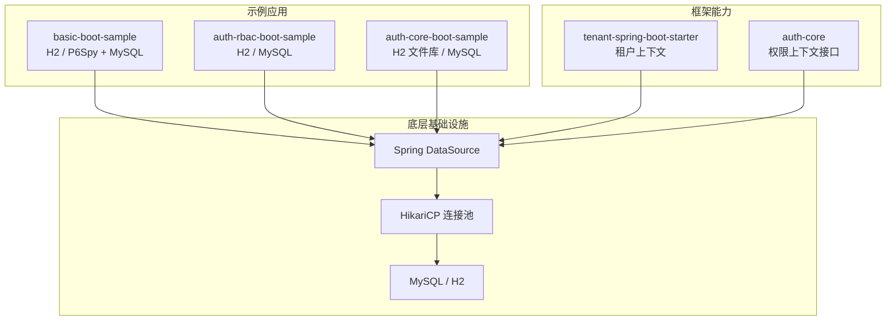
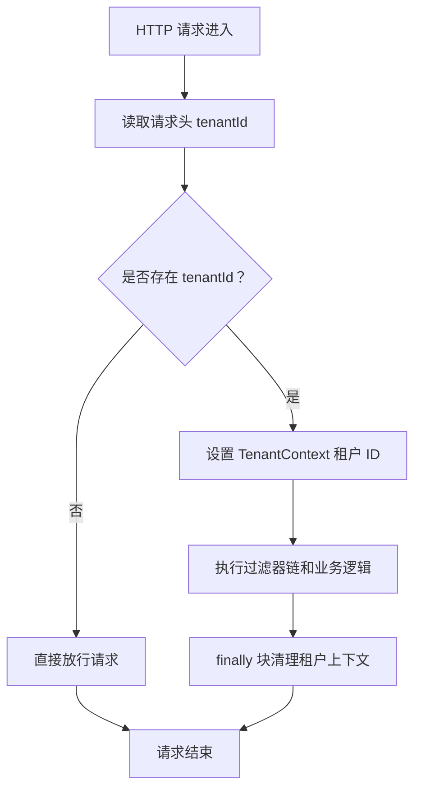
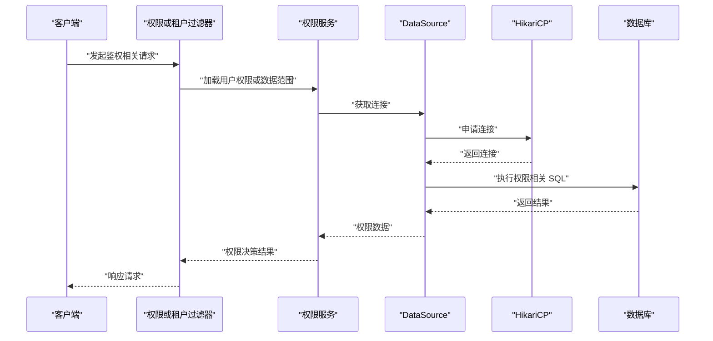
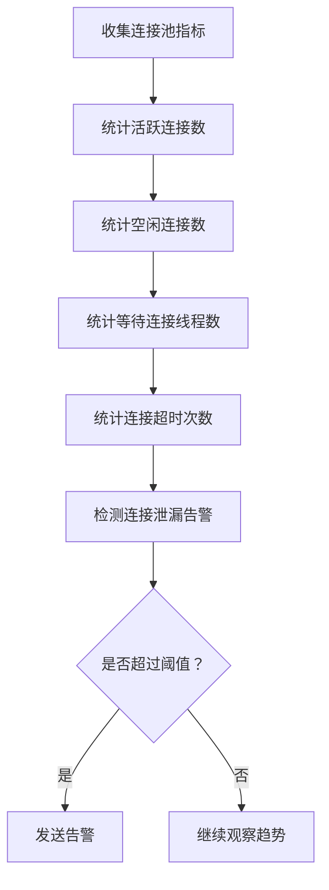

# 连接池配置优化

<cite>
**本文引用的文件**   
- [TenantContext.java](file://boot/tenant-spring-boot-starter/src/main/java/com/cu/framework/tenant/TenantContext.java)
- [TenantRequestFilter.java](file://boot/tenant-spring-boot-starter/src/main/java/com/cu/framework/tenant/TenantRequestFilter.java)
- [AuthCurrentUserContextHolder.java](file://auth/auth-core/src/main/java/com/cu/framework/auth/core/AuthCurrentUserContextHolder.java)
- [application.yml（权限 RBAC 示例）](file://sample/auth-rbac-boot-sample/src/main/resources/application.yml)
- [application.yml（基础示例）](file://sample/basic-boot-sample/src/main/resources/application.yml)
- [application.yml（权限核心示例）](file://sample/auth-core-boot-sample/src/main/resources/application.yml)
</cite>

## 目录
1. [引言](#引言)
2. [项目结构中的连接池相关位置](#项目结构中的连接池相关位置)
3. [多租户连接隔离与线程上下文](#多租户连接隔离与线程上下文)
4. [Spring Boot 默认连接池配置分析](#spring-boot-默认连接池配置分析)
5. [权限模块对数据库连接的特殊需求](#权限模块对数据库连接的特殊需求)
6. [连接泄漏检测与监控指标](#连接泄漏检测与监控指标)
7. [不同业务规模的连接池配置模板](#不同业务规模的连接池配置模板)
8. [调优案例与排查建议](#调优案例与排查建议)
9. [结论](#结论)

## 引言
本文面向 Kewen Framework 中基于 Spring Boot 与 HikariCP 的连接池配置优化，重点回答以下问题：
- 多租户场景下，`TenantContext` 的线程隔离如何影响连接池使用。
- 当前仓库中 HikariCP 参数的实际配置情况、潜在风险及改进方向。
- 权限模块在鉴权、数据范围过滤等场景中对数据库连接的特殊要求。
- 如何在现有工程中接入活跃连接数、等待队列、连接泄露告警等监控手段。
- 小型开发环境、中型生产服务、高并发多租户服务的连接池配置模板与调优路径。

## 项目结构中的连接池相关位置
Kewen Framework 本身不直接实现连接池，而是依赖 Spring Boot 自动装配的数据源与 HikariCP。连接池参数主要出现在示例工程的 `application.yml` 中：
- 基础示例使用 H2 内存库或 P6Spy + MySQL，并显式配置 `spring.datasource.hikari.*`。
- 权限 RBAC 示例同时提供 H2 与 MySQL profile，每个数据源都声明了独立的 HikariCP 连接池。
- 权限核心示例将 HikariCP 参数精简为最大池大小和连接池名称。

**图表来源**
- [application.yml（基础示例）:34-43](file://sample/basic-boot-sample/src/main/resources/application.yml#L34-L43)
- [application.yml（权限 RBAC 示例）:60-69](file://sample/auth-rbac-boot-sample/src/main/resources/application.yml#L60-L69)
- [application.yml（权限核心示例）:54-56](file://sample/auth-core-boot-sample/src/main/resources/application.yml#L54-L56)

**章节来源**
- [application.yml（基础示例）:34-79](file://sample/basic-boot-sample/src/main/resources/application.yml#L34-L79)
- [application.yml（权限 RBAC 示例）:60-113](file://sample/auth-rbac-boot-sample/src/main/resources/application.yml#L60-L113)
- [application.yml（权限核心示例）:54-56](file://sample/auth-core-boot-sample/src/main/resources/application.yml#L54-L56)

## 多租户连接隔离与线程上下文
### 租户上下文的线程隔离机制
`TenantContext` 使用 `InheritableThreadLocal<Long>` 保存当前线程的租户标识。它提供判断是否支持租户、获取租户、设置租户和清理租户的方法。由于使用的是可继承线程局部变量，普通线程及其派生子线程可以继承该值；但线程池复用的工作线程不会自动继承旧请求的租户信息，因此必须在每次请求入口处明确设置并在结束时清理。

**图表来源**
- [TenantRequestFilter.java:1-46](file://boot/tenant-spring-boot-starter/src/main/java/com/cu/framework/tenant/TenantRequestFilter.java#L1-L46)
- [TenantContext.java:1-43](file://boot/tenant-spring-boot-starter/src/main/java/com/cu/framework/tenant/TenantContext.java#L1-L43)

### 对连接池的影响
1. **同一线程内复用连接更稳定**  
   如果租户解析发生在事务或 MyBatis 拦截器之前，同一 HTTP 请求线程内的所有数据库访问通常能复用同一条连接，从而降低连接切换开销。
2. **线程池不会自动隔离租户**  
   线程池会复用工作线程，但 `TenantContext` 只在 `TenantRequestFilter` 的 try-finally 中设置和清理。若后续异步任务、线程池回调未显式传递租户 ID，可能读到空租户或上一请求残留租户。
3. **连接池大小不能按租户数量线性放大**  
   连接池是按 JVM 进程维度管理的，不是按租户维度隔离。即使有 100 个租户，最终并发仍受 `maximum-pool-size` 限制。

### 最佳实践要点
- 始终保证 `TenantRequestFilter` 先于数据访问层执行，确保事务边界和 SQL 拦截器能拿到租户上下文。
- 对于异步任务、消息消费者、定时任务，应显式从安全上下文或调用上下文中复制租户 ID 到 `TenantContext`。
- 避免在长生命周期对象中缓存租户 ID；只在线程作用域或请求作用域中使用。
- 若需要跨线程传播租户，应结合链路追踪上下文或自定义上下文传递器，而不是依赖线程池隐式行为。

**章节来源**
- [TenantContext.java:1-43](file://boot/tenant-spring-boot-starter/src/main/java/com/cu/framework/tenant/TenantContext.java#L1-L43)
- [TenantRequestFilter.java:1-46](file://boot/tenant-spring-boot-starter/src/main/java/com/cu/framework/tenant/TenantRequestFilter.java#L1-L46)

## Spring Boot 默认连接池配置分析
### 示例工程中的 HikariCP 配置
仓库中的示例工程统一通过 `spring.datasource.hikari.*` 配置 HikariCP。常见字段包括：
- `connection-timeout`：获取连接的超时时间。
- `idle-timeout`：空闲连接存活时间。
- `max-lifetime`：连接最大生命周期。
- `maximum-pool-size`：最大连接数。
- `minimum-idle`：最小空闲连接数。
- `validation-timeout`：连接校验超时。
- `pool-name`：连接池名称，便于监控区分。
- `auto-commit`、`connection-test-query`：自动提交与连接有效性测试。

#### 基础示例
基础示例在 H2 profile 中配置了完整的 HikariCP 参数，并额外启用 P6Spy 作为 MySQL profile 的驱动包装。

**章节来源**
- [application.yml（基础示例）:34-43](file://sample/basic-boot-sample/src/main/resources/application.yml#L34-L43)
- [application.yml（基础示例）:71-79](file://sample/basic-boot-sample/src/main/resources/application.yml#L71-L79)

#### 权限 RBAC 示例
权限 RBAC 示例分别定义了 H2 和 MySQL profile，每个数据源拥有独立连接池，便于观察不同数据源的连接行为。

**章节来源**
- [application.yml（权限 RBAC 示例）:60-69](file://sample/auth-rbac-boot-sample/src/main/resources/application.yml#L60-L69)
- [application.yml（权限 RBAC 示例）:104-113](file://sample/auth-rbac-boot-sample/src/main/resources/application.yml#L104-L113)

#### 权限核心示例
权限核心示例仅配置了最大池大小和连接池名称，其余参数走 Spring Boot 与 HikariCP 默认值。这种写法适合快速启动，但不利于生产环境的可观测性。

**章节来源**
- [application.yml（权限核心示例）:54-56](file://sample/auth-core-boot-sample/src/main/resources/application.yml#L54-L56)

### 关键参数调优原则
| 参数 | 含义 | 调优建议 |
|---|---|---|
| `maximum-pool-size` | 连接池最大连接数 | 根据峰值并发、平均事务耗时、数据库承载能力综合评估；不要盲目设大。 |
| `minimum-idle` | 最小空闲连接数 | 小流量服务可设为较小值；热服务可略高于空闲基线，减少冷启动抖动。 |
| `connection-timeout` | 获取连接超时 | 通常设置为几十毫秒到几秒；过长会掩盖连接池不足问题。 |
| `idle-timeout` | 空闲连接超时 | 应小于 `max-lifetime`，避免连接被数据库端回收后仍留在池中。 |
| `max-lifetime` | 连接最大生命周期 | 略小于数据库端连接超时，避免脏连接。 |
| `validation-timeout` | 连接校验超时 | 一般小于 `connection-timeout`，避免校验阻塞主流程。 |
| `pool-name` | 连接池名称 | 多数据源或多实例部署时务必唯一，便于监控定位。 |

### 配置质量检查清单
- 是否显式设置了 `pool-name`，避免监控无法区分连接池。
- 是否同时配置 `connection-timeout`、`idle-timeout`、`max-lifetime`、`maximum-pool-size`。
- 是否根据数据库类型选择合适驱动和 URL。
- 是否在不同 profile 中区分开发、测试、生产配置。
- 是否避免在生产环境开启不必要的建表或灌数据脚本。

**章节来源**
- [application.yml（基础示例）:34-79](file://sample/basic-boot-sample/src/main/resources/application.yml#L34-L79)
- [application.yml（权限 RBAC 示例）:60-113](file://sample/auth-rbac-boot-sample/src/main/resources/application.yml#L60-L113)
- [application.yml（权限核心示例）:54-56](file://sample/auth-core-boot-sample/src/main/resources/application.yml#L54-L56)

## 权限模块对数据库连接的特殊需求
权限模块的核心职责是身份识别、菜单权限、数据范围控制和操作权限判定。这些能力会引入额外的数据库访问模式：

### 权限上下文与数据访问
`AuthCurrentUserContextHolder` 暴露当前用户和扁平化权限集合，其实现依赖登录模块的安全上下文。权限校验和数据范围过滤通常在拦截器、注解处理器或服务层中触发，可能产生以下连接使用模式：
- 登录成功后加载用户权限。
- 每次请求加载菜单或数据范围。
- 批量权限预检或只读查询。
- 审计日志写入。

**图表来源**
- [AuthCurrentUserContextHolder.java:1-25](file://auth/auth-core/src/main/java/com/cu/framework/auth/core/AuthCurrentUserContextHolder.java#L1-L25)

### 连接池大小规划
权限模块的典型压力来自：
- 高频只读鉴权查询。
- 批量权限预检。
- 数据范围过滤带来的附加条件查询。

因此，连接池不应只按“写事务”估算，还应考虑：
- 鉴权接口的 QPS。
- 单次请求中涉及的权限查询次数。
- 是否开启权限缓存。
- 是否与业务写事务共享连接池。

### 连接复用策略
- 在同一事务或同一请求中尽量复用连接，避免频繁切换数据源。
- 将鉴权查询设计为短事务或无事务只读查询，缩短连接占用时间。
- 避免在拦截器中执行重型查询；必要时可预热或缓存热点权限数据。
- 对批量权限预检采用顺序或限流方式，防止短时间内耗尽连接池。

### 事务边界管理
- 鉴权读操作应尽量短且幂等。
- 写操作必须明确事务边界，避免长时间持有连接。
- 异步任务中若涉及权限校验，需重新建立安全上下文和租户上下文。

**章节来源**
- [AuthCurrentUserContextHolder.java:1-25](file://auth/auth-core/src/main/java/com/cu/framework/auth/core/AuthCurrentUserContextHolder.java#L1-L25)

## 连接泄漏检测与监控指标
### 连接泄漏检测
当前示例工程没有显式启用 HikariCP 的连接泄漏检测。若需要检测连接泄漏，可在生产配置中启用泄漏检测阈值，使连接长时间未归还时记录警告或抛出异常。

建议在生产环境中：
- 设置较短的泄漏检测阈值用于压测或故障恢复期。
- 正常生产阶段保持合理阈值，避免误报。
- 配合日志和告警系统，捕获连接长时间占用堆栈。

### 监控指标
HikariCP 自带指标，可通过 Spring Boot Actuator 或 Prometheus 采集。关键指标包括：
- 活跃连接数：反映当前被业务占用的连接数量。
- 空闲连接数：反映可用连接数量。
- 等待线程数：表示正在等待连接的线程数，非零通常意味着连接池不足或慢查询。
- 连接创建速率、借用速率、归还速率。
- 连接超时次数。
- 连接泄漏告警。

[本图为概念流程图，不对应具体代码文件]

### 监控落地建议
- 为每个数据源设置唯一的 `pool-name`。
- 在 Actuator 暴露 `/actuator/metrics` 或通过 Micrometer 暴露 Prometheus 指标。
- 设置活跃连接数接近 `maximum-pool-size` 的告警。
- 设置等待线程数持续大于 0 的告警。
- 对连接泄漏阈值告警设置更高优先级。

**章节来源**
- [application.yml（权限 RBAC 示例）:60-69](file://sample/auth-rbac-boot-sample/src/main/resources/application.yml#L60-L69)
- [application.yml（基础示例）:34-43](file://sample/basic-boot-sample/src/main/resources/application.yml#L34-L43)

## 不同业务规模的连接池配置模板
以下模板以仓库中示例配置为基础进行归纳，并结合通用调优经验给出推荐值。实际数值需结合压测结果调整。

### 小型开发环境
适用于单机开发、本地调试、H2 内存库或轻量数据库。
- 最大连接数：较小，避免占用过多系统资源。
- 最小空闲连接数：可设为 1 或 2。
- 连接超时：几十毫秒到几秒均可，重点在于避免无限等待。
- 空闲超时和最大生命周期：开发环境可适当保守。
- 连接池名称：明确标识开发环境。

参考位置：
- [application.yml（基础示例）:34-43](file://sample/basic-boot-sample/src/main/resources/application.yml#L34-L43)
- [application.yml（权限核心示例）:54-56](file://sample/auth-core-boot-sample/src/main/resources/application.yml#L54-L56)

### 中型生产服务
适用于单一业务域、中等 QPS、单数据源或少量读写分离数据源。
- 最大连接数：根据峰值并发和平均事务耗时计算，通常为几十以内。
- 最小空闲连接数：略高于空闲基线，减少冷启动抖动。
- 连接超时：建议小于业务超时上限。
- 空闲超时：小于数据库连接超时。
- 最大生命周期：略小于数据库连接超时。
- 连接池名称：包含环境、实例、数据源角色信息。

参考位置：
- [application.yml（权限 RBAC 示例）:60-69](file://sample/auth-rbac-boot-sample/src/main/resources/application.yml#L60-L69)
- [application.yml（权限 RBAC 示例）:104-113](file://sample/auth-rbac-boot-sample/src/main/resources/application.yml#L104-L113)

### 高并发多租户服务
适用于多租户、高 QPS、复杂鉴权和大数据范围过滤。
- 连接池不宜按租户数量线性放大。
- 应区分鉴权连接池与业务连接池，避免鉴权查询挤占写连接。
- 对批量权限预检做限流或去抖。
- 监控等待线程数和活跃连接数趋势。
- 对连接泄漏检测设置短期高敏阈值，用于回归验证。

参考位置：
- [TenantContext.java:1-43](file://boot/tenant-spring-boot-starter/src/main/java/com/cu/framework/tenant/TenantContext.java#L1-L43)
- [TenantRequestFilter.java:1-46](file://boot/tenant-spring-boot-starter/src/main/java/com/cu/framework/tenant/TenantRequestFilter.java#L1-L46)

## 调优案例与排查建议
### 典型问题：连接池耗尽
现象：
- 请求大量超时。
- 活跃连接数长期接近最大连接数。
- 等待线程数持续大于 0。
- 日志中出现连接获取超时。

排查步骤：
1. 确认是否出现慢查询或未关闭连接。
2. 检查权限模块是否在拦截器或服务层中执行重型查询。
3. 检查异步任务是否未正确传递租户上下文，导致重复查询或错误查询。
4. 查看 HikariCP 指标中的连接借用和归还速率。
5. 临时提高最大连接数进行压测对比，但不要长期依赖扩容掩盖问题。

### 典型问题：连接泄漏
现象：
- 运行一段时间后活跃连接数缓慢上升。
- 连接泄漏检测触发告警。
- 重启后暂时缓解。

处理建议：
- 启用连接泄漏检测阈值。
- 抓取告警时的线程堆栈，定位未归还连接的代码路径。
- 检查事务边界是否正确，异常分支是否提前释放连接。
- 对第三方组件或异步任务中的数据库访问进行专项排查。

### 典型问题：多租户连接错配
现象：
- 某租户数据被其他租户看到。
- 异步任务中租户上下文为空。
- 某些后台任务访问了错误租户的数据。

处理建议：
- 确认 `TenantRequestFilter` 在请求入口生效。
- 确认异步任务、线程池回调、消息消费者显式复制租户 ID。
- 避免在长生命周期对象中缓存租户 ID。
- 结合链路追踪添加租户 ID 字段。

### 性能调优建议
- 优先优化慢查询和 N+1 查询，其次才调整连接池大小。
- 将鉴权查询设计为短事务或只读查询。
- 对热点权限数据使用缓存，减少数据库压力。
- 对批量权限预检进行限流、合并和去抖。
- 通过压测确定 `maximum-pool-size`，而不是凭经验猜测。

**章节来源**
- [application.yml（权限 RBAC 示例）:60-69](file://sample/auth-rbac-boot-sample/src/main/resources/application.yml#L60-L69)
- [application.yml（基础示例）:34-43](file://sample/basic-boot-sample/src/main/resources/application.yml#L34-L43)
- [TenantContext.java:1-43](file://boot/tenant-spring-boot-starter/src/main/java/com/cu/framework/tenant/TenantContext.java#L1-L43)
- [TenantRequestFilter.java:1-46](file://boot/tenant-spring-boot-starter/src/main/java/com/cu/framework/tenant/TenantRequestFilter.java#L1-L46)

## 结论
Kewen Framework 的连接池优化应以“可观测、可回归、可压测”为核心目标：
- 多租户场景下，`TenantContext` 提供线程级租户隔离，但不能替代连接池隔离。连接池仍是进程级资源，应按总并发和数据库承载能力规划。
- 示例工程已展示 HikariCP 的关键参数，但生产环境需要补齐泄漏检测、监控指标和告警规则。
- 权限模块会带来额外鉴权查询压力，应通过短事务、只读查询、缓存和限流降低连接占用。
- 配置模板应根据业务规模分层管理，并通过压测和监控逐步收敛到最优值。