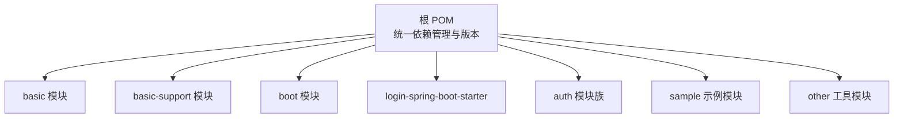
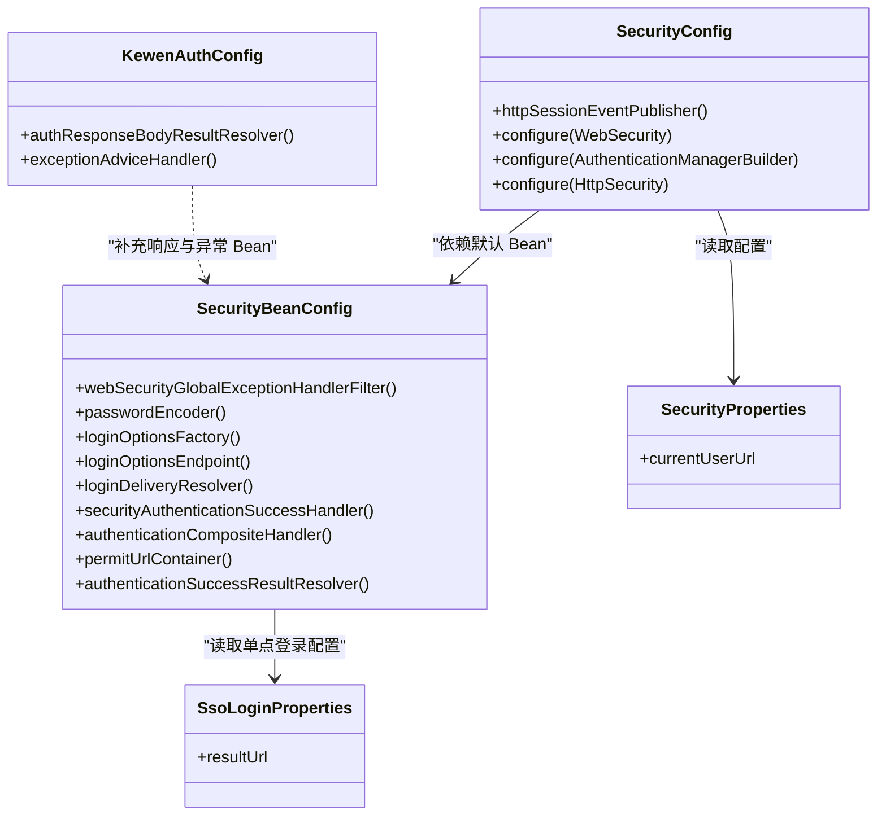
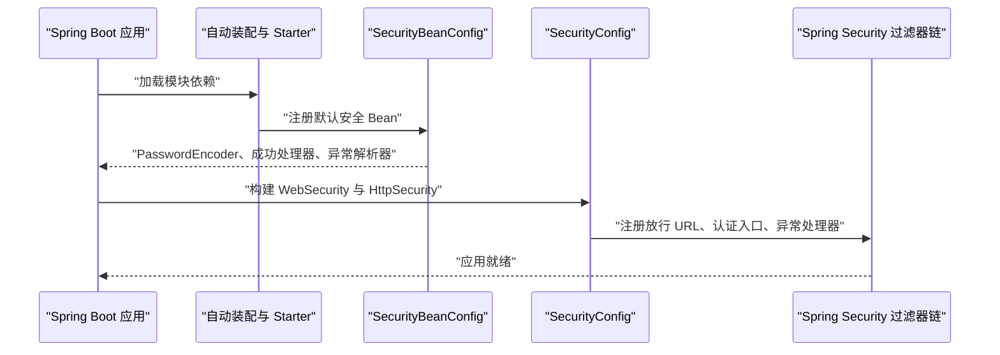
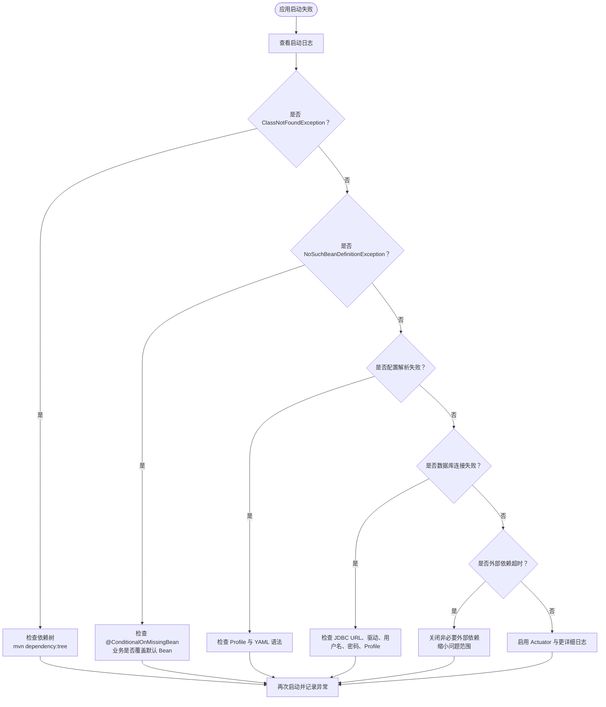

# 启动问题诊断

<cite>
**本文引用的文件**   
- [pom.xml](file://pom.xml)
- [application.yml（认证示例）](file://sample/auth-core-boot-sample/src/main/resources/application.yml)
- [application.yml（基础示例）](file://sample/basic-boot-sample/src/main/resources/application.yml)
- [SecurityBeanConfig.java](file://login-spring-boot-starter/src/main/java/com/cu/framework/authentication/config/SecurityBeanConfig.java)
- [SecurityConfig.java](file://login-spring-boot-starter/src/main/java/com/cu/framework/authentication/config/SecurityConfig.java)
- [KewenAuthConfig.java](file://login-spring-boot-starter/src/main/java/com/cu/framework/authentication/config/KewenAuthConfig.java)
- [SecurityProperties.java](file://login-spring-boot-starter/src/main/java/com/cu/framework/authentication/properties/SecurityProperties.java)
- [SsoLoginProperties.java](file://login-spring-boot-starter/src/main/java/com/cu/framework/authentication/properties/SsoLoginProperties.java)
- [AuthRangeStartupFailureTest.java](file://sample/auth-core-boot-sample/src/test/java/com/cu/framework/sample/authcore/AuthRangeStartupFailureTest.java)
</cite>

## 目录
1. [引言](#引言)
2. [项目结构与启动入口](#项目结构与启动入口)
3. [核心组件与装配关系](#核心组件与装配关系)
4. [架构总览](#架构总览)
5. [启动失败常见原因与定位方法](#启动失败常见原因与定位方法)
6. [关键异常分类处理指南](#关键异常分类处理指南)
7. [外部依赖诊断：数据库、缓存与第三方服务](#外部依赖诊断数据库缓存与第三方服务)
8. [依赖冲突排查](#依赖冲突排查)
9. [调试工具与 JVM 调优](#调试工具与-jvm-调优)
10. [故障排查流程图](#故障排查流程图)
11. [结论](#结论)

## 引言
本文面向使用 Kewen Framework 的 Spring Boot 应用，目标是把“应用启动不起来”或“启动后部分功能不可用”的问题，收敛到可操作的诊断流程。文档覆盖以下方面：
- Maven 依赖冲突检测
- Bean 装配失败和条件装配失效
- 配置文件语法与 Profile 激活错误
- 启动日志中关键异常的解读
- 数据库连接失败、缓存连接超时等外部依赖问题
- 命令行工具、Actuator 端点和 JVM 参数调优

本指南不仅给出通用方法，还结合仓库中的 Starter、配置样例和测试用例，说明框架在认证、权限、数据源初始化等环节可能暴露的典型启动问题。

## 项目结构与启动入口
Kewen Framework 是一个多模块 Maven 工程，顶层 `pom.xml` 统一管理版本、依赖管理以及子模块。典型业务应用通过引入 `boot`、`login-spring-boot-starter`、`auth`、`basic-support` 等 Starter 来装配能力；示例工程位于 `sample` 目录，提供可直接运行的最小化应用。

**图表来源**
- [pom.xml:10-33](file://pom.xml#L10-L33)

**章节来源**
- [pom.xml:1-33](file://pom.xml#L1-L33)

## 核心组件与装配关系
Kewen Framework 的启动期行为主要由 Spring Boot 自动装配和框架自定义配置类共同驱动。登录与安全相关的能力集中在 `login-spring-boot-starter` 中，包括：
- 安全 Bean 默认装配
- 认证成功处理器
- 全局异常解析器
- Session 事件发布
- Web 安全过滤链
- 单点登录属性绑定

**图表来源**
- [SecurityBeanConfig.java:1-126](file://login-spring-boot-starter/src/main/java/com/cu/framework/authentication/config/SecurityBeanConfig.java#L1-L126)
- [SecurityConfig.java:1-144](file://login-spring-boot-starter/src/main/java/com/cu/framework/authentication/config/SecurityConfig.java#L1-L144)
- [KewenAuthConfig.java:1-26](file://login-spring-boot-starter/src/main/java/com/cu/framework/authentication/config/KewenAuthConfig.java#L1-L26)
- [SecurityProperties.java:1-22](file://login-spring-boot-starter/src/main/java/com/cu/framework/authentication/properties/SecurityProperties.java#L1-L22)
- [SsoLoginProperties.java:1-24](file://login-spring-boot-starter/src/main/java/com/cu/framework/authentication/properties/SsoLoginProperties.java#L1-L24)

**章节来源**
- [SecurityBeanConfig.java:1-126](file://login-spring-boot-starter/src/main/java/com/cu/framework/authentication/config/SecurityBeanConfig.java#L1-L126)
- [SecurityConfig.java:1-144](file://login-spring-boot-starter/src/main/java/com/cu/framework/authentication/config/SecurityConfig.java#L1-L144)
- [KewenAuthConfig.java:1-26](file://login-spring-boot-starter/src/main/java/com/cu/framework/authentication/config/KewenAuthConfig.java#L1-L26)
- [SecurityProperties.java:1-22](file://login-spring-boot-starter/src/main/java/com/cu/framework/authentication/properties/SecurityProperties.java#L1-L22)
- [SsoLoginProperties.java:1-24](file://login-spring-boot-starter/src/main/java/com/cu/framework/authentication/properties/SsoLoginProperties.java#L1-L24)

## 架构总览
从启动角度看，Kewen Framework 的安全与认证能力可以理解为三层：
1. **配置层**：`@ConfigurationProperties` 绑定 `cu.security`、`cu.security.login.sso` 等前缀的配置项。
2. **Bean 装配层**：`SecurityBeanConfig` 和 `KewenAuthConfig` 注册默认 Bean，并通过 `@ConditionalOnMissingBean` 允许业务覆盖。
3. **Web 安全层**：`SecurityConfig` 继承 Spring Security 配置适配器，构建放行清单、认证入口、登出处理器和全局异常解析器。

**图表来源**
- [SecurityBeanConfig.java:30-126](file://login-spring-boot-starter/src/main/java/com/cu/framework/authentication/config/SecurityBeanConfig.java#L30-L126)
- [SecurityConfig.java:30-144](file://login-spring-boot-starter/src/main/java/com/cu/framework/authentication/config/SecurityConfig.java#L30-L144)

**章节来源**
- [SecurityBeanConfig.java:30-126](file://login-spring-boot-starter/src/main/java/com/cu/framework/authentication/config/SecurityBeanConfig.java#L30-L126)
- [SecurityConfig.java:30-144](file://login-spring-boot-starter/src/main/java/com/cu/framework/authentication/config/SecurityConfig.java#L30-L144)

## 启动失败常见原因与定位方法

### 一、Maven 依赖缺失或版本不一致
常见问题：
- 编译时报找不到类，例如 `ClassNotFoundException`、`NoClassDefFoundError`
- 运行时报类型转换异常，通常是不同模块引入了相同包的不同版本
- Starter 生效但某个 Bean 未创建，可能是依赖被排除或版本不兼容

定位方法：
1. 在工程根目录执行依赖树分析，确认 Starter 是否真正引入。
2. 检查根 `pom.xml` 的 `dependencyManagement` 是否覆盖了第三方库版本。
3. 若引入多个同类库，优先保留与 Starter 官方声明一致的版本。

仓库证据：
- 根 POM 集中声明了 Spring Boot、Spring Cloud、MyBatis Plus、MySQL 驱动、Guava 等依赖版本，是排查依赖冲突的第一参考点。
- `login-spring-boot-starter` 依赖 Spring Security、Jackson、Spring Web，若这些依赖版本异常，容易触发 Bean 装配失败。

**章节来源**
- [pom.xml:10-33](file://pom.xml#L10-L33)
- [pom.xml:34-120](file://pom.xml#L34-L120)
- [pom.xml:201-279](file://pom.xml#L201-L279)

### 二、Bean 装配失败
常见问题：
- 容器启动时报 `NoSuchBeanDefinitionException`
- 某个 Starter 的功能没有生效
- 业务定义了同类型 Bean，导致默认实现未注册

定位方法：
1. 查看报错 Bean 名称及依赖注入点。
2. 确认业务是否重复定义同类型 Bean，或使用 `@ConditionalOnMissingBean` 的条件装配被意外短路。
3. 检查 Starter 是否通过 `spring.factories` 或自动装配机制被加载。

仓库证据：
- `SecurityBeanConfig` 明确说明多数 Bean 带 `@ConditionalOnMissingBean` 保护，业务工程可自行定义同类型 Bean 覆盖。
- `SecurityConfig` 需要 `SecurityUserDetailsService`、`SecurityAuthenticationSuccessHandler`、`ObjectMapper`、`HttpSecurityCustomizer`、`UrlSecurityCustomizer` 等 Bean，若这些 Bean 不存在，会直接导致装配失败。
- `KewenAuthConfig` 额外注册响应结果解析器和异常处理建议处理器，若业务覆盖了这些类型，需确认覆盖逻辑不会破坏返回格式。

**章节来源**
- [SecurityBeanConfig.java:30-126](file://login-spring-boot-starter/src/main/java/com/cu/framework/authentication/config/SecurityBeanConfig.java#L30-L126)
- [SecurityConfig.java:30-144](file://login-spring-boot-starter/src/main/java/com/cu/framework/authentication/config/SecurityConfig.java#L30-L144)
- [KewenAuthConfig.java:1-26](file://login-spring-boot-starter/src/main/java/com/cu/framework/authentication/config/KewenAuthConfig.java#L1-L26)

### 三、配置文件语法错误或 Profile 未激活
常见问题：
- YAML 缩进错误导致 `YAMLException`
- 某段配置写在 `---` 分隔符下，但当前 Profile 未激活
- 数据源、脚本路径、H2 控制台路径配置不正确

定位方法：
1. 优先确认 `spring.profiles.active` 是否正确。
2. 检查 `spring.config.activate.on-profile` 是否与预期一致。
3. 对数据库相关配置，先验证 JDBC URL、用户名、密码、驱动类名。
4. 如果启用 H2 控制台，确认访问路径和应用 `context-path` 组合后的完整地址。

仓库证据：
- 认证示例使用 `spring.profiles.active: h2`，并在 `on-profile: h2` 下配置 H2 数据源、SQL 初始化脚本、H2 控制台路径。
- 基础示例同时提供 H2 内存模式和 MySQL 模式，MySQL 模式下使用 P6Spy 驱动，JDBC URL 必须以 `jdbc:p6spy:` 开头。
- 认证示例中 `server.servlet.context-path: /coredemo`，意味着 H2 控制台实际访问地址应包含该上下文路径。

**章节来源**
- [application.yml（认证示例）:1-85](file://sample/auth-core-boot-sample/src/main/resources/application.yml#L1-L85)
- [application.yml（基础示例）:1-79](file://sample/basic-boot-sample/src/main/resources/application.yml#L1-L79)

### 四、权限注解与 MyBatis 映射语句校验失败
这类问题通常表现为“应用根本起不来”，并且错误信息指向具体的 Mapper 接口或注解位置。

常见问题：
- 使用了权限范围注解但没有解析到对应 SQL 映射语句
- 将权限范围注解放在写操作上
- 目标 SQL 启用了二级缓存
- 静态 SQL 中指定的表名与实际查询不一致
- 旧版用法把注解误写在业务 Service 上

定位方法：
1. 根据启动失败堆栈找到最底层的异常消息。
2. 检查注解所在的接口是否为 MyBatis Mapper。
3. 检查注解方法与 SQL 注解是否匹配。
4. 检查目标表名是否与 SQL 一致。
5. 确认是否启用了 MyBatis 二级缓存。

仓库证据：
- `AuthRangeStartupFailureTest` 专门构造多种错误场景并断言“启动失败”，包括：
  - 解析不到映射语句
  - 数据范围只作用于查询语句
  - 二级缓存与数据范围共存失败
  - 目标表不存在
  - 注解不在 MyBatis Mapper 接口上

**章节来源**
- [AuthRangeStartupFailureTest.java:1-272](file://sample/auth-core-boot-sample/src/test/java/com/cu/framework/sample/authcore/AuthRangeStartupFailureTest.java#L1-L272)

## 关键异常分类处理指南

### ClassNotFoundException 与 NoClassDefFoundError
含义：
- `ClassNotFoundException`：运行时类加载器找不到类。
- `NoClassDefFoundError`：编译期存在，运行期缺失或被版本冲突替换。

处理步骤：
1. 使用 `mvn dependency:tree` 查看是否缺少依赖。
2. 检查是否有多个模块引入同一坐标的不同版本。
3. 确认 Starter 依赖的 Spring Boot、Spring Security、Jackson、MyBatis 等版本是否与根 POM 一致。
4. 清理本地仓库后重新安装依赖，排除 IDE 缓存干扰。

关联仓库位置：
- 根 POM 统一管理 Spring Boot、Spring Cloud、MyBatis Plus、MySQL 驱动等版本。
- `login-spring-boot-starter` 依赖 Spring Security 生态，若版本不匹配，容易在构建安全配置时抛出类加载异常。

**章节来源**
- [pom.xml:34-120](file://pom.xml#L34-L120)
- [pom.xml:201-279](file://pom.xml#L201-L279)
- [SecurityConfig.java:30-144](file://login-spring-boot-starter/src/main/java/com/cu/framework/authentication/config/SecurityConfig.java#L30-L144)

### NoSuchBeanDefinitionException
含义：
- Spring 容器中没有找到指定 Bean，通常由依赖注入失败或条件装配未生效引起。

处理步骤：
1. 确认是否漏加 Starter 或遗漏自动装配。
2. 检查业务是否定义了同类型 Bean，导致默认实现被跳过。
3. 检查 `@ConditionalOnMissingBean` 条件是否被其他 Bean 提前满足。
4. 检查依赖 Bean 是否存在，例如 `SecurityConfig` 依赖的 `SecurityUserDetailsService`、`SecurityAuthenticationSuccessHandler`、`ObjectMapper`。

仓库证据：
- `SecurityBeanConfig` 中多个 Bean 使用 `@ConditionalOnMissingBean`，例如 `PasswordEncoder`、`SecurityAuthenticationSuccessHandler`、`AuthenticationSuccessResultResolver`。
- `SecurityConfig` 使用 `@Autowired` 注入多个 Bean，若这些 Bean 未创建，装配阶段就会失败。

**章节来源**
- [SecurityBeanConfig.java:53-126](file://login-spring-boot-starter/src/main/java/com/cu/framework/authentication/config/SecurityBeanConfig.java#L53-L126)
- [SecurityConfig.java:30-144](file://login-spring-boot-starter/src/main/java/com/cu/framework/authentication/config/SecurityConfig.java#L30-L144)

### PropertySource 解析失败或配置绑定异常
含义：
- YAML/Properties 语法错误
- 配置键不存在
- Profile 未激活导致配置未加载
- 自定义 `PropertySourceFactory` 解析失败

处理步骤：
1. 先验证 YAML 缩进和键名拼写。
2. 确认 `spring.profiles.active` 是否正确。
3. 检查 `@ConfigurationProperties` 绑定的前缀，例如 `cu.security`、`cu.security.login.sso`。
4. 若使用自定义 `PropertySourceFactory`，检查其是否能正确解析资源文件。

仓库证据：
- `SecurityProperties` 绑定 `cu.security`。
- `SsoLoginProperties` 绑定 `cu.security.login.sso`。
- 认证示例使用 `spring.profiles.active: h2`，并在 `spring.config.activate.on-profile: h2` 下配置数据源。
- 基础示例在 MySQL Profile 中使用 P6Spy 驱动，JDBC URL 必须以 `jdbc:p6spy:` 开头。

**章节来源**
- [SecurityProperties.java:1-22](file://login-spring-boot-starter/src/main/java/com/cu/framework/authentication/properties/SecurityProperties.java#L1-L22)
- [SsoLoginProperties.java:1-24](file://login-spring-boot-starter/src/main/java/com/cu/framework/authentication/properties/SsoLoginProperties.java#L1-L24)
- [application.yml（认证示例）:1-85](file://sample/auth-core-boot-sample/src/main/resources/application.yml#L1-L85)
- [application.yml（基础示例）:1-79](file://sample/basic-boot-sample/src/main/resources/application.yml#L1-L79)

### 数据库连接失败
常见现象：
- 启动时连接池无法获取连接
- SQL 初始化脚本执行失败
- H2 控制台无法访问
- MySQL 驱动类名或 URL 配置错误

处理步骤：
1. 检查 JDBC URL、用户名、密码、驱动类名。
2. 确认数据源 Profile 是否激活。
3. 如果是 H2 文件库，确认数据文件路径是否在预期目录。
4. 如果是 MySQL，确认网络可达、账号权限、数据库存在。
5. 如果使用 P6Spy，确认 JDBC URL 以 `jdbc:p6spy:` 开头。
6. 如果是 MyBatis 初始化脚本，确认 `sql.init.mode` 和脚本路径。

仓库证据：
- 认证示例 H2 Profile 中配置 `jdbc:h2:file:./data/auth_core_sample;MODE=MySQL;...`，并启用 H2 控制台。
- 基础示例 H2 Profile 使用内存库，MySQL Profile 使用 `jdbc:p6spy:mysql://localhost:3306/your_database`。
- 两个示例都显式配置 HikariCP 参数，如 `maximum-pool-size`、`connection-timeout`、`idle-timeout`。

**章节来源**
- [application.yml（认证示例）:35-85](file://sample/auth-core-boot-sample/src/main/resources/application.yml#L35-L85)
- [application.yml（基础示例）:16-79](file://sample/basic-boot-sample/src/main/resources/application.yml#L16-L79)

### Redis 或缓存连接超时
仓库中未直接出现 Redis Starter，但诊断思路同样适用于任何缓存或远程依赖：
1. 确认缓存客户端依赖是否引入。
2. 检查缓存连接地址、端口、认证信息。
3. 调整连接超时、重试次数、最大连接数。
4. 在启动失败场景中，先关闭非必需的外部依赖，缩小问题范围。
5. 使用 Actuator 或日志观察连接建立过程。

[本节为通用指导，不直接分析具体源码]

### 认证与登录相关启动问题
常见现象：
- 应用启动后所有请求都被拦截
- 登录接口返回 401 或 403
- 登录成功处理器未生效
- 单点登录结果页地址未配置导致行为不符合预期

处理步骤：
1. 确认是否引入了认证相关 Starter。
2. 检查 `SecurityConfig` 构建的放行 URL 清单是否包含登录接口和静态资源。
3. 检查 `SecurityAuthenticationSuccessHandler` 是否被覆盖且行为异常。
4. 检查 `SsoLoginProperties.resultUrl` 是否符合前端跳转需求。
5. 检查全局异常解析器是否把认证异常统一转换为 JSON。

仓库证据：
- `SecurityConfig` 放行 `/static/**`、`/js/**`、`/css/**`、`/image/**`、`/**/**.html`，其余请求需要认证。
- `SecurityBeanConfig` 提供默认的 JSON 登录成功处理器和全局异常解析处理器。
- `SsoLoginProperties` 的 `resultUrl` 控制三类单点登录的成功与失败回跳地址。

**章节来源**
- [SecurityConfig.java:60-120](file://login-spring-boot-starter/src/main/java/com/cu/framework/authentication/config/SecurityConfig.java#L60-L120)
- [SecurityBeanConfig.java:60-126](file://login-spring-boot-starter/src/main/java/com/cu/framework/authentication/config/SecurityBeanConfig.java#L60-L126)
- [SsoLoginProperties.java:1-24](file://login-spring-boot-starter/src/main/java/com/cu/framework/authentication/properties/SsoLoginProperties.java#L1-L24)

## 外部依赖诊断：数据库、缓存与第三方服务

### 数据库诊断
推荐操作：
1. 使用示例工程的 H2 Profile 快速验证应用能否启动。
2. 切换到 MySQL Profile，确认真实数据库连通性。
3. 使用 H2 控制台或数据库客户端直接连接 JDBC URL。
4. 检查 SQL 初始化脚本是否幂等，避免重复建表或插入种子数据失败。
5. 检查 HikariCP 连接池参数，特别是 `connection-timeout`、`maximum-pool-size`。

仓库证据：
- 认证示例提供 H2 文件库和 MySQL Profile。
- 基础示例提供 H2 内存库和 MySQL Profile，并演示 P6Spy 驱动。
- 两个示例都配置 HikariCP 参数，便于排查连接池问题。

**章节来源**
- [application.yml（认证示例）:35-85](file://sample/auth-core-boot-sample/src/main/resources/application.yml#L35-L85)
- [application.yml（基础示例）:16-79](file://sample/basic-boot-sample/src/main/resources/application.yml#L16-L79)

### 第三方通知或消息服务
仓库中基础示例启用了方糖消息通知相关配置，可用于判断外部服务配置是否正确：
- `cu.notify.fang-tang.enabled`
- `cu.notify.fang-tang.key`
- `cu.notify.fang-tang.domain`
- `cu.request.message.fang-tang`
- `cu.request.persistent.database`

若应用启动后某些功能不可用，可先关闭这些可选外部依赖，再逐步恢复，定位是哪个外部配置导致问题。

**章节来源**
- [application.yml（基础示例）:1-15](file://sample/basic-boot-sample/src/main/resources/application.yml#L1-L15)

## 依赖冲突排查

### 使用 mvn dependency:tree
推荐命令：
- 全量依赖树：`mvn dependency:tree`
- 针对特定模块：`mvn -pl sample/auth-core-boot-sample dependency:tree`
- 输出到文件：`mvn dependency:tree -DoutputFile=dep.txt`
- 查找冲突：结合 `grep` 搜索相同坐标不同版本

分析要点：
- 关注 Spring Boot、Spring Security、Jackson、MyBatis、MySQL 驱动等核心依赖版本。
- 检查是否有意外的 `exclusions` 排除了必要依赖。
- 检查是否引入多个 Swagger、JSON 库、HTTP 客户端等易冲突组件。

**章节来源**
- [pom.xml:34-120](file://pom.xml#L34-L120)
- [pom.xml:201-279](file://pom.xml#L201-L279)

### 使用 mvn dependency:analyze
推荐命令：
- `mvn dependency:analyze`
- 用于发现未使用依赖、隐式依赖和潜在冲突

适用场景：
- 新增 Starter 后不确定是否需要全部依赖。
- 清理历史依赖时评估风险。
- 单元测试通过但生产启动失败时，对比依赖差异。

**章节来源**
- [pom.xml:1-33](file://pom.xml#L1-L33)

## 调试工具与 JVM 调优

### Spring Boot Actuator
如果应用启用了 Actuator：
- 健康检查：`/actuator/health`
- 环境信息：`/actuator/env`
- 日志级别：`/actuator/loggers`
- Bean 列表：`/actuator/beans`
- 应用信息：`/actuator/info`

注意：
- 不要在生产环境无限制暴露 Actuator 端点。
- 如需调试，先通过安全策略限制访问来源。
- 如果应用启动失败，Actuator 可能尚未完全注册，此时应优先分析启动日志。

[本节为通用指导，不直接分析具体源码]

### 日志与调试开关
建议：
1. 启动时开启 Spring 相关 debug 日志，观察自动装配过程。
2. 开启 MyBatis 日志，观察 SQL 初始化过程。
3. 开启 HikariCP 连接池日志，观察连接获取失败原因。
4. 对认证相关类开启 debug，观察过滤器链和异常处理。

仓库证据：
- 认证示例开启了 `com.cu.framework.sample.authcore.mapper`、`com.cu.framework.auth.core`、`org.springframework.jdbc.core` 的 debug 日志，适合排查权限数据与 SQL 初始化问题。

**章节来源**
- [application.yml（认证示例）:20-34](file://sample/auth-core-boot-sample/src/main/resources/application.yml#L20-L34)

### JVM 参数调优
常用参数：
- `-Xms`、`-Xmx`：设置初始堆和最大堆
- `-XX:+HeapDumpOnOutOfMemoryError`：OOM 时生成堆转储
- `-XX:+UseGCLogFileRotation`：启用 GC 日志轮转
- `-Dspring.profiles.active=dev`：指定 Profile
- `-Dlogging.level.root=DEBUG`：提升日志级别

适用场景：
- 启动慢：增加堆大小、减少不必要的 Bean 扫描
- OOM：增大堆、分析堆转储
- 启动卡住：开启线程 dump、GC 日志
- 配置未生效：通过 `-D` 参数覆盖配置，隔离配置文件问题

[本节为通用指导，不直接分析具体源码]

## 故障排查流程图

[本图为概念流程，不对应具体源码文件]

## 结论
Kewen Framework 的启动问题通常落在五个维度：依赖版本、Bean 装配、配置解析、外部依赖、以及框架特有的权限注解校验。排查时应遵循“先外部后内部、先简单后复杂”的原则：
1. 先用 H2 Profile 验证应用能否启动。
2. 再用 `mvn dependency:tree` 排除依赖冲突。
3. 根据异常类型定位是类加载、Bean 装配还是配置解析问题。
4. 对数据库、缓存、通知服务等外部依赖逐个启用或禁用，缩小范围。
5. 最后结合 Actuator、日志和 JVM 参数完成深度诊断。

对于认证和权限相关功能，应特别注意：
- `SecurityBeanConfig` 提供的默认 Bean 可以被业务覆盖。
- `SecurityConfig` 构建的放行 URL 和异常处理器会影响登录体验。
- 权限范围注解必须出现在合法的 MyBatis 查询方法上，否则会在启动期直接失败。
- 配置文件中的 Profile 和数据源 URL 必须与实际运行环境一致。