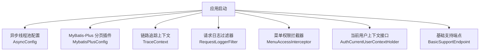
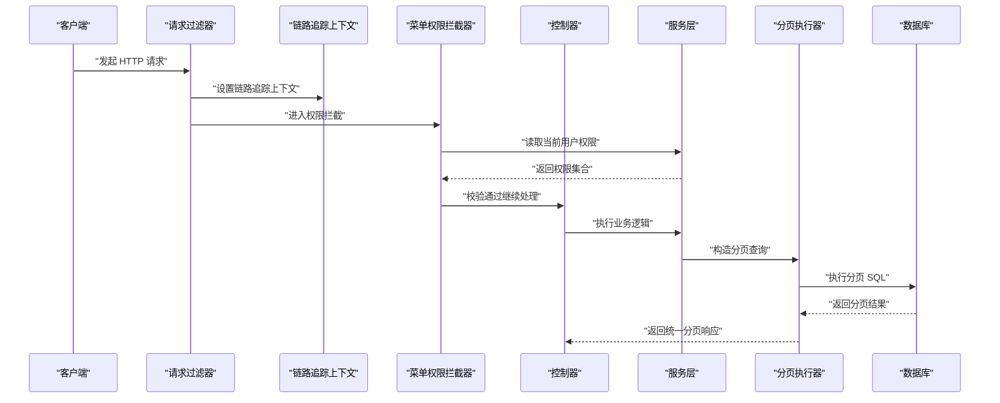
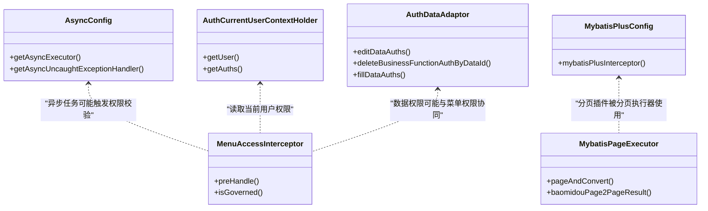

# 性能问题诊断

<cite>
**本文引用的文件**   
- [AsyncConfig.java](file://boot/basic-spring-boot-starter/src/main/java/com/cu/framework/boot/basic/config/AsyncConfig.java)
- [MybatisPlusConfig.java](file://boot/basic-spring-boot-starter/src/main/java/com/cu/framework/boot/basic/config/MybatisPlusConfig.java)
- [MybatisPageExecutor.java](file://basic-support/src/main/java/com/cu/framework/basic/support/utils/MybatisPageExecutor.java)
- [AuthCurrentUserContextHolder.java](file://auth/auth-core/src/main/java/com/cu/framework/auth/core/AuthCurrentUserContextHolder.java)
- [MenuAccessInterceptor.java](file://auth/auth-core/src/main/java/com/cu/framework/auth/core/menu/MenuAccessInterceptor.java)
- [AuthDataAdaptor.java](file://auth/auth-core/src/main/java/com/cu/framework/auth/core/AuthDataAdaptor.java)
- [BasicSupportEndpoint.java](file://basic-support/src/main/java/com/cu/framework/basic/support/BasicSupportEndpoint.java)
- [TraceContext.java](file://basic/src/main/java/com/cu/framework/basic/logger/trace/TraceContext.java)
- [RequestLoggerFilter.java](file://basic/src/main/java/com/cu/framework/basic/logger/RequestLoggerFilter.java)
- [GlobalExceptionHandlerAdvice.java](file://basic/src/main/java/com/cu/framework/basic/exception/GlobalExceptionHandlerAdvice.java)
</cite>

## 目录
1. [引言](#引言)
2. [项目结构与性能相关入口](#项目结构与性能相关入口)
3. [核心组件与性能关注点](#核心组件与性能关注点)
4. [架构总览与请求处理链路](#架构总览与请求处理链路)
5. [详细组件分析与优化建议](#详细组件分析与优化建议)
6. [依赖关系分析](#依赖关系分析)
7. [性能调优清单](#性能调优清单)
8. [故障排查指南](#故障排查指南)
9. [结论](#结论)

## 引言
本文面向本框架的使用者和维护者，目标是提供一套可落地的性能问题诊断和优化指南。内容覆盖：
- 如何使用 JProfiler、VisualVM、Arthas 等工具定位系统瓶颈；
- 如何识别和优化慢查询，尤其是 MyBatis-Plus 分页查询、数据范围注入和权限相关 SQL；
- 如何进行内存使用分析，包括堆监控、垃圾回收分析和内存泄漏检测；
- 如何诊断线程死锁和并发问题，包括线程 dump 分析、锁竞争检测和异步任务优化；
- 如何针对权限相关操作进行优化，例如权限缓存策略、批量权限查询、上下文切换优化等。

## 项目结构与性能相关入口
本仓库包含多个 starter 模块，其中与性能最相关的部分集中在基础运行能力、异步线程池、MyBatis-Plus 分页、日志追踪、异常处理和权限拦截等位置。

**图示来源**
- [AsyncConfig.java:1-59](file://boot/basic-spring-boot-starter/src/main/java/com/cu/framework/boot/basic/config/AsyncConfig.java#L1-L59)
- [MybatisPlusConfig.java:1-28](file://boot/basic-spring-boot-starter/src/main/java/com/cu/framework/boot/basic/config/MybatisPlusConfig.java#L1-L28)
- [TraceContext.java](file://basic/src/main/java/com/cu/framework/basic/logger/trace/TraceContext.java)
- [RequestLoggerFilter.java](file://basic/src/main/java/com/cu/framework/basic/logger/RequestLoggerFilter.java)
- [MenuAccessInterceptor.java:1-93](file://auth/auth-core/src/main/java/com/cu/framework/auth/core/menu/MenuAccessInterceptor.java#L1-L93)
- [AuthCurrentUserContextHolder.java:1-25](file://auth/auth-core/src/main/java/com/cu/framework/auth/core/AuthCurrentUserContextHolder.java#L1-L25)
- [BasicSupportEndpoint.java](file://basic-support/src/main/java/com/cu/framework/basic/support/BasicSupportEndpoint.java)

**章节来源**
- [AsyncConfig.java:1-59](file://boot/basic-spring-boot-starter/src/main/java/com/cu/framework/boot/basic/config/AsyncConfig.java#L1-L59)
- [MybatisPlusConfig.java:1-28](file://boot/basic-spring-boot-starter/src/main/java/com/cu/framework/boot/basic/config/MybatisPlusConfig.java#L1-L28)
- [MenuAccessInterceptor.java:1-93](file://auth/auth-core/src/main/java/com/cu/framework/auth/core/menu/MenuAccessInterceptor.java#L1-L93)
- [AuthCurrentUserContextHolder.java:1-25](file://auth/auth-core/src/main/java/com/cu/framework/auth/core/AuthCurrentUserContextHolder.java#L1-L25)
- [BasicSupportEndpoint.java](file://basic-support/src/main/java/com/cu/framework/basic/support/BasicSupportEndpoint.java)

## 核心组件与性能关注点
### 异步线程池
`AsyncConfig` 定义了 Spring 异步执行器，核心关注点包括：
- 核心线程数与最大线程数基于处理器数量计算；
- 队列容量有限，超过上限时使用调用者线程拒绝策略；
- 异步方法未捕获异常时通过统一异常处理器输出类名、方法和异常信息。

性能风险：
- 若业务异步任务为 CPU 密集型，默认线程数可能不足或过多；
- 队列过小会导致大量任务退化为调用者线程执行，影响响应时间；
- 异常未记录到日志系统，不利于线上定位。

**章节来源**
- [AsyncConfig.java:1-59](file://boot/basic-spring-boot-starter/src/main/java/com/cu/framework/boot/basic/config/AsyncConfig.java#L1-L59)

### MyBatis-Plus 分页插件
`MybatisPlusConfig` 注册了分页拦截器，并指定数据库类型为 MySQL。

性能关注点：
- 分页查询应始终配合合适索引；
- 复杂排序和条件可能导致全表扫描；
- 多插件情况下需保证分页拦截器顺序正确。

**章节来源**
- [MybatisPlusConfig.java:1-28](file://boot/basic-spring-boot-starter/src/main/java/com/cu/framework/boot/basic/config/MybatisPlusConfig.java#L1-L28)

### 分页执行辅助类
`MybatisPageExecutor` 提供 `PageReq`、MyBatis-Plus `Page` 与 `PageResult` 之间的转换，以及直接执行 Service 分页的方法。

性能关注点：
- 建议在 Service 层构造 Wrapper 时避免不必要的字段查询；
- 对大结果集进行映射转换时应注意对象创建开销；
- 自定义 `Query` 的 `pageConsumer` 可用于追加必要的数据范围条件。

**章节来源**
- [MybatisPageExecutor.java:1-118](file://basic-support/src/main/java/com/cu/framework/basic/support/utils/MybatisPageExecutor.java#L1-L118)

### 权限上下文与菜单拦截
`AuthCurrentUserContextHolder` 暴露当前用户及扁平化权限集合；`MenuAccessInterceptor` 在 Controller 方法前校验菜单访问权限。

性能关注点：
- 每次请求都获取权限集合，应避免重复数据库查询；
- 权限缓存键设计需考虑租户、用户、角色、数据范围等因素；
- 菜单路径匹配逻辑应避免字符串拼接和正则滥用。

**章节来源**
- [AuthCurrentUserContextHolder.java:1-25](file://auth/auth-core/src/main/java/com/cu/framework/auth/core/AuthCurrentUserContextHolder.java#L1-L25)
- [MenuAccessInterceptor.java:1-93](file://auth/auth-core/src/main/java/com/cu/framework/auth/core/menu/MenuAccessInterceptor.java#L1-L93)

### 数据权限适配器
`AuthDataAdaptor` 封装数据权限编辑、删除、填充等操作，委托给底层 `AuthDataHandler`。

性能关注点：
- 数据权限写入属于写放大场景，应避免频繁单条更新；
- 删除业务数据时应同步清理对应数据权限；
- 填充数据权限前应判断是否已有缓存命中。

**章节来源**
- [AuthDataAdaptor.java:1-45](file://auth/auth-core/src/main/java/com/cu/framework/auth/core/AuthDataAdaptor.java#L1-L45)

## 架构总览与请求处理链路
一个典型请求的性能关键路径包括：过滤器 → 链路追踪 → 权限拦截 → Controller → Service → MyBatis-Plus 分页 → 数据库。

**图示来源**
- [RequestLoggerFilter.java](file://basic/src/main/java/com/cu/framework/basic/logger/RequestLoggerFilter.java)
- [TraceContext.java](file://basic/src/main/java/com/cu/framework/basic/logger/trace/TraceContext.java)
- [MenuAccessInterceptor.java:1-93](file://auth/auth-core/src/main/java/com/cu/framework/auth/core/menu/MenuAccessInterceptor.java#L1-L93)
- [MybatisPageExecutor.java:1-118](file://basic-support/src/main/java/com/cu/framework/basic/support/utils/MybatisPageExecutor.java#L1-L118)

## 详细组件分析与优化建议

### 使用 JProfiler 定位热点方法
JProfiler 适合在开发或测试环境进行深度 CPU 热点、内存分配、方法耗时分析。

推荐步骤：
1. 在 JVM 启动参数中附加 JProfiler agent；
2. 启动应用后连接 JProfiler 可视化界面；
3. 录制一次典型慢请求的 CPU Profile；
4. 查看 Top Methods、Call Tree、Allocation Tracker；
5. 重点关注权限校验、菜单匹配、分页查询、对象复制、JSON 序列化等热点；
6. 结合代码中的 `MenuAccessInterceptor`、`AuthCurrentUserContextHolder`、`MybatisPageExecutor` 进行定位。

注意事项：
- 生产环境不建议长期开启 CPU 采样；
- 压测场景下优先观察长时间运行的热点方法；
- 将 JProfiler 结果与链路追踪 ID 关联，便于缩小范围。

### 使用 VisualVM 监控运行时状态
VisualVM 适合快速查看进程、线程、CPU、内存概况。

推荐步骤：
1. 使用 jvisualvm 连接本地或远程 JVM；
2. 观察 CPU 使用率曲线、GC 次数和时间；
3. 查看线程 Dump，寻找阻塞、等待、自旋线程；
4. 对比不同压测阶段的堆大小变化；
5. 结合 `AsyncConfig` 的线程名称前缀，识别异步任务线程。

注意事项：
- 远程连接需要启用 JMX 并开放端口；
- 不要在生产高峰期间频繁抓取线程 Dump；
- 将 VisualVM 截图与 Arthas 命令结果互相验证。

### 使用 Arthas 在线诊断
Arthas 适合无需重启应用、无需重新部署的在线诊断。

常用命令：
- `dashboard`：查看整体 CPU、内存、GC、线程信息；
- `thread -b`：查找阻塞线程；
- `thread --interrupt`：中断可疑线程（谨慎使用）；
- `profiler start` / `profiler stop`：采集火焰图；
- `jad`：反编译方法，确认线上字节码是否与源码一致；
- `trace`：跟踪方法内部调用链耗时；
- `watch`：观察方法入参、返回值、异常；
- `heapdump`：导出堆转储供 MAT 分析。

最佳实践：
- 先通过 `dashboard` 判断是 CPU 瓶颈还是 GC 瓶颈；
- 再通过 `thread -b` 判断是否存在线程阻塞；
- 对热点方法使用 `trace` 或 `profiler`；
- 对疑似内存泄漏使用 `heapdump` + MAT 分析；
- 将 Arthas 会话与链路追踪 ID 关联，提高定位效率。

### 慢查询识别与优化

#### MyBatis-Plus 分页查询优化
分页查询常见慢点包括：
- 未使用分页导致全表扫描；
- 排序字段无索引；
- 条件字段无索引或选择性差；
- SELECT * 导致回表和额外网络传输；
- 大对象字段参与查询。

优化建议：
- 确保分页字段有合适索引；
- 避免在分页 SQL 中使用函数包裹查询字段；
- 只选择必要字段；
- 对高频查询建立联合索引；
- 对复杂条件使用 Explain 分析执行计划；
- 利用 `MybatisPageExecutor` 构造清晰的分页查询。

#### 数据范围注入导致的慢查询
框架中存在数据范围相关实现，会在查询时注入数据权限条件。

优化建议：
- 检查数据范围条件是否命中索引；
- 避免过宽的数据范围导致扫描行数过大；
- 对高频数据范围查询建立复合索引；
- 必要时拆分查询，先查主键再查详情；
- 对读多写少场景增加权限缓存。

#### SQL 语句优化技巧
- 使用 EXPLAIN 分析执行计划；
- 避免子查询替代 JOIN；
- 避免隐式类型转换导致索引失效；
- 控制 IN 列表大小；
- 合理使用 LIMIT；
- 避免在 WHERE 中对字段做表达式运算。

### 内存使用分析

#### 堆内存监控
- 使用 VisualVM 观察堆大小、GC 次数；
- 使用 Arthas `dashboard` 查看堆占用；
- 关注老年代增长趋势；
- 区分临时对象和长生命周期对象。

#### 垃圾回收分析
- 观察 Full GC 频率；
- 分析 Young GC 与 Old GC 比例；
- 调整堆大小、新生代比例、G1 区域大小；
- 关注大对象直接进入老年代的场景；
- 结合业务压测观察 GC 停顿时间。

#### 内存泄漏检测
- 使用 Arthas `heapdump` 导出堆转储；
- 使用 MAT 打开 heapdump；
- 查看 Dominator Tree 找出占用最大的对象；
- 检查是否存在静态集合、监听器未注销、ThreadLocal 未清理；
- 特别关注权限缓存、上下文对象、大结果集缓存。

### 线程死锁与并发问题诊断

#### 线程 Dump 分析
- 使用 VisualVM 或 `jstack` 获取线程 Dump；
- 查找 BLOCKED、WAITING、TIMED_WAITING 线程；
- 确认是否存在死锁、锁竞争、IO 等待；
- 结合 `AsyncConfig` 的线程名前缀识别异步任务；
- 将线程栈与业务链路追踪 ID 关联。

#### 锁竞争检测
- 使用 Arthas `monitor` 观察方法耗时；
- 使用 `profiler` 生成火焰图；
- 关注 synchronized、ReentrantLock 等锁持有时间；
- 检查是否有长事务或慢查询持锁；
- 对高并发热点方法减少锁粒度。

#### 异步任务性能优化
- 评估异步任务是否为 CPU 密集型或 IO 密集型；
- 根据业务峰值调整核心线程数和队列容量；
- 为异步任务添加独立线程池，避免与通用线程池相互影响；
- 为异步任务添加超时、重试、降级策略；
- 记录异步任务执行结果和异常。

**章节来源**
- [AsyncConfig.java:1-59](file://boot/basic-spring-boot-starter/src/main/java/com/cu/framework/boot/basic/config/AsyncConfig.java#L1-L59)
- [MybatisPlusConfig.java:1-28](file://boot/basic-spring-boot-starter/src/main/java/com/cu/framework/boot/basic/config/MybatisPlusConfig.java#L1-L28)
- [MybatisPageExecutor.java:1-118](file://basic-support/src/main/java/com/cu/framework/basic/support/utils/MybatisPageExecutor.java#L1-L118)
- [MenuAccessInterceptor.java:1-93](file://auth/auth-core/src/main/java/com/cu/framework/auth/core/menu/MenuAccessInterceptor.java#L1-L93)
- [AuthDataAdaptor.java:1-45](file://auth/auth-core/src/main/java/com/cu/framework/auth/core/AuthDataAdaptor.java#L1-L45)

## 依赖关系分析
以下图展示与本框架性能相关的主要组件依赖关系。

**图示来源**
- [AsyncConfig.java:1-59](file://boot/basic-spring-boot-starter/src/main/java/com/cu/framework/boot/basic/config/AsyncConfig.java#L1-L59)
- [MybatisPlusConfig.java:1-28](file://boot/basic-spring-boot-starter/src/main/java/com/cu/framework/boot/basic/config/MybatisPlusConfig.java#L1-L28)
- [MybatisPageExecutor.java:1-118](file://basic-support/src/main/java/com/cu/framework/basic/support/utils/MybatisPageExecutor.java#L1-L118)
- [AuthCurrentUserContextHolder.java:1-25](file://auth/auth-core/src/main/java/com/cu/framework/auth/core/AuthCurrentUserContextHolder.java#L1-L25)
- [MenuAccessInterceptor.java:1-93](file://auth/auth-core/src/main/java/com/cu/framework/auth/core/menu/MenuAccessInterceptor.java#L1-L93)
- [AuthDataAdaptor.java:1-45](file://auth/auth-core/src/main/java/com/cu/framework/auth/core/AuthDataAdaptor.java#L1-L45)

## 性能调优清单
### 通用调优
- 明确压测模型，模拟真实流量特征；
- 先观测再优化，避免盲目调参；
- 为关键路径添加链路追踪和指标埋点；
- 对慢接口设置超时和熔断；
- 对热点接口增加限流保护。

### 数据库调优
- 为分页、排序、过滤字段建立索引；
- 避免 SELECT *；
- 控制单次分页大小；
- 对高频查询增加缓存；
- 对大对象查询采用延迟加载；
- 定期分析慢查询日志和执行计划。

### 权限相关调优
- 对当前用户权限集合增加缓存；
- 缓存键需包含租户、用户、角色、数据范围维度；
- 权限变更时主动失效相关缓存；
- 对批量权限查询使用批量接口；
- 避免在高频路径中进行昂贵对象创建；
- 对菜单路径匹配使用高效数据结构。

### 异步任务调优
- 根据任务类型选择合适的线程池；
- 设置合理的队列容量和拒绝策略；
- 为异步任务添加超时和异常处理；
- 监控异步任务队列堆积；
- 对耗时异步任务拆分或改为事件驱动。

## 故障排查指南

### 常见问题与现象
- 接口响应时间突然升高；
- CPU 使用率持续偏高；
- 频繁 Full GC；
- 线程阻塞或死锁；
- 权限校验缓慢；
- 分页查询变慢；
- 异步任务堆积或丢失。

### 排查流程
1. 使用 `dashboard` 判断瓶颈类型；
2. 使用 `thread -b` 检查线程阻塞；
3. 使用 `profiler` 或 JProfiler 定位热点方法；
4. 使用 `trace` 跟踪慢方法调用链；
5. 使用 `heapdump` + MAT 分析内存；
6. 结合链路追踪 ID 缩小问题范围；
7. 复现问题并验证修复效果。

### 权限相关故障
- 菜单权限校验失败：检查 `MenuAccessInterceptor` 的路径匹配和用户权限集合；
- 数据权限不生效：检查 `AuthDataAdaptor` 的权限填充逻辑和数据范围；
- 权限缓存不一致：检查缓存键设计和失效策略；
- 权限查询慢：检查数据库索引和缓存命中率。

### 日志与异常
- 使用 `RequestLoggerFilter` 记录请求日志；
- 使用 `TraceContext` 贯穿链路追踪；
- 使用 `GlobalExceptionHandlerAdvice` 统一异常处理；
- 将异常信息与链路追踪 ID 绑定，便于线上定位。

**章节来源**
- [BasicSupportEndpoint.java](file://basic-support/src/main/java/com/cu/framework/basic/support/BasicSupportEndpoint.java)
- [TraceContext.java](file://basic/src/main/java/com/cu/framework/basic/logger/trace/TraceContext.java)
- [RequestLoggerFilter.java](file://basic/src/main/java/com/cu/framework/basic/logger/RequestLoggerFilter.java)
- [GlobalExceptionHandlerAdvice.java](file://basic/src/main/java/com/cu/framework/basic/exception/GlobalExceptionHandlerAdvice.java)

## 结论
性能问题诊断是一个系统性工程。对本框架而言，最需要关注的三个方向是：
- 权限相关路径的上下文获取、菜单匹配和数据范围注入；
- MyBatis-Plus 分页查询与数据库索引；
- 异步线程池配置和异步任务行为。

在实际工作中，应以指标和链路追踪为基础，结合 JProfiler、VisualVM、Arthas 三类工具形成互补的诊断体系，并在权限、数据库、线程池三个层面分别制定缓存、索引、线程池优化策略，才能稳定提升系统性能。