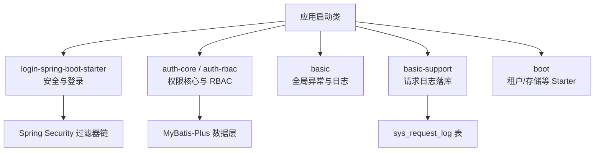
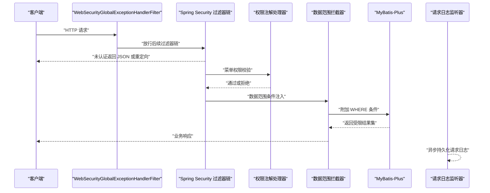
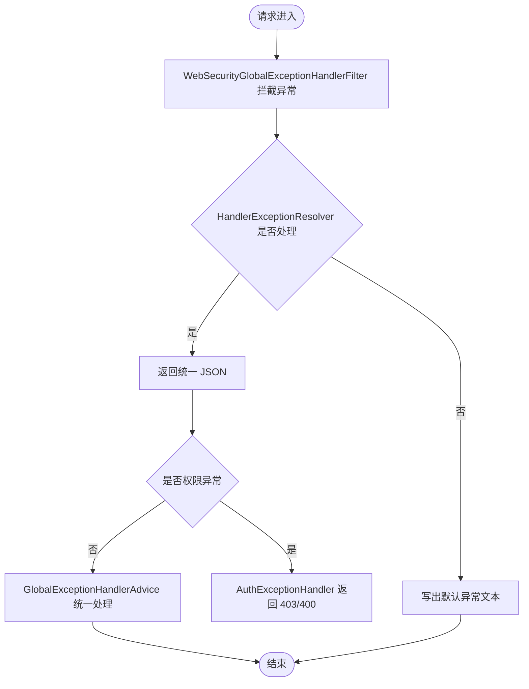
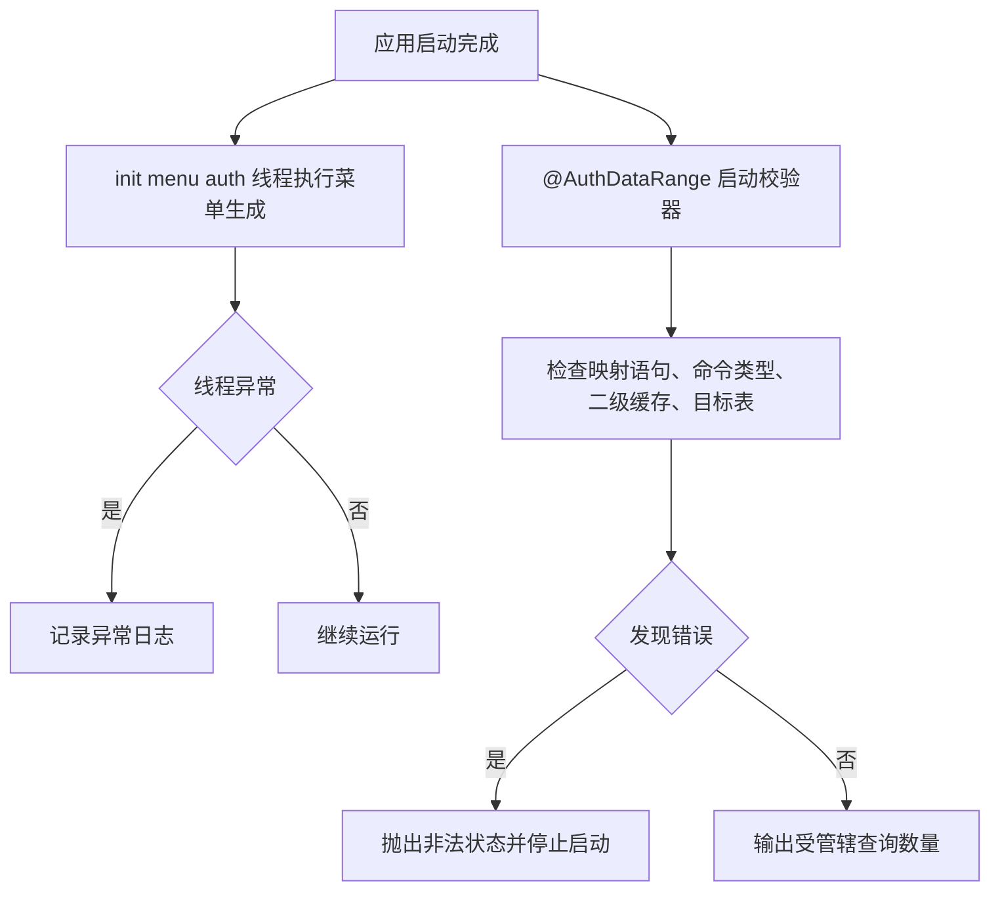
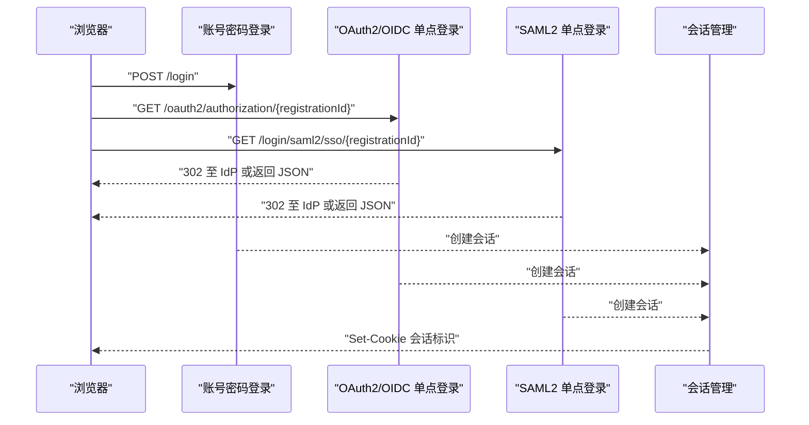
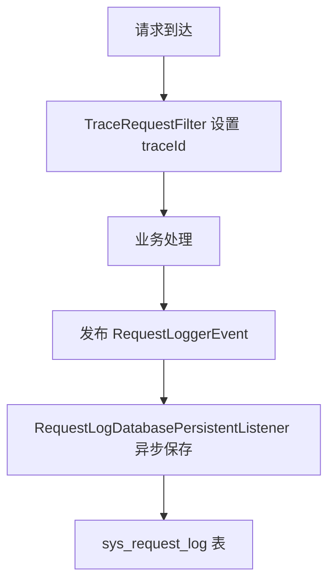
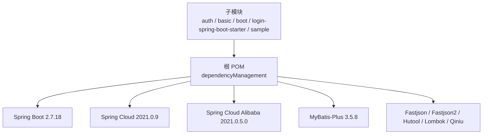

# 故障排除指南

<cite>
**本文引用的文件**   
- [README_Auth.md](file://README_Auth.md)
- [pom.xml](file://pom.xml)
- [docs/application.yml](file://docs/application.yml)
- [basic/src/main/java/com/cu/framework/basic/exception/GlobalExceptionHandlerAdvice.java](file://basic/src/main/java/com/cu/framework/basic/exception/GlobalExceptionHandlerAdvice.java)
- [auth/auth-core-spring-boot-starter/src/main/java/com/cu/framework/boot/auth/core/AuthExceptionHandler.java](file://auth/auth-core-spring-boot-starter/src/main/java/com/cu/framework/boot/auth/core/AuthExceptionHandler.java)
- [login-spring-boot-starter/src/main/java/com/cu/framework/authentication/filter/WebSecurityGlobalExceptionHandlerFilter.java](file://login-spring-boot-starter/src/main/java/com/cu/framework/authentication/filter/WebSecurityGlobalExceptionHandlerFilter.java)
- [login-spring-boot-starter/README.md](file://login-spring-boot-starter/README.md)
- [login-spring-boot-starter/README-SSO.md](file://login-spring-boot-starter/README-SSO.md)
- [basic/src/main/java/com/cu/framework/basic/logger/LoggerConstant.java](file://basic/src/main/java/com/cu/framework/basic/logger/LoggerConstant.java)
- [basic/src/main/java/com/cu/framework/basic/logger/TraceRequestFilter.java](file://basic/src/main/java/com/cu/framework/basic/logger/TraceRequestFilter.java)
- [basic-support/src/main/java/com/cu/framework/basic/support/log/RequestLogDatabasePersistentListener.java](file://basic-support/src/main/java/com/cu/framework/basic/support/log/RequestLogDatabasePersistentListener.java)
- [auth/auth-core-spring-boot-starter/src/main/java/com/cu/framework/boot/auth/core/init/InitMenuApiCommandLineRunner.java](file://auth/auth-core-spring-boot-starter/src/main/java/com/cu/framework/boot/auth/core/init/InitMenuApiCommandLineRunner.java)
- [auth/auth-core/src/main/java/com/cu/framework/auth/core/data/range/AuthRangeStartupValidator.java](file://auth/auth-core/src/main/java/com/cu/framework/auth/core/data/range/AuthRangeStartupValidator.java)
- [sample/auth-core-boot-sample/src/test/java/com/cu/framework/sample/authcore/AuthRangeStartupFailureTest.java](file://sample/auth-core-boot-sample/src/test/java/com/cu/framework/sample/authcore/AuthRangeStartupFailureTest.java)
- [docs/sql/auth-rbac.sql](file://docs/sql/auth-rbac.sql)
</cite>

## 目录
1. [引言](#引言)
2. [项目结构](#项目结构)
3. [核心组件](#核心组件)
4. [架构总览](#架构总览)
5. [详细组件分析](#详细组件分析)
6. [依赖关系分析](#依赖关系分析)
7. [性能考虑](#性能考虑)
8. [故障排查手册](#故障排查手册)
9. [结论](#结论)

## 引言
本指南面向 Kewen Framework 的使用者与运维人员，聚焦以下问题：系统启动失败、依赖冲突、Bean 装配异常、配置文件错误；权限验证失败、菜单显示异常、数据权限不生效；认证集成失败、单点登录异常、会话丢失；日志无法定位、慢查询与内存压力。文档将把代码实现、配置约定和测试断言转化为可操作的诊断流程。

## 项目结构
Kewen Framework 采用多模块 Maven 工程，核心能力分布在以下区域：
- `auth`：权限核心、RBAC 实现及对应 Spring Boot Starter。
- `login-spring-boot-starter`：账号密码登录、OAuth2/OIDC、SAML2 单点登录及安全过滤器链。
- `basic`：全局异常处理、基础模型、通用工具、请求追踪与日志。
- `basic-support`：请求日志持久化、分页工具、雪花 ID、通知客户端等扩展能力。
- `boot`：存储、租户、基础启动器等业务无关的 Starter。
- `sample`：示例应用，提供最小可运行配置与测试数据。
- `docs`：配置参考与数据库脚本。
- `openspec`：变更与设计说明，包含权限范围、菜单访问、协议集成等规范。

**图示来源**
- [README_Auth.md:1-90](file://README_Auth.md#L1-L90)
- [docs/application.yml:1-211](file://docs/application.yml#L1-L211)
- [docs/sql/auth-rbac.sql:1-148](file://docs/sql/auth-rbac.sql#L1-L148)

**章节来源**
- [README_Auth.md:1-90](file://README_Auth.md#L1-L90)
- [pom.xml:1-60](file://pom.xml#L1-L60)

## 核心组件
- 登录与安全：`login-spring-boot-starter` 在统一过滤器链上支持账号密码、OAuth2/OIDC、SAML2，并提供会话并发控制、结果页跳转策略与未认证响应契约。
- 权限体系：`auth-core` 提供注解驱动的菜单权限与数据权限；`auth-rbac` 提供用户-角色-部门默认实现；Starter 负责自动装配与扫描。
- 异常与日志：`basic` 提供全局异常处理器、请求追踪过滤；`basic-support` 支持异步将请求日志写入数据库。
- 启动期校验：数据范围声明会在所有单例 Bean 初始化后执行校验，尽早暴露 Mapper 配置错误。

**章节来源**
- [login-spring-boot-starter/README.md:1-120](file://login-spring-boot-starter/README.md#L1-L120)
- [README_Auth.md:1-90](file://README_Auth.md#L1-L90)
- [auth/auth-core/src/main/java/com/cu/framework/auth/core/data/range/AuthRangeStartupValidator.java:1-60](file://auth/auth-core/src/main/java/com/cu/framework/auth/core/data/range/AuthRangeStartupValidator.java#L1-L60)

## 架构总览
下图展示一次受保护接口请求从浏览器进入，到安全校验、权限判断、数据范围注入、日志记录的完整链路。

**图示来源**
- [login-spring-boot-starter/src/main/java/com/cu/framework/authentication/filter/WebSecurityGlobalExceptionHandlerFilter.java:1-71](file://login-spring-boot-starter/src/main/java/com/cu/framework/authentication/filter/WebSecurityGlobalExceptionHandlerFilter.java#L1-L71)
- [auth/auth-core-spring-boot-starter/src/main/java/com/cu/framework/boot/auth/core/init/InitMenuApiCommandLineRunner.java:1-33](file://auth/auth-core-spring-boot-starter/src/main/java/com/cu/framework/boot/auth/core/init/InitMenuApiCommandLineRunner.java#L1-L33)
- [auth/auth-core/src/main/java/com/cu/framework/auth/core/data/range/AuthRangeStartupValidator.java:60-163](file://auth/auth-core/src/main/java/com/cu/framework/auth/core/data/range/AuthRangeStartupValidator.java#L60-L163)
- [basic-support/src/main/java/com/cu/framework/basic/support/log/RequestLogDatabasePersistentListener.java:1-66](file://basic-support/src/main/java/com/cu/framework/basic/support/log/RequestLogDatabasePersistentListener.java#L1-L66)

## 详细组件分析

### 全局异常与错误响应
框架使用多层异常处理器统一返回格式：
- 安全过滤器前捕获异常，避免 Tomcat 错误页重定向。
- 权限相关异常由 `AuthExceptionHandler` 返回 403 或 400。
- 业务异常、参数校验异常、空指针等由 `GlobalExceptionHandlerAdvice` 统一封装。

**图示来源**
- [login-spring-boot-starter/src/main/java/com/cu/framework/authentication/filter/WebSecurityGlobalExceptionHandlerFilter.java:1-71](file://login-spring-boot-starter/src/main/java/com/cu/framework/authentication/filter/WebSecurityGlobalExceptionHandlerFilter.java#L1-L71)
- [auth/auth-core-spring-boot-starter/src/main/java/com/cu/framework/boot/auth/core/AuthExceptionHandler.java:1-35](file://auth/auth-core-spring-boot-starter/src/main/java/com/cu/framework/boot/auth/core/AuthExceptionHandler.java#L1-L35)
- [basic/src/main/java/com/cu/framework/basic/exception/GlobalExceptionHandlerAdvice.java:1-83](file://basic/src/main/java/com/cu/framework/basic/exception/GlobalExceptionHandlerAdvice.java#L1-L83)

**章节来源**
- [login-spring-boot-starter/src/main/java/com/cu/framework/authentication/filter/WebSecurityGlobalExceptionHandlerFilter.java:1-71](file://login-spring-boot-starter/src/main/java/com/cu/framework/authentication/filter/WebSecurityGlobalExceptionHandlerFilter.java#L1-L71)
- [auth/auth-core-spring-boot-starter/src/main/java/com/cu/framework/boot/auth/core/AuthExceptionHandler.java:1-35](file://auth/auth-core-spring-boot-starter/src/main/java/com/cu/framework/boot/auth/core/AuthExceptionHandler.java#L1-L35)
- [basic/src/main/java/com/cu/framework/basic/exception/GlobalExceptionHandlerAdvice.java:1-83](file://basic/src/main/java/com/cu/framework/basic/exception/GlobalExceptionHandlerAdvice.java#L1-L83)

### 菜单与数据权限启动期行为
菜单 API 生成在启动后异步执行，线程异常仅记录日志而不中断应用；数据范围声明则在所有单例初始化完成后进行严格校验，失败直接导致启动终止。

**图示来源**
- [auth/auth-core-spring-boot-starter/src/main/java/com/cu/framework/boot/auth/core/init/InitMenuApiCommandLineRunner.java:1-33](file://auth/auth-core-spring-boot-starter/src/main/java/com/cu/framework/boot/auth/core/init/InitMenuApiCommandLineRunner.java#L1-L33)
- [auth/auth-core/src/main/java/com/cu/framework/auth/core/data/range/AuthRangeStartupValidator.java:1-163](file://auth/auth-core/src/main/java/com/cu/framework/auth/core/data/range/AuthRangeStartupValidator.java#L1-L163)

**章节来源**
- [auth/auth-core-spring-boot-starter/src/main/java/com/cu/framework/boot/auth/core/init/InitMenuApiCommandLineRunner.java:1-33](file://auth/auth-core-spring-boot-starter/src/main/java/com/cu/framework/boot/auth/core/init/InitMenuApiCommandLineRunner.java#L1-L33)
- [auth/auth-core/src/main/java/com/cu/framework/auth/core/data/range/AuthRangeStartupValidator.java:1-163](file://auth/auth-core/src/main/java/com/cu/framework/auth/core/data/range/AuthRangeStartupValidator.java#L1-L163)
- [sample/auth-core-boot-sample/src/test/java/com/cu/framework/sample/authcore/AuthRangeStartupFailureTest.java:1-200](file://sample/auth-core-boot-sample/src/test/java/com/cu/framework/sample/authcore/AuthRangeStartupFailureTest.java#L1-L200)

### 认证与会话
- 账号密码登录入口为 `/login`，JSON 表单优先，非 JSON 回退 form。
- OAuth2/OIDC 共用授权码模式，回调端点由 `login-processing-url` 匹配。
- SAML2 通过 `SamlConfig` 注册登录、登出与 SP Metadata。
- 会话并发数可通过 `cu.security.session.maximum-sessions` 配置；达到上限时可阻止新登录或挤掉最早会话。
- 未认证请求返回 HTTP 200 + 业务码 401，调用方应读取业务字段而非只看 HTTP 状态码。

**图示来源**
- [login-spring-boot-starter/README.md:1-120](file://login-spring-boot-starter/README.md#L1-L120)
- [login-spring-boot-starter/README-SSO.md:1-120](file://login-spring-boot-starter/README-SSO.md#L1-L120)
- [docs/application.yml:120-211](file://docs/application.yml#L120-L211)

**章节来源**
- [login-spring-boot-starter/README.md:1-200](file://login-spring-boot-starter/README.md#L1-L200)
- [login-spring-boot-starter/README-SSO.md:1-200](file://login-spring-boot-starter/README-SSO.md#L1-L200)
- [docs/application.yml:120-211](file://docs/application.yml#L120-L211)

### 日志追踪与请求日志
- `TraceRequestFilter` 提取 traceId 并写入 MDC，供后续日志聚合。
- `LoggerConstant` 定义 traceId key。
- `RequestLogDatabasePersistentListener` 异步接收请求日志事件并写入 `sys_request_log`，traceId 来自事件对象以避免异步线程丢失上下文。

**图示来源**
- [basic/src/main/java/com/cu/framework/basic/logger/TraceRequestFilter.java:1-60](file://basic/src/main/java/com/cu/framework/basic/logger/TraceRequestFilter.java#L1-L60)
- [basic/src/main/java/com/cu/framework/basic/logger/LoggerConstant.java:1-10](file://basic/src/main/java/com/cu/framework/basic/logger/LoggerConstant.java#L1-L10)
- [basic-support/src/main/java/com/cu/framework/basic/support/log/RequestLogDatabasePersistentListener.java:1-66](file://basic-support/src/main/java/com/cu/framework/basic/support/log/RequestLogDatabasePersistentListener.java#L1-L66)

**章节来源**
- [basic/src/main/java/com/cu/framework/basic/logger/TraceRequestFilter.java:1-60](file://basic/src/main/java/com/cu/framework/basic/logger/TraceRequestFilter.java#L1-L60)
- [basic/src/main/java/com/cu/framework/basic/logger/LoggerConstant.java:1-10](file://basic/src/main/java/com/cu/framework/basic/logger/LoggerConstant.java#L1-L10)
- [basic-support/src/main/java/com/cu/framework/basic/support/log/RequestLogDatabasePersistentListener.java:1-66](file://basic-support/src/main/java/com/cu/framework/basic/support/log/RequestLogDatabasePersistentListener.java#L1-L66)

## 依赖关系分析
根 POM 集中管理 Spring Boot、Spring Cloud、MyBatis-Plus、Fastjson、Hutool、Qiniu SDK 等版本，子模块引入 starter 时需注意版本一致性。

**图示来源**
- [pom.xml:1-279](file://pom.xml#L1-L279)

**章节来源**
- [pom.xml:1-120](file://pom.xml#L1-L120)

## 性能考虑
- 数据范围声明只作用于查询语句，且与二级缓存不能共存；启用二级缓存会导致缓存键在权限条件注入前计算，从而产生不可预期的结果。
- 菜单 API 生成放在独立线程中执行，异常不会中断应用启动，但需关注异步日志中是否存在生成失败信息。
- 请求日志持久化为异步落库，避免阻塞请求线程；生产环境建议开启数据库持久化并监控 `sys_request_log` 表增长。
- 会话并发控制可限制同一用户最大会话数，防止资源被单个用户占用过多。

[本节为通用性能建议，不直接分析具体源码]

## 故障排查手册

### 一、系统启动问题
常见现象：
- 应用启动失败，报依赖冲突、Bean 找不到、Mapper 方法解析不到映射语句。
- 启动后菜单权限未入库，或数据范围未生效。

排查步骤：
1. 检查依赖版本：确认 Spring Boot、Spring Cloud、MyBatis-Plus 等版本与根 POM 一致。
2. 检查 Starter 装配：确认引入了 `login-spring-boot-starter` 与 `auth-rbac-spring-boot-starter`（若使用 RBAC）。
3. 检查数据库初始化：执行 `docs/sql/auth-rbac.sql`，确保权限相关表存在。
4. 观察菜单生成线程日志：启动后查看名为 `init menu auth` 的线程是否记录异常。
5. 检查数据范围声明：若启动失败，关注 `@AuthDataRange` 校验器抛出的非法状态信息。
6. 校验 Mapper 位置：数据范围声明只能出现在 MyBatis Mapper 接口的查询方法上，写在 Controller/Service 会触发启动失败。

关键依据：
- 根 POM 管理依赖版本。
- RBAC 初始化脚本定义权限相关表。
- 菜单生成线程仅记录异常不中断应用。
- 数据范围启动校验器对映射语句、命令类型、二级缓存、目标表做严格检查。

**章节来源**
- [pom.xml:1-120](file://pom.xml#L1-L120)
- [docs/sql/auth-rbac.sql:1-148](file://docs/sql/auth-rbac.sql#L1-L148)
- [auth/auth-core-spring-boot-starter/src/main/java/com/cu/framework/boot/auth/core/init/InitMenuApiCommandLineRunner.java:1-33](file://auth/auth-core-spring-boot-starter/src/main/java/com/cu/framework/boot/auth/core/init/InitMenuApiCommandLineRunner.java#L1-L33)
- [auth/auth-core/src/main/java/com/cu/framework/auth/core/data/range/AuthRangeStartupValidator.java:60-163](file://auth/auth-core/src/main/java/com/cu/framework/auth/core/data/range/AuthRangeStartupValidator.java#L60-L163)
- [sample/auth-core-boot-sample/src/test/java/com/cu/framework/sample/authcore/AuthRangeStartupFailureTest.java:120-200](file://sample/auth-core-boot-sample/src/test/java/com/cu/framework/sample/authcore/AuthRangeStartupFailureTest.java#L120-L200)

### 二、权限相关问题
常见现象：
- 接口返回 403，提示当前登录人无权。
- 菜单可见但接口不可用。
- 数据列表出现越权数据或不生效的数据范围。

排查步骤：
1. 确认接口是否使用菜单权限注解，并已在菜单表中登记。
2. 确认当前用户是否具备所需权限字符串。
3. 若使用数据范围，确认 Mapper 查询方法已标注数据范围注解，且 SQL 中目标表与注解一致。
4. 检查权限相关表数据是否正确：`sys_auth_menu`、`sys_auth_data`、`sys_menu_api`。
5. 若接口返回 400，可能是权限判定方式错误或缺少必要上下文。

关键依据：
- 权限异常统一返回 403，调用方式错误返回 400。
- 菜单 API 生成会把需要验证的路径入库。
- 数据范围只对 SELECT 生效，并与二级缓存互斥。

**章节来源**
- [auth/auth-core-spring-boot-starter/src/main/java/com/cu/framework/boot/auth/core/AuthExceptionHandler.java:1-35](file://auth/auth-core-spring-boot-starter/src/main/java/com/cu/framework/boot/auth/core/AuthExceptionHandler.java#L1-L35)
- [auth/auth-core-spring-boot-starter/src/main/java/com/cu/framework/boot/auth/core/init/InitMenuApiCommandLineRunner.java:1-33](file://auth/auth-core-spring-boot-starter/src/main/java/com/cu/framework/boot/auth/core/init/InitMenuApiCommandLineRunner.java#L1-L33)
- [auth/auth-core/src/main/java/com/cu/framework/auth/core/data/range/AuthRangeStartupValidator.java:80-163](file://auth/auth-core/src/main/java/com/cu/framework/auth/core/data/range/AuthRangeStartupValidator.java#L80-L163)
- [docs/sql/auth-rbac.sql:1-148](file://docs/sql/auth-rbac.sql#L1-L148)

### 三、认证集成问题
常见现象：
- 登录失败，返回 JSON 或重定向到前端结果页。
- OAuth2/OIDC 回调失败，或 SAML2 ACS 失败。
- 登录后会话丢失，或同一用户多个会话被挤掉。

排查步骤：
1. 账号密码登录：确认请求体字段名、Content-Type 是否为 `application/json`；数据库密码是否需要编码器前缀。
2. OAuth2/OIDC：确认 `clients` 至少有一条配置，`client-id`、`client-secret`、`user-name-attribute-name` 正确；回调地址必须与 IdP 侧一致。
3. SAML2：确认 `registrations` 至少有一条，metadata 文件可加载，SP Entity ID 与 IdP 侧 Audience 一致。
4. 单点登录结果页：若配置了 `result-url`，成功与失败都会 302 跳转；未配置则保持 JSON。
5. 会话并发：调整 `maximum-sessions` 与 `max-sessions-prevents-login`，观察是否因并发限制导致旧会话失效。

关键依据：
- 登录入口、回调端点、会话并发、单点登录结果页均有明确配置项。
- 未认证请求返回业务码 401，不是 HTTP 401。
- 身份源用户名必须与本地用户名一致，否则以 `sso_local_user_not_found` 失败。

**章节来源**
- [login-spring-boot-starter/README.md:1-200](file://login-spring-boot-starter/README.md#L1-L200)
- [login-spring-boot-starter/README-SSO.md:1-200](file://login-spring-boot-starter/README-SSO.md#L1-L200)
- [docs/application.yml:120-211](file://docs/application.yml#L120-L211)

### 四、日志分析方法论
定位步骤：
1. 开启 traceId：确认 `TraceRequestFilter` 已生效，请求头或上下文携带 traceId。
2. 收集业务异常：查看 `GlobalExceptionHandlerAdvice` 输出的业务异常、参数校验异常、空指针异常。
3. 查看权限异常：关注 `AuthExceptionHandler` 输出的 403/400 权限异常。
4. 查看安全异常：注意 `WebSecurityGlobalExceptionHandlerFilter` 在安全过滤器之前捕获的异常。
5. 查看请求日志：若开启数据库持久化，通过 `sys_request_log` 表按 traceId 聚合请求耗时、IP、URL、参数与 body。
6. 分析异步日志：确认 `RequestLogDatabasePersistentListener` 是否成功落库，避免异步线程丢失 traceId。

关键字段：
- traceId：跨组件关联日志。
- method、api_path、millisecond：请求方法与耗时。
- ip_address、params、body：请求来源与负载。
- code、message：业务异常响应。

**章节来源**
- [basic/src/main/java/com/cu/framework/basic/logger/TraceRequestFilter.java:1-60](file://basic/src/main/java/com/cu/framework/basic/logger/TraceRequestFilter.java#L1-L60)
- [basic/src/main/java/com/cu/framework/basic/logger/LoggerConstant.java:1-10](file://basic/src/main/java/com/cu/framework/basic/logger/LoggerConstant.java#L1-L10)
- [basic/src/main/java/com/cu/framework/basic/exception/GlobalExceptionHandlerAdvice.java:1-83](file://basic/src/main/java/com/cu/framework/basic/exception/GlobalExceptionHandlerAdvice.java#L1-L83)
- [auth/auth-core-spring-boot-starter/src/main/java/com/cu/framework/boot/auth/core/AuthExceptionHandler.java:1-35](file://auth/auth-core-spring-boot-starter/src/main/java/com/cu/framework/boot/auth/core/AuthExceptionHandler.java#L1-L35)
- [login-spring-boot-starter/src/main/java/com/cu/framework/authentication/filter/WebSecurityGlobalExceptionHandlerFilter.java:1-71](file://login-spring-boot-starter/src/main/java/com/cu/framework/authentication/filter/WebSecurityGlobalExceptionHandlerFilter.java#L1-L71)
- [basic-support/src/main/java/com/cu/framework/basic/support/log/RequestLogDatabasePersistentListener.java:1-66](file://basic-support/src/main/java/com/cu/framework/basic/support/log/RequestLogDatabasePersistentListener.java#L1-L66)

### 五、性能问题诊断
常见问题：
- 慢查询：数据范围动态拼接 WHERE 条件后仍慢。
- 内存压力：会话过大或请求日志表膨胀。
- 线程死锁：较少见，但需关注异步日志持久化与数据库连接池。

诊断步骤：
1. 开启 p6spy 或使用数据库慢查询日志，结合 `sys_request_log.millisecond` 定位慢请求。
2. 检查数据范围 SQL 是否命中索引；避免在数据范围注解中指定错误表导致全表扫描。
3. 监控 `sys_request_log` 表大小，必要时关闭持久化或归档历史数据。
4. 监控会话表容量，合理配置 `maximum-sessions`，避免单用户占用过多会话。
5. 检查异步日志线程池与数据库连接池是否耗尽。

[本节为通用性能建议，不直接分析具体源码]

### 六、典型故障案例库

#### 案例一：启动时报数据范围声明校验失败
现象：
- 应用启动失败，抛出非法状态异常，提示某条声明解析不到映射语句或语句类型不是查询。

根因：
- Mapper 方法未绑定 SQL，或数据范围注解放在了写语句上。
- 语句启用了二级缓存，与数据范围互斥。
- 静态 SQL 中目标表不存在。
- 数据范围注解残留在非 Mapper 类上。

修复：
- 确保注解方法有对应 SELECT 语句。
- 移除二级缓存或移除数据范围注解。
- 修正目标表名。
- 将注解迁移到 Mapper 接口方法。

依据：
- 启动校验器对四类错误分别报错。
- 测试用例断言这些场景必须启动失败。

**章节来源**
- [auth/auth-core/src/main/java/com/cu/framework/auth/core/data/range/AuthRangeStartupValidator.java:80-163](file://auth/auth-core/src/main/java/com/cu/framework/auth/core/data/range/AuthRangeStartupValidator.java#L80-L163)
- [sample/auth-core-boot-sample/src/test/java/com/cu/framework/sample/authcore/AuthRangeStartupFailureTest.java:120-200](file://sample/auth-core-boot-sample/src/test/java/com/cu/framework/sample/authcore/AuthRangeStartupFailureTest.java#L120-L200)

#### 案例二：登录失败但前端收到 302
现象：
- 单点登录失败时，前端跳转到结果页而不是看到 JSON 错误。

根因：
- 配置了 `cu.security.login.sso.result-url`，单点登录成功与失败都改为 302 跳转。

修复：
- 若希望调试阶段看到 JSON，暂时移除 `result-url`。
- 在前端根据 `loginState=failure` 显示错误。

依据：
- 单点登录结果页配置会改变三类协议的交付姿态。

**章节来源**
- [login-spring-boot-starter/README.md:120-200](file://login-spring-boot-starter/README.md#L120-L200)
- [docs/application.yml:120-180](file://docs/application.yml#L120-L180)

#### 案例三：接口返回 403，但菜单可见
现象：
- 菜单能打开，接口却返回 403。

根因：
- 菜单可见不等于接口权限已通过；可能缺少接口所需的权限字符串，或当前用户未分配该权限。

修复：
- 检查菜单 API 是否已入库。
- 检查 `sys_auth_menu` 中该 API 对应的权限字符串。
- 检查当前用户角色是否拥有该权限。

依据：
- 菜单 API 生成会把路径入库。
- 权限异常统一返回 403。

**章节来源**
- [auth/auth-core-spring-boot-starter/src/main/java/com/cu/framework/boot/auth/core/init/InitMenuApiCommandLineRunner.java:1-33](file://auth/auth-core-spring-boot-starter/src/main/java/com/cu/framework/boot/auth/core/init/InitMenuApiCommandLineRunner.java#L1-L33)
- [auth/auth-core-spring-boot-starter/src/main/java/com/cu/framework/boot/auth/core/AuthExceptionHandler.java:1-35](file://auth/auth-core-spring-boot-starter/src/main/java/com/cu/framework/boot/auth/core/AuthExceptionHandler.java#L1-L35)
- [docs/sql/auth-rbac.sql:1-148](file://docs/sql/auth-rbac.sql#L1-L148)

#### 案例四：登录后很快失去会话
现象：
- 登录后访问几次接口突然未认证。

根因：
- 会话并发数超限，新登录挤掉了旧会话。
- Cookie 未正确携带，或网关/Nginx 修改了 Cookie。
- 分布式环境下未使用共享会话存储。

修复：
- 调整 `maximum-sessions` 与 `max-sessions-prevents-login`。
- 检查前端请求是否携带 Cookie。
- 部署为集群时使用 JDBC 或 Redis 共享会话。

依据：
- 会话并发控制由 session 配置项控制。
- 未认证返回业务码 401，便于前端识别。

**章节来源**
- [docs/application.yml:160-211](file://docs/application.yml#L160-L211)
- [login-spring-boot-starter/README.md:1-120](file://login-spring-boot-starter/README.md#L1-L120)

## 结论
Kewen Framework 通过 Starter 自动化装配、注解驱动权限、统一异常与日志机制，降低了权限系统与认证集成的复杂度。排障时应优先区分“启动期问题”“权限配置问题”“认证协议问题”“日志与性能问题”，并结合框架提供的异常处理器、启动校验器、配置参考与测试断言逐步缩小范围。对于权限与数据范围，务必保证 Mapper 配置正确、表结构与数据一致；对于认证与 SSO，务必核对协议端点、回调地址、用户名映射与会话策略。日志方面应以 traceId 为主线，结合业务异常、权限异常与安全异常进行端到端定位。