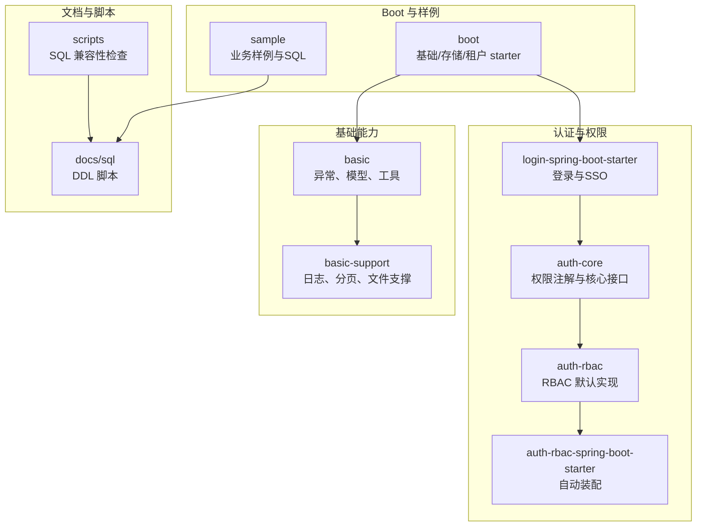
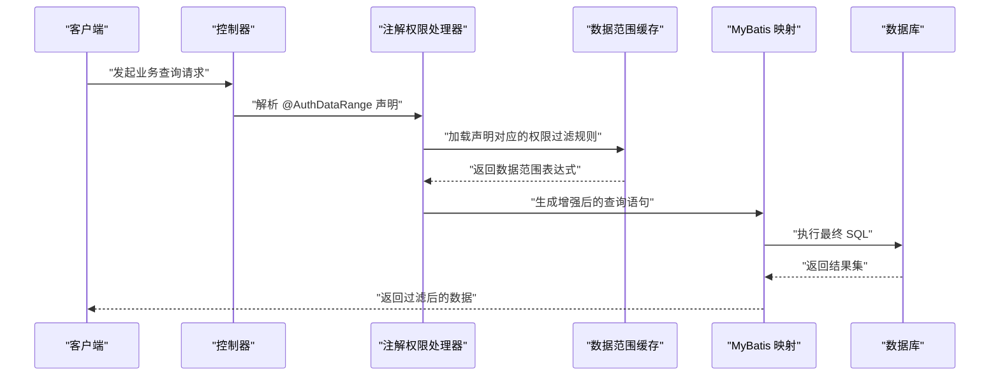
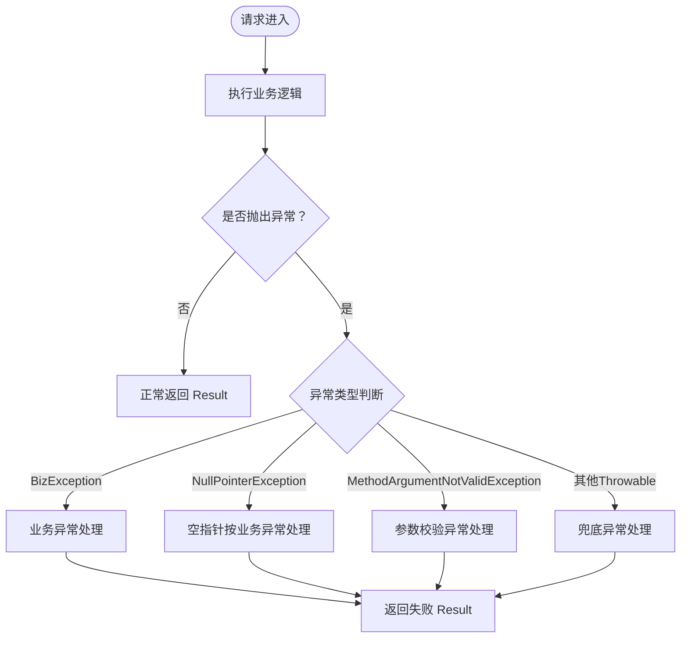
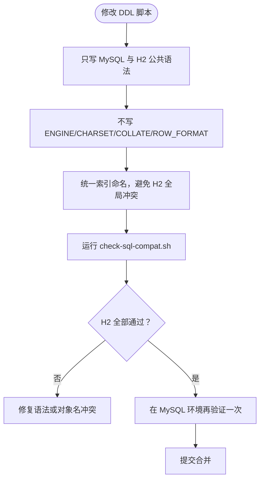
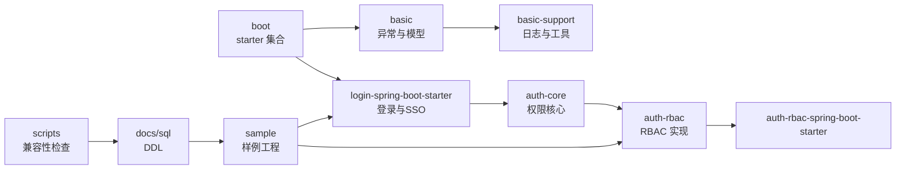

# 故障案例库

<cite>
**本文引用的文件**   
- [README_Auth.md](file://README_Auth.md)
- [pom.xml](file://pom.xml)
- [GlobalExceptionHandlerAdvice.java](file://basic/src/main/java/com/cu/framework/basic/exception/GlobalExceptionHandlerAdvice.java)
- [BizException.java](file://basic/src/main/java/com/cu/framework/basic/exception/BizException.java)
- [BackendException.java](file://basic/src/main/java/com/cu/framework/basic/exception/BackendException.java)
- [AuthRangeStartupFailureTest.java](file://sample/auth-core-boot-sample/src/test/java/com/cu/framework/sample/authcore/AuthRangeStartupFailureTest.java)
- [CheckCompat.java](file://scripts/CheckCompat.java)
- [check-sql-compat.sh](file://scripts/check-sql-compat.sh)
- [auth-rbac.sql](file://docs/sql/auth-rbac.sql)
- [basic-support.sql](file://docs/sql/basic-support.sql)
- [oidc接入踩坑记录.md](file://docs/说明文档/oidc接入踩坑记录.md)
- [SAML2_SP_Metadata配置指南.md](file://docs/说明文档/SAML2_SP_Metadata配置指南.md)
- [已废弃实现与决策记录.md](file://docs/说明文档/已废弃实现与决策记录.md)
</cite>

## 目录
1. [引言](#引言)
2. [项目结构](#项目结构)
3. [核心组件](#核心组件)
4. [架构总览](#架构总览)
5. [详细故障案例](#详细故障案例)
6. [依赖关系分析](#依赖关系分析)
7. [性能注意事项](#性能注意事项)
8. [故障排查指南](#故障排查指南)
9. [结论](#结论)

## 引言
本故障案例库基于当前仓库中的权限认证框架、基础异常处理、数据库脚本以及 SSO/OIDC/SAML 相关文档，整理出在生产环境中容易出现的启动失败、权限配置错误、认证集成问题、SQL 兼容性与响应格式异常等典型问题。每个案例包含问题现象、环境信息、错误日志线索、根因分析、解决步骤和预防措施，并附带可复现的最小化测试或校验方式，帮助读者快速定位与验证解决方案。

## 项目结构
该仓库是一个多模块 Spring Boot 权限与基础能力框架，主要包含：
- auth 系列：RBAC 权限模型、注解驱动的数据范围与菜单权限、Spring Security 集成 starter。
- basic / basic-support：统一异常、请求日志、分页工具、文件存储支撑。
- boot：通用 Spring Boot Starter（基础、存储、租户、魔法示例）。
- login-spring-boot-starter：登录、OAuth2/OIDC、SAML2、过滤器、响应处理。
- sample：多个业务样例工程，含建表脚本、种子数据、单元测试。
- docs/sql：跨 MySQL/H2 的通用 DDL 脚本。
- scripts：H2 MySQL 模式下的 SQL 兼容性检查工具。

**图表来源**
- [README_Auth.md:1-90](file://README_Auth.md#L1-L90)
- [pom.xml:1-60](file://pom.xml#L1-L60)

**章节来源**
- [README_Auth.md:1-90](file://README_Auth.md#L1-L90)
- [pom.xml:1-60](file://pom.xml#L1-L60)

## 核心组件
- 全局异常处理器：将业务异常、参数校验异常、空指针异常、未捕获异常统一转换为 `Result` 响应，便于前端一致处理。
- 权限注解体系：通过 `@AuthMenu`、`@AuthDataRange`、`@AuthDataOperation`、`@AuthDataAuthEdit` 完成菜单与数据权限控制。
- RBAC 默认实现：提供用户、角色、部门、菜单、API 权限的基础表结构与查询逻辑。
- 登录与 SSO：支持 OAuth2/OIDC、SAML2、密码登录、Remember-Me、统一登录返回结构。
- SQL 兼容性保障：通过 H2 MySQL 模式脚本执行检查器，确保 DDL 在 H2 中可重复执行且对象真正创建。

**章节来源**
- [GlobalExceptionHandlerAdvice.java:1-83](file://basic/src/main/java/com/cu/framework/basic/exception/GlobalExceptionHandlerAdvice.java#L1-L83)
- [README_Auth.md:1-90](file://README_Auth.md#L1-L90)
- [auth-rbac.sql:1-148](file://docs/sql/auth-rbac.sql#L1-L148)
- [check-sql-compat.sh:1-32](file://scripts/check-sql-compat.sh#L1-L32)

## 架构总览
下图展示一次带权限的数据范围查询从 Web 层到 MyBatis 层的调用链，以及权限扫描在启动期的关键路径。

**图表来源**
- [AuthRangeStartupFailureTest.java:1-120](file://sample/auth-core-boot-sample/src/test/java/com/cu/framework/sample/authcore/AuthRangeStartupFailureTest.java#L1-L120)
- [README_Auth.md:60-120](file://README_Auth.md#L60-L120)

## 详细故障案例

### 案例一：数据范围注解误用导致应用启动失败
- 问题现象
  - 应用启动时报错，无法完成上下文刷新。
  - 错误指向某个使用 `@AuthDataRange` 的方法或类，但具体原因不直观。
- 环境信息
  - Java 8、Spring Boot 2.7.x、MyBatis、H2(MODE=MySQL)。
  - 使用 `AnnotationConfigApplicationContext` 构造最小化测试环境。
- 错误日志线索
  - 启动期抛出的根异常中包含“解析不到映射语句”“数据范围只作用于查询语句”“二级缓存”“目标表不存在”“不在 MyBatis Mapper 接口上”等关键字。
- 根因分析
  - `@AuthDataRange` 必须标注在 MyBatis 映射接口的查询方法上；若方法无 SQL 注解、标在非查询方法、启用了二级缓存、静态 SQL 中目标表写错、或旧用法把声明放在业务 Bean 上，都会在启动期被校验器拦截。
- 解决步骤
  - 确认注解所在方法为查询方法，且存在有效的 SQL 注解。
  - 不要对启用二级缓存的语句使用数据范围注解。
  - 核对声明中的目标表名与实际 SQL 中使用的表名一致。
  - 删除业务 Bean 上的历史残留声明，迁移到 Mapper 接口。
- 预防措施
  - 使用现有测试用例作为基线，保证“错误声明必启动失败”，避免静默不过滤。
  - 在 CI 中加入启动期断言，覆盖上述五类错误场景。
- 最小化示例与验证
  - 参考测试类中对 `UnresolvedMapper`、`WriteStatementMapper`、`CachedMapper`、`WrongTableMapper`、`LegacyPlacementService` 的定义与断言，分别验证五种错误场景。

**图表来源**
- [AuthRangeStartupFailureTest.java:1-272](file://sample/auth-core-boot-sample/src/test/java/com/cu/framework/sample/authcore/AuthRangeStartupFailureTest.java#L1-L272)

**章节来源**
- [AuthRangeStartupFailureTest.java:1-272](file://sample/auth-core-boot-sample/src/test/java/com/cu/framework/sample/authcore/AuthRangeStartupFailureTest.java#L1-L272)

### 案例二：全局异常返回结构不一致
- 问题现象
  - 某些接口返回了非预期的 HTTP 状态码或 `Result` 结构。
  - 业务异常、参数校验异常、空指针异常和未捕获异常混在一起，前端难以区分。
- 环境信息
  - Spring MVC + `@RestControllerAdvice` 全局异常处理。
  - 业务层抛出 `BizException`，底层可能抛出 `NullPointerException` 或其他 `Throwable`。
- 错误日志线索
  - 全局处理器日志中出现 `bizException >>`、`nullPointerException >>`、`throwable >>` 等输出。
- 根因分析
  - `GlobalExceptionHandlerAdvice` 对业务异常、空指针异常、参数校验异常、任意 `Throwable` 分别处理，但最后一个兜底处理器没有设置明确的 `@ResponseStatus`，可能返回默认状态码。
  - `BackendException` 默认错误码为 500，而 `BizException` 通过 `ExceptionConstant.BIZ_FAILED` 走业务失败分支，二者语义不同。
- 解决步骤
  - 明确业务异常使用 `BizException`，系统异常使用 `BackendException`。
  - 对兜底异常处理器补充明确的 HTTP 状态码，避免前端收到 200 或 500 混淆。
  - 在业务层优先抛出结构化业务异常，而不是直接抛空指针或原始异常。
- 预防措施
  - 在代码审查中禁止直接抛出 `RuntimeException` 或 `NullPointerException`。
  - 所有对外 API 统一返回 `Result`，由全局处理器负责填充状态码与消息。
- 最小化示例与验证
  - 通过触发 `MethodArgumentNotValidException`、`BizException`、`NullPointerException`、任意 `Throwable`，观察返回体是否均为 `Result` 结构。

**图表来源**
- [GlobalExceptionHandlerAdvice.java:1-83](file://basic/src/main/java/com/cu/framework/basic/exception/GlobalExceptionHandlerAdvice.java#L1-L83)
- [BizException.java:1-27](file://basic/src/main/java/com/cu/framework/basic/exception/BizException.java#L1-L27)
- [BackendException.java:1-31](file://basic/src/main/java/com/cu/framework/basic/exception/BackendException.java#L1-L31)

**章节来源**
- [GlobalExceptionHandlerAdvice.java:1-83](file://basic/src/main/java/com/cu/framework/basic/exception/GlobalExceptionHandlerAdvice.java#L1-L83)
- [BizException.java:1-27](file://basic/src/main/java/com/cu/framework/basic/exception/BizException.java#L1-L27)
- [BackendException.java:1-31](file://basic/src/main/java/com/cu/framework/basic/exception/BackendException.java#L1-L31)

### 案例三：OIDC 元数据地址配置错误导致启动失败
- 问题现象
  - 应用启动时报错，OIDC Discovery 阶段失败。
  - 日志中出现 `text/html` 内容类型解析异常，或提示找不到合适的消息转换器。
- 环境信息
  - Spring Boot 2.7.18、Spring Security 5.7.x、Java 8。
  - OIDC 使用 `issuer-uri` 自动发现端点。
- 错误日志线索
  - 启动期日志显示 `ClientRegistrations.fromIssuerLocation()` 失败。
  - 实际访问 URL 出现 `.well-known/openid-configuration/.well-known/openid-configuration` 的双拼接路径。
- 根因分析
  - 配置的是完整的 Discovery URL，而非 IDP 基础地址。Spring Security 会自动拼接 `/.well-known/openid-configuration`，导致请求无效地址，返回 HTML 错误页而非 JSON。
- 解决步骤
  - 将 `issuer-uri` 改为 IDP 基础地址，例如 `/oidc`，而不是 `/oidc/.well-known/openid-configuration`。
  - 仅在需要自定义 HTTP 行为时显式配置 `tokenEndpoint`、`userInfoEndpoint`，不要把 IDP 端点地址填进这些 DSL。
- 预防措施
  - 在配置模板中明确区分“本机拦截路径前缀”和“IDP 端点地址”。
  - 在 CI 中校验 `issuer-uri` 是否以基础路径结尾，避免生产环境误配。
- 最小化示例与验证
  - 对比正确与错误的 `issuer-uri` 配置，观察启动日志是否还能拉取 Discovery 文档。

**图表来源**
- [oidc接入踩坑记录.md:1-120](file://docs/说明文档/oidc接入踩坑记录.md#L1-L120)

**章节来源**
- [oidc接入踩坑记录.md:1-120](file://docs/说明文档/oidc接入踩坑记录.md#L1-L120)

### 案例四：非标准 IdP 的 JWKS 端点缺少 client_id 导致 JWT 验签失败
- 问题现象
  - 登录成功但后续鉴权失败，JWT 验签报错。
  - 日志中出现 `BadJwtException: Signed JWT rejected`、期望算法或密钥不匹配。
- 环境信息
  - Spring Security 5.7.x、OIDC、JWKS 端点由外部 IdP 提供。
  - 该 IdP 的 JWKS 端点要求携带 `client_id` 才能返回对应公钥。
- 错误日志线索
  - `NimbusJwtDecoder.process` 抛出 `BadJwtException`。
  - 内部 `selectKeys()` 找不到匹配的 JWK。
- 根因分析
  - Spring Security 使用 `RemoteJWKSet` 访问 `jwks_uri`，默认不带 `client_id`。
  - 非标准 IdP 返回空密钥列表，导致 JWT 解码时找不到签名密钥。
- 解决步骤
  - 在 OIDC 客户端配置中手动覆盖 `jwk-set-uri`，追加 `client_id` 参数。
  - 保持其他 IdP 使用自动发现，仅对该客户端做特殊配置。
- 预防措施
  - 将“非标准 IdP”的配置差异写入配置文档，避免新开发者复制通用模板。
  - 对 `ignore-ssl` 等安全开关做严格审批，默认关闭证书豁免。
- 最小化示例与验证
  - 使用提供的 YAML 片段替换 `jwk-set-uri`，观察是否仍报 `BadJwtException`。

**图表来源**
- [oidc接入踩坑记录.md:120-220](file://docs/说明文档/oidc接入踩坑记录.md#L120-L220)

**章节来源**
- [oidc接入踩坑记录.md:120-220](file://docs/说明文档/oidc接入踩坑记录.md#L120-L220)

### 案例五：SAML2 SP Metadata 端点未暴露
- 问题现象
  - 在 Spring Security 5.7 环境下，IdP 无法获取 SP Metadata。
  - 访问 `/saml2/service-provider-metadata/{registrationId}` 返回 404。
- 环境信息
  - Spring Security 5.7、SAML2、OpenSAML。
  - 需要通过手动添加 `Saml2MetadataFilter` 暴露 SP Metadata。
- 错误日志线索
  - 无明显异常，但 IdP 侧无法完成 SSO 初始化，因为拿不到 SP 的端点和证书信息。
- 根因分析
  - Spring Security 5.7 不会自动注册 SP Metadata 过滤器，需开发者显式装配。
  - 缺少 `RelyingPartyRegistrationRepository`、`Saml2MetadataFilter` 或过滤器顺序不正确。
- 解决步骤
  - 构建 `RelyingPartyRegistrationRepository`，登记 SP 的 registration。
  - 在 `HttpSecurity` 中添加 `Saml2MetadataFilter`，并确保其位于 `Saml2WebSsoAuthenticationFilter` 之前。
  - 使用 `/saml2/service-provider-metadata/{registrationId}` 验证返回 XML。
- 预防措施
  - 将 SAML2 配置纳入部署清单，明确 metadata 端点是否应公开。
  - 在测试中增加 metadata 端点可用性检查。
- 最小化示例与验证
  - 参考配置指南中的过滤器装配方式，访问 metadata 端点并校验返回的 EntityDescriptor。

**图表来源**
- [SAML2_SP_Metadata配置指南.md:1-160](file://docs/说明文档/SAML2_SP_Metadata配置指南.md#L1-L160)

**章节来源**
- [SAML2_SP_Metadata配置指南.md:1-160](file://docs/说明文档/SAML2_SP_Metadata配置指南.md#L1-L160)

### 案例六：数据库脚本方言混乱导致 H2 与 MySQL 不一致
- 问题现象
  - 本地 H2 内存库能运行，但切换到 MySQL 后建表失败。
  - 或者反过来，MySQL 可用，H2 无法识别字符集、排序规则、引擎等方言子句。
  - 增量脚本与全量脚本不一致，升级时遗漏字段或索引。
- 环境信息
  - MySQL、H2、MyBatis Plus。
  - 脚本分布在多处，曾同时保留 `auth_full.sql` 与 MySQL 8 原样快照。
- 错误日志线索
  - H2 报语法不支持、对象名冲突、索引名冲突。
  - MySQL 报未知字符集、未知排序规则或不支持的行格式。
- 根因分析
  - 早期方案按数据库方言分多份脚本，同一张表要同步维护多份，极易漂移。
  - 方言子句把脚本锁死在特定 MySQL 版本，H2 无法复用。
  - H2 的索引作用域是全局，原来多表共用 `user_id` 索引名会冲突。
- 解决步骤
  - 统一到 `docs/sql/` 下，只保留一份 MySQL 与 H2(MODE=MySQL) 公共语法。
  - 不写 `ENGINE`、`CHARACTER SET`、`COLLATE`、`ROW_FORMAT`，交给各库默认值。
  - 将索引名统一为 `idx_表名_列`、`uk_表名_列`，避免 H2 全局冲突。
  - 将示例专用建表和种子数据放回 `sample/*/sql/`。
- 预防措施
  - 新增或修改 DDL 后，必须通过 `scripts/check-sql-compat.sh` 在 H2 MySQL 模式下执行。
  - 在 CI 中强制执行兼容性检查，否则不允许合并。
  - 变更脚本时同步检查实体类、Mapper、视图、索引。
- 最小化示例与验证
  - 执行 `scripts/check-sql-compat.sh`，确认所有 `docs/sql/*.sql` 和 `sample/*/sql/*.sql` 均可被 H2 逐条接受，并能重复执行。

**图表来源**
- [check-sql-compat.sh:1-32](file://scripts/check-sql-compat.sh#L1-L32)
- [CheckCompat.java:1-144](file://scripts/CheckCompat.java#L1-L144)
- [auth-rbac.sql:1-148](file://docs/sql/auth-rbac.sql#L1-L148)
- [basic-support.sql:1-79](file://docs/sql/basic-support.sql#L1-L79)
- [已废弃实现与决策记录.md:120-239](file://docs/说明文档/已废弃实现与决策记录.md#L120-L239)

**章节来源**
- [check-sql-compat.sh:1-32](file://scripts/check-sql-compat.sh#L1-L32)
- [CheckCompat.java:1-144](file://scripts/CheckCompat.java#L1-L144)
- [auth-rbac.sql:1-148](file://docs/sql/auth-rbac.sql#L1-L148)
- [basic-support.sql:1-79](file://docs/sql/basic-support.sql#L1-L79)
- [已废弃实现与决策记录.md:120-239](file://docs/说明文档/已废弃实现与决策记录.md#L120-L239)

### 案例七：历史废弃实现引发安全风险
- 问题现象
  - 遗留的 Remember-Me header 实现存在默认 key 安全问题。
  - 有代码注释提到 SSL 豁免，但真实故障是响应解析问题，方向判断错误。
- 环境信息
  - 历史认证实现、OAuth2 用户信息获取、Spring Session 迁移过程。
- 错误日志线索
  - 日志中可能没有明显错误，但安全性审计发现默认 key、SSL 豁免硬编码。
- 根因分析
  - 历史实现中 Remember-Me key 默认值为固定字符串，登出清除响应头的行为在 Servlet 规范下并不生效。
  - 早期为 OIDC 对接加入的 SSL 豁免是排障时的“广撒网”，实际问题是消息转换器和错误处理器配置，而非证书本身。
- 解决步骤
  - 不再使用已废弃的 header 模式 Remember-Me，改用 Spring Session 的 remember-me。
  - 移除调用点的硬编码 SSL 豁免，改为受控配置项，默认开启证书校验。
  - 对 OIDC Discovery 始终执行标准证书校验，不因业务客户端的 `ignore-ssl` 放宽。
- 预防措施
  - 对已废弃实现加明确警告，禁止在新功能中复用。
  - 安全相关配置必须走审批流程，默认值必须是安全值。
- 最小化示例与验证
  - 检查是否仍有引用已废弃 Remember-Me header 实现。
  - 检查 OAuth2 客户端配置是否默认跳过 TLS 校验。

**图表来源**
- [已废弃实现与决策记录.md:1-120](file://docs/说明文档/已废弃实现与决策记录.md#L1-L120)

**章节来源**
- [已废弃实现与决策记录.md:1-120](file://docs/说明文档/已废弃实现与决策记录.md#L1-L120)

## 依赖关系分析

**图表来源**
- [pom.xml:1-120](file://pom.xml#L1-L120)
- [README_Auth.md:1-90](file://README_Auth.md#L1-L90)

**章节来源**
- [pom.xml:1-120](file://pom.xml#L1-L120)
- [README_Auth.md:1-90](file://README_Auth.md#L1-L90)

## 性能注意事项
- 数据范围查询应在 Mapper 层完成 SQL 增强，避免在业务层做二次过滤。
- 不要在高频查询上启用二级缓存的同时叠加数据范围，两者在框架校验中被视为不可共存。
- 全局异常处理器会记录日志，生产环境建议根据日志级别控制异常堆栈输出，避免大量堆栈日志影响吞吐。
- SQL 脚本应尽量减少不必要的索引和冗余列，配合 `basic-support` 的请求日志表进行慢请求分析。

[本节为通用性能建议，不直接分析具体文件]

## 故障排查指南
- 启动失败
  - 先检查 OIDC `issuer-uri` 是否为 IDP 基础地址。
  - 再检查 `@AuthDataRange` 是否标注在合法查询方法上。
  - 最后执行 `scripts/check-sql-compat.sh` 排除 DDL 语法问题。
- 权限异常
  - 确认菜单权限和数据权限都已初始化。
  - 检查 `sys_menu_api`、`sys_auth_menu`、`sys_auth_data` 等表是否按 `docs/sql/auth-rbac.sql` 初始化。
- 认证集成
  - OIDC：核对 `issuer-uri`、`jwk-set-uri`、`ignore-ssl`。
  - SAML2：核对 metadata 端点是否暴露、`registrationId` 是否与 IdP 一致。
- 数据库升级
  - 修改 DDL 后必须通过 H2 兼容性检查，并在 MySQL 环境复测。
  - 注意索引命名、视图定义、字段类型与实体映射的一致性。

**章节来源**
- [AuthRangeStartupFailureTest.java:1-272](file://sample/auth-core-boot-sample/src/test/java/com/cu/framework/sample/authcore/AuthRangeStartupFailureTest.java#L1-L272)
- [check-sql-compat.sh:1-32](file://scripts/check-sql-compat.sh#L1-L32)
- [auth-rbac.sql:1-148](file://docs/sql/auth-rbac.sql#L1-L148)

## 结论
本故障案例库覆盖了权限框架启动期校验、全局异常处理、OIDC/SAML 集成、SQL 兼容性和历史废弃实现等五个关键领域。通过测试用例、脚本工具和文档记录，这些问题都可以被提前发现并标准化处理。建议在团队内建立“配置即文档、脚本即契约、异常即出口”的工程习惯，使权限、认证、数据和日志在各环境中保持一致。

[本节为总结性内容，不直接分析具体文件]