# 日志分析方法论

<cite>
**本文引用的文件**   
- [LoggerConstant.java](file://basic/src/main/java/com/cu/framework/basic/logger/LoggerConstant.java)
- [TraceContext.java](file://basic/src/main/java/com/cu/framework/basic/logger/trace/TraceContext.java)
- [TraceIdProcessor.java](file://basic/src/main/java/com/cu/framework/basic/logger/trace/TraceIdProcessor.java)
- [HeaderTraceIdProcessor.java](file://basic/src/main/java/com/cu/framework/basic/logger/trace/HeaderTraceIdProcessor.java)
- [TraceRequestFilter.java](file://basic/src/main/java/com/cu/framework/basic/logger/TraceRequestFilter.java)
- [RequestLoggerFilter.java](file://basic/src/main/java/com/cu/framework/basic/logger/RequestLoggerFilter.java)
- [RequestLoggerEvent.java](file://basic/src/main/java/com/cu/framework/basic/logger/request/RequestLoggerEvent.java)
- [RequestLogger.java](file://basic/src/main/java/com/cu/framework/basic/logger/request/RequestLogger.java)
- [TraceResponseBodyAdvice.java](file://basic/src/main/java/com/cu/framework/basic/logger/trace/TraceResponseBodyAdvice.java)
- [TraceResult.java](file://basic/src/main/java/com/cu/framework/basic/logger/trace/TraceResult.java)
- [RequestLogDatabasePersistentListener.java](file://basic-support/src/main/java/com/cu/framework/basic/support/log/RequestLogDatabasePersistentListener.java)
- [RequestLogFangTangMessageListener.java](file://basic-support/src/main/java/com/cu/framework/basic/support/log/RequestLogFangTangMessageListener.java)
- [RequestLogService.java](file://basic-support/src/main/java/com/cu/framework/basic/support/log/persistent/RequestLogService.java)
- [TodayStatisticResp.java](file://basic-support/src/main/java/com/cu/framework/basic/support/log/persistent/TodayStatisticResp.java)
- [basic-support.sql](file://docs/sql/basic-support.sql)
- [application.yml](file://docs/application.yml)
</cite>

## 目录

1. [引言](#引言)
2. [项目结构](#项目结构)
3. [核心组件](#核心组件)
4. [架构总览](#架构总览)
5. [详细组件分析](#详细组件分析)
6. [依赖关系分析](#依赖关系分析)
7. [性能相关日志分析](#性能相关日志分析)
8. [配置与输出格式](#配置与输出格式)
9. [日志聚合与分析工具集成](#日志聚合与分析工具集成)
10. [故障排查指南](#故障排查指南)
11. [结论](#结论)

## 引言

本方法论围绕 Kewen Framework 的日志与可观测能力展开，重点说明请求日志采集、链路追踪、异常处理、数据库持久化以及扩展通知机制。文档的目标是让读者既能理解框架内部实现，又能据此制定生产环境的日志策略、性能分析方法和排障流程。

Kewen Framework 的日志设计以 Servlet Filter 为入口，结合 Spring MVC 的响应拦截器完成请求全链路数据采集；通过事件机制将日志异步投递到数据库和消息通知渠道；并通过统一的 TraceId 实现跨层链路追踪。

## 项目结构

日志相关代码主要分布在两个模块：

| 模块 | 职责 | 关键路径 |
|---|---|---|
| basic | 提供基础过滤器、链路上下文、请求日志模型、MDC 上下文、统一响应包装 | `basic/src/main/java/com/cu/framework/basic/logger` |
| basic-support | 提供请求日志数据库持久化、方糖消息通知、访问统计服务 | `basic-support/src/main/java/com/cu/framework/basic/support/log` |

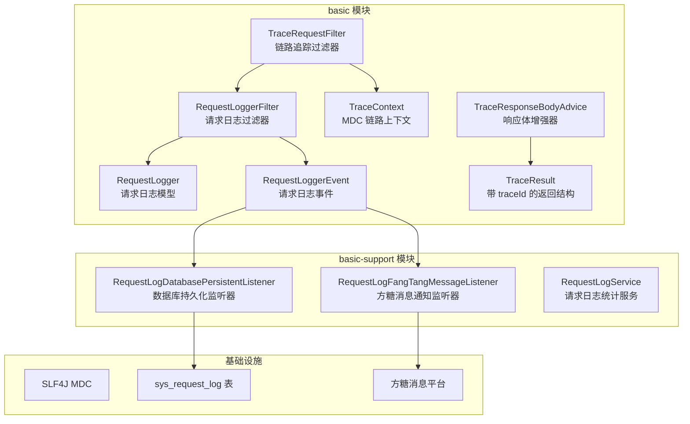

**图表来源**   
- [TraceRequestFilter.java:1-60](file://basic/src/main/java/com/cu/framework/basic/logger/TraceRequestFilter.java#L1-L60)
- [RequestLoggerFilter.java:1-133](file://basic/src/main/java/com/cu/framework/basic/logger/RequestLoggerFilter.java#L1-L133)
- [TraceContext.java:1-22](file://basic/src/main/java/com/cu/framework/basic/logger/trace/TraceContext.java#L1-L22)
- [RequestLogger.java:1-40](file://basic/src/main/java/com/cu/framework/basic/logger/request/RequestLogger.java#L1-L40)
- [RequestLoggerEvent.java:1-23](file://basic/src/main/java/com/cu/framework/basic/logger/request/RequestLoggerEvent.java#L1-L23)
- [TraceResponseBodyAdvice.java:1-42](file://basic/src/main/java/com/cu/framework/basic/logger/trace/TraceResponseBodyAdvice.java#L1-L42)
- [TraceResult.java:1-39](file://basic/src/main/java/com/cu/framework/basic/logger/trace/TraceResult.java#L1-L39)
- [RequestLogDatabasePersistentListener.java:1-66](file://basic-support/src/main/java/com/cu/framework/basic/support/log/RequestLogDatabasePersistentListener.java#L1-L66)
- [RequestLogFangTangMessageListener.java:1-108](file://basic-support/src/main/java/com/cu/framework/basic/support/log/RequestLogFangTangMessageListener.java#L1-L108)

**章节来源**   
- [TraceRequestFilter.java:1-60](file://basic/src/main/java/com/cu/framework/basic/logger/TraceRequestFilter.java#L1-L60)
- [RequestLoggerFilter.java:1-133](file://basic/src/main/java/com/cu/framework/basic/logger/RequestLoggerFilter.java#L1-L133)
- [RequestLogDatabasePersistentListener.java:1-66](file://basic-support/src/main/java/com/cu/framework/basic/support/log/RequestLogDatabasePersistentListener.java#L1-L66)
- [RequestLogFangTangMessageListener.java:1-108](file://basic-support/src/main/java/com/cu/framework/basic/support/log/RequestLogFangTangMessageListener.java#L1-L108)

## 核心组件

### 链路追踪上下文

链路追踪的核心是 TraceId。框架使用 SLF4J 的 MDC 存储当前请求的 traceId，从而让后续所有日志输出都能携带统一流水号。

- `LoggerConstant.TRACE_ID_KEY` 定义 MDC 键名为 `traceId`。
- `TraceContext` 封装 MDC 的读取、写入和清理操作。
- `TraceRequestFilter` 在请求进入时设置 traceId，并在 finally 中清理，避免线程复用导致污染。
- `HeaderTraceIdProcessor` 默认从请求头读取 traceId，不存在时生成无短横线的 UUID。
- `TraceIdProcessor` 是一个可扩展接口，允许替换默认处理器。

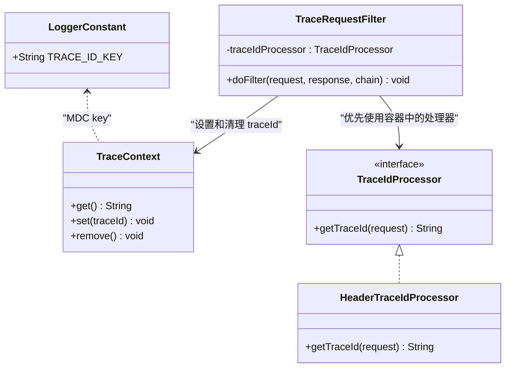

**图表来源**   
- [LoggerConstant.java:1-10](file://basic/src/main/java/com/cu/framework/basic/logger/LoggerConstant.java#L1-L10)
- [TraceContext.java:1-22](file://basic/src/main/java/com/cu/framework/basic/logger/trace/TraceContext.java#L1-L22)
- [TraceIdProcessor.java:1-18](file://basic/src/main/java/com/cu/framework/basic/logger/trace/TraceIdProcessor.java#L1-L18)
- [HeaderTraceIdProcessor.java:1-27](file://basic/src/main/java/com/cu/framework/basic/logger/trace/HeaderTraceIdProcessor.java#L1-L27)
- [TraceRequestFilter.java:1-60](file://basic/src/main/java/com/cu/framework/basic/logger/TraceRequestFilter.java#L1-L60)

**章节来源**   
- [LoggerConstant.java:1-10](file://basic/src/main/java/com/cu/framework/basic/logger/LoggerConstant.java#L1-L10)
- [TraceContext.java:1-22](file://basic/src/main/java/com/cu/framework/basic/logger/trace/TraceContext.java#L1-L22)
- [TraceIdProcessor.java:1-18](file://basic/src/main/java/com/cu/framework/basic/logger/trace/TraceIdProcessor.java#L1-L18)
- [HeaderTraceIdProcessor.java:1-27](file://basic/src/main/java/com/cu/framework/basic/logger/trace/HeaderTraceIdProcessor.java#L1-L27)
- [TraceRequestFilter.java:1-60](file://basic/src/main/java/com/cu/framework/basic/logger/TraceRequestFilter.java#L1-L60)

### 请求日志采集模型

`RequestLogger` 是框架对一次 HTTP 请求的抽象模型，包含以下关键字段：

| 字段 | 含义 | 典型用途 |
|---|---|---|
| `traceId` | 链路追踪 ID | 关联同一请求的多条日志 |
| `url` | 请求 URI | 按接口维度统计 |
| `method` | HTTP 方法 | 区分 GET、POST 等 |
| `params` | 序列化后的查询参数 | 定位接口入参 |
| `body` | 解析后的请求体对象 | 分析 JSON 请求内容 |
| `ip` | 客户端 IP | 识别来源、做去重和告警 |
| `headers` | 全部请求头 | 分析鉴权、租户、链路透传信息 |
| `execMillisecond` | 执行耗时（毫秒） | 慢请求识别和性能统计 |

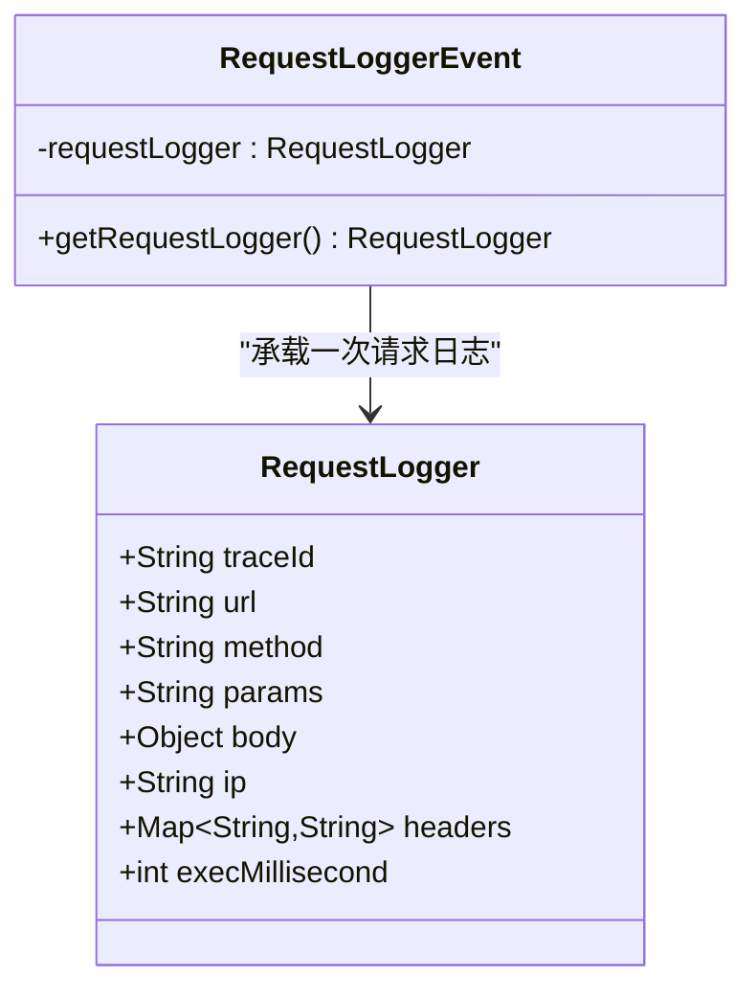

**图表来源**   
- [RequestLogger.java:1-40](file://basic/src/main/java/com/cu/framework/basic/logger/request/RequestLogger.java#L1-L40)
- [RequestLoggerEvent.java:1-23](file://basic/src/main/java/com/cu/framework/basic/logger/request/RequestLoggerEvent.java#L1-L23)

**章节来源**   
- [RequestLogger.java:1-40](file://basic/src/main/java/com/cu/framework/basic/logger/request/RequestLogger.java#L1-L40)
- [RequestLoggerEvent.java:1-23](file://basic/src/main/java/com/cu/framework/basic/logger/request/RequestLoggerEvent.java#L1-L23)

### 响应链路追踪增强

`TraceResponseBodyAdvice` 会拦截返回类型为 `Result` 的控制器响应，并将其包装成 `TraceResult`，使调用方能够直接从响应中拿到 traceId。

`TraceResult` 继承业务通用返回结构，新增 `traceId` 字段，并把原始 code、message、success、data 复制到新对象中。

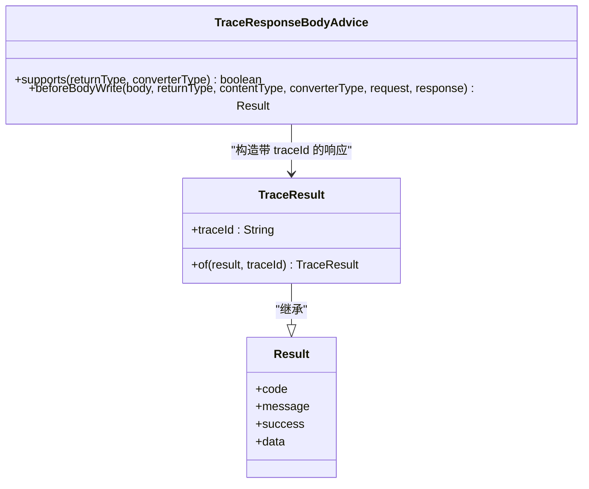

**图表来源**   
- [TraceResponseBodyAdvice.java:1-42](file://basic/src/main/java/com/cu/framework/basic/logger/trace/TraceResponseBodyAdvice.java#L1-L42)
- [TraceResult.java:1-39](file://basic/src/main/java/com/cu/framework/basic/logger/trace/TraceResult.java#L1-L39)

**章节来源**   
- [TraceResponseBodyAdvice.java:1-42](file://basic/src/main/java/com/cu/framework/basic/logger/trace/TraceResponseBodyAdvice.java#L1-L42)
- [TraceResult.java:1-39](file://basic/src/main/java/com/cu/framework/basic/logger/trace/TraceResult.java#L1-L39)

## 架构总览

Kewen Framework 的请求日志与链路追踪流程可以概括为：

1. 请求进入后，先由 `TraceRequestFilter` 解析或生成 traceId，并写入 MDC。
2. 然后进入 `RequestLoggerFilter`，该过滤器收集 URL、方法、IP、参数、请求体、请求头和 traceId，打印结构化请求日志。
3. 过滤器计算请求执行时间，并发布 `RequestLoggerEvent`。
4. 事件监听器异步处理日志：
   - 数据库监听器把请求日志写入 `sys_request_log`。
   - 方糖消息监听器根据来源 IP 去重后推送通知。
5. 控制器返回 `Result` 时，`TraceResponseBodyAdvice` 将其包装为 `TraceResult`，附带 traceId。

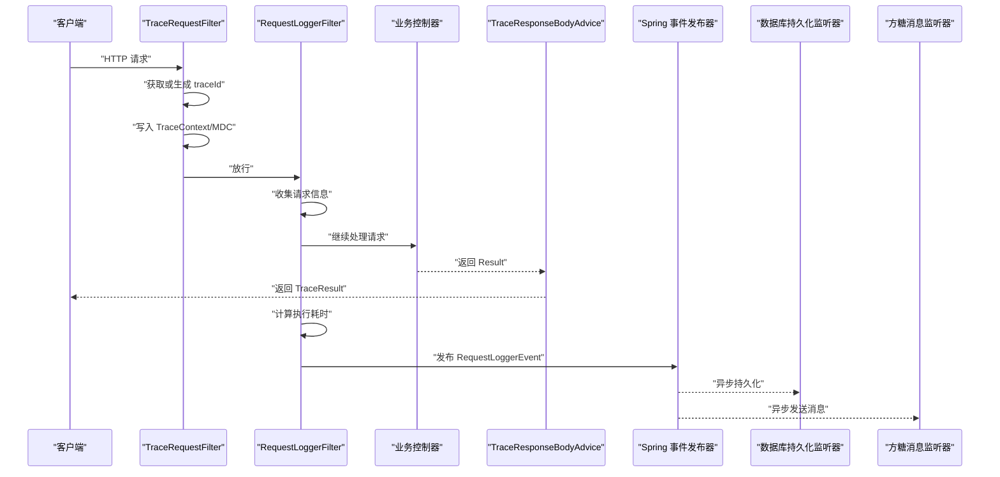

**图表来源**   
- [TraceRequestFilter.java:1-60](file://basic/src/main/java/com/cu/framework/basic/logger/TraceRequestFilter.java#L1-L60)
- [RequestLoggerFilter.java:1-133](file://basic/src/main/java/com/cu/framework/basic/logger/RequestLoggerFilter.java#L1-L133)
- [TraceResponseBodyAdvice.java:1-42](file://basic/src/main/java/com/cu/framework/basic/logger/trace/TraceResponseBodyAdvice.java#L1-L42)
- [RequestLogDatabasePersistentListener.java:1-66](file://basic-support/src/main/java/com/cu/framework/basic/support/log/RequestLogDatabasePersistentListener.java#L1-L66)
- [RequestLogFangTangMessageListener.java:1-108](file://basic-support/src/main/java/com/cu/framework/basic/support/log/RequestLogFangTangMessageListener.java#L1-L108)

**章节来源**   
- [TraceRequestFilter.java:1-60](file://basic/src/main/java/com/cu/framework/basic/logger/TraceRequestFilter.java#L1-L60)
- [RequestLoggerFilter.java:1-133](file://basic/src/main/java/com/cu/framework/basic/logger/RequestLoggerFilter.java#L1-L133)
- [TraceResponseBodyAdvice.java:1-42](file://basic/src/main/java/com/cu/framework/basic/logger/trace/TraceResponseBodyAdvice.java#L1-L42)
- [RequestLogDatabasePersistentListener.java:1-66](file://basic-support/src/main/java/com/cu/framework/basic/support/log/RequestLogDatabasePersistentListener.java#L1-L66)
- [RequestLogFangTangMessageListener.java:1-108](file://basic-support/src/main/java/com/cu/framework/basic/support/log/RequestLogFangTangMessageListener.java#L1-L108)

## 详细组件分析

### 请求日志收集流程

`RequestLoggerFilter` 是请求日志采集的核心。它实现早期请求过滤器接口，并按顺序完成以下工作：

1. 解析全部请求头。
2. 解析查询参数，并将数组参数转为字符串形式。
3. 包装原始请求，以便重复读取请求体。
4. 组装 `RequestLogger`，包含 traceId、IP、URL、方法、参数、请求体、请求头。
5. 使用 Slf4j 输出请求日志。
6. 记录开始时间，执行后续过滤器链。
7. 在 finally 中计算耗时，并设置 `execMillisecond`。
8. 发布 `RequestLoggerEvent`，交由监听器异步处理。

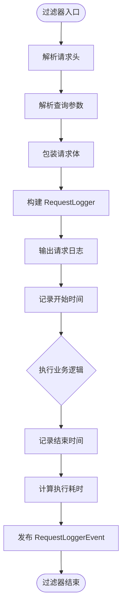

**图表来源**   
- [RequestLoggerFilter.java:1-133](file://basic/src/main/java/com/cu/framework/basic/logger/RequestLoggerFilter.java#L1-L133)

**章节来源**   
- [RequestLoggerFilter.java:1-133](file://basic/src/main/java/com/cu/framework/basic/logger/RequestLoggerFilter.java#L1-L133)

### 链路追踪流程

链路追踪的关键在于保证 traceId 在整个请求生命周期中可用，并且不会泄漏到其他请求。

- `TraceRequestFilter` 使用 `Order(1)`，保证在日志过滤器之前执行。
- 如果容器中注册了自定义 `TraceIdProcessor`，则优先使用；否则使用默认的 `HeaderTraceIdProcessor`。
- `HeaderTraceIdProcessor` 从请求头 `traceId` 读取；不存在时生成无短横线的 UUID。
- `TraceContext` 基于 SLF4J MDC 保存 traceId。
- `finally` 块中调用 `TraceContext.remove()`，确保线程复用安全。

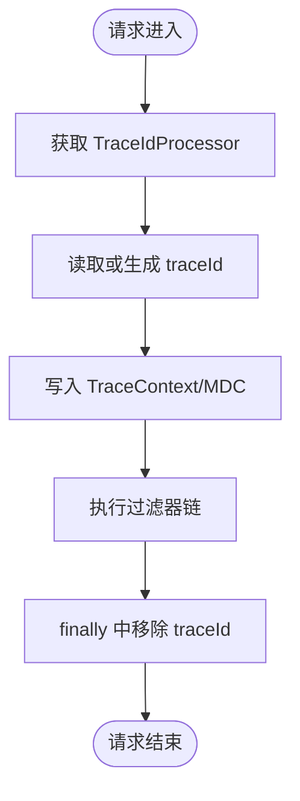

**图表来源**   
- [TraceRequestFilter.java:1-60](file://basic/src/main/java/com/cu/framework/basic/logger/TraceRequestFilter.java#L1-L60)
- [HeaderTraceIdProcessor.java:1-27](file://basic/src/main/java/com/cu/framework/basic/logger/trace/HeaderTraceIdProcessor.java#L1-L27)
- [TraceContext.java:1-22](file://basic/src/main/java/com/cu/framework/basic/logger/trace/TraceContext.java#L1-L22)

**章节来源**   
- [TraceRequestFilter.java:1-60](file://basic/src/main/java/com/cu/framework/basic/logger/TraceRequestFilter.java#L1-L60)
- [HeaderTraceIdProcessor.java:1-27](file://basic/src/main/java/com/cu/framework/basic/logger/trace/HeaderTraceIdProcessor.java#L1-L27)
- [TraceContext.java:1-22](file://basic/src/main/java/com/cu/framework/basic/logger/trace/TraceContext.java#L1-L22)

### 日志持久化流程

当 `cu.request.persistent.database` 启用时，系统会把请求日志写入数据库。持久化过程是异步的，不阻塞主请求线程。

- `RequestLogDatabasePersistentListener` 监听 `RequestLoggerEvent`。
- 使用 `@Async` 异步保存，避免影响接口响应时间。
- 将 `RequestLogger` 转换为 `SysRequestLog` 实体后保存。
- 注意：traceId 来自事件对象中的 `RequestLogger.traceId`，而不是当前异步线程的 `TraceContext`，以避免线程局部变量丢失。

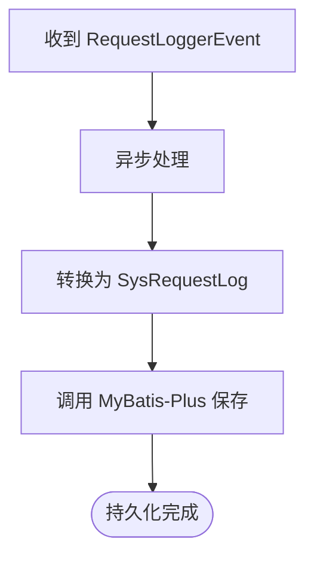

**图表来源**   
- [RequestLogDatabasePersistentListener.java:1-66](file://basic-support/src/main/java/com/cu/framework/basic/support/log/RequestLogDatabasePersistentListener.java#L1-L66)

**章节来源**   
- [RequestLogDatabasePersistentListener.java:1-66](file://basic-support/src/main/java/com/cu/framework/basic/support/log/RequestLogDatabasePersistentListener.java#L1-L66)

### 方糖消息通知流程

方糖消息通知用于快速感知某个 IP 发起的请求。通知逻辑具有 IP 级别去重特性：

- 使用本地缓存记录已推送的 IP。
- 缓存过期时间为 30 分钟。
- 相同 IP 在有效期内只推送一次。
- 消息正文使用 Markdown 渲染，包含 IP、URL、请求头、参数和请求体。

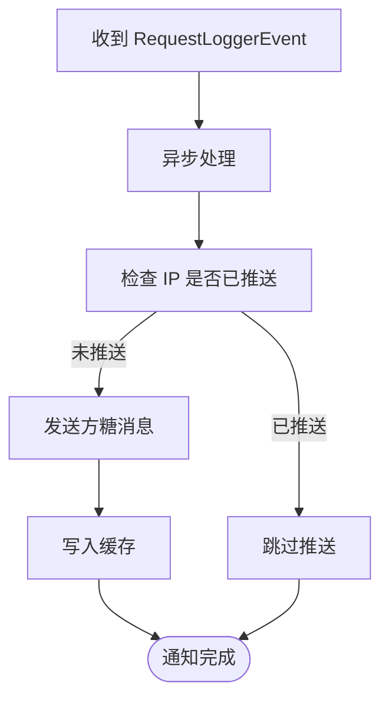

**图表来源**   
- [RequestLogFangTangMessageListener.java:1-108](file://basic-support/src/main/java/com/cu/framework/basic/support/log/RequestLogFangTangMessageListener.java#L1-L108)

**章节来源**   
- [RequestLogFangTangMessageListener.java:1-108](file://basic-support/src/main/java/com/cu/framework/basic/support/log/RequestLogFangTangMessageListener.java#L1-L108)

### 访问统计能力

`RequestLogService` 提供按天统计独立访问 IP 数和独立用户数的能力。它基于 `sys_request_log` 表查询指定日期区间内的日志，并按创建日期分组统计。

- 查询范围是闭区间：起始日期的 00:00 到结束日期的次日 00:00。
- 如果某日没有日志记录，则该日不出现在结果中。
- 返回结果为 `TodayStatisticResp`，包含日期、独立 IP 数、独立用户数。

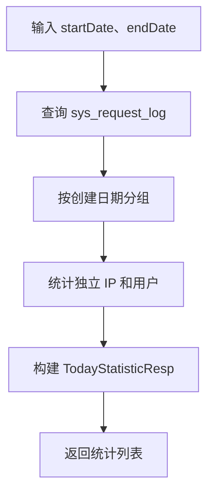

**图表来源**   
- [RequestLogService.java:1-60](file://basic-support/src/main/java/com/cu/framework/basic/support/log/persistent/RequestLogService.java#L1-L60)
- [TodayStatisticResp.java:1-23](file://basic-support/src/main/java/com/cu/framework/basic/support/log/persistent/TodayStatisticResp.java#L1-L23)

**章节来源**   
- [RequestLogService.java:1-60](file://basic-support/src/main/java/com/cu/framework/basic/support/log/persistent/RequestLogService.java#L1-L60)
- [TodayStatisticResp.java:1-23](file://basic-support/src/main/java/com/cu/framework/basic/support/log/persistent/TodayStatisticResp.java#L1-L23)

## 依赖关系分析

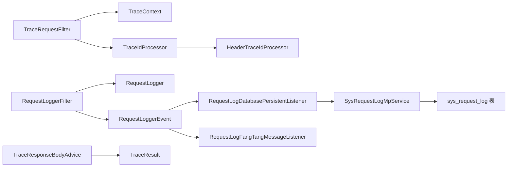

**图表来源**   
- [TraceRequestFilter.java:1-60](file://basic/src/main/java/com/cu/framework/basic/logger/TraceRequestFilter.java#L1-L60)
- [TraceContext.java:1-22](file://basic/src/main/java/com/cu/framework/basic/logger/trace/TraceContext.java#L1-L22)
- [TraceIdProcessor.java:1-18](file://basic/src/main/java/com/cu/framework/basic/logger/trace/TraceIdProcessor.java#L1-L18)
- [HeaderTraceIdProcessor.java:1-27](file://basic/src/main/java/com/cu/framework/basic/logger/trace/HeaderTraceIdProcessor.java#L1-L27)
- [RequestLoggerFilter.java:1-133](file://basic/src/main/java/com/cu/framework/basic/logger/RequestLoggerFilter.java#L1-L133)
- [RequestLogger.java:1-40](file://basic/src/main/java/com/cu/framework/basic/logger/request/RequestLogger.java#L1-L40)
- [RequestLoggerEvent.java:1-23](file://basic/src/main/java/com/cu/framework/basic/logger/request/RequestLoggerEvent.java#L1-L23)
- [TraceResponseBodyAdvice.java:1-42](file://basic/src/main/java/com/cu/framework/basic/logger/trace/TraceResponseBodyAdvice.java#L1-L42)
- [TraceResult.java:1-39](file://basic/src/main/java/com/cu/framework/basic/logger/trace/TraceResult.java#L1-L39)
- [RequestLogDatabasePersistentListener.java:1-66](file://basic-support/src/main/java/com/cu/framework/basic/support/log/RequestLogDatabasePersistentListener.java#L1-L66)
- [RequestLogFangTangMessageListener.java:1-108](file://basic-support/src/main/java/com/cu/framework/basic/support/log/RequestLogFangTangMessageListener.java#L1-L108)

**章节来源**   
- [TraceRequestFilter.java:1-60](file://basic/src/main/java/com/cu/framework/basic/logger/TraceRequestFilter.java#L1-L60)
- [RequestLoggerFilter.java:1-133](file://basic/src/main/java/com/cu/framework/basic/logger/RequestLoggerFilter.java#L1-L133)
- [RequestLogDatabasePersistentListener.java:1-66](file://basic-support/src/main/java/com/cu/framework/basic/support/log/RequestLogDatabasePersistentListener.java#L1-L66)
- [RequestLogFangTangMessageListener.java:1-108](file://basic-support/src/main/java/com/cu/framework/basic/support/log/RequestLogFangTangMessageListener.java#L1-L108)

## 性能相关日志分析

### 慢请求识别

慢请求识别可以直接基于 `RequestLogger.execMillisecond` 和 `sys_request_log.millisecond`。建议关注以下场景：

- 单次请求耗时显著高于同接口历史均值。
- 某些接口在高峰时段出现大量超时或高延迟。
- 外部依赖导致的长尾请求。

分析方法：

1. 通过数据库查询超过阈值的 `millisecond` 记录。
2. 使用 `traceId` 关联同一请求的完整日志。
3. 结合 `api_path`、`method`、`ip_address` 进行接口维度和来源维度分析。
4. 结合应用日志中的错误堆栈判断是否为异常分支。

### 接口响应时间统计

可以使用 `RequestLogService.visitStatistic` 作为访问趋势分析的起点，但它只统计独立 IP 和独立用户数量。如果需要更细粒度的响应时间指标，应基于 `sys_request_log` 表自行聚合：

- 按接口统计平均耗时、P95、P99。
- 按小时或天维度观察响应时间变化。
- 对比不同环境或部署版本的性能差异。

### 数据库查询性能监控

当前日志模块本身不直接捕获 SQL 执行时间。若需要数据库查询性能监控，可在现有日志基础上叠加以下手段：

- 开启 MyBatis 或数据源层的 SQL 日志。
- 将慢 SQL 与 `traceId` 关联，形成端到端链路。
- 结合 `sys_request_log` 中的 `millisecond` 判断瓶颈是否落在数据库层。

### 异步持久化的性能影响

`RequestLogDatabasePersistentListener` 使用 `@Async` 异步保存日志，这是合理的性能优化：

- 主请求线程不等待数据库写入。
- 降低日志持久化对接口响应时间的直接影响。
- 需要注意异步线程池容量、队列长度和数据库写入吞吐。

**章节来源**   
- [RequestLoggerFilter.java:1-133](file://basic/src/main/java/com/cu/framework/basic/logger/RequestLoggerFilter.java#L1-L133)
- [RequestLogDatabasePersistentListener.java:1-66](file://basic-support/src/main/java/com/cu/framework/basic/support/log/RequestLogDatabasePersistentListener.java#L1-L66)
- [RequestLogService.java:1-60](file://basic-support/src/main/java/com/cu/framework/basic/support/log/persistent/RequestLogService.java#L1-L60)
- [basic-support.sql:1-79](file://docs/sql/basic-support.sql#L1-L79)

## 配置与输出格式

### 日志级别配置

Kewen Framework 的日志主要通过 Slf4j 输出。示例中的请求日志使用 `log.info` 打印请求基本信息，包括 IP、路径、方法、参数和请求体。

建议的配置策略：

- 开发环境：开启 INFO 级别，便于调试请求体和参数。
- 测试环境：按需开启 DEBUG，用于观察持久化和通知细节。
- 生产环境：谨慎开启请求体日志，避免敏感信息和性能损耗。

由于框架未内置独立的日志级别开关类，具体日志级别应由应用的 Slf4j 配置控制。

### 控制台日志

控制台日志由 Slf4j 默认输出。请求日志过滤器的 `doFilter` 方法会打印请求 IP、路径、方法、参数和请求体。

注意事项：

- 请求体可能较大，生产环境不建议默认打印完整 body。
- 如需脱敏，应在应用层扩展日志输出逻辑。

### 文件日志

文件日志通常由应用的 Slf4j 配置文件决定，例如 logback 或 log4j2 配置。Kewen Framework 没有在日志模块内强制指定文件输出方式，因此具体文件路径、滚动策略、保留天数等应由应用侧配置。

### 数据库持久化日志

数据库持久化由 `cu.request.persistent.database` 控制：

| 配置项 | 含义 | 默认值 |
|---|---|---|
| `cu.request.persistent.database` | 是否把请求日志持久化到数据库 | `false` |

启用后需要确保数据库中存在 `sys_request_log` 表。

**章节来源**   
- [RequestLoggerFilter.java:1-133](file://basic/src/main/java/com/cu/framework/basic/logger/RequestLoggerFilter.java#L1-L133)
- [application.yml:1-25](file://docs/application.yml#L1-L25)
- [basic-support.sql:1-79](file://docs/sql/basic-support.sql#L1-L79)

## 日志聚合与分析工具集成

### ELK Stack 集成思路

ELK Stack 通常通过以下方式消费应用日志：

1. 应用将日志输出到标准输出或文件。
2. Filebeat 或 Logstash 采集日志。
3. Elasticsearch 存储结构化日志。
4. Kibana 可视化查询和分析。

在 Kewen Framework 中，可重点利用以下字段建立索引和仪表盘：

| 字段 | 分析用途 |
|---|---|
| `trace_id` | 链路追踪、跨服务关联 |
| `api_path` | 接口维度统计 |
| `method` | 接口行为分类 |
| `ip_address` | 来源 IP 分析 |
| `millisecond` | 慢请求、性能趋势 |
| `create_time` | 时间序列分析 |

### Splunk 集成思路

Splunk 可通过 Universal Forwarder、Heavy Forwarder 或直接接入日志流消费应用日志。建议在 Splunk 中：

- 将 `trace_id` 设为追踪字段。
- 对 `millisecond` 设置阈值告警。
- 使用 `api_path` 和 `method` 构建接口健康度看板。
- 对高频错误接口建立实时告警规则。

### 方糖消息通知集成

框架已经提供方糖消息通知能力，适合轻量级告警场景：

- 通过 `cu.notify.fang-tang.enabled` 启用。
- 通过 `cu.notify.fang-tang.key` 配置消息密钥。
- 通过 `cu.notify.fang-tang.domain` 配置推送域名。
- 同时需要启用 `cu.request.message.fang-tang=true`，才可能触发请求来源 IP 的消息推送。

**章节来源**   
- [application.yml:1-35](file://docs/application.yml#L1-L35)
- [RequestLogFangTangMessageListener.java:1-108](file://basic-support/src/main/java/com/cu/framework/basic/support/log/RequestLogFangTangMessageListener.java#L1-L108)

## 故障排查指南

### 无法看到 traceId

排查要点：

1. 确认 `TraceRequestFilter` 是否生效。
2. 检查请求头是否包含 `traceId`。
3. 检查 Slf4j 配置是否输出 MDC 字段。
4. 如果是异步线程，确认是否显式传递 traceId。

### 数据库中没有请求日志

排查要点：

1. 检查 `cu.request.persistent.database` 是否为 `true`。
2. 检查 `sys_request_log` 表是否存在。
3. 检查异步线程池是否正常执行。
4. 检查数据库连接和权限。

### 方糖消息未收到

排查要点：

1. 检查 `cu.notify.fang-tang.enabled`。
2. 检查 `cu.request.message.fang-tang`。
3. 检查 `cu.notify.fang-tang.key` 是否正确。
4. 检查是否被 IP 去重缓存屏蔽。
5. 检查网络是否能访问方糖推送接口。

### 响应中没有 traceId

排查要点：

1. 确认控制器返回类型是 `Result` 或其子类。
2. 确认 `TraceResponseBodyAdvice` 已被加载。
3. 确认返回值没有被提前转换或绕过响应体增强。

**章节来源**   
- [TraceRequestFilter.java:1-60](file://basic/src/main/java/com/cu/framework/basic/logger/TraceRequestFilter.java#L1-L60)
- [RequestLogDatabasePersistentListener.java:1-66](file://basic-support/src/main/java/com/cu/framework/basic/support/log/RequestLogDatabasePersistentListener.java#L1-L66)
- [RequestLogFangTangMessageListener.java:1-108](file://basic-support/src/main/java/com/cu/framework/basic/support/log/RequestLogFangTangMessageListener.java#L1-L108)
- [TraceResponseBodyAdvice.java:1-42](file://basic/src/main/java/com/cu/framework/basic/logger/trace/TraceResponseBodyAdvice.java#L1-L42)

## 结论

Kewen Framework 的日志体系以简单、可插拔、可扩展为核心设计原则：

- 链路追踪基于 MDC 和请求头，既支持上游透传，也支持本地生成。
- 请求日志采集集中在单一过滤器中，逻辑清晰且易于扩展。
- 持久化和通知通过 Spring 事件解耦，避免阻塞主请求。
- 响应体增强让调用方能直接获得 traceId，方便前端和网关联动。
- 数据库表和统计服务提供了基础的请求审计和访问量分析能力。

在生产环境中，建议结合企业自身的日志平台，把 traceId、接口路径、执行耗时、状态码和错误信息纳入统一可观测体系，并制定明确的日志分级、脱敏、保留和告警策略。这样既能满足日常排障，也能支撑性能分析和容量规划。