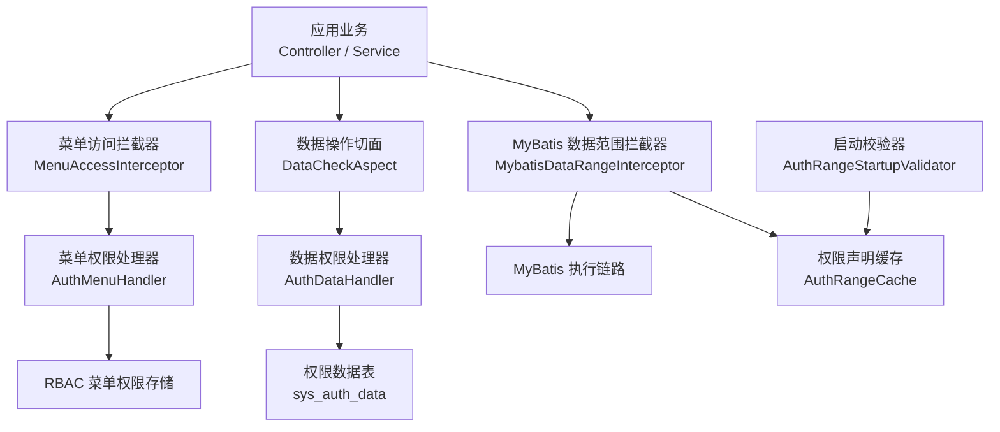
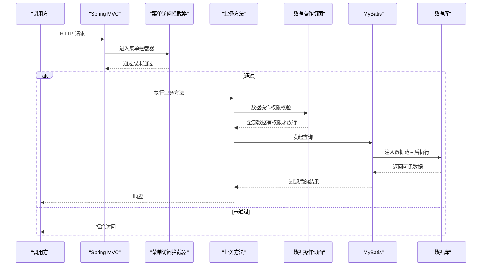
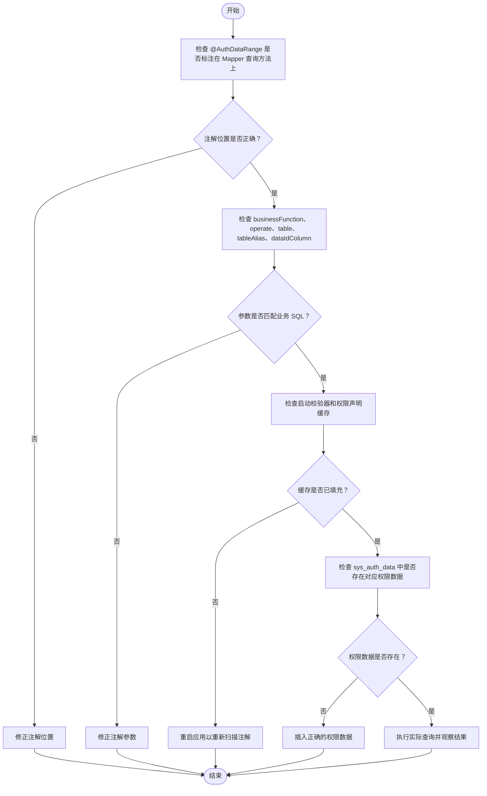
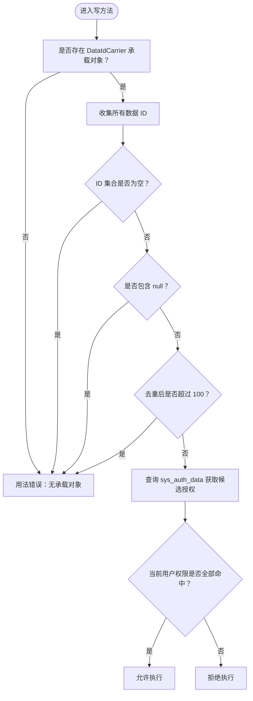
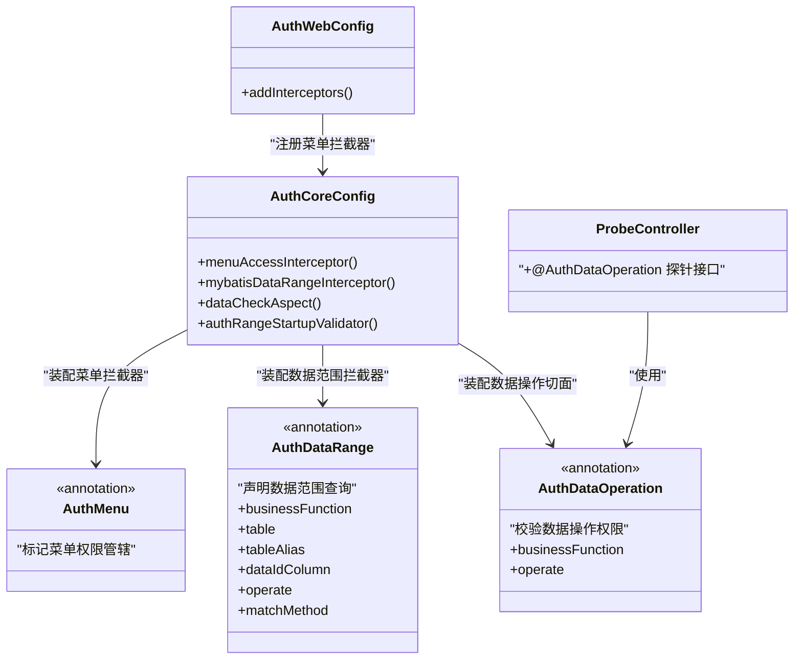

# 权限问题排查

<cite>
**本文引用的文件**   
- [README_Auth.md](file://README_Auth.md)
- [AuthMenu.java](file://auth/auth-core/src/main/java/com/cu/framework/auth/core/AuthMenu.java)
- [AuthDataRange.java](file://auth/auth-core/src/main/java/com/cu/framework/auth/core/AuthDataRange.java)
- [AuthDataOperation.java](file://auth/auth-core/src/main/java/com/cu/framework/auth/core/AuthDataOperation.java)
- [AuthCoreConfig.java](file://auth/auth-core-spring-boot-starter/src/main/java/com/cu/framework/boot/auth/core/config/AuthCoreConfig.java)
- [AuthWebConfig.java](file://auth/auth-core-spring-boot-starter/src/main/java/com/cu/framework/boot/auth/core/config/AuthWebConfig.java)
- [ProbeController.java](file://sample/auth-core-boot-sample/src/main/java/com/cu/framework/sample/authcore/web/ProbeController.java)
- [auth-rbac.sql](file://docs/sql/auth-rbac.sql)
</cite>

## 目录
1. [引言](#引言)
2. [项目结构](#项目结构)
3. [核心组件](#核心组件)
4. [架构总览](#架构总览)
5. [@AuthMenu 注解失效排查](#authmenu-注解失效排查)
6. [@AuthDataRange 数据范围不生效排查](#authdatarange-数据范围不生效排查)
7. [@AuthDataOperation 数据操作校验失败排查](#authdataoperation-数据操作校验失败排查)
8. [权限矩阵测试方法](#权限矩阵测试方法)
9. [依赖关系分析](#依赖关系分析)
10. [性能与缓存注意事项](#性能与缓存注意事项)
11. [故障定位清单](#故障定位清单)
12. [结论](#结论)

## 引言
本文面向使用 cu-framework-auth 的开发者，聚焦三类高频权限问题：菜单权限注解失效、数据范围不生效、数据操作校验失败。文档基于仓库中的核心注解、自动装配配置、示例探针接口和初始化脚本进行逐层诊断，并提供可直接执行的 SQL 检查语句与权限矩阵验证流程。

## 项目结构
权限能力由“核心模块 + Spring Boot Starter + RBAC 实现 + 示例工程”组成：
- 核心注解定义在 `auth-core` 中，包括菜单权限和数据权限相关注解。
- Spring Boot Starter 负责将拦截器、切面、MyBatis 拦截器、启动校验器等基础设施装配到应用中。
- RBAC 模块提供用户、角色、部门、菜单等持久化实现。
- 示例工程提供可运行的控制器、Mapper、SQL 种子数据和权限边界探针端点。



**图示来源**
- [AuthCoreConfig.java:1-200](file://auth/auth-core-spring-boot-starter/src/main/java/com/cu/framework/boot/auth/core/config/AuthCoreConfig.java#L1-L200)
- [AuthWebConfig.java:1-30](file://auth/auth-core-spring-boot-starter/src/main/java/com/cu/framework/boot/auth/core/config/AuthWebConfig.java#L1-L30)

**章节来源**
- [README_Auth.md:1-200](file://README_Auth.md#L1-L200)

## 核心组件
| 组件 | 职责 | 典型失效表现 |
|---|---|---|
| `@AuthMenu` | 标记 Controller 或方法受菜单权限管辖；显示文案由 `AuthMenuDoc` 承担 | 请求未命中菜单权限、菜单列表不显示、API 路径未入库 |
| `@AuthDataRange` | 为 MyBatis Mapper 查询方法注入数据范围条件 | 列表返回了无权数据、空结果、启动时报解析失败 |
| `@AuthDataOperation` | 在写方法前校验单条或多条数据的编辑权限 | 越权修改成功、批量提交被拒绝、权限判定日志异常 |
| `MenuAccessInterceptor` | Web 层菜单访问控制拦截器 | 菜单拦截未注册、鉴权逻辑未触发 |
| `MybatisDataRangeInterceptor` | MyBatis 层数据范围拦截器 | 条件未注入、缓存为空、SQL 校验失败 |
| `DataCheckAspect` | 数据操作权限切面 | 参数承载对象缺失、ID 集合为空或超限 |
| `AuthRangeStartupValidator` | 启动时扫描 `@AuthDataRange` 并填充缓存 | 启动失败或静默失效 |

**章节来源**
- [AuthMenu.java:1-16](file://auth/auth-core/src/main/java/com/cu/framework/auth/core/AuthMenu.java#L1-L16)
- [AuthDataRange.java:1-81](file://auth/auth-core/src/main/java/com/cu/framework/auth/core/AuthDataRange.java#L1-L81)
- [AuthDataOperation.java:1-51](file://auth/auth-core/src/main/java/com/cu/framework/auth/core/AuthDataOperation.java#L1-L51)
- [AuthCoreConfig.java:1-200](file://auth/auth-core-spring-boot-starter/src/main/java/com/cu/framework/boot/auth/core/config/AuthCoreConfig.java#L1-L200)

## 架构总览
权限系统的工作流分为三层：
1. **Web 层菜单权限**：请求进入 Spring MVC 后，先经过菜单访问拦截器，判断当前用户是否有权访问该 API。
2. **业务层数据操作权限**：写方法执行前，切面从实参中提取数据 ID，逐个判定是否有对应操作的授权行。
3. **数据层数据范围权限**：MyBatis 执行查询时，根据 `@AuthDataRange` 注入 where 子句，仅返回当前用户可见的数据。



**图示来源**
- [AuthWebConfig.java:1-30](file://auth/auth-core-spring-boot-starter/src/main/java/com/cu/framework/boot/auth/core/config/AuthWebConfig.java#L1-L30)
- [AuthCoreConfig.java:1-200](file://auth/auth-core-spring-boot-starter/src/main/java/com/cu/framework/boot/auth/core/config/AuthCoreConfig.java#L1-L200)

## @AuthMenu 注解失效排查
### 常见原因
1. **菜单 API 未入库**  
   框架会在启动阶段生成需要校验的菜单 API 并写入数据库；如果生成器未运行或路径未被识别，数据库中就没有对应的 API 记录，菜单权限自然无法匹配。
2. **菜单权限配置缺失**  
   `sys_auth_menu` 中缺少该 API 的权限字符串，即使 API 已入库，也没有任何角色能访问。
3. **角色权限分配错误**  
   当前登录用户的角色没有获得该 API 所需的权限字符串。
4. **菜单拦截器未注册**  
   如果 Web 配置未注册 `MenuAccessInterceptor`，菜单鉴权不会生效。
5. **注解位置或作用域不正确**  
   `@AuthMenu` 可标注在类或方法上；标注在类上表示管辖该类所有端点，标注在方法上只管辖该方法。
6. **权限缓存未更新**  
   菜单权限通常由 RBAC 模块维护，修改菜单或角色后需要确保权限缓存刷新。

### 排查步骤
1. 确认应用已引入 RBAC Starter，并启用了 Web 拦截器。
2. 检查启动日志中是否生成了菜单 API。
3. 检查 `sys_menu_api` 是否存在目标路径。
4. 检查 `sys_auth_menu` 是否包含该 API 的权限字符串。
5. 检查当前用户角色是否拥有该权限字符串。
6. 若使用了权限缓存，刷新缓存后再测试。

### 关键 SQL
```sql
-- 检查菜单 API 是否已入库
SELECT id, path, name, parent_id, auth_type, deleted
FROM sys_menu_api
WHERE path = '/你的接口路径';

-- 检查菜单权限是否配置
SELECT api_id, authority, description
FROM sys_auth_menu
WHERE api_id = (
    SELECT id FROM sys_menu_api WHERE path = '/你的接口路径'
);

-- 检查视图中的菜单 API 权限
SELECT id, path, name, parent_id, authority, description
FROM view_menu_api_auth
WHERE path = '/你的接口路径';
```

**章节来源**
- [AuthMenu.java:1-16](file://auth/auth-core/src/main/java/com/cu/framework/auth/core/AuthMenu.java#L1-L16)
- [AuthWebConfig.java:1-30](file://auth/auth-core-spring-boot-starter/src/main/java/com/cu/framework/boot/auth/core/config/AuthWebConfig.java#L1-L30)
- [AuthCoreConfig.java:1-200](file://auth/auth-core-spring-boot-starter/src/main/java/com/cu/framework/boot/auth/core/config/AuthCoreConfig.java#L1-L200)
- [auth-rbac.sql:1-148](file://docs/sql/auth-rbac.sql#L1-L148)

## @AuthDataRange 数据范围不生效排查
### 常见原因
1. **注解声明在错误的 MyBatis 方法上**  
   `@AuthDataRange` 应标注在 Mapper 接口的查询方法上；BaseMapper 内建方法如 `selectList`、分页方法等没有挂载点，不受本注解管辖。
2. **业务功能名或操作类型不匹配**  
   注解中的 `businessFunction`、`operate` 必须与 `sys_auth_data` 中一致。
3. **多表联查时表名或别名配置错误**  
   当存在多表关联且主表不明确时，需正确设置 `table` 和 `tableAlias`。
4. **主键列名配置错误**  
   `dataIdColumn` 默认是 `id`，若业务主键不是 `id`，需显式指定。
5. **启动校验失败导致静默失效**  
   解析不到映射语句、语句不是查询、启用了二级缓存、静态 SQL 中找不到目标表等情况会直接启动失败；但如果校验器未正确装配，可能出现静默失效。
6. **权限缓存未填充**  
   启动校验器会扫描注解并填充 `AuthRangeCache`，若缓存为空，数据范围条件可能无法注入。

### 诊断流程图


**图示来源**
- [AuthDataRange.java:1-81](file://auth/auth-core/src/main/java/com/cu/framework/auth/core/AuthDataRange.java#L1-L81)
- [AuthCoreConfig.java:1-200](file://auth/auth-core-spring-boot-starter/src/main/java/com/cu/framework/boot/auth/core/config/AuthCoreConfig.java#L1-L200)

### 关键 SQL
```sql
-- 检查权限数据是否按业务功能和操作类型配置
SELECT id, business_function, data_id, operate, authority, description
FROM sys_auth_data
WHERE business_function = '你的业务功能'
  AND operate = 'unified';

-- 检查权限索引是否可用
SHOW INDEX FROM sys_auth_data;

-- 检查是否存在重复的业务功能与数据组合
SELECT business_function, data_id, COUNT(*) AS cnt
FROM sys_auth_data
GROUP BY business_function, data_id
HAVING cnt > 1;
```

**章节来源**
- [AuthDataRange.java:1-81](file://auth/auth-core/src/main/java/com/cu/framework/auth/core/AuthDataRange.java#L1-L81)
- [AuthCoreConfig.java:1-200](file://auth/auth-core-spring-boot-starter/src/main/java/com/cu/framework/boot/auth/core/config/AuthCoreConfig.java#L1-L200)
- [auth-rbac.sql:1-148](file://docs/sql/auth-rbac.sql#L1-L148)

## @AuthDataOperation 数据操作校验失败排查
### 常见原因
1. **业务功能名或操作类型不匹配**  
   `businessFunction` 和 `operate` 必须与 `sys_auth_data` 中一致。
2. **参数中没有携带数据 ID 承载对象**  
   切面需要从方法参数中收集实现 `DataIdCarrier` 的对象；如果参数不包含这类对象，会被视为用法错误。
3. **ID 集合为空、含 null 或超出上限**  
   一次调用涉及的数据 ID 去重后最多 100 条；超出上限直接失败，且不再发送权限查询。
4. **权限数据缺失或权限字符串不一致**  
   即使语法正确，如果权限表中没有对应行，也会拒绝。
5. **业务逻辑遗漏权限判断**  
   有些写操作没有加 `@AuthDataOperation`，而是依赖其他逻辑判断，容易遗漏。

### 诊断流程图


**图示来源**
- [AuthDataOperation.java:1-51](file://auth/auth-core/src/main/java/com/cu/framework/auth/core/AuthDataOperation.java#L1-L51)

### 示例探针接口
示例工程中提供了 `ProbeController`，专门用于验证权限判定边界，包括：
- 无承载对象的参数场景。
- 空集合、含 null 的场景。
- 批量 ID 上限场景。
- 正常权限命中与未命中场景。
- 原始文本形态 ID 的引号载荷场景。

这些端点不带菜单管辖声明，便于隔离“能不能判定”和“能不能进门”两个变量。

**章节来源**
- [AuthDataOperation.java:1-51](file://auth/auth-core/src/main/java/com/cu/framework/auth/core/AuthDataOperation.java#L1-L51)
- [ProbeController.java:1-122](file://sample/auth-core-boot-sample/src/main/java/com/cu/framework/sample/authcore/web/ProbeController.java#L1-L122)

## 权限矩阵测试方法
权限矩阵测试的目标是验证“用户 × 角色 × 菜单 API × 数据 ID × 操作类型”的组合是否符合预期。建议按以下维度组织测试：

| 测试维度 | 说明 | 预期结果 |
|---|---|---|
| 菜单访问 | 不同角色访问带 `@AuthMenu` 的接口 | 有权限角色可访问，无权限角色被拒绝 |
| 菜单显示 | 前端根据角色获取菜单路由 | 无权限菜单不显示 |
| 数据范围查询 | 同一查询接口切换不同用户 | 只能看到自己有权限的数据 |
| 数据操作校验 | 同一条数据对不同用户执行写操作 | 有权限者成功，无权限者被拒绝 |
| 批量操作 | 一次提交多个数据 ID | 任一数据无权限即整体拒绝 |
| 权限缓存刷新 | 修改权限后刷新缓存 | 后续请求立即反映新权限 |
| 边界参数 | 空集合、null ID、超 100 条 | 返回用法错误语义 |

### 推荐测试流程
1. 准备两个角色：一个有权限，一个无权限。
2. 准备一组数据：部分有授权行，部分无授权行。
3. 分别用两个角色登录，执行相同查询和写操作。
4. 对比返回结果与预期矩阵。
5. 修改权限后刷新缓存，再次执行相同用例。
6. 对批量接口传入空集合、null、超过 100 条 ID，验证边界行为。
7. 使用示例工程的探针接口快速验证判定逻辑是否被触发。

### 使用示例探针验证
- `/probe/noCarrier`：验证无承载对象时不会被放行。
- `/probe/emptyIds`：验证空集合时不会被放行。
- `/probe/nullId`：验证含 null 的 ID 集合会被拒绝。
- `/probe/bulk`：验证批量 ID 上限行为。
- `/probe/call`：验证单个数据权限判定。
- `/probe/quote/call`：验证原始文本形态 ID 的安全性。

**章节来源**
- [ProbeController.java:1-122](file://sample/auth-core-boot-sample/src/main/java/com/cu/framework/sample/authcore/web/ProbeController.java#L1-L122)

## 依赖关系分析


**图示来源**
- [AuthMenu.java:1-16](file://auth/auth-core/src/main/java/com/cu/framework/auth/core/AuthMenu.java#L1-L16)
- [AuthDataRange.java:1-81](file://auth/auth-core/src/main/java/com/cu/framework/auth/core/AuthDataRange.java#L1-L81)
- [AuthDataOperation.java:1-51](file://auth/auth-core/src/main/java/com/cu/framework/auth/core/AuthDataOperation.java#L1-L51)
- [AuthCoreConfig.java:1-200](file://auth/auth-core-spring-boot-starter/src/main/java/com/cu/framework/boot/auth/core/config/AuthCoreConfig.java#L1-L200)
- [AuthWebConfig.java:1-30](file://auth/auth-core-spring-boot-starter/src/main/java/com/cu/framework/boot/auth/core/config/AuthWebConfig.java#L1-L30)
- [ProbeController.java:1-122](file://sample/auth-core-boot-sample/src/main/java/com/cu/framework/sample/authcore/web/ProbeController.java#L1-L122)

**章节来源**
- [AuthCoreConfig.java:1-200](file://auth/auth-core-spring-boot-starter/src/main/java/com/cu/framework/boot/auth/core/config/AuthCoreConfig.java#L1-L200)
- [AuthWebConfig.java:1-30](file://auth/auth-core-spring-boot-starter/src/main/java/com/cu/framework/boot/auth/core/config/AuthWebConfig.java#L1-L30)

## 性能与缓存注意事项
- `@AuthDataRange` 的匹配方式支持 `IN` 和 `EXISTS`；当权限表数据量较大时，应优先选择 `EXISTS`，避免大 IN 列表影响性能。
- 启动校验器会扫描所有 `@AuthDataRange` 并填充声明缓存，避免每次查询都重复解析注解。
- 如果自定义实现了 `AuthDataHandler`，需要注意权限查询缓存策略，防止频繁穿透到数据库。
- 批量操作最多处理 100 个去重后的数据 ID；超过时应分批提交，避免单次权限查询过大。

**章节来源**
- [AuthDataRange.java:1-81](file://auth/auth-core/src/main/java/com/cu/framework/auth/core/AuthDataRange.java#L1-L81)
- [AuthDataOperation.java:1-51](file://auth/auth-core/src/main/java/com/cu/framework/auth/core/AuthDataOperation.java#L1-L51)
- [AuthCoreConfig.java:1-200](file://auth/auth-core-spring-boot-starter/src/main/java/com/cu/framework/boot/auth/core/config/AuthCoreConfig.java#L1-L200)

## 故障定位清单
### 菜单权限问题
- 是否引入 RBAC Starter 并启用 Web 拦截器。
- 菜单 API 是否已入库。
- `sys_auth_menu` 是否配置了该 API 的权限字符串。
- 当前用户角色是否拥有该权限字符串。
- 权限缓存是否需要刷新。

### 数据范围问题
- `@AuthDataRange` 是否标注在 Mapper 查询方法上。
- `businessFunction`、`operate`、`table`、`tableAlias`、`dataIdColumn` 是否与业务 SQL 匹配。
- 启动日志是否出现解析失败或缓存为空。
- `sys_auth_data` 中是否存在对应权限数据。
- 是否误用 BaseMapper 内建方法而期望注解生效。

### 数据操作问题
- `@AuthDataOperation` 的 `businessFunction` 和 `operate` 是否正确。
- 方法参数是否包含 `DataIdCarrier` 承载对象。
- ID 集合是否为空、是否包含 null、是否超过 100 条。
- 权限表中是否存在对应授权行。
- 是否遗漏了对写方法的权限判断。

### 推荐 SQL 检查
```sql
-- 菜单 API 是否存在
SELECT id, path FROM sys_menu_api WHERE path = '/你的接口路径';

-- 菜单权限是否配置
SELECT api_id, authority FROM sys_auth_menu WHERE api_id = (
    SELECT id FROM sys_menu_api WHERE path = '/你的接口路径'
);

-- 数据权限是否存在
SELECT business_function, data_id, operate, authority
FROM sys_auth_data
WHERE business_function = '你的业务功能'
  AND operate = 'unified';

-- 权限索引状态
SHOW INDEX FROM sys_auth_data;
```

**章节来源**
- [auth-rbac.sql:1-148](file://docs/sql/auth-rbac.sql#L1-L148)
- [AuthDataOperation.java:1-51](file://auth/auth-core/src/main/java/com/cu/framework/auth/core/AuthDataOperation.java#L1-L51)
- [AuthDataRange.java:1-81](file://auth/auth-core/src/main/java/com/cu/framework/auth/core/AuthDataRange.java#L1-L81)

## 结论
排查权限问题时，应先区分是“菜单访问控制”“数据操作校验”还是“数据范围查询”的问题。菜单权限关注 API 是否入库、权限是否配置、角色是否分配；数据范围关注注解位置、参数匹配、启动校验和权限数据；数据操作关注承载对象、ID 集合合法性和权限匹配。结合示例探针接口和提供的 SQL，可以快速定位大多数权限配置错误，并通过权限矩阵验证最终效果。