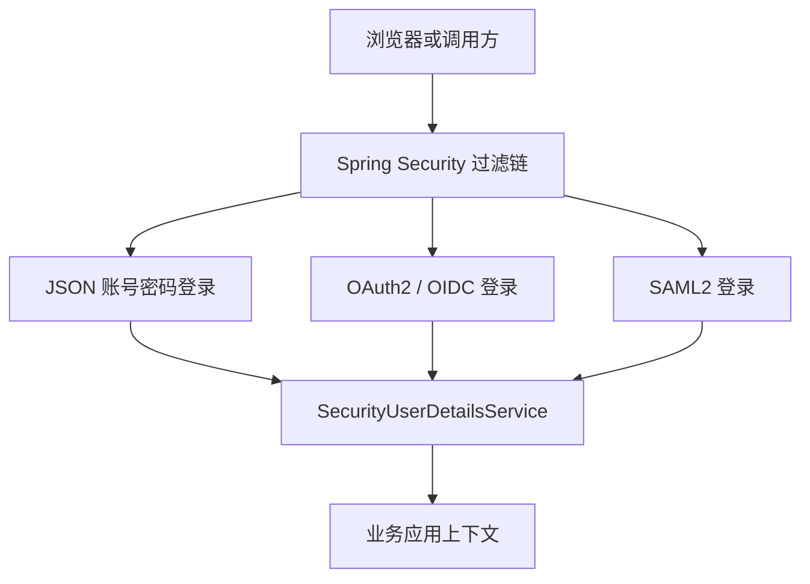
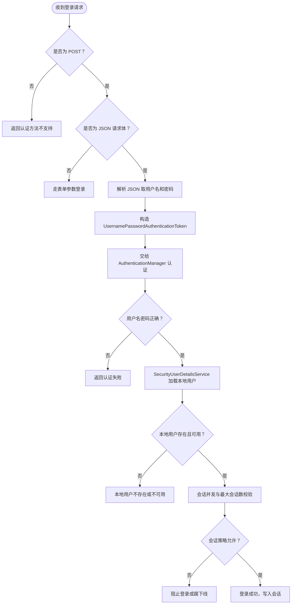
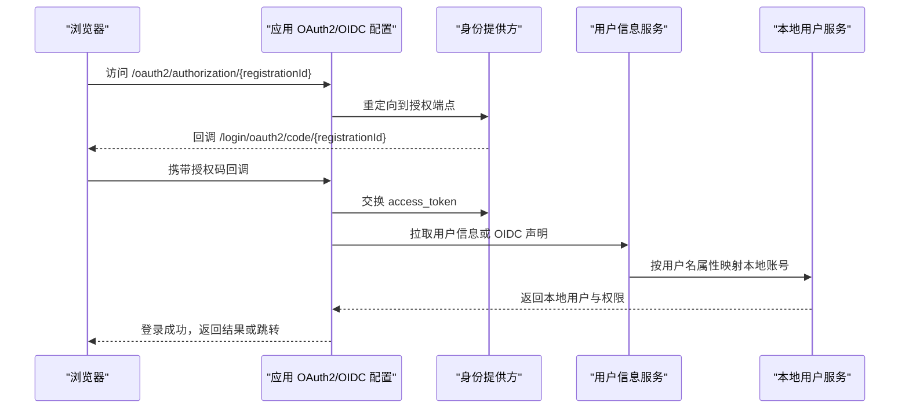
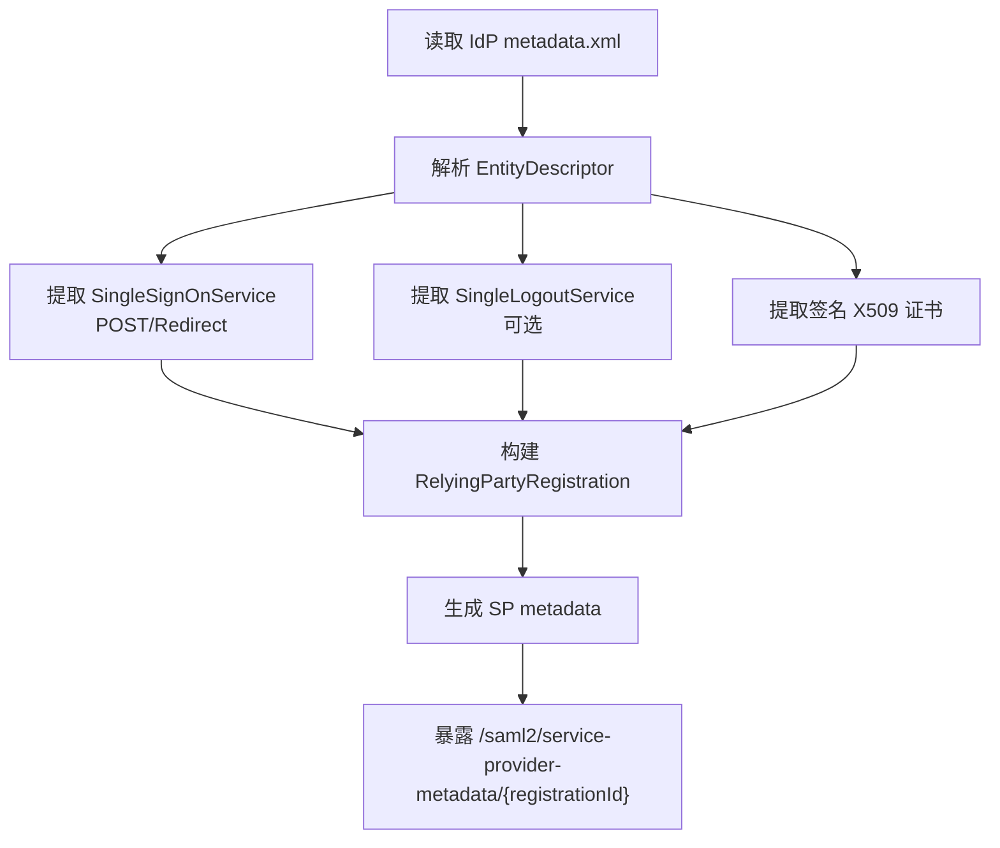
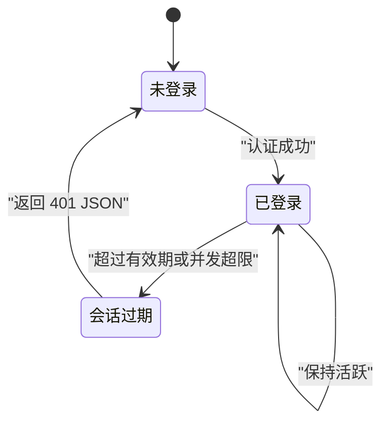
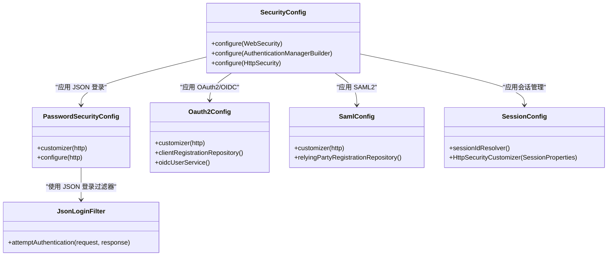

# 认证问题排查

<cite>
**本文引用的文件**   
- [README_Auth.md](file://README_Auth.md)
- [SecurityConfig.java](file://login-spring-boot-starter/src/main/java/com/cu/framework/authentication/config/SecurityConfig.java)
- [PasswordSecurityConfig.java](file://login-spring-boot-starter/src/main/java/com/cu/framework/authentication/password/config/PasswordSecurityConfig.java)
- [JsonLoginFilter.java](file://login-spring-boot-starter/src/main/java/com/cu/framework/authentication/password/filter/JsonLoginFilter.java)
- [SessionProperties.java](file://login-spring-boot-starter/src/main/java/com/cu/framework/authentication/properties/SessionProperties.java)
- [SessionConfig.java](file://login-spring-boot-starter/src/main/java/com/cu/framework/authentication/config/SessionConfig.java)
- [SsoLoginProperties.java](file://login-spring-boot-starter/src/main/java/com/cu/framework/authentication/properties/SsoLoginProperties.java)
- [Oauth2OidcProperties.java](file://login-spring-boot-starter/src/main/java/com/cu/framework/authentication/oauth2/Oauth2OidcProperties.java)
- [Oauth2Config.java](file://login-spring-boot-starter/src/main/java/com/cu/framework/authentication/oauth2/Oauth2Config.java)
- [SamlConfig.java](file://login-spring-boot-starter/src/main/java/com/cu/framework/authentication/saml/SamlConfig.java)
- [IdpMetadataParser.java](file://login-spring-boot-starter/src/main/java/com/cu/framework/authentication/saml/IdpMetadataParser.java)
- [oidc接入踩坑记录.md](file://docs/说明文档/oidc接入踩坑记录.md)
- [SAML2_SP_Metadata配置指南.md](file://docs/说明文档/SAML2_SP_Metadata配置指南.md)
</cite>

## 目录
1. [引言](#引言)
2. [项目结构与定位](#项目结构与定位)
3. [账号密码登录排查](#账号密码登录排查)
4. [OAuth2 / OIDC 单点登录排查](#oauth2--oidc-单点登录排查)
5. [SAML2 单点登录排查](#saml2-单点登录排查)
6. [会话管理排查](#会话管理排查)
7. [依赖与流程总览](#依赖与流程总览)
8. [性能与可观测性建议](#性能与可观测性建议)
9. [常见故障速查表](#常见故障速查表)
10. [结论](#结论)

## 引言
本手册面向使用 cu-framework-auth 项目的运维、开发与集成工程师，聚焦身份认证相关问题的系统化排查。内容覆盖：
- 账号密码登录失败；
- OAuth2 / OIDC 单点登录客户端配置、令牌获取、用户信息同步异常；
- SAML2 元数据、证书、断言、登出联动等关键环节；
- 会话丢失、并发登录控制、最大会话数限制；
- OIDC 接入实际踩坑记录中的典型问题与解决方案。

该框架基于 Spring Boot 与 Spring Security，统一通过 `login-spring-boot-starter` 提供安全与登录能力，并支持 RBAC 权限扩展。

**章节来源**
- [README_Auth.md:1-90](file://README_Auth.md#L1-L90)

## 项目结构与定位
从认证视角看，核心代码集中在 `login-spring-boot-starter` 模块：
- 基础安全链由 `SecurityConfig` 构建；
- 账号密码登录由 `PasswordSecurityConfig` 和 `JsonLoginFilter` 实现；
- OAuth2 / OIDC 由 `Oauth2OidcProperties` 和 `Oauth2Config` 驱动；
- SAML2 由 `SamlConfig`、`IdpMetadataParser` 及 SAML 属性类驱动；
- 会话配置由 `SessionConfig` 与 `SessionProperties` 提供。

**图表来源**
- [SecurityConfig.java:40-144](file://login-spring-boot-starter/src/main/java/com/cu/framework/authentication/config/SecurityConfig.java#L40-L144)
- [PasswordSecurityConfig.java:1-54](file://login-spring-boot-starter/src/main/java/com/cu/framework/authentication/password/config/PasswordSecurityConfig.java#L1-L54)
- [JsonLoginFilter.java:1-55](file://login-spring-boot-starter/src/main/java/com/cu/framework/authentication/password/filter/JsonLoginFilter.java#L1-L55)
- [Oauth2Config.java:1-271](file://login-spring-boot-starter/src/main/java/com/cu/framework/authentication/oauth2/Oauth2Config.java#L1-L271)
- [SamlConfig.java:1-233](file://login-spring-boot-starter/src/main/java/com/cu/framework/authentication/saml/SamlConfig.java#L1-L233)

**章节来源**
- [README_Auth.md:1-120](file://README_Auth.md#L1-L120)
- [SecurityConfig.java:40-144](file://login-spring-boot-starter/src/main/java/com/cu/framework/authentication/config/SecurityConfig.java#L40-L144)

## 账号密码登录排查
### 典型现象
- 提交 JSON 登录请求后返回认证失败；
- 提示用户名不存在、密码错误；
- 非 POST 请求被拒绝；
- JSON 参数解析异常；
- 登录后无会话或会话很快失效；
- 并发登录超出最大会话数后被阻止或踢下线。

### 排查步骤
1. **确认登录入口与字段名**  
   - 登录处理 URL、用户名参数名、密码参数名来自 `SecurityLoginProperties`，并通过 `PasswordSecurityConfig` 装配到 JSON 登录过滤器。  
   - 若前端传参键名不一致，会直接导致用户名或密码为空。

2. **确认请求方法与时序**  
   - `JsonLoginFilter` 仅允许 POST 请求；非 POST 会抛出“不支持的认证方法”异常。  
   - JSON 请求体需要 `Content-Type` 为 JSON，否则会回退表单参数逻辑。

3. **检查用户名是否存在**  
   - 用户名最终由 `SecurityUserDetailsService` 加载本地用户。若外部身份源映射的用户名在本系统不存在，则登录失败。

4. **检查密码加密方式是否匹配**  
   - 虽然仓库未在此处展开具体编码器实现，但密码比对依赖于 Spring Security 的 `AuthenticationManager` 与用户详情服务。如果数据库存储的是旧格式密文，而运行时使用新编码器，则会始终比对失败。  
   - 建议核对部署环境使用的密码编码器是否与历史数据一致，必要时先迁移历史数据或临时兼容旧格式。

5. **检查账户锁定策略**  
   - 若业务侧在 `SecurityUserDetailsService` 或后续权限校验中实现了账户锁定，应结合业务日志确认是否命中锁定逻辑。

6. **检查会话是否启用并正确持久化**  
   - 若使用 Spring Session 或分布式会话，需确认会话 ID 解析器、会话仓库与容器行为一致。  
   - `SessionConfig` 暴露了基于 Header/Cookie 的会话 ID 解析器，以及过期会话策略。

7. **检查并发登录与最大会话数**  
   - `SessionProperties.maximumSessions` 控制同一用户的最大会话数；  
   - `maxSessionsPreventsLogin` 控制达到上限时是阻止新登录还是踢掉最老会话；  
   - 过期会话策略会返回 401 与 JSON 提示。

**图表来源**
- [JsonLoginFilter.java:18-55](file://login-spring-boot-starter/src/main/java/com/cu/framework/authentication/password/filter/JsonLoginFilter.java#L18-L55)
- [PasswordSecurityConfig.java:24-54](file://login-spring-boot-starter/src/main/java/com/cu/framework/authentication/password/config/PasswordSecurityConfig.java#L24-L54)
- [SessionConfig.java:78-124](file://login-spring-boot-starter/src/main/java/com/cu/framework/authentication/config/SessionConfig.java#L78-L124)

**章节来源**
- [PasswordSecurityConfig.java:1-54](file://login-spring-boot-starter/src/main/java/com/cu/framework/authentication/password/config/PasswordSecurityConfig.java#L1-L54)
- [JsonLoginFilter.java:1-55](file://login-spring-boot-starter/src/main/java/com/cu/framework/authentication/password/filter/JsonLoginFilter.java#L1-L55)
- [SessionProperties.java:1-22](file://login-spring-boot-starter/src/main/java/com/cu/framework/authentication/properties/SessionProperties.java#L1-L22)
- [SessionConfig.java:78-124](file://login-spring-boot-starter/src/main/java/com/cu/framework/authentication/config/SessionConfig.java#L78-L124)

## OAuth2 / OIDC 单点登录排查
### 架构职责分层
- **IDP 端点地址**：由 `ClientRegistration` 决定，来源于 `Oauth2OidcProperties`。  
- **本机拦截路径与 HTTP 行为**：由 `Oauth2Config` 中 `http.oauth2Login()` 的授权端点、令牌端点、用户信息端点配置决定。  
- **用户主体装配**：OIDC 由 `OidcUserService` 处理 ID Token 与 UserInfo；OAuth2 由 `SecurityUserOAuth2UserService` 把原始主体转换为统一认证主体。

**图表来源**
- [Oauth2Config.java:90-170](file://login-spring-boot-starter/src/main/java/com/cu/framework/authentication/oauth2/Oauth2Config.java#L90-L170)
- [Oauth2OidcProperties.java:1-240](file://login-spring-boot-starter/src/main/java/com/cu/framework/authentication/oauth2/Oauth2OidcProperties.java#L1-L240)

### 常见问题分类
#### 1. 客户端配置错误
- **registrationId 缺失或重复**：每个 IDP 必须唯一标识。  
- **clientId / clientSecret 错误**：令牌端点认证失败。  
- **clientAuthenticationMethod 不匹配**：IDP 要求 `basic`、`post` 或 `none`，配置不一致会导致令牌交换失败。  
- **redirectUriTemplate 与 IDP 登记不一致**：回调地址展开后的完整 URL 必须与 IDP 后台一致。  
- **scopes 缺少 openid**：OIDC 场景必须包含 `openid`；当前实现会自动补全，但仍建议显式配置。

#### 2. 自动发现与手动配置混用
- OIDC 模式推荐只配 `issuerUri`，由 `ClientRegistrations.fromIssuerLocation()` 自动发现端点。  
- OAuth2 模式需手动指定 `authorizationUri`、`tokenUri`、`userInfoUri`。  
- 两者互斥：若同时出现歧义，可能拉错元数据或端点。

#### 3. 令牌获取失败
- 网络不可达、SSL 证书问题、IDP 返回非预期响应。  
- `ignoreSsl` 仅在特定端点豁免校验，主要用于测试环境。  
- 若 IDP 返回 HTML 错误页而非 JSON，通常说明 Discovery 地址或端点 URL 拼接错误。

#### 4. 用户信息同步异常
- OIDC 模式下，用户名由 `userNameAttributeName` 映射到本地用户。若本地找不到对应用户，登录会失败。  
- OAuth2 模式下，原始主体由 `RoutingOAuth2UserService` 路由，再经 `SecurityUserOAuth2UserService` 装配统一主体。  
- 若自定义 `OAuth2UserService` 或 `OidcUserService` 的行为，要确保不会重复查询本地用户库，否则会影响性能与一致性。

#### 5. JWT 签名验证失败（OIDC）
- 典型错误：`BadJwtException: Signed JWT rejected`。  
- 根因常为非标准 IDP 的 JWKS 端点需要携带 `client_id` 才能返回公钥集合。  
- 解决方案：在配置中手动覆盖 `jwkSetUri`，而不是修改代码。

**章节来源**
- [Oauth2OidcProperties.java:1-240](file://login-spring-boot-starter/src/main/java/com/cu/framework/authentication/oauth2/Oauth2OidcProperties.java#L1-L240)
- [Oauth2Config.java:90-271](file://login-spring-boot-starter/src/main/java/com/cu/framework/authentication/oauth2/Oauth2Config.java#L90-L271)
- [oidc接入踩坑记录.md:1-200](file://docs/说明文档/oidc接入踩坑记录.md#L1-L200)

### OIDC 接入踩坑记录摘要
1. **Discovery 地址不能写完整 `.well-known/openid-configuration`**  
   - `fromIssuerLocation()` 会自动拼接后缀；传入完整 URL 会造成双重拼接，返回 HTML 错误页。  
   - 应只填写 IDP 基础地址。

2. **不需要显式配置 `authorizationRequestResolver`**  
   - 默认解析器已能根据 `ClientRegistrationRepository` 和本机 baseUri 解析请求；只有需要自定义授权请求时才替换。

3. **JWKS 端点需要 `client_id`**  
   - 非标准 IDP 的 `jwks_uri` 若不带 `client_id`，会返回空密钥列表，导致 JWT 验签失败。  
   - 通过配置覆盖 `jwk-set-uri` 即可解决，无需改代码。

**章节来源**
- [oidc接入踩坑记录.md:1-200](file://docs/说明文档/oidc接入踩坑记录.md#L1-L200)

## SAML2 单点登录排查
### 关键组件
- `SamlConfig`：将 SAML2 登录、登出、SP metadata 过滤器加入安全链。  
- `IdpMetadataParser`：从 IdP 的 `metadata.xml` 解析 entityId、SSO URL、绑定方式、签名证书、登出端点。  
- `SamlProperties`：描述多个 Relying Party 注册项、SP signing keystore、登录与登出路径。

**图表来源**
- [SamlConfig.java:70-233](file://login-spring-boot-starter/src/main/java/com/cu/framework/authentication/saml/SamlConfig.java#L70-L233)
- [IdpMetadataParser.java:1-232](file://login-spring-boot-starter/src/main/java/com/cu/framework/authentication/saml/IdpMetadataParser.java#L1-L232)

### 常见问题分类
#### 1. 元数据配置错误
- `metadata.xml` 缺少 `IDPSSODescriptor` 或 `SingleSignOnService`，解析会失败。  
- 缺少签名证书时，无法验证 IdP 断言签名。  
- 多绑定方式下，优先选择 HTTP-POST，其次 HTTP-Redirect；若 IdP 只提供 Redirect，需确认框架是否能适配。

#### 2. 证书管理问题
- IdP 证书与 `metadata.xml` 中不一致，断言验签失败。  
- SP 签名 keystore 不存在、JKS 密码错误、别名或私钥密码错误，会导致无法签发 AuthnRequest 或 LogoutRequest。

#### 3. 断言处理问题
- 断言中的 NameID 或用户属性无法映射到本地用户，登录失败。  
- 断言 Destination、Audience、NotBefore、NotOnOrAfter 不符合预期，会被安全校验拒绝。

#### 4. 登出联动问题
- 若希望 SP 退出时联动 IDP 退出，必须设置 `singleLogoutServiceLocation` 与 `singleLogoutServiceResponseLocation`。  
- 若 IdP metadata 中包含 `SingleLogoutService`，框架会补充登出绑定；否则可能无法完成双向登出。

#### 5. SP Metadata 端点
- Spring Security 5.7 不会默认暴露 SP metadata 端点，需要手动添加 `Saml2MetadataFilter`。  
- 本项目已在 `SamlConfig` 中添加该过滤器，默认路径为 `/saml2/service-provider-metadata/{registrationId}`。

**章节来源**
- [SamlConfig.java:70-233](file://login-spring-boot-starter/src/main/java/com/cu/framework/authentication/saml/SamlConfig.java#L70-L233)
- [IdpMetadataParser.java:1-232](file://login-spring-boot-starter/src/main/java/com/cu/framework/authentication/saml/IdpMetadataParser.java#L1-L232)
- [SAML2_SP_Metadata配置指南.md:1-200](file://docs/说明文档/SAML2_SP_Metadata配置指南.md#L1-L200)

## 会话管理排查
### 会话丢失
- 若前端以 API 调用为主，需确认会话 ID 是否通过 Header 传递。  
- `SessionConfig` 提供了 `HeaderCookieHttpSessionIdResolver`，优先从 `Authorization` 头获取 session id，再回退 Cookie。  
- 若网关、反向代理或负载均衡改变了请求头或 Cookie，可能导致会话 ID 丢失。

### 并发登录控制
- `SessionProperties.maximumSessions` 控制同一用户最大会话数。  
- `maxSessionsPreventsLogin` 控制达到上限时的行为：  
  - 阻止新登录；  
  - 或踢掉最早会话。  
- 过期会话策略会返回 401 与 JSON 响应，便于前端识别“登录状态失效”。

### 最大会话数限制
- 如果设置为较小值，频繁刷新或移动端多标签打开容易导致会话被踢。  
- 如果设置为较大值或未启用限制，可能出现单用户长期持有大量会话，增加内存或分布式会话存储压力。

**图表来源**
- [SessionConfig.java:78-124](file://login-spring-boot-starter/src/main/java/com/cu/framework/authentication/config/SessionConfig.java#L78-L124)
- [SessionProperties.java:1-22](file://login-spring-boot-starter/src/main/java/com/cu/framework/authentication/properties/SessionProperties.java#L1-L22)

**章节来源**
- [SessionConfig.java:20-124](file://login-spring-boot-starter/src/main/java/com/cu/framework/authentication/config/SessionConfig.java#L20-L124)
- [SessionProperties.java:1-22](file://login-spring-boot-starter/src/main/java/com/cu/framework/authentication/properties/SessionProperties.java#L1-L22)

## 依赖与流程总览
### 认证入口依赖关系

**图表来源**
- [SecurityConfig.java:40-144](file://login-spring-boot-starter/src/main/java/com/cu/framework/authentication/config/SecurityConfig.java#L40-L144)
- [PasswordSecurityConfig.java:1-54](file://login-spring-boot-starter/src/main/java/com/cu/framework/authentication/password/config/PasswordSecurityConfig.java#L1-L54)
- [JsonLoginFilter.java:1-55](file://login-spring-boot-starter/src/main/java/com/cu/framework/authentication/password/filter/JsonLoginFilter.java#L1-L55)
- [Oauth2Config.java:1-271](file://login-spring-boot-starter/src/main/java/com/cu/framework/authentication/oauth2/Oauth2Config.java#L1-L271)
- [SamlConfig.java:1-233](file://login-spring-boot-starter/src/main/java/com/cu/framework/authentication/saml/SamlConfig.java#L1-L233)
- [SessionConfig.java:1-124](file://login-spring-boot-starter/src/main/java/com/cu/framework/authentication/config/SessionConfig.java#L1-L124)

## 性能与可观测性建议
- **避免重复查询本地用户**：OIDC 的 `OidcUserService` 会基于 ID Token 重建主体，不应随意替换为会再次查询本地用户的服务，否则可能造成额外数据库压力。  
- **合理配置 scopes**：OIDC 场景至少申请 `openid`，按需申请 profile、email 等，减少不必要的数据传输。  
- **合理使用 ignoreSsl**：仅测试环境关闭 SSL 校验，生产环境应启用证书校验并维护可信证书链。  
- **监控 IDP 端点可达性**：对 Discovery、token、userinfo、jwks、SAML ACS/SLO 等端点进行健康检查。  
- **关注会话存储压力**：并发登录数和最大会话数直接影响会话数量，尤其在分布式会话存储场景下更需谨慎。

[本节为通用建议，不直接分析具体源码文件]

## 常见故障速查表
| 问题 | 可能原因 | 排查方向 | 参考位置 |
|---|---|---|---|
| 账号密码登录失败 | 用户名错误、密码错误、本地用户不存在、密码编码不匹配 | 检查登录字段、用户名映射、密码编码器、用户服务 | [PasswordSecurityConfig.java:24-54](file://login-spring-boot-starter/src/main/java/com/cu/framework/authentication/password/config/PasswordSecurityConfig.java#L24-L54), [JsonLoginFilter.java:18-55](file://login-spring-boot-starter/src/main/java/com/cu/framework/authentication/password/filter/JsonLoginFilter.java#L18-L55) |
| 非 POST 登录被拒 | 请求方法不是 POST | 检查前端请求方法与 Content-Type | [JsonLoginFilter.java:18-55](file://login-spring-boot-starter/src/main/java/com/cu/framework/authentication/password/filter/JsonLoginFilter.java#L18-L55) |
| OAuth2/OIDC 授权请求解析异常 | registrationId 缺失、baseUri 重复、自定义 resolver 冗余 | 检查本机授权端点 baseUri 与 ClientRegistration | [Oauth2Config.java:90-170](file://login-spring-boot-starter/src/main/java/com/cu/framework/authentication/oauth2/Oauth2Config.java#L90-L170) |
| OIDC Discovery 返回 HTML | issuer-uri 写成完整 discovery URL | 改为 IDP 基础地址 | [oidc接入踩坑记录.md:1-200](file://docs/说明文档/oidc接入踩坑记录.md#L1-L200) |
| OIDC JWT 验签失败 | JWKS 端点需 client_id | 手动覆盖 jwk-set-uri | [oidc接入踩坑记录.md:120-200](file://docs/说明文档/oidc接入踩坑记录.md#L120-L200) |
| SAML 断言验签失败 | IdP 证书与 metadata 不一致 | 检查 metadata.xml 与 IdP 证书 | [IdpMetadataParser.java:150-232](file://login-spring-boot-starter/src/main/java/com/cu/framework/authentication/saml/IdpMetadataParser.java#L150-L232) |
| SAML 无法签名 AuthnRequest | SP keystore 不存在或密码错误 | 检查 SP signing keystore 配置 | [SamlConfig.java:200-233](file://login-spring-boot-starter/src/main/java/com/cu/framework/authentication/saml/SamlConfig.java#L200-L233) |
| SAML 登出不同步 | 未配置 singleLogoutServiceLocation | 检查 metadata 与 logout 路径 | [SamlConfig.java:120-200](file://login-spring-boot-starter/src/main/java/com/cu/framework/authentication/saml/SamlConfig.java#L120-L200) |
| 会话频繁失效 | Header 中 session id 未透传 | 检查 Authorization 头与网关转发 | [SessionConfig.java:20-77](file://login-spring-boot-starter/src/main/java/com/cu/framework/authentication/config/SessionConfig.java#L20-L77) |
| 并发登录过多 | maximumSessions 过小或未启用限制 | 调整会话并发策略 | [SessionProperties.java:1-22](file://login-spring-boot-starter/src/main/java/com/cu/framework/authentication/properties/SessionProperties.java#L1-L22), [SessionConfig.java:78-124](file://login-spring-boot-starter/src/main/java/com/cu/framework/authentication/config/SessionConfig.java#L78-L124) |

## 结论
本框架通过统一的 Spring Security 配置入口，把账号密码、OAuth2/OIDC、SAML2 三种认证方式纳入同一个安全链，并通过 `SecurityUserDetailsService` 把外部身份映射为本系统用户与权限。排查认证问题时，应按以下顺序定位：
1. 先确认协议入口是否正确；
2. 再检查配置项是否与实际 IDP/IdP 一致；
3. 然后查看用户映射、证书、JWT 验签、会话策略；
4. 最后结合业务侧的 RBAC、账户锁定、租户与权限数据进行端到端验证。

对于 OIDC，优先使用自动发现；遇到非标准 IDP 时，优先通过配置覆盖端点，例如 `jwk-set-uri`。对于 SAML2，优先使用 IdP 提供的 `metadata.xml`，并确保 SP keystore 与 IdP 证书正确配置。对于会话，明确前端是通过 Cookie 还是 Header 传递会话 ID，并合理设置最大会话数与过期策略。

[本节为总结性内容，不直接分析具体源码文件]