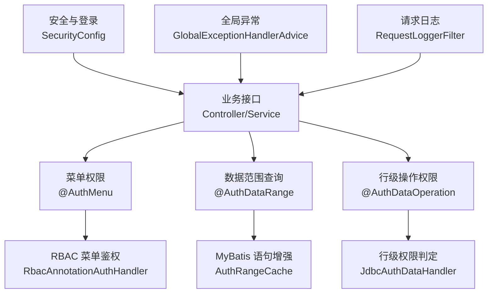
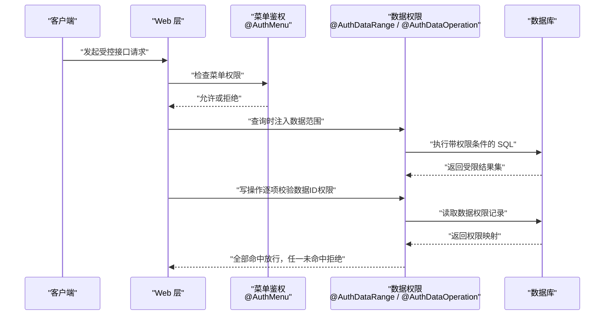
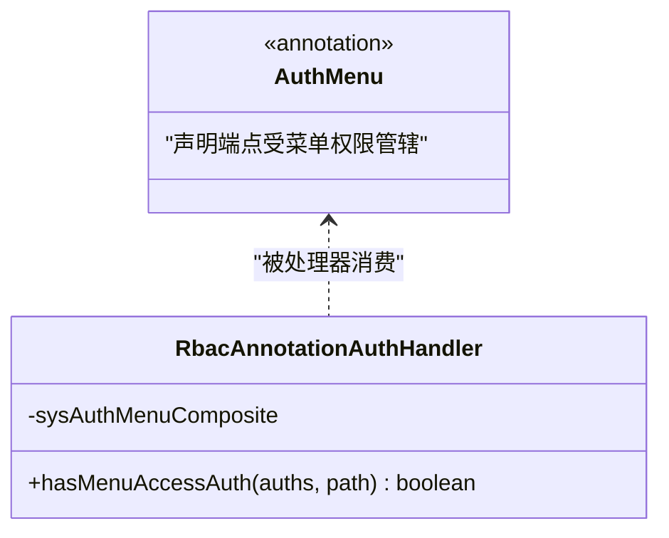
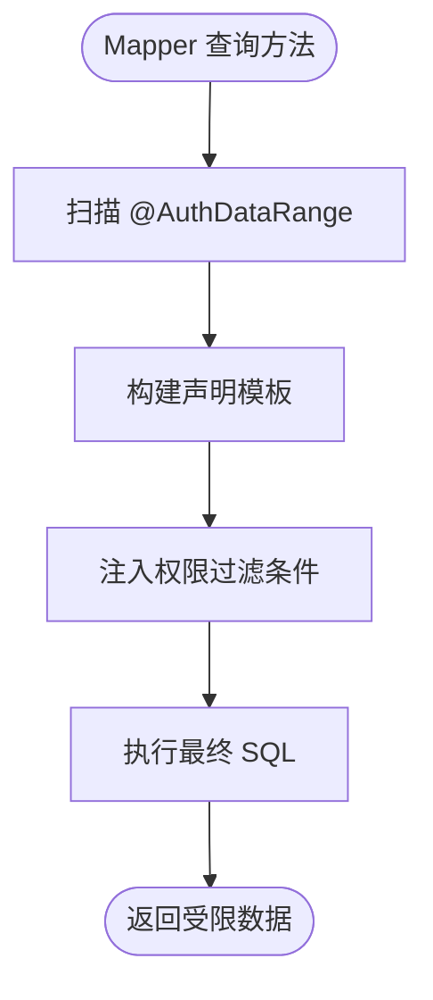
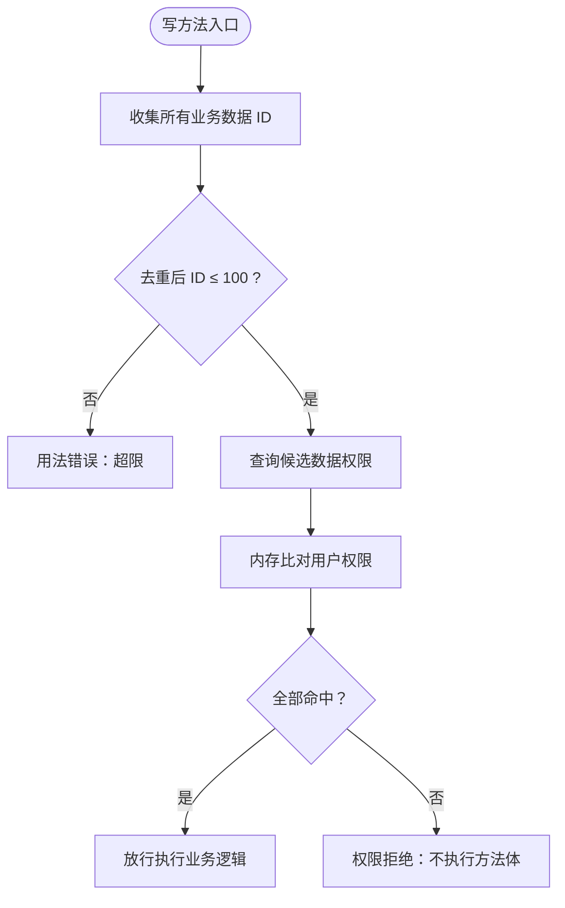
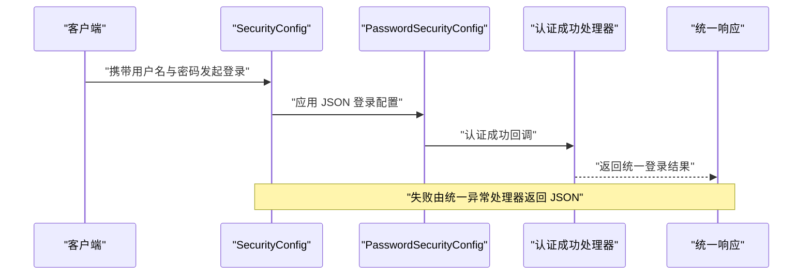
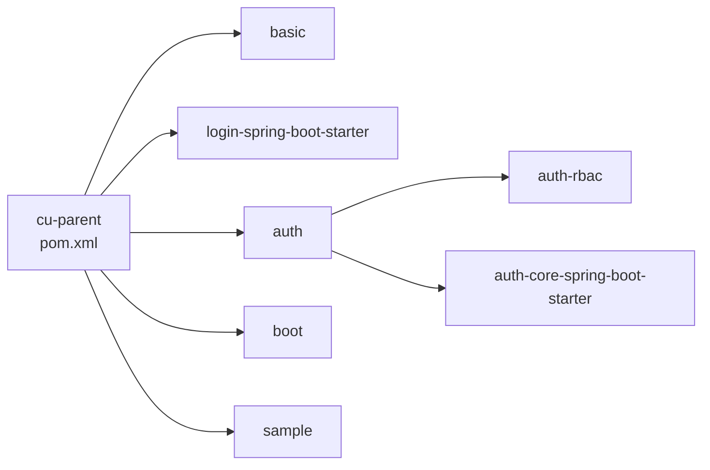

# 最佳实践

<cite>
**本文引用的文件**   
- [README_Auth.md](file://README_Auth.md)
- [pom.xml](file://pom.xml)
- [AuthDataOperation.java](file://auth/auth-core/src/main/java/com/cu/framework/auth/core/AuthDataOperation.java)
- [AuthDataRange.java](file://auth/auth-core/src/main/java/com/cu/framework/auth/core/AuthDataRange.java)
- [AuthMenu.java](file://auth/auth-core/src/main/java/com/cu/framework/auth/core/AuthMenu.java)
- [JdbcAuthDataHandler.java](file://auth/auth-core/src/main/java/com/cu/framework/auth/core/data/JdbcAuthDataHandler.java)
- [AuthRangeCache.java](file://auth/auth-core/src/main/java/com/cu/framework/auth/core/data/range/AuthRangeCache.java)
- [RbacAnnotationAuthHandler.java](file://auth/auth-rbac/src/main/java/com/cu/framework/auth/rbac/RbacAnnotationAuthHandler.java)
- [SecurityConfig.java](file://login-spring-boot-starter/src/main/java/com/cu/framework/authentication/config/SecurityConfig.java)
- [PasswordSecurityConfig.java](file://login-spring-boot-starter/src/main/java/com/cu/framework/authentication/password/config/PasswordSecurityConfig.java)
- [GlobalExceptionHandlerAdvice.java](file://basic/src/main/java/com/cu/framework/basic/exception/GlobalExceptionHandlerAdvice.java)
- [RequestLoggerFilter.java](file://basic/src/main/java/com/cu/framework/basic/logger/RequestLoggerFilter.java)
- [spec.md（数据操作权限）](file://openspec/specs/auth/data-operation/spec.md)
- [spec.md（菜单访问权限）](file://openspec/specs/auth/menu-access/spec.md)
- [sample README](file://sample/auth-rbac-boot-sample/README.md)
</cite>

## 目录
1. [引言](#引言)
2. [项目结构](#项目结构)
3. [核心组件](#核心组件)
4. [架构总览](#架构总览)
5. [详细组件分析](#详细组件分析)
6. [依赖关系分析](#依赖关系分析)
7. [性能优化建议](#性能优化建议)
8. [安全最佳实践](#安全最佳实践)
9. [代码规范与开发约定](#代码规范与开发约定)
10. [常见陷阱与反模式](#常见陷阱与反模式)
11. [故障排除指南](#故障排除指南)
12. [结论](#结论)

## 引言
本指南基于 Kewen Framework 的权限、登录、基础能力与示例工程，总结一套面向企业级后端系统的最佳实践。内容覆盖：
- 权限设计：菜单权限、数据范围查询、行级数据操作权限、权限矩阵与权限继承。
- 安全策略：JSON 登录、会话管理、输入校验与输出统一响应。
- 性能调优：权限缓存、SQL 注入方式选择、批量判定上限与连接监控。
- 开发约定：注解驱动、异常分类、日志与可观测性。
- 反模式与排障：典型错误、诊断方法、定位路径。

该框架以 Spring Boot + Spring Security + MyBatis-Plus + MySQL/H2 为基础，通过注解驱动完成菜单与数据权限，并通过 starter 模块提供自动装配能力。

**章节来源**
- [README_Auth.md:1-90](file://README_Auth.md#L1-L90)
- [pom.xml:1-40](file://pom.xml#L1-L40)

## 项目结构
Kewen Framework 采用多模块 Maven 工程，核心分层如下：
- `auth`：权限核心与 RBAC 实现。
- `login-spring-boot-starter`：认证、登录、会话与安全配置。
- `basic`：全局异常、请求日志、通用模型与工具。
- `boot`：Spring Boot Starter 装配层。
- `sample`：RBAC、登录、存储、租户等示例应用。
- `openspec`：以规格文档形式沉淀权限行为契约。

**图表来源**
- [AuthMenu.java:1-16](file://auth/auth-core/src/main/java/com/cu/framework/auth/core/AuthMenu.java#L1-L16)
- [AuthDataRange.java:1-81](file://auth/auth-core/src/main/java/com/cu/framework/auth/core/AuthDataRange.java#L1-L81)
- [AuthDataOperation.java:1-51](file://auth/auth-core/src/main/java/com/cu/framework/auth/core/AuthDataOperation.java#L1-L51)
- [RbacAnnotationAuthHandler.java:1-27](file://auth/auth-rbac/src/main/java/com/cu/framework/auth/rbac/RbacAnnotationAuthHandler.java#L1-L27)
- [AuthRangeCache.java:1-155](file://auth/auth-core/src/main/java/com/cu/framework/auth/core/data/range/AuthRangeCache.java#L1-L155)
- [JdbcAuthDataHandler.java:1-119](file://auth/auth-core/src/main/java/com/cu/framework/auth/core/data/JdbcAuthDataHandler.java#L1-L119)
- [SecurityConfig.java:1-144](file://login-spring-boot-starter/src/main/java/com/cu/framework/authentication/config/SecurityConfig.java#L1-L144)
- [GlobalExceptionHandlerAdvice.java:1-83](file://basic/src/main/java/com/cu/framework/basic/exception/GlobalExceptionHandlerAdvice.java#L1-L83)
- [RequestLoggerFilter.java:1-133](file://basic/src/main/java/com/cu/framework/basic/logger/RequestLoggerFilter.java#L1-L133)

**章节来源**
- [README_Auth.md:90-180](file://README_Auth.md#L90-L180)
- [pom.xml:12-30](file://pom.xml#L12-L30)

## 核心组件
### 权限三件套
- 菜单权限：通过 `@AuthMenu` 声明端点是否受菜单鉴权管辖，支持方法级与类级批量声明。
- 数据范围查询：通过 `@AuthDataRange` 在 MyBatis Mapper 查询方法上注入数据权限过滤条件。
- 行级数据操作权限：通过 `@AuthDataOperation` 对写方法进行逐个数据 ID 的权限判定。

这三个注解分别对应“可见性控制”“列表过滤”“写操作授权”，共同构成从菜单到数据的完整权限体系。

**章节来源**
- [AuthMenu.java:1-16](file://auth/auth-core/src/main/java/com/cu/framework/auth/core/AuthMenu.java#L1-L16)
- [AuthDataRange.java:1-81](file://auth/auth-core/src/main/java/com/cu/framework/auth/core/AuthDataRange.java#L1-L81)
- [AuthDataOperation.java:1-51](file://auth/auth-core/src/main/java/com/cu/framework/auth/core/AuthDataOperation.java#L1-L51)

### 持久化与执行器
- `JdbcAuthDataHandler`：负责数据权限表的增删查改与行级权限判定；用户权限集合留在内存比对，避免将不可控大小的用户权限放入 SQL。
- `AuthRangeCache`：启动期扫描 MyBatis Mapper，缓存 `@AuthDataRange` 声明模板，使权限条件作用域天然绑定单条 SQL。
- `RbacAnnotationAuthHandler`：默认 RBAC 菜单权限处理器，委托组合服务完成菜单路径与权限串匹配。

**章节来源**
- [JdbcAuthDataHandler.java:1-119](file://auth/auth-core/src/main/java/com/cu/framework/auth/core/data/JdbcAuthDataHandler.java#L1-L119)
- [AuthRangeCache.java:1-155](file://auth/auth-core/src/main/java/com/cu/framework/auth/core/data/range/AuthRangeCache.java#L1-L155)
- [RbacAnnotationAuthHandler.java:1-27](file://auth/auth-rbac/src/main/java/com/cu/framework/auth/rbac/RbacAnnotationAuthHandler.java#L1-L27)

### 安全与基础能力
- `SecurityConfig`：集中配置 Spring Security，统一放行静态资源、启用 JSON 登录、禁用 CSRF、注册成功与失败处理器。
- `PasswordSecurityConfig`：将 JSON 登录 URL、用户名字段名、密码字段名接入 HttpSecurity。
- `GlobalExceptionHandlerAdvice`：统一返回业务异常、参数校验异常、空指针与未捕获异常。
- `RequestLoggerFilter`：记录请求头、参数、Body、IP、耗时，并发布事件供监听方持久化。

**章节来源**
- [SecurityConfig.java:1-144](file://login-spring-boot-starter/src/main/java/com/cu/framework/authentication/config/SecurityConfig.java#L1-L144)
- [PasswordSecurityConfig.java:1-54](file://login-spring-boot-starter/src/main/java/com/cu/framework/authentication/password/config/PasswordSecurityConfig.java#L1-L54)
- [GlobalExceptionHandlerAdvice.java:1-83](file://basic/src/main/java/com/cu/framework/basic/exception/GlobalExceptionHandlerAdvice.java#L1-L83)
- [RequestLoggerFilter.java:1-133](file://basic/src/main/java/com/cu/framework/basic/logger/RequestLoggerFilter.java#L1-L133)

## 架构总览
Kewen Framework 的权限链路分为两条主线：
1. 菜单鉴权：请求进入控制器前，由 `@AuthMenu` 与 RBAC 处理器判断当前用户是否拥有菜单权限。
2. 数据权限：查询走 `@AuthDataRange` 注入 SQL 过滤；写操作走 `@AuthDataOperation` 对每条数据 ID 做独立权限判定。

**图表来源**
- [AuthMenu.java:1-16](file://auth/auth-core/src/main/java/com/cu/framework/auth/core/AuthMenu.java#L1-L16)
- [AuthDataRange.java:1-81](file://auth/auth-core/src/main/java/com/cu/framework/auth/core/AuthDataRange.java#L1-L81)
- [AuthDataOperation.java:1-51](file://auth/auth-core/src/main/java/com/cu/framework/auth/core/AuthDataOperation.java#L1-L51)
- [RbacAnnotationAuthHandler.java:1-27](file://auth/auth-rbac/src/main/java/com/cu/framework/auth/rbac/RbacAnnotationAuthHandler.java#L1-L27)
- [JdbcAuthDataHandler.java:1-119](file://auth/auth-core/src/main/java/com/cu/framework/auth/core/data/JdbcAuthDataHandler.java#L1-L119)

## 详细组件分析

### 菜单权限与 RBAC 集成
菜单权限关注“端点是否可见/可调用”。`@AuthMenu` 只声明管辖范围，显示文案由配套文档注解承载，不参与鉴权判定。RBAC 实现通过 `RbacAnnotationAuthHandler` 将权限串与菜单路径进行匹配，从而把抽象注解落到具体权限表。

**图表来源**
- [AuthMenu.java:1-16](file://auth/auth-core/src/main/java/com/cu/framework/auth/core/AuthMenu.java#L1-L16)
- [RbacAnnotationAuthHandler.java:1-27](file://auth/auth-rbac/src/main/java/com/cu/framework/auth/rbac/RbacAnnotationAuthHandler.java#L1-L27)

**章节来源**
- [spec.md（菜单访问权限）:1-91](file://openspec/specs/auth/menu-access/spec.md#L1-L91)

### 数据范围查询与 SQL 注入
`@AuthDataRange` 用于查询场景，注解标在 Mapper 查询方法上后，框架会为该语句注入权限过滤条件。其关键设计包括：
- 作用域为单条语句，不会污染同调用链其他 SQL。
- 支持按业务功能、操作类型、目标表与主键列配置。
- 支持 IN 与 EXISTS 两种匹配方式，权限表数据量大时应优先选择 EXISTS。
- 启动期校验语句是否存在、是否为 SELECT、是否禁用二级缓存、是否能解析目标表。

**图表来源**
- [AuthDataRange.java:1-81](file://auth/auth-core/src/main/java/com/cu/framework/auth/core/AuthDataRange.java#L1-L81)
- [AuthRangeCache.java:1-155](file://auth/auth-core/src/main/java/com/cu/framework/auth/core/data/range/AuthRangeCache.java#L1-L155)

**章节来源**
- [AuthDataRange.java:1-81](file://auth/auth-core/src/main/java/com/cu/framework/auth/core/AuthDataRange.java#L1-L81)
- [AuthRangeCache.java:1-155](file://auth/auth-core/src/main/java/com/cu/framework/auth/core/data/range/AuthRangeCache.java#L1-L155)

### 行级数据操作权限
`@AuthDataOperation` 针对写操作，要求每个业务数据 ID 都独立命中声明槽位，全部命中才放行，任一未命中整体拒绝。实现要点：
- 从实参中收集所有 `DataIdCarrier` 交出的 ID，含数组与集合元素。
- 查询一次候选权限记录，再在内存中与用户权限集合比对。
- ID 去重后最多 100 条，超出直接失败，不拆分批次。
- 区分“权限拒绝”和“用法/配置错误”，对外仅暴露统一语义编码。

**图表来源**
- [AuthDataOperation.java:1-51](file://auth/auth-core/src/main/java/com/cu/framework/auth/core/AuthDataOperation.java#L1-L51)
- [JdbcAuthDataHandler.java:1-119](file://auth/auth-core/src/main/java/com/cu/framework/auth/core/data/JdbcAuthDataHandler.java#L1-L119)
- [spec.md（数据操作权限）:1-153](file://openspec/specs/auth/data-operation/spec.md#L1-L153)

**章节来源**
- [AuthDataOperation.java:1-51](file://auth/auth-core/src/main/java/com/cu/framework/auth/core/AuthDataOperation.java#L1-L51)
- [JdbcAuthDataHandler.java:1-119](file://auth/auth-core/src/main/java/com/cu/framework/auth/core/data/JdbcAuthDataHandler.java#L1-L119)
- [spec.md（数据操作权限）:1-153](file://openspec/specs/auth/data-operation/spec.md#L1-L153)

### 安全配置与登录流程
框架将 Spring Security 默认表单登录改为 JSON 登录，并统一异常返回。登录流程大致如下：

**图表来源**
- [SecurityConfig.java:1-144](file://login-spring-boot-starter/src/main/java/com/cu/framework/authentication/config/SecurityConfig.java#L1-L144)
- [PasswordSecurityConfig.java:1-54](file://login-spring-boot-starter/src/main/java/com/cu/framework/authentication/password/config/PasswordSecurityConfig.java#L1-L54)

**章节来源**
- [SecurityConfig.java:1-144](file://login-spring-boot-starter/src/main/java/com/cu/framework/authentication/config/SecurityConfig.java#L1-L144)
- [PasswordSecurityConfig.java:1-54](file://login-spring-boot-starter/src/main/java/com/cu/framework/authentication/password/config/PasswordSecurityConfig.java#L1-L54)

## 依赖关系分析
Kewen Framework 的核心依赖集中在父 POM 与 starter 模块中：
- Spring Boot 2.7.18 作为基础运行环境。
- MyBatis-Plus 3.5.8 提供 ORM 与分页能力。
- p6spy 用于 SQL 监控。
- Fastjson/Fastjson2、Hutool、Lombok 提供常用工具能力。
- auth、login-spring-boot-starter、basic、boot、sample 等模块通过 dependencyManagement 统一版本。

**图表来源**
- [pom.xml:12-30](file://pom.xml#L12-L30)
- [pom.xml:40-120](file://pom.xml#L40-L120)

**章节来源**
- [pom.xml:1-120](file://pom.xml#L1-L120)

## 性能优化建议
### 权限缓存策略
- 使用 `AuthRangeCache` 在启动期扫描并缓存 `@AuthDataRange` 声明模板，避免每次查询重复解析注解与语句。
- 缓存只包含静态声明信息，不包含用户相关数据，线程安全且轻量。

### 查询优化技巧
- 当权限表数据量较大时，优先选择 `@AuthDataRange.matchMethod=EXISTS`，以减少大 IN 列表带来的性能问题。
- 确保权限查询只注入必要字段，避免额外 JOIN。
- 业务主键应稳定、单一，便于权限表与业务表关联。

### 连接池与 SQL 监控
- 使用 p6spy 监控 SQL，结合示例工程的 spy.properties 排查慢查询。
- 生产环境建议显式配置连接池大小、超时、空闲回收参数，并根据 QPS 与并发压测调整。
- 避免在权限判定中对用户权限集合进行 SQL 拼接；当前实现已在内存比对，符合性能与安全原则。

### 批处理与上限控制
- 行级操作权限单次最多判定 100 个去重 ID，超过直接失败，调用方需分批提交，防止超大事务与内存压力。

**章节来源**
- [AuthRangeCache.java:1-155](file://auth/auth-core/src/main/java/com/cu/framework/auth/core/data/range/AuthRangeCache.java#L1-L155)
- [AuthDataRange.java:1-81](file://auth/auth-core/src/main/java/com/cu/framework/auth/core/AuthDataRange.java#L1-L81)
- [JdbcAuthDataHandler.java:1-119](file://auth/auth-core/src/main/java/com/cu/framework/auth/core/data/JdbcAuthDataHandler.java#L1-L119)
- [sample README:1-120](file://sample/auth-rbac-boot-sample/README.md#L1-L120)

## 安全最佳实践
### 密码与登录
- 使用 JSON 登录，避免表单登录的跳转与 CSRF 风险。
- 通过 `SecurityLoginProperties` 配置登录 URL、用户名与密码字段名，保持配置集中。
- 认证成功与失败统一交由自定义处理器，避免原生 Security 异常页面泄露内部细节。

### 会话管理
- 启用 `HttpSessionEventPublisher`，保证 Session 销毁事件能被 Spring 容器感知。
- 若需要限制同一账号并发会话数，可在 `SecurityConfig` 中启用 Session Management 并按业务需求设置最大会话数。
- 注意跨域与 Cookie 安全属性，生产环境不应使用 `AllowOrigin=*` 配合凭证。

### 输入验证与输出编码
- 使用 `GlobalExceptionHandlerAdvice` 统一捕获参数校验异常、业务异常与未捕获异常，对外返回统一 Result。
- 对前端展示内容建议使用白名单富文本或输出编码，避免 XSS。
- 权限描述、权限标识等敏感字段应按“数据而非语句”处理，不要拼接进 SQL。

**章节来源**
- [SecurityConfig.java:1-144](file://login-spring-boot-starter/src/main/java/com/cu/framework/authentication/config/SecurityConfig.java#L1-L144)
- [PasswordSecurityConfig.java:1-54](file://login-spring-boot-starter/src/main/java/com/cu/framework/authentication/password/config/PasswordSecurityConfig.java#L1-L54)
- [GlobalExceptionHandlerAdvice.java:1-83](file://basic/src/main/java/com/cu/framework/basic/exception/GlobalExceptionHandlerAdvice.java#L1-L83)

## 代码规范与开发约定
### 命名规范
- 注解命名体现职责：`@AuthMenu`、`@AuthDataRange`、`@AuthDataOperation`。
- 处理器命名体现角色：`*AuthHandler`、`*Customizer`、`*ResultResolver`。
- 配置类命名体现用途：`*SecurityConfig`、`*Properties`。

### 注释标准
- 注解应说明适用位置、生效边界、默认值与失败语义。
- 处理器与服务类应说明依赖、性能注意事项与扩展点。
- 对外暴露的枚举、常量应附带业务含义说明。

### 测试要求
- 单元测试覆盖权限判定的正常与拒绝分支。
- 示例工程应保留最小可用数据，便于快速联调。
- 对 SQL 注入、权限越权、批量超限等边界用例编写专项测试。

**章节来源**
- [AuthMenu.java:1-16](file://auth/auth-core/src/main/java/com/cu/framework/auth/core/AuthMenu.java#L1-L16)
- [AuthDataRange.java:1-81](file://auth/auth-core/src/main/java/com/cu/framework/auth/core/AuthDataRange.java#L1-L81)
- [AuthDataOperation.java:1-51](file://auth/auth-core/src/main/java/com/cu/framework/auth/core/AuthDataOperation.java#L1-L51)
- [sample README:120-220](file://sample/auth-rbac-boot-sample/README.md#L120-L220)

## 常见陷阱与反模式
### 权限粒度设计
- 反模式：把所有操作放在同一个 `operate` 下，导致编辑与预约权限无法区分。
- 正确做法：按业务功能划分 `businessFunction`，按操作语义划分 `operate`，例如 `edit_info`、`appointment`。

### 权限继承策略
- 反模式：通过动态修改菜单身份来绕过权限，导致授权归属不稳定。
- 正确做法：菜单行的身份由代码与建库脚本决定，更新接口不应改写鉴权身份。

### 权限矩阵规划
- 反模式：仅凭角色字符串做硬编码判断。
- 正确做法：维护权限矩阵表，以 `authority` 与 `description` 表达权限关系，并在 UI 层展示与审计。

### 实现问题
- 反模式：将用户权限集合拼接到 SQL 中，导致性能与安全问题。
- 反模式：忽略 `@AuthDataOperation` 的 100 条 ID 上限，导致超大事务。
- 反模式：在 `@AuthDataRange` 中使用二级缓存，导致权限条件注入时机与缓存键不一致。

**章节来源**
- [spec.md（菜单访问权限）:1-91](file://openspec/specs/auth/menu-access/spec.md#L1-L91)
- [spec.md（数据操作权限）:1-153](file://openspec/specs/auth/data-operation/spec.md#L1-L153)
- [AuthDataRange.java:1-81](file://auth/auth-core/src/main/java/com/cu/framework/auth/core/AuthDataRange.java#L1-L81)
- [AuthDataOperation.java:1-51](file://auth/auth-core/src/main/java/com/cu/framework/auth/core/AuthDataOperation.java#L1-L51)

## 故障排除指南
### 日志分析
- 使用 `RequestLoggerFilter` 查看请求 IP、URL、方法、参数、Body 与耗时。
- 开启 p6spy 打印 SQL，结合业务上下文定位慢查询与异常 SQL。
- 对权限拒绝与用法错误分别观察日志与响应码，避免混淆。

### 性能监控
- 观察权限判定次数、权限表查询行数、用户权限集合大小。
- 对热点接口增加接口级埋点，统计 P95/P99 延迟与失败率。
- 通过压测验证 `EXISTS` 与 `IN` 在不同数据规模下的表现。

### 问题诊断
- 菜单权限无效：检查是否漏加 `@AuthMenu`，或 RBAC 菜单路径是否与接口路径一致。
- 数据范围未生效：检查 Mapper 方法是否正确标注 `@AuthDataRange`，以及 SQL 是否启用了二级缓存。
- 行级权限误拒：检查 `businessFunction`、`operate`、`dataId` 类型与权限表中记录是否一致。
- 登录失败：检查 JSON 登录字段名、URL、认证处理器与统一异常处理器是否生效。

**章节来源**
- [RequestLoggerFilter.java:1-133](file://basic/src/main/java/com/cu/framework/basic/logger/RequestLoggerFilter.java#L1-L133)
- [GlobalExceptionHandlerAdvice.java:1-83](file://basic/src/main/java/com/cu/framework/basic/exception/GlobalExceptionHandlerAdvice.java#L1-L83)
- [AuthRangeCache.java:1-155](file://auth/auth-core/src/main/java/com/cu/framework/auth/core/data/range/AuthRangeCache.java#L1-L155)
- [JdbcAuthDataHandler.java:1-119](file://auth/auth-core/src/main/java/com/cu/framework/auth/core/data/JdbcAuthDataHandler.java#L1-L119)

## 结论
Kewen Framework 通过注解驱动的菜单权限、数据范围查询与行级操作权限，形成了一套清晰、可扩展、可审计的企业级权限体系。实践中应遵循以下原则：
- 用 `@AuthMenu` 明确菜单管辖边界，用 RBAC 维护稳定授权身份。
- 用 `@AuthDataRange` 控制列表可见性，用 `@AuthDataOperation` 控制写操作授权。
- 使用权限缓存、SQL 注入策略与批处理上限提升性能与安全性。
- 借助统一异常、请求日志与 p6spy 提高可观测性与可诊断性。
- 以 openspec 规格约束行为契约，减少团队认知差异与回归风险。