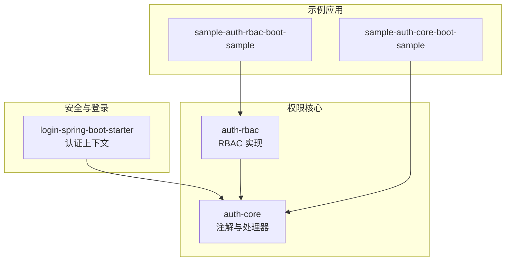
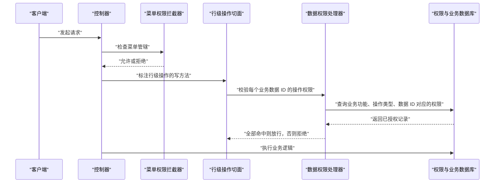
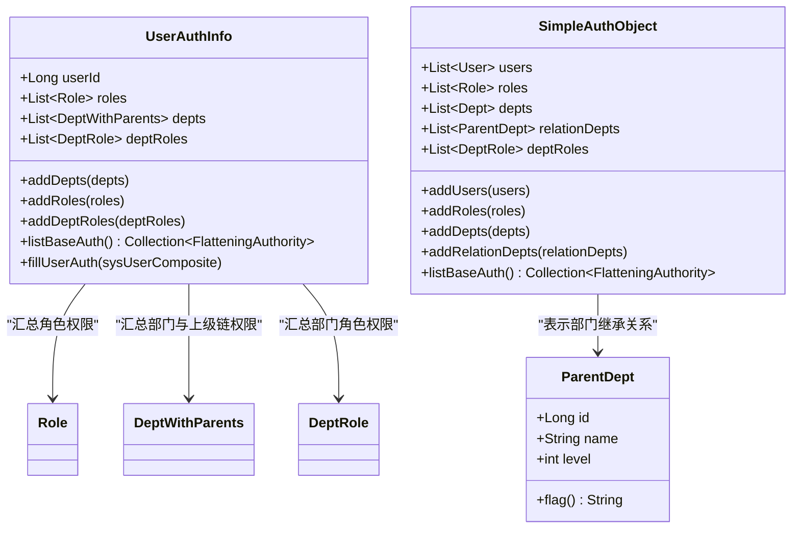
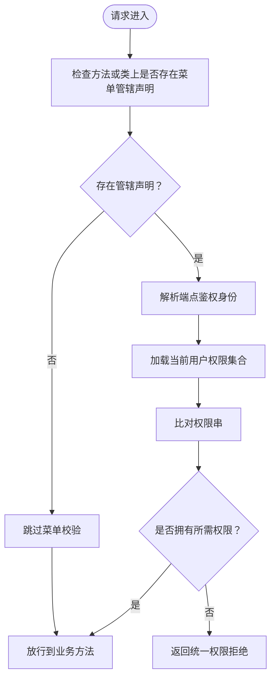
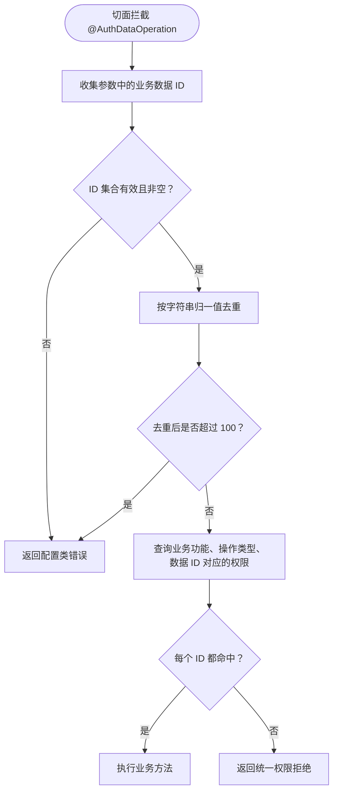
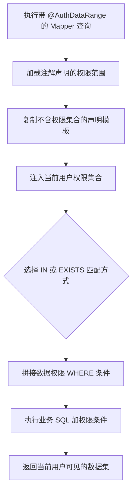
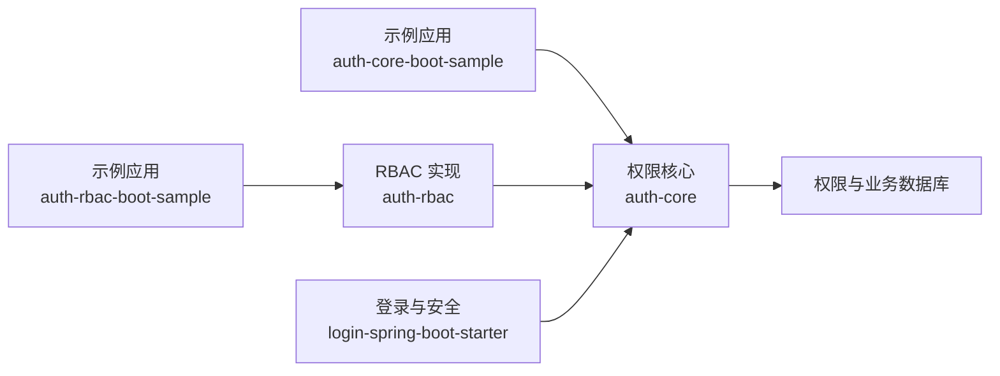
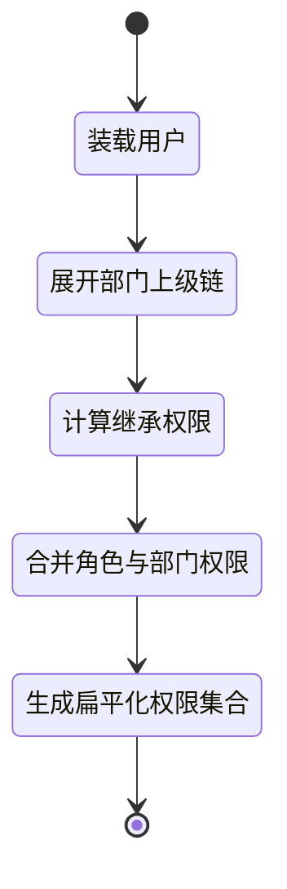

# 权限设计原则

<cite>
**本文引用的文件**   
- [README_Auth.md](file://README_Auth.md)
- [AuthMenu.java](file://auth/auth-core/src/main/java/com/cu/framework/auth/core/AuthMenu.java)
- [AuthDataRange.java](file://auth/auth-core/src/main/java/com/cu/framework/auth/core/AuthDataRange.java)
- [AuthDataOperation.java](file://auth/auth-core/src/main/java/com/cu/framework/auth/core/AuthDataOperation.java)
- [IAuthEntity.java](file://auth/auth-core/src/main/java/com/cu/framework/auth/core/entity/IAuthEntity.java)
- [IAuthObject.java](file://auth/auth-core/src/main/java/com/cu/framework/auth/core/entity/IAuthObject.java)
- [AbstractIdNameFlagAuthEntity.java](file://auth/auth-core/src/main/java/com/cu/framework/auth/core/entity/AbstractIdNameFlagAuthEntity.java)
- [AuthDataAdaptor.java](file://auth/auth-core/src/main/java/com/cu/framework/auth/core/AuthDataAdaptor.java)
- [AuthRange.java](file://auth/auth-core/src/main/java/com/cu/framework/auth/core/data/range/AuthRange.java)
- [MatchMethod.java](file://auth/auth-core/src/main/java/com/cu/framework/auth/core/data/range/MatchMethod.java)
- [DataCheckAspect.java](file://auth/auth-core/src/main/java/com/cu/framework/auth/core/data/edit/DataCheckAspect.java)
- [UserAuthInfo.java](file://auth/auth-rbac/src/main/java/com/cu/framework/auth/rbac/composite/model/UserAuthInfo.java)
- [SimpleAuthObject.java](file://auth/auth-rbac/src/main/java/com/cu/framework/auth/rbac/composite/model/SimpleAuthObject.java)
- [ParentDept.java](file://auth/auth-rbac/src/main/java/com/cu/framework/auth/rbac/composite/model/ParentDept.java)
- [spec_menu_access.md](file://openspec/specs/auth/menu-access/spec.md)
- [spec_data_operation.md](file://openspec/specs/auth/data-operation/spec.md)
- [spec_dept_inherited_access.md](file://openspec/specs/auth/dept-inherited-access/spec.md)
- [design_permission_matrix.md](file://openspec/changes/archive/2026-10-26-refactor-auth-core-demo-permission-matrix/design.md)
</cite>

## 目录
1. [引言](#引言)
2. [项目结构](#项目结构)
3. [核心组件](#核心组件)
4. [架构总览](#架构总览)
5. [详细组件分析](#详细组件分析)
6. [依赖关系分析](#依赖关系分析)
7. [性能与扩展性](#性能与扩展性)
8. [权限矩阵规划方法](#权限矩阵规划方法)
9. [权限继承策略](#权限继承策略)
10. [最佳实践与反模式](#最佳实践与反模式)
11. [故障排查指南](#故障排查指南)
12. [结论](#结论)

## 引言
Kewen Framework 的权限体系以 RBAC 为核心，围绕“用户-角色-部门”三层关系展开，并通过注解驱动实现菜单权限、行级数据操作权限和数据范围查询三类控制。框架明确区分“菜单可见性”和“数据可执行性”，避免把接口能否进入与业务数据能否操作混为一谈；同时通过部门继承机制支持组织结构的动态授权，并通过权限矩阵帮助团队显式表达不同角色的访问能力。

## 项目结构
权限相关代码主要分布在以下模块：
- `auth/auth-core`：权限核心抽象，包含菜单、数据范围、数据操作等注解及通用处理器。
- `auth/auth-rbac`：RBAC 默认实现，封装用户、角色、部门、部门角色等实体及其组合模型。
- `login-spring-boot-starter`：登录态与安全上下文，为权限判定提供当前用户身份。
- `sample/*-boot-sample`：示例应用，演示注解用法、权限透视台和部门继承场景。

**图示来源**
- [README_Auth.md:1-934](file://README_Auth.md#L1-L934)

**章节来源**
- [README_Auth.md:1-934](file://README_Auth.md#L1-L934)

## 核心组件
框架将权限划分为三个维度：

| 维度 | 代表注解或模型 | 职责 | 典型使用位置 |
|---|---|---|---|
| 菜单权限 | `@AuthMenu` | 声明某个 HTTP 端点是否受菜单鉴权管辖 | Controller 类或方法 |
| 数据范围 | `@AuthDataRange` | 在查询时自动注入数据权限条件，限制列表可见行 | MyBatis Mapper 查询方法 |
| 行级操作 | `@AuthDataOperation` | 校验对单条或多条业务数据的写操作权限 | Controller/Service 写方法 |
| 权限集合体 | `IAuthObject`、`AbstractIdNameFlagAuthEntity` | 描述用户、角色、部门等权限实体的扁平化权限串 | 权限装配与持久化 |
| 权限适配器 | `AuthDataAdaptor` | 在服务层直接编辑、填充或删除数据权限 | Service 层 |

### 菜单权限注解
`@AuthMenu` 是“管不管辖”的声明型注解，本身不带权限值，也不参与鉴权判定；显示文案由文档注解承担，实际权限归属由菜单注册与数据库授权决定。它可以标在方法上，也可以标在类上批量管辖该 Controller 的所有端点。

**章节来源**
- [AuthMenu.java:1-16](file://auth/auth-core/src/main/java/com/cu/framework/auth/core/AuthMenu.java#L1-L16)
- [spec_menu_access.md:1-91](file://openspec/specs/auth/menu-access/spec.md#L1-L91)

### 数据范围注解
`@AuthDataRange` 用于 MyBatis Mapper 的查询方法，启动期会校验映射语句、是否为查询、是否启用二级缓存、是否能解析目标表；运行期根据当前用户的权限集合拼接数据过滤条件，使无权数据不出现在列表中。它支持指定主表、表别名、业务主键列、操作类型以及 `IN` 或 `EXISTS` 匹配方式。

**章节来源**
- [AuthDataRange.java:1-81](file://auth/auth-core/src/main/java/com/cu/framework/auth/core/AuthDataRange.java#L1-L81)
- [AuthRange.java:1-64](file://auth/auth-core/src/main/java/com/cu/framework/auth/core/data/range/AuthRange.java#L1-L64)
- [MatchMethod.java:10-21](file://auth/auth-core/src/main/java/com/cu/framework/auth/core/data/range/MatchMethod.java#L10-L21)

### 行级操作注解
`@AuthDataOperation` 用于切面拦截的业务写方法。切面从参数中收集所有实现数据 ID 承载接口的对象，提取业务数据 ID，去重后逐个判断是否拥有声明的业务功能与操作权限；任一未命中即整体拒绝。单次调用最多处理 100 个去重后的 ID，超出属于配置或用法错误。

**章节来源**
- [AuthDataOperation.java:1-51](file://auth/auth-core/src/main/java/com/cu/framework/auth/core/AuthDataOperation.java#L1-L51)
- [DataCheckAspect.java:1-149](file://auth/auth-core/src/main/java/com/cu/framework/auth/core/data/edit/DataCheckAspect.java#L1-L149)
- [spec_data_operation.md:1-153](file://openspec/specs/auth/data-operation/spec.md#L1-L153)

### 权限实体与权限集合体
`IAuthEntity` 是基础权限对象的序列化入口，`IAuthObject` 是权限集合体接口，用于聚合用户、角色、部门等多类权限实体并输出扁平化的权限串集合。`AbstractIdNameFlagAuthEntity` 提供了“ID+名称”形式的权限实体基类，并内置整型、长整型、字符串三种 ID 转换逻辑。

**章节来源**
- [IAuthEntity.java:1-16](file://auth/auth-core/src/main/java/com/cu/framework/auth/core/entity/IAuthEntity.java#L1-L16)
- [IAuthObject.java:1-35](file://auth/auth-core/src/main/java/com/cu/framework/auth/core/entity/IAuthObject.java#L1-L35)
- [AbstractIdNameFlagAuthEntity.java:1-91](file://auth/auth-core/src/main/java/com/cu/framework/auth/core/entity/AbstractIdNameFlagAuthEntity.java#L1-L91)

### 数据权限适配器
`AuthDataAdaptor` 暴露服务层可直接调用的权限编辑 API，包括编辑数据权限、按业务功能与数据 ID 删除权限、填充某条数据对应的权限集合。它解耦了“注解驱动的自动化权限维护”和“业务主动维护权限”两种场景。

**章节来源**
- [AuthDataAdaptor.java:1-45](file://auth/auth-core/src/main/java/com/cu/framework/auth/core/AuthDataAdaptor.java#L1-L45)

## 架构总览
Kewen Framework 的权限架构可以理解为四层：声明层、装配层、判定层、执行层。

**图示来源**
- [AuthMenu.java:1-16](file://auth/auth-core/src/main/java/com/cu/framework/auth/core/AuthMenu.java#L1-L16)
- [DataCheckAspect.java:1-149](file://auth/auth-core/src/main/java/com/cu/framework/auth/core/data/edit/DataCheckAspect.java#L1-L149)
- [AuthDataOperation.java:1-51](file://auth/auth-core/src/main/java/com/cu/framework/auth/core/AuthDataOperation.java#L1-L51)

**章节来源**
- [README_Auth.md:1-934](file://README_Auth.md#L1-L934)
- [spec_menu_access.md:1-91](file://openspec/specs/auth/menu-access/spec.md#L1-L91)
- [spec_data_operation.md:1-153](file://openspec/specs/auth/data-operation/spec.md#L1-L153)

## 详细组件分析

### RBAC 用户权限装配模型
RBAC 层的 `UserAuthInfo` 是用户权限装载模型，负责汇总用户、角色、部门、部门上级链、部门角色等权限实体，最终生成扁平化的权限串集合。关键行为包括：
- 用户缺失时返回空权限集合，而不是抛出异常掩盖装载缺陷。
- 角色权限、部门权限、部门上级链权限、部门角色权限均合并到同一权限集合。
- 通过 `fillUserAuth` 在装载期展开部门的严格上级链，并生成部门角色组合权限。
- 用户权限只用于正向判定，不提供逆向解析。

**图示来源**
- [UserAuthInfo.java:1-163](file://auth/auth-rbac/src/main/java/com/cu/framework/auth/rbac/composite/model/UserAuthInfo.java#L1-L163)
- [SimpleAuthObject.java:1-129](file://auth/auth-rbac/src/main/java/com/cu/framework/auth/rbac/composite/model/SimpleAuthObject.java#L1-L129)
- [ParentDept.java:1-48](file://auth/auth-rbac/src/main/java/com/cu/framework/auth/rbac/composite/model/ParentDept.java#L1-L48)

**章节来源**
- [UserAuthInfo.java:1-163](file://auth/auth-rbac/src/main/java/com/cu/framework/auth/rbac/composite/model/UserAuthInfo.java#L1-L163)
- [SimpleAuthObject.java:1-129](file://auth/auth-rbac/src/main/java/com/cu/framework/auth/rbac/composite/model/SimpleAuthObject.java#L1-L129)
- [ParentDept.java:1-48](file://auth/auth-rbac/src/main/java/com/cu/framework/auth/rbac/composite/model/ParentDept.java#L1-L48)

### 菜单权限控制流程
菜单权限的控制边界由规格严格约束：
- 管辖粒度可以是单个端点或整个 Controller。
- 显示文案不参与鉴权判定。
- 鉴权身份只能由代码声明和建库脚本决定，不能由更新请求改写。
- 启动时自动注册受管辖端点，不覆盖已有菜单行的名称、权限类型和授权。

**图示来源**
- [spec_menu_access.md:1-91](file://openspec/specs/auth/menu-access/spec.md#L1-L91)

**章节来源**
- [spec_menu_access.md:1-91](file://openspec/specs/auth/menu-access/spec.md#L1-L91)

### 行级数据操作权限流程
行级权限判定遵循“每个业务数据 ID 独立命中”的原则：
- 切面收集参数中所有数据 ID 承载对象交出的 ID。
- 对 ID 进行去重和空值校验。
- 上限 100 条，超限直接失败。
- 仅依据声明槽位下的权限记录判定，不做跨操作回退。
- 业务主键类型形态不影响判定结果。

**图示来源**
- [DataCheckAspect.java:1-149](file://auth/auth-core/src/main/java/com/cu/framework/auth/core/data/edit/DataCheckAspect.java#L1-L149)
- [spec_data_operation.md:1-153](file://openspec/specs/auth/data-operation/spec.md#L1-L153)

**章节来源**
- [DataCheckAspect.java:1-149](file://auth/auth-core/src/main/java/com/cu/framework/auth/core/data/edit/DataCheckAspect.java#L1-L149)
- [spec_data_operation.md:1-153](file://openspec/specs/auth/data-operation/spec.md#L1-L153)

### 数据范围查询流程
`@AuthDataRange` 针对 Mapper 查询方法注入数据权限条件，其内部定义包含业务功能、操作类型、表名、表别名、业务主键列、权限集合以及匹配方式。匹配方式支持 `IN` 与 `EXISTS`，适用于权限表规模不同的场景。

**图示来源**
- [AuthDataRange.java:1-81](file://auth/auth-core/src/main/java/com/cu/framework/auth/core/AuthDataRange.java#L1-L81)
- [AuthRange.java:1-64](file://auth/auth-core/src/main/java/com/cu/framework/auth/core/data/range/AuthRange.java#L1-L64)
- [MatchMethod.java:10-21](file://auth/auth-core/src/main/java/com/cu/framework/auth/core/data/range/MatchMethod.java#L10-L21)

**章节来源**
- [AuthDataRange.java:1-81](file://auth/auth-core/src/main/java/com/cu/framework/auth/core/AuthDataRange.java#L1-L81)
- [AuthRange.java:1-64](file://auth/auth-core/src/main/java/com/cu/framework/auth/core/data/range/AuthRange.java#L1-L64)
- [MatchMethod.java:10-21](file://auth/auth-core/src/main/java/com/cu/framework/auth/core/data/range/MatchMethod.java#L10-L21)

## 依赖关系分析
权限系统的依赖方向清晰：示例应用依赖 `auth-core` 提供的注解和处理器；RBAC 实现依赖 `auth-core` 的权限集合体接口；登录模块提供当前用户上下文；运行时由切面和拦截器触发判定，再由数据权限处理器访问数据库。

**图示来源**
- [README_Auth.md:1-934](file://README_Auth.md#L1-L934)

**章节来源**
- [README_Auth.md:1-934](file://README_Auth.md#L1-L934)

## 性能与扩展性
- **菜单权限**：判定基于当前用户权限集合与端点鉴权身份，适合轻量级内存比对。
- **行级操作权限**：单次调用最多 100 个去重 ID，避免一次请求放大成不可控查询；失败分为配置错误和权限拒绝两类，便于调用方区分系统问题与业务无权限。
- **数据范围权限**：支持 `IN` 与 `EXISTS` 两种匹配方式，当权限表数据量较大时应优先选择 `EXISTS`，以降低大表关联成本。
- **权限集合体**：扁平化权限串集合通过 Set 去重，避免重复权限影响判定；用户权限集合为空时直接拒绝，符合最小权限原则。
- **可扩展点**：`IAuthEntity`、`IAuthObject`、`AbstractIdNameFlagAuthEntity`、`AuthDataAdaptor` 和 `AuthDataHandler` 都是扩展点，可在不修改框架注解的前提下接入新的权限来源或存储方式。

[本节为通用指导，不直接分析具体源码文件]

## 权限矩阵规划方法
权限矩阵用于清晰表达“哪些角色能对哪些资源执行哪些操作”。在 Kewen Framework 中，矩阵应拆分为三层：
- 菜单层：角色能否看到或进入某个端点。
- 行级层：角色能否对某条业务数据进行增删改查。
- 数据范围层：角色能看到的业务数据行集合。

示例应用的权限透视台设计明确了这一分层：页面展示期望结果与实际结果，区分“菜单拒绝”“行级拒绝”“数据范围可见行数”，并提供只读预检接口，避免切换身份时产生写入副作用。

| 矩阵列 | 含义 | 对应框架概念 |
|---|---|---|
| 角色 | 用户所属角色 | `UserAuthInfo.roles` |
| 部门 | 用户所属部门及上级链 | `UserAuthInfo.depts` |
| 菜单路径 | 受 `@AuthMenu` 管辖的端点 | `@AuthMenu`、菜单注册 |
| 业务功能 | 一组相关数据操作 | `businessFunction` |
| 操作类型 | 统一、修改、更新、删除等 | `operate` |
| 数据 ID | 行级权限作用的具体业务记录 | `data_id` |
| 数据范围 | 查询时可见的行集合 | `@AuthDataRange` |

**章节来源**
- [design_permission_matrix.md:1-253](file://openspec/changes/archive/2026-10-26-refactor-auth-core-demo-permission-matrix/design.md#L1-L253)
- [AuthMenu.java:1-16](file://auth/auth-core/src/main/java/com/cu/framework/auth/core/AuthMenu.java#L1-L16)
- [AuthDataOperation.java:1-51](file://auth/auth-core/src/main/java/com/cu/framework/auth/core/AuthDataOperation.java#L1-L51)
- [AuthDataRange.java:1-81](file://auth/auth-core/src/main/java/com/cu/framework/auth/core/AuthDataRange.java#L1-L81)

## 权限继承策略
框架的部门继承策略强调“仅授予子孙部门”，并且继承关系在装载时展开，而不是预先写入用户授权数据。

### 继承规则
- 授予某部门的“部门继承标记”权限，只对该部门严格子孙部门的成员生效。
- 本部门自己的成员不会因此获得权限，必须由部门自身标记授权。
- 继承不设层级上限，直接子部门和隔级子孙均可命中。
- 多部门任职时取并集，不因隶属关系相互抵消。

### 展开时机
- 用户在每次装载权限时，系统根据当前部门层级展开上级链。
- 调整部门层级后，下一次装载即生效，无需重刷用户授权记录。
- 展开结果不落入用户授权存储，避免脏数据和历史状态污染。

### 编解码要求
- 继承型权限标记必须是单段令牌，不能被误拆成多个位置。
- 权限串的往返序列化和反序列化必须无损，不能依赖权限串之外的层级深度字段。

**图示来源**
- [UserAuthInfo.java:1-163](file://auth/auth-rbac/src/main/java/com/cu/framework/auth/rbac/composite/model/UserAuthInfo.java#L1-L163)
- [ParentDept.java:1-48](file://auth/auth-rbac/src/main/java/com/cu/framework/auth/rbac/composite/model/ParentDept.java#L1-L48)
- [spec_dept_inherited_access.md:1-130](file://openspec/specs/auth/dept-inherited-access/spec.md#L1-L130)

**章节来源**
- [spec_dept_inherited_access.md:1-130](file://openspec/specs/auth/dept-inherited-access/spec.md#L1-L130)
- [UserAuthInfo.java:1-163](file://auth/auth-rbac/src/main/java/com/cu/framework/auth/rbac/composite/model/UserAuthInfo.java#L1-L163)
- [ParentDept.java:1-48](file://auth/auth-rbac/src/main/java/com/cu/framework/auth/rbac/composite/model/ParentDept.java#L1-L48)

## 最佳实践与反模式

### 接口级菜单权限
- 为需要鉴权的 Controller 方法或整个 Controller 添加 `@AuthMenu`。
- 不要依赖显示文案做鉴权；菜单权限应由代码声明和数据库授权共同决定。
- 如果某些端点不需要菜单校验，不要添加 `@AuthMenu`，保持它们不受管辖。

**章节来源**
- [AuthMenu.java:1-16](file://auth/auth-core/src/main/java/com/cu/framework/auth/core/AuthMenu.java#L1-L16)
- [spec_menu_access.md:1-91](file://openspec/specs/auth/menu-access/spec.md#L1-L91)

### 行级数据范围
- 为每个需要数据范围控制的查询 Mapper 方法添加 `@AuthDataRange`。
- 一张表若需按不同操作过滤，应为每个操作声明独立的查询方法。
- 权限表规模较大时优先使用 `EXISTS` 匹配方式，减少大表关联压力。

**章节来源**
- [AuthDataRange.java:1-81](file://auth/auth-core/src/main/java/com/cu/framework/auth/core/AuthDataRange.java#L1-L81)
- [MatchMethod.java:10-21](file://auth/auth-core/src/main/java/com/cu/framework/auth/core/data/range/MatchMethod.java#L10-L21)

### CRUD 操作权限划分
- 读操作通常由菜单权限和数据范围控制。
- 写操作应额外使用 `@AuthDataOperation`，并明确 `businessFunction` 和 `operate`。
- 同一数据的不同操作应独立配置权限，不允许跨操作回退。

**章节来源**
- [AuthDataOperation.java:1-51](file://auth/auth-core/src/main/java/com/cu/framework/auth/core/AuthDataOperation.java#L1-L51)
- [spec_data_operation.md:1-153](file://openspec/specs/auth/data-operation/spec.md#L1-L153)

### 常见反模式
| 反模式 | 风险 | 建议 |
|---|---|---|
| 用菜单显示文案决定权限 | 文案改动导致权限语义漂移 | 文案仅用于展示，权限由标识符和授权记录决定 |
| 把所有写操作放在同一个槽位 | 无法区分查看、修改、删除等行为 | 为不同业务动作定义不同 `operate` |
| 一次性提交超大批量数据 ID | 触发 100 条上限，变成配置错误 | 业务层分批提交 |
| 依赖部门自身标记实现继承 | 无法让子孙部门自动获得权限 | 使用部门继承标记配合上级链展开 |
| 把权限维护逻辑耦合到业务查询 | 查询 SQL 与权限逻辑互相污染 | 使用 `AuthDataAdaptor` 或服务层权限处理器 |

[本节为通用指导，不直接分析具体源码文件]

## 故障排查指南

### 启动期常见问题
- `@AuthDataRange` 标注的方法没有解析到映射语句。
- `@AuthDataRange` 标注在非查询方法上。
- 查询启用了二级缓存，导致权限条件注入时机不正确。
- 静态 SQL 中找不到声明的目标表。

排查建议：检查 Mapper 接口方法是否绑定 SQL、是否为查询、是否关闭二级缓存、是否准确指定 `table` 和 `tableAlias`。

**章节来源**
- [AuthDataRange.java:1-81](file://auth/auth-core/src/main/java/com/cu/framework/auth/core/AuthDataRange.java#L1-L81)

### 行级权限拒绝
- 确认方法是否正确标注 `@AuthDataOperation`。
- 确认请求参数是否实现了数据 ID 承载接口，并交出全部业务数据 ID。
- 确认业务功能、操作类型、数据 ID 是否与权限表中一致。
- 确认没有把不同操作类型的权限混用。

**章节来源**
- [DataCheckAspect.java:1-149](file://auth/auth-core/src/main/java/com/cu/framework/auth/core/data/edit/DataCheckAspect.java#L1-L149)
- [spec_data_operation.md:1-153](file://openspec/specs/auth/data-operation/spec.md#L1-L153)

### 部门继承无效
- 确认授权的是“部门继承标记”，而不是部门自身标记。
- 确认被授权者确实是目标部门的严格子孙部门成员。
- 确认部门层级调整后已重新装载用户权限。
- 确认权限标记是单段令牌，没有被误拆成多个位置。

**章节来源**
- [spec_dept_inherited_access.md:1-130](file://openspec/specs/auth/dept-inherited-access/spec.md#L1-L130)
- [ParentDept.java:1-48](file://auth/auth-rbac/src/main/java/com/cu/framework/auth/rbac/composite/model/ParentDept.java#L1-L48)

## 结论
Kewen Framework 的权限设计以 RBAC 为基础，但并未停留在“用户-角色-部门”三张表层面，而是进一步拆出菜单权限、行级数据权限和数据范围权限三个维度，并通过注解、切面、拦截器和权限集合体把它们串联起来。最佳实践的核心是：
- 用 `@AuthMenu` 控制菜单可见性和接口入口。
- 用 `@AuthDataOperation` 控制每条业务数据的写权限。
- 用 `@AuthDataRange` 控制查询结果的行级可见性。
- 用权限矩阵表达角色、部门、菜单、操作和数据之间的关系。
- 用部门继承机制支持组织结构变化带来的权限变化。
- 始终区分“配置错误”和“权限拒绝”，并在设计中预留扩展点以适应新权限来源。

[本节为总结性内容，不直接分析具体源码文件]