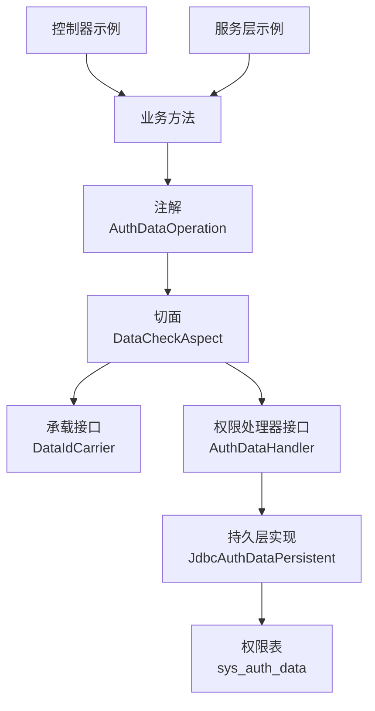
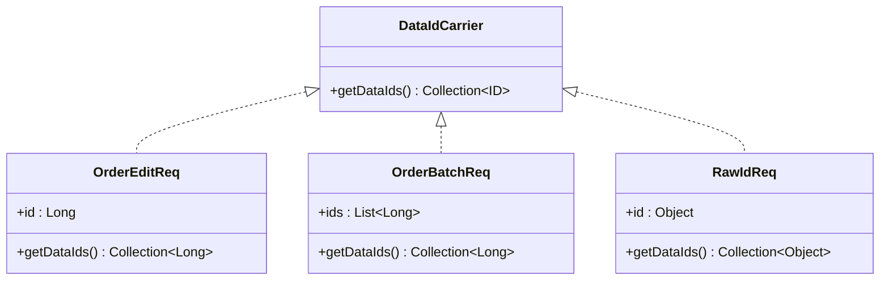
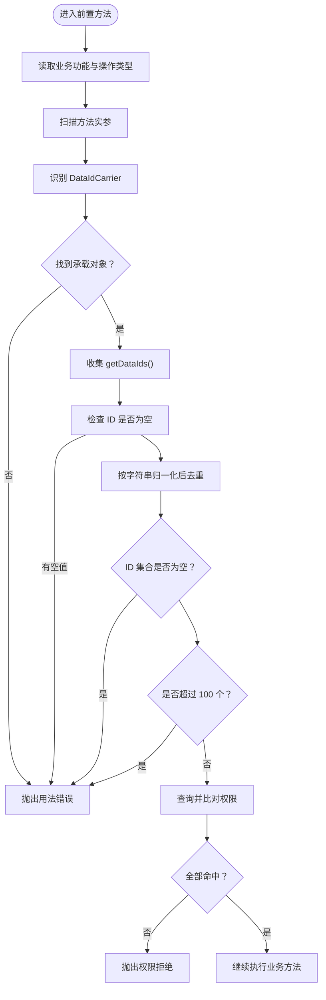
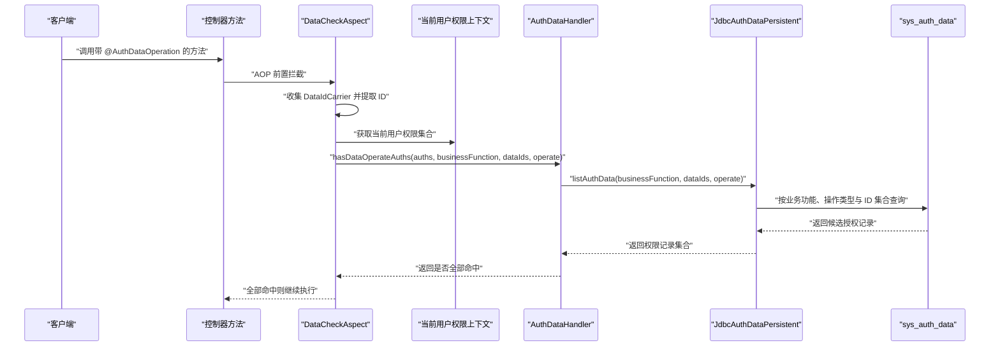
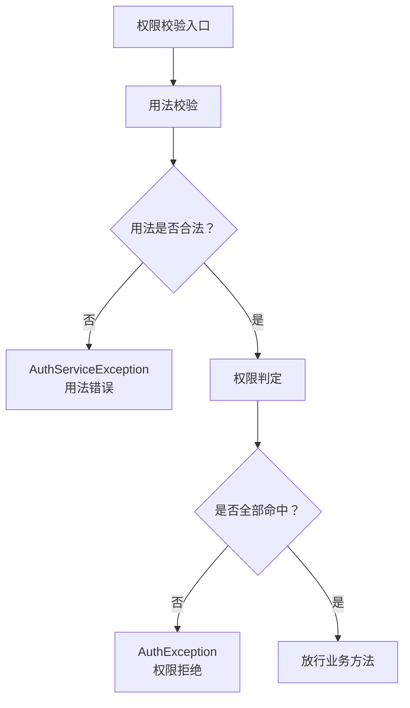
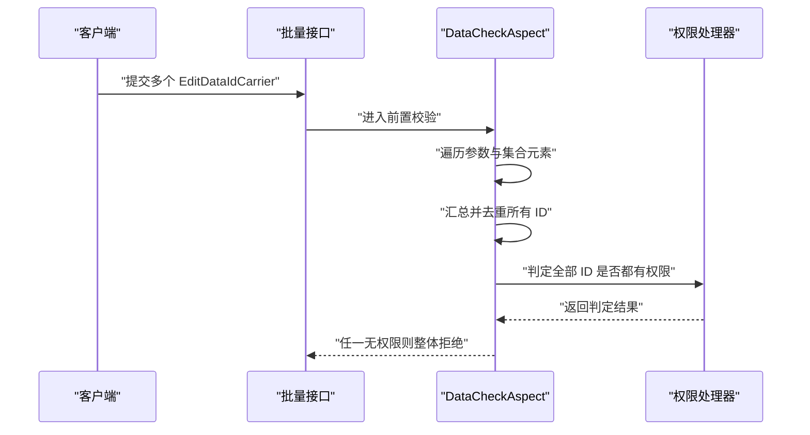
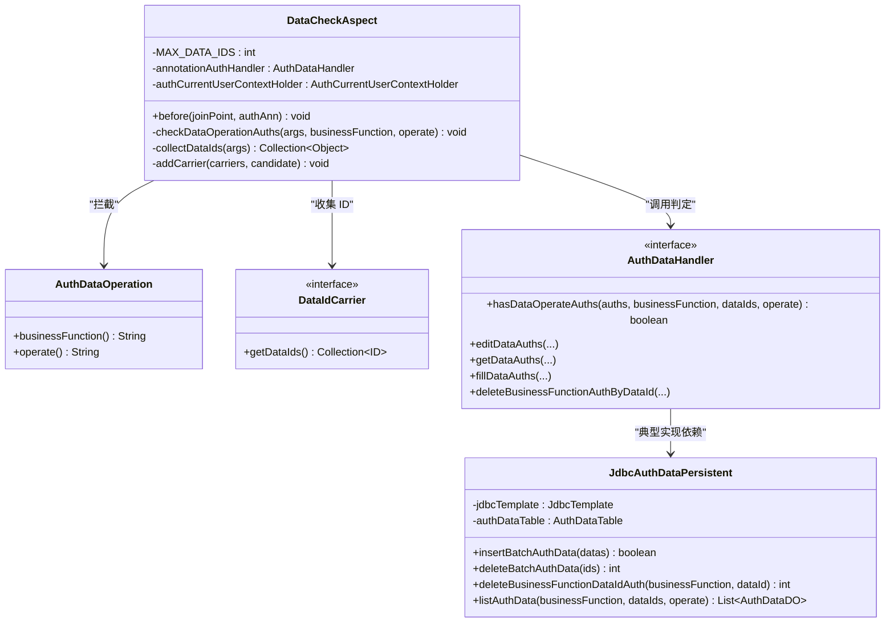

# 数据操作权限

<cite>
**本文引用的文件**   
- [AuthDataOperation.java](file://auth/auth-core/src/main/java/com/cu/framework/auth/core/AuthDataOperation.java)
- [DataCheckAspect.java](file://auth/auth-core/src/main/java/com/cu/framework/auth/core/data/edit/DataCheckAspect.java)
- [DataIdCarrier.java](file://auth/auth-core/src/main/java/com/cu/framework/auth/core/data/edit/DataIdCarrier.java)
- [AuthDataHandler.java](file://auth/auth-core/src/main/java/com/cu/framework/auth/core/data/AuthDataHandler.java)
- [JdbcAuthDataPersistent.java](file://auth/auth-core/src/main/java/com/cu/framework/auth/core/data/JdbcAuthDataPersistent.java)
- [AuthException.java](file://auth/auth-core/src/main/java/com/cu/framework/auth/core/exception/AuthException.java)
- [AuthServiceException.java](file://auth/auth-core/src/main/java/com/cu/framework/auth/core/exception/AuthServiceException.java)
- [spec.md](file://openspec/specs/auth/data-operation/spec.md)
- [design.md](file://openspec/changes/archive/2026-10-20-refactor-auth-data-operation/design.md)
- [DemoRequests.java](file://sample/auth-core-boot-sample/src/main/java/com/cu/framework/sample/authcore/model/DemoRequests.java)
- [TestAuthAnnotationController.java](file://sample/auth-rbac-boot-sample/src/main/java/com/cu/framework/auth/sample/controller/TestAuthAnnotationController.java)
</cite>

## 目录
1. [简介](#简介)
2. [项目结构定位](#项目结构定位)
3. [核心组件总览](#核心组件总览)
4. [注解与承载接口设计](#注解与承载接口设计)
5. [切面执行流程](#切面执行流程)
6. [权限校验与持久层](#权限校验与持久层)
7. [失败处理与异常分类](#失败处理与异常分类)
8. [使用示例：控制器与服务层](#使用示例控制器与服务层)
9. [依赖关系分析](#依赖关系分析)
10. [性能考虑与最佳实践](#性能考虑与最佳实践)
11. [故障排查指南](#故障排查指南)
12. [结论](#结论)

## 简介
本文件面向 Kewen Framework 的“行级数据操作权限”能力，围绕 `@AuthDataOperation` 注解、`DataCheckAspect` 切面、`DataIdCarrier` 承载接口以及底层权限表读写机制展开。目标是帮助开发者理解：

- 哪些方法需要声明数据操作权限；
- 如何正确提供业务数据 ID；
- 单条和批量数据如何判定；
- 为什么一次调用必须全部命中；
- 用法错误与权限拒绝如何区分；
- 在控制器和服务层中如何组织请求对象与方法。

该能力的规格定义见 [spec.md:1-153](file://openspec/specs/auth/data-operation/spec.md#L1-L153)，重构动机与设计决策见 [design.md:1-116](file://openspec/changes/archive/2026-10-20-refactor-auth-data-operation/design.md#L1-L116)。

## 项目结构定位
数据操作权限相关代码集中在 `auth/auth-core` 模块，并在样例项目中提供控制器与服务层的使用示范：

- 注解与切面位于 `com.cu.framework.auth.core` 及其子包；
- 权限处理器接口位于 `com.cu.framework.auth.core.data`；
- 权限表持久化实现位于同包的 `JdbcAuthDataPersistent`；
- 异常类型位于 `com.cu.framework.auth.core.exception`；
- 样例使用位于 `sample/auth-core-boot-sample` 与 `sample/auth-rbac-boot-sample`。

**图表来源**
- [AuthDataOperation.java:1-51](file://auth/auth-core/src/main/java/com/cu/framework/auth/core/AuthDataOperation.java#L1-L51)
- [DataCheckAspect.java:1-149](file://auth/auth-core/src/main/java/com/cu/framework/auth/core/data/edit/DataCheckAspect.java#L1-L149)
- [DataIdCarrier.java:1-26](file://auth/auth-core/src/main/java/com/cu/framework/auth/core/data/edit/DataIdCarrier.java#L1-L26)
- [AuthDataHandler.java:1-102](file://auth/auth-core/src/main/java/com/cu/framework/auth/core/data/AuthDataHandler.java#L1-L102)
- [JdbcAuthDataPersistent.java:1-179](file://auth/auth-core/src/main/java/com/cu/framework/auth/core/data/JdbcAuthDataPersistent.java#L1-L179)

**章节来源**
- [AuthDataOperation.java:1-51](file://auth/auth-core/src/main/java/com/cu/framework/auth/core/AuthDataOperation.java#L1-L51)
- [DataCheckAspect.java:1-149](file://auth/auth-core/src/main/java/com/cu/framework/auth/core/data/edit/DataCheckAspect.java#L1-L149)
- [spec.md:1-153](file://openspec/specs/auth/data-operation/spec.md#L1-L153)

## 核心组件总览
| 组件 | 职责 | 关键行为 |
|---|---|---|
| `AuthDataOperation` | 声明方法需要对业务数据进行行级写权限校验 | 指定业务功能与操作类型 |
| `DataIdCarrier` | 承载本次调用涉及的全部业务数据 ID | 返回集合，支持单值和多值场景 |
| `DataCheckAspect` | AOP 前置拦截并执行权限校验 | 收集 ID、去重、限流、调用处理器 |
| `AuthDataHandler` | 抽象权限判定与权限维护入口 | 统一暴露 `hasDataOperateAuths` 等方法 |
| `JdbcAuthDataPersistent` | 直接访问 `sys_auth_data` 表 | 使用 JSqlParser 构造语句并以参数绑定值 |
| `AuthException` | 表示权限拒绝 | 用于“未命中权限”的业务拒绝语义 |
| `AuthServiceException` | 表示框架侧配置或用法错误 | 用于缺少 ID、ID 为空、超出上限等 |

**章节来源**
- [AuthDataOperation.java:10-51](file://auth/auth-core/src/main/java/com/cu/framework/auth/core/AuthDataOperation.java#L10-L51)
- [DataIdCarrier.java:6-26](file://auth/auth-core/src/main/java/com/cu/framework/auth/core/data/edit/DataIdCarrier.java#L6-L26)
- [DataCheckAspect.java:20-149](file://auth/auth-core/src/main/java/com/cu/framework/auth/core/data/edit/DataCheckAspect.java#L20-L149)
- [AuthDataHandler.java:10-102](file://auth/auth-core/src/main/java/com/cu/framework/auth/core/data/AuthDataHandler.java#L10-L102)
- [JdbcAuthDataPersistent.java:17-179](file://auth/auth-core/src/main/java/com/cu/framework/auth/core/data/JdbcAuthDataPersistent.java#L17-L179)
- [AuthException.java:1-23](file://auth/auth-core/src/main/java/com/cu/framework/auth/core/exception/AuthException.java#L1-L23)
- [AuthServiceException.java:1-16](file://auth/auth-core/src/main/java/com/cu/framework/auth/core/exception/AuthServiceException.java#L1-L16)

## 注解与承载接口设计

### `@AuthDataOperation` 的设计理念
该注解用于声明“写方法需要按数据行维度检查权限”。它不是通用登录认证，也不是菜单访问控制，而是针对具体业务数据的编辑、删除、审批等写操作。

核心字段如下：

| 字段 | 含义 | 默认值 | 说明 |
|---|---|---|---|
| `businessFunction` | 业务功能槽位 | 无默认值 | 对应权限表中业务功能列，通常由团队约定，例如订单、资产、会议室等 |
| `operate` | 操作类型 | `unified` | 可取 `unified`、`modify`、`update`、`delete` 或自定义值；不同操作类型互相独立 |

设计理念要点：

- **声明位置是业务方法**：通常是控制器或服务层的写方法。
- **判定单位是数据 ID，不是调用本身**：一次调用可能涉及多条数据，每条都必须独立命中。
- **不跨操作回退**：如果只配置了更新权限，不代表删除也能通过。
- **默认操作类型为 `unified`**：在没有细粒度操作要求时使用统一槽位，但不应把它理解为“通配所有操作”。

**章节来源**
- [AuthDataOperation.java:10-51](file://auth/auth-core/src/main/java/com/cu/framework/auth/core/AuthDataOperation.java#L10-L51)
- [spec.md:1-153](file://openspec/specs/auth/data-operation/spec.md#L1-L153)

### `DataIdCarrier` 接口的作用
`DataIdCarrier<ID>` 是业务请求对象与权限切面之间的契约。它的唯一方法是 `getDataIds()`，返回本次调用涉及的**全部**业务主键集合。

关键约束：

- 单条数据也返回单元素集合，而不是单个 ID。
- 批量数据在一次调用中把所有 ID 交给框架，不要隐式拆分。
- ID 类型不限：整型、长整型、字符串都可以。
- 更深层嵌套结构的摊平由实现类负责，切面只看这一层。
- 框架不会反射猜测对象内部字段，也不会静默忽略未显式交出的 ID。

**图表来源**
- [DataIdCarrier.java:6-26](file://auth/auth-core/src/main/java/com/cu/framework/auth/core/data/edit/DataIdCarrier.java#L6-L26)
- [DemoRequests.java:30-39](file://sample/auth-core-boot-sample/src/main/java/com/cu/framework/sample/authcore/model/DemoRequests.java#L30-L39)
- [DemoRequests.java:46-52](file://sample/auth-core-boot-sample/src/main/java/com/cu/framework/sample/authcore/model/DemoRequests.java#L46-L52)
- [DemoRequests.java:155-161](file://sample/auth-core-boot-sample/src/main/java/com/cu/framework/sample/authcore/model/DemoRequests.java#L155-L161)

**章节来源**
- [DataIdCarrier.java:6-26](file://auth/auth-core/src/main/java/com/cu/framework/auth/core/data/edit/DataIdCarrier.java#L6-L26)
- [spec.md:1-153](file://openspec/specs/auth/data-operation/spec.md#L1-L153)

## 切面执行流程
`DataCheckAspect` 是一个 Spring AOP 前置切面，拦截所有标注了 `@AuthDataOperation` 的方法。其执行顺序可以概括为：

1. 解析注解中的 `businessFunction` 与 `operate`。
2. 扫描方法实参，识别实现 `DataIdCarrier` 的对象。
3. 对实参本身、数组元素、集合元素各检查一层。
4. 读取每个承载对象的 `getDataIds()`。
5. 将 ID 转为字符串作为去重键，保留原始值。
6. 判断是否存在承载对象、是否提供有效 ID、是否超过上限。
7. 从当前用户上下文获取权限集合。
8. 调用 `AuthDataHandler.hasDataOperateAuths` 进行权限判定。
9. 任一 ID 未命中则抛出权限拒绝异常；否则放行目标方法。

**图表来源**
- [DataCheckAspect.java:45-149](file://auth/auth-core/src/main/java/com/cu/framework/auth/core/data/edit/DataCheckAspect.java#L45-L149)
- [spec.md:1-153](file://openspec/specs/auth/data-operation/spec.md#L1-L153)

**章节来源**
- [DataCheckAspect.java:20-149](file://auth/auth-core/src/main/java/com/cu/framework/auth/core/data/edit/DataCheckAspect.java#L20-L149)
- [spec.md:1-153](file://openspec/specs/auth/data-operation/spec.md#L1-L153)

## 权限校验与持久层
权限判定的核心不在切面里完成 SQL，而是在 `AuthDataHandler` 与其实现中完成。当前仓库中与数据操作权限相关的持久化逻辑由 `JdbcAuthDataPersistent` 提供。

### 查询路径
系统执行的查询语义大致为：

- 按 `business_function`、`operate`、`data_id IN (...)` 过滤；
- 返回候选数据的授权记录；
- 把当前登录人的权限串与候选记录在内存求交；
- 只有当传入的每个业务 ID 都至少有一条匹配记录时，才认为全部命中。

### 安全与类型处理
- 所有值都通过 `JdbcParameter` 绑定，不再拼接字面量，避免 SQL 注入。
- 业务 ID 类型不限制：整型、长整型、字符串均可。
- 权限表读回的 ID 直接使用 `getObject` 读取，不再根据入参 ID 的类型推断权限表主键类型。
- 去重键使用 `String.valueOf(id)`，因此数值形态不同的同一主键被视为同一条数据。
- 权限串不进 SQL 的 `IN` 列表，防止用户权限规模影响语句体积。

**图表来源**
- [DataCheckAspect.java:60-95](file://auth/auth-core/src/main/java/com/cu/framework/auth/core/data/edit/DataCheckAspect.java#L60-L95)
- [AuthDataHandler.java:23-45](file://auth/auth-core/src/main/java/com/cu/framework/auth/core/data/AuthDataHandler.java#L23-L45)
- [JdbcAuthDataPersistent.java:108-179](file://auth/auth-core/src/main/java/com/cu/framework/auth/core/data/JdbcAuthDataPersistent.java#L108-L179)

**章节来源**
- [AuthDataHandler.java:10-102](file://auth/auth-core/src/main/java/com/cu/framework/auth/core/data/AuthDataHandler.java#L10-L102)
- [JdbcAuthDataPersistent.java:17-179](file://auth/auth-core/src/main/java/com/cu/framework/auth/core/data/JdbcAuthDataPersistent.java#L17-L179)
- [design.md:34-116](file://openspec/changes/archive/2026-10-20-refactor-auth-data-operation/design.md#L34-L116)

## 失败处理与异常分类
框架明确区分两类失败：

| 类别 | 触发条件 | 异常类型 | 对外语义 |
|---|---|---|---|
| 用法错误 | 没有承载对象、ID 集合为空、含空值、ID 数量超过 100 | `AuthServiceException` | 框架侧配置或调用方式错误 |
| 权限拒绝 | 至少一个业务 ID 未命中权限 | `AuthException` | 当前用户无权执行该操作 |

切面中：

- 找不到承载对象时抛出 `AuthServiceException`；
- `getDataIds()` 返回空集合时抛出 `AuthServiceException`；
- ID 列表中出现空值时抛出 `AuthServiceException`；
- 去重后的 ID 数量超过 100 时抛出 `AuthServiceException`；
- 权限判定失败时抛出 `AuthException`，消息为统一的“权限校验不通过”。

规范还要求：

- 未命中的 ID 明细只写入服务端日志；
- 对外响应应能区分“权限拒绝”和“配置/用法错误”；
- 对外信息不应泄露框架内部类名或接口名。

**图表来源**
- [DataCheckAspect.java:60-149](file://auth/auth-core/src/main/java/com/cu/framework/auth/core/data/edit/DataCheckAspect.java#L60-L149)
- [AuthException.java:1-23](file://auth/auth-core/src/main/java/com/cu/framework/auth/core/exception/AuthException.java#L1-L23)
- [AuthServiceException.java:1-16](file://auth/auth-core/src/main/java/com/cu/framework/auth/core/exception/AuthServiceException.java#L1-L16)
- [spec.md:1-153](file://openspec/specs/auth/data-operation/spec.md#L1-L153)

**章节来源**
- [DataCheckAspect.java:60-149](file://auth/auth-core/src/main/java/com/cu/framework/auth/core/data/edit/DataCheckAspect.java#L60-L149)
- [AuthException.java:1-23](file://auth/auth-core/src/main/java/com/cu/framework/auth/core/exception/AuthException.java#L1-L23)
- [AuthServiceException.java:1-16](file://auth/auth-core/src/main/java/com/cu/framework/auth/core/exception/AuthServiceException.java#L1-L16)
- [spec.md:1-153](file://openspec/specs/auth/data-operation/spec.md#L1-L153)

## 使用示例：控制器与服务层

### 单条数据校验
单条数据场景下，请求对象只需返回包含一个 ID 的集合。样例中 `OrderEditReq` 实现了 `DataIdCarrier<Long>`，`getDataIds()` 返回单元素集合。

控制器方法示例路径：

- 单条编辑方法使用 `@AuthDataOperation(businessFunction = "testedit")`；
- 请求体中包含 `DataIdCarrier` 实现；
- 切面自动校验权限后再执行业务逻辑。

**章节来源**
- [DemoRequests.java:30-39](file://sample/auth-core-boot-sample/src/main/java/com/cu/framework/sample/authcore/model/DemoRequests.java#L30-L39)
- [TestAuthAnnotationController.java:64-78](file://sample/auth-rbac-boot-sample/src/main/java/com/cu/framework/auth/sample/controller/TestAuthAnnotationController.java#L64-L78)
- [TestAuthAnnotationController.java:105-119](file://sample/auth-rbac-boot-sample/src/main/java/com/cu/framework/auth/sample/controller/TestAuthAnnotationController.java#L105-L119)

### 批量数据校验
批量数据场景的关键是：**一次请求中的所有 ID 都必须同时命中**。如果其中任意一个未命中，整个调用被拒绝，已命中的部分也不执行。

样例中：

- `OrderBatchReq` 表示一批 ID；
- `TestAuthAnnotationController.testDataEditBatch` 接收 `List<EditDataIdCarrier>`；
- 切面会遍历方法参数和集合元素，收集所有 `DataIdCarrier` 的 ID；
- 去重后一次性判定，不允许内部分批绕过上限。

**图表来源**
- [DataCheckAspect.java:97-149](file://auth/auth-core/src/main/java/com/cu/framework/auth/core/data/edit/DataCheckAspect.java#L97-L149)
- [TestAuthAnnotationController.java:75-78](file://sample/auth-rbac-boot-sample/src/main/java/com/cu/framework/auth/sample/controller/TestAuthAnnotationController.java#L75-L78)
- [spec.md:1-153](file://openspec/specs/auth/data-operation/spec.md#L1-L153)

**章节来源**
- [DemoRequests.java:46-52](file://sample/auth-core-boot-sample/src/main/java/com/cu/framework/sample/authcore/model/DemoRequests.java#L46-L52)
- [TestAuthAnnotationController.java:75-78](file://sample/auth-rbac-boot-sample/src/main/java/com/cu/framework/auth/sample/controller/TestAuthAnnotationController.java#L75-L78)
- [spec.md:1-153](file://openspec/specs/auth/data-operation/spec.md#L1-L153)

## 依赖关系分析

**图表来源**
- [AuthDataOperation.java:10-51](file://auth/auth-core/src/main/java/com/cu/framework/auth/core/AuthDataOperation.java#L10-L51)
- [DataCheckAspect.java:20-149](file://auth/auth-core/src/main/java/com/cu/framework/auth/core/data/edit/DataCheckAspect.java#L20-L149)
- [DataIdCarrier.java:6-26](file://auth/auth-core/src/main/java/com/cu/framework/auth/core/data/edit/DataIdCarrier.java#L6-L26)
- [AuthDataHandler.java:10-102](file://auth/auth-core/src/main/java/com/cu/framework/auth/core/data/AuthDataHandler.java#L10-L102)
- [JdbcAuthDataPersistent.java:17-179](file://auth/auth-core/src/main/java/com/cu/framework/auth/core/data/JdbcAuthDataPersistent.java#L17-L179)

**章节来源**
- [DataCheckAspect.java:20-149](file://auth/auth-core/src/main/java/com/cu/framework/auth/core/data/edit/DataCheckAspect.java#L20-L149)
- [AuthDataHandler.java:10-102](file://auth/auth-core/src/main/java/com/cu/framework/auth/core/data/AuthDataHandler.java#L10-L102)
- [JdbcAuthDataPersistent.java:17-179](file://auth/auth-core/src/main/java/com/cu/framework/auth/core/data/JdbcAuthDataPersistent.java#L17-L179)

## 性能考虑与最佳实践

### 性能特性
- **单次 ID 上限为 100**：超过上限直接失败，不进行内部分批，避免权限查询规模不可控。
- **权限串不下推 SQL**：当前登录人权限集合规模不可控，放在内存求交，SQL 只按业务功能、操作类型和候选 ID 过滤。
- **去重后判定**：重复 ID 不会重复查询或重复判定。
- **JdbcParameter 绑定**：避免动态拼接 SQL，降低解析与注入风险。
- **RowMapper 使用 `getObject`**：权限表主键类型与业务 ID 类型解耦。

### 最佳实践
1. **始终显式交出全部 ID**  
   不要在 `DataIdCarrier` 中只返回第一个 ID，也不要让切面猜字段。批量请求应一次交出整批 ID。

2. **合理拆分大批量请求**  
   如果业务允许，客户端或服务端应把超过 100 条的请求拆成多次调用，每次仍是完整判定边界。

3. **按业务功能与操作类型精确声明**  
   不要把不同语义的操作混在一个槽位，除非确实共享同一权限模型。

4. **不要依赖默认 `unified` 代表通配**  
   默认值只是简化声明，不等于任何操作都能通过。

5. **在 Service 层也使用注解**  
   如果 Service 方法是写操作且直接受外部调用，应考虑同样加注解，避免绕过控制器直接调用越权。

6. **统一捕获并区分异常**  
   全局异常处理应区分 `AuthServiceException` 与 `AuthException`，不要向调用方暴露内部类名。

7. **测试覆盖部分命中场景**  
   多 ID 场景中，“部分命中即整体拒绝”是关键回归点。

8. **避免在权限描述中注入敏感内容**  
   权限描述会存入权限表，应保持可读但不敏感。

**章节来源**
- [DataCheckAspect.java:30-35](file://auth/auth-core/src/main/java/com/cu/framework/auth/core/data/edit/DataCheckAspect.java#L30-L35)
- [DataCheckAspect.java:97-149](file://auth/auth-core/src/main/java/com/cu/framework/auth/core/data/edit/DataCheckAspect.java#L97-L149)
- [JdbcAuthDataPersistent.java:17-28](file://auth/auth-core/src/main/java/com/cu/framework/auth/core/data/JdbcAuthDataPersistent.java#L17-L28)
- [design.md:34-116](file://openspec/changes/archive/2026-10-20-refactor-auth-data-operation/design.md#L34-L116)

## 故障排查指南

| 现象 | 可能原因 | 处理方式 |
|---|---|---|
| 报错提示未提供业务数据 ID | 方法参数中没有实现 `DataIdCarrier` 的对象 | 检查请求对象是否实现 `DataIdCarrier`，或在 Service 层显式构造承载对象 |
| 报错提示业务数据 ID 不能为空 | `getDataIds()` 返回的集合中存在空值 | 清理请求数据，或在业务层提前校验 |
| 报错提示业务数据 ID 数量超过上限 | 去重后 ID 超过 100 | 客户端或服务端分批提交 |
| 权限校验不通过 | 至少一个 ID 在当前业务功能与操作类型下无权限 | 检查权限表记录、业务功能名称、操作类型是否与权限配置一致 |
| 单条能通过，批量部分通过却拒绝 | 这是预期行为 | 确保调用方请求的所有 ID 都有权限 |
| 字符串主键业务无法判定 | 权限表或权限维护逻辑未适配字符串主键 | 检查持久层与权限维护实现是否使用 `JdbcParameter` 而非字面量 |
| 相同数字的不同类型被误判 | ID 去重键未归一化 | 确认框架使用 `String.valueOf` 归一化键 |
| 权限描述中含引号导致行为异常 | 旧实现可能拼接字面量 | 确认使用 `JdbcAuthDataPersistent` 的参数绑定实现 |

**章节来源**
- [DataCheckAspect.java:97-149](file://auth/auth-core/src/main/java/com/cu/framework/auth/core/data/edit/DataCheckAspect.java#L97-L149)
- [JdbcAuthDataPersistent.java:17-179](file://auth/auth-core/src/main/java/com/cu/framework/auth/core/data/JdbcAuthDataPersistent.java#L17-L179)
- [spec.md:1-153](file://openspec/specs/auth/data-operation/spec.md#L1-L153)

## 结论
Kewen Framework 的数据操作权限以 `@AuthDataOperation` 为声明入口，以 `DataIdCarrier` 为数据边界契约，以 `DataCheckAspect` 为执行拦截点，最终落到 `AuthDataHandler` 与 `JdbcAuthDataPersistent` 对 `sys_auth_data` 的安全访问。

其核心原则是：

- 每个业务数据 ID 都必须独立命中；
- 一次调用全部命中才放行；
- 用法错误与权限拒绝必须区分；
- 业务主键类型不影响判定结果；
- 调用方可控的值不能作为 SQL 文本的一部分。

对于业务开发而言，最关键的是：在写方法上声明正确的业务功能与操作类型，在请求对象中显式交出全部 ID，并对超过 100 条的请求进行显式分批。这样既能获得清晰的权限语义，也能保持可预测的性能与错误行为。