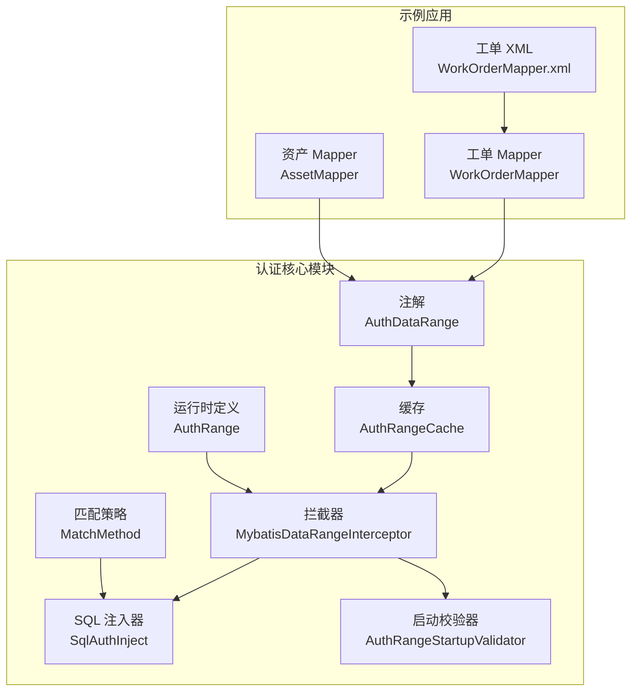
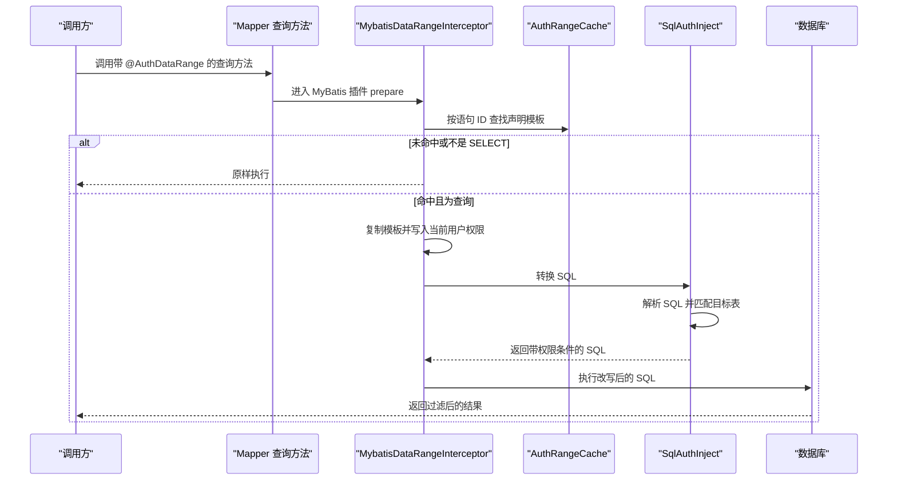
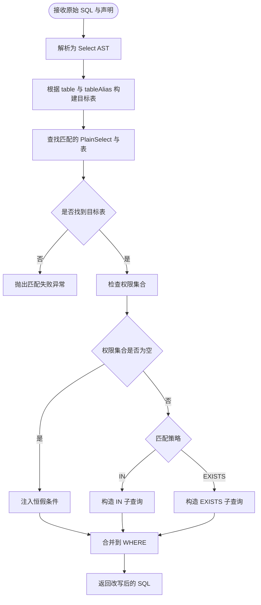
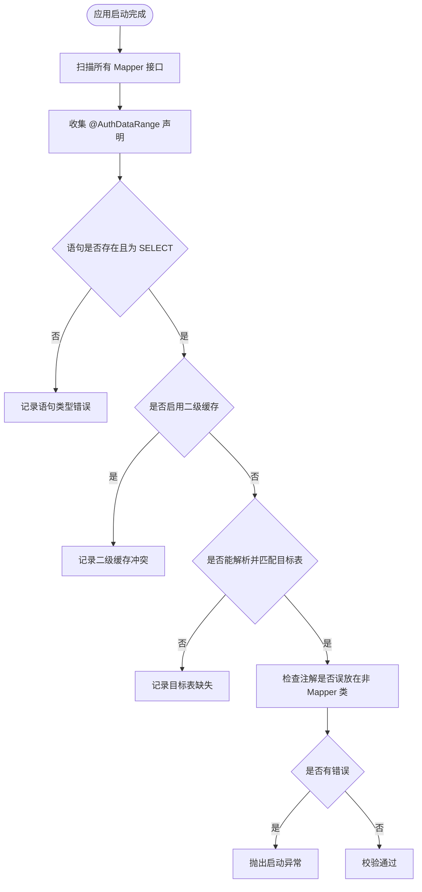
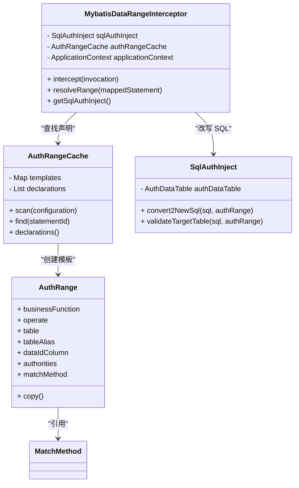
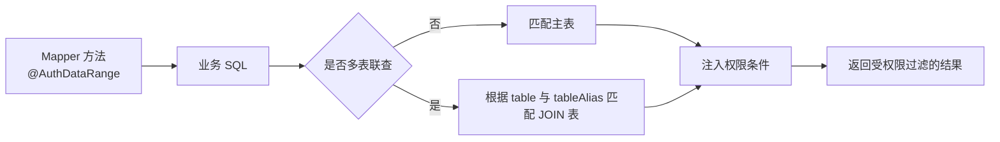
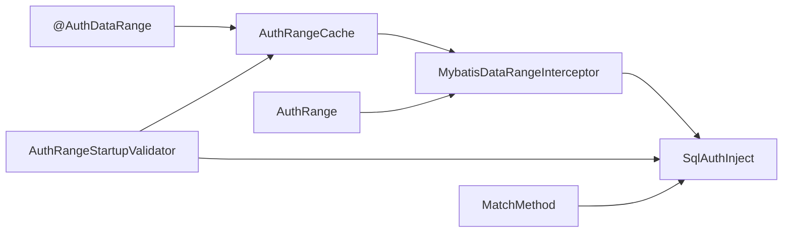
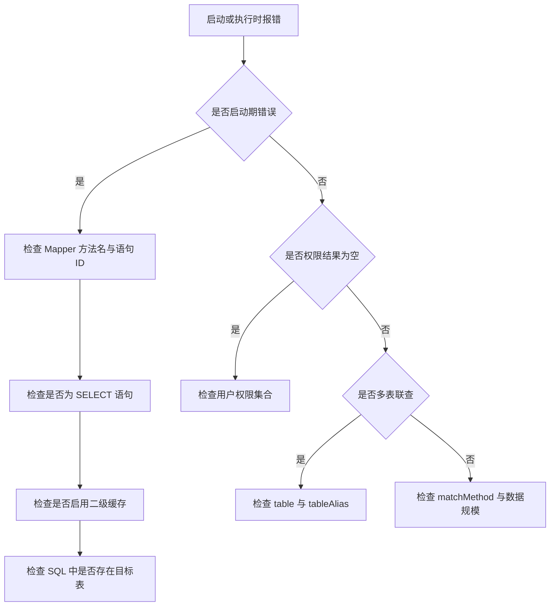

# 数据范围权限

<cite>
**本文引用的文件**   
- [AuthDataRange.java](file://auth/auth-core/src/main/java/com/cu/framework/auth/core/AuthDataRange.java)
- [MybatisDataRangeInterceptor.java](file://auth/auth-core/src/main/java/com/cu/framework/auth/core/data/range/MybatisDataRangeInterceptor.java)
- [AuthRangeCache.java](file://auth/auth-core/src/main/java/com/cu/framework/auth/core/data/range/AuthRangeCache.java)
- [AuthRangeStartupValidator.java](file://auth/auth-core/src/main/java/com/cu/framework/auth/core/data/range/AuthRangeStartupValidator.java)
- [SqlAuthInject.java](file://auth/auth-core/src/main/java/com/cu/framework/auth/core/data/range/SqlAuthInject.java)
- [MatchMethod.java](file://auth/auth-core/src/main/java/com/cu/framework/auth/core/data/range/MatchMethod.java)
- [AuthRange.java](file://auth/auth-core/src/main/java/com/cu/framework/auth/core/data/range/AuthRange.java)
- [WorkOrderMapper.java](file://sample/auth-core-boot-sample/src/main/java/com/cu/framework/sample/authcore/mapper/WorkOrderMapper.java)
- [WorkOrderMapper.xml](file://sample/auth-core-boot-sample/src/main/resources/mapper/WorkOrderMapper.xml)
- [AssetMapper.java](file://sample/auth-core-boot-sample/src/main/java/com/cu/framework/sample/authcore/mapper/AssetMapper.java)
</cite>

## 目录

1. [引言](#引言)
2. [项目结构定位](#项目结构定位)
3. [核心组件总览](#核心组件总览)
4. [注解设计理念与属性说明](#注解设计理念与属性说明)
5. [架构与执行流程](#架构与执行流程)
6. [SQL 拦截与条件注入机制](#sql-拦截与条件注入机制)
7. [启动时校验器](#启动时校验器)
8. [缓存机制与性能设计](#缓存机制与性能设计)
9. [多表联查与复杂查询实践](#多表联查与复杂查询实践)
10. [依赖关系分析](#依赖关系分析)
11. [常见问题与故障排查](#常见问题与故障排查)
12. [性能优化建议](#性能优化建议)
13. [结论](#结论)

## 引言

Kewen Framework 的数据范围权限体系围绕“声明式注解 + MyBatis 拦截 + SQL 改写”展开。开发者只需要在 Mapper 查询方法上标注 `@AuthDataRange`，框架就会在执行阶段把用户当前权限映射成 SQL 中的过滤条件，从而让业务 SQL 无需显式关联权限表即可完成行级数据隔离。

该方案的核心目标是：

- 将数据权限从业务 SQL 中解耦，避免每个查询都手动拼接权限过滤。
- 以“一条语句一个作用域”的方式控制权限注入，避免同一调用链上的无关语句被污染。
- 在启动期发现配置错误，而不是运行期静默放开权限。
- 通过声明模板缓存、IN 与 EXISTS 两种匹配策略，兼顾可读性与大数据量场景下的性能。

## 项目结构定位

数据范围权限的实现集中在 `auth/auth-core` 模块的 `com.cu.framework.auth.core.data.range` 包中，示例用法则出现在 `sample/auth-core-boot-sample` 模块。

**图表来源**
- [AuthDataRange.java:1-81](file://auth/auth-core/src/main/java/com/cu/framework/auth/core/AuthDataRange.java#L1-L81)
- [AuthRangeCache.java:1-155](file://auth/auth-core/src/main/java/com/cu/framework/auth/core/data/range/AuthRangeCache.java#L1-L155)
- [MybatisDataRangeInterceptor.java:1-216](file://auth/auth-core/src/main/java/com/cu/framework/auth/core/data/range/MybatisDataRangeInterceptor.java#L1-L216)
- [SqlAuthInject.java:1-441](file://auth/auth-core/src/main/java/com/cu/framework/auth/core/data/range/SqlAuthInject.java#L1-L441)
- [AuthRangeStartupValidator.java:1-163](file://auth/auth-core/src/main/java/com/cu/framework/auth/core/data/range/AuthRangeStartupValidator.java#L1-L163)
- [WorkOrderMapper.java:1-122](file://sample/auth-core-boot-sample/src/main/java/com/cu/framework/sample/authcore/mapper/WorkOrderMapper.java#L1-L122)
- [WorkOrderMapper.xml:1-99](file://sample/auth-core-boot-sample/src/main/resources/mapper/WorkOrderMapper.xml#L1-L99)
- [AssetMapper.java:1-30](file://sample/auth-core-boot-sample/src/main/java/com/cu/framework/sample/authcore/mapper/AssetMapper.java#L1-L30)

**章节来源**
- [AuthDataRange.java:1-81](file://auth/auth-core/src/main/java/com/cu/framework/auth/core/AuthDataRange.java#L1-L81)
- [AuthRangeCache.java:1-155](file://auth/auth-core/src/main/java/com/cu/framework/auth/core/data/range/AuthRangeCache.java#L1-L155)
- [MybatisDataRangeInterceptor.java:1-216](file://auth/auth-core/src/main/java/com/cu/framework/auth/core/data/range/MybatisDataRangeInterceptor.java#L1-L216)
- [SqlAuthInject.java:1-441](file://auth/auth-core/src/main/java/com/cu/framework/auth/core/data/range/SqlAuthInject.java#L1-L441)
- [AuthRangeStartupValidator.java:1-163](file://auth/auth-core/src/main/java/com/cu/framework/auth/core/data/range/AuthRangeStartupValidator.java#L1-L163)
- [WorkOrderMapper.java:1-122](file://sample/auth-core-boot-sample/src/main/java/com/cu/framework/sample/authcore/mapper/WorkOrderMapper.java#L1-L122)
- [WorkOrderMapper.xml:1-99](file://sample/auth-core-boot-sample/src/main/resources/mapper/WorkOrderMapper.xml#L1-L99)
- [AssetMapper.java:1-30](file://sample/auth-core-boot-sample/src/main/java/com/cu/framework/sample/authcore/mapper/AssetMapper.java#L1-L30)

## 核心组件总览

| 组件 | 职责 | 关键行为 |
|---|---|---|
| `@AuthDataRange` | 在 Mapper 查询方法上声明数据范围 | 指定业务功能、操作类型、目标表、主键列、匹配方式 |
| `AuthRangeCache` | 扫描并缓存注解声明 | 构建不含用户权限的声明模板，按语句 ID 索引 |
| `MybatisDataRangeInterceptor` | 拦截 MyBatis 物理 SQL 执行 | 根据语句 ID 找到声明，生成带权限条件的 SQL |
| `SqlAuthInject` | 构造权限子查询或 EXISTS 条件 | 支持 IN、EXISTS、恒假条件、多表别名匹配 |
| `AuthRangeStartupValidator` | 启动期校验注解配置 | 检查语句解析、语句类型、二级缓存冲突、目标表存在性 |
| `AuthRange` | 运行时范围定义 | 承载业务功能、操作、表、权限集合等字段 |
| `MatchMethod` | 匹配策略枚举 | IN 或 EXISTS |

**章节来源**
- [AuthDataRange.java:1-81](file://auth/auth-core/src/main/java/com/cu/framework/auth/core/AuthDataRange.java#L1-L81)
- [AuthRangeCache.java:1-155](file://auth/auth-core/src/main/java/com/cu/framework/auth/core/data/range/AuthRangeCache.java#L1-L155)
- [MybatisDataRangeInterceptor.java:1-216](file://auth/auth-core/src/main/java/com/cu/framework/auth/core/data/range/MybatisDataRangeInterceptor.java#L1-L216)
- [SqlAuthInject.java:1-441](file://auth/auth-core/src/main/java/com/cu/framework/auth/core/data/range/SqlAuthInject.java#L1-L441)
- [AuthRangeStartupValidator.java:1-163](file://auth/auth-core/src/main/java/com/cu/framework/auth/core/data/range/AuthRangeStartupValidator.java#L1-L163)
- [AuthRange.java:1-64](file://auth/auth-core/src/main/java/com/cu/framework/auth/core/data/range/AuthRange.java#L1-L64)
- [MatchMethod.java:1-22](file://auth/auth-core/src/main/java/com/cu/framework/auth/core/data/range/MatchMethod.java#L1-L22)

## 注解设计理念与属性说明

`@AuthDataRange` 的设计原则是：**注解标在哪个 Mapper 查询方法上，权限条件就只注入该方法对应的 MyBatis 语句**。它不关心调用链上下文，也不影响其他语句。这样既简化了实现，也避免了跨语句状态泄漏。

### 核心属性

| 属性 | 含义 | 默认值 | 使用建议 |
|---|---|---:|---|
| `businessFunction` | 业务功能标识，用于关联权限表中对应业务 | 无 | 通常表示模块或资源名称，例如工单、资产 |
| `operate` | 操作类型，如统一、编辑、审批等 | `unified` | 不同操作可绑定不同权限集合 |
| `table` | 多表联查时指定要匹配的业务表 | 空字符串 | 为空时默认使用主表 |
| `tableAlias` | 多表联查时指定表别名 | 空字符串 | 只有设置了 `table` 时才生效 |
| `dataIdColumn` | 业务主键列名 | `id` | 当主键不是 `id` 时必须设置 |
| `matchMethod` | 权限匹配策略 | `IN` | 小权限集用 IN；大权限集考虑 EXISTS |

### 作用域语义

- 注解只作用于当前 Mapper 方法对应的语句。
- MyBatis-Plus 由 `BaseMapper` 继承的内建方法没有挂载点，不受本注解管辖。
- 同一张表若需要按多个操作过滤，应为每个操作声明独立查询方法。
- 如果权限集合为空，系统会注入恒假条件，返回零行，而不是直接放开过滤。

**章节来源**
- [AuthDataRange.java:1-81](file://auth/auth-core/src/main/java/com/cu/framework/auth/core/AuthDataRange.java#L1-L81)

## 架构与执行流程

整体流程可以理解为三层：

1. **启动阶段**：扫描所有 Mapper 接口，收集 `@AuthDataRange`，构建声明模板并校验。
2. **执行阶段**：拦截 MyBatis 的物理 SQL 执行，判断是否需要注入权限条件。
3. **SQL 改写阶段**：根据匹配策略生成 IN 或 EXISTS 子查询，并追加到 WHERE 条件中。

**图表来源**
- [MybatisDataRangeInterceptor.java:1-216](file://auth/auth-core/src/main/java/com/cu/framework/auth/core/data/range/MybatisDataRangeInterceptor.java#L1-L216)
- [AuthRangeCache.java:1-155](file://auth/auth-core/src/main/java/com/cu/framework/auth/core/data/range/AuthRangeCache.java#L1-L155)
- [SqlAuthInject.java:1-441](file://auth/auth-core/src/main/java/com/cu/framework/auth/core/data/range/SqlAuthInject.java#L1-L441)

**章节来源**
- [MybatisDataRangeInterceptor.java:1-216](file://auth/auth-core/src/main/java/com/cu/framework/auth/core/data/range/MybatisDataRangeInterceptor.java#L1-L216)
- [AuthRangeCache.java:1-155](file://auth/auth-core/src/main/java/com/cu/framework/auth/core/data/range/AuthRangeCache.java#L1-L155)
- [SqlAuthInject.java:1-441](file://auth/auth-core/src/main/java/com/cu/framework/auth/core/data/range/SqlAuthInject.java#L1-L441)

## SQL 拦截与条件注入机制

### 拦截时机

`MybatisDataRangeInterceptor` 拦截的是 `StatementHandler.prepare`。这是每条真正执行的物理语句都会经过的位置，因此它与“一条语句一个作用域”的设计天然契合。

拦截器主要做三件事：

1. 解包 MyBatis 插件代理，拿到真实 `StatementHandler`。
2. 读取 `MappedStatement`，并通过语句 ID 查找声明模板。
3. 如果是查询语句，则复制模板、写入当前用户权限集合，再交给 `SqlAuthInject` 改写 SQL。

### 条件注入逻辑

`SqlAuthInject` 基于 JSqlParser 解析 SQL，并选择以下三种注入方式之一：

| 场景 | 注入方式 | 语义 |
|---|---|---|
| 权限集合为空 | 恒假条件 | 返回零行，不报错 |
| 匹配策略为 IN | `table.id IN (SELECT data_id FROM sys_auth_data ...)` | 适合权限集较小 |
| 匹配策略为 EXISTS | `EXISTS (SELECT 1 FROM sys_auth_data WHERE id = data_id AND ...)` | 适合权限集较大 |

**图表来源**
- [SqlAuthInject.java:1-441](file://auth/auth-core/src/main/java/com/cu/framework/auth/core/data/range/SqlAuthInject.java#L1-L441)

### 表关联处理与匹配策略选择

#### 表匹配规则

系统优先匹配最外层主表，其次匹配 WITH 子句中的查询，最后递归遍历 WHERE 条件中的子查询。对于 JOIN 场景，它会检查主表和 JOIN 子句中的表，并根据 `table` 与 `tableAlias` 进行精确匹配。

匹配优先级如下：

1. 主表是否等于目标表。
2. 如果配置了表别名，是否同时匹配别名。
3. 是否在 JOIN 子句中匹配目标表。
4. 是否在 WHERE 子句的子查询中匹配目标表。

#### IN 与 EXISTS 的选择

| 维度 | IN | EXISTS |
|---|---|---|
| 生成形式 | `业务表.主键 IN (SELECT data_id FROM 权限表 ...)` | `EXISTS (SELECT 1 FROM 权限表 WHERE 权限表.data_id = 业务表.主键 AND ...)` |
| 适用场景 | 权限数据远小于业务数据 | 权限数据远大于业务数据 |
| 优点 | 语义直观，容易理解 | 大权限集下通常更高效 |
| 风险 | 权限集过大可能产生很长的 IN 列表 | 依赖数据库对 EXISTS 的执行计划 |

**章节来源**
- [MybatisDataRangeInterceptor.java:1-216](file://auth/auth-core/src/main/java/com/cu/framework/auth/core/data/range/MybatisDataRangeInterceptor.java#L1-L216)
- [SqlAuthInject.java:1-441](file://auth/auth-core/src/main/java/com/cu/framework/auth/core/data/range/SqlAuthInject.java#L1-L441)
- [MatchMethod.java:1-22](file://auth/auth-core/src/main/java/com/cu/framework/auth/core/data/range/MatchMethod.java#L1-L22)

## 启动时校验器

`AuthRangeStartupValidator` 在 Spring 所有单例初始化完成后执行，目的是把配置错误提前暴露。

### 校验项

| 校验项 | 失败原因 | 处理方式 |
|---|---|---|
| 声明解析不到映射语句 | Mapper 方法名与语句 ID 不一致 | 启动失败 |
| 语句不是查询 | 注解放到了非 SELECT 语句上 | 启动失败 |
| 启用二级缓存 | 缓存键在权限条件注入前已计算 | 启动失败 |
| 静态 SQL 中找不到目标表 | 表名或别名配置错误 | 启动失败 |
| 注解不在 Mapper 接口上 | 旧用法残留 | 启动失败 |

### 动态 SQL 的特殊处理

对于动态 SQL，启动期不会强行渲染完整 SQL，因为 OGNL 或 Provider 渲染出来的语句可能与实际执行不一致。这类语句会在执行期由注入逻辑兜底，如果仍无法匹配目标表，则抛出异常。

**图表来源**
- [AuthRangeStartupValidator.java:1-163](file://auth/auth-core/src/main/java/com/cu/framework/auth/core/data/range/AuthRangeStartupValidator.java#L1-L163)

**章节来源**
- [AuthRangeStartupValidator.java:1-163](file://auth/auth-core/src/main/java/com/cu/framework/auth/core/data/range/AuthRangeStartupValidator.java#L1-L163)

## 缓存机制与性能设计

### 声明模板缓存

`AuthRangeCache` 在启动时遍历 MyBatis 已注册的 Mapper 接口，收集所有 `@AuthDataRange`。它维护两个结构：

- `templates`：语句 ID 到 `AuthRange` 模板的映射，仅包含查询语句。
- `declarations`：全部声明点，包括解析失败的声明，用于启动期诊断。

模板只保存注解的静态信息，不包含任何用户相关数据。

### 运行时权限隔离

`MybatisDataRangeInterceptor.resolveRange` 会从缓存取出模板后调用 `copy()`，再写入当前请求的用户权限集合。这是关键的安全边界：如果不复制，多条语句或多次请求可能共享同一个 `AuthRange`，导致权限泄漏。

### 懒加载注入器

`SqlAuthInject` 在拦截器中以双重检查锁方式懒加载，解决 MyBatis 插件早于 Spring 容器完全初始化的问题。

**图表来源**
- [AuthRangeCache.java:1-155](file://auth/auth-core/src/main/java/com/cu/framework/auth/core/data/range/AuthRangeCache.java#L1-L155)
- [AuthRange.java:1-64](file://auth/auth-core/src/main/java/com/cu/framework/auth/core/data/range/AuthRange.java#L1-L64)
- [MybatisDataRangeInterceptor.java:1-216](file://auth/auth-core/src/main/java/com/cu/framework/auth/core/data/range/MybatisDataRangeInterceptor.java#L1-L216)
- [SqlAuthInject.java:1-441](file://auth/auth-core/src/main/java/com/cu/framework/auth/core/data/range/SqlAuthInject.java#L1-L441)

**章节来源**
- [AuthRangeCache.java:1-155](file://auth/auth-core/src/main/java/com/cu/framework/auth/core/data/range/AuthRangeCache.java#L1-L155)
- [AuthRange.java:1-64](file://auth/auth-core/src/main/java/com/cu/framework/auth/core/data/range/AuthRange.java#L1-L64)
- [MybatisDataRangeInterceptor.java:1-216](file://auth/auth-core/src/main/java/com/cu/framework/auth/core/data/range/MybatisDataRangeInterceptor.java#L1-L216)
- [SqlAuthInject.java:1-441](file://auth/auth-core/src/main/java/com/cu/framework/auth/core/data/range/SqlAuthInject.java#L1-L441)

## 多表联查与复杂查询实践

### 基础示例：工单列表

`WorkOrderMapper` 展示了多种典型用法：

| 方法 | 用途 | 关键点 |
|---|---|---|
| `listRangeIn` | 使用 IN 匹配 | 默认匹配策略 |
| `listRangeExists` | 使用 EXISTS 匹配 | 适合权限数据较大的场景 |
| `listEditable` | 编辑操作 | 通过 `operate` 区分权限 |
| `listApprovable` | 审批操作 | 同一业务不同操作 |
| `listNested` | 嵌套查询 | 验证语句作用域 |
| `listJoinCu` / `listJoinCb` | 多表 JOIN | 通过 `table` 和 `tableAlias` 指定目标表 |
| `listDynamic` | 动态 SQL | 动态条件不影响权限注入 |
| `listDynamicMissingTable` | 错误示例 | 声明的目标表不存在，应触发校验或执行期异常 |

### 多表联查注意事项

当一张查询涉及多个同名字段或别名时，必须明确指定 `table` 和 `tableAlias`。否则系统可能匹配到错误的表，导致权限过滤失效或 SQL 解析失败。

示例中工单查询分别关联了两个客户表，因此需要根据业务意图决定是对“所属客户”还是“预约客户”做权限过滤。

### 自定义主键列

`AssetMapper` 展示了主键不是 `id` 的情况。此时需要设置 `dataIdColumn`，使框架能正确生成 `asset_id IN (...)` 或 `asset_id = data_id` 的条件。

**图表来源**
- [WorkOrderMapper.java:1-122](file://sample/auth-core-boot-sample/src/main/java/com/cu/framework/sample/authcore/mapper/WorkOrderMapper.java#L1-L122)
- [WorkOrderMapper.xml:1-99](file://sample/auth-core-boot-sample/src/main/resources/mapper/WorkOrderMapper.xml#L1-L99)
- [AssetMapper.java:1-30](file://sample/auth-core-boot-sample/src/main/java/com/cu/framework/sample/authcore/mapper/AssetMapper.java#L1-L30)
- [SqlAuthInject.java:1-441](file://auth/auth-core/src/main/java/com/cu/framework/auth/core/data/range/SqlAuthInject.java#L1-L441)

**章节来源**
- [WorkOrderMapper.java:1-122](file://sample/auth-core-boot-sample/src/main/java/com/cu/framework/sample/authcore/mapper/WorkOrderMapper.java#L1-L122)
- [WorkOrderMapper.xml:1-99](file://sample/auth-core-boot-sample/src/main/resources/mapper/WorkOrderMapper.xml#L1-L99)
- [AssetMapper.java:1-30](file://sample/auth-core-boot-sample/src/main/java/com/cu/framework/sample/authcore/mapper/AssetMapper.java#L1-L30)

## 依赖关系分析

**图表来源**
- [AuthDataRange.java:1-81](file://auth/auth-core/src/main/java/com/cu/framework/auth/core/AuthDataRange.java#L1-L81)
- [AuthRangeCache.java:1-155](file://auth/auth-core/src/main/java/com/cu/framework/auth/core/data/range/AuthRangeCache.java#L1-L155)
- [MybatisDataRangeInterceptor.java:1-216](file://auth/auth-core/src/main/java/com/cu/framework/auth/core/data/range/MybatisDataRangeInterceptor.java#L1-L216)
- [SqlAuthInject.java:1-441](file://auth/auth-core/src/main/java/com/cu/framework/auth/core/data/range/SqlAuthInject.java#L1-L441)
- [AuthRangeStartupValidator.java:1-163](file://auth/auth-core/src/main/java/com/cu/framework/auth/core/data/range/AuthRangeStartupValidator.java#L1-L163)
- [MatchMethod.java:1-22](file://auth/auth-core/src/main/java/com/cu/framework/auth/core/data/range/MatchMethod.java#L1-L22)
- [AuthRange.java:1-64](file://auth/auth-core/src/main/java/com/cu/framework/auth/core/data/range/AuthRange.java#L1-L64)

**章节来源**
- [AuthDataRange.java:1-81](file://auth/auth-core/src/main/java/com/cu/framework/auth/core/AuthDataRange.java#L1-L81)
- [AuthRangeCache.java:1-155](file://auth/auth-core/src/main/java/com/cu/framework/auth/core/data/range/AuthRangeCache.java#L1-L155)
- [MybatisDataRangeInterceptor.java:1-216](file://auth/auth-core/src/main/java/com/cu/framework/auth/core/data/range/MybatisDataRangeInterceptor.java#L1-L216)
- [SqlAuthInject.java:1-441](file://auth/auth-core/src/main/java/com/cu/framework/auth/core/data/range/SqlAuthInject.java#L1-L441)
- [AuthRangeStartupValidator.java:1-163](file://auth/auth-core/src/main/java/com/cu/framework/auth/core/data/range/AuthRangeStartupValidator.java#L1-L163)
- [MatchMethod.java:1-22](file://auth/auth-core/src/main/java/com/cu/framework/auth/core/data/range/MatchMethod.java#L1-L22)
- [AuthRange.java:1-64](file://auth/auth-core/src/main/java/com/cu/framework/auth/core/data/range/AuthRange.java#L1-L64)

## 常见问题与故障排查

| 现象 | 可能原因 | 处理建议 |
|---|---|---|
| 应用启动时报注解校验失败 | Mapper 方法名与 SQL 语句 ID 不一致 | 核对接口方法与 XML 中的 statementId |
| 非查询语句报权限校验错误 | 注解放到了更新或删除语句上 | 数据范围只作用于 SELECT |
| 启用了二级缓存后启动失败 | 缓存键在权限条件注入前已计算 | 移除语句级二级缓存或移除注解 |
| 启动期提示目标表不存在 | 静态 SQL 中表名或别名配置错误 | 修正 `table` 或 `tableAlias` |
| 动态 SQL 启动期跳过校验但运行时报错 | 动态 SQL 无法在启动期准确渲染 | 检查 SQL 中是否真的包含声明的目标表 |
| 权限列表为空时查不到数据 | 权限集合为空会注入恒假条件 | 确认当前用户是否拥有对应权限 |
| 多表联查后权限过滤失效 | 未正确指定 `table` 或 `tableAlias` | 明确声明要过滤的业务表 |
| 主键不是 `id` 时过滤无效 | 未设置 `dataIdColumn` | 设置为实际主键列名 |
| 权限数据量大导致查询变慢 | 使用了 IN 模式 | 改用 `MatchMethod.EXISTS` |
| 权限注入后 SQL 语法异常 | 权限值包含特殊字符 | 注意权限 ID 类型；当前实现假设权限值为安全字符串 |

### 常见错误路径

**图表来源**
- [AuthRangeStartupValidator.java:1-163](file://auth/auth-core/src/main/java/com/cu/framework/auth/core/data/range/AuthRangeStartupValidator.java#L1-L163)
- [SqlAuthInject.java:1-441](file://auth/auth-core/src/main/java/com/cu/framework/auth/core/data/range/SqlAuthInject.java#L1-L441)

**章节来源**
- [AuthRangeStartupValidator.java:1-163](file://auth/auth-core/src/main/java/com/cu/framework/auth/core/data/range/AuthRangeStartupValidator.java#L1-L163)
- [SqlAuthInject.java:1-441](file://auth/auth-core/src/main/java/com/cu/framework/auth/core/data/range/SqlAuthInject.java#L1-L441)

## 性能优化建议

1. **优先使用声明模板缓存**  
   声明模板只在启动时构建一次，运行时复用，避免重复解析注解。

2. **合理选择匹配策略**  
   - 权限数据远小于业务数据时使用 `IN`。
   - 权限数据很大时使用 `EXISTS`，避免生成过长的 IN 列表。

3. **避免不必要的多表匹配歧义**  
   多表联查时明确 `table` 和 `tableAlias`，减少解析歧义和潜在的错误匹配。

4. **避免在主查询中使用超大权限集**  
   即使使用 EXISTS，也应确保权限表上有合适的索引，例如权限 ID、业务功能、操作类型列。

5. **谨慎使用二级缓存**  
   当前设计与语句级二级缓存不兼容，因为缓存键在权限条件注入前已计算。

6. **关注权限值安全性**  
   当前权限值以字面量形式拼入 SQL，内部假设权限 ID 是安全的标识符。若未来引入外部不可信权限值，应考虑转义或改用参数化方案。

[本节为通用性能指导，不直接分析具体代码片段]

## 结论

Kewen Framework 的数据范围权限方案以 `@AuthDataRange` 为入口，通过启动期扫描、声明模板缓存、MyBatis 拦截器和 SQL 注入器协同工作，实现了声明式、语句级、可配置的数据权限控制。

它的优势在于：

- 开发成本低：业务 SQL 无需主动关联权限表。
- 作用域清晰：每条语句独立判定，避免跨语句污染。
- 启动期防护：配置错误尽早暴露。
- 可扩展性强：支持多表联查、动态 SQL、IN 与 EXISTS 两种策略。

使用时应重点关注：

- 正确声明 `businessFunction`、`operate`、`table`、`tableAlias` 和 `dataIdColumn`。
- 在多表联查场景中明确目标表。
- 根据权限数据规模选择合适的匹配策略。
- 保持 Mapper 方法名与语句 ID 一致。
- 不使用与当前实现冲突的语句级二级缓存。