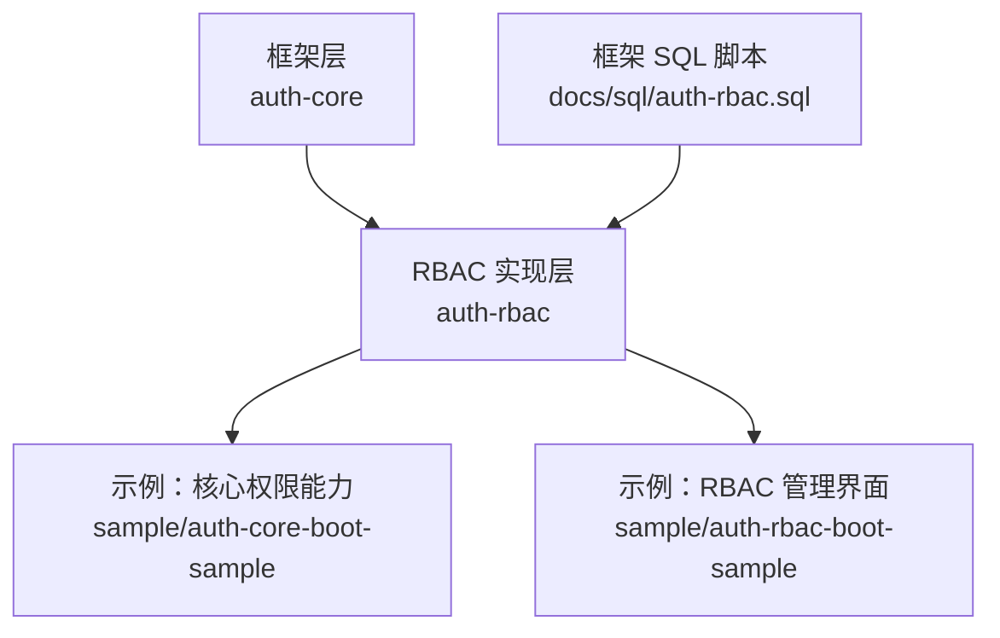
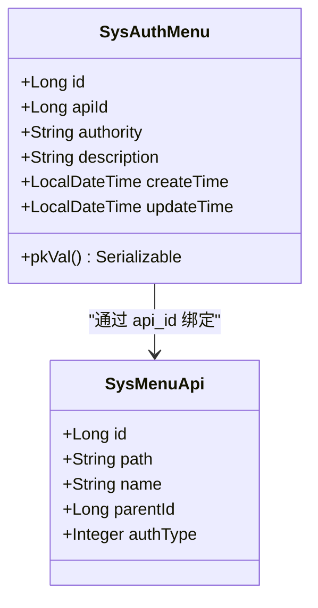
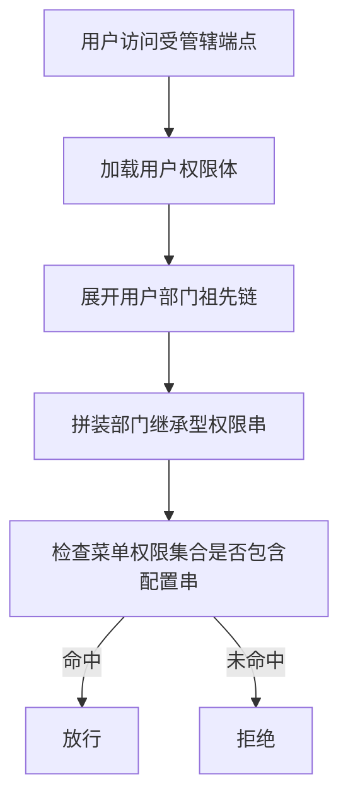
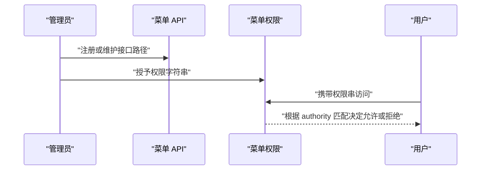
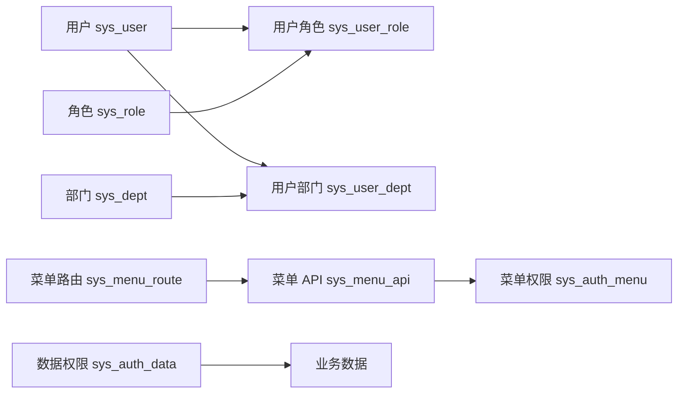

# 权限数据模型

<cite>
**本文引用的文件**   
- [auth-rbac.sql](file://docs/sql/auth-rbac.sql)
- [SysAuthMenu.java](file://auth/auth-rbac/src/main/java/com/cu/framework/auth/rbac/mp/entity/SysAuthMenu.java)
- [SysAuthData.java](file://auth/auth-rbac/src/main/java/com/cu/framework/auth/rbac/mp/entity/SysAuthData.java)
- [SysUser.java](file://auth/auth-rbac/src/main/java/com/cu/framework/auth/rbac/mp/entity/SysUser.java)
- [SysRole.java](file://auth/auth-rbac/src/main/java/com/cu/framework/auth/rbac/mp/entity/SysRole.java)
- [SysDept.java](file://auth/auth-rbac/src/main/java/com/cu/framework/auth/rbac/mp/entity/SysDept.java)
- [SysUserRole.java](file://auth/auth-rbac/src/main/java/com/cu/framework/auth/rbac/mp/entity/SysUserRole.java)
- [SysUserDept.java](file://auth/auth-rbac/src/main/java/com/cu/framework/auth/rbac/mp/entity/SysUserDept.java)
- [SysMenuApi.java](file://auth/auth-rbac/src/main/java/com/cu/framework/auth/rbac/mp/entity/SysMenuApi.java)
- [SysMenuRoute.java](file://auth/auth-rbac/src/main/java/com/cu/framework/auth/rbac/mp/entity/SysMenuRoute.java)
- [FlatteningAuthority.java](file://auth/auth-core/src/main/java/com/cu/framework/auth/core/entity/FlatteningAuthority.java)
- [menu-access/spec.md](file://openspec/specs/auth/menu-access/spec.md)
- [dept-inherited-auth/design.md](file://openspec/changes/archive/2026-10-26-complete-dept-inherited-auth/design.md)
- [seed-data.sql（RBAC 示例）](file://sample/auth-rbac-boot-sample/sql/seed-data.sql)
- [schema.sql（核心示例）](file://sample/auth-core-boot-sample/sql/schema.sql)
- [seed-data.sql（核心示例）](file://sample/auth-core-boot-sample/sql/seed-data.sql)
</cite>

## 目录
1. [引言](#引言)
2. [项目结构定位](#项目结构定位)
3. [核心数据表总览](#核心数据表总览)
4. [数据库 Schema 参考](#数据库-schema-参考)
5. [SysAuthMenu 实体详解](#sysauthmenu-实体详解)
6. [RBAC 继承与部门权限扩展](#rbac-继承与部门权限扩展)
7. [权限数据生命周期](#权限数据生命周期)
8. [依赖关系分析](#依赖关系分析)
9. [性能与索引特性](#性能与索引特性)
10. [迁移与版本兼容性指南](#迁移与版本兼容性指南)
11. [故障排查](#故障排查)
12. [结论](#结论)

## 引言
本文面向 Kewen Framework 的权限子系统，聚焦 RBAC 相关的数据模型：用户、角色、部门、菜单 API、菜单路由、菜单权限、应用数据权限等。文档从数据库表结构出发，逐步解释代码实体、权限串语义、菜单权限映射、部门继承机制以及权限数据的创建、更新和删除行为，并提供可执行的示例数据路径与迁移注意事项。

## 项目结构定位
权限数据模型横跨两个层次：

- **框架层（auth-core）**：定义扁平化权限对象、权限标识、菜单访问声明边界等通用概念。
- **RBAC 实现层（auth-rbac）**：落地用户、角色、部门、菜单 API、菜单路由、菜单权限、数据权限等持久化实体与 MyBatis-Plus 实体类。
- **示例层**：提供可运行的建表脚本、种子数据和业务侧扩展表。



**图表来源**
- [FlatteningAuthority.java:1-63](file://auth/auth-core/src/main/java/com/cu/framework/auth/core/entity/FlatteningAuthority.java#L1-L63)
- [SysAuthMenu.java:1-72](file://auth/auth-rbac/src/main/java/com/cu/framework/auth/rbac/mp/entity/SysAuthMenu.java#L1-L72)
- [schema.sql（核心示例）:1-120](file://sample/auth-core-boot-sample/sql/schema.sql#L1-L120)
- [seed-data.sql（RBAC 示例）:1-200](file://sample/auth-rbac-boot-sample/sql/seed-data.sql#L1-L200)

**章节来源**
- [FlatteningAuthority.java:1-63](file://auth/auth-core/src/main/java/com/cu/framework/auth/core/entity/FlatteningAuthority.java#L1-L63)
- [menu-access/spec.md:1-91](file://openspec/specs/auth/menu-access/spec.md#L1-L91)

## 核心数据表总览
权限相关核心表可分为四类：

| 类别 | 表名 | 主要职责 | 关键关系 |
|---|---|---|---|
| 身份主体 | `sys_user` | 用户基本信息 | 通过 `sys_user_role`、`sys_user_dept` 关联角色和部门 |
| 身份凭证 | `sys_user_credential` | 密码、账号状态、过期时间等 | 一对一关联 `sys_user.id` |
| 组织与角色 | `sys_dept`、`sys_role` | 部门树、角色集合 | 部门通过 `parent_id` 自关联形成层级 |
| 菜单资源 | `sys_menu_api`、`sys_menu_route` | 后端接口与前端路由元信息 | 路由通过 `api_id` 绑定接口 |
| 权限映射 | `sys_auth_menu`、`sys_auth_data` | 菜单级权限、行级数据权限 | 菜单权限指向 `sys_menu_api.id`；数据权限按业务功能和数据 ID 划分 |
| 关联关系 | `sys_user_role`、`sys_user_dept` | 多对多关系 | 用户到角色、用户到部门 |

```mermaid
erDiagram
    SYS_USER {
        bigint id PK
        varchar name
        varchar nick_name
        varchar username UK
        varchar phone UK
        varchar email
        bigint avatar_file_id
        tinyint gender
        datetime create_time
        datetime update_time
    }

    SYS_USER_CREDENTIAL {
        bigint id PK
        bigint user_id UK
        varchar password
        varchar remark
        datetime password_expired_time
        datetime account_locked_deadline
        tinyint enabled
        datetime create_time
        datetime update_time
    }

    SYS_ROLE {
        bigint id PK
        varchar name
        datetime create_time
        datetime update_time
    }

    SYS_DEPT {
        bigint id PK
        varchar name
        bigint parent_id
        datetime create_time
        datetime update_time
    }

    SYS_MENU_API {
        bigint id PK UK
        varchar path UK
        varchar name
        bigint parent_id
        text remark
        tinyint auth_type
        datetime create_time
        datetime update_time
        tinyint deleted
    }

    SYS_MENU_ROUTE {
        bigint id PK
        varchar name
        bigint parent_id
        varchar path
        varchar redirect
        varchar component
        json meta
        varchar icon
        tinyint hidden
        bigint api_id
        tinyint type
        text description
        datetime create_time
        datetime update_time
        tinyint deleted
    }

    SYS_AUTH_MENU {
        bigint id PK
        bigint api_id
        varchar authority
        varchar description
        datetime create_time
        datetime update_time
    }

    SYS_AUTH_DATA {
        bigint id PK
        varchar business_function
        bigint data_id
        varchar operate
        varchar authority
        varchar description
        datetime create_time
        datetime update_time
    }

    SYS_USER_ROLE {
        bigint id PK
        bigint user_id
        bigint role_id
        datetime create_time
        datetime update_time
    }

    SYS_USER_DEPT {
        bigint id PK
        bigint user_id
        bigint dept_id
        tinyint is_primary
        datetime create_time
        datetime update_time
    }

    SYS_USER ||--o{ SYS_USER_CREDENTIAL : "拥有"
    SYS_USER ||--o{ SYS_USER_ROLE : "被赋予角色"
    SYS_USER ||--o{ SYS_USER_DEPT : "属于部门"
    SYS_ROLE ||--o{ SYS_USER_ROLE : "分配给"
    SYS_DEPT ||--o{ SYS_USER_DEPT : "包含"
    SYS_MENU_API ||--o{ SYS_AUTH_MENU : "授予菜单权限"
    SYS_MENU_ROUTE ||--o{ SYS_MENU_API : "路由绑定接口"
```

**图表来源**
- [auth-rbac.sql:1-148](file://docs/sql/auth-rbac.sql#L1-L148)
- [SysUser.java:1-95](file://auth/auth-rbac/src/main/java/com/cu/framework/auth/rbac/mp/entity/SysUser.java#L1-L95)
- [SysRole.java:1-60](file://auth/auth-rbac/src/main/java/com/cu/framework/auth/rbac/mp/entity/SysRole.java#L1-L60)
- [SysDept.java:1-66](file://auth/auth-rbac/src/main/java/com/cu/framework/auth/rbac/mp/entity/SysDept.java#L1-L66)
- [SysMenuApi.java:1-94](file://auth/auth-rbac/src/main/java/com/cu/framework/auth/rbac/mp/entity/SysMenuApi.java#L1-L94)
- [SysMenuRoute.java:1-129](file://auth/auth-rbac/src/main/java/com/cu/framework/auth/rbac/mp/entity/SysMenuRoute.java#L1-L129)
- [SysAuthMenu.java:1-72](file://auth/auth-rbac/src/main/java/com/cu/framework/auth/rbac/mp/entity/SysAuthMenu.java#L1-L72)
- [SysAuthData.java:1-84](file://auth/auth-rbac/src/main/java/com/cu/framework/auth/rbac/mp/entity/SysAuthData.java#L1-L84)
- [SysUserRole.java:1-66](file://auth/auth-rbac/src/main/java/com/cu/framework/auth/rbac/mp/entity/SysUserRole.java#L1-L66)
- [SysUserDept.java:1-72](file://auth/auth-rbac/src/main/java/com/cu/framework/auth/rbac/mp/entity/SysUserDept.java#L1-L72)

**章节来源**
- [auth-rbac.sql:1-148](file://docs/sql/auth-rbac.sql#L1-L148)

## 数据库 Schema 参考
以下字段说明以仓库中的 DDL 和实体类为准。所有主键均为 `bigint`，默认自增；时间字段为 `datetime`；逻辑删除字段使用 `tinyint`；部分列类型由注释明确约束。

### 用户表 `sys_user`
| 字段 | 类型 | 是否必填 | 说明 |
|---|---|---:|---|
| `id` | `bigint` | 是 | 主键 |
| `name` | `varchar(100)` | 否 | 姓名 |
| `nick_name` | `varchar(100)` | 否 | 昵称 |
| `username` | `varchar(100)` | 是 | 用户名，唯一 |
| `phone` | `varchar(20)` | 否 | 手机号，唯一 |
| `email` | `varchar(32)` | 否 | 邮箱 |
| `avatar_file_id` | `bigint` | 否 | 头像文件 ID |
| `gender` | `tinyint` | 是 | 性别编码，默认 1 |
| `create_time` | `datetime` | 是 | 创建时间 |
| `update_time` | `datetime` | 否 | 更新时间 |

**章节来源**
- [auth-rbac.sql:83-101](file://docs/sql/auth-rbac.sql#L83-L101)
- [SysUser.java:15-95](file://auth/auth-rbac/src/main/java/com/cu/framework/auth/rbac/mp/entity/SysUser.java#L15-L95)

### 用户凭证表 `sys_user_credential`
| 字段 | 类型 | 是否必填 | 说明 |
|---|---|---:|---|
| `id` | `bigint` | 是 | 主键 |
| `user_id` | `bigint` | 是 | 用户 ID，唯一 |
| `password` | `varchar(200)` | 否 | 密码，预留免密登录空间 |
| `remark` | `varchar(64)` | 否 | 备注 |
| `password_expired_time` | `datetime` | 否 | 密码过期时间 |
| `account_locked_deadline` | `datetime` | 否 | 账号锁定截止时间 |
| `enabled` | `tinyint(1)` | 是 | 账号启用状态，默认 1 |
| `create_time` | `datetime` | 是 | 创建时间 |
| `update_time` | `datetime` | 否 | 更新时间 |

**章节来源**
- [auth-rbac.sql:103-121](file://docs/sql/auth-rbac.sql#L103-L121)

### 部门表 `sys_dept`
| 字段 | 类型 | 是否必填 | 说明 |
|---|---|---:|---|
| `id` | `bigint` | 是 | 主键 |
| `name` | `varchar(100)` | 是 | 部门名称 |
| `parent_id` | `bigint` | 是 | 父部门 ID，0 表示根部门 |
| `create_time` | `datetime` | 是 | 创建时间 |
| `update_time` | `datetime` | 否 | 更新时间 |

**章节来源**
- [auth-rbac.sql:41-50](file://docs/sql/auth-rbac.sql#L41-L50)
- [SysDept.java:15-66](file://auth/auth-rbac/src/main/java/com/cu/framework/auth/rbac/mp/entity/SysDept.java#L15-L66)

### 角色表 `sys_role`
| 字段 | 类型 | 是否必填 | 说明 |
|---|---|---:|---|
| `id` | `bigint` | 是 | 主键 |
| `name` | `varchar(100)` | 是 | 角色名称 |
| `create_time` | `datetime` | 是 | 创建时间 |
| `update_time` | `datetime` | 否 | 更新时间 |

**章节来源**
- [auth-rbac.sql:68-76](file://docs/sql/auth-rbac.sql#L68-L76)
- [SysRole.java:15-60](file://auth/auth-rbac/src/main/java/com/cu/framework/auth/rbac/mp/entity/SysRole.java#L15-L60)

### 菜单 API 表 `sys_menu_api`
| 字段 | 类型 | 是否必填 | 说明 |
|---|---|---:|---|
| `id` | `bigint` | 是 | 主键，唯一 |
| `path` | `varchar(256)` | 是 | 请求路径，唯一 |
| `name` | `varchar(255)` | 否 | 请求名称 |
| `parent_id` | `bigint` | 是 | 父节点 ID，默认 0 |
| `remark` | `text` | 否 | 备注 |
| `auth_type` | `tinyint` | 是 | 权限类型：1 表示基于自身权限，2 表示基于父权限 |
| `create_time` | `datetime` | 是 | 创建时间 |
| `update_time` | `datetime` | 否 | 更新时间 |
| `deleted` | `tinyint` | 否 | 逻辑删除，默认未删除 |

**章节来源**
- [auth-rbac.sql:52-66](file://docs/sql/auth-rbac.sql#L52-L66)
- [SysMenuApi.java:15-94](file://auth/auth-rbac/src/main/java/com/cu/framework/auth/rbac/mp/entity/SysMenuApi.java#L15-L94)

### 菜单路由表 `sys_menu_route`
| 字段 | 类型 | 是否必填 | 说明 |
|---|---|---:|---|
| `id` | `bigint` | 是 | 主键 |
| `name` | `varchar(200)` | 否 | 路由名称 |
| `parent_id` | `bigint` | 否 | 父路由 ID |
| `path` | `varchar(512)` | 否 | 链接或路径 |
| `redirect` | `varchar(64)` | 否 | 重定向路由 |
| `component` | `varchar(64)` | 否 | 前端组件名 |
| `meta` | `json` | 否 | 元信息 |
| `icon` | `varchar(512)` | 否 | 图标地址 |
| `hidden` | `tinyint(1)` | 否 | 是否隐藏菜单 |
| `api_id` | `bigint` | 否 | 绑定的菜单 API ID |
| `type` | `tinyint` | 是 | 类型：1 菜单、2 按钮、3 外部链接 |
| `description` | `text` | 否 | 描述 |
| `create_time` | `datetime` | 是 | 创建时间 |
| `update_time` | `datetime` | 否 | 更新时间 |
| `deleted` | `tinyint` | 否 | 逻辑删除 |

**章节来源**
- [auth-rbac.sql:68-81](file://docs/sql/auth-rbac.sql#L68-L81)
- [SysMenuRoute.java:15-129](file://auth/auth-rbac/src/main/java/com/cu/framework/auth/rbac/mp/entity/SysMenuRoute.java#L15-L129)

### 菜单权限表 `sys_auth_menu`
| 字段 | 类型 | 是否必填 | 说明 |
|---|---|---:|---|
| `id` | `bigint` | 是 | 主键 |
| `api_id` | `bigint` | 是 | 菜单 API ID |
| `authority` | `varchar(100)` | 是 | 权限字符串 |
| `description` | `varchar(200)` | 是 | 权限描述 |
| `create_time` | `datetime` | 是 | 创建时间 |
| `update_time` | `datetime` | 否 | 更新时间 |

**章节来源**
- [auth-rbac.sql:24-39](file://docs/sql/auth-rbac.sql#L24-L39)
- [SysAuthMenu.java:15-72](file://auth/auth-rbac/src/main/java/com/cu/framework/auth/rbac/mp/entity/SysAuthMenu.java#L15-L72)

### 应用数据权限表 `sys_auth_data`
| 字段 | 类型 | 是否必填 | 说明 |
|---|---|---:|---|
| `id` | `bigint` | 是 | 主键 |
| `business_function` | `varchar(64)` | 是 | 业务功能标识 |
| `data_id` | `bigint` | 是 | 业务数据主键 ID |
| `operate` | `varchar(64)` | 是 | 操作类型，默认 `unified` |
| `authority` | `varchar(100)` | 是 | 权限字符串 |
| `description` | `varchar(200)` | 是 | 权限描述 |
| `create_time` | `datetime` | 是 | 创建时间 |
| `update_time` | `datetime` | 否 | 更新时间 |

**章节来源**
- [auth-rbac.sql:9-22](file://docs/sql/auth-rbac.sql#L9-L22)
- [SysAuthData.java:15-84](file://auth/auth-rbac/src/main/java/com/cu/framework/auth/rbac/mp/entity/SysAuthData.java#L15-L84)

### 用户角色关联表 `sys_user_role`
| 字段 | 类型 | 是否必填 | 说明 |
|---|---|---:|---|
| `id` | `bigint` | 是 | 主键 |
| `user_id` | `bigint` | 是 | 用户 ID |
| `role_id` | `bigint` | 是 | 角色 ID |
| `create_time` | `datetime` | 是 | 创建时间 |
| `update_time` | `datetime` | 否 | 更新时间 |

**章节来源**
- [auth-rbac.sql:129-138](file://docs/sql/auth-rbac.sql#L129-L138)
- [SysUserRole.java:15-66](file://auth/auth-rbac/src/main/java/com/cu/framework/auth/rbac/mp/entity/SysUserRole.java#L15-L66)

### 用户部门关联表 `sys_user_dept`
| 字段 | 类型 | 是否必填 | 说明 |
|---|---|---:|---|
| `id` | `bigint` | 是 | 主键 |
| `user_id` | `bigint` | 是 | 用户 ID |
| `dept_id` | `bigint` | 是 | 部门 ID |
| `is_primary` | `tinyint` | 是 | 是否主要归属部门，默认 0 |
| `create_time` | `datetime` | 是 | 创建时间 |
| `update_time` | `datetime` | 否 | 更新时间 |

**章节来源**
- [auth-rbac.sql:123-127](file://docs/sql/auth-rbac.sql#L123-L127)
- [SysUserDept.java:15-72](file://auth/auth-rbac/src/main/java/com/cu/framework/auth/rbac/mp/entity/SysUserDept.java#L15-L72)

## SysAuthMenu 实体详解
`SysAuthMenu` 是 RBAC 菜单权限的核心实体，对应 `sys_auth_menu` 表。它不是“菜单本身”，而是“某个菜单 API 被授予了哪些权限字符串”。

### 设计要点
- **主键独立**：`id` 是自增主键，用于权限记录本身的增删改查。
- **菜单 API 关联**：`api_id` 指向 `sys_menu_api.id`，把权限字符串绑定到具体后端路径。
- **权限字符串**：`authority` 是鉴权判定的关键值，例如角色前缀串、部门继承串等。
- **权限描述**：`description` 仅用于展示，不参与鉴权判定。
- **审计字段**：`create_time`、`update_time` 记录权限映射的生命周期。



**图表来源**
- [SysAuthMenu.java:15-72](file://auth/auth-rbac/src/main/java/com/cu/framework/auth/rbac/mp/entity/SysAuthMenu.java#L15-L72)
- [SysMenuApi.java:15-94](file://auth/auth-rbac/src/main/java/com/cu/framework/auth/rbac/mp/entity/SysMenuApi.java#L15-L94)

### 权限映射关系
- 一个 `sys_menu_api` 可以对应多条 `sys_auth_menu`，即一个接口路径可被多个权限字符串授权。
- 一个 `sys_auth_menu` 只绑定一个 `api_id`，不直接绑定用户或角色。
- 菜单权限的最终生效取决于当前用户的权限集合是否包含该 `authority`。

**章节来源**
- [SysAuthMenu.java:15-72](file://auth/auth-rbac/src/main/java/com/cu/framework/auth/rbac/mp/entity/SysAuthMenu.java#L15-L72)
- [menu-access/spec.md:1-91](file://openspec/specs/auth/menu-access/spec.md#L1-L91)

## RBAC 继承与部门权限扩展
Kewen Framework 的 RBAC 不仅支持“用户 → 角色 → 权限”的传统关系，还通过权限串机制扩展出“部门继承”能力。

### 传统 RBAC 继承
- 用户通过 `sys_user_role` 获得角色。
- 角色在业务中通常作为权限前缀或分类标识。
- 菜单权限和数据权限通过权限串表达，而不是直接把菜单或数据与角色一一对应。

### 部门继承扩展
部门继承并不是通过一张“角色继承表”实现，而是通过权限串的前缀约定完成：

- 权限串中包含部门相关标记，例如示例中的 `RELATIONDEPT__2`。
- 系统会结合用户所属部门，展开该部门的祖先链路，生成可用于鉴权的权限串集合。
- 最终判断使用的是权限串的精确匹配，而不是字符串解析结果再反解回部门 ID。



**图表来源**
- [dept-inherited-auth/design.md:1-146](file://openspec/changes/archive/2026-10-26-complete-dept-inherited-auth/design.md#L1-L146)
- [seed-data.sql（RBAC 示例）:1-200](file://sample/auth-rbac-boot-sample/sql/seed-data.sql#L1-L200)

### 继承规则关键点
- **严格子孙语义**：设计文档明确将继承语义收敛为“严格子孙”，并修复了装载链路中空权限体的问题。
- **权限串等价性**：扁平化权限对象的相等性只基于权限字符串，因此任何一环拼出的串不一致都会导致静默丢权限。
- **不含自身**：祖先部门链不包含用户所在部门自身，避免“含自身”带来的隐式覆盖。
- **前端展示字段与判定字段分离**：部门链路中的层级展示字段不参与鉴权判定。

**章节来源**
- [dept-inherited-auth/design.md:1-146](file://openspec/changes/archive/2026-10-26-complete-dept-inherited-auth/design.md#L1-L146)
- [FlatteningAuthority.java:1-63](file://auth/auth-core/src/main/java/com/cu/framework/auth/core/entity/FlatteningAuthority.java#L1-L63)

## 权限数据生命周期
权限数据分为三类：菜单权限、数据权限、用户身份关联数据。它们的创建、更新和删除行为由数据库表结构和示例数据共同体现。

### 菜单权限生命周期
- **创建**：新增 `sys_auth_menu` 记录，将权限字符串绑定到某个 `sys_menu_api`。
- **更新**：修改 `description`、`create_time`、`update_time` 等字段；权限字符串变更会影响鉴权结果。
- **删除**：删除某条菜单权限记录后，对应权限字符串不再对该接口生效。
- **显示文案不影响鉴权**：菜单显示的文案只是标签，不会改变权限归属。



**图表来源**
- [menu-access/spec.md:1-91](file://openspec/specs/auth/menu-access/spec.md#L1-L91)
- [SysAuthMenu.java:15-72](file://auth/auth-rbac/src/main/java/com/cu/framework/auth/rbac/mp/entity/SysAuthMenu.java#L15-L72)

### 数据权限生命周期
- **创建**：向 `sys_auth_data` 插入一行，指定业务功能、数据 ID、操作类型和权限字符串。
- **更新**：修改权限字符串、描述或审计时间。
- **删除**：移除某条数据权限后，该用户对这条业务数据不再具备相应操作权限。
- **示例扩展**：核心示例使用自定义 `demo_auth_data` 表演示行级数据权限，但框架默认约定落在 `sys_auth_data`。

**章节来源**
- [auth-rbac.sql:9-22](file://docs/sql/auth-rbac.sql#L9-L22)
- [SysAuthData.java:15-84](file://auth/auth-rbac/src/main/java/com/cu/framework/auth/rbac/mp/entity/SysAuthData.java#L15-L84)
- [schema.sql（核心示例）:1-30](file://sample/auth-core-boot-sample/sql/schema.sql#L1-L30)

### 用户身份关联生命周期
- **创建**：向 `sys_user` 写入用户，向 `sys_user_credential` 写入凭证，向 `sys_user_role`、`sys_user_dept` 写入关联。
- **更新**：更新用户名、电话、邮箱、性别、凭证状态等。
- **删除**：删除用户时通常需要清理其角色、部门和凭证关联，以避免孤儿数据。

**章节来源**
- [auth-rbac.sql:83-138](file://docs/sql/auth-rbac.sql#L83-L138)

## 依赖关系分析
权限数据之间的依赖可以分为静态依赖和运行时依赖。

### 静态依赖
- `sys_auth_menu.api_id` → `sys_menu_api.id`
- `sys_menu_route.api_id` → `sys_menu_api.id`
- `sys_user_role.user_id` → `sys_user.id`
- `sys_user_role.role_id` → `sys_role.id`
- `sys_user_dept.user_id` → `sys_user.id`
- `sys_user_dept.dept_id` → `sys_dept.id`
- `sys_user_credential.user_id` → `sys_user.id`

### 运行时依赖
- 菜单鉴权依赖：`sys_menu_api.path` + `sys_auth_menu.authority` + 用户权限集合。
- 数据鉴权依赖：`sys_auth_data.business_function` + `data_id` + `operate` + `authority`。
- 部门继承依赖：`sys_dept.parent_id` 树 + 用户部门 + 权限串前缀约定。



**图表来源**
- [auth-rbac.sql:1-148](file://docs/sql/auth-rbac.sql#L1-L148)

**章节来源**
- [auth-rbac.sql:1-148](file://docs/sql/auth-rbac.sql#L1-L148)

## 性能与索引特性
- `sys_auth_data` 上建有复合索引 `(business_function, operate, data_id, authority)`，适合按业务功能、操作类型、数据 ID 和权限串进行快速匹配。
- `sys_menu_api.path` 有唯一索引，保证接口路径唯一，也便于菜单查询和鉴权查找。
- `sys_user_role` 和 `sys_user_dept` 都建有用户维度的联合索引，有利于按用户加载角色和部门。
- `sys_user.username`、`sys_user.phone`、`sys_user_credential.user_id` 均有唯一索引，保障身份唯一性和一对一凭证关系。

这些索引使权限查询在常见 RBAC 场景下具备较好的查找性能，尤其是用户维度加载和多条件数据权限匹配。

**章节来源**
- [auth-rbac.sql:9-22](file://docs/sql/auth-rbac.sql#L9-L22)
- [auth-rbac.sql:52-66](file://docs/sql/auth-rbac.sql#L52-L66)
- [auth-rbac.sql:123-138](file://docs/sql/auth-rbac.sql#L123-L138)

## 迁移与版本兼容性指南

### 初始安装
1. 执行框架权限脚本 `docs/sql/auth-rbac.sql`，创建 `sys_*` 权限相关表和视图。
2. 如需 RBAC 管理示例，导入 `sample/auth-rbac-boot-sample/sql/seed-data.sql`。
3. 如需核心权限能力示例，导入 `sample/auth-core-boot-sample/sql/schema.sql` 和 `seed-data.sql`。

**章节来源**
- [auth-rbac.sql:1-148](file://docs/sql/auth-rbac.sql#L1-L148)
- [seed-data.sql（RBAC 示例）:1-200](file://sample/auth-rbac-boot-sample/sql/seed-data.sql#L1-L200)
- [schema.sql（核心示例）:1-120](file://sample/auth-core-boot-sample/sql/schema.sql#L1-L120)

### 已有库升级
- 如果已有权限表结构，应先比较现有 DDL 与 `docs/sql/auth-rbac.sql`，确认字段长度、索引、默认值和注释是否一致。
- 权限串字段 `authority` 为 `varchar(100)`，若业务需要更长权限串，需要评估扩容风险。
- 部门继承语义变更后，已按“含自身”配置的 `RELATIONDEPT` 权限可能收窄，需核对存量数据。

**章节来源**
- [dept-inherited-auth/design.md:1-146](file://openspec/changes/archive/2026-10-26-complete-dept-inherited-auth/design.md#L1-L146)

### H2 与 MySQL 兼容
- 框架 SQL 注释明确要求不写引擎、字符集、排序规则和行格式，交由各数据库默认值处理。
- 脚本通过 `scripts/check-sql-compat.sh` 用 H2 实测校验，保证 MySQL 与 H2（MySQL 模式）兼容。
- 示例模块也遵循相同策略：示例自建表使用 `CREATE TABLE IF NOT EXISTS`，避免重复初始化破坏用户数据。

**章节来源**
- [auth-rbac.sql:1-4](file://docs/sql/auth-rbac.sql#L1-L4)
- [schema.sql（核心示例）:1-10](file://sample/auth-core-boot-sample/sql/schema.sql#L1-L10)

### 版本兼容性说明
- 菜单权限的显示文案不参与鉴权判定，改动文案不会影响权限归属。
- 部门继承语义改为严格祖先链且不含自身，属于对外契约变化，需要谨慎评估存量授权。
- 扁平化权限对象的相等性只基于权限字符串，权限串前后端一致性非常重要。

**章节来源**
- [menu-access/spec.md:1-91](file://openspec/specs/auth/menu-access/spec.md#L1-L91)
- [dept-inherited-auth/design.md:1-146](file://openspec/changes/archive/2026-10-26-complete-dept-inherited-auth/design.md#L1-L146)
- [FlatteningAuthority.java:1-63](file://auth/auth-core/src/main/java/com/cu/framework/auth/core/entity/FlatteningAuthority.java#L1-L63)

## 故障排查
- **菜单鉴权失败但权限串存在**：检查 `sys_auth_menu.authority` 是否与用户权限集合完全一致，注意权限描述不同不会导致失败，但权限串不同一定会失败。
- **部门继承不生效**：确认用户是否已正确关联部门，且权限串是否为合法的部门继承串；同时检查祖先链展开是否包含目标部门。
- **无凭证用户访问异常**：权限体缺失时应返回空权限集合，而不是抛出空指针；若仍出现 NPE，需检查用户权限装载链路。
- **菜单文案修改后权限变化**：这属于异常行为；菜单文案不应参与鉴权判定，应排查是否错误地把显示文案当作权限串。
- **H2 测试与 MySQL 行为不一致**：优先检查 SQL 是否包含引擎、字符集、排序规则等数据库方言差异，并确认索引是否被正确创建。

**章节来源**
- [menu-access/spec.md:1-91](file://openspec/specs/auth/menu-access/spec.md#L1-L91)
- [dept-inherited-auth/design.md:1-146](file://openspec/changes/archive/2026-10-26-complete-dept-inherited-auth/design.md#L1-L146)
- [auth-rbac.sql:1-148](file://docs/sql/auth-rbac.sql#L1-L148)

## 结论
Kewen Framework 的权限数据模型以 RBAC 为基础，通过权限串将菜单权限、数据权限和部门继承统一起来。`sys_auth_menu` 负责菜单 API 与权限字符串的映射，`sys_auth_data` 负责行级数据权限，用户通过角色和部门间接获得权限。部门继承采用权限串前缀约定配合祖先链展开，既保持灵活，又要求权限串设计和装载链路高度一致。对于使用者而言，最重要的是保证权限串稳定、菜单路径唯一、部门树清晰，并在迁移时重点关注部门继承语义的变化。