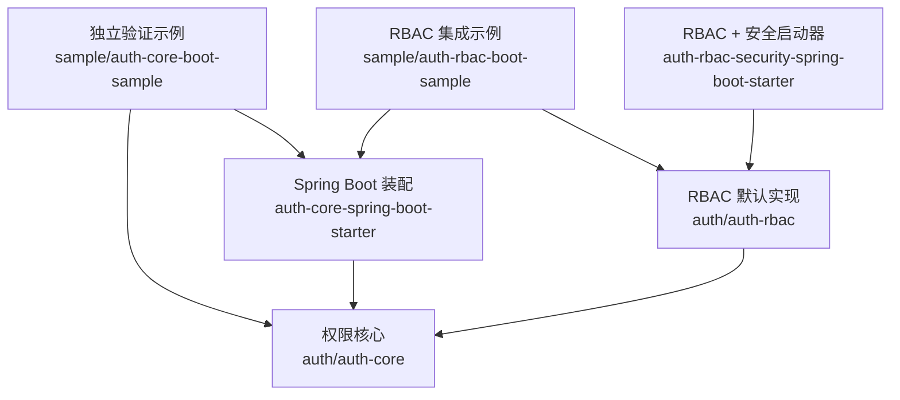
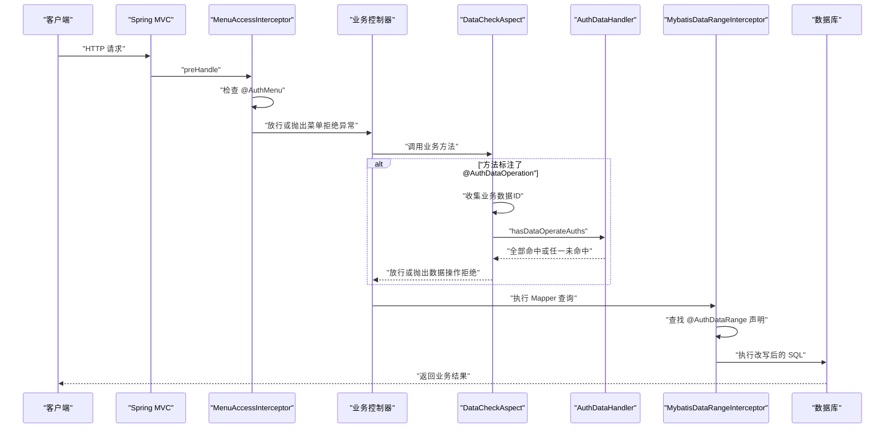
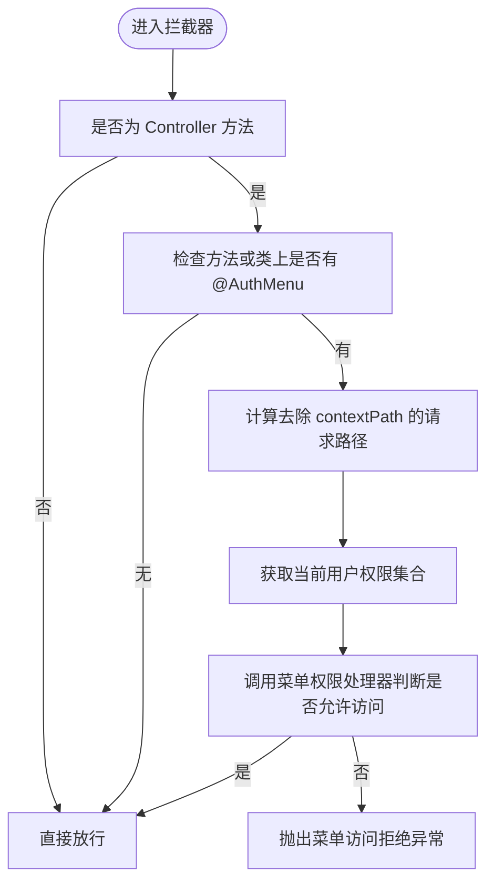
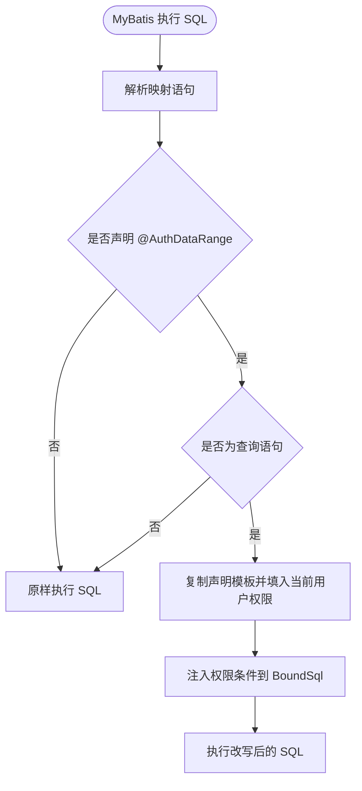
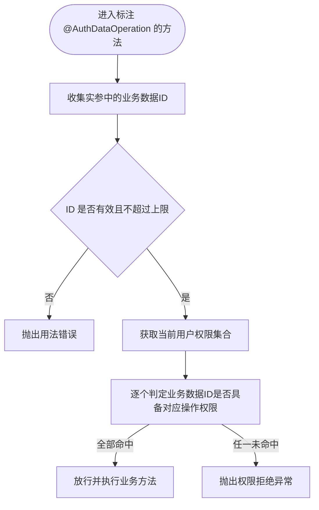
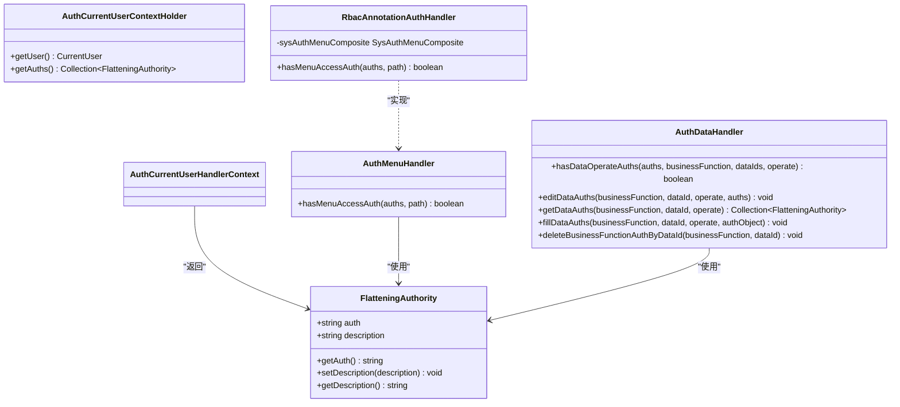
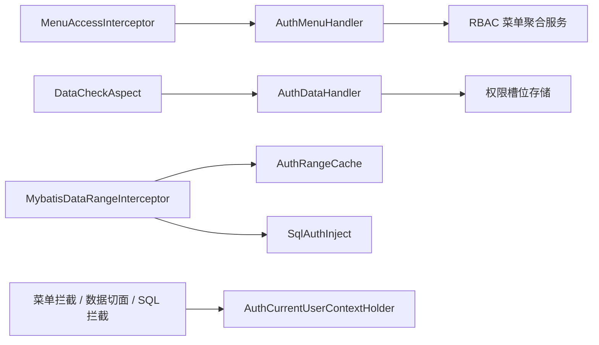

# 权限管理系统

<cite>
**本文引用的文件**   
- [README_Auth.md](file://README_Auth.md)
- [auth-core README.md](file://auth/auth-core/README.md)
- [AuthMenu.java](file://auth/auth-core/src/main/java/com/cu/framework/auth/core/AuthMenu.java)
- [AuthDataRange.java](file://auth/auth-core/src/main/java/com/cu/framework/auth/core/AuthDataRange.java)
- [AuthDataOperation.java](file://auth/auth-core/src/main/java/com/cu/framework/auth/core/AuthDataOperation.java)
- [AuthCurrentUserContextHolder.java](file://auth/auth-core/src/main/java/com/cu/framework/auth/core/AuthCurrentUserContextHolder.java)
- [FlatteningAuthority.java](file://auth/auth-core/src/main/java/com/cu/framework/auth/core/entity/FlatteningAuthority.java)
- [MenuAccessInterceptor.java](file://auth/auth-core/src/main/java/com/cu/framework/auth/core/menu/MenuAccessInterceptor.java)
- [AuthMenuHandler.java](file://auth/auth-core/src/main/java/com/cu/framework/auth/core/menu/AuthMenuHandler.java)
- [DataCheckAspect.java](file://auth/auth-core/src/main/java/com/cu/framework/auth/core/data/edit/DataCheckAspect.java)
- [AuthDataHandler.java](file://auth/auth-core/src/main/java/com/cu/framework/auth/core/data/AuthDataHandler.java)
- [MybatisDataRangeInterceptor.java](file://auth/auth-core/src/main/java/com/cu/framework/auth/core/data/range/MybatisDataRangeInterceptor.java)
- [AuthCoreConfig.java](file://auth/auth-core-spring-boot-starter/src/main/java/com/cu/framework/boot/auth/core/config/AuthCoreConfig.java)
- [RbacAnnotationAuthHandler.java](file://auth/auth-rbac/src/main/java/com/cu/framework/auth/rbac/RbacAnnotationAuthHandler.java)
- [MethodLevelController.java](file://sample/auth-core-boot-sample/src/main/java/com/cu/framework/sample/authcore/web/MethodLevelController.java)
- [ClassLevelController.java](file://sample/auth-core-boot-sample/src/main/java/com/cu/framework/sample/authcore/web/ClassLevelController.java)
- [WorkOrderController.java](file://sample/auth-core-boot-sample/src/main/java/com/cu/framework/sample/authcore/web/WorkOrderController.java)
- [WorkOrderMapper.java](file://sample/auth-core-boot-sample/src/main/java/com/cu/framework/sample/authcore/mapper/WorkOrderMapper.java)
</cite>

## 目录
1. [引言](#引言)
2. [项目结构](#项目结构)
3. [核心组件](#核心组件)
4. [架构总览](#架构总览)
5. [详细组件分析](#详细组件分析)
6. [依赖关系分析](#依赖关系分析)
7. [性能与容量特性](#性能与容量特性)
8. [配置示例与最佳实践](#配置示例与最佳实践)
9. [故障排查指南](#故障排查指南)
10. [结论](#结论)

## 引言
Kewen Framework 权限管理系统围绕菜单权限、数据权限和操作权限三个层次构建，目标是让业务系统以注解声明的方式快速获得完整的权限能力：接口是否可见、哪些行能进入列表、哪些单条或多条数据可以编辑。框架采用 RBAC 思想，默认实现用户、部门、角色与岗位的权限继承关系，并通过 Spring Boot Starter 装配拦截器、切面与 MyBatis 插件，形成从请求进入、注解解析、权限查询到最终授权的完整链路。

文档重点说明：
- 三层权限模型的设计理念与职责边界。
- RBAC 实体、权限串编解码、权限继承和部门权限传递机制。
- `@AuthMenu`、`@AuthDataRange`、`@AuthDataOperation` 的声明位置、参数含义和使用方式。
- 请求生命周期中的权限判定流程。
- 结合示例工程的可观察行为、配置项和排错建议。

## 项目结构
权限相关代码分布在以下模块中：
- `auth/auth-core`：权限接缝层，定义注解、抽象处理器、当前用户上下文、扁平化权限对象，以及菜单拦截器、数据操作切面和 MyBatis 数据范围拦截器的核心实现。
- `auth/auth-core-spring-boot-starter`：自动装配核心 Bean，包括数据校验切面、SQL 注入器、MyBatis 拦截器、菜单访问拦截器和拒绝响应处理器。
- `auth/auth-rbac`：RBAC 默认实现，提供菜单权限处理、菜单聚合服务和持久层服务。
- `auth/auth-rbac-security-spring-boot-starter`：将 RBAC 与登录态整合，提供当前用户上下文实现。
- `sample/auth-core-boot-sample` 与 `sample/auth-rbac-boot-sample`：独立验证示例和 RBAC 集成示例，展示注解用法、数据表设计、启动行为和可观察断言。

**图示来源**
- [AuthCoreConfig.java:1-203](file://auth/auth-core-spring-boot-starter/src/main/java/com/cu/framework/boot/auth/core/config/AuthCoreConfig.java#L1-L203)
- [RbacAnnotationAuthHandler.java:1-27](file://auth/auth-rbac/src/main/java/com/cu/framework/auth/rbac/RbacAnnotationAuthHandler.java#L1-L27)
- [AuthMenu.java:1-16](file://auth/auth-core/src/main/java/com/cu/framework/auth/core/AuthMenu.java#L1-L16)

**章节来源**
- [README_Auth.md:1-200](file://README_Auth.md#L1-L200)

## 核心组件
权限系统的核心由三类组件构成：
- 注解与声明：`@AuthMenu` 声明菜单管辖，`@AuthDataRange` 声明数据范围过滤，`@AuthDataOperation` 声明行级数据操作校验。
- 执行期拦截点：`MenuAccessInterceptor` 做菜单权限拦截，`DataCheckAspect` 做写操作前的数据 ID 校验，`MybatisDataRangeInterceptor` 在 SQL 执行前注入权限条件。
- 抽象处理器与上下文：`AuthMenuHandler`、`AuthDataHandler` 定义菜单和数据权限判定的扩展点；`AuthCurrentUserContextHolder` 提供当前用户及其权限集合；`FlatteningAuthority` 是统一的扁平化权限字符串载体。

| 组件 | 职责 | 关键行为 |
|---|---|---|
| `@AuthMenu` | 声明接口受菜单权限控制 | 标方法只管该端点，标类管整个 Controller 的全部端点 |
| `@AuthDataRange` | 声明 Mapper 查询语句的数据范围 | 根据业务功能与操作类型注入权限过滤条件 |
| `@AuthDataOperation` | 声明业务方法的行级数据操作权限 | 收集请求中的业务数据 ID，逐个判定，全部命中才放行 |
| `MenuAccessInterceptor` | 菜单访问拦截器 | 判断端点是否被管辖，比较用户权限与菜单授权 |
| `DataCheckAspect` | 数据操作切面 | 在方法执行前校验数据 ID 权限，失败不执行业务方法体 |
| `MybatisDataRangeInterceptor` | MyBatis 数据范围拦截器 | 找到带 `@AuthDataRange` 的映射语句，改写 SQL 追加权限条件 |
| `AuthMenuHandler` | 菜单权限处理接口 | 由 RBAC 或自定义实现决定某路径是否允许访问 |
| `AuthDataHandler` | 数据权限处理接口 | 查询、编辑、填充、删除数据权限槽位 |
| `AuthCurrentUserContextHolder` | 当前用户上下文 | 提供当前用户及权限集合 |
| `FlatteningAuthority` | 扁平化权限对象 | 统一承载权限字符串和描述，作为跨层传输单元 |

**章节来源**
- [AuthMenu.java:1-16](file://auth/auth-core/src/main/java/com/cu/framework/auth/core/AuthMenu.java#L1-L16)
- [AuthDataRange.java:1-81](file://auth/auth-core/src/main/java/com/cu/framework/auth/core/AuthDataRange.java#L1-L81)
- [AuthDataOperation.java:1-51](file://auth/auth-core/src/main/java/com/cu/framework/auth/core/AuthDataOperation.java#L1-L51)
- [MenuAccessInterceptor.java:1-93](file://auth/auth-core/src/main/java/com/cu/framework/auth/core/menu/MenuAccessInterceptor.java#L1-L93)
- [DataCheckAspect.java:1-149](file://auth/auth-core/src/main/java/com/cu/framework/auth/core/data/edit/DataCheckAspect.java#L1-L149)
- [MybatisDataRangeInterceptor.java:1-216](file://auth/auth-core/src/main/java/com/cu/framework/auth/core/data/range/MybatisDataRangeInterceptor.java#L1-L216)
- [AuthMenuHandler.java:1-27](file://auth/auth-core/src/main/java/com/cu/framework/auth/core/menu/AuthMenuHandler.java#L1-L27)
- [AuthDataHandler.java:1-102](file://auth/auth-core/src/main/java/com/cu/framework/auth/core/data/AuthDataHandler.java#L1-L102)
- [AuthCurrentUserContextHolder.java:1-25](file://auth/auth-core/src/main/java/com/cu/framework/auth/core/AuthCurrentUserContextHolder.java#L1-L25)
- [FlatteningAuthority.java:1-63](file://auth/auth-core/src/main/java/com/cu/framework/auth/core/entity/FlatteningAuthority.java#L1-L63)

## 架构总览
权限系统采用“声明 + 拦截 + 处理”的分层架构：

1. 声明层：业务通过注解声明菜单管辖、数据范围和操作方法权限。
2. 拦截层：Spring MVC 拦截器、AOP 切面和 MyBatis 插件在请求不同阶段触发。
3. 处理层：抽象处理器读取当前用户权限，并结合数据库或缓存完成授权决策。
4. 结果层：放行、返回业务数据，或以统一 403 拒绝响应结束请求。

**图示来源**
- [MenuAccessInterceptor.java:1-93](file://auth/auth-core/src/main/java/com/cu/framework/auth/core/menu/MenuAccessInterceptor.java#L1-L93)
- [DataCheckAspect.java:1-149](file://auth/auth-core/src/main/java/com/cu/framework/auth/core/data/edit/DataCheckAspect.java#L1-L149)
- [MybatisDataRangeInterceptor.java:1-216](file://auth/auth-core/src/main/java/com/cu/framework/auth/core/data/range/MybatisDataRangeInterceptor.java#L1-L216)
- [AuthDataHandler.java:1-102](file://auth/auth-core/src/main/java/com/cu/framework/auth/core/data/AuthDataHandler.java#L1-L102)

## 详细组件分析

### 菜单权限层：`@AuthMenu` 与菜单拦截
菜单权限解决“能不能进这个接口”的问题。`@AuthMenu` 本身不带属性，只表达管辖意图；显示文案由 `@AuthMenuDoc` 承担，菜单行注册由启动期的菜单 API 生成器完成。

关键点：
- 方法级声明只管辖该端点，类级声明管辖该类所有端点。
- 如果方法或类上没有 `@AuthMenu`，则跳过菜单校验。
- 拦截器会剥离应用上下文路径，用内部分配的路径匹配用户权限。
- RBAC 默认实现通过 `RbacAnnotationAuthHandler` 委托给菜单聚合服务进行判断。

**图示来源**
- [MenuAccessInterceptor.java:1-93](file://auth/auth-core/src/main/java/com/cu/framework/auth/core/menu/MenuAccessInterceptor.java#L1-L93)
- [AuthMenuHandler.java:1-27](file://auth/auth-core/src/main/java/com/cu/framework/auth/core/menu/AuthMenuHandler.java#L1-L27)
- [RbacAnnotationAuthHandler.java:1-27](file://auth/auth-rbac/src/main/java/com/cu/framework/auth/rbac/RbacAnnotationAuthHandler.java#L1-L27)

**章节来源**
- [AuthMenu.java:1-16](file://auth/auth-core/src/main/java/com/cu/framework/auth/core/AuthMenu.java#L1-L16)
- [MenuAccessInterceptor.java:1-93](file://auth/auth-core/src/main/java/com/cu/framework/auth/core/menu/MenuAccessInterceptor.java#L1-L93)
- [RbacAnnotationAuthHandler.java:1-27](file://auth/auth-rbac/src/main/java/com/cu/framework/auth/rbac/RbacAnnotationAuthHandler.java#L1-L27)
- [MethodLevelController.java:1-78](file://sample/auth-core-boot-sample/src/main/java/com/cu/framework/sample/authcore/web/MethodLevelController.java#L1-L78)
- [ClassLevelController.java:1-46](file://sample/auth-core-boot-sample/src/main/java/com/cu/framework/sample/authcore/web/ClassLevelController.java#L1-L46)

### 数据范围层：`@AuthDataRange` 与 SQL 注入
数据范围解决“查询结果能看到哪些行”的问题。它必须标注在 MyBatis Mapper 接口的查询方法上，一条语句绑定一个业务功能和一个操作类型。

关键点：
- 注解参数包括业务功能、目标表、表别名、主键列名、操作类型和匹配方式。
- 匹配方式支持 `IN` 与 `EXISTS`，当权限表较大时可切换为 `EXISTS`。
- 拦截器只在 SELECT 语句上注入权限条件；写语句即使误标也不会静默生效。
- 启动时会校验声明：找不到映射语句、不是查询、启用二级缓存、静态 SQL 中找不到目标表都会导致启动失败。

**图示来源**
- [AuthDataRange.java:1-81](file://auth/auth-core/src/main/java/com/cu/framework/auth/core/AuthDataRange.java#L1-L81)
- [MybatisDataRangeInterceptor.java:1-216](file://auth/auth-core/src/main/java/com/cu/framework/auth/core/data/range/MybatisDataRangeInterceptor.java#L1-L216)

**章节来源**
- [AuthDataRange.java:1-81](file://auth/auth-core/src/main/java/com/cu/framework/auth/core/AuthDataRange.java#L1-L81)
- [MybatisDataRangeInterceptor.java:1-216](file://auth/auth-core/src/main/java/com/cu/framework/auth/core/data/range/MybatisDataRangeInterceptor.java#L1-L216)
- [WorkOrderMapper.java:1-132](file://sample/auth-core-boot-sample/src/main/java/com/cu/framework/sample/authcore/mapper/WorkOrderMapper.java#L1-L132)

### 数据操作层：`@AuthDataOperation` 与行级权限
数据操作解决“对某条或若干条数据能不能执行修改、审批等动作”的问题。它标注在业务方法上，切面在执行前收集请求中的业务数据 ID，逐个判定权限。

关键点：
- 业务数据 ID 来自实现 `DataIdCarrier` 的参数对象，支持一层数组和集合元素。
- 去重后最多允许 100 条；超出属于用法错误，要求调用方分批提交。
- 判定按业务功能和操作类型查询已授予的权限，再与当前用户权限集合比对。
- 任一数据 ID 未命中即整体拒绝，方法体不会执行；成功时方法体才会真正运行。

**图示来源**
- [AuthDataOperation.java:1-51](file://auth/auth-core/src/main/java/com/cu/framework/auth/core/AuthDataOperation.java#L1-L51)
- [DataCheckAspect.java:1-149](file://auth/auth-core/src/main/java/com/cu/framework/auth/core/data/edit/DataCheckAspect.java#L1-L149)
- [AuthDataHandler.java:1-102](file://auth/auth-core/src/main/java/com/cu/framework/auth/core/data/AuthDataHandler.java#L1-L102)

**章节来源**
- [AuthDataOperation.java:1-51](file://auth/auth-core/src/main/java/com/cu/framework/auth/core/AuthDataOperation.java#L1-L51)
- [DataCheckAspect.java:1-149](file://auth/auth-core/src/main/java/com/cu/framework/auth/core/data/edit/DataCheckAspect.java#L1-L149)
- [WorkOrderController.java:1-257](file://sample/auth-core-boot-sample/src/main/java/com/cu/framework/sample/authcore/web/WorkOrderController.java#L1-L257)

### RBAC 模型、权限继承与部门权限传递
RBAC 默认实现将权限组织为用户、部门、角色、岗位的关系，并以扁平化的权限字符串在系统中传递。权限体系分为两部分：
- 配置侧权限体：用于权限配置、反解析和权限串重组。
- 用户侧权限体：表示当前用户实际拥有的权限，包含父级机构等上下文信息，不参与反解析。

权限串使用分隔符区分标记与值，支持单位置、双位置组合标记。示例工程中通过 `DemoAuthObject` 演示权限串的序列化与反序列化往返一致性。

权限继承方面，示例规格强调部门继承型标记的行为：继承标记覆盖严格子孙部门成员，本部门自身成员由普通部门标记覆盖，两者正交。权限体缺失时的策略是：用户权限集合为空时不抛异常，而是返回空权限集合，避免把装载层缺陷伪装成数据问题。

**图示来源**
- [FlatteningAuthority.java:1-63](file://auth/auth-core/src/main/java/com/cu/framework/auth/core/entity/FlatteningAuthority.java#L1-L63)
- [AuthCurrentUserContextHolder.java:1-25](file://auth/auth-core/src/main/java/com/cu/framework/auth/core/AuthCurrentUserContextHolder.java#L1-L25)
- [AuthMenuHandler.java:1-27](file://auth/auth-core/src/main/java/com/cu/framework/auth/core/menu/AuthMenuHandler.java#L1-L27)
- [AuthDataHandler.java:1-102](file://auth/auth-core/src/main/java/com/cu/framework/auth/core/data/AuthDataHandler.java#L1-L102)
- [RbacAnnotationAuthHandler.java:1-27](file://auth/auth-rbac/src/main/java/com/cu/framework/auth/rbac/RbacAnnotationAuthHandler.java#L1-L27)

**章节来源**
- [auth-core README.md:1-15](file://auth/auth-core/README.md#L1-L15)
- [README_Auth.md:1-200](file://README_Auth.md#L1-L200)

## 依赖关系分析
权限系统的关键依赖如下：
- 菜单权限链：`MenuAccessInterceptor` → `AuthMenuHandler` → RBAC 菜单聚合服务。
- 数据操作权限链：`DataCheckAspect` → `AuthDataHandler` → 权限槽位存储。
- 数据范围权限链：`MybatisDataRangeInterceptor` → `AuthRangeCache` → SQL 注入逻辑 → 数据库。
- 当前用户权限链：各拦截点和处理器都依赖 `AuthCurrentUserContextHolder.getAuths()`。

**图示来源**
- [AuthCoreConfig.java:1-203](file://auth/auth-core-spring-boot-starter/src/main/java/com/cu/framework/boot/auth/core/config/AuthCoreConfig.java#L1-L203)
- [MenuAccessInterceptor.java:1-93](file://auth/auth-core/src/main/java/com/cu/framework/auth/core/menu/MenuAccessInterceptor.java#L1-L93)
- [DataCheckAspect.java:1-149](file://auth/auth-core/src/main/java/com/cu/framework/auth/core/data/edit/DataCheckAspect.java#L1-L149)
- [MybatisDataRangeInterceptor.java:1-216](file://auth/auth-core/src/main/java/com/cu/framework/auth/core/data/range/MybatisDataRangeInterceptor.java#L1-L216)

**章节来源**
- [AuthCoreConfig.java:1-203](file://auth/auth-core-spring-boot-starter/src/main/java/com/cu/framework/boot/auth/core/config/AuthCoreConfig.java#L1-L203)

## 性能与容量特性
- 数据操作 ID 上限：单次去重后的业务数据 ID 最多 100 条，超出直接失败，避免一次判定退化为不可控规模的数据库查询。
- SQL 注入时机：权限条件在 MyBatis `StatementHandler.prepare` 阶段注入，每条物理语句单独处理，不需要跨语句作用域上下文。
- 懒加载注入器：SQL 权限注入器通过双重检测锁懒加载，避免 MyBatis 插件初始化阶段的循环依赖。
- 声明缓存：`AuthRangeCache` 以映射语句 ID 为键缓存静态声明模板，运行时只复制副本并写入当前用户权限，避免线程间污染。
- 匹配策略：数据范围支持 `IN` 与 `EXISTS`，当权限表数据量较大时应考虑使用 `EXISTS` 减少大 IN 列表带来的开销。

[本节为通用性能讨论，不直接分析具体文件]

## 配置示例与最佳实践

### 基本依赖与启动
引入登录与安全模块、RBAC 权限模块后，初始化数据库建表脚本，配置数据源即可启动。最小可用配置包括：
- 引入 `login-spring-boot-starter`。
- 引入 `auth-rbac-spring-boot-starter`。
- 配置 MySQL 数据源。
- 执行 `docs/sql/auth-rbac.sql` 建立 RBAC 基础表。

**章节来源**
- [README_Auth.md:1-200](file://README_Auth.md#L1-L200)

### 菜单权限声明
在需要控制的 Controller 方法或类上添加 `@AuthMenu`。示例工程中：
- `MethodLevelController` 演示方法级管辖：某个端点受控，其他端点不受控。
- `ClassLevelController` 演示类级管辖：整个类的端点受控，但每个路径仍需单独授权。

最佳实践：
- 菜单权限只控制“能否进入接口”，不代表一定能操作数据。
- 显示文案由 `@AuthMenuDoc` 提供；未提供时会回落到类名或方法名。
- 授权归属基于路径，而不是菜单文案；改文案不影响路径归属。

**章节来源**
- [MethodLevelController.java:1-78](file://sample/auth-core-boot-sample/src/main/java/com/cu/framework/sample/authcore/web/MethodLevelController.java#L1-L78)
- [ClassLevelController.java:1-46](file://sample/auth-core-boot-sample/src/main/java/com/cu/framework/sample/authcore/web/ClassLevelController.java#L1-L46)

### 数据范围声明
在 Mapper 查询方法上添加 `@AuthDataRange`，指定业务功能、操作类型和匹配方式。示例工程中 `WorkOrderMapper` 展示了：
- 同一张表的不同操作槽位：`unified`、`edit`、`approve`。
- `IN` 与 `EXISTS` 两种匹配方式。
- 嵌套查询和多表联查场景。
- 动态 SQL 中目标表可能运行期才拼出时的校验行为。

最佳实践：
- 每个需要按权限过滤的查询方法单独声明。
- 多表联查时明确 `table` 和 `tableAlias`，避免权限条件挂错表。
- 权限表数据量大时使用 `EXISTS`。
- 不要期望 MyBatis-Plus 内置方法自动获得过滤；需要显式声明查询方法。

**章节来源**
- [WorkOrderMapper.java:1-132](file://sample/auth-core-boot-sample/src/main/java/com/cu/framework/sample/authcore/mapper/WorkOrderMapper.java#L1-L132)
- [AuthDataRange.java:1-81](file://auth/auth-core/src/main/java/com/cu/framework/auth/core/AuthDataRange.java#L1-L81)

### 数据操作声明
在写方法上添加 `@AuthDataOperation`，指定业务功能和操作类型，并在请求体中提供实现 `DataIdCarrier` 的数据 ID。示例工程中 `WorkOrderController` 同时标注菜单权限和数据操作权限：
- 编辑工单使用 `work_order/edit` 槽位。
- 审批工单使用 `work_order/approve` 槽位。
- 两个槽位互不回退，体现操作粒度控制。

最佳实践：
- 写方法应同时标注菜单权限和数据操作权限，分别控制入口和数据主体。
- 批量操作要确保 ID 数量不超过 100，必要时拆分请求。
- 对集合或数组参数，确保其元素实现 `DataIdCarrier` 或在承载对象内部摊平 ID。

**章节来源**
- [WorkOrderController.java:1-257](file://sample/auth-core-boot-sample/src/main/java/com/cu/framework/sample/authcore/web/WorkOrderController.java#L1-L257)
- [AuthDataOperation.java:1-51](file://auth/auth-core/src/main/java/com/cu/framework/auth/core/AuthDataOperation.java#L1-L51)
- [DataCheckAspect.java:1-149](file://auth/auth-core/src/main/java/com/cu/framework/auth/core/data/edit/DataCheckAspect.java#L1-L149)

### 当前用户上下文与 RBAC 接入
RBAC 默认实现要求额外实现当前用户上下文和密码编码器。`auth-rbac-spring-boot-starter` 的说明明确要求：
- 必须实现 `AuthCurrentUserContextHolder`，否则权限模块无法获取当前用户。
- 必须实现 `PasswordEncoder`，否则密码相关功能会报错。

最佳实践：
- 在登录成功后把用户身份和权限集合放入上下文。
- 权限集合应包含用户直接权限、角色权限、部门权限及继承权限。
- 权限串格式要与权限对象的序列化规则一致，保证往返一致。

**章节来源**
- [auth-rbac-spring-boot-starter README.md:1-5](file://auth/auth-rbac-spring-boot-starter/README.md#L1-L5)
- [AuthCurrentUserContextHolder.java:1-25](file://auth/auth-core/src/main/java/com/cu/framework/auth/core/AuthCurrentUserContextHolder.java#L1-L25)

## 故障排查指南

| 现象 | 可能原因 | 排查建议 |
|---|---|---|
| 启动时报缺少当前用户上下文 | 未实现 `AuthCurrentUserContextHolder` | 注册该 Bean，并确保 `getAuths()` 返回用户权限集合 |
| 启动时报缺少菜单权限处理 | 未实现 `AuthMenuHandler` | 注册 RBAC 实现或自定义菜单权限处理器 |
| 菜单权限正常但数据范围不生效 | 未声明 `@AuthDataRange` 或声明在错误位置 | 确认注解标在 Mapper 查询方法上 |
| 数据范围声明存在但 SQL 未被改写 | 语句不是 SELECT，或 MyBatis 插件链异常 | 检查是否为查询语句，查看拦截器日志和插件链 |
| 启动时报二级缓存冲突 | 声明的查询启用了二级缓存 | 关闭相关查询的二级缓存 |
| 动态 SQL 报找不到目标表 | 运行期 SQL 没有拼出声明的目标表 | 检查动态 SQL 分支，确保目标表始终存在 |
| 数据操作报 400 而非 403 | 参数中没有承载对象、ID 为空、含 null 或超过 100 条 | 检查请求体结构和 ID 收集逻辑 |
| 数据操作报 403 | 用户权限集合为空或数据 ID 未命中授权 | 检查用户权限装载和权限槽位数据 |
| 菜单路径被拒绝 | 菜单未登记或未授予当前用户权限 | 检查菜单 API 注册和用户权限集合 |

**章节来源**
- [README_Auth.md:1-200](file://README_Auth.md#L1-L200)
- [auth-core README.md:1-15](file://auth/auth-core/README.md#L1-L15)
- [DataCheckAspect.java:1-149](file://auth/auth-core/src/main/java/com/cu/framework/auth/core/data/edit/DataCheckAspect.java#L1-L149)
- [MybatisDataRangeInterceptor.java:1-216](file://auth/auth-core/src/main/java/com/cu/framework/auth/core/data/range/MybatisDataRangeInterceptor.java#L1-L216)

## 结论
Kewen Framework 权限管理系统以注解声明为核心，将菜单权限、数据范围和数据操作权限解耦为三个清晰层次：菜单层控制入口可见性，数据范围层控制查询结果集，操作层控制行级数据主体。RBAC 默认实现提供用户、部门、角色的继承关系，并通过扁平化权限串贯穿整个链路。配合 Spring Boot Starter 的自动装配，开发者可以在不重复造轮子的情况下，快速获得一套可观测、可扩展、可测试的权限能力。

在实际项目中，建议：
- 先用菜单权限控制接口可见性。
- 再用 `@AuthDataRange` 控制列表数据范围。
- 最后用 `@AuthDataOperation` 控制单条或多条数据的写权限。
- 始终确保当前用户上下文正确注入，权限串编解码一致。
- 利用示例工程的透视台、脚本和测试断言验证权限矩阵是否符合预期。

[本节为总结性内容，不直接分析具体文件]