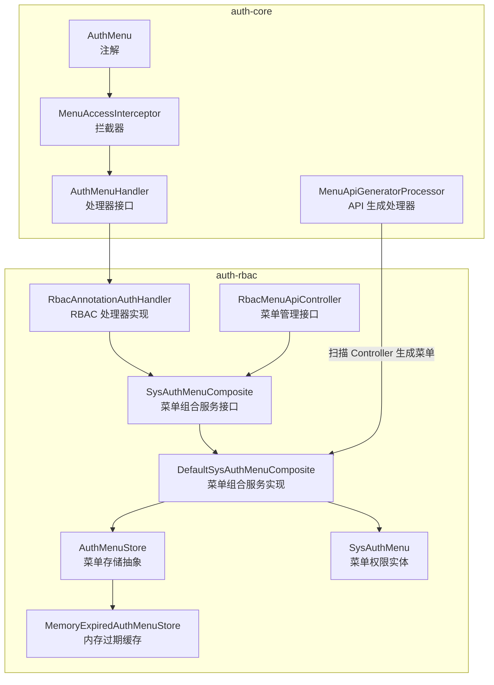
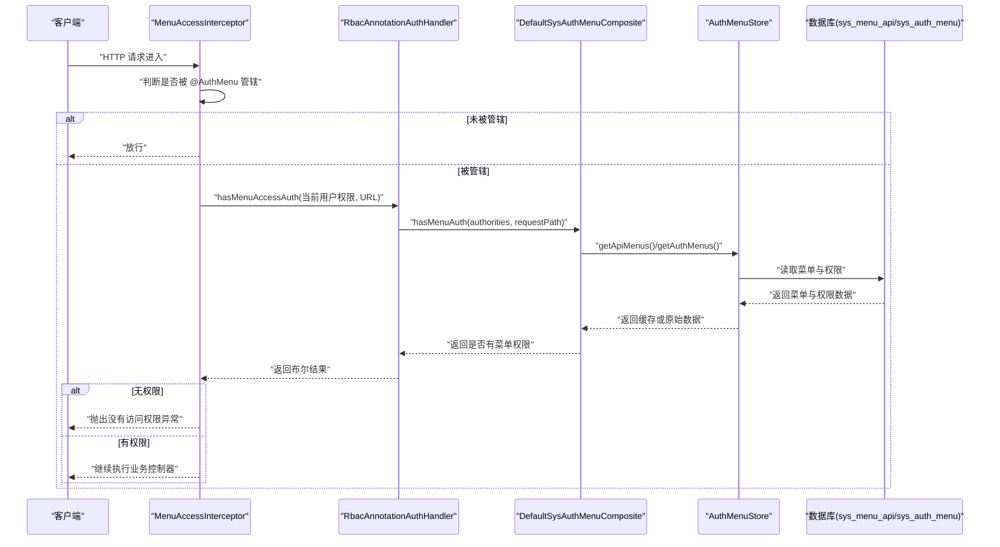
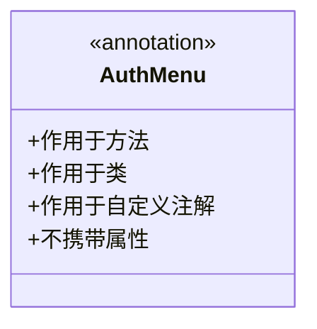
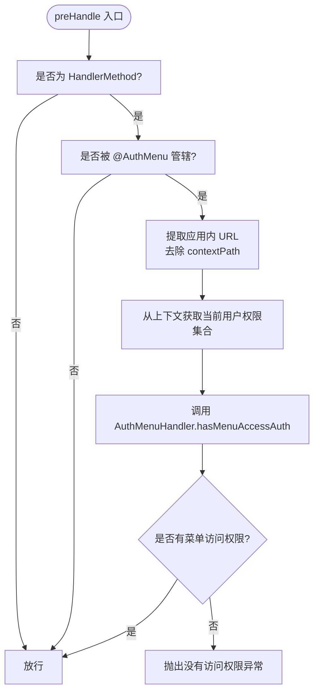
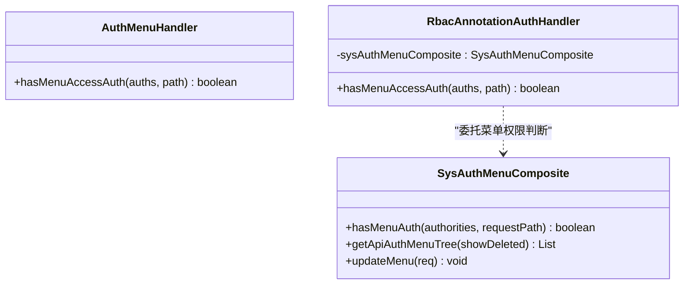
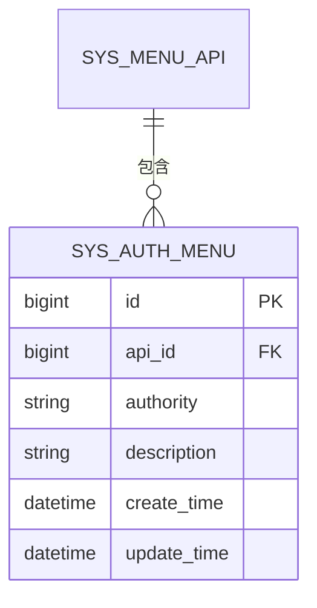
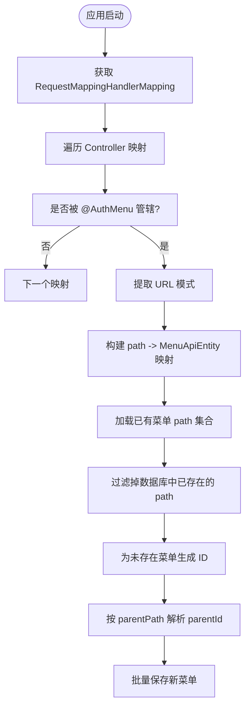
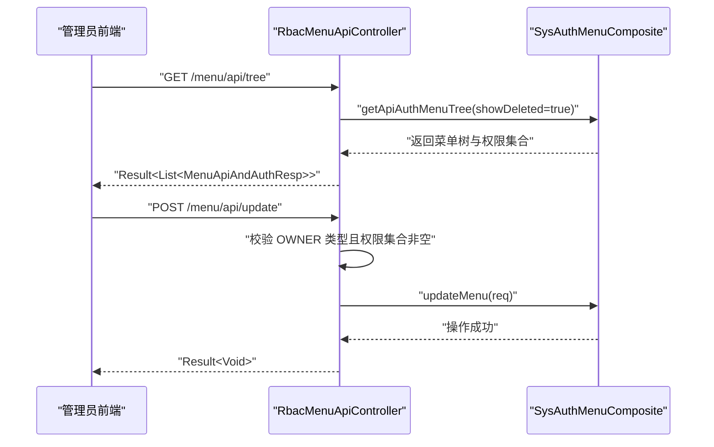
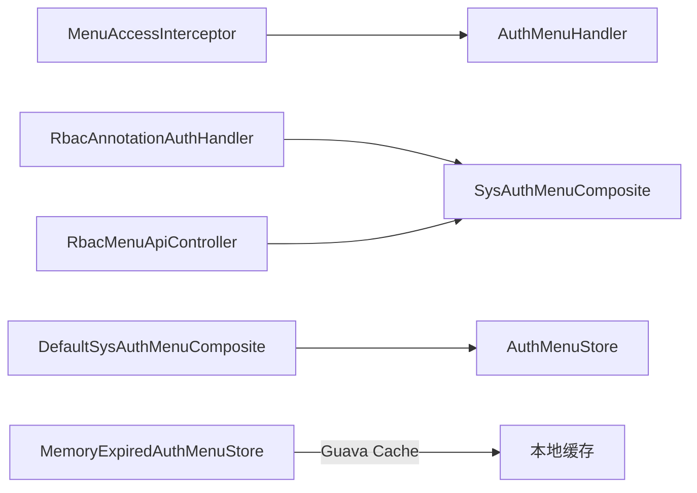
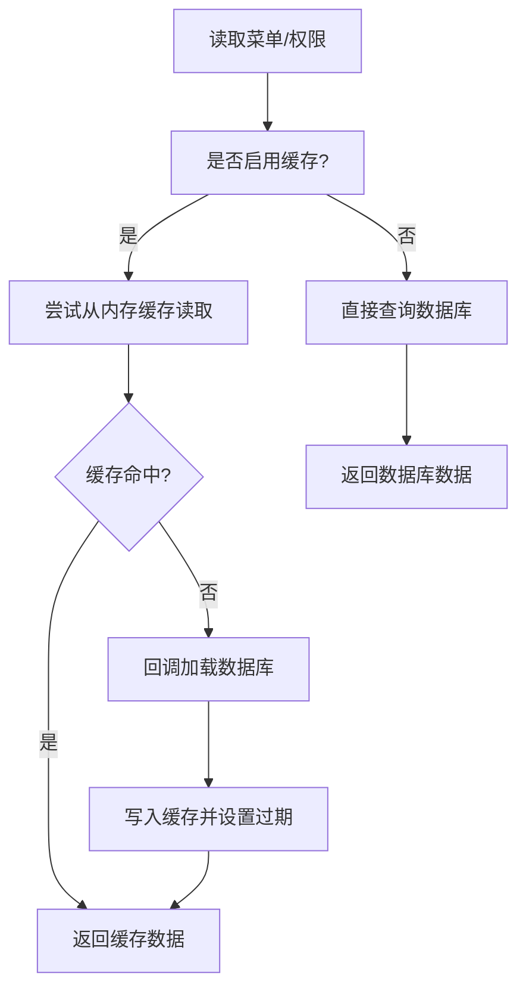

# 菜单权限控制

<cite>
**本文引用的文件**
- [AuthMenu.java](file://auth/auth-core/src/main/java/com/cu/framework/auth/core/AuthMenu.java)
- [MenuAccessInterceptor.java](file://auth/auth-core/src/main/java/com/cu/framework/auth/core/menu/MenuAccessInterceptor.java)
- [AuthMenuHandler.java](file://auth/auth-core/src/main/java/com/cu/framework/auth/core/menu/AuthMenuHandler.java)
- [MenuApiGeneratorProcessor.java](file://auth/auth-core/src/main/java/com/cu/framework/auth/core/menu/MenuApiGeneratorProcessor.java)
- [RbacAnnotationAuthHandler.java](file://auth/auth-rbac/src/main/java/com/cu/framework/auth/rbac/RbacAnnotationAuthHandler.java)
- [SysAuthMenuComposite.java](file://auth/auth-rbac/src/main/java/com/cu/framework/auth/rbac/composite/SysAuthMenuComposite.java)
- [DefaultSysAuthMenuComposite.java](file://auth/auth-rbac/src/main/java/com/cu/framework/auth/rbac/composite/impl/DefaultSysAuthMenuComposite.java)
- [AuthMenuStore.java](file://auth/auth-rbac/src/main/java/com/cu/framework/auth/rbac/composite/AuthMenuStore.java)
- [MemoryExpiredAuthMenuStore.java](file://auth/auth-rbac/src/main/java/com/cu/framework/auth/rbac/composite/impl/MemoryExpiredAuthMenuStore.java)
- [SysAuthMenu.java](file://auth/auth-rbac/src/main/java/com/cu/framework/auth/rbac/mp/entity/SysAuthMenu.java)
- [RbacMenuApiController.java](file://auth/auth-rbac/src/main/java/com/cu/framework/auth/rbac/controller/RbacMenuApiController.java)
</cite>

## 目录
1. [引言](#引言)
2. [项目结构](#项目结构)
3. [核心组件](#核心组件)
4. [架构总览](#架构总览)
5. [详细组件分析](#详细组件分析)
6. [依赖关系分析](#依赖关系分析)
7. [性能与缓存](#性能与缓存)
8. [配置示例与最佳实践](#配置示例与最佳实践)
9. [常见问题排查](#常见问题排查)
10. [结论](#结论)

## 引言
本文面向使用 Kewen Framework 的开发者，系统性说明“菜单权限控制”的设计、实现与使用方式。重点包括：
- @AuthMenu 注解的设计理念与方法级、类级声明方式
- MenuAccessInterceptor 拦截器的请求校验流程
- 菜单权限存储模型 SysAuthMenu 以及 RBAC 组合服务
- 菜单 API 自动生成器如何扫描 Controller 并入库
- RbacMenuApiController 提供的菜单管理接口
- 配置项、缓存策略、常见错误与优化建议

## 项目结构
与菜单权限控制直接相关的代码分布在两个子模块中：
- auth-core：提供注解、拦截器、处理器接口与 API 生成处理器
- auth-rbac：提供 RBAC 实现、菜单组合服务、存储抽象与默认内存过期缓存、实体与控制器

**图示来源**
- [AuthMenu.java:1-16](file://auth/auth-core/src/main/java/com/cu/framework/auth/core/AuthMenu.java#L1-L16)
- [MenuAccessInterceptor.java:1-93](file://auth/auth-core/src/main/java/com/cu/framework/auth/core/menu/MenuAccessInterceptor.java#L1-L93)
- [AuthMenuHandler.java:1-27](file://auth/auth-core/src/main/java/com/cu/framework/auth/core/menu/AuthMenuHandler.java#L1-L27)
- [MenuApiGeneratorProcessor.java:1-214](file://auth/auth-core/src/main/java/com/cu/framework/auth/core/menu/MenuApiGeneratorProcessor.java#L1-L214)
- [RbacAnnotationAuthHandler.java:1-27](file://auth/auth-rbac/src/main/java/com/cu/framework/auth/rbac/RbacAnnotationAuthHandler.java#L1-L27)
- [SysAuthMenuComposite.java:1-63](file://auth/auth-rbac/src/main/java/com/cu/framework/auth/rbac/composite/SysAuthMenuComposite.java#L1-L63)
- [DefaultSysAuthMenuComposite.java:1-200](file://auth/auth-rbac/src/main/java/com/cu/framework/auth/rbac/composite/impl/DefaultSysAuthMenuComposite.java#L1-L200)
- [AuthMenuStore.java:1-23](file://auth/auth-rbac/src/main/java/com/cu/framework/auth/rbac/composite/AuthMenuStore.java#L1-L23)
- [MemoryExpiredAuthMenuStore.java:1-69](file://auth/auth-rbac/src/main/java/com/cu/framework/auth/rbac/composite/impl/MemoryExpiredAuthMenuStore.java#L1-L69)
- [SysAuthMenu.java:1-72](file://auth/auth-rbac/src/main/java/com/cu/framework/auth/rbac/mp/entity/SysAuthMenu.java#L1-L72)
- [RbacMenuApiController.java:1-73](file://auth/auth-rbac/src/main/java/com/cu/framework/auth/rbac/controller/RbacMenuApiController.java#L1-L73)

**章节来源**
- [AuthMenu.java:1-16](file://auth/auth-core/src/main/java/com/cu/framework/auth/core/AuthMenu.java#L1-L16)
- [MenuAccessInterceptor.java:1-93](file://auth/auth-core/src/main/java/com/cu/framework/auth/core/menu/MenuAccessInterceptor.java#L1-L93)
- [AuthMenuHandler.java:1-27](file://auth/auth-core/src/main/java/com/cu/framework/auth/core/menu/AuthMenuHandler.java#L1-L27)
- [MenuApiGeneratorProcessor.java:1-214](file://auth/auth-core/src/main/java/com/cu/framework/auth/core/menu/MenuApiGeneratorProcessor.java#L1-L214)
- [RbacAnnotationAuthHandler.java:1-27](file://auth/auth-rbac/src/main/java/com/cu/framework/auth/rbac/RbacAnnotationAuthHandler.java#L1-L27)
- [SysAuthMenuComposite.java:1-63](file://auth/auth-rbac/src/main/java/com/cu/framework/auth/rbac/composite/SysAuthMenuComposite.java#L1-L63)
- [DefaultSysAuthMenuComposite.java:1-200](file://auth/auth-rbac/src/main/java/com/cu/framework/auth/rbac/composite/impl/DefaultSysAuthMenuComposite.java#L1-L200)
- [AuthMenuStore.java:1-23](file://auth/auth-rbac/src/main/java/com/cu/framework/auth/rbac/composite/AuthMenuStore.java#L1-L23)
- [MemoryExpiredAuthMenuStore.java:1-69](file://auth/auth-rbac/src/main/java/com/cu/framework/auth/rbac/composite/impl/MemoryExpiredAuthMenuStore.java#L1-L69)
- [SysAuthMenu.java:1-72](file://auth/auth-rbac/src/main/java/com/cu/framework/auth/rbac/mp/entity/SysAuthMenu.java#L1-L72)
- [RbacMenuApiController.java:1-73](file://auth/auth-rbac/src/main/java/com/cu/framework/auth/rbac/controller/RbacMenuApiController.java#L1-L73)

## 核心组件
- AuthMenu：菜单权限管辖注解，仅声明“是否受菜单权限控制”，文案由 @AuthMenuDoc 承担。可标注在方法或类上。
- MenuAccessInterceptor：Spring MVC 拦截器，负责判断端点是否受 @AuthMenu 管辖，并调用 AuthMenuHandler 进行路径访问授权。
- AuthMenuHandler：菜单权限处理接口，定义 hasMenuAccessAuth(auths, path) 方法；RBAC 实现为 RbacAnnotationAuthHandler。
- DefaultSysAuthMenuComposite：菜单组合服务实现，封装菜单树查询、权限匹配、菜单更新等逻辑，支持可选缓存。
- SysAuthMenu：菜单权限表实体，记录某个菜单 API 对应的权限字符串及描述。
- RbacMenuApiController：暴露 /menu/api 菜单管理接口，用于获取菜单树和更新菜单及其权限集合体。
- MenuApiGeneratorProcessor：启动时扫描 @AuthMenu 相关 Controller，自动构建菜单 API 树并批量入库。
- AuthMenuStore 与 MemoryExpiredAuthMenuStore：菜单与权限数据缓存抽象与默认内存过期实现。

**章节来源**
- [AuthMenu.java:1-16](file://auth/auth-core/src/main/java/com/cu/framework/auth/core/AuthMenu.java#L1-L16)
- [MenuAccessInterceptor.java:1-93](file://auth/auth-core/src/main/java/com/cu/framework/auth/core/menu/MenuAccessInterceptor.java#L1-L93)
- [AuthMenuHandler.java:1-27](file://auth/auth-core/src/main/java/com/cu/framework/auth/core/menu/AuthMenuHandler.java#L1-L27)
- [RbacAnnotationAuthHandler.java:1-27](file://auth/auth-rbac/src/main/java/com/cu/framework/auth/rbac/RbacAnnotationAuthHandler.java#L1-L27)
- [DefaultSysAuthMenuComposite.java:1-200](file://auth/auth-rbac/src/main/java/com/cu/framework/auth/rbac/composite/impl/DefaultSysAuthMenuComposite.java#L1-L200)
- [SysAuthMenu.java:1-72](file://auth/auth-rbac/src/main/java/com/cu/framework/auth/rbac/mp/entity/SysAuthMenu.java#L1-L72)
- [RbacMenuApiController.java:1-73](file://auth/auth-rbac/src/main/java/com/cu/framework/auth/rbac/controller/RbacMenuApiController.java#L1-L73)
- [MenuApiGeneratorProcessor.java:1-214](file://auth/auth-core/src/main/java/com/cu/framework/auth/core/menu/MenuApiGeneratorProcessor.java#L1-L214)
- [AuthMenuStore.java:1-23](file://auth/auth-rbac/src/main/java/com/cu/framework/auth/rbac/composite/AuthMenuStore.java#L1-L23)
- [MemoryExpiredAuthMenuStore.java:1-69](file://auth/auth-rbac/src/main/java/com/cu/framework/auth/rbac/composite/impl/MemoryExpiredAuthMenuStore.java#L1-L69)

## 架构总览
下图展示了从请求进入 Spring MVC，到菜单权限校验、再到数据库与缓存交互的整体流程。

**图示来源**
- [MenuAccessInterceptor.java:1-93](file://auth/auth-core/src/main/java/com/cu/framework/auth/core/menu/MenuAccessInterceptor.java#L1-L93)
- [RbacAnnotationAuthHandler.java:1-27](file://auth/auth-rbac/src/main/java/com/cu/framework/auth/rbac/RbacAnnotationAuthHandler.java#L1-L27)
- [DefaultSysAuthMenuComposite.java:1-200](file://auth/auth-rbac/src/main/java/com/cu/framework/auth/rbac/composite/impl/DefaultSysAuthMenuComposite.java#L1-L200)
- [AuthMenuStore.java:1-23](file://auth/auth-rbac/src/main/java/com/cu/framework/auth/rbac/composite/AuthMenuStore.java#L1-L23)

## 详细组件分析

### AuthMenu 注解设计与用法
AuthMenu 是一个轻量级权限管辖注解，不包含属性，只用于声明“该端点是否受菜单权限控制”。其设计要点：
- 作用目标：方法、类、以及自定义注解（便于二次封装）
- 保留策略：运行时可见，以便拦截器与生成器通过反射识别
- 文案分离：显示名称由 @AuthMenuDoc 负责，@AuthMenu 专注权限边界

使用方法：
- 方法级：仅对当前端点生效
- 类级：对该 Controller 下所有端点生效

**图示来源**
- [AuthMenu.java:1-16](file://auth/auth-core/src/main/java/com/cu/framework/auth/core/AuthMenu.java#L1-L16)

**章节来源**
- [AuthMenu.java:1-16](file://auth/auth-core/src/main/java/com/cu/framework/auth/core/AuthMenu.java#L1-L16)

### MenuAccessInterceptor 拦截器工作原理
拦截器在 preHandle 阶段执行以下逻辑：
1. 若请求不是 HandlerMethod，直接放行
2. 判断端点是否被 @AuthMenu 管辖：优先看方法注解，其次看类注解
3. 提取请求路径：取 RequestURI 并去除 contextPath
4. 从当前用户上下文获取已展开权限 FlatteningAuthority 集合
5. 调用 AuthMenuHandler.hasMenuAccessAuth 进行菜单路径授权判定
6. 若无权限，抛出 AuthException；否则放行

**图示来源**
- [MenuAccessInterceptor.java:1-93](file://auth/auth-core/src/main/java/com/cu/framework/auth/core/menu/MenuAccessInterceptor.java#L1-L93)

**章节来源**
- [MenuAccessInterceptor.java:1-93](file://auth/auth-core/src/main/java/com/cu/framework/auth/core/menu/MenuAccessInterceptor.java#L1-L93)

### AuthMenuHandler 与 RbacAnnotationAuthHandler
AuthMenuHandler 定义了菜单权限判定的统一接口 hasMenuAccessAuth(auths, path)。RBAC 实现 RbacAnnotationAuthHandler 将具体实现委托给 SysAuthMenuComposite.hasMenuAuth，从而把菜单路径与权限数据匹配逻辑集中在组合服务中。

**图示来源**
- [AuthMenuHandler.java:1-27](file://auth/auth-core/src/main/java/com/cu/framework/auth/core/menu/AuthMenuHandler.java#L1-L27)
- [RbacAnnotationAuthHandler.java:1-27](file://auth/auth-rbac/src/main/java/com/cu/framework/auth/rbac/RbacAnnotationAuthHandler.java#L1-L27)
- [SysAuthMenuComposite.java:1-63](file://auth/auth-rbac/src/main/java/com/cu/framework/auth/rbac/composite/SysAuthMenuComposite.java#L1-L63)

**章节来源**
- [AuthMenuHandler.java:1-27](file://auth/auth-core/src/main/java/com/cu/framework/auth/core/menu/AuthMenuHandler.java#L1-L27)
- [RbacAnnotationAuthHandler.java:1-27](file://auth/auth-rbac/src/main/java/com/cu/framework/auth/rbac/RbacAnnotationAuthHandler.java#L1-L27)

### 菜单权限存储模型与组合服务
SysAuthMenu 对应 sys_auth_menu 表，主要字段包括：
- id：主键
- api_id：关联菜单 API
- authority：权限字符串
- description：权限描述
- create_time/update_time：时间戳

DefaultSysAuthMenuComposite 提供了菜单与权限的组合能力：
- hasMenuAuth：根据 requestPath 查找菜单，再结合权限集合判定
- getApiAuthMenuTree：组装菜单树，并将权限集合映射到每个节点
- editMenuAuthorities：对比现有权限与请求权限，增量删除与新增
- updateMenu：按白名单更新菜单字段，并同步权限集合

**图示来源**
- [SysAuthMenu.java:1-72](file://auth/auth-rbac/src/main/java/com/cu/framework/auth/rbac/mp/entity/SysAuthMenu.java#L1-L72)
- [DefaultSysAuthMenuComposite.java:1-200](file://auth/auth-rbac/src/main/java/com/cu/framework/auth/rbac/composite/impl/DefaultSysAuthMenuComposite.java#L1-L200)

**章节来源**
- [SysAuthMenu.java:1-72](file://auth/auth-rbac/src/main/java/com/cu/framework/auth/rbac/mp/entity/SysAuthMenu.java#L1-L72)
- [DefaultSysAuthMenuComposite.java:1-200](file://auth/auth-rbac/src/main/java/com/cu/framework/auth/rbac/composite/impl/DefaultSysAuthMenuComposite.java#L1-L200)

### 菜单 API 自动生成器
MenuApiGeneratorProcessor 在 Spring 容器初始化后扫描所有 Controller 映射：
- 通过 RequestMappingHandlerMapping 获取全部 HandlerMethod 与其映射信息
- 过滤出被 @AuthMenu 管辖的方法
- 以 RequestMappingInfo 提取 URL 模式，兼容旧版与新版的 PatternsCondition
- 若存在 MenuApiService，则跳过数据库中已存在的 path，为新菜单生成 ID，并按 parentPath 计算 parentId
- 将父路径缺失的情况降级为根节点，避免单条父链断裂导致静默失败

**图示来源**
- [MenuApiGeneratorProcessor.java:1-214](file://auth/auth-core/src/main/java/com/cu/framework/auth/core/menu/MenuApiGeneratorProcessor.java#L1-L214)

**章节来源**
- [MenuApiGeneratorProcessor.java:1-214](file://auth/auth-core/src/main/java/com/cu/framework/auth/core/menu/MenuApiGeneratorProcessor.java#L1-L214)

### 菜单管理接口 RbacMenuApiController
RbacMenuApiController 位于 /menu/api，提供两类能力：
- GET /menu/api/tree：返回完整 API 菜单树，附带每个节点的权限集合体
- POST /menu/api/update：更新菜单 API 及其权限集合体；当权限类型为 OWNER 且权限集合为空时拒绝，防止“无人可看”

类级别标注了 @AuthMenu 与 @AuthMenuDoc，表示该控制器本身也受菜单权限管控。

**图示来源**
- [RbacMenuApiController.java:1-73](file://auth/auth-rbac/src/main/java/com/cu/framework/auth/rbac/controller/RbacMenuApiController.java#L1-L73)
- [SysAuthMenuComposite.java:1-63](file://auth/auth-rbac/src/main/java/com/cu/framework/auth/rbac/composite/SysAuthMenuComposite.java#L1-L63)

**章节来源**
- [RbacMenuApiController.java:1-73](file://auth/auth-rbac/src/main/java/com/cu/framework/auth/rbac/controller/RbacMenuApiController.java#L1-L73)
- [SysAuthMenuComposite.java:1-63](file://auth/auth-rbac/src/main/java/com/cu/framework/auth/rbac/composite/SysAuthMenuComposite.java#L1-L63)

## 依赖关系分析
- MenuAccessInterceptor 依赖 AuthMenuHandler 与当前用户上下文
- RbacAnnotationAuthHandler 依赖 SysAuthMenuComposite
- DefaultSysAuthMenuComposite 依赖菜单 API、路由、权限三个 MP 服务，以及可选的 AuthMenuStore
- MemoryExpiredAuthMenuStore 基于 Guava Cache 提供内存过期缓存
- RbacMenuApiController 依赖 SysAuthMenuComposite 进行菜单树查询与更新

**图示来源**
- [MenuAccessInterceptor.java:1-93](file://auth/auth-core/src/main/java/com/cu/framework/auth/core/menu/MenuAccessInterceptor.java#L1-L93)
- [RbacAnnotationAuthHandler.java:1-27](file://auth/auth-rbac/src/main/java/com/cu/framework/auth/rbac/RbacAnnotationAuthHandler.java#L1-L27)
- [DefaultSysAuthMenuComposite.java:1-200](file://auth/auth-rbac/src/main/java/com/cu/framework/auth/rbac/composite/impl/DefaultSysAuthMenuComposite.java#L1-L200)
- [AuthMenuStore.java:1-23](file://auth/auth-rbac/src/main/java/com/cu/framework/auth/rbac/composite/AuthMenuStore.java#L1-L23)
- [MemoryExpiredAuthMenuStore.java:1-69](file://auth/auth-rbac/src/main/java/com/cu/framework/auth/rbac/composite/impl/MemoryExpiredAuthMenuStore.java#L1-L69)
- [RbacMenuApiController.java:1-73](file://auth/auth-rbac/src/main/java/com/cu/framework/auth/rbac/controller/RbacMenuApiController.java#L1-L73)

**章节来源**
- [MenuAccessInterceptor.java:1-93](file://auth/auth-core/src/main/java/com/cu/framework/auth/core/menu/MenuAccessInterceptor.java#L1-L93)
- [RbacAnnotationAuthHandler.java:1-27](file://auth/auth-rbac/src/main/java/com/cu/framework/auth/rbac/RbacAnnotationAuthHandler.java#L1-L27)
- [DefaultSysAuthMenuComposite.java:1-200](file://auth/auth-rbac/src/main/java/com/cu/framework/auth/rbac/composite/impl/DefaultSysAuthMenuComposite.java#L1-L200)
- [AuthMenuStore.java:1-23](file://auth/auth-rbac/src/main/java/com/cu/framework/auth/rbac/composite/AuthMenuStore.java#L1-L23)
- [MemoryExpiredAuthMenuStore.java:1-69](file://auth/auth-rbac/src/main/java/com/cu/framework/auth/rbac/composite/impl/MemoryExpiredAuthMenuStore.java#L1-L69)
- [RbacMenuApiController.java:1-73](file://auth/auth-rbac/src/main/java/com/cu/framework/auth/rbac/controller/RbacMenuApiController.java#L1-L73)

## 性能与缓存
- 默认行为：DefaultSysAuthMenuComposite 的缓存开关 cu.auth.cache-auth 默认关闭，即每次直接查库
- 开启缓存：设置为 true 后，DefaultSysAuthMenuComposite 通过 AuthMenuStore 读取菜单与权限数据
- 默认缓存实现：MemoryExpiredAuthMenuStore 使用 Guava Cache，写入后 10 分钟过期
- 注意：缓存粒度为整张菜单 API、路由、权限表的数据列表；适合读多写少场景，避免频繁全表扫描
- 更新影响：菜单更新接口会持久化变更；若启用缓存，应考虑在变更后刷新缓存或在业务层保证一致性

**图示来源**
- [DefaultSysAuthMenuComposite.java:1-200](file://auth/auth-rbac/src/main/java/com/cu/framework/auth/rbac/composite/impl/DefaultSysAuthMenuComposite.java#L1-L200)
- [AuthMenuStore.java:1-23](file://auth/auth-rbac/src/main/java/com/cu/framework/auth/rbac/composite/AuthMenuStore.java#L1-L23)
- [MemoryExpiredAuthMenuStore.java:1-69](file://auth/auth-rbac/src/main/java/com/cu/framework/auth/rbac/composite/impl/MemoryExpiredAuthMenuStore.java#L1-L69)

**章节来源**
- [DefaultSysAuthMenuComposite.java:1-200](file://auth/auth-rbac/src/main/java/com/cu/framework/auth/rbac/composite/impl/DefaultSysAuthMenuComposite.java#L1-L200)
- [MemoryExpiredAuthMenuStore.java:1-69](file://auth/auth-rbac/src/main/java/com/cu/framework/auth/rbac/composite/impl/MemoryExpiredAuthMenuStore.java#L1-L69)

## 配置示例与最佳实践
- 启用菜单权限
  - 在需要控制的 Controller 或方法上添加 @AuthMenu
  - 如需显示名称，配合 @AuthMenuDoc
- 菜单生成
  - 确保系统中存在 MenuApiService 实现，否则 MenuApiGeneratorProcessor 会跳过入库
  - 首次启动会自动扫描 @AuthMenu 标记的端点并生成菜单
- 菜单管理
  - 使用 /menu/api/tree 查看菜单树与权限
  - 使用 /menu/api/update 更新菜单字段与权限集合；OWNER 类型必须提供权限集合
- 缓存配置
  - 设置 cu.auth.cache-auth=true 启用内存过期缓存
  - 根据业务频率调整缓存过期时间，可通过替换 AuthMenuStore 实现扩展
- 最佳实践
  - 优先在类上加 @AuthMenu，减少重复注解
  - 为菜单配置清晰、稳定的 path，避免频繁变更
  - 对高并发场景开启缓存，并确保菜单更新后的缓存一致性
  - 对敏感菜单使用细粒度权限集合，避免 OWNER 类型留空

[本节为通用指导，不直接分析具体代码文件]

## 常见问题排查
- 端点未受菜单权限控制
  - 检查是否遗漏 @AuthMenu；方法级与类级任选其一即可
  - 确认请求路径是否与生成的菜单 path 一致
- 出现“没有 API 菜单访问权限”异常
  - 检查当前用户是否拥有该菜单对应的权限集合
  - 检查菜单是否正确生成并关联权限
- 菜单树为空或未显示
  - 确认 MenuApiService 是否存在
  - 检查数据库是否已有相同 path，生成器会跳过已存在项
- OWNER 类型无法保存
  - RbacMenuApiController 会拒绝 OWNER 类型且权限集合为空的情况
- 缓存未生效
  - 确认 cu.auth.cache-auth 是否设为 true
  - 检查是否使用了默认 MemoryExpiredAuthMenuStore 或其他实现

**章节来源**
- [MenuAccessInterceptor.java:1-93](file://auth/auth-core/src/main/java/com/cu/framework/auth/core/menu/MenuAccessInterceptor.java#L1-L93)
- [RbacMenuApiController.java:1-73](file://auth/auth-rbac/src/main/java/com/cu/framework/auth/rbac/controller/RbacMenuApiController.java#L1-L73)
- [MenuApiGeneratorProcessor.java:1-214](file://auth/auth-core/src/main/java/com/cu/framework/auth/core/menu/MenuApiGeneratorProcessor.java#L1-L214)

## 结论
Kewen Framework 的菜单权限控制通过注解声明、拦截器校验、处理器组合、菜单生成与管理接口形成闭环。开发者只需在 Controller 或方法上标注 @AuthMenu，框架即可自动完成菜单生成、权限匹配与访问控制。对于生产环境，建议结合菜单管理接口完善权限配置，并根据流量特征开启菜单缓存以提升性能。