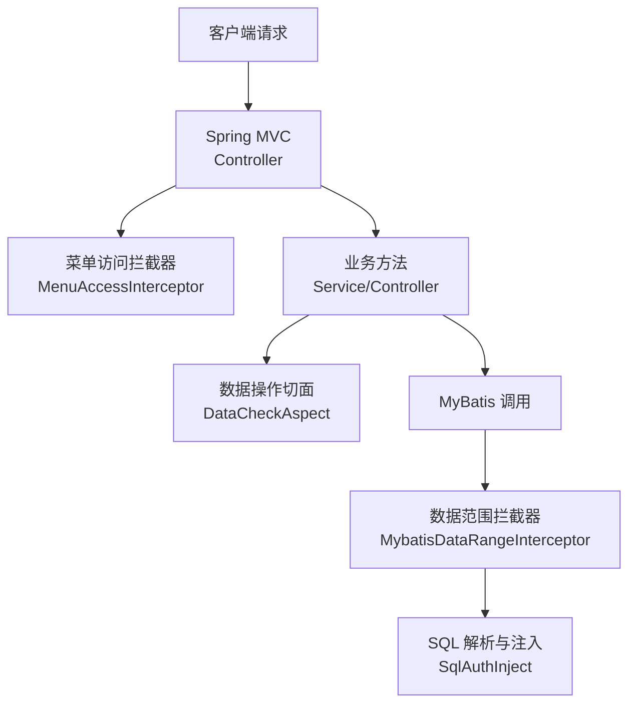
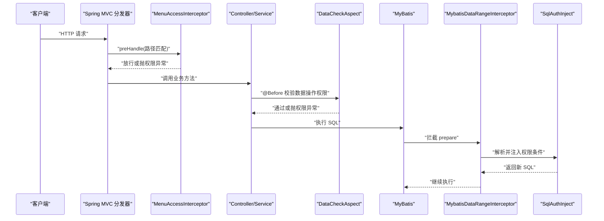
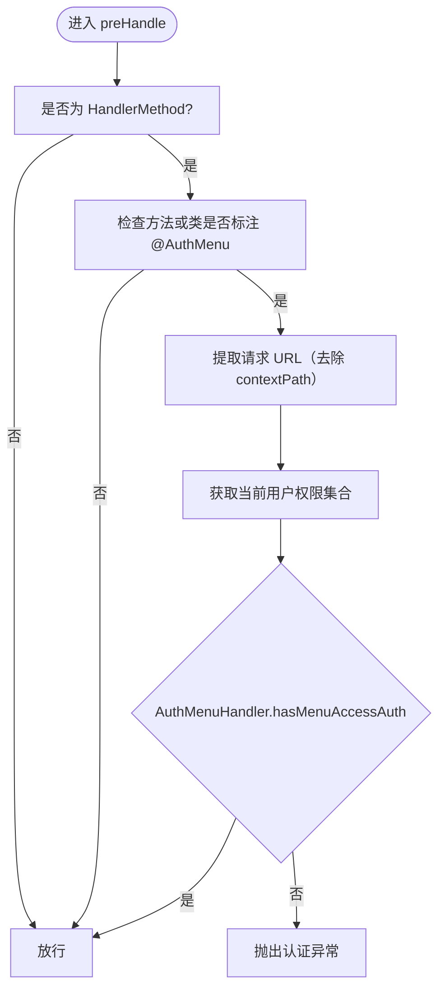
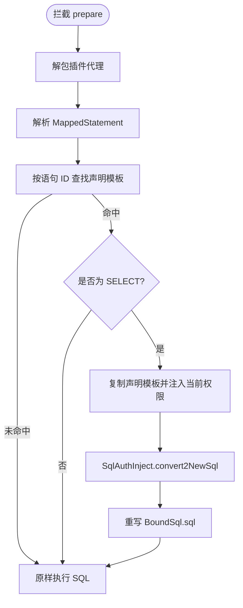
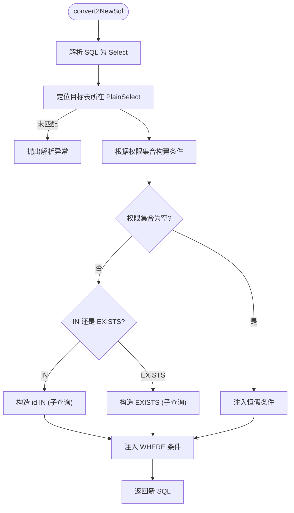
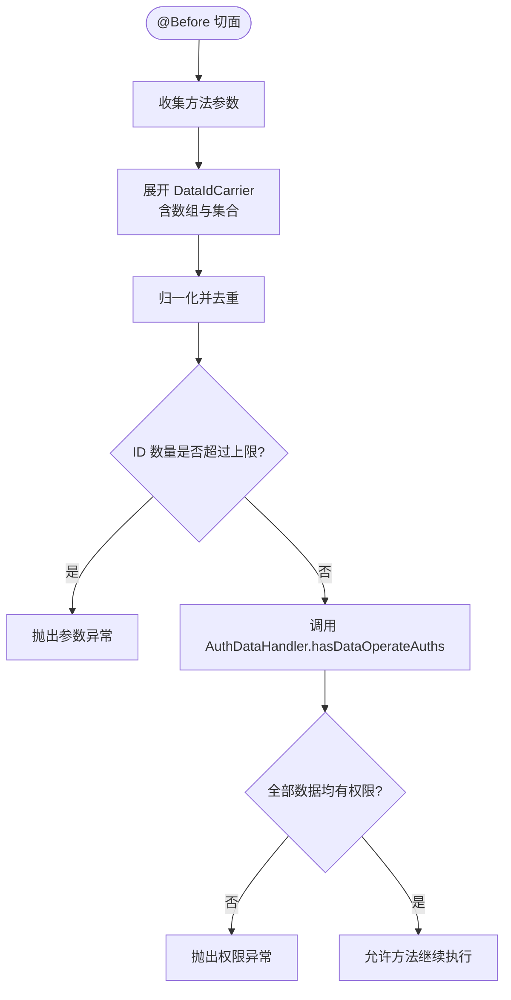
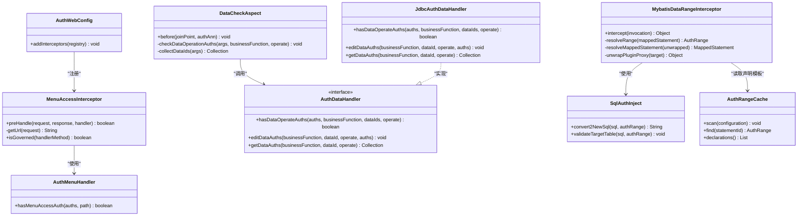

# AOP 权限拦截机制

<cite>
**本文引用的文件**   
- [MenuAccessInterceptor.java](file://auth/auth-core/src/main/java/com/cu/framework/auth/core/menu/MenuAccessInterceptor.java)
- [AuthMenuHandler.java](file://auth/auth-core/src/main/java/com/cu/framework/auth/core/menu/AuthMenuHandler.java)
- [AuthMenu.java](file://auth/auth-core/src/main/java/com/cu/framework/auth/core/AuthMenu.java)
- [AuthWebConfig.java](file://auth/auth-core-spring-boot-starter/src/main/java/com/cu/framework/boot/auth/core/config/AuthWebConfig.java)
- [AuthCoreConfig.java](file://auth/auth-core-spring-boot-starter/src/main/java/com/cu/framework/boot/auth/core/config/AuthCoreConfig.java)
- [MybatisDataRangeInterceptor.java](file://auth/auth-core/src/main/java/com/cu/framework/auth/core/data/range/MybatisDataRangeInterceptor.java)
- [SqlAuthInject.java](file://auth/auth-core/src/main/java/com/cu/framework/auth/core/data/range/SqlAuthInject.java)
- [AuthRangeCache.java](file://auth/auth-core/src/main/java/com/cu/framework/auth/core/data/range/AuthRangeCache.java)
- [DataCheckAspect.java](file://auth/auth-core/src/main/java/com/cu/framework/auth/core/data/edit/DataCheckAspect.java)
- [AuthDataHandler.java](file://auth/auth-core/src/main/java/com/cu/framework/auth/core/data/AuthDataHandler.java)
- [JdbcAuthDataHandler.java](file://auth/auth-core/src/main/java/com/cu/framework/auth/core/data/JdbcAuthDataHandler.java)
</cite>

## 目录
1. [引言](#引言)
2. [项目结构](#项目结构)
3. [核心组件](#核心组件)
4. [架构总览](#架构总览)
5. [详细组件分析](#详细组件分析)
6. [依赖关系分析](#依赖关系分析)
7. [性能与可维护性](#性能与可维护性)
8. [配置与使用示例](#配置与使用示例)
9. [自定义拦截器开发指南](#自定义拦截器开发指南)
10. [故障排查](#故障排查)
11. [结论](#结论)

## 引言
本文件面向 Kewen Framework 的 AOP 权限拦截机制，聚焦三类关键能力：
- 声明式菜单访问控制：通过 Spring MVC 拦截器与注解实现端点级菜单权限校验。
- 数据范围查询增强：基于 MyBatis 插件对 SELECT 语句进行条件注入，实现行级数据过滤。
- 数据操作权限校验：基于 AspectJ 切面在业务方法执行前校验数据 ID 集合的操作权限。

文档会解释切面定义、拦截器链和执行顺序，并给出 MenuAccessInterceptor、MybatisDataRangeInterceptor、DataCheckAspect 的实现要点、异常处理与扩展方式。

## 项目结构
AOP 权限相关代码主要分布在以下位置：
- auth/auth-core：权限核心模型、菜单权限拦截器、数据范围拦截器、数据操作切面及处理器接口。
- auth/auth-core-spring-boot-starter：Spring Boot 自动装配配置，注册拦截器、切面、SQL 注入器和启动校验器等 Bean。
- sample/auth-core-boot-sample：示例应用，展示注解用法、Mapper 数据范围声明和控制器菜单管辖标注。

**图示来源**
- [AuthWebConfig.java:1-30](file://auth/auth-core-spring-boot-starter/src/main/java/com/cu/framework/boot/auth/core/config/AuthWebConfig.java#L1-L30)
- [MenuAccessInterceptor.java:1-93](file://auth/auth-core/src/main/java/com/cu/framework/auth/core/menu/MenuAccessInterceptor.java#L1-L93)
- [DataCheckAspect.java:1-149](file://auth/auth-core/src/main/java/com/cu/framework/auth/core/data/edit/DataCheckAspect.java#L1-L149)
- [MybatisDataRangeInterceptor.java:1-216](file://auth/auth-core/src/main/java/com/cu/framework/auth/core/data/range/MybatisDataRangeInterceptor.java#L1-L216)
- [SqlAuthInject.java:1-200](file://auth/auth-core/src/main/java/com/cu/framework/auth/core/data/range/SqlAuthInject.java#L1-L200)

**章节来源**
- [AuthWebConfig.java:1-30](file://auth/auth-core-spring-boot-starter/src/main/java/com/cu/framework/boot/auth/core/config/AuthWebConfig.java#L1-L30)
- [AuthCoreConfig.java:1-203](file://auth/auth-core-spring-boot-starter/src/main/java/com/cu/framework/boot/auth/core/config/AuthCoreConfig.java#L1-L203)

## 核心组件
- 菜单访问控制：
  - 注解 AuthMenu 用于声明“是否管辖”某个 Controller 或方法。
  - 拦截器 MenuAccessInterceptor 在 preHandle 阶段校验当前用户是否有该 URL 的菜单访问权限。
  - 策略接口 AuthMenuHandler 提供 hasMenuAccessAuth 实现，RBAC 等具体实现负责判定逻辑。
- 数据范围查询增强：
  - 注解 @AuthDataRange 声明 Mapper 方法的 SQL 数据范围模板。
  - 缓存 AuthRangeCache 扫描 Mapper 接口，将静态声明转为模板并按语句 ID 缓存。
  - 拦截器 MybatisDataRangeInterceptor 在 StatementHandler.prepare 时解析 MappedStatement，命中则用 SqlAuthInject 改写 SQL。
  - SqlAuthInject 使用 JSqlParser 解析 SELECT，找到目标表并注入 IN 或 EXISTS 权限条件。
- 数据操作权限校验：
  - 切面 DataCheckAspect 切入 @AuthDataOperation 注解方法，收集参数中的 DataIdCarrier，去重后调用 AuthDataHandler.hasDataOperateAuths 校验。
  - 默认实现 JdbcAuthDataHandler 基于数据库权限表查询用户授权数据，按业务功能 + 操作类型 + 数据 ID 进行判定。

**章节来源**
- [AuthMenu.java:1-16](file://auth/auth-core/src/main/java/com/cu/framework/auth/core/AuthMenu.java#L1-L16)
- [MenuAccessInterceptor.java:1-93](file://auth/auth-core/src/main/java/com/cu/framework/auth/core/menu/MenuAccessInterceptor.java#L1-L93)
- [AuthMenuHandler.java:1-27](file://auth/auth-core/src/main/java/com/cu/framework/auth/core/menu/AuthMenuHandler.java#L1-L27)
- [AuthRangeCache.java:1-155](file://auth/auth-core/src/main/java/com/cu/framework/auth/core/data/range/AuthRangeCache.java#L1-L155)
- [MybatisDataRangeInterceptor.java:1-216](file://auth/auth-core/src/main/java/com/cu/framework/auth/core/data/range/MybatisDataRangeInterceptor.java#L1-L216)
- [SqlAuthInject.java:1-200](file://auth/auth-core/src/main/java/com/cu/framework/auth/core/data/range/SqlAuthInject.java#L1-L200)
- [DataCheckAspect.java:1-149](file://auth/auth-core/src/main/java/com/cu/framework/auth/core/data/edit/DataCheckAspect.java#L1-L149)
- [AuthDataHandler.java:1-102](file://auth/auth-core/src/main/java/com/cu/framework/auth/core/data/AuthDataHandler.java#L1-L102)
- [JdbcAuthDataHandler.java:1-119](file://auth/auth-core/src/main/java/com/cu/framework/auth/core/data/JdbcAuthDataHandler.java#L1-L119)

## 架构总览
整体流程分为三层：
- Web 层：Spring MVC 先经过 MenuAccessInterceptor 做菜单访问控制；未命中则直接放行。
- 业务层：@AuthDataOperation 切面在方法执行前校验数据操作权限，失败抛出认证异常。
- 数据层：MyBatis 在执行物理 SQL 前被 MybatisDataRangeInterceptor 拦截，按声明注入数据范围条件。

**图示来源**
- [AuthWebConfig.java:1-30](file://auth/auth-core-spring-boot-starter/src/main/java/com/cu/framework/boot/auth/core/config/AuthWebConfig.java#L1-L30)
- [MenuAccessInterceptor.java:1-93](file://auth/auth-core/src/main/java/com/cu/framework/auth/core/menu/MenuAccessInterceptor.java#L1-L93)
- [DataCheckAspect.java:1-149](file://auth/auth-core/src/main/java/com/cu/framework/auth/core/data/edit/DataCheckAspect.java#L1-L149)
- [MybatisDataRangeInterceptor.java:1-216](file://auth/auth-core/src/main/java/com/cu/framework/auth/core/data/range/MybatisDataRangeInterceptor.java#L1-L216)
- [SqlAuthInject.java:1-200](file://auth/auth-core/src/main/java/com/cu/framework/auth/core/data/range/SqlAuthInject.java#L1-L200)

## 详细组件分析

### 菜单访问拦截器 MenuAccessInterceptor
职责：
- 仅对 HandlerMethod 生效，非 Controller 方法直接放行。
- 根据方法或类上是否存在 @AuthMenu 判断是否受管辖。
- 从请求中取 URL（去除 contextPath），结合当前用户权限集合调用 AuthMenuHandler.hasMenuAccessAuth 进行校验。
- 无权限时抛出认证异常，阻止后续 Controller 执行。

关键点：
- 路径匹配以 RequestURI 为基础，去除应用 contextPath 后再做权限比对。
- 管辖声明支持方法级与类级两种粒度，方法优先。
- 权限判定委托给外部策略接口，便于替换为 RBAC 或其他策略。

**图示来源**
- [MenuAccessInterceptor.java:1-93](file://auth/auth-core/src/main/java/com/cu/framework/auth/core/menu/MenuAccessInterceptor.java#L1-L93)
- [AuthMenu.java:1-16](file://auth/auth-core/src/main/java/com/cu/framework/auth/core/AuthMenu.java#L1-L16)
- [AuthMenuHandler.java:1-27](file://auth/auth-core/src/main/java/com/cu/framework/auth/core/menu/AuthMenuHandler.java#L1-L27)

**章节来源**
- [MenuAccessInterceptor.java:1-93](file://auth/auth-core/src/main/java/com/cu/framework/auth/core/menu/MenuAccessInterceptor.java#L1-L93)
- [AuthWebConfig.java:1-30](file://auth/auth-core-spring-boot-starter/src/main/java/com/cu/framework/boot/auth/core/config/AuthWebConfig.java#L1-L30)

### 数据范围拦截器 MybatisDataRangeInterceptor
职责：
- 作为 MyBatis 插件拦截 StatementHandler.prepare，确保每条物理 SQL 都可被评估是否需要数据范围增强。
- 解析 MappedStatement，若对应 Mapper 方法声明了 @AuthDataRange 且命令类型为 SELECT，则生成带当前用户权限的数据范围模板。
- 通过 SqlAuthInject 把原始 SQL 转换为包含权限条件的 SQL，再写回 BoundSql 继续执行。

关键点：
- 使用 ApplicationContextAware 延迟加载 SqlAuthInject，避免 MyBatis 插件早于 Spring 容器初始化导致的循环依赖。
- 解包 Plugin 代理，安全读取 delegate.mappedStatement，无法识别时抛异常而不是静默放行。
- 只处理 SELECT；写操作即使误标也不改写，由启动期校验发现错误。
- 每次命中都复制声明模板并注入当前用户权限，避免缓存污染。

**图示来源**
- [MybatisDataRangeInterceptor.java:1-216](file://auth/auth-core/src/main/java/com/cu/framework/auth/core/data/range/MybatisDataRangeInterceptor.java#L1-L216)
- [AuthRangeCache.java:1-155](file://auth/auth-core/src/main/java/com/cu/framework/auth/core/data/range/AuthRangeCache.java#L1-L155)
- [SqlAuthInject.java:1-200](file://auth/auth-core/src/main/java/com/cu/framework/auth/core/data/range/SqlAuthInject.java#L1-L200)

**章节来源**
- [MybatisDataRangeInterceptor.java:1-216](file://auth/auth-core/src/main/java/com/cu/framework/auth/core/data/range/MybatisDataRangeInterceptor.java#L1-L216)
- [AuthCoreConfig.java:1-203](file://auth/auth-core-spring-boot-starter/src/main/java/com/cu/framework/boot/auth/core/config/AuthCoreConfig.java#L1-L203)

### SQL 注入器 SqlAuthInject
职责：
- 使用 JSqlParser 解析 SELECT，定位声明的目标表及其所在 PlainSelect。
- 根据匹配模式选择 IN 或 EXISTS 子句构造权限条件，并与原有 WHERE 组合。
- 当权限集合为空时注入恒假条件，使结果集为零行而非放开过滤。

关键点：
- 支持主表、WITH 子句以及嵌套子查询中的目标表定位。
- 提供 validateTargetTable 供启动期静态校验 SQL 可匹配目标表。
- 空权限语义与数据操作权限判定的“空集合即拒绝”保持一致。

**图示来源**
- [SqlAuthInject.java:1-200](file://auth/auth-core/src/main/java/com/cu/framework/auth/core/data/range/SqlAuthInject.java#L1-L200)

**章节来源**
- [SqlAuthInject.java:1-200](file://auth/auth-core/src/main/java/com/cu/framework/auth/core/data/range/SqlAuthInject.java#L1-L200)

### 数据操作权限切面 DataCheckAspect
职责：
- 切入所有标注 @AuthDataOperation 的方法，在方法执行前校验数据操作权限。
- 收集方法参数中的所有 DataIdCarrier，展开数组与集合元素，归一化去重。
- 调用 AuthDataHandler.hasDataOperateAuths 进行判定，任一数据 ID 未命中则拒绝。

关键点：
- 限制单次校验的最大数据 ID 数量，防止一次校验退化为不可控规模的查询。
- 对空参数、空 ID、空值、超上限等情况抛出服务异常，明确区分参数错误与权限拒绝。
- 权限判定委托给 AuthDataHandler，默认实现基于数据库权限表进行匹配。

**图示来源**
- [DataCheckAspect.java:1-149](file://auth/auth-core/src/main/java/com/cu/framework/auth/core/data/edit/DataCheckAspect.java#L1-L149)
- [AuthDataHandler.java:1-102](file://auth/auth-core/src/main/java/com/cu/framework/auth/core/data/AuthDataHandler.java#L1-L102)

**章节来源**
- [DataCheckAspect.java:1-149](file://auth/auth-core/src/main/java/com/cu/framework/auth/core/data/edit/DataCheckAspect.java#L1-L149)

### 数据权限处理器 AuthDataHandler 与 JdbcAuthDataHandler
职责：
- 定义数据操作权限的查询、编辑、填充与删除能力。
- JdbcAuthDataHandler 基于数据库权限表实现，支持批量新增、删除、查询用户授权数据。
- hasDataOperateAuths 按业务功能 + 操作类型 + 数据 ID 判定，任意一个 ID 未命中即拒绝。

关键点：
- 数据 ID 统一转字符串比较，避免整型与长整型主键形态差异导致误判。
- 用户权限集合留在内存中比较，不放入 SQL 条件，避免权限集合规模不可控影响查询。
- 提供默认方法 IAuthObject 适配，简化权限对象的使用。

**章节来源**
- [AuthDataHandler.java:1-102](file://auth/auth-core/src/main/java/com/cu/framework/auth/core/data/AuthDataHandler.java#L1-L102)
- [JdbcAuthDataHandler.java:1-119](file://auth/auth-core/src/main/java/com/cu/framework/auth/core/data/JdbcAuthDataHandler.java#L1-L119)

## 依赖关系分析

**图示来源**
- [MenuAccessInterceptor.java:1-93](file://auth/auth-core/src/main/java/com/cu/framework/auth/core/menu/MenuAccessInterceptor.java#L1-L93)
- [AuthMenuHandler.java:1-27](file://auth/auth-core/src/main/java/com/cu/framework/auth/core/menu/AuthMenuHandler.java#L1-L27)
- [AuthWebConfig.java:1-30](file://auth/auth-core-spring-boot-starter/src/main/java/com/cu/framework/boot/auth/core/config/AuthWebConfig.java#L1-L30)
- [DataCheckAspect.java:1-149](file://auth/auth-core/src/main/java/com/cu/framework/auth/core/data/edit/DataCheckAspect.java#L1-L149)
- [AuthDataHandler.java:1-102](file://auth/auth-core/src/main/java/com/cu/framework/auth/core/data/AuthDataHandler.java#L1-L102)
- [JdbcAuthDataHandler.java:1-119](file://auth/auth-core/src/main/java/com/cu/framework/auth/core/data/JdbcAuthDataHandler.java#L1-L119)
- [MybatisDataRangeInterceptor.java:1-216](file://auth/auth-core/src/main/java/com/cu/framework/auth/core/data/range/MybatisDataRangeInterceptor.java#L1-L216)
- [SqlAuthInject.java:1-200](file://auth/auth-core/src/main/java/com/cu/framework/auth/core/data/range/SqlAuthInject.java#L1-L200)
- [AuthRangeCache.java:1-155](file://auth/auth-core/src/main/java/com/cu/framework/auth/core/data/range/AuthRangeCache.java#L1-L155)

**章节来源**
- [AuthCoreConfig.java:1-203](file://auth/auth-core-spring-boot-starter/src/main/java/com/cu/framework/boot/auth/core/config/AuthCoreConfig.java#L1-L203)

## 性能与可维护性
- 菜单访问控制：
  - 仅在 HandlerMethod 且有管辖声明时进行权限判定，减少不必要开销。
  - URL 计算与上下文路径去除逻辑简单，适合高频入口。
- 数据范围查询增强：
  - 声明模板缓存在 AuthRangeCache，避免重复解析注解与映射信息。
  - 只在 SELECT 命中时改写 SQL，非查询语句直接放行。
  - SqlAuthInject 使用 JSqlParser 解析 SQL，复杂嵌套子查询会增加解析成本；建议在频繁热点 SQL 上谨慎使用复杂子查询。
- 数据操作权限校验：
  - 限制单次校验的最大数据 ID 数量，避免一次性大量 ID 导致查询放大。
  - 用户权限集合留在内存中进行集合运算，避免将权限集合拼入 SQL 条件造成性能问题。
- 可维护性：
  - 菜单权限策略通过 AuthMenuHandler 接口抽象，便于替换实现。
  - 数据操作权限通过 AuthDataHandler 接口抽象，默认 JDBC 实现可被覆盖。
  - 数据范围声明通过注解与启动校验器集中管理，解析不到语句或配置错误会在启动期暴露。

[本节为通用性能讨论，不直接分析具体文件]

## 配置与使用示例

### 菜单权限配置
- 在 Controller 或方法上使用 @AuthMenu 表示该端点受菜单权限管辖。
- 框架通过 AuthWebConfig 注册 MenuAccessInterceptor，并在 preHandle 阶段执行权限校验。
- 菜单访问策略通过 AuthMenuHandler 接口实现，RBAC 等具体实现负责根据用户权限与 URL 匹配。

参考路径：
- [AuthMenu.java:1-16](file://auth/auth-core/src/main/java/com/cu/framework/auth/core/AuthMenu.java#L1-L16)
- [AuthWebConfig.java:1-30](file://auth/auth-core-spring-boot-starter/src/main/java/com/cu/framework/boot/auth/core/config/AuthWebConfig.java#L1-L30)
- [MenuAccessInterceptor.java:1-93](file://auth/auth-core/src/main/java/com/cu/framework/auth/core/menu/MenuAccessInterceptor.java#L1-L93)
- [AuthMenuHandler.java:1-27](file://auth/auth-core/src/main/java/com/cu/framework/auth/core/menu/AuthMenuHandler.java#L1-L27)

### 数据范围查询配置
- 在 Mapper 方法上添加 @AuthDataRange，声明业务功能、操作类型、目标表、别名、数据 ID 列及匹配方式。
- 启动期通过 AuthRangeStartupValidator 扫描 Mapper 接口，填充 AuthRangeCache，并对解析不到语句、非查询、二级缓存、目标表不存在等错误进行启动失败保护。
- 运行时 MybatisDataRangeInterceptor 拦截 prepare，命中则用 SqlAuthInject 注入权限条件。

参考路径：
- [AuthRangeCache.java:1-155](file://auth/auth-core/src/main/java/com/cu/framework/auth/core/data/range/AuthRangeCache.java#L1-L155)
- [MybatisDataRangeInterceptor.java:1-216](file://auth/auth-core/src/main/java/com/cu/framework/auth/core/data/range/MybatisDataRangeInterceptor.java#L1-L216)
- [SqlAuthInject.java:1-200](file://auth/auth-core/src/main/java/com/cu/framework/auth/core/data/range/SqlAuthInject.java#L1-L200)
- [AuthCoreConfig.java:1-203](file://auth/auth-core-spring-boot-starter/src/main/java/com/cu/framework/boot/auth/core/config/AuthCoreConfig.java#L1-L203)

### 数据操作权限配置
- 在业务方法上添加 @AuthDataOperation，声明业务功能与操作类型。
- 方法参数中包含 DataIdCarrier，切面会收集并去重业务数据 ID。
- 权限判定由 AuthDataHandler.hasDataOperateAuths 完成，默认实现基于数据库权限表查询。

参考路径：
- [DataCheckAspect.java:1-149](file://auth/auth-core/src/main/java/com/cu/framework/auth/core/data/edit/DataCheckAspect.java#L1-L149)
- [AuthDataHandler.java:1-102](file://auth/auth-core/src/main/java/com/cu/framework/auth/core/data/AuthDataHandler.java#L1-L102)
- [JdbcAuthDataHandler.java:1-119](file://auth/auth-core/src/main/java/com/cu/framework/auth/core/data/JdbcAuthDataHandler.java#L1-L119)

## 自定义拦截器开发指南

### 自定义菜单访问策略
- 实现 AuthMenuHandler 接口，提供 hasMenuAccessAuth 的具体判定逻辑。
- 可将用户权限集合 FlatteningAuthority 与 URL 路径进行匹配，例如基于 RBAC 菜单树或 API 白名单。
- 若需要替换默认实现，可通过 Spring 配置覆盖该 Bean。

参考路径：
- [AuthMenuHandler.java:1-27](file://auth/auth-core/src/main/java/com/cu/framework/auth/core/menu/AuthMenuHandler.java#L1-L27)

### 自定义数据操作权限处理器
- 实现 AuthDataHandler 接口，覆盖 hasDataOperateAuths、editDataAuths、getDataAuths 等方法。
- 可在实现中使用缓存、分布式权限中心或自定义权限存储后端。
- 通过 Spring 配置提供自定义 Bean，AuthCoreConfig 中的默认 JdbcAuthDataHandler 会被让位。

参考路径：
- [AuthDataHandler.java:1-102](file://auth/auth-core/src/main/java/com/cu/framework/auth/core/data/AuthDataHandler.java#L1-L102)
- [AuthCoreConfig.java:1-203](file://auth/auth-core-spring-boot-starter/src/main/java/com/cu/framework/boot/auth/core/config/AuthCoreConfig.java#L1-L203)

### 自定义 MyBatis 数据范围规则
- 保持 @AuthDataRange 声明与目标表匹配规则一致，必要时扩展 SqlAuthInject 的解析逻辑。
- 注意 IN 与 EXISTS 的性能差异：大数据量时 EXISTS 可能更优，但需结合数据库优化器与索引设计。
- 在启动期利用校验器尽早发现问题，避免运行期静默失效。

参考路径：
- [SqlAuthInject.java:1-200](file://auth/auth-core/src/main/java/com/cu/framework/auth/core/data/range/SqlAuthInject.java#L1-L200)
- [MybatisDataRangeInterceptor.java:1-216](file://auth/auth-core/src/main/java/com/cu/framework/auth/core/data/range/MybatisDataRangeInterceptor.java#L1-L216)

## 故障排查
常见问题与处理建议：
- 菜单权限校验失败：
  - 确认 Controller 或方法是否标注 @AuthMenu。
  - 确认 URL 是否与菜单权限配置一致，contextPath 是否正确去除。
  - 检查 AuthMenuHandler 实现是否正确返回 hasMenuAccessAuth。
- 数据范围 SQL 未注入：
  - 确认 Mapper 方法是否声明 @AuthDataRange，且命令类型为 SELECT。
  - 确认目标表名与别名是否与 SQL 中一致。
  - 查看启动日志是否出现“解析不到语句”“不是查询语句”等错误。
- 数据操作权限校验失败：
  - 确认方法参数是否包含 DataIdCarrier，且数据 ID 不为空。
  - 确认业务功能与操作类型是否一致。
  - 检查数据库中权限表是否配置了用户对该数据 ID 的授权。

参考路径：
- [MenuAccessInterceptor.java:1-93](file://auth/auth-core/src/main/java/com/cu/framework/auth/core/menu/MenuAccessInterceptor.java#L1-L93)
- [MybatisDataRangeInterceptor.java:1-216](file://auth/auth-core/src/main/java/com/cu/framework/auth/core/data/range/MybatisDataRangeInterceptor.java#L1-L216)
- [DataCheckAspect.java:1-149](file://auth/auth-core/src/main/java/com/cu/framework/auth/core/data/edit/DataCheckAspect.java#L1-L149)
- [JdbcAuthDataHandler.java:1-119](file://auth/auth-core/src/main/java/com/cu/framework/auth/core/data/JdbcAuthDataHandler.java#L1-L119)

## 结论
Kewen Framework 的 AOP 权限拦截机制通过三类组件形成完整的声明式权限体系：
- 菜单访问控制通过 Spring MVC 拦截器与注解实现端点级访问控制。
- 数据范围查询增强通过 MyBatis 插件与 SQL 注入器实现对 SELECT 的条件注入。
- 数据操作权限校验通过 AspectJ 切面在方法执行前进行细粒度数据 ID 权限判定。

该体系强调可配置、可扩展与可验证：策略接口抽象权限判定，注解声明驱动行为，启动期校验保障配置正确性。开发者可以通过替换策略实现与扩展 SQL 解析规则，满足不同场景下的权限需求。