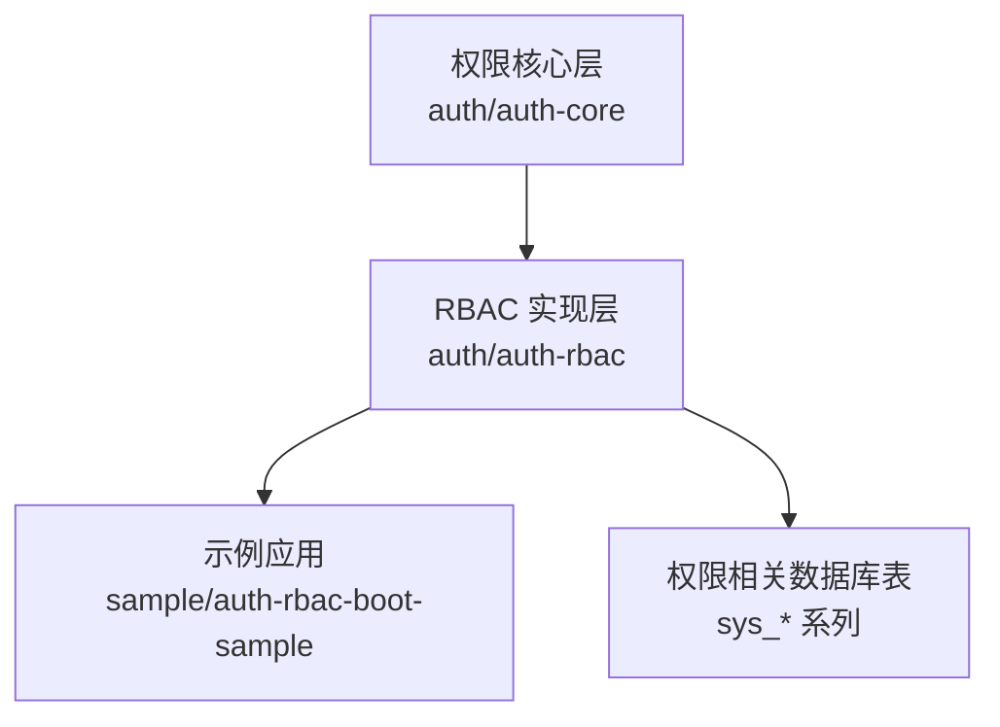
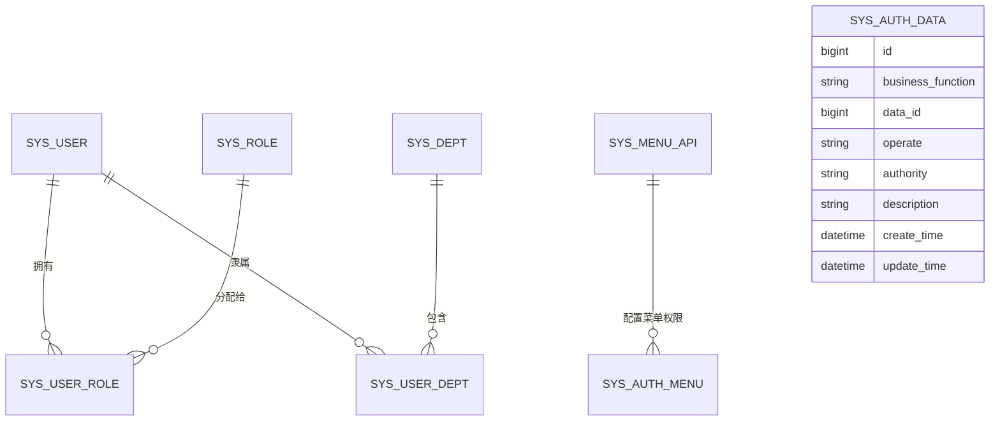
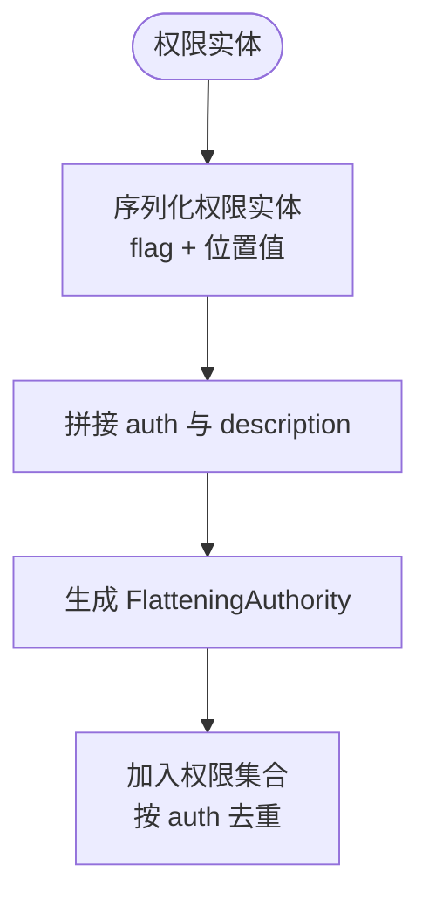
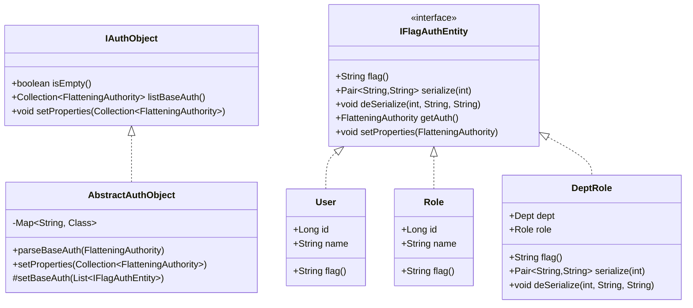
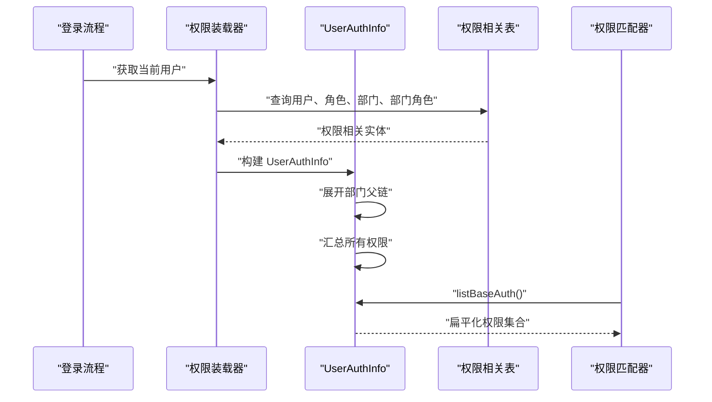
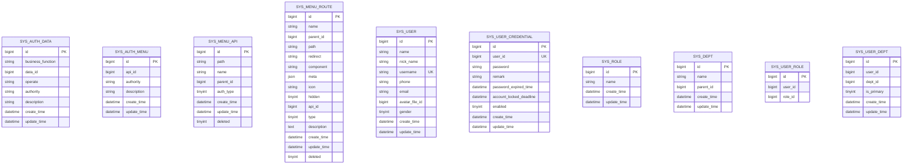
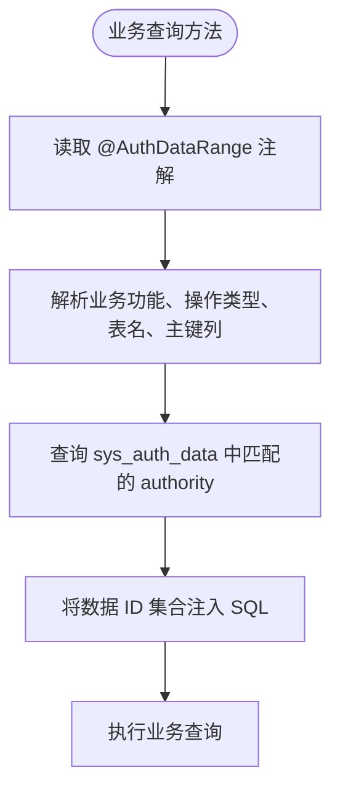
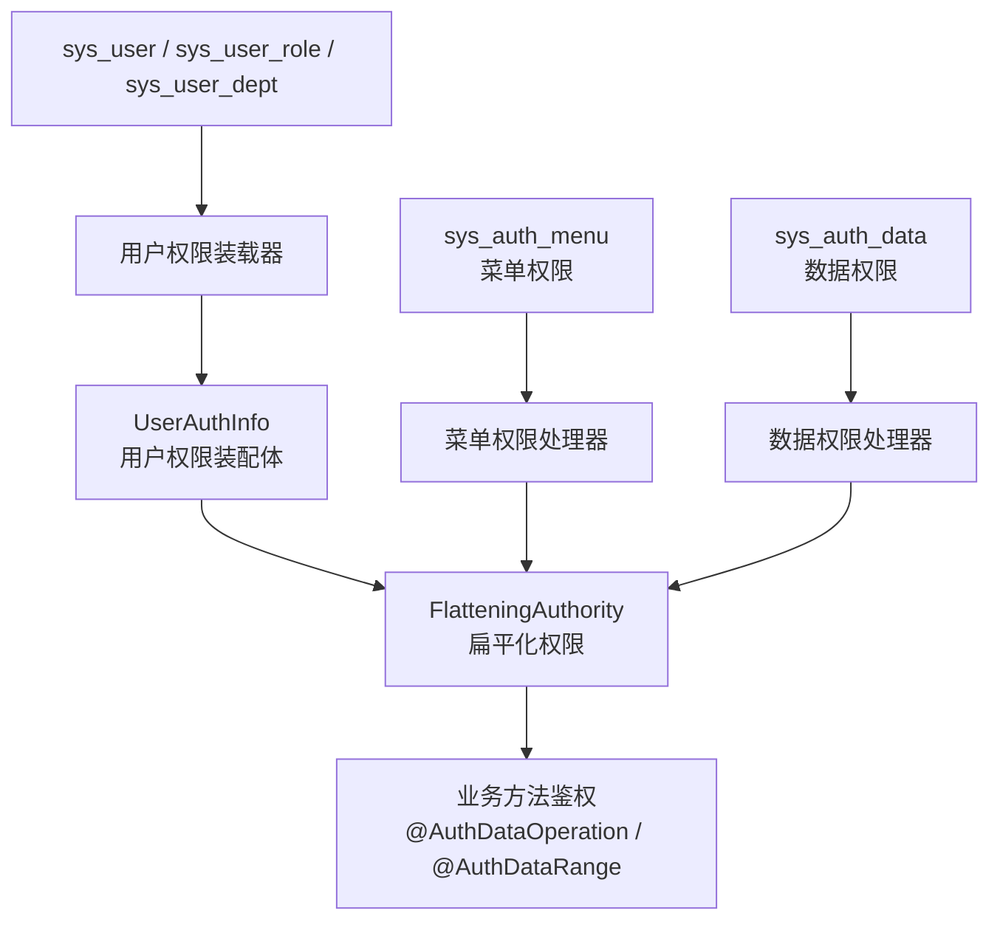

# RBAC 权限模型

<cite>
**本文引用的文件**   
- [auth-rbac.sql](file://docs/sql/auth-rbac.sql)
- [schema.sql（RBAC 示例）](file://sample/auth-rbac-boot-sample/sql/schema.sql)
- [FlatteningAuthority.java](file://auth/auth-core/src/main/java/com/cu/framework/auth/core/entity/FlatteningAuthority.java)
- [IAuthObject.java](file://auth/auth-core/src/main/java/com/cu/framework/auth/core/entity/IAuthObject.java)
- [AbstractAuthObject.java](file://auth/auth-core/src/main/java/com/cu/framework/auth/core/entity/AbstractAuthObject.java)
- [IFlagAuthEntity.java](file://auth/auth-core/src/main/java/com/cu/framework/auth/core/entity/IFlagAuthEntity.java)
- [AuthDataOperation.java](file://auth/auth-core/src/main/java/com/cu/framework/auth/core/AuthDataOperation.java)
- [AuthDataRange.java](file://auth/auth-core/src/main/java/com/cu/framework/auth/core/AuthDataRange.java)
- [RbacAnnotationAuthHandler.java](file://auth/auth-rbac/src/main/java/com/cu/framework/auth/rbac/RbacAnnotationAuthHandler.java)
- [UserAuthInfo.java](file://auth/auth-rbac/src/main/java/com/cu/framework/auth/rbac/composite/model/UserAuthInfo.java)
- [SimpleAuthObject.java](file://auth/auth-rbac/src/main/java/com/cu/framework/auth/rbac/composite/model/SimpleAuthObject.java)
- [UserAuthObject.java](file://auth/auth-rbac/src/main/java/com/cu/framework/auth/rbac/model/UserAuthObject.java)
- [DeptRole.java](file://auth/auth-rbac/src/main/java/com/cu/framework/auth/rbac/composite/model/DeptRole.java)
- [SysAuthData.java](file://auth/auth-rbac/src/main/java/com/cu/framework/auth/rbac/mp/entity/SysAuthData.java)
- [SysAuthMenu.java](file://auth/auth-rbac/src/main/java/com/cu/framework/auth/rbac/mp/entity/SysAuthMenu.java)
- [SysDept.java](file://auth/auth-rbac/src/main/java/com/cu/framework/auth/rbac/mp/entity/SysDept.java)
- [SysMenuApi.java](file://auth/auth-rbac/src/main/java/com/cu/framework/auth/rbac/mp/entity/SysMenuApi.java)
- [SysMenuRoute.java](file://auth/auth-rbac/src/main/java/com/cu/framework/auth/rbac/mp/entity/SysMenuRoute.java)
- [SysRole.java](file://auth/auth-rbac/src/main/java/com/cu/framework/auth/rbac/mp/entity/SysRole.java)
- [SysUser.java](file://auth/auth-rbac/src/main/java/com/cu/framework/auth/rbac/mp/entity/SysUser.java)
- [SysUserCredential.java](file://auth/auth-rbac/src/main/java/com/cu/framework/auth/rbac/mp/entity/SysUserCredential.java)
- [SysUserDept.java](file://auth/auth-rbac/src/main/java/com/cu/framework/auth/rbac/mp/entity/SysUserDept.java)
- [SysUserRole.java](file://auth/auth-rbac/src/main/java/com/cu/framework/auth/rbac/mp/entity/SysUserRole.java)
</cite>

## 目录

1. [引言](#引言)
2. [项目结构与定位](#项目结构与定位)
3. [RBAC 核心概念与层次关系](#rbac-核心概念与层次关系)
4. [扁平化权限对象 FlatteningAuthority](#扁平化权限对象-flatteningauthority)
5. [权限对象抽象 IAuthObject 与实体标记 IFlagAuthEntity](#权限对象抽象-iauthobject-与实体标记-iflagauthentity)
6. [用户、角色、部门与权限的数据流转](#用户角色部门与权限的数据流转)
7. [数据库表结构分析](#数据库表结构分析)
8. [Java 实体类与业务模型](#java-实体类与业务模型)
9. [注解式数据权限控制](#注解式数据权限控制)
10. [架构总览图](#架构总览图)
11. [性能与扩展性说明](#性能与扩展性说明)
12. [常见问题与排错建议](#常见问题与排错建议)
13. [结论](#结论)

## 引言

本文围绕项目中基于角色的访问控制模型，系统解释用户、角色、部门、权限之间的层次关系，以及从数据库到内存权限对象的完整数据流。重点包括：

- RBAC 模型中“用户—角色—部门—权限”的装配方式；
- `FlatteningAuthority` 扁平化权限对象的设计目标、字段含义和匹配语义；
- `IAuthObject` 接口如何统一表达不同来源的权限集合；
- `IFlagAuthEntity` 如何通过“标记+位置值”把用户、角色、部门、部门角色等实体映射为统一的权限字符串；
- 数据库表结构与 MyBatis-Plus 实体类的对应关系；
- 菜单权限、数据权限、操作权限三类控制的实现思路；
- 对初学者的可读性与对工程实践的技术深度兼顾。

需要特别说明的是：仓库中并未出现名为 `RbacEntity` 的通用基类；当前 RBAC 基础实体直接继承 MyBatis-Plus 的 `Model`，并通过各自字段体现主键、审计时间等信息。租户隔离也不是通过单一 `tenantId` 基类字段实现的，而是由外部租户模块和上下文承担。

## 项目结构与定位

RBAC 权限模型主要分布在以下三个层面：

| 层级 | 目录或模块 | 职责 |
|---|---|---|
| 权限核心层 | `auth/auth-core` | 定义扁平化权限、权限对象接口、数据范围注解、菜单权限处理器等框架级抽象 |
| RBAC 实现层 | `auth/auth-rbac` | 提供用户、角色、部门、菜单、权限数据的实体、组合模型、控制器与服务实现 |
| 示例应用层 | `sample/auth-rbac-boot-sample` | 展示如何使用 RBAC 模型，并包含示例业务表和初始化脚本 |



**图表来源**  
- [FlatteningAuthority.java:1-63](file://auth/auth-core/src/main/java/com/cu/framework/auth/core/entity/FlatteningAuthority.java#L1-L63)
- [RbacAnnotationAuthHandler.java:1-27](file://auth/auth-rbac/src/main/java/com/cu/framework/auth/rbac/RbacAnnotationAuthHandler.java#L1-L27)
- [auth-rbac.sql:1-148](file://docs/sql/auth-rbac.sql#L1-L148)

**章节来源**  
- [FlatteningAuthority.java:1-63](file://auth/auth-core/src/main/java/com/cu/framework/auth/core/entity/FlatteningAuthority.java#L1-L63)
- [RbacAnnotationAuthHandler.java:1-27](file://auth/auth-rbac/src/main/java/com/cu/framework/auth/rbac/RbacAnnotationAuthHandler.java#L1-L27)

## RBAC 核心概念与层次关系

RBAC 模型在本项目中的基本关系如下：

- **用户**：登录系统的主体，由 `sys_user` 表示。
- **用户凭证**：密码、账号启用状态、过期与锁定等认证信息，由 `sys_user_credential` 表示。
- **角色**：一组权限的集合，由 `sys_role` 表示。
- **部门**：树形组织结构，由 `sys_dept` 表示，通过 `parent_id` 形成父子关系。
- **用户—角色关联**：一个用户可以拥有多个角色。
- **用户—部门关联**：一个用户可以属于多个部门，其中一个可以是主要归属部门。
- **菜单与 API**：`sys_menu_api` 描述后端请求路径，`sys_menu_route` 描述前端路由与菜单结构。
- **菜单权限**：`sys_auth_menu` 将菜单 API 与权限字符串关联。
- **数据权限**：`sys_auth_data` 将业务功能、操作类型、业务数据 ID 与权限字符串关联。



**图表来源**  
- [auth-rbac.sql:1-148](file://docs/sql/auth-rbac.sql#L1-L148)
- [SysUser.java:1-95](file://auth/auth-rbac/src/main/java/com/cu/framework/auth/rbac/mp/entity/SysUser.java#L1-L95)
- [SysRole.java:1-60](file://auth/auth-rbac/src/main/java/com/cu/framework/auth/rbac/mp/entity/SysRole.java#L1-L60)
- [SysDept.java:1-66](file://auth/auth-rbac/src/main/java/com/cu/framework/auth/rbac/mp/entity/SysDept.java#L1-L66)
- [SysAuthData.java:1-84](file://auth/auth-rbac/src/main/java/com/cu/framework/auth/rbac/mp/entity/SysAuthData.java#L1-L84)

### 权限来源层次

权限并非只来自角色，而是由多个来源聚合：

1. **用户自身权限**：用户记录携带的权限字符串。
2. **角色权限**：用户拥有的所有角色所携带的权限字符串。
3. **部门权限**：用户所属部门及其上级链上部门的权限字符串。
4. **部门角色权限**：部门与角色的组合权限，用于表达“某个部门下的某角色”才具备的权限。
5. **菜单 API 权限**：后端接口对应的菜单权限字符串。
6. **数据权限**：针对具体业务数据 ID 的操作授权。

这些来源最终都会转换为 `FlatteningAuthority`，进入统一的权限集合中进行匹配。

**章节来源**  
- [auth-rbac.sql:1-148](file://docs/sql/auth-rbac.sql#L1-L148)
- [UserAuthInfo.java:1-163](file://auth/auth-rbac/src/main/java/com/cu/framework/auth/rbac/composite/model/UserAuthInfo.java#L1-L163)
- [SimpleAuthObject.java:1-129](file://auth/auth-rbac/src/main/java/com/cu/framework/auth/rbac/composite/model/SimpleAuthObject.java#L1-L129)

## 扁平化权限对象 FlatteningAuthority

`FlatteningAuthority` 是权限系统中最核心的统一数据结构。它不关心权限来自用户、角色、部门还是部门角色，只负责承载两个字段：

| 字段 | 类型 | 含义 | 用途 |
|---|---|---|---|
| `auth` | `String` | 权限唯一标识字符串 | 作为权限匹配、去重、缓存和比较的依据 |
| `description` | `String` | 权限描述 | 面向界面或日志的可读名称 |

### 设计要点

1. **唯一性以 `auth` 为准**：`equals` 与 `hashCode` 仅依赖 `auth`，因此同一权限字符串在集合中只会保留一份。
2. **描述可冗余但非关键**：`description` 不参与相等性判断，主要用于显示、调试和权限可视化。
3. **扁平化语义**：无论原始权限是“用户”“角色”“部门”还是“部门+角色”，最终都被转成一条扁平权限记录。
4. **适合集合运算**：因为基于字符串标识，权限合并、去重、差集等逻辑可以在内存中高效完成。

### 权限字符串组成

权限字符串不是任意文本，而是由 `IFlagAuthEntity` 序列化生成的结构化字符串。其核心规则是：

- 使用分隔符区分“权限标记”和“位置值”。
- 每个权限实体声明自己的 `flag()`，例如 `USER`、`ROLE`、`DEPT`。
- 复合权限如部门角色使用组合标记，例如部门在前、角色在后。
- 每个位置的值同时生成权限部分和描述部分，保证机器匹配和人类可读并存。



**图表来源**  
- [FlatteningAuthority.java:1-63](file://auth/auth-core/src/main/java/com/cu/framework/auth/core/entity/FlatteningAuthority.java#L1-L63)
- [IFlagAuthEntity.java:1-95](file://auth/auth-core/src/main/java/com/cu/framework/auth/core/entity/IFlagAuthEntity.java#L1-L95)

**章节来源**  
- [FlatteningAuthority.java:1-63](file://auth/auth-core/src/main/java/com/cu/framework/auth/core/entity/FlatteningAuthority.java#L1-L63)
- [IFlagAuthEntity.java:1-95](file://auth/auth-core/src/main/java/com/cu/framework/auth/core/entity/IFlagAuthEntity.java#L1-L95)

## 权限对象抽象 IAuthObject 与实体标记 IFlagAuthEntity

### IAuthObject：权限集合的统一入口

`IAuthObject` 是权限集合体的接口，它定义了三种能力：

| 方法 | 作用 | 说明 |
|---|---|---|
| `isEmpty()` | 判断是否没有任何基础权限 | 默认实现委托给 `listBaseAuth()` |
| `listBaseAuth()` | 输出扁平化权限集合 | 子类负责汇总用户、角色、部门等来源 |
| `setProperties()` | 从扁平化权限恢复集合体属性 | 配合解析逻辑反序列化权限 |

这种设计让不同来源的权限对象可以统一处理：加载时可以把数据库权限转为 `IAuthObject`，鉴权时可以直接调用 `listBaseAuth()`。

### AbstractAuthObject：解析与注册中心

`AbstractAuthObject` 实现了 `IAuthObject`，并提供两个重要机制：

1. **启动期扫描权限实体**：扫描所有实现 `IFlagAuthEntity` 的具体类，建立“权限标记 → 实体类”的映射。
2. **解析扁平权限为实体**：根据 `auth` 中的标记找到对应实体类，实例化后调用 `setProperties` 填充字段。

这避免了在权限解析逻辑中写死“如果 flag 是 USER 就查用户，是 ROLE 就查角色”的分支代码。

### IFlagAuthEntity：权限实体的最小契约

`IFlagAuthEntity` 定义了权限实体应该具备的最小能力：

| 方法 | 作用 |
|---|---|
| `flag()` | 返回权限标记，例如 `USER`、`ROLE`、`DEPT` |
| `serialize(pos)` | 把第 `pos` 个位置的值序列化为“ID 部分”和“描述部分” |
| `deSerialize(pos, posAuth, posDescription)` | 从扁平权限中还原第 `pos` 个位置的实体字段 |
| `getAuth()` | 默认实现把实体转为 `FlatteningAuthority` |
| `setProperties(flatteningAuthority)` | 默认实现拆分权限字符串并逐个位置赋值 |

对于简单实体如用户、角色、部门，通常继承 `AbstractIdNameFlagAuthEntity`；对于复合实体如部门角色，则直接实现 `IFlagAuthEntity`。



**图表来源**  
- [IAuthObject.java:1-35](file://auth/auth-core/src/main/java/com/cu/framework/auth/core/entity/IAuthObject.java#L1-L35)
- [AbstractAuthObject.java:1-92](file://auth/auth-core/src/main/java/com/cu/framework/auth/core/entity/AbstractAuthObject.java#L1-L92)
- [IFlagAuthEntity.java:1-95](file://auth/auth-core/src/main/java/com/cu/framework/auth/core/entity/IFlagAuthEntity.java#L1-L95)
- [User.java:1-49](file://auth/auth-rbac/src/main/java/com/cu/framework/auth/rbac/composite/model/User.java#L1-L49)
- [Role.java:1-33](file://auth/auth-rbac/src/main/java/com/cu/framework/auth/rbac/composite/model/Role.java#L1-L33)
- [DeptRole.java:1-69](file://auth/auth-rbac/src/main/java/com/cu/framework/auth/rbac/composite/model/DeptRole.java#L1-L69)

**章节来源**  
- [IAuthObject.java:1-35](file://auth/auth-core/src/main/java/com/cu/framework/auth/core/entity/IAuthObject.java#L1-L35)
- [AbstractAuthObject.java:1-92](file://auth/auth-core/src/main/java/com/cu/framework/auth/core/entity/AbstractAuthObject.java#L1-L92)
- [IFlagAuthEntity.java:1-95](file://auth/auth-core/src/main/java/com/cu/framework/auth/core/entity/IFlagAuthEntity.java#L1-L95)

## 用户、角色、部门与权限的数据流转

### 用户权限装配体 UserAuthInfo

`UserAuthInfo` 是当前登录用户的完整权限装配体，它继承 `AbstractAuthObject`，并持有：

| 字段 | 含义 |
|---|---|
| `userId` | 权限体所属用户 ID，也是结果映射时的根行鉴别列 |
| `user` | 用户基本信息 |
| `roles` | 用户拥有的角色列表 |
| `depts` | 用户所属部门列表 |
| `deptRoles` | 部门与角色的组合权限列表 |

`listBaseAuth()` 会依次收集：

1. 用户自身的权限；
2. 所有角色的权限；
3. 所有部门的权限；
4. 部门父链上每个上级部门的权限；
5. 所有部门角色权限；
6. 最后调用 `addAnotherBashAuth()` 允许子类追加额外权限。

### 配置权限体 SimpleAuthObject

`SimpleAuthObject` 更偏向“配置侧”使用，适合在管理端为用户、角色、部门、部门角色批量设置权限。它支持：

- 用户集合；
- 角色集合；
- 部门集合；
- 部门关系集合；
- 部门角色集合。

它的 `listBaseAuth()` 会把上述所有实体的权限字符串汇总到一个集合中，并去重。

### 当前用户包装 UserAuthObject

`UserAuthObject` 是更高层的上下文对象，封装了：

| 字段 | 含义 |
|---|---|
| `sysUser` | 用户实体 |
| `sysUserCredential` | 用户凭证，可能为空 |
| `authInfo` | 用户权限集合体 |

这个对象适合作为当前登录用户在系统中的统一视图。



**图表来源**  
- [UserAuthInfo.java:1-163](file://auth/auth-rbac/src/main/java/com/cu/framework/auth/rbac/composite/model/UserAuthInfo.java#L1-L163)
- [SimpleAuthObject.java:1-129](file://auth/auth-rbac/src/main/java/com/cu/framework/auth/rbac/composite/model/SimpleAuthObject.java#L1-L129)
- [UserAuthObject.java:1-25](file://auth/auth-rbac/src/main/java/com/cu/framework/auth/rbac/model/UserAuthObject.java#L1-L25)

**章节来源**  
- [UserAuthInfo.java:1-163](file://auth/auth-rbac/src/main/java/com/cu/framework/auth/rbac/composite/model/UserAuthInfo.java#L1-L163)
- [SimpleAuthObject.java:1-129](file://auth/auth-rbac/src/main/java/com/cu/framework/auth/rbac/composite/model/SimpleAuthObject.java#L1-L129)
- [UserAuthObject.java:1-25](file://auth/auth-rbac/src/main/java/com/cu/framework/auth/rbac/model/UserAuthObject.java#L1-L25)

## 数据库表结构分析

### 权限数据表 sys_auth_data

该表用于数据权限，即“某个用户对某个业务功能的某条数据具有某种操作权限”。

| 字段 | 类型 | 含义 |
|---|---|---|
| `id` | `bigint` | 主键 |
| `business_function` | `varchar(64)` | 业务功能，用于区分不同业务域 |
| `data_id` | `bigint` | 业务主键 ID；业务主键为字符串时可改用 `varchar` |
| `operate` | `varchar(64)` | 操作类型，如 `unified`、`modify`、`delete` 等 |
| `authority` | `varchar(100)` | 权限字符串 |
| `description` | `varchar(200)` | 权限描述 |
| `create_time` | `datetime` | 创建时间 |
| `update_time` | `datetime` | 修改时间 |

索引 `idx_sys_auth_data_biz` 按 `business_function`、`operate`、`data_id`、`authority` 建立，适合按业务功能和操作快速查找数据权限。

### 菜单权限表 sys_auth_menu

该表把菜单 API 与权限字符串关联，用于菜单级访问控制。

| 字段 | 类型 | 含义 |
|---|---|---|
| `id` | `bigint` | 主键 |
| `api_id` | `bigint` | 菜单 API ID |
| `authority` | `varchar(100)` | 权限字符串 |
| `description` | `varchar(200)` | 权限描述 |
| `create_time` | `datetime` | 创建时间 |
| `update_time` | `datetime` | 修改时间 |

### 部门表 sys_dept

部门采用树形结构，`parent_id=0` 表示根部门。

### 菜单 API 表 sys_menu_api

该表描述后端请求路径、名称、父级、权限类型等。其中 `auth_type=1` 表示基于自身权限，`auth_type=2` 表示基于父权限。

### 菜单路由表 sys_menu_route

该表描述前端路由、组件、元信息、图标、隐藏策略等，并与 `api_id` 关联。

### 用户与角色

- `sys_user`：用户基本信息。
- `sys_user_credential`：用户密码、启用状态、过期时间、锁定截止时间等。
- `sys_user_role`：用户与角色关联。
- `sys_user_dept`：用户与部门关联，`is_primary` 表示主要归属部门。



**图表来源**  
- [auth-rbac.sql:1-148](file://docs/sql/auth-rbac.sql#L1-L148)

**章节来源**  
- [auth-rbac.sql:1-148](file://docs/sql/auth-rbac.sql#L1-L148)

## Java 实体类与业务模型

### 数据权限实体 SysAuthData

`SysAuthData` 直接对应 `sys_auth_data` 表，字段包括：

- 业务功能；
- 操作类型；
- 数据 ID；
- 权限字符串；
- 权限描述；
- 创建时间和修改时间。

该类还继承了 MyBatis-Plus 的 `Model`，并提供 `pkVal()` 返回主键。

### 用户、角色、部门实体

| 实体 | 对应表 | 关键字段 |
|---|---|---|
| `SysUser` | `sys_user` | `id`、`name`、`nickName`、`username`、`phone`、`email`、`gender`、`createTime`、`updateTime` |
| `SysRole` | `sys_role` | `id`、`name`、`createTime`、`updateTime` |
| `SysDept` | `sys_dept` | `id`、`name`、`parentId`、`createTime`、`updateTime` |
| `SysUserCredential` | `sys_user_credential` | `userId`、`password`、`enabled`、过期与锁定时间 |
| `SysUserDept` | `sys_user_dept` | `userId`、`deptId`、`isPrimary` |
| `SysUserRole` | `sys_user_role` | `userId`、`roleId` |

### 菜单与权限实体

| 实体 | 对应表 | 关键字段 |
|---|---|---|
| `SysMenuApi` | `sys_menu_api` | `path`、`name`、`parentId`、`authType`、`deleted` |
| `SysMenuRoute` | `sys_menu_route` | `name`、`path`、`component`、`meta`、`apiId`、`type`、`hidden` |
| `SysAuthMenu` | `sys_auth_menu` | `apiId`、`authority`、`description` |

### 关于 RBAC 实体基类 RbacEntity

当前仓库中没有名为 `RbacEntity` 的基类。RBAC 基础实体直接继承 MyBatis-Plus 的 `Model`，并通过各自字段表达主键、创建时间、更新时间等信息。如果需要租户隔离、统一审计字段，应参考现有实体的写法自行扩展，而不是假设存在统一的 `RbacEntity`。

**章节来源**  
- [SysAuthData.java:1-84](file://auth/auth-rbac/src/main/java/com/cu/framework/auth/rbac/mp/entity/SysAuthData.java#L1-L84)
- [SysUser.java:1-95](file://auth/auth-rbac/src/main/java/com/cu/framework/auth/rbac/mp/entity/SysUser.java#L1-L95)
- [SysRole.java:1-60](file://auth/auth-rbac/src/main/java/com/cu/framework/auth/rbac/mp/entity/SysRole.java#L1-L60)
- [SysDept.java:1-66](file://auth/auth-rbac/src/main/java/com/cu/framework/auth/rbac/mp/entity/SysDept.java#L1-L66)

## 注解式数据权限控制

### 数据写入权限 AuthDataOperation

`@AuthDataOperation` 用于校验业务写方法的单条或多条数据编辑权限。其核心行为是：

1. 从方法参数中收集携带业务数据 ID 的对象；
2. 取出本次涉及的业务数据 ID 集合；
3. 查询 `sys_auth_data` 中匹配 `businessFunction`、`operate` 和数据 ID 的权限记录；
4. 与当前登录人的权限集合做内存比对；
5. 全部命中放行，任一条未命中拒绝；
6. 一次调用最多处理去重后的 100 条数据，超出应分批提交。

注解中的关键字段：

| 字段 | 含义 |
|---|---|
| `businessFunction` | 业务功能 |
| `operate` | 操作类型，默认 `unified` |

### 数据查询范围 AuthDataRange

`@AuthDataRange` 用于在 MyBatis Mapper 查询方法中注入数据范围条件。它会根据当前用户权限，把符合条件的数据 ID 集合注入到 SQL 中，典型形式是：

```sql
WHERE 业务主键 IN (
    SELECT data_id
    FROM sys_auth_data
    WHERE business_function = ?
      AND operate = ?
      AND authority IN (当前用户权限集合)
)
```

注解关键字段：

| 字段 | 含义 |
|---|---|
| `businessFunction` | 业务功能 |
| `table` | 多表联查时指定主表 |
| `tableAlias` | 多表联查时指定表别名 |
| `dataIdColumn` | 业务主键列名 |
| `operate` | 操作类型 |
| `matchMethod` | `IN` 或 `EXISTS` 匹配方式 |



**图表来源**  
- [AuthDataOperation.java:1-51](file://auth/auth-core/src/main/java/com/cu/framework/auth/core/AuthDataOperation.java#L1-L51)
- [AuthDataRange.java:1-81](file://auth/auth-core/src/main/java/com/cu/framework/auth/core/AuthDataRange.java#L1-L81)

**章节来源**  
- [AuthDataOperation.java:1-51](file://auth/auth-core/src/main/java/com/cu/framework/auth/core/AuthDataOperation.java#L1-L51)
- [AuthDataRange.java:1-81](file://auth/auth-core/src/main/java/com/cu/framework/auth/core/AuthDataRange.java#L1-L81)

## 架构总览图

下面的架构图展示了 RBAC 权限模型从数据库到运行时权限集合再到权限判定的整体路径：



**图表来源**  
- [RbacAnnotationAuthHandler.java:1-27](file://auth/auth-rbac/src/main/java/com/cu/framework/auth/rbac/RbacAnnotationAuthHandler.java#L1-L27)
- [UserAuthInfo.java:1-163](file://auth/auth-rbac/src/main/java/com/cu/framework/auth/rbac/composite/model/UserAuthInfo.java#L1-L163)
- [FlatteningAuthority.java:1-63](file://auth/auth-core/src/main/java/com/cu/framework/auth/core/entity/FlatteningAuthority.java#L1-L63)
- [AuthDataOperation.java:1-51](file://auth/auth-core/src/main/java/com/cu/framework/auth/core/AuthDataOperation.java#L1-L51)
- [AuthDataRange.java:1-81](file://auth/auth-core/src/main/java/com/cu/framework/auth/core/AuthDataRange.java#L1-L81)

## 性能与扩展性说明

### 性能特征

1. **权限字符串匹配在内存中进行**：用户权限集合不会参与数据库查询条件，避免权限规模影响 SQL 性能。
2. **数据权限查询使用索引**：`sys_auth_data` 按业务功能、操作、数据 ID、权限字符串建立索引，便于快速定位。
3. **扁平化权限集合去重**：权限字符串作为唯一标识，使用集合去重减少重复判定。
4. **数据写入限制数量**：`@AuthDataOperation` 单次最多处理 100 条数据，防止一次性权限判定过大。
5. **数据范围匹配可选 EXISTS**：当权限表较大时可使用 `EXISTS` 模式，遵循小表驱动大表原则。

### 扩展点

1. **新增权限实体**：实现 `IFlagAuthEntity`，并在 `flag()` 中返回新标记。
2. **扩展用户权限来源**：继承 `UserAuthInfo` 或 `SimpleAuthObject`，重写 `listBaseAuth()` 或 `addAnotherBashAuth()`。
3. **扩展菜单权限处理器**：替换 `RbacAnnotationAuthHandler` 的实现，接入自定义菜单权限源。
4. **扩展数据权限注解**：在 `@AuthDataRange` 基础上增加新的匹配策略或表绑定规则。

**章节来源**  
- [AuthDataOperation.java:1-51](file://auth/auth-core/src/main/java/com/cu/framework/auth/core/AuthDataOperation.java#L1-L51)
- [AuthDataRange.java:1-81](file://auth/auth-core/src/main/java/com/cu/framework/auth/core/AuthDataRange.java#L1-L81)
- [UserAuthInfo.java:1-163](file://auth/auth-rbac/src/main/java/com/cu/framework/auth/rbac/composite/model/UserAuthInfo.java#L1-L163)
- [IFlagAuthEntity.java:1-95](file://auth/auth-core/src/main/java/com/cu/framework/auth/core/entity/IFlagAuthEntity.java#L1-L95)

## 常见问题与排错建议

### 权限匹配失败

常见原因：

- 权限字符串未正确序列化或反序列化；
- 权限标记与实体不一致；
- 用户没有分配角色或部门；
- 菜单 API 未配置权限；
- 数据权限未为业务功能、操作类型、数据 ID 配置对应权限。

排查建议：

1. 确认权限实体实现了正确的 `flag()`。
2. 检查 `FlatteningAuthority.auth` 是否符合“标记+位置值”的结构。
3. 检查数据库中 `sys_auth_menu`、`sys_auth_data` 是否已配置对应权限。
4. 检查用户是否通过 `sys_user_role`、`sys_user_dept` 获得角色和部门。

### 用户权限为空

`UserAuthInfo.listBaseAuth()` 在用户为空时会返回空集合，这是保护性设计：无法确认用户身份时，不应赋予可信权限。

排查建议：

1. 检查用户加载逻辑是否正确。
2. 检查权限装配是否在用户信息可用之后执行。
3. 检查用户是否被禁用或凭证异常。

### 数据权限未生效

排查建议：

1. 确认 `@AuthDataRange` 的 `businessFunction` 和 `operate` 与实际配置一致。
2. 确认 `sys_auth_data` 中存在对应业务功能、操作类型和数据 ID 的记录。
3. 确认当前用户权限中包含对应 `authority`。
4. 如果是复杂 SQL，确认 `table`、`tableAlias`、`dataIdColumn` 配置正确。

**章节来源**  
- [UserAuthInfo.java:1-163](file://auth/auth-rbac/src/main/java/com/cu/framework/auth/rbac/composite/model/UserAuthInfo.java#L1-L163)
- [IFlagAuthEntity.java:1-95](file://auth/auth-core/src/main/java/com/cu/framework/auth/core/entity/IFlagAuthEntity.java#L1-L95)
- [AuthDataOperation.java:1-51](file://auth/auth-core/src/main/java/com/cu/framework/auth/core/AuthDataOperation.java#L1-L51)
- [AuthDataRange.java:1-81](file://auth/auth-core/src/main/java/com/cu/framework/auth/core/AuthDataRange.java#L1-L81)

## 结论

本项目的 RBAC 权限模型以“用户、角色、部门、权限”为核心，通过扁平化权限对象 `FlatteningAuthority` 把多种来源的权限统一为可比较、可去重的字符串集合。`IAuthObject` 和 `IFlagAuthEntity` 提供了权限集合体与权限实体的统一抽象，使权限装配、解析、扩展都具备良好的可扩展性。

在实际工程中，建议：

- 明确业务功能与操作类型的命名规范；
- 使用菜单权限控制接口可见性；
- 使用数据权限控制数据范围；
- 通过用户、角色、部门和部门角色组合表达组织化权限；
- 谨慎扩展权限来源，并确保扁平化权限的序列化与反序列化保持一致。