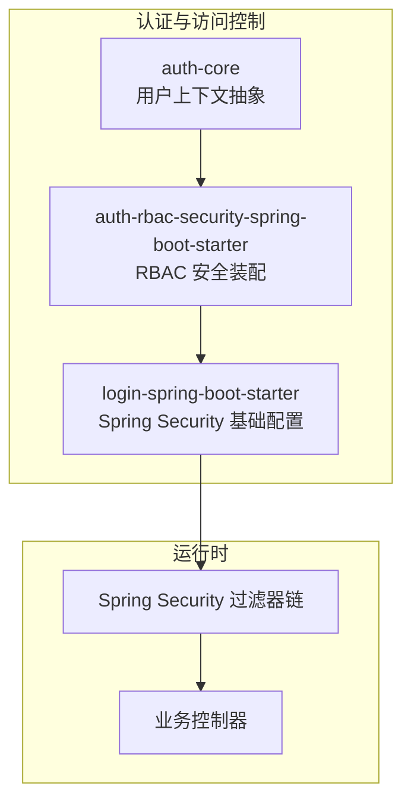
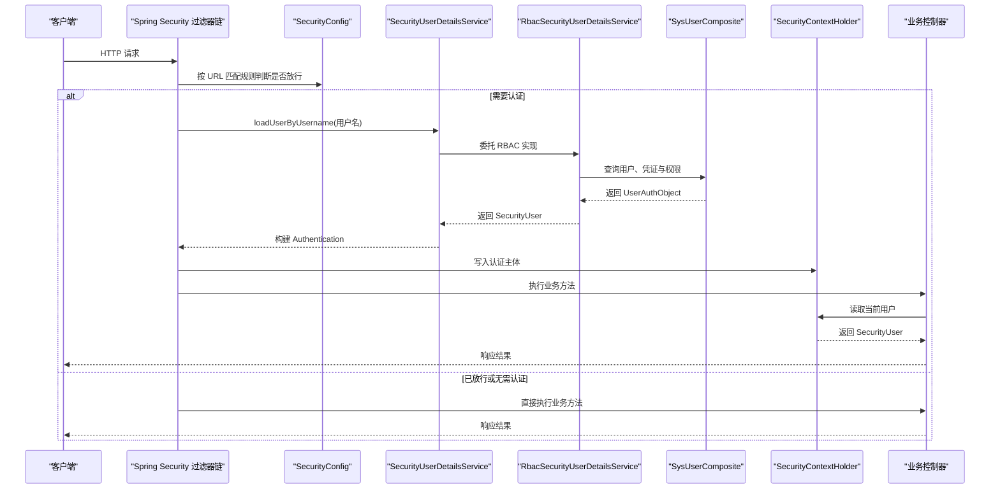
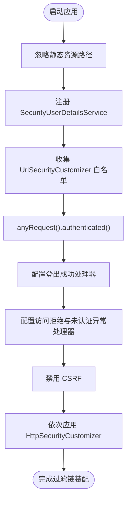
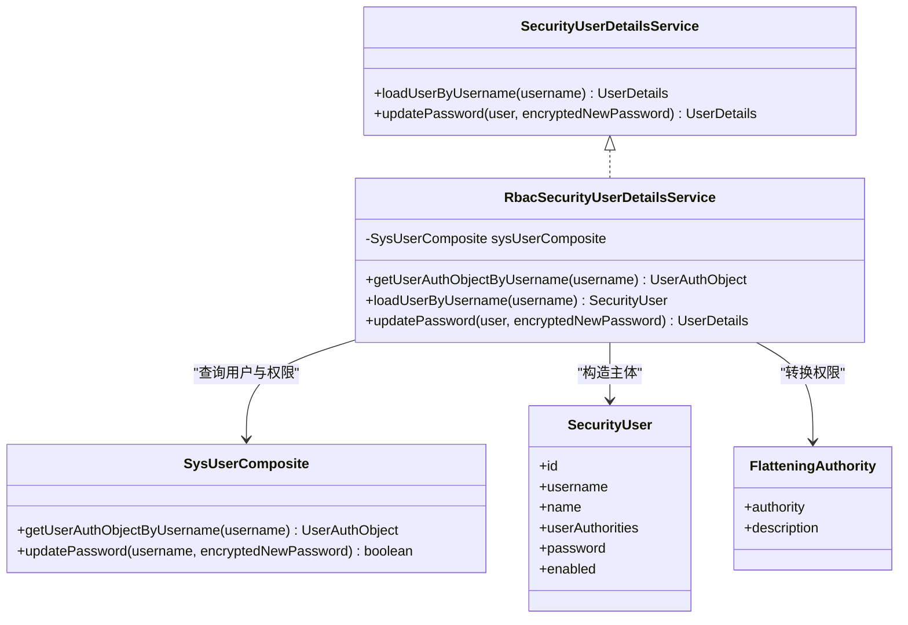
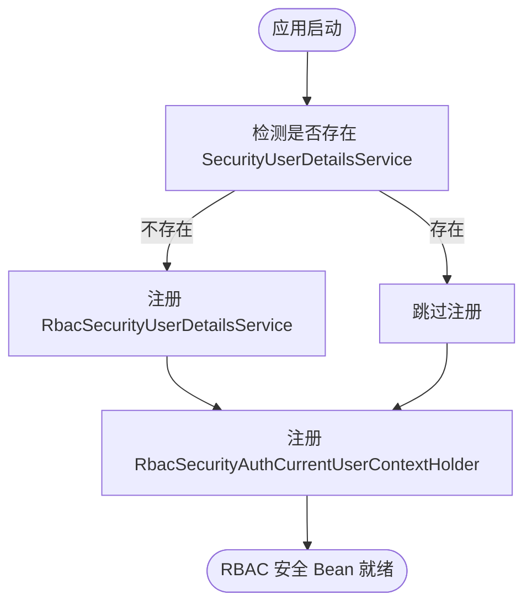
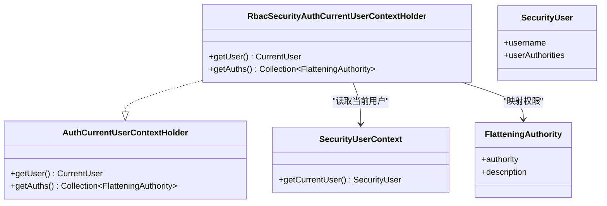
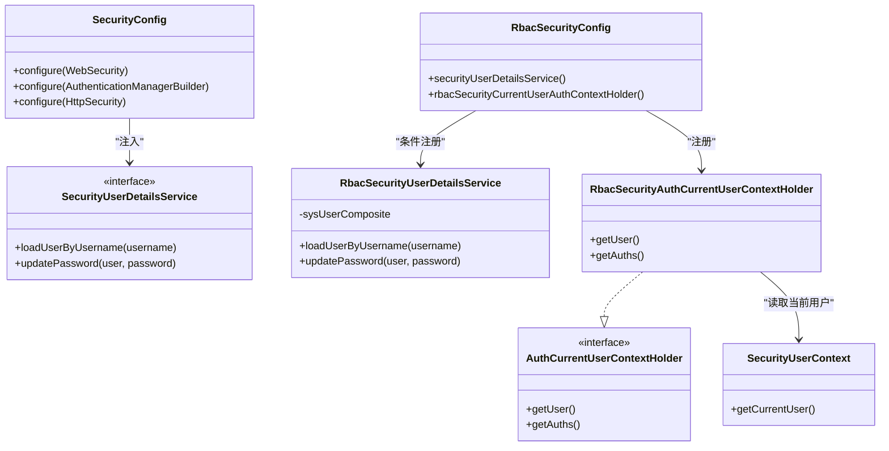

# Spring Security 集成

<cite>
**本文引用的文件**   
- [SecurityConfig.java](file://login-spring-boot-starter/src/main/java/com/cu/framework/authentication/config/SecurityConfig.java)
- [SecurityUserDetailsService.java](file://login-spring-boot-starter/src/main/java/com/cu/framework/authentication/service/SecurityUserDetailsService.java)
- [RbacSecurityUserDetailsService.java](file://auth/auth-rbac-security-spring-boot-starter/src/main/java/com/cu/framework/auth/rbac/security/RbacSecurityUserDetailsService.java)
- [RbacSecurityConfig.java](file://auth/auth-rbac-security-spring-boot-starter/src/main/java/com/cu/framework/auth/rbac/security/RbacSecurityConfig.java)
- [RbacSecurityAuthCurrentUserContextHolder.java](file://auth/auth-rbac-security-spring-boot-starter/src/main/java/com/cu/framework/auth/rbac/security/RbacSecurityAuthCurrentUserContextHolder.java)
- [AuthCurrentUserContextHolder.java](file://auth/auth-core/src/main/java/com/cu/framework/auth/core/AuthCurrentUserContextHolder.java)
- [SecurityUserContext.java](file://login-spring-boot-starter/src/main/java/com/cu/framework/authentication/SecurityUserContext.java)
</cite>

## 目录
1. [引言](#引言)
2. [项目结构](#项目结构)
3. [核心组件](#核心组件)
4. [架构总览](#架构总览)
5. [详细组件分析](#详细组件分析)
6. [依赖关系分析](#依赖关系分析)
7. [性能与扩展性](#性能与扩展性)
8. [故障排查指南](#故障排查指南)
9. [结论](#结论)
10. [附录：配置与扩展指南](#附录配置与扩展指南)

## 引言
本文面向使用 Kewen Framework 的开发者，系统性说明 Spring Security 在框架中的集成方式。重点包括：
- 安全上下文管理：如何在认证后持有当前用户，并在业务层通过统一接口获取。
- 认证流程配置：基于用户名密码、JSON 登录、单点登录的统一入口和过滤器链。
- 授权机制实现：RBAC 模型与安全框架的对接、URL 级与方法级权限控制现状。
- RbacSecurityConfig 的作用：自动装配 RBAC 相关的安全 Bean。
- SecurityUserDetailsService 的职责：将 RBAC 的用户、凭证、权限数据转换为 Spring Security 的 UserDetails。
- 自定义扩展：如何替换默认实现以满足特定业务需求。

## 项目结构
Kewen Framework 将 Spring Security 能力拆分为两个主要模块：
- login-spring-boot-starter：负责通用认证能力（过滤器、成功/失败处理器、跨域、静态资源放行、WebSecurityConfigurerAdapter 配置）。
- auth-rbac-security-spring-boot-starter：在 RBAC 能力基础上，提供基于数据库的角色权限体系与安全框架的对接 Bean。

图表来源
- [SecurityConfig.java:1-144](file://login-spring-boot-starter/src/main/java/com/cu/framework/authentication/config/SecurityConfig.java#L1-L144)
- [RbacSecurityConfig.java:1-35](file://auth/auth-rbac-security-spring-boot-starter/src/main/java/com/cu/framework/auth/rbac/security/RbacSecurityConfig.java#L1-L35)
- [AuthCurrentUserContextHolder.java:1-25](file://auth/auth-core/src/main/java/com/cu/framework/auth/core/AuthCurrentUserContextHolder.java#L1-L25)

章节来源
- [SecurityConfig.java:1-144](file://login-spring-boot-starter/src/main/java/com/cu/framework/authentication/config/SecurityConfig.java#L1-L144)
- [RbacSecurityConfig.java:1-35](file://auth/auth-rbac-security-spring-boot-starter/src/main/java/com/cu/framework/auth/rbac/security/RbacSecurityConfig.java#L1-L35)
- [AuthCurrentUserContextHolder.java:1-25](file://auth/auth-core/src/main/java/com/cu/framework/auth/core/AuthCurrentUserContextHolder.java#L1-L25)

## 核心组件
- SecurityConfig：继承 WebSecurityConfigurerAdapter，完成静态资源放行、用户详情服务注入、URL 白名单合并、全局异常处理、CSRF 禁用以及 HttpSecurity 自定义扩展点。
- SecurityUserDetailsService：框架统一的用户详情服务接口，同时具备加载用户与更新密码能力。
- RbacSecurityUserDetailsService：基于 RBAC 的实现，从 SysUserComposite 加载用户、凭证与扁平化权限，并组装为 SecurityUser。
- RbacSecurityConfig：条件注册 RbacSecurityUserDetailsService 与 RBAC 当前用户上下文实现。
- RbacSecurityAuthCurrentUserContextHolder：从 Spring Security 上下文中读取 SecurityUser，并映射到框架 CurrentUser 与 FlatteningAuthority。
- AuthCurrentUserContextHolder：业务层使用的统一用户上下文接口。
- SecurityUserContext：从 SecurityContextHolder 提取当前用户的工具类。

章节来源
- [SecurityConfig.java:1-144](file://login-spring-boot-starter/src/main/java/com/cu/framework/authentication/config/SecurityConfig.java#L1-L144)
- [SecurityUserDetailsService.java:1-27](file://login-spring-boot-starter/src/main/java/com/cu/framework/authentication/service/SecurityUserDetailsService.java#L1-L27)
- [RbacSecurityUserDetailsService.java:1-104](file://auth/auth-rbac-security-spring-boot-starter/src/main/java/com/cu/framework/auth/rbac/security/RbacSecurityUserDetailsService.java#L1-L104)
- [RbacSecurityConfig.java:1-35](file://auth/auth-rbac-security-spring-boot-starter/src/main/java/com/cu/framework/auth/rbac/security/RbacSecurityConfig.java#L1-L35)
- [RbacSecurityAuthCurrentUserContextHolder.java:1-32](file://auth/auth-rbac-security-spring-boot-starter/src/main/java/com/cu/framework/auth/rbac/security/RbacSecurityAuthCurrentUserContextHolder.java#L1-L32)
- [AuthCurrentUserContextHolder.java:1-25](file://auth/auth-core/src/main/java/com/cu/framework/auth/core/AuthCurrentUserContextHolder.java#L1-L25)
- [SecurityUserContext.java:1-37](file://login-spring-boot-starter/src/main/java/com/cu/framework/authentication/SecurityUserContext.java#L1-L37)

## 架构总览
下图展示一次典型请求从进入 Spring 容器到最终访问受控接口时的调用链。

图表来源
- [SecurityConfig.java:60-144](file://login-spring-boot-starter/src/main/java/com/cu/framework/authentication/config/SecurityConfig.java#L60-L144)
- [SecurityUserDetailsService.java:1-27](file://login-spring-boot-starter/src/main/java/com/cu/framework/authentication/service/SecurityUserDetailsService.java#L1-L27)
- [RbacSecurityUserDetailsService.java:35-104](file://auth/auth-rbac-security-spring-boot-starter/src/main/java/com/cu/framework/auth/rbac/security/RbacSecurityUserDetailsService.java#L35-L104)
- [SecurityUserContext.java:1-37](file://login-spring-boot-starter/src/main/java/com/cu/framework/authentication/SecurityUserContext.java#L1-L37)

## 详细组件分析

### SecurityConfig：安全过滤链与认证管理器装配
SecurityConfig 是 Spring Security 集成的核心装配类，职责如下：
- 静态资源放行：对 /static、/js、/css、/image 及 HTML 页面不做拦截。
- 用户详情服务装配：将 SecurityUserDetailsService 注入 AuthenticationManagerBuilder，作为用户名密码认证的用户来源。
- URL 白名单汇总：遍历 UrlSecurityCustomizer 收集允许匿名访问的 URL，然后对其它所有请求要求认证。
- 登出与异常处理：设置登出成功处理器，并将认证失败与访问拒绝统一交给异常解析处理器。
- CSRF 禁用：默认关闭 CSRF，适配前后端分离场景。
- 自定义扩展点：支持多个 HttpSecurityCustomizer 在默认配置之后继续定制，可覆盖默认行为。

图表来源
- [SecurityConfig.java:24-144](file://login-spring-boot-starter/src/main/java/com/cu/framework/authentication/config/SecurityConfig.java#L24-L144)

章节来源
- [SecurityConfig.java:24-144](file://login-spring-boot-starter/src/main/java/com/cu/framework/authentication/config/SecurityConfig.java#L24-L144)

### SecurityUserDetailsService：统一用户详情服务接口
该接口继承 Spring Security 的 UserDetailsService 与 UserDetailsPasswordService，统一对外暴露两个能力：
- 按用户名加载用户详情。
- 更新用户密码，常用于密钥算法升级后的“首次登录即刷新”策略。

实际实现由 RBAC 模块提供的 RbacSecurityUserDetailsService 承担。

章节来源
- [SecurityUserDetailsService.java:1-27](file://login-spring-boot-starter/src/main/java/com/cu/framework/authentication/service/SecurityUserDetailsService.java#L1-L27)

### RbacSecurityUserDetailsService：RBAC 用户详情实现
该类实现了 SecurityUserDetailsService，并与 RBAC 模块协作：
- 通过 SysUserComposite 按用户名加载 UserAuthObject，包含 SysUser、SysUserCredential 与 UserAuthInfo。
- 将用户基本信息映射到 SecurityUser。
- 将 UserAuthInfo 中的扁平化权限集合转换为 SecurityUserAuthority 列表。
- 若用户无凭证，则不视为异常，而是以空权限继续流程。
- 提供 updatePassword 方法，委托 SysUserComposite 更新密码。

图表来源
- [RbacSecurityUserDetailsService.java:1-104](file://auth/auth-rbac-security-spring-boot-starter/src/main/java/com/cu/framework/auth/rbac/security/RbacSecurityUserDetailsService.java#L1-L104)
- [SecurityUserDetailsService.java:1-27](file://login-spring-boot-starter/src/main/java/com/cu/framework/authentication/service/SecurityUserDetailsService.java#L1-L27)

章节来源
- [RbacSecurityUserDetailsService.java:1-104](file://auth/auth-rbac-security-spring-boot-starter/src/main/java/com/cu/framework/auth/rbac/security/RbacSecurityUserDetailsService.java#L1-L104)

### RbacSecurityConfig：RBAC 安全 Bean 装配
该配置类负责在引入 RBAC 安全 Starter 时自动装配两个关键 Bean：
- RbacSecurityUserDetailsService：当容器中不存在 SecurityUserDetailsService 实现时注册。
- RbacSecurityAuthCurrentUserContextHolder：提供 RBAC 场景下的当前用户上下文实现。

这使 RBAC 功能可以“开箱即用”，同时允许使用者通过同名 Bean 覆盖默认实现。

图表来源
- [RbacSecurityConfig.java:1-35](file://auth/auth-rbac-security-spring-boot-starter/src/main/java/com/cu/framework/auth/rbac/security/RbacSecurityConfig.java#L1-L35)

章节来源
- [RbacSecurityConfig.java:1-35](file://auth/auth-rbac-security-spring-boot-starter/src/main/java/com/cu/framework/auth/rbac/security/RbacSecurityConfig.java#L1-L35)

### 安全上下文管理：SecurityUserContext 与 AuthCurrentUserContextHolder
- SecurityUserContext：从 SecurityContextHolder 中取出 Authentication，并校验 principal 是否为框架统一的 SecurityUser；如果不是，抛出未登录异常。
- RbacSecurityAuthCurrentUserContextHolder：实现框架定义的 AuthCurrentUserContextHolder，从 SecurityUserContext 获取当前用户，并提取其权限集合为 FlatteningAuthority。
- AuthCurrentUserContextHolder：业务层应使用该接口获取当前用户与基础权限，避免直接耦合 Spring Security。

图表来源
- [SecurityUserContext.java:1-37](file://login-spring-boot-starter/src/main/java/com/cu/framework/authentication/SecurityUserContext.java#L1-L37)
- [RbacSecurityAuthCurrentUserContextHolder.java:1-32](file://auth/auth-rbac-security-spring-boot-starter/src/main/java/com/cu/framework/auth/rbac/security/RbacSecurityAuthCurrentUserContextHolder.java#L1-L32)
- [AuthCurrentUserContextHolder.java:1-25](file://auth/auth-core/src/main/java/com/cu/framework/auth/core/AuthCurrentUserContextHolder.java#L1-L25)

章节来源
- [SecurityUserContext.java:1-37](file://login-spring-boot-starter/src/main/java/com/cu/framework/authentication/SecurityUserContext.java#L1-L37)
- [RbacSecurityAuthCurrentUserContextHolder.java:1-32](file://auth/auth-rbac-security-spring-boot-starter/src/main/java/com/cu/framework/auth/rbac/security/RbacSecurityAuthCurrentUserContextHolder.java#L1-L32)
- [AuthCurrentUserContextHolder.java:1-25](file://auth/auth-core/src/main/java/com/cu/framework/auth/core/AuthCurrentUserContextHolder.java#L1-L25)

### 授权机制现状：URL 级与方法级
- URL 级权限控制：由 SecurityConfig 的 configure(HttpSecurity) 完成。默认将所有未显式放行的请求标记为 authenticated，并通过 UrlSecurityCustomizer 提供白名单扩展点。
- 方法级权限控制：在当前仓库源码中未发现 EnableGlobalMethodSecurity、@PreAuthorize、@PostAuthorize、@Secured、@RolesAllowed 或自定义 MethodSecurityInterceptor/MetadataSource 的实现。因此，当前代码库并未启用 Spring Security 的方法级注解鉴权。若需启用，应在业务项目中补充相应配置与表达式处理器。

章节来源
- [SecurityConfig.java:60-144](file://login-spring-boot-starter/src/main/java/com/cu/framework/authentication/config/SecurityConfig.java#L60-L144)

## 依赖关系分析
下图展示关键类之间的依赖关系。

图表来源
- [SecurityConfig.java:1-144](file://login-spring-boot-starter/src/main/java/com/cu/framework/authentication/config/SecurityConfig.java#L1-L144)
- [RbacSecurityConfig.java:1-35](file://auth/auth-rbac-security-spring-boot-starter/src/main/java/com/cu/framework/auth/rbac/security/RbacSecurityConfig.java#L1-L35)
- [RbacSecurityUserDetailsService.java:1-104](file://auth/auth-rbac-security-spring-boot-starter/src/main/java/com/cu/framework/auth/rbac/security/RbacSecurityUserDetailsService.java#L1-L104)
- [RbacSecurityAuthCurrentUserContextHolder.java:1-32](file://auth/auth-rbac-security-spring-boot-starter/src/main/java/com/cu/framework/auth/rbac/security/RbacSecurityAuthCurrentUserContextHolder.java#L1-L32)
- [AuthCurrentUserContextHolder.java:1-25](file://auth/auth-core/src/main/java/com/cu/framework/auth/core/AuthCurrentUserContextHolder.java#L1-L25)
- [SecurityUserContext.java:1-37](file://login-spring-boot-starter/src/main/java/com/cu/framework/authentication/SecurityUserContext.java#L1-L37)

章节来源
- [SecurityConfig.java:1-144](file://login-spring-boot-starter/src/main/java/com/cu/framework/authentication/config/SecurityConfig.java#L1-L144)
- [RbacSecurityConfig.java:1-35](file://auth/auth-rbac-security-spring-boot-starter/src/main/java/com/cu/framework/auth/rbac/security/RbacSecurityConfig.java#L1-L35)
- [RbacSecurityUserDetailsService.java:1-104](file://auth/auth-rbac-security-spring-boot-starter/src/main/java/com/cu/framework/auth/rbac/security/RbacSecurityUserDetailsService.java#L1-L104)
- [RbacSecurityAuthCurrentUserContextHolder.java:1-32](file://auth/auth-rbac-security-spring-boot-starter/src/main/java/com/cu/framework/auth/rbac/security/RbacSecurityAuthCurrentUserContextHolder.java#L1-L32)
- [AuthCurrentUserContextHolder.java:1-25](file://auth/auth-core/src/main/java/com/cu/framework/auth/core/AuthCurrentUserContextHolder.java#L1-L25)
- [SecurityUserContext.java:1-37](file://login-spring-boot-starter/src/main/java/com/cu/framework/authentication/SecurityUserContext.java#L1-L37)

## 性能与扩展性
- 用户信息加载：每次认证都会通过 SysUserComposite 查询用户、凭证与权限。建议确保底层缓存或索引合理，避免频繁全表扫描。
- 权限集合转换：将 FlatteningAuthority 转为 SecurityUserAuthority 发生在认证阶段，应避免在高频路径中进行额外计算。
- 自定义扩展点：
  - 使用 HttpSecurityCustomizer 在默认过滤链之后追加或覆盖规则。
  - 使用 UrlSecurityCustomizer 声明匿名访问路径。
  - 使用 SecurityUserDetailsService 的自定义实现替换 RBAC 默认实现。
  - 使用 AuthCurrentUserContextHolder 的自定义实现替换 RBAC 默认上下文。

[本节为通用指导，不涉及具体代码片段]

## 故障排查指南
- 未登录异常：
  - 现象：调用 SecurityUserContext.getCurrentUser() 抛出未登录异常。
  - 可能原因：认证尚未完成、SecurityContextHolder 中没有 Authentication，或 principal 不是 SecurityUser。
  - 排查要点：检查登录流程是否成功写入 SecurityUser；确认是否使用了自定义认证主体类型。
- 用户未找到：
  - 现象：RbacSecurityUserDetailsService.loadUserByUsername 抛出未找到用户异常。
  - 可能原因：用户名不存在；SysUserComposite 未返回有效数据。
  - 排查要点：检查用户表与关联权限数据是否完整。
- 权限为空但能登录：
  - 现象：用户可登录，但没有权限。
  - 可能原因：用户存在但无权限数据；SysUserComposite.getUserAuthObjectByUsername 返回的 UserAuthInfo 为空。
  - 处理逻辑：框架允许无权限用户登录，只是权限集合为空。
- 自定义配置未生效：
  - 现象：UrlSecurityCustomizer 或 HttpSecurityCustomizer 配置的放行规则无效。
  - 可能原因：自定义 Bean 未被 Spring 扫描到；顺序不正确；被后续 customizer 覆盖。
  - 排查要点：确认 Bean 名称与类型；检查 customizer 执行顺序。

章节来源
- [SecurityUserContext.java:1-37](file://login-spring-boot-starter/src/main/java/com/cu/framework/authentication/SecurityUserContext.java#L1-L37)
- [RbacSecurityUserDetailsService.java:35-104](file://auth/auth-rbac-security-spring-boot-starter/src/main/java/com/cu/framework/auth/rbac/security/RbacSecurityUserDetailsService.java#L35-L104)
- [SecurityConfig.java:60-144](file://login-spring-boot-starter/src/main/java/com/cu/framework/authentication/config/SecurityConfig.java#L60-L144)

## 结论
Kewen Framework 通过 login-spring-boot-starter 提供了 Spring Security 的基础能力，再通过 auth-rbac-security-spring-boot-starter 将 RBAC 的用户、凭证与权限体系与安全框架无缝衔接。SecurityConfig 负责过滤链与认证入口，RbacSecurityUserDetailsService 负责把 RBAC 数据转换成 Spring Security 的主体，而 RbacSecurityAuthCurrentUserContextHolder 则将当前用户暴露给业务层。当前仓库未启用方法级注解鉴权，URL 级控制可通过白名单与自定义 Customizer 灵活扩展。

[本节为总结性内容，不涉及具体代码片段]

## 附录：配置与扩展指南

### 使用默认 RBAC 安全能力
- 引入 RBAC 安全 Starter，即可自动获得：
  - RbacSecurityUserDetailsService。
  - RbacSecurityAuthCurrentUserContextHolder。
- 业务层通过 AuthCurrentUserContextHolder 获取当前用户与权限。

章节来源
- [RbacSecurityConfig.java:1-35](file://auth/auth-rbac-security-spring-boot-starter/src/main/java/com/cu/framework/auth/rbac/security/RbacSecurityConfig.java#L1-L35)
- [AuthCurrentUserContextHolder.java:1-25](file://auth/auth-core/src/main/java/com/cu/framework/auth/core/AuthCurrentUserContextHolder.java#L1-L25)

### 自定义用户详情服务
- 定义实现 SecurityUserDetailsService 的 Bean。
- 由于 RbacSecurityConfig 使用 ConditionalOnMissingBean，自定义实现会覆盖默认实现。
- 适合场景：从非 RBAC 系统加载用户，或与第三方身份源集成。

章节来源
- [RbacSecurityConfig.java:10-23](file://auth/auth-rbac-security-spring-boot-starter/src/main/java/com/cu/framework/auth/rbac/security/RbacSecurityConfig.java#L10-L23)
- [SecurityUserDetailsService.java:1-27](file://login-spring-boot-starter/src/main/java/com/cu/framework/authentication/service/SecurityUserDetailsService.java#L1-L27)

### 自定义当前用户上下文
- 定义实现 AuthCurrentUserContextHolder 的 Bean。
- 由于 RbacSecurityConfig 直接注册名为 rbacSecurityCurrentUserAuthContextHolder 的 Bean，若业务希望完全替换，应提供同类型 Bean 并注意命名与装配顺序。
- 适合场景：从其他上下文或分布式会话中读取当前用户。

章节来源
- [RbacSecurityConfig.java:25-34](file://auth/auth-rbac-security-spring-boot-starter/src/main/java/com/cu/framework/auth/rbac/security/RbacSecurityConfig.java#L25-L34)
- [AuthCurrentUserContextHolder.java:1-25](file://auth/auth-core/src/main/java/com/cu/framework/auth/core/AuthCurrentUserContextHolder.java#L1-L25)

### URL 级权限控制扩展
- 通过 UrlSecurityCustomizer 提供 permitAll 白名单。
- 通过 HttpSecurityCustomizer 在默认过滤链之后追加或覆盖规则。
- 适合场景：开放健康检查、Swagger、公开 API、第三方回调等。

章节来源
- [SecurityConfig.java:60-144](file://login-spring-boot-starter/src/main/java/com/cu/framework/authentication/config/SecurityConfig.java#L60-L144)

### 方法级权限控制
- 当前仓库未启用 @PreAuthorize、@PostAuthorize、@Secured 等方法级注解。
- 如需启用，可在业务项目中补充方法级安全配置与表达式处理器，并确保 SecurityUserContext 与权限数据一致。

[本节为通用指导，不涉及具体代码片段]