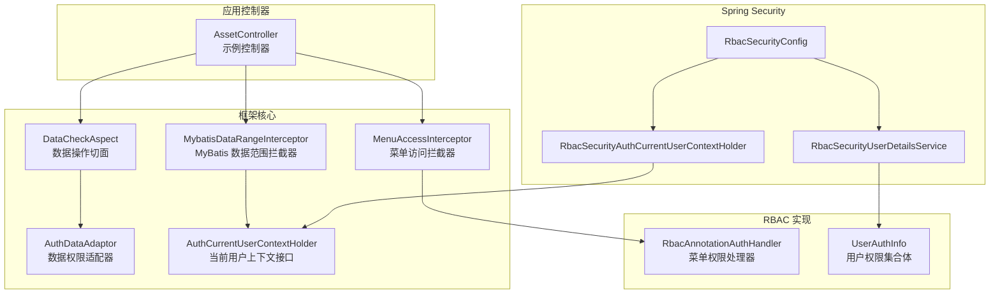
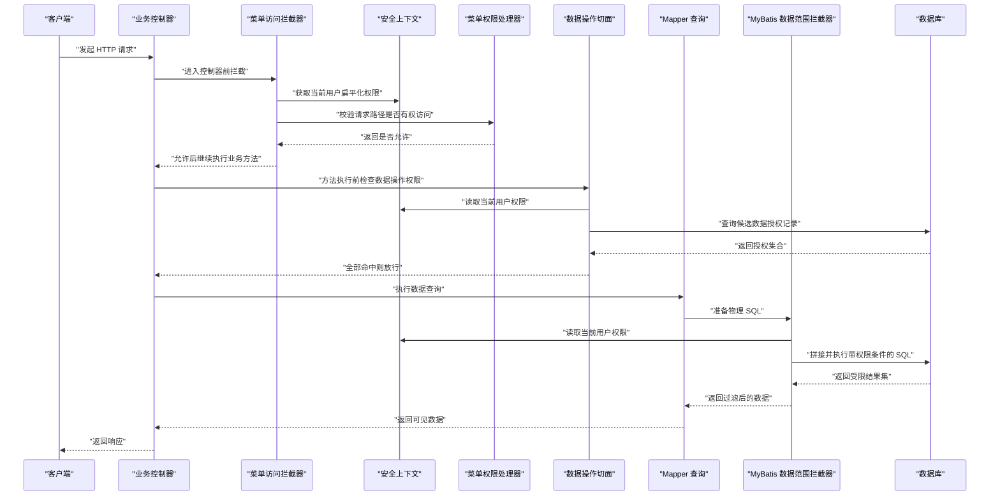
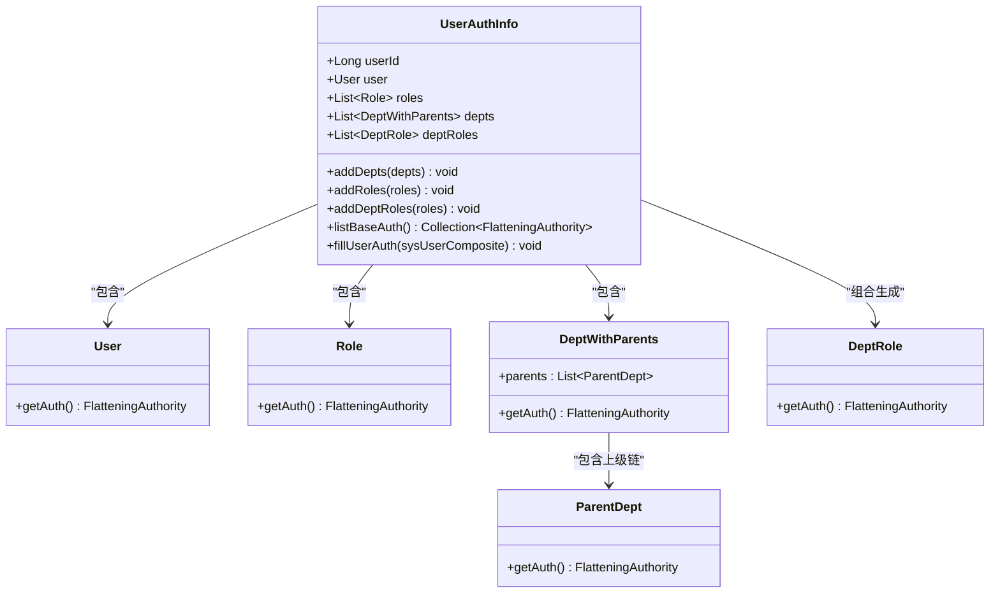
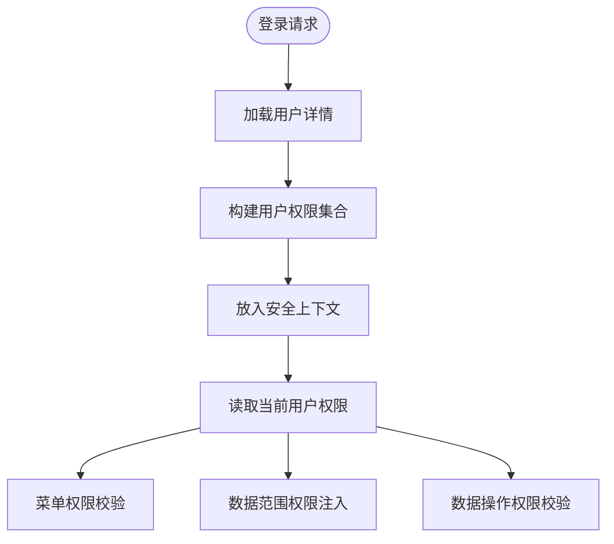
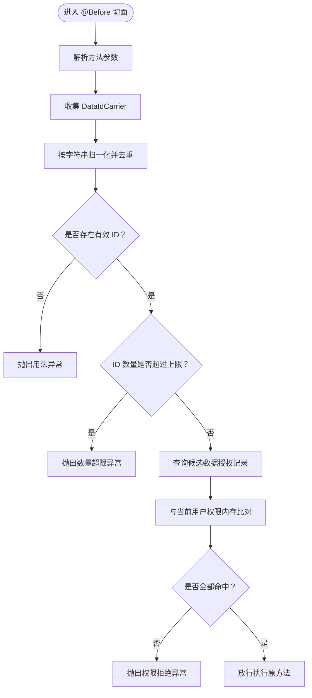
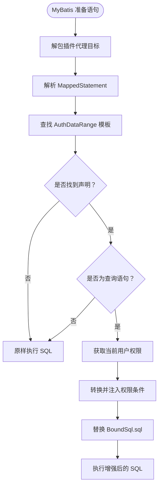
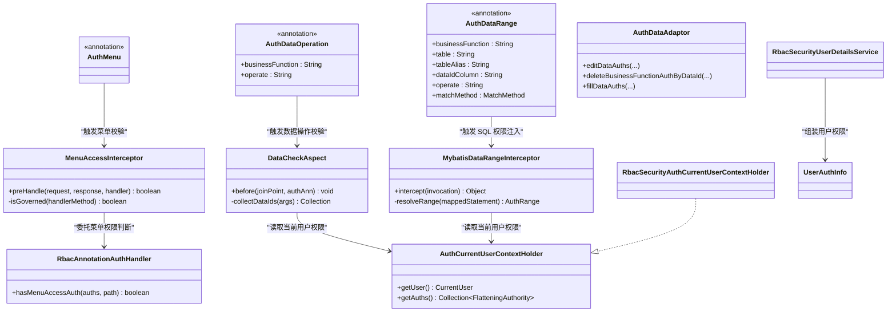

# 核心概念

<cite>
**本文引用的文件**   
- [README_Auth.md](file://README_Auth.md)
- [AuthMenu.java](file://auth/auth-core/src/main/java/com/cu/framework/auth/core/AuthMenu.java)
- [AuthDataRange.java](file://auth/auth-core/src/main/java/com/cu/framework/auth/core/AuthDataRange.java)
- [AuthDataOperation.java](file://auth/auth-core/src/main/java/com/cu/framework/auth/core/AuthDataOperation.java)
- [AuthDataAdaptor.java](file://auth/auth-core/src/main/java/com/cu/framework/auth/core/AuthDataAdaptor.java)
- [AuthCurrentUserContextHolder.java](file://auth/auth-core/src/main/java/com/cu/framework/auth/core/AuthCurrentUserContextHolder.java)
- [MenuAccessInterceptor.java](file://auth/auth-core/src/main/java/com/cu/framework/auth/core/menu/MenuAccessInterceptor.java)
- [RbacAnnotationAuthHandler.java](file://auth/auth-rbac/src/main/java/com/cu/framework/auth/rbac/RbacAnnotationAuthHandler.java)
- [MybatisDataRangeInterceptor.java](file://auth/auth-core/src/main/java/com/cu/framework/auth/core/data/range/MybatisDataRangeInterceptor.java)
- [DataCheckAspect.java](file://auth/auth-core/src/main/java/com/cu/framework/auth/core/data/edit/DataCheckAspect.java)
- [UserAuthInfo.java](file://auth/auth-rbac/src/main/java/com/cu/framework/auth/rbac/composite/model/UserAuthInfo.java)
- [RbacSecurityConfig.java](file://auth/auth-rbac-security-spring-boot-starter/src/main/java/com/cu/framework/auth/rbac/security/RbacSecurityConfig.java)
- [RbacSecurityUserDetailsService.java](file://auth/auth-rbac-security-spring-boot-starter/src/main/java/com/cu/framework/auth/rbac/security/RbacSecurityUserDetailsService.java)
- [RbacSecurityAuthCurrentUserContextHolder.java](file://auth/auth-rbac-security-spring-boot-starter/src/main/java/com/cu/framework/auth/rbac/security/RbacSecurityAuthCurrentUserContextHolder.java)
- [AssetController.java](file://sample/auth-core-boot-sample/src/main/java/com/cu/framework/sample/authcore/web/AssetController.java)
</cite>

## 目录
1. [引言](#引言)
2. [项目结构](#项目结构)
3. [核心概念总览](#核心概念总览)
4. [架构总览](#架构总览)
5. [RBAC 权限模型与用户、角色、部门关系](#rbac-权限模型与用户角色部门关系)
6. [注解驱动开发模式](#注解驱动开发模式)
7. [Spring Security 集成与安全上下文](#spring-security-集成与安全上下文)
8. [AOP 切面在权限验证中的应用](#aop-切面在权限验证中的应用)
9. [数据范围 SQL 注入机制](#数据范围-sql-注入机制)
10. [关键类关系图](#关键类关系图)
11. [性能与边界条件](#性能与边界条件)
12. [故障排查指南](#故障排查指南)
13. [结论](#结论)

## 引言
本文件面向 Kewen Framework 的权限子系统，目标是帮助读者从“业务视角”理解 RBAC（基于角色的访问控制），并从“实现视角”理解框架如何通过注解、拦截器、MyBatis 插件和 Spring Security 协作完成菜单权限、数据范围和数据操作权限控制。文档同时覆盖：
- RBAC 中用户、角色、部门、权限的关系；
- `@AuthMenu`、`@AuthDataRange`、`@AuthDataOperation` 等核心注解的设计理念；
- Spring Security 安全上下文加载流程；
- AOP 与 MyBatis 拦截器如何把权限逻辑从业务代码中剥离；
- 实际示例中的调用顺序、边界条件和常见陷阱。

## 项目结构
权限相关代码主要分布在以下模块：
- `auth/auth-core`：框架抽象层，定义注解、上下文接口、菜单校验入口、数据范围与数据操作的核心处理契约。
- `auth/auth-rbac`：RBAC 默认实现，提供用户、角色、部门、菜单、数据权限等实体与服务组合。
- `auth/auth-rbac-security-spring-boot-starter`：将 RBAC 能力接入 Spring Security，装配当前登录用户上下文。
- `login-spring-boot-starter`：通用认证与登录能力，对外暴露 `SecurityUserContext` 等安全上下文工具。
- `sample/auth-core-boot-sample`、`sample/auth-rbac-boot-sample`：演示如何使用注解与数据权限。

**图表来源**  
- [MenuAccessInterceptor.java:1-93](file://auth/auth-core/src/main/java/com/cu/framework/auth/core/menu/MenuAccessInterceptor.java#L1-L93)  
- [MybatisDataRangeInterceptor.java:1-216](file://auth/auth-core/src/main/java/com/cu/framework/auth/core/data/range/MybatisDataRangeInterceptor.java#L1-L216)  
- [DataCheckAspect.java:1-149](file://auth/auth-core/src/main/java/com/cu/framework/auth/core/data/edit/DataCheckAspect.java#L1-L149)  
- [AuthDataAdaptor.java:1-45](file://auth/auth-core/src/main/java/com/cu/framework/auth/core/AuthDataAdaptor.java#L1-L45)  
- [RbacAnnotationAuthHandler.java:1-27](file://auth/auth-rbac/src/main/java/com/cu/framework/auth/rbac/RbacAnnotationAuthHandler.java#L1-L27)  
- [UserAuthInfo.java:1-163](file://auth/auth-rbac/src/main/java/com/cu/framework/auth/rbac/composite/model/UserAuthInfo.java#L1-L163)  
- [RbacSecurityConfig.java:1-35](file://auth/auth-rbac-security-spring-boot-starter/src/main/java/com/cu/framework/auth/rbac/security/RbacSecurityConfig.java#L1-L35)  
- [RbacSecurityUserDetailsService.java:1-104](file://auth/auth-rbac-security-spring-boot-starter/src/main/java/com/cu/framework/auth/rbac/security/RbacSecurityUserDetailsService.java#L1-L104)  
- [RbacSecurityAuthCurrentUserContextHolder.java:1-32](file://auth/auth-rbac-security-spring-boot-starter/src/main/java/com/cu/framework/auth/rbac/security/RbacSecurityAuthCurrentUserContextHolder.java#L1-L32)

**章节来源**  
- [README_Auth.md:1-934](file://README_Auth.md#L1-L934)

## 核心概念总览
Kewen Framework 的权限体系围绕三类问题展开：
1. **菜单权限**：某个请求路径是否允许被当前用户访问。
2. **数据范围权限**：查询结果只返回当前用户可见的数据行。
3. **数据操作权限**：对某条或某些数据执行写操作前，确认调用方确实拥有该数据的操作权。

框架通过四个核心注解表达这些意图：
- `@AuthMenu`：声明一个端点受菜单权限管辖。
- `@AuthDataRange`：声明一条 MyBatis 查询需要按数据范围过滤。
- `@AuthDataOperation`：声明一个方法需要对其中承载的业务数据 ID 做操作权限校验。
- `@AuthDataAuthEdit`：直接编辑数据权限记录，由适配器封装。

此外，`AuthDataAdaptor` 提供了不依赖注解的方式，在 Service 层直接读写数据权限。

**章节来源**  
- [README_Auth.md:201-649](file://README_Auth.md#L201-L649)  
- [AuthMenu.java:1-16](file://auth/auth-core/src/main/java/com/cu/framework/auth/core/AuthMenu.java#L1-L16)  
- [AuthDataRange.java:1-81](file://auth/auth-core/src/main/java/com/cu/framework/auth/core/AuthDataRange.java#L1-L81)  
- [AuthDataOperation.java:1-51](file://auth/auth-core/src/main/java/com/cu/framework/auth/core/AuthDataOperation.java#L1-L51)  
- [AuthDataAdaptor.java:1-45](file://auth/auth-core/src/main/java/com/cu/framework/auth/core/AuthDataAdaptor.java#L1-L45)

## 架构总览
下图展示一次典型带权限控制的请求经过哪些组件：

**图表来源**  
- [MenuAccessInterceptor.java:1-93](file://auth/auth-core/src/main/java/com/cu/framework/auth/core/menu/MenuAccessInterceptor.java#L1-L93)  
- [DataCheckAspect.java:1-149](file://auth/auth-core/src/main/java/com/cu/framework/auth/core/data/edit/DataCheckAspect.java#L1-L149)  
- [MybatisDataRangeInterceptor.java:1-216](file://auth/auth-core/src/main/java/com/cu/framework/auth/core/data/range/MybatisDataRangeInterceptor.java#L1-L216)  
- [RbacSecurityAuthCurrentUserContextHolder.java:1-32](file://auth/auth-rbac-security-spring-boot-starter/src/main/java/com/cu/framework/auth/rbac/security/RbacSecurityAuthCurrentUserContextHolder.java#L1-L32)

## RBAC 权限模型与用户、角色、部门关系
RBAC 的核心思想是把“谁能做什么”拆成三层：
- **用户**：系统使用者。
- **角色**：一组权限的集合。
- **部门**：组织维度，常用于继承式数据范围。

框架中 `UserAuthInfo` 是 RBAC 权限集合体的实现，它聚合：
- 用户本身；
- 用户关联的角色；
- 用户所在的部门及其上级部门链；
- 部门与角色的组合。

`listBaseAuth()` 会把上述所有实体的扁平化权限汇总成一个去重集合，供后续菜单权限、数据权限判断使用。这样，权限判断不再直接依赖用户表，而是依赖“用户 + 角色 + 部门 + 部门角色”共同产生的权限字符串集合。

**图表来源**  
- [UserAuthInfo.java:1-163](file://auth/auth-rbac/src/main/java/com/cu/framework/auth/rbac/composite/model/UserAuthInfo.java#L1-L163)

在登录流程中，`RbacSecurityUserDetailsService` 会：
1. 通过 `SysUserComposite` 加载用户名对应的用户、凭证和权限对象；
2. 将 `UserAuthInfo` 中的扁平化权限转换为 `SecurityUserAuthority`；
3. 组装为 Spring Security 可用的 `SecurityUser`；
4. 若没有凭证，仍允许加载出无权限的用户，而不是直接失败。

随后，`RbacSecurityAuthCurrentUserContextHolder` 从 `SecurityUserContext` 中取出当前用户及其权限，供菜单拦截器和数据范围拦截器使用。

**章节来源**  
- [UserAuthInfo.java:1-163](file://auth/auth-rbac/src/main/java/com/cu/framework/auth/rbac/composite/model/UserAuthInfo.java#L1-L163)  
- [RbacSecurityUserDetailsService.java:1-104](file://auth/auth-rbac-security-spring-boot-starter/src/main/java/com/cu/framework/auth/rbac/security/RbacSecurityUserDetailsService.java#L1-L104)  
- [RbacSecurityAuthCurrentUserContextHolder.java:1-32](file://auth/auth-rbac-security-spring-boot-starter/src/main/java/com/cu/framework/auth/rbac/security/RbacSecurityAuthCurrentUserContextHolder.java#L1-L32)

## 注解驱动开发模式
### `@AuthMenu`：菜单权限
`@AuthMenu` 是一个“标记型”注解，本身不包含属性，只表示“这个端点受菜单权限管辖”。它可以标在方法上，也可以标在类上；类级别标注意味着该类下所有映射到 URL 的端点都参与菜单权限判定。

菜单权限的运行时校验由 `MenuAccessInterceptor` 完成：
- 如果请求不是 Controller 方法，直接放行；
- 如果方法和所在类都没有 `@AuthMenu`，跳过菜单校验；
- 否则取请求路径（去掉 contextPath），结合当前用户的扁平化权限，调用菜单权限处理器判断是否允许访问；
- 不允许时抛出统一异常。

RBAC 默认实现 `RbacAnnotationAuthHandler` 委托给 `SysAuthMenuComposite`，即最终根据数据库中已登记的 API 菜单与授权关系进行匹配。

**章节来源**  
- [AuthMenu.java:1-16](file://auth/auth-core/src/main/java/com/cu/framework/auth/core/AuthMenu.java#L1-L16)  
- [MenuAccessInterceptor.java:1-93](file://auth/auth-core/src/main/java/com/cu/framework/auth/core/menu/MenuAccessInterceptor.java#L1-L93)  
- [RbacAnnotationAuthHandler.java:1-27](file://auth/auth-rbac/src/main/java/com/cu/framework/auth/rbac/RbacAnnotationAuthHandler.java#L1-L27)

### `@AuthDataRange`：数据范围查询
`@AuthDataRange` 用于声明“这条查询只能看到当前用户有权限的数据”。它必须指定 `businessFunction`，可选参数包括目标表、表别名、主键列名、操作类型和匹配方式。

关键点：
- 声明位置是 MyBatis Mapper 接口的查询方法；
- 注解只影响该方法对应的映射语句；
- MyBatis-Plus 自带的 `selectList`、`page` 等方法不受此注解控制；
- 启动期会校验声明合法性，例如找不到映射语句、非查询语句、启用二级缓存、找不到声明表等；
- 运行时通过 MyBatis 拦截器把权限条件注入到 SQL 中，通常表现为对 `data_id` 的 `IN` 或 `EXISTS` 子查询。

**章节来源**  
- [AuthDataRange.java:1-81](file://auth/auth-core/src/main/java/com/cu/framework/auth/core/AuthDataRange.java#L1-L81)

### `@AuthDataOperation`：数据操作权限
`@AuthDataOperation` 用于写操作前的数据级权限校验。它关注的是“本次操作涉及哪些业务数据 ID”，而不是“这次请求能否进入方法”。

校验规则：
- 切面从方法参数中收集所有 `DataIdCarrier` 交出的业务 ID；
- 支持一层数组和集合元素；
- ID 会按字符串归一化去重；
- 单次最多允许 100 个不同 ID，超出直接拒绝；
- 查询候选数据授权记录后，与当前用户权限在内存比对；
- 任一未命中即整体拒绝，方法体不执行。

**章节来源**  
- [AuthDataOperation.java:1-51](file://auth/auth-core/src/main/java/com/cu/framework/auth/core/AuthDataOperation.java#L1-L51)  
- [DataCheckAspect.java:1-149](file://auth/auth-core/src/main/java/com/cu/framework/auth/core/data/edit/DataCheckAspect.java#L1-L149)

### `AuthDataAdaptor`：编程式数据权限适配
`AuthDataAdaptor` 提供三个常用能力：
- 编辑某条数据的权限；
- 删除某条数据对应功能下的权限；
- 填充某条数据对应的权限集合。

它适合不想用 `@AuthDataAuthEdit` 注解，而希望在 Service 层灵活控制权限写入的场景。

**章节来源**  
- [AuthDataAdaptor.java:1-45](file://auth/auth-core/src/main/java/com/cu/framework/auth/core/AuthDataAdaptor.java#L1-L45)

## Spring Security 集成与安全上下文
Kewen Framework 的安全能力分为两层：
1. **认证与登录**：由 `login-spring-boot-starter` 提供，负责登录、会话、异常返回、OAuth2/OIDC/SAML 等扩展。
2. **RBAC 权限装配**：由 `auth-rbac-security-spring-boot-starter` 提供，把 RBAC 用户、角色、部门、权限装配进 Spring Security 上下文。

`RbacSecurityConfig` 自动注册两个 Bean：
- `RbacSecurityUserDetailsService`：当应用未自定义 `SecurityUserDetailsService` 时使用；
- `RbacSecurityAuthCurrentUserContextHolder`：当应用未自定义 `AuthCurrentUserContextHolder` 时使用。

`RbacSecurityUserDetailsService.loadUserByUsername` 是认证流程的关键：它从 RBAC 组合服务中加载用户、凭证和用户权限信息，并把扁平化权限转为 Spring Security 可识别的安全授权对象。之后，`RbacSecurityAuthCurrentUserContextHolder.getAuths()` 会从线程局部上下文 `SecurityUserContext` 中取出当前用户授权，供菜单和数据权限组件使用。

**图表来源**  
- [RbacSecurityConfig.java:1-35](file://auth/auth-rbac-security-spring-boot-starter/src/main/java/com/cu/framework/auth/rbac/security/RbacSecurityConfig.java#L1-L35)  
- [RbacSecurityUserDetailsService.java:1-104](file://auth/auth-rbac-security-spring-boot-starter/src/main/java/com/cu/framework/auth/rbac/security/RbacSecurityUserDetailsService.java#L1-L104)  
- [RbacSecurityAuthCurrentUserContextHolder.java:1-32](file://auth/auth-rbac-security-spring-boot-starter/src/main/java/com/cu/framework/auth/rbac/security/RbacSecurityAuthCurrentUserContextHolder.java#L1-L32)

**章节来源**  
- [RbacSecurityConfig.java:1-35](file://auth/auth-rbac-security-spring-boot-starter/src/main/java/com/cu/framework/auth/rbac/security/RbacSecurityConfig.java#L1-L35)  
- [RbacSecurityUserDetailsService.java:1-104](file://auth/auth-rbac-security-spring-boot-starter/src/main/java/com/cu/framework/auth/rbac/security/RbacSecurityUserDetailsService.java#L1-L104)  
- [RbacSecurityAuthCurrentUserContextHolder.java:1-32](file://auth/auth-rbac-security-spring-boot-starter/src/main/java/com/cu/framework/auth/rbac/security/RbacSecurityAuthCurrentUserContextHolder.java#L1-L32)

## AOP 切面在权限验证中的应用
`DataCheckAspect` 是基于 AspectJ 的前置切面，专门拦截标注了 `@AuthDataOperation` 的方法。它的职责不是替换业务逻辑，而是在方法执行前完成数据操作权限校验。

核心行为如下：
1. 解析切点方法上的注解；
2. 从方法参数中收集 `DataIdCarrier`；
3. 支持方法参数本身、数组元素、集合元素；
4. 将所有 ID 转为字符串键去重；
5. 空集合或空 ID 视为用法错误；
6. ID 数量超过上限视为用法错误；
7. 调用底层权限处理器判定是否全部命中；
8. 未命中则抛出统一权限异常。

**图表来源**  
- [DataCheckAspect.java:1-149](file://auth/auth-core/src/main/java/com/cu/framework/auth/core/data/edit/DataCheckAspect.java#L1-L149)

**章节来源**  
- [DataCheckAspect.java:1-149](file://auth/auth-core/src/main/java/com/cu/framework/auth/core/data/edit/DataCheckAspect.java#L1-L149)

## 数据范围 SQL 注入机制
`MybatisDataRangeInterceptor` 是 MyBatis 插件，拦截 `StatementHandler.prepare`。它的作用是在真正准备物理 SQL 之前，根据当前语句是否声明了 `@AuthDataRange`，决定是否注入权限条件。

关键设计：
- 每个语句只关心自己的映射语句 ID；
- 权限模板来自启动期缓存；
- 每次执行时复制模板并设置当前用户权限，避免跨请求污染；
- 只对 SELECT 语句生效；
- 无法解析映射语句时会抛异常，而不是静默放行；
- 通过反射修改 `BoundSql.sql`，把权限子查询拼入业务 SQL。

**图表来源**  
- [MybatisDataRangeInterceptor.java:1-216](file://auth/auth-core/src/main/java/com/cu/framework/auth/core/data/range/MybatisDataRangeInterceptor.java#L1-L216)

**章节来源**  
- [MybatisDataRangeInterceptor.java:1-216](file://auth/auth-core/src/main/java/com/cu/framework/auth/core/data/range/MybatisDataRangeInterceptor.java#L1-L216)

## 关键类关系图
下图把注解、拦截器、切面、RBAC 实现和安全上下文串起来，帮助读者理解“谁在什么时候做什么”。

**图表来源**  
- [AuthMenu.java:1-16](file://auth/auth-core/src/main/java/com/cu/framework/auth/core/AuthMenu.java#L1-L16)  
- [AuthDataRange.java:1-81](file://auth/auth-core/src/main/java/com/cu/framework/auth/core/AuthDataRange.java#L1-L81)  
- [AuthDataOperation.java:1-51](file://auth/auth-core/src/main/java/com/cu/framework/auth/core/AuthDataOperation.java#L1-L51)  
- [AuthDataAdaptor.java:1-45](file://auth/auth-core/src/main/java/com/cu/framework/auth/core/AuthDataAdaptor.java#L1-L45)  
- [MenuAccessInterceptor.java:1-93](file://auth/auth-core/src/main/java/com/cu/framework/auth/core/menu/MenuAccessInterceptor.java#L1-L93)  
- [DataCheckAspect.java:1-149](file://auth/auth-core/src/main/java/com/cu/framework/auth/core/data/edit/DataCheckAspect.java#L1-L149)  
- [MybatisDataRangeInterceptor.java:1-216](file://auth/auth-core/src/main/java/com/cu/framework/auth/core/data/range/MybatisDataRangeInterceptor.java#L1-L216)  
- [RbacAnnotationAuthHandler.java:1-27](file://auth/auth-rbac/src/main/java/com/cu/framework/auth/rbac/RbacAnnotationAuthHandler.java#L1-L27)  
- [AuthCurrentUserContextHolder.java:1-25](file://auth/auth-core/src/main/java/com/cu/framework/auth/core/AuthCurrentUserContextHolder.java#L1-L25)  
- [RbacSecurityAuthCurrentUserContextHolder.java:1-32](file://auth/auth-rbac-security-spring-boot-starter/src/main/java/com/cu/framework/auth/rbac/security/RbacSecurityAuthCurrentUserContextHolder.java#L1-L32)  
- [RbacSecurityUserDetailsService.java:1-104](file://auth/auth-rbac-security-spring-boot-starter/src/main/java/com/cu/framework/auth/rbac/security/RbacSecurityUserDetailsService.java#L1-L104)  
- [UserAuthInfo.java:1-163](file://auth/auth-rbac/src/main/java/com/cu/framework/auth/rbac/composite/model/UserAuthInfo.java#L1-L163)

## 性能与边界条件
- **菜单权限**：拦截发生在进入 Controller 之前，能尽早拒绝非法路径访问。注意：同一路径的不同 HTTP 方法共享同一菜单行；带路径变量的端点在现有精确匹配策略下可能无法正确授权。
- **数据范围权限**：建议在权限表规模较大时选择 `exists` 匹配方式，以减少 `IN` 列表膨胀带来的开销。同时，声明必须在显式 Mapper 方法上，不能依赖 MyBatis-Plus 内置方法。
- **数据操作权限**：单批最多 100 个不同业务 ID，超出必须由调用方分批提交；ID 类型差异会被归一化为字符串，避免因整型、长整型、字符串形态不同导致误判。
- **上下文权限**：权限集合来自 Spring Security 上下文，登录成功后才可用；未登录或无权限对象时，应得到空集合而非空指针。
- **事务边界**：框架提供的权限编辑能力不替你管理事务，调用方需要保证业务与权限写入在同一事务中。

**章节来源**  
- [README_Auth.md:201-649](file://README_Auth.md#L201-L649)  
- [AuthDataOperation.java:1-51](file://auth/auth-core/src/main/java/com/cu/framework/auth/core/AuthDataOperation.java#L1-L51)  
- [DataCheckAspect.java:1-149](file://auth/auth-core/src/main/java/com/cu/framework/auth/core/data/edit/DataCheckAspect.java#L1-L149)

## 故障排查指南
常见问题可按“现象 → 原因 → 定位点”整理：

| 现象 | 可能原因 | 定位文件 |
|---|---|---|
| 带路径变量的接口无法获得菜单权限 | 菜单权限按请求路径精确匹配，变量端点可能恒拒绝 | [MenuAccessInterceptor.java:1-93](file://auth/auth-core/src/main/java/com/cu/framework/auth/core/menu/MenuAccessInterceptor.java#L1-L93) |
| 启用了二级缓存后数据范围失效 | 缓存键在权限条件注入前计算，二者不可共存 | [MybatisDataRangeInterceptor.java:1-216](file://auth/auth-core/src/main/java/com/cu/framework/auth/core/data/range/MybatisDataRangeInterceptor.java#L1-L216) |
| 使用 `BaseMapper.selectList` 或 `page` 没有数据过滤 | 这些内建方法没有挂载点，不受 `@AuthDataRange` 控制 | [AuthDataRange.java:1-81](file://auth/auth-core/src/main/java/com/cu/framework/auth/core/AuthDataRange.java#L1-L81) |
| 批量更新报“业务数据 ID 数量超过上限” | 一次提交的去重 ID 超过 100 | [DataCheckAspect.java:1-149](file://auth/auth-core/src/main/java/com/cu/framework/auth/core/data/edit/DataCheckAspect.java#L1-L149) |
| 写方法没执行但也没报错 | 可能只声明了 `@AuthMenu`，未声明 `@AuthDataOperation`，或者 ID 载体为空 | [AuthDataOperation.java:1-51](file://auth/auth-core/src/main/java/com/cu/framework/auth/core/AuthDataOperation.java#L1-L51) |
| 登录后菜单权限始终拒绝 | 用户权限未正确装入 Spring Security 上下文，或数据库菜单授权缺失 | [RbacSecurityUserDetailsService.java:1-104](file://auth/auth-rbac-security-spring-boot-starter/src/main/java/com/cu/framework/auth/rbac/security/RbacSecurityUserDetailsService.java#L1-L104) |

**章节来源**  
- [MenuAccessInterceptor.java:1-93](file://auth/auth-core/src/main/java/com/cu/framework/auth/core/menu/MenuAccessInterceptor.java#L1-L93)  
- [MybatisDataRangeInterceptor.java:1-216](file://auth/auth-core/src/main/java/com/cu/framework/auth/core/data/range/MybatisDataRangeInterceptor.java#L1-L216)  
- [DataCheckAspect.java:1-149](file://auth/auth-core/src/main/java/com/cu/framework/auth/core/data/edit/DataCheckAspect.java#L1-L149)  
- [RbacSecurityUserDetailsService.java:1-104](file://auth/auth-rbac-security-spring-boot-starter/src/main/java/com/cu/framework/auth/rbac/security/RbacSecurityUserDetailsService.java#L1-L104)

## 结论
Kewen Framework 的权限体系以 RBAC 为基础，通过四层协同实现“声明即生效”的权限控制：
- **注解层**：开发者用 `@AuthMenu`、`@AuthDataRange`、`@AuthDataOperation` 表达权限意图；
- **Web 层**：`MenuAccessInterceptor` 做菜单访问拦截；
- **AOP 层**：`DataCheckAspect` 做数据操作前置校验；
- **持久层**：`MybatisDataRangeInterceptor` 把数据范围条件注入 SQL；
- **安全层**：Spring Security 与 RBAC 实现一起把用户、角色、部门权限组装成当前上下文。

对于初学者，建议先掌握 `@AuthMenu` 和 `@AuthDataOperation` 的组合使用，再逐步引入 `@AuthDataRange` 和 `AuthDataAdaptor`。对于高级用户，可以通过扩展 `UserAuthInfo`、`AuthCurrentUserContextHolder` 和 `SecurityUserDetailsService` 来适配更复杂的组织结构和认证源。