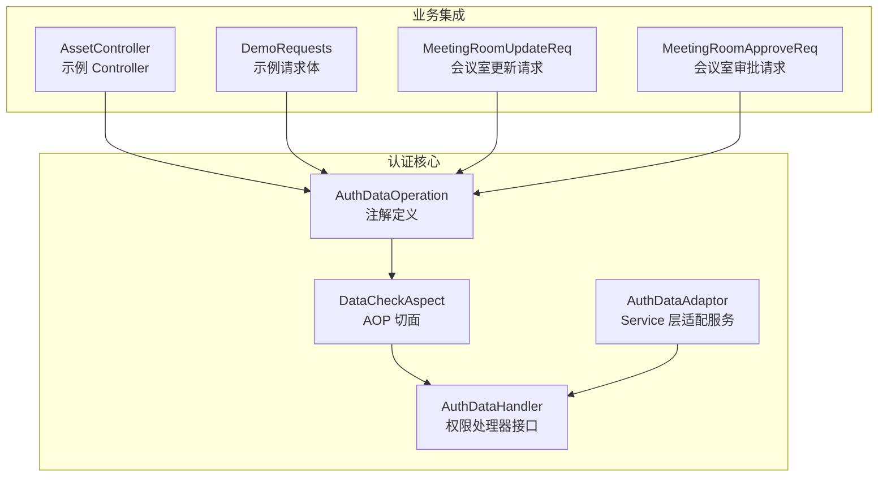
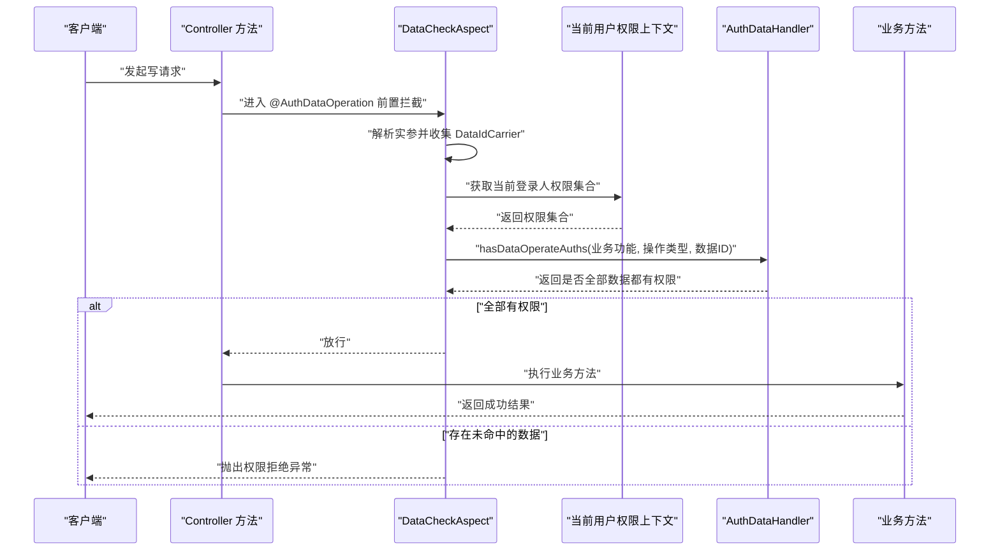
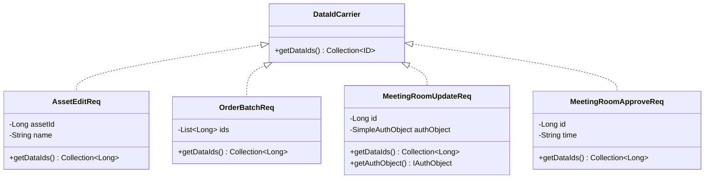
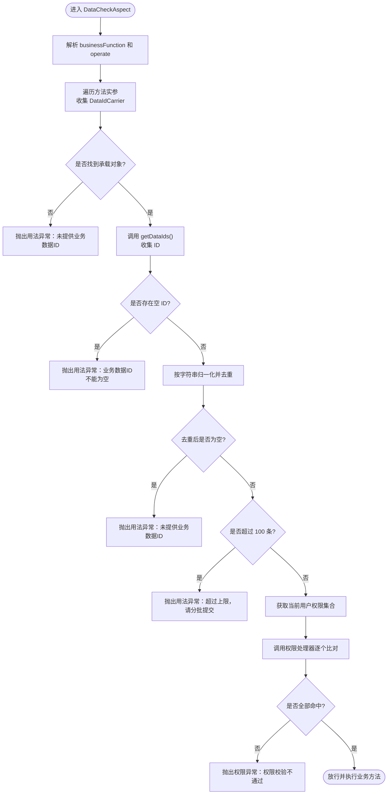
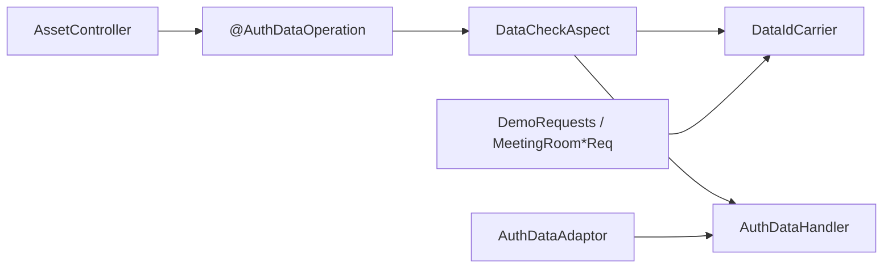

# @AuthDataOperation 数据操作注解

<cite>
**本文引用的文件**   
- [AuthDataOperation.java](file://auth/auth-core/src/main/java/com/cu/framework/auth/core/AuthDataOperation.java)
- [DataIdCarrier.java](file://auth/auth-core/src/main/java/com/cu/framework/auth/core/data/edit/DataIdCarrier.java)
- [DataCheckAspect.java](file://auth/auth-core/src/main/java/com/cu/framework/auth/core/data/edit/DataCheckAspect.java)
- [AuthDataHandler.java](file://auth/auth-core/src/main/java/com/cu/framework/auth/core/data/AuthDataHandler.java)
- [AuthDataAdaptor.java](file://auth/auth-core/src/main/java/com/cu/framework/auth/core/AuthDataAdaptor.java)
- [AssetController.java](file://sample/auth-core-boot-sample/src/main/java/com/cu/framework/sample/authcore/web/AssetController.java)
- [DemoRequests.java](file://sample/auth-core-boot-sample/src/main/java/com/cu/framework/sample/authcore/model/DemoRequests.java)
- [MeetingRoomUpdateReq.java](file://sample/auth-rbac-boot-sample/src/main/java/com/cu/framework/auth/sample/model/MeetingRoomUpdateReq.java)
- [MeetingRoomApproveReq.java](file://sample/auth-rbac-boot-sample/src/main/java/com/cu/framework/auth/sample/model/MeetingRoomApproveReq.java)
- [AuthException.java](file://auth/auth-core/src/main/java/com/cu/framework/auth/core/exception/AuthException.java)
- [AuthServiceException.java](file://auth/auth-core/src/main/java/com/cu/framework/auth/core/exception/AuthServiceException.java)
</cite>

## 目录
1. [引言](#引言)
2. [项目结构定位](#项目结构定位)
3. [核心组件](#核心组件)
4. [架构总览](#架构总览)
5. [详细组件分析](#详细组件分析)
6. [依赖关系分析](#依赖关系分析)
7. [性能与批量处理](#性能与批量处理)
8. [故障排查指南](#故障排查指南)
9. [结论](#结论)

## 引言
@AuthDataOperation 是一个面向“编辑类数据操作”的权限校验注解，目标是防止越权修改单条或多条业务数据。它通过 AOP 切面在目标方法执行前，从方法实参中收集所有实现了 DataIdCarrier 的业务对象，提取本次操作涉及的数据主键 ID，然后按 businessFunction（业务功能）和 operate（操作类型）进行权限比对；只有当请求中每个 ID 都命中用户在该槽位上的授权记录时，才放行执行，否则直接拒绝。

该设计的关键思想是：
- 判定单位是“数据 ID”，而不是“调用是否合法”。
- 一个写接口可以一次影响多条数据，每条数据都必须单独获得授权。
- 业务对象只负责暴露自己涉及的 ID，不感知框架内部如何查询和比较权限。
- 失败语义分为两类：用法错误由框架抛出参数异常，权限未命中则统一返回权限拒绝。

## 项目结构定位
@AuthDataOperation 属于 auth 模块中的认证与数据访问控制能力，核心定义位于 auth-core 包下，配套切面、处理器和示例分别分布在 data.edit、data 层以及 sample 子模块中。

**图表来源**
- [AuthDataOperation.java:1-51](file://auth/auth-core/src/main/java/com/cu/framework/auth/core/AuthDataOperation.java#L1-L51)
- [DataCheckAspect.java:1-149](file://auth/auth-core/src/main/java/com/cu/framework/auth/core/data/edit/DataCheckAspect.java#L1-L149)
- [AuthDataHandler.java:1-102](file://auth/auth-core/src/main/java/com/cu/framework/auth/core/data/AuthDataHandler.java#L1-L102)
- [AuthDataAdaptor.java:1-45](file://auth/auth-core/src/main/java/com/cu/framework/auth/core/AuthDataAdaptor.java#L1-L45)
- [AssetController.java:1-148](file://sample/auth-core-boot-sample/src/main/java/com/cu/framework/sample/authcore/web/AssetController.java#L1-L148)
- [DemoRequests.java:1-200](file://sample/auth-core-boot-sample/src/main/java/com/cu/framework/sample/authcore/model/DemoRequests.java#L1-L200)
- [MeetingRoomUpdateReq.java:1-38](file://sample/auth-rbac-boot-sample/src/main/java/com/cu/framework/auth/sample/model/MeetingRoomUpdateReq.java#L1-L38)
- [MeetingRoomApproveReq.java:1-29](file://sample/auth-rbac-boot-sample/src/main/java/com/cu/framework/auth/sample/model/MeetingRoomApproveReq.java#L1-L29)

**章节来源**
- [AuthDataOperation.java:1-51](file://auth/auth-core/src/main/java/com/cu/framework/auth/core/AuthDataOperation.java#L1-L51)
- [DataCheckAspect.java:1-149](file://auth/auth-core/src/main/java/com/cu/framework/auth/core/data/edit/DataCheckAspect.java#L1-L149)

## 核心组件
| 组件 | 职责 | 关键行为 |
|---|---|---|
| @AuthDataOperation | 声明写操作的权限校验点 | 指定 businessFunction 和 operate；默认 operate 为 unified |
| DataIdCarrier | 业务数据 ID 载体接口 | 提供 getDataIds()，让切面知道本次操作涉及哪些主键 |
| DataCheckAspect | AOP 前置切面 | 解析实参、收集 ID、去重、校验上限、调用权限处理器 |
| AuthDataHandler | 数据权限处理器接口 | 实现具体业务系统的权限查询、写入、填充逻辑 |
| AuthDataAdaptor | Service 层适配服务 | 以非注解方式调用权限读取、写入和删除能力 |
| 示例 Controller 与请求体 | 演示注解使用、ID 载体实现 | 展示单条、批量、分散承载、不同 ID 形态等场景 |

**章节来源**
- [AuthDataOperation.java:1-51](file://auth/auth-core/src/main/java/com/cu/framework/auth/core/AuthDataOperation.java#L1-L51)
- [DataIdCarrier.java:1-26](file://auth/auth-core/src/main/java/com/cu/framework/auth/core/data/edit/DataIdCarrier.java#L1-L26)
- [DataCheckAspect.java:1-149](file://auth/auth-core/src/main/java/com/cu/framework/auth/core/data/edit/DataCheckAspect.java#L1-L149)
- [AuthDataHandler.java:1-102](file://auth/auth-core/src/main/java/com/cu/framework/auth/core/data/AuthDataHandler.java#L1-L102)
- [AuthDataAdaptor.java:1-45](file://auth/auth-core/src/main/java/com/cu/framework/auth/core/AuthDataAdaptor.java#L1-L45)

## 架构总览
下图展示了带 @AuthDataOperation 的写接口在运行时的调用链：

**图表来源**
- [DataCheckAspect.java:40-149](file://auth/auth-core/src/main/java/com/cu/framework/auth/core/data/edit/DataCheckAspect.java#L40-L149)
- [AuthDataHandler.java:25-48](file://auth/auth-core/src/main/java/com/cu/framework/auth/core/data/AuthDataHandler.java#L25-L48)
- [AuthDataOperation.java:17-36](file://auth/auth-core/src/main/java/com/cu/framework/auth/core/AuthDataOperation.java#L17-L36)

## 详细组件分析

### @AuthDataOperation 注解
该注解用于标注业务方法，通常是 Controller 或 Service 的写方法。它有两个属性：

| 属性 | 类型 | 含义 | 默认值 |
|---|---|---|---:|
| businessFunction | String | 业务功能标识，对应权限表中的业务功能槽位 | 必填 |
| operate | String | 操作类型，对应权限表中的 operate 字段 | unified |

注解文档明确说明：
- 判定单位是业务数据 ID。
- 切面从实参中收集所有 DataIdCarrier 交出的 ID。
- 同一调用中任意一条 ID 无权限，整体拒绝。
- 一次调用去重后的 ID 最多 100 条，超出由调用方分批提交。
- 失败分为用法错误和权限拒绝两类。

**章节来源**
- [AuthDataOperation.java:17-51](file://auth/auth-core/src/main/java/com/cu/framework/auth/core/AuthDataOperation.java#L17-L51)

### DataIdCarrier 接口与 ID 提取策略
DataIdCarrier 是业务对象与框架之间的约定接口。业务对象不需要理解权限表、SQL 或切面机制，只需要实现 getDataIds()，告诉框架这次操作涉及哪些主键。

关键规则：
- 单条数据也返回单元素集合，而不是单个 ID。
- 批量数据把整批 ID 一起交出。
- ID 类型不限：整数、长整型、字符串均可。
- 嵌套结构由实现类自行摊平，切面只看这里返回的集合。
- 空集合不代表“无需校验”，而是“没有可判定的数据”，通常应视为用法错误。

**图表来源**
- [DataIdCarrier.java:1-26](file://auth/auth-core/src/main/java/com/cu/framework/auth/core/data/edit/DataIdCarrier.java#L1-L26)
- [DemoRequests.java:23-120](file://sample/auth-core-boot-sample/src/main/java/com/cu/framework/sample/authcore/model/DemoRequests.java#L23-L120)
- [MeetingRoomUpdateReq.java:1-38](file://sample/auth-rbac-boot-sample/src/main/java/com/cu/framework/auth/sample/model/MeetingRoomUpdateReq.java#L1-L38)
- [MeetingRoomApproveReq.java:1-29](file://sample/auth-rbac-boot-sample/src/main/java/com/cu/framework/auth/sample/model/MeetingRoomApproveReq.java#L1-L29)

**章节来源**
- [DataIdCarrier.java:1-26](file://auth/auth-core/src/main/java/com/cu/framework/auth/core/data/edit/DataIdCarrier.java#L1-L26)
- [DemoRequests.java:23-200](file://sample/auth-core-boot-sample/src/main/java/com/cu/framework/sample/authcore/model/DemoRequests.java#L23-L200)
- [MeetingRoomUpdateReq.java:1-38](file://sample/auth-rbac-boot-sample/src/main/java/com/cu/framework/auth/sample/model/MeetingRoomUpdateReq.java#L1-L38)
- [MeetingRoomApproveReq.java:1-29](file://sample/auth-rbac-boot-sample/src/main/java/com/cu/framework/auth/sample/model/MeetingRoomApproveReq.java#L1-L29)

### 权限验证流程
DataCheckAspect 是注解生效的核心。它在前置通知中完成以下步骤：

1. **切入方法**：匹配带有 @AuthDataOperation 的方法。
2. **解析注解参数**：取出 businessFunction 和 operate。
3. **收集实参中的载体**：支持方法参数本身、数组元素、集合元素。
4. **提取 ID 集合**：对每个 DataIdCarrier 调用 getDataIds()。
5. **过滤空集合**：实现类返回空集合不会贡献 ID。
6. **检查空值 ID**：集合中出现 null 会直接报错。
7. **归一化去重**：将每个 ID 转为字符串作为 key，避免 Integer、Long、String 等形态造成重复或误判。
8. **检查数量上限**：去重后超过 100 条抛出用法异常。
9. **加载当前用户权限**：从 AuthCurrentUserContextHolder 获取 FlatteningAuthority 集合。
10. **调用权限处理器**：判断每个 ID 是否在 businessFunction + operate 槽位命中。
11. **拒绝或放行**：任一未命中就抛出权限异常，否则继续执行业务方法。

**图表来源**
- [DataCheckAspect.java:40-149](file://auth/auth-core/src/main/java/com/cu/framework/auth/core/data/edit/DataCheckAspect.java#L40-L149)

**章节来源**
- [DataCheckAspect.java:28-149](file://auth/auth-core/src/main/java/com/cu/framework/auth/core/data/edit/DataCheckAspect.java#L28-L149)

### Controller 层使用示例
示例资产控制器展示了多种使用方式：

- 单条编辑：注解标注在 update 方法上，businessFunction 为 asset，operate 为 edit。
- 短整型形态 ID：updateIntegerForm 用 Integer 形态提交，但权限比对仍按字符串归一化。
- 批量编辑：batchUpdate 接收一批 ID，由请求体 DataIdCarrier 一次性交出。
- 分散承载：scattered 方法把 primary、many、moreArray 三类位置交给业务层组合后再校验。
- 未声明注解：renameUnchecked 不标注注解，走业务层自行控制的权限路径。

这些用例体现了：
- 注解放在写接口上最合适。
- 业务对象实现 DataIdCarrier 即可被切面识别。
- 同一个业务功能可以使用不同的 operate 槽位。
- 控制器主要负责入参转换、日志记录和简单结果封装，核心权限逻辑由框架承担。

**章节来源**
- [AssetController.java:34-148](file://sample/auth-core-boot-sample/src/main/java/com/cu/framework/sample/authcore/web/AssetController.java#L34-L148)

### Service 层集成与权限维护
AuthDataAdaptor 提供 Service 层直接调用权限数据的能力，适合以下场景：
- 在业务方法内填充某条数据的已配置权限。
- 在编辑成功后更新数据权限。
- 在业务数据删除后清理对应权限。

注意：权限维护接口自身的权限应与被维护的目标数据分开。也就是说，管理某个数据权限的管理动作，其 @AuthDataOperation 应该针对“管理槽位的数据 ID”，而不是被维护的目标数据 ID。

**章节来源**
- [AuthDataAdaptor.java:1-45](file://auth/auth-core/src/main/java/com/cu/framework/auth/core/AuthDataAdaptor.java#L1-L45)

### 权限处理器接口
AuthDataHandler 定义了数据权限读写契约，包括：
- hasDataOperateAuths：判断一组数据是否全部拥有指定业务功能和操作类型的权限。
- editDataAuths：编辑某条数据在指定槽位的权限。
- getDataAuths：查询某条数据在指定槽位的权限集合。
- fillDataAuths：将已配置权限填充到权限对象。
- deleteBusinessFunctionAuthByDataId：根据业务功能和数据 ID 删除权限。

该接口的实现由 RBAC 或其他权限系统提供，@AuthDataOperation 切面只关心它能否正确判断权限。

**章节来源**
- [AuthDataHandler.java:1-102](file://auth/auth-core/src/main/java/com/cu/framework/auth/core/data/AuthDataHandler.java#L1-L102)

## 依赖关系分析

**图表来源**
- [AuthDataOperation.java:1-51](file://auth/auth-core/src/main/java/com/cu/framework/auth/core/AuthDataOperation.java#L1-L51)
- [DataCheckAspect.java:1-149](file://auth/auth-core/src/main/java/com/cu/framework/auth/core/data/edit/DataCheckAspect.java#L1-L149)
- [DataIdCarrier.java:1-26](file://auth/auth-core/src/main/java/com/cu/framework/auth/core/data/edit/DataIdCarrier.java#L1-L26)
- [AuthDataHandler.java:1-102](file://auth/auth-core/src/main/java/com/cu/framework/auth/core/data/AuthDataHandler.java#L1-L102)
- [AuthDataAdaptor.java:1-45](file://auth/auth-core/src/main/java/com/cu/framework/auth/core/AuthDataAdaptor.java#L1-L45)
- [AssetController.java:1-148](file://sample/auth-core-boot-sample/src/main/java/com/cu/framework/sample/authcore/web/AssetController.java#L1-L148)
- [DemoRequests.java:1-200](file://sample/auth-core-boot-sample/src/main/java/com/cu/framework/sample/authcore/model/DemoRequests.java#L1-L200)
- [MeetingRoomUpdateReq.java:1-38](file://sample/auth-rbac-boot-sample/src/main/java/com/cu/framework/auth/sample/model/MeetingRoomUpdateReq.java#L1-L38)
- [MeetingRoomApproveReq.java:1-29](file://sample/auth-rbac-boot-sample/src/main/java/com/cu/framework/auth/sample/model/MeetingRoomApproveReq.java#L1-L29)

耦合关系要点：
- 注解与切面强耦合，切面必须能解析 @AuthDataOperation。
- 切面与 DataIdCarrier 松耦合，只要业务对象实现接口即可。
- 切面与 AuthDataHandler 解耦，具体权限实现可替换。
- AuthDataAdaptor 复用 AuthDataHandler，但不依赖注解，适合 Service 层直接调用。
- 示例 Controller 和请求体仅展示集成方式，不改变框架行为。

## 性能与批量处理

### 100 条 ID 上限的设计考虑
DataCheckAspect 明确将 MAX_DATA_IDS 设置为 100，并在去重后检查数量。这一限制的主要目的包括：

- 防止单次调用构造超大 ID 列表，导致权限查询退化为不可控规模。
- 降低内存中权限比对的成本。
- 避免前端或上游调用方无意传入大量无关 ID。
- 强制业务侧采用分批提交，提高可观测性和可重试性。

如果业务确实需要一次处理更多数据，应在应用层拆分成多个小批次，每个批次不超过 100 个 ID。

**章节来源**
- [DataCheckAspect.java:35-44](file://auth/auth-core/src/main/java/com/cu/framework/auth/core/data/edit/DataCheckAspect.java#L35-L44)
- [DataCheckAspect.java:108-149](file://auth/auth-core/src/main/java/com/cu/framework/auth/core/data/edit/DataCheckAspect.java#L108-L149)

### 分批提交最佳实践
建议遵循以下原则：

| 场景 | 推荐做法 |
|---|---|
| 单条编辑 | 直接提交单个 ID，请求体实现 DataIdCarrier 返回单元素集合 |
| 少量批量 | 一次提交 1 到 100 个 ID |
| 大批量编辑 | 客户端或服务端拆分为多个批次，逐批调用 |
| 混合入参 | 分散在散参、集合、数组中的 ID 也要合并计算总数 |
| 包含无效 ID | 先做参数校验，再提交给权限框架 |
| 权限维护接口 | 管理动作的 ID 与被维护目标数据 ID 分开声明 |

**章节来源**
- [DemoRequests.java:120-200](file://sample/auth-core-boot-sample/src/main/java/com/cu/framework/sample/authcore/model/DemoRequests.java#L120-L200)
- [AssetController.java:86-148](file://sample/auth-core-boot-sample/src/main/java/com/cu/framework/sample/authcore/web/AssetController.java#L86-L148)

## 故障排查指南

### 失败分类
框架将失败分为两类：

| 类别 | 典型原因 | 异常类型 | 对外语义 | 日志策略 |
|---|---|---|---|---|
| 用法错误 | 没有 DataIdCarrier、ID 集合为空、含 null、ID 数量超过 100 | AuthServiceException | 参数或调用方式错误 | 切面抛出参数异常，通常由全局异常处理器转换为业务错误 |
| 权限拒绝 | 至少一个 ID 未在 businessFunction + operate 槽位命中 | AuthException | 权限校验不通过 | 切面记录业务功能、操作类型和 ID 数量，然后抛出权限异常 |

注意：
- 权限未命中的明细通常不进对外响应，只进日志，避免泄露权限细节。
- 对外只暴露统一的拒绝语义，有利于安全审计和统一错误处理。

**章节来源**
- [AuthDataOperation.java:25-36](file://auth/auth-core/src/main/java/com/cu/framework/auth/core/AuthDataOperation.java#L25-L36)
- [DataCheckAspect.java:63-87](file://auth/auth-core/src/main/java/com/cu/framework/auth/core/data/edit/DataCheckAspect.java#L63-L87)
- [DataCheckAspect.java:108-149](file://auth/auth-core/src/main/java/com/cu/framework/auth/core/data/edit/DataCheckAspect.java#L108-L149)
- [AuthException.java:1-23](file://auth/auth-core/src/main/java/com/cu/framework/auth/core/exception/AuthException.java#L1-L23)
- [AuthServiceException.java:1-16](file://auth/auth-core/src/main/java/com/cu/framework/auth/core/exception/AuthServiceException.java#L1-L16)

### 常见问题与定位建议
1. **提示未提供业务数据ID**  
   检查方法参数是否包含实现 DataIdCarrier 的对象，或者集合/数组元素是否为 DataIdCarrier。

2. **提示业务数据ID不能为空**  
   检查 DataIdCarrier.getDataIds() 是否可能返回包含 null 的集合。

3. **提示未提供业务数据ID**  
  实现类可能返回空集合，或所有实现类都返回空集合。

4. **提示超过上限**  
   检查请求中合并后的唯一 ID 数量是否超过 100，应改为分批提交。

5. **权限校验不通过**  
   确认 sys_auth_data 表中是否存在对应的 businessFunction、operate 和 data_id 记录，且当前用户具备该权限。

6. **ID 类型不一致导致误判**  
   框架会按字符串归一化，Integer、Long、String 相同数值视为同一条数据；若仍异常，检查实际存储值和读取值的字符串表示是否一致。

**章节来源**
- [DataCheckAspect.java:90-149](file://auth/auth-core/src/main/java/com/cu/framework/auth/core/data/edit/DataCheckAspect.java#L90-L149)
- [AuthDataOperation.java:25-36](file://auth/auth-core/src/main/java/com/cu/framework/auth/core/AuthDataOperation.java#L25-L36)

## 结论
@AuthDataOperation 通过“注解声明 + DataIdCarrier 载体 + AOP 切面 + 权限处理器接口”的组合，把数据级编辑权限校验从业务代码中抽离出来。业务对象只需暴露自己的主键 ID，框架负责收集、去重、上限控制和权限比对。

使用该注解时应记住：
- businessFunction 和 operate 要准确对应权限表槽位。
- 单条和多条数据都要通过 DataIdCarrier 交出完整 ID 集合。
- 不要在一个请求中提交超过 100 个唯一 ID。
- 区分用法错误和权限拒绝，前者是参数问题，后者是业务安全问题。
- 权限维护接口自身也要做行级权限控制，但其判定 ID 应是管理槽位数据 ID，而非被维护目标数据 ID。