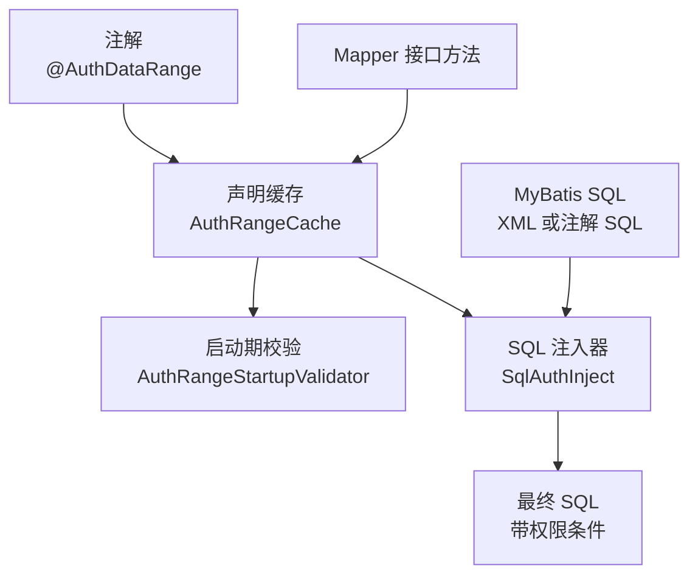
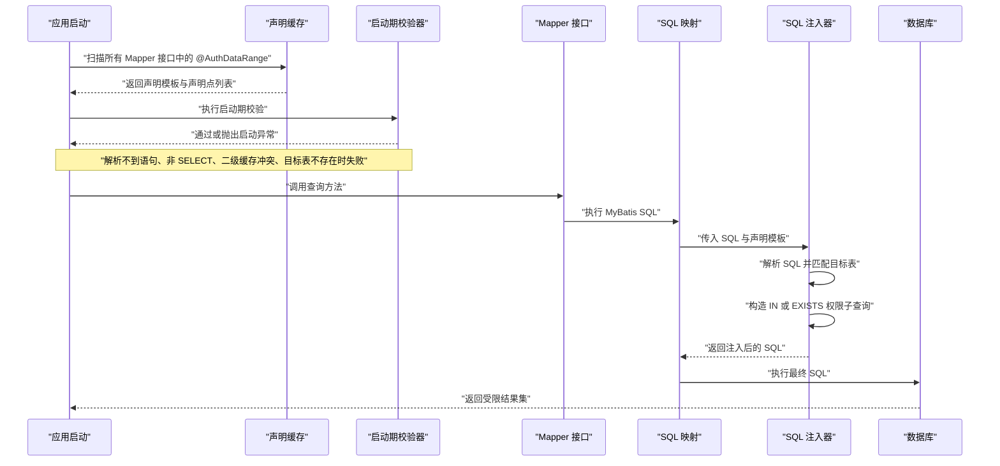
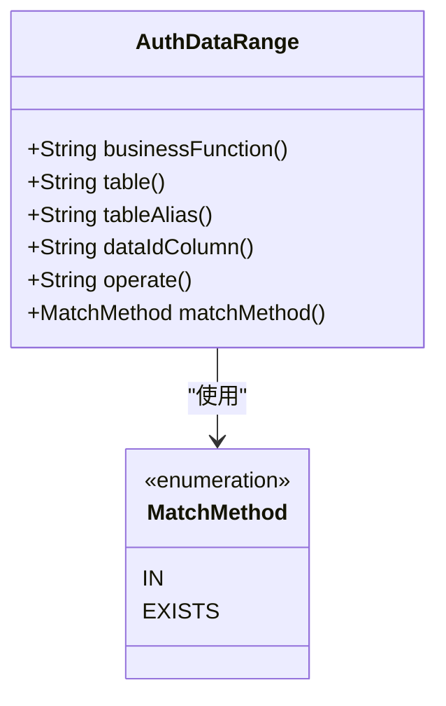
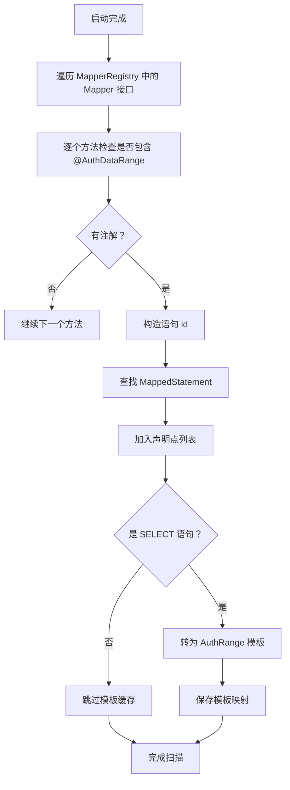
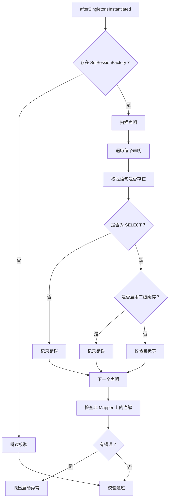
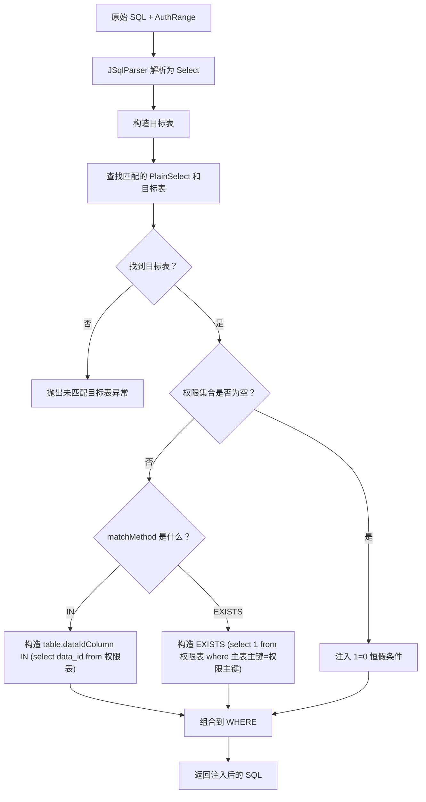
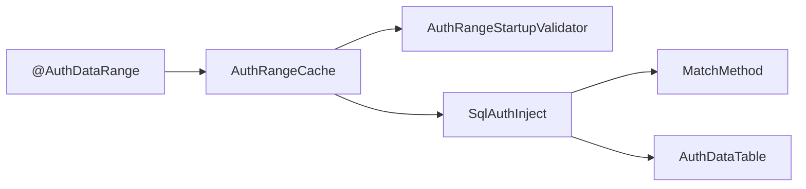
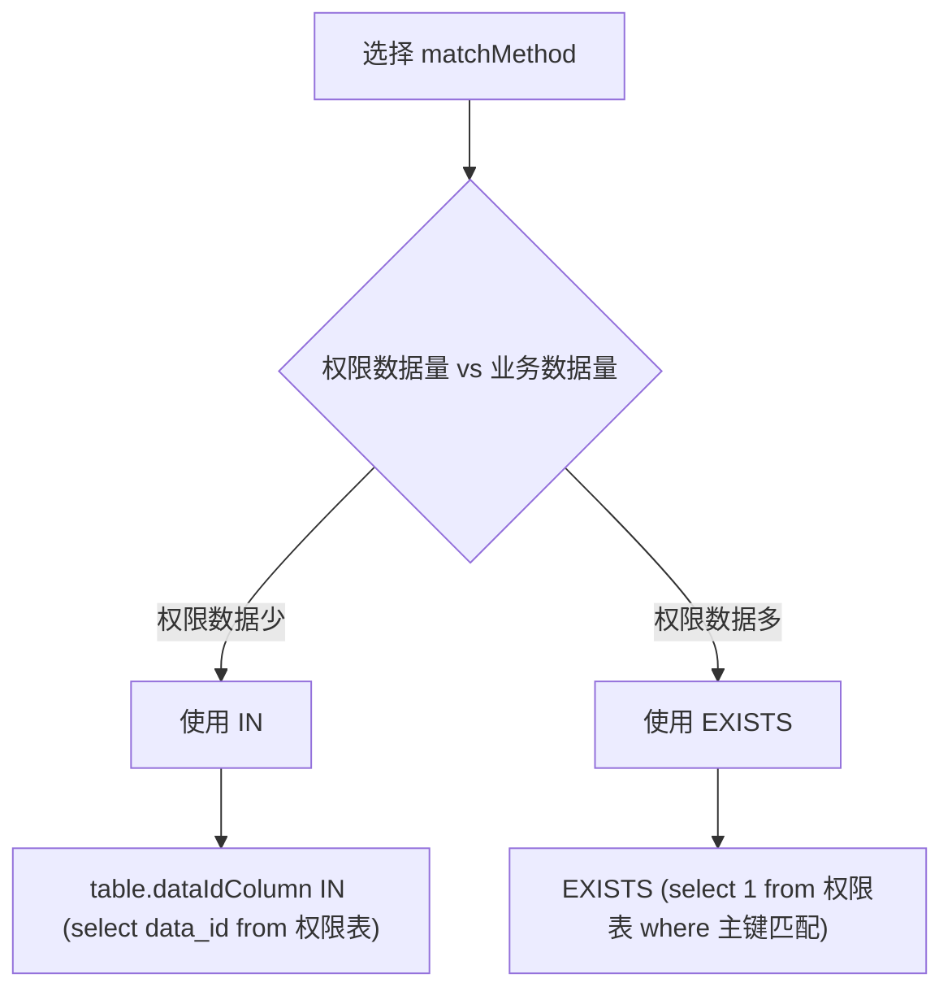
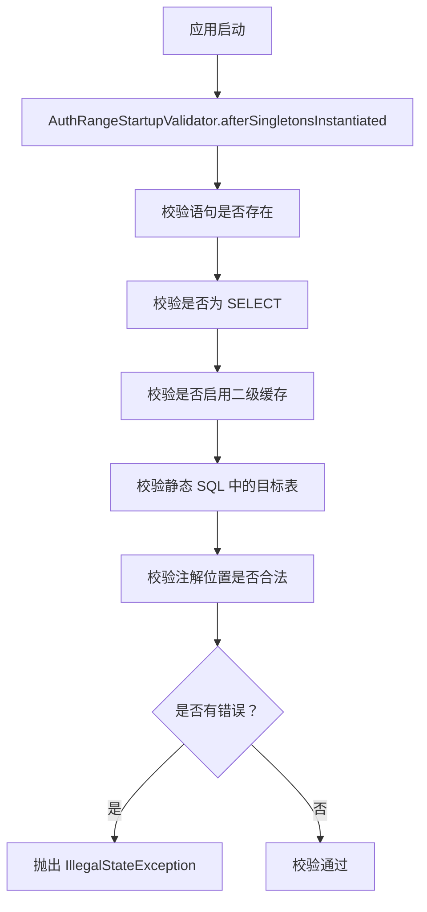

# @AuthDataRange 数据范围注解

<cite>
**本文引用的文件**   
- [AuthDataRange.java](file://auth/auth-core/src/main/java/com/cu/framework/auth/core/AuthDataRange.java)
- [MatchMethod.java](file://auth/auth-core/src/main/java/com/cu/framework/auth/core/data/range/MatchMethod.java)
- [AuthRangeCache.java](file://auth/auth-core/src/main/java/com/cu/framework/auth/core/data/range/AuthRangeCache.java)
- [AuthRangeStartupValidator.java](file://auth/auth-core/src/main/java/com/cu/framework/auth/core/data/range/AuthRangeStartupValidator.java)
- [SqlAuthInject.java](file://auth/auth-core/src/main/java/com/cu/framework/auth/core/data/range/SqlAuthInject.java)
- [WorkOrderMapper.java](file://sample/auth-core-boot-sample/src/main/java/com/cu/framework/sample/authcore/mapper/WorkOrderMapper.java)
- [WorkOrderMapper.xml](file://sample/auth-core-boot-sample/src/main/resources/mapper/WorkOrderMapper.xml)
- [AssetMapper.java](file://sample/auth-core-boot-sample/src/main/java/com/cu/framework/sample/authcore/mapper/AssetMapper.java)
</cite>

## 目录
1. [引言](#引言)
2. [项目结构定位](#项目结构定位)
3. [核心组件](#核心组件)
4. [架构总览](#架构总览)
5. [详细组件分析](#详细组件分析)
6. [依赖关系分析](#依赖关系分析)
7. [性能与匹配方式选择](#性能与匹配方式选择)
8. [启动时校验规则](#启动时校验规则)
9. [代码示例与使用场景](#代码示例与使用场景)
10. [故障排查指南](#故障排查指南)
11. [结论](#结论)

## 引言
`@AuthDataRange` 是权限框架中用于声明“数据范围”的注解。它的作用是在 MyBatis Mapper 接口的查询方法上，声明当前业务功能、操作类型、主表、主键列名以及权限条件匹配方式；在查询执行前，框架自动把用户的数据权限转换为 SQL 条件，并注入到目标语句中。

其核心目标是让业务 SQL 无需显式关联权限表：开发者只需声明一条语句要按哪个业务功能、哪种操作、哪张表过滤，运行时系统根据当前用户的权限集合生成 `IN` 或 `EXISTS` 子查询，从而限制该查询只能返回用户有权访问的数据行。

## 项目结构定位
`@AuthDataRange` 属于权限核心模块，位于 `auth/auth-core` 包下。与其配套的注解属性解析、缓存、启动期校验和 SQL 注入逻辑分别由以下类承担：

| 职责 | 文件 | 说明 |
|---|---|---|
| 注解定义 | [AuthDataRange.java](file://auth/auth-core/src/main/java/com/cu/framework/auth/core/AuthDataRange.java) | 声明在 Mapper 查询方法上的数据范围元信息 |
| 匹配方式枚举 | [MatchMethod.java](file://auth/auth-core/src/main/java/com/cu/framework/auth/core/data/range/MatchMethod.java) | `IN` 与 `EXISTS` 两种权限匹配策略 |
| 声明缓存 | [AuthRangeCache.java](file://auth/auth-core/src/main/java/com/cu/framework/auth/core/data/range/AuthRangeCache.java) | 扫描 Mapper 接口中的注解，构建语句级模板 |
| 启动期校验 | [AuthRangeStartupValidator.java](file://auth/auth-core/src/main/java/com/cu/framework/auth/core/data/range/AuthRangeStartupValidator.java) | 应用启动时发现配置错误并直接失败 |
| SQL 注入器 | [SqlAuthInject.java](file://auth/auth-core/src/main/java/com/cu/framework/auth/core/data/range/SqlAuthInject.java) | 解析 SQL、匹配目标表、拼接权限条件 |
| 示例 Mapper | [WorkOrderMapper.java](file://sample/auth-core-boot-sample/src/main/java/com/cu/framework/sample/authcore/mapper/WorkOrderMapper.java) | 单表、多表、动态 SQL、不同操作槽位等用例 |
| 示例 XML | [WorkOrderMapper.xml](file://sample/auth-core-boot-sample/src/main/resources/mapper/WorkOrderMapper.xml) | 对应 SQL 形态与动态拼接行为 |
| 自定义主键列示例 | [AssetMapper.java](file://sample/auth-core-boot-sample/src/main/java/com/cu/framework/sample/authcore/mapper/AssetMapper.java) | 演示 `dataIdColumn` 非 `id` 的场景 |

**图示来源**
- [AuthDataRange.java:1-81](file://auth/auth-core/src/main/java/com/cu/framework/auth/core/AuthDataRange.java#L1-L81)
- [AuthRangeCache.java:1-155](file://auth/auth-core/src/main/java/com/cu/framework/auth/core/data/range/AuthRangeCache.java#L1-L155)
- [AuthRangeStartupValidator.java:1-163](file://auth/auth-core/src/main/java/com/cu/framework/auth/core/data/range/AuthRangeStartupValidator.java#L1-L163)
- [SqlAuthInject.java:1-441](file://auth/auth-core/src/main/java/com/cu/framework/auth/core/data/range/SqlAuthInject.java#L1-L441)

**章节来源**
- [AuthDataRange.java:1-81](file://auth/auth-core/src/main/java/com/cu/framework/auth/core/AuthDataRange.java#L1-L81)
- [AuthRangeCache.java:1-155](file://auth/auth-core/src/main/java/com/cu/framework/auth/core/data/range/AuthRangeCache.java#L1-L155)
- [AuthRangeStartupValidator.java:1-163](file://auth/auth-core/src/main/java/com/cu/framework/auth/core/data/range/AuthRangeStartupValidator.java#L1-L163)
- [SqlAuthInject.java:1-441](file://auth/auth-core/src/main/java/com/cu/framework/auth/core/data/range/SqlAuthInject.java#L1-L441)

## 核心组件
`@AuthDataRange` 是一个方法级注解，仅作用于 MyBatis Mapper 接口的查询方法。它不直接执行权限判断，而是描述“这条语句应该按哪些维度进行数据范围过滤”。

### 注解属性总览

| 属性 | 类型 | 默认值 | 含义 |
|---|---:|---:|---|
| `businessFunction` | `String` | 无默认值，必填 | 业务功能标识，例如工单、资产、会议室等 |
| `table` | `String` | 空字符串 | 指定主表；未指定时默认以 SQL 中的主表为准 |
| `tableAlias` | `String` | 空字符串 | 多表联查时指定表别名，用于区分同一张表被多次关联 |
| `dataIdColumn` | `String` | `"id"` | 业务主键列名，用于拼接 `table.id` 形式的匹配列 |
| `operate` | `String` | `"unified"` | 操作类型槽位，同表可按多个操作分别过滤 |
| `matchMethod` | `MatchMethod` | `MatchMethod.IN` | 权限匹配方式：`IN` 或 `EXISTS` |

注解文档明确强调：

- 注解声明在哪条 Mapper 方法上，权限条件就只注入那条语句。
- 同一调用链上的其他语句不受影响。
- 同一张表需要按多个操作过滤时，应分别为每个操作声明一个查询方法。
- MyBatis-Plus 由 `BaseMapper` 继承而来的内建方法（如 `selectList`、`page`）没有挂载点，不受本注解管辖。

**章节来源**
- [AuthDataRange.java:10-81](file://auth/auth-core/src/main/java/com/cu/framework/auth/core/AuthDataRange.java#L10-L81)

## 架构总览
`@AuthDataRange` 的运行流程可以分为三个阶段：**启动期声明扫描与校验**、**运行期声明模板查找**、**SQL 解析与权限条件注入**。

**图示来源**
- [AuthRangeCache.java:41-94](file://auth/auth-core/src/main/java/com/cu/framework/auth/core/data/range/AuthRangeCache.java#L41-L94)
- [AuthRangeStartupValidator.java:47-100](file://auth/auth-core/src/main/java/com/cu/framework/auth/core/data/range/AuthRangeStartupValidator.java#L47-L100)
- [SqlAuthInject.java:55-100](file://auth/auth-core/src/main/java/com/cu/framework/auth/core/data/range/SqlAuthInject.java#L55-L100)

**章节来源**
- [AuthRangeCache.java:1-155](file://auth/auth-core/src/main/java/com/cu/framework/auth/core/data/range/AuthRangeCache.java#L1-L155)
- [AuthRangeStartupValidator.java:1-163](file://auth/auth-core/src/main/java/com/cu/framework/auth/core/data/range/AuthRangeStartupValidator.java#L1-L163)
- [SqlAuthInject.java:1-200](file://auth/auth-core/src/main/java/com/cu/framework/auth/core/data/range/SqlAuthInject.java#L1-L200)

## 详细组件分析

### 注解定义：`@AuthDataRange`
`@AuthDataRange` 的目标是方法级别的数据范围声明。它本身不包含运行时逻辑，而是作为声明元数据被 `AuthRangeCache` 读取，再交给 `SqlAuthInject` 使用。

关键设计点：

| 设计点 | 说明 |
|---|---|
| 作用位置 | `ElementType.METHOD`，且语义上要求是 MyBatis Mapper 接口方法 |
| 保留策略 | `RUNTIME`，便于反射扫描 |
| 业务功能 | 必填，表示数据权限所属的业务域 |
| 主表 | 可选；为空时使用 SQL 中的主表 |
| 表别名 | 配合 `table` 使用，用于多表联查中同名表的区分 |
| 主键列 | 默认为 `id`，可覆盖为业务实体真实主键列 |
| 操作类型 | 默认 `unified`，支持同表多槽位 |
| 匹配方式 | 默认 `IN`，也可选 `EXISTS` |

**图示来源**
- [AuthDataRange.java:10-81](file://auth/auth-core/src/main/java/com/cu/framework/auth/core/AuthDataRange.java#L10-L81)
- [MatchMethod.java:1-22](file://auth/auth-core/src/main/java/com/cu/framework/auth/core/data/range/MatchMethod.java#L1-L22)

**章节来源**
- [AuthDataRange.java:10-81](file://auth/auth-core/src/main/java/com/cu/framework/auth/core/AuthDataRange.java#L10-L81)
- [MatchMethod.java:1-22](file://auth/auth-core/src/main/java/com/cu/framework/auth/core/data/range/MatchMethod.java#L1-L22)

### 声明缓存：`AuthRangeCache`
`AuthRangeCache` 负责在应用启动后扫描已注册的 Mapper 接口，收集所有 `@AuthDataRange` 声明，并把它们转换成不含权限集合的静态模板。

重要特性：

- 缓存键是 MyBatis 的映射语句 id，即“接口全限定名.方法名”。
- 只有解析到的 SELECT 语句才会进入模板缓存。
- 全部声明点（包括解析失败的）都会保留，供启动期校验定位问题。
- 模板不含用户相关数据；用户权限集合在执行期才写入。

**图示来源**
- [AuthRangeCache.java:41-94](file://auth/auth-core/src/main/java/com/cu/framework/auth/core/data/range/AuthRangeCache.java#L41-L94)

**章节来源**
- [AuthRangeCache.java:1-155](file://auth/auth-core/src/main/java/com/cu/framework/auth/core/data/range/AuthRangeCache.java#L1-L155)

### 启动期校验：`AuthRangeStartupValidator`
`AuthRangeStartupValidator` 实现 Spring 的 `SmartInitializingSingleton`，在所有单例 Bean 初始化完成后执行。它的核心目标是把配置错误提前到启动阶段暴露，而不是在运行期静默放开数据过滤。

校验项包括：

| 校验项 | 失败表现 |
|---|---|
| 声明解析不到映射语句 | 启动失败，提示方法名与语句 id 不一致 |
| 语句不是 SELECT | 启动失败，数据范围只作用于查询 |
| 启用了二级缓存 | 启动失败，因为缓存键在权限条件注入前计算 |
| 静态 SQL 中找不到目标表 | 启动失败 |
| 注解不在 Mapper 接口上 | 启动失败，迁移守卫防止旧用法静默失效 |

**图示来源**
- [AuthRangeStartupValidator.java:47-163](file://auth/auth-core/src/main/java/com/cu/framework/auth/core/data/range/AuthRangeStartupValidator.java#L47-L163)

**章节来源**
- [AuthRangeStartupValidator.java:1-163](file://auth/auth-core/src/main/java/com/cu/framework/auth/core/data/range/AuthRangeStartupValidator.java#L1-L163)

### SQL 注入器：`SqlAuthInject`
`SqlAuthInject` 是权限条件注入的核心实现。它基于 JSqlParser 解析 SQL，找到声明的目标表，然后把权限子查询拼接到 WHERE 条件中。

主要能力：

- 解析普通 SELECT、WITH 子句、JOIN、嵌套子查询。
- 根据 `table` 和 `tableAlias` 匹配目标表。
- 当权限集合为空时注入恒假条件，保证零行返回，而不是放开过滤。
- 根据 `matchMethod` 生成 `IN` 或 `EXISTS` 子查询。
- 将业务功能、操作类型、权限集合写入权限表条件。

**图示来源**
- [SqlAuthInject.java:55-140](file://auth/auth-core/src/main/java/com/cu/framework/auth/core/data/range/SqlAuthInject.java#L55-L140)
- [SqlAuthInject.java:285-380](file://auth/auth-core/src/main/java/com/cu/framework/auth/core/data/range/SqlAuthInject.java#L285-L380)

**章节来源**
- [SqlAuthInject.java:1-441](file://auth/auth-core/src/main/java/com/cu/framework/auth/core/data/range/SqlAuthInject.java#L1-L441)

## 依赖关系分析
`@AuthDataRange` 的依赖关系可以理解为：注解是声明入口，缓存是装配桥，校验是质量门，注入器是执行期引擎。

- `AuthDataRange` 被 `AuthRangeCache` 通过反射读取。
- `AuthRangeCache` 同时服务于启动期校验和执行期模板查找。
- `SqlAuthInject` 依赖 `MatchMethod` 决定 SQL 拼接策略。
- `SqlAuthInject` 还依赖权限表配置对象，用于确定权限表名、权限列、业务功能列和操作列。

**图示来源**
- [AuthDataRange.java:10-81](file://auth/auth-core/src/main/java/com/cu/framework/auth/core/AuthDataRange.java#L10-L81)
- [AuthRangeCache.java:41-94](file://auth/auth-core/src/main/java/com/cu/framework/auth/core/data/range/AuthRangeCache.java#L41-L94)
- [AuthRangeStartupValidator.java:21-45](file://auth/auth-core/src/main/java/com/cu/framework/auth/core/data/range/AuthRangeStartupValidator.java#L21-L45)
- [SqlAuthInject.java:27-53](file://auth/auth-core/src/main/java/com/cu/framework/auth/core/data/range/SqlAuthInject.java#L27-L53)

**章节来源**
- [AuthRangeCache.java:1-155](file://auth/auth-core/src/main/java/com/cu/framework/auth/core/data/range/AuthRangeCache.java#L1-L155)
- [AuthRangeStartupValidator.java:1-163](file://auth/auth-core/src/main/java/com/cu/framework/auth/core/data/range/AuthRangeStartupValidator.java#L1-L163)
- [SqlAuthInject.java:1-200](file://auth/auth-core/src/main/java/com/cu/framework/auth/core/data/range/SqlAuthInject.java#L1-L200)

## 性能与匹配方式选择
`MatchMethod` 提供两种匹配策略，核心原则是“小表驱动大表”。

| 匹配方式 | 适用场景 | 生成的 SQL 形态 | 性能建议 |
|---|---|---|---|
| `IN` | 权限表中符合条件的数据量远小于业务表 | `table.dataIdColumn IN (SELECT data_id FROM 权限表 WHERE ...)` | 适合权限数据较少、业务表较大的场景 |
| `EXISTS` | 权限数据量可能很大，或权限表驱动更合理 | `EXISTS (SELECT 1 FROM 权限表 WHERE 主表主键 = 权限主键 AND ...)` | 适合权限数据较大、希望用权限表驱动业务表的场景 |

默认值为 `MatchMethod.IN`。如果业务侧发现权限表数据规模明显增大，应考虑切换到 `EXISTS`。

**图示来源**
- [MatchMethod.java:1-22](file://auth/auth-core/src/main/java/com/cu/framework/auth/core/data/range/MatchMethod.java#L1-L22)
- [SqlAuthInject.java:120-140](file://auth/auth-core/src/main/java/com/cu/framework/auth/core/data/range/SqlAuthInject.java#L120-L140)
- [SqlAuthInject.java:318-380](file://auth/auth-core/src/main/java/com/cu/framework/auth/core/data/range/SqlAuthInject.java#L318-L380)

**章节来源**
- [MatchMethod.java:1-22](file://auth/auth-core/src/main/java/com/cu/framework/auth/core/data/range/MatchMethod.java#L1-L22)
- [SqlAuthInject.java:100-140](file://auth/auth-core/src/main/java/com/cu/framework/auth/core/data/range/SqlAuthInject.java#L100-L140)
- [SqlAuthInject.java:318-380](file://auth/auth-core/src/main/java/com/cu/framework/auth/core/data/range/SqlAuthInject.java#L318-L380)

## 启动时校验规则
启动期校验是 `@AuthDataRange` 安全性的关键保障。任何配置错误都应在启动阶段失败，避免线上出现“看起来正常但数据权限未生效”的情况。

### 校验规则表

| 配置错误 | 触发条件 | 行为 |
|---|---|---|
| 解析不到映射语句 | 注解所在方法的语句 id 无法在 MyBatis Configuration 中找到 | 启动失败 |
| 非查询语句 | 语句类型为 UPDATE、INSERT、DELETE 等非 SELECT | 启动失败 |
| 启用二级缓存 | 语句启用了 MyBatis 二级缓存 | 启动失败 |
| 静态 SQL 中找不到目标表 | 静态 SQL 中无法匹配 `table` 或 `tableAlias` | 启动失败 |
| 注解不在 Mapper 接口上 | 注解出现在 Controller、Service 或其他非 Mapper 类的方法上 | 启动失败 |
| 动态 SQL 中缺少目标表 | 运行期拼出的 SQL 中没有声明的表 | 运行期抛异常，不会静默放行 |

### 启动期校验流程图

**图示来源**
- [AuthRangeStartupValidator.java:47-163](file://auth/auth-core/src/main/java/com/cu/framework/auth/core/data/range/AuthRangeStartupValidator.java#L47-L163)

**章节来源**
- [AuthRangeStartupValidator.java:1-163](file://auth/auth-core/src/main/java/com/cu/framework/auth/core/data/range/AuthRangeStartupValidator.java#L1-L163)

## 代码示例与使用场景

### 示例一：单表查询，默认主键列
这是最基础的用法：业务功能为工单，操作类型为 `unified`，主键列使用默认 `id`。

参考路径：
- [WorkOrderMapper.java:23-29](file://sample/auth-core-boot-sample/src/main/java/com/cu/framework/sample/authcore/mapper/WorkOrderMapper.java#L23-L29)
- [WorkOrderMapper.xml:28-31](file://sample/auth-core-boot-sample/src/main/resources/mapper/WorkOrderMapper.xml#L28-L31)

效果：
- 查询 `demo_work_order`。
- 运行时根据用户权限生成 `IN` 或 `EXISTS` 子查询。
- 无权限时返回零行。

### 示例二：同一业务功能、不同操作槽位
同一张工单表需要区分“可编辑”和“可审批”两个数据范围。

参考路径：
- [WorkOrderMapper.java:39-58](file://sample/auth-core-boot-sample/src/main/java/com/cu/framework/sample/authcore/mapper/WorkOrderMapper.java#L39-L58)

效果：
- `operate = "edit"` 只返回用户拥有编辑权限的工单。
- `operate = "approve"` 只返回用户拥有审批权限的工单。
- 同一张表通过不同方法形成不同权限槽位。

### 示例三：使用 `MatchMethod.EXISTS`
当权限数据规模较大时，可以把匹配方式改为 `EXISTS`。

参考路径：
- [WorkOrderMapper.java:31-37](file://sample/auth-core-boot-sample/src/main/java/com/cu/framework/sample/authcore/mapper/WorkOrderMapper.java#L31-L37)

效果：
- SQL 不再使用 `table.id IN (...)`，而是使用 `EXISTS` 子查询。
- 适用于权限表数据量较大的场景。

### 示例四：多表联查，指定表别名
工单表关联两张相同的客户表，分别代表“归属客户”和“下单客户”，需要通过 `table` 和 `tableAlias` 区分。

参考路径：
- [WorkOrderMapper.java:90-106](file://sample/auth-core-boot-sample/src/main/java/com/cu/framework/sample/authcore/mapper/WorkOrderMapper.java#L90-L106)
- [WorkOrderMapper.xml:60-71](file://sample/auth-core-boot-sample/src/main/resources/mapper/WorkOrderMapper.xml#L60-L71)

效果：
- 第一个方法把权限条件挂到别名为 `cu` 的客户表。
- 第二个方法把权限条件挂到别名为 `cb` 的客户表。
- 两者 SQL 形态相同，但权限过滤目标不同。

### 示例五：动态 SQL
动态 SQL 在启动期跳过目标表校验，因为 SQL 要到运行期才能拼接出来。

参考路径：
- [WorkOrderMapper.java:108-120](file://sample/auth-core-boot-sample/src/main/java/com/cu/framework/sample/authcore/mapper/WorkOrderMapper.java#L108-L120)
- [WorkOrderMapper.xml:74-86](file://sample/auth-core-boot-sample/src/main/resources/mapper/WorkOrderMapper.xml#L74-L86)

效果：
- 正常运行时，权限条件照常注入。
- 如果运行期拼出的 SQL 缺少声明的目标表，会抛异常，不会静默返回全部数据。

### 示例六：自定义主键列 `dataIdColumn`
当业务主键列不是 `id` 时，必须显式声明 `dataIdColumn`。

参考路径：
- [AssetMapper.java:18-26](file://sample/auth-core-boot-sample/src/main/java/com/cu/framework/sample/authcore/mapper/AssetMapper.java#L18-L26)

效果：
- 权限条件使用 `asset_id` 而非 `id` 与权限表匹配。
- 适用于主键命名不符合默认约定的业务表。

### 示例七：嵌套查询与语句作用域
外层查询和内层查询各自带 `@AuthDataRange`，互不影响。

参考路径：
- [WorkOrderMapper.java:60-88](file://sample/auth-core-boot-sample/src/main/java/com/cu/framework/sample/authcore/mapper/WorkOrderMapper.java#L60-L88)
- [WorkOrderMapper.xml:39-58](file://sample/auth-core-boot-sample/src/main/resources/mapper/WorkOrderMapper.xml#L39-L58)

效果：
- 外层使用 `unified` 槽位。
- 内层使用 `edit` 槽位。
- 两条语句各自注入各自的权限条件。

**章节来源**
- [WorkOrderMapper.java:23-120](file://sample/auth-core-boot-sample/src/main/java/com/cu/framework/sample/authcore/mapper/WorkOrderMapper.java#L23-L120)
- [WorkOrderMapper.xml:28-86](file://sample/auth-core-boot-sample/src/main/resources/mapper/WorkOrderMapper.xml#L28-L86)
- [AssetMapper.java:18-26](file://sample/auth-core-boot-sample/src/main/java/com/cu/framework/sample/authcore/mapper/AssetMapper.java#L18-L26)

## 故障排查指南

### 常见问题与原因

| 现象 | 可能原因 | 处理建议 |
|---|---|---|
| 应用启动时报 `@AuthDataRange 数据范围声明校验失败` | 注解配置错误 | 检查语句 id、方法名、是否 SELECT、是否启用二级缓存、目标表是否存在 |
| 某个查询返回全部数据 | 注解未加在 Mapper 查询方法上 | 确认注解在 Mapper 接口方法上，而不是 Controller 或 Service |
| 启动时报“解析不到映射语句” | 方法名与 XML 中 `<select>` 的 id 不一致 | 核对接口方法与映射语句 id |
| 启动时报“对应的是 UPDATE 语句，数据范围只作用于查询语句” | 注解加在了写方法上 | 数据范围只作用于查询；写操作应使用数据操作权限机制 |
| 启动时报“启用二级缓存” | 语句启用了 MyBatis 二级缓存 | 去掉二级缓存或去掉注解 |
| 运行时报“没有匹配到 SQL 对应的表” | `table` 或 `tableAlias` 配置错误，或动态 SQL 没有拼出该表 | 检查 SQL 中是否存在该表及别名 |
| 聚合查询未被过滤 | 忘记为计数方法添加 `@AuthDataRange` | 为 `count*` 方法也添加注解 |
| MyBatis-Plus 内建方法没过滤 | 使用了 `BaseMapper` 自带方法 | 这些方法没有注解挂载点，需改用自定义 Mapper 方法 |

### 调试建议

1. **优先查看启动日志**：大多数配置错误会在启动阶段直接失败。
2. **先验证静态 SQL**：如果 XML 中的 SQL 能直接匹配到 `table` 和 `tableAlias`，可以减少运行期问题。
3. **逐步缩小范围**：先去掉 `tableAlias`，确认基础表名匹配正确，再加别名。
4. **区分操作槽位**：如果同表有多个操作，确保每个方法对应正确的 `operate`。
5. **检查权限集合来源**：如果权限集合为空，框架会注入恒假条件，导致零行返回。

**章节来源**
- [AuthRangeStartupValidator.java:47-163](file://auth/auth-core/src/main/java/com/cu/framework/auth/core/data/range/AuthRangeStartupValidator.java#L47-L163)
- [SqlAuthInject.java:55-100](file://auth/auth-core/src/main/java/com/cu/framework/auth/core/data/range/SqlAuthInject.java#L55-L100)

## 结论
`@AuthDataRange` 的设计围绕“声明即注入”展开：开发者只需要在 Mapper 查询方法上声明业务功能、操作类型、主表和主键列，框架就能在运行时把数据权限转换为 SQL 条件。

它的核心价值在于：

- **解耦**：业务 SQL 不需要显式关联权限表。
- **语句级作用域**：注解标在哪条方法，就只影响那条语句。
- **启动期安全**：常见配置错误在启动阶段暴露，避免线上静默放行。
- **灵活匹配**：支持 `IN` 与 `EXISTS`，适应不同数据规模。
- **多表支持**：通过 `table` 和 `tableAlias` 支持复杂联查。
- **可观测性**：通过示例 Mapper 和 XML 可以直接对照实际 SQL 形态。

在实际项目中，建议优先使用默认的 `IN` 模式；当权限表数据规模增长到明显影响查询性能时，再评估切换到 `EXISTS`。对于多表联查，务必明确 `table` 和 `tableAlias`，避免权限条件挂错表。对于非 `id` 主键的业务表，务必显式设置 `dataIdColumn`。