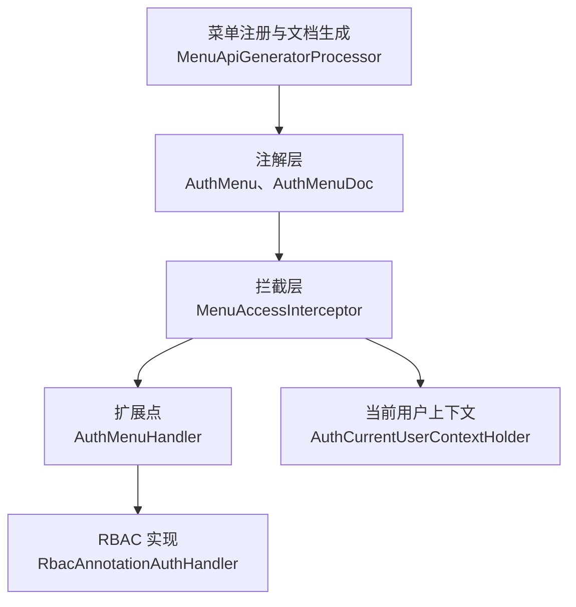
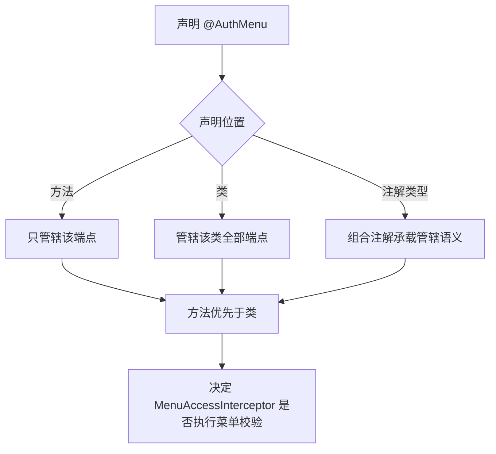
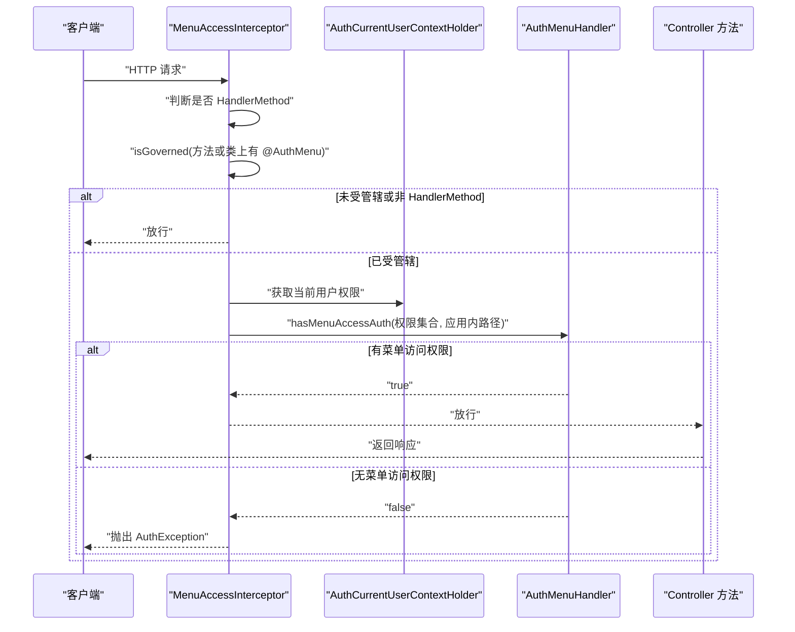
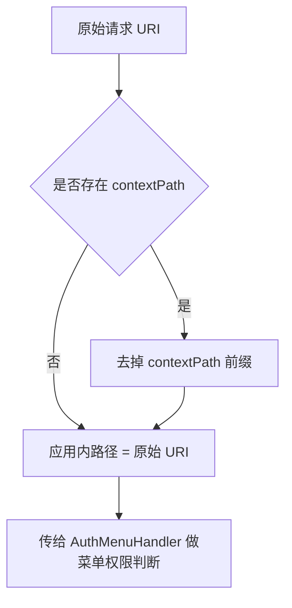
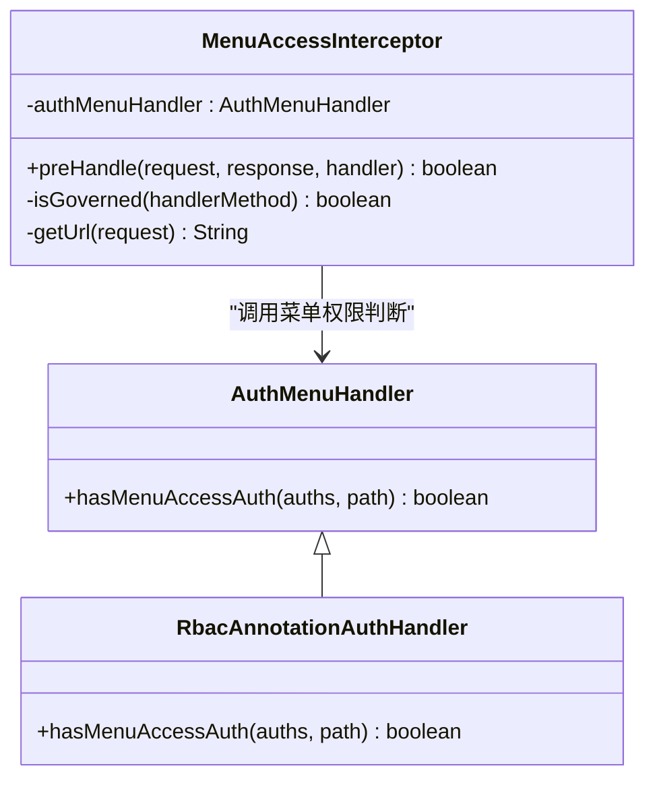
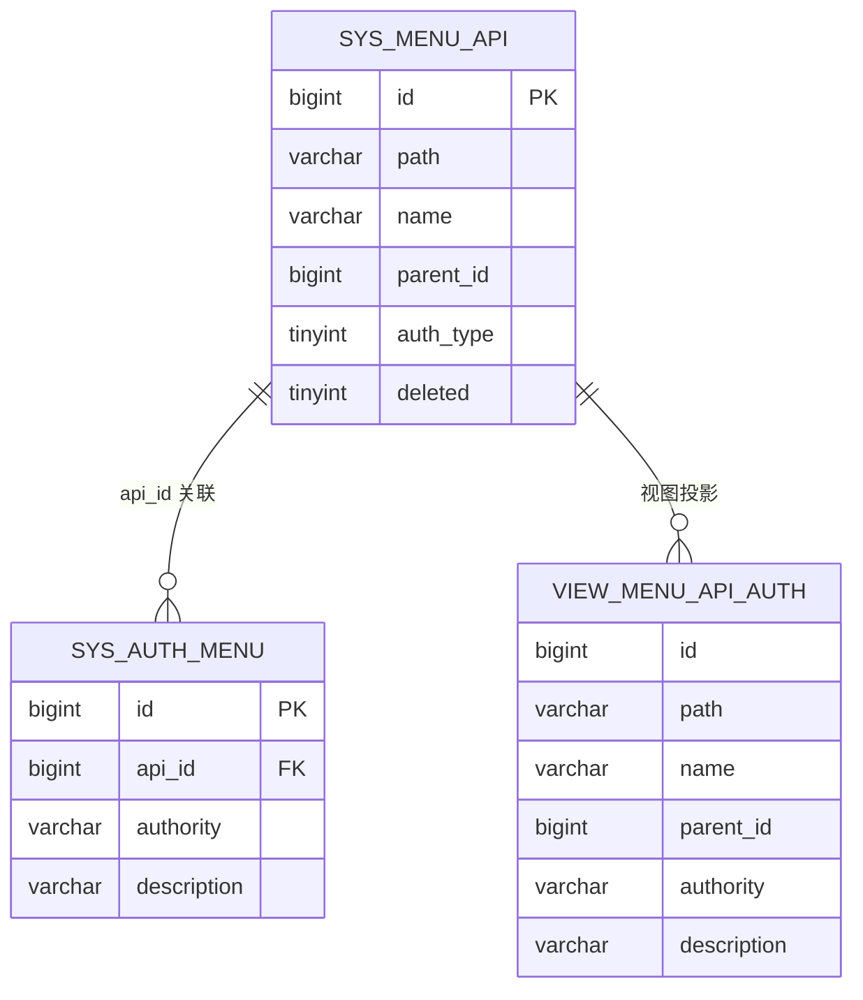
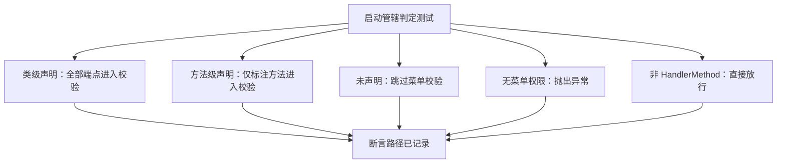
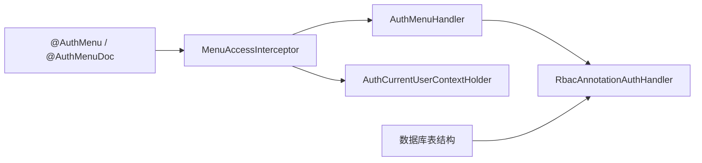

# @AuthMenu 菜单权限注解

<cite>
**本文引用的文件**   
- [auth-core/AuthMenu.java](file://auth/auth-core/src/main/java/com/cu/framework/auth/core/AuthMenu.java)
- [auth-core/AuthMenuDoc.java](file://auth/auth-core/src/main/java/com/cu/framework/auth/core/AuthMenuDoc.java)
- [auth-core/menu/MenuAccessInterceptor.java](file://auth/auth-core/src/main/java/com/cu/framework/auth/core/menu/MenuAccessInterceptor.java)
- [auth-core/menu/AuthMenuHandler.java](file://auth/auth-core/src/main/java/com/cu/framework/auth/core/menu/AuthMenuHandler.java)
- [rbac/RbacAnnotationAuthHandler.java](file://auth/auth-rbac/src/main/java/com/cu/framework/auth/rbac/RbacAnnotationAuthHandler.java)
- [spec/auth/menu-access/spec.md](file://openspec/specs/auth/menu-access/spec.md)
- [sql/auth-rbac.sql](file://docs/sql/auth-rbac.sql)
- [sample/ClassLevelController.java](file://sample/auth-core-boot-sample/src/main/java/com/cu/framework/sample/authcore/web/ClassLevelController.java)
- [sample/MethodLevelController.java](file://sample/auth-core-boot-sample/src/main/java/com/cu/framework/sample/authcore/web/MethodLevelController.java)
- [test/TestAuthMenuClassController.java](file://sample/auth-rbac-boot-sample/src/test/java/controller/authmenu/TestAuthMenuClassController.java)
- [test/TestAuthMenuMethodController.java](file://sample/auth-rbac-boot-sample/src/test/java/controller/authmenu/TestAuthMenuMethodController.java)
- [test/MenuAccessGovernanceTest.java](file://auth/auth-core/src/test/java/com/cu/framework/auth/core/menu/MenuAccessGovernanceTest.java)
</cite>

## 目录
1. [引言](#引言)
2. [项目结构定位](#项目结构定位)
3. [@AuthMenu 注解核心设计](#authmenu-注解核心设计)
4. [与拦截器的配合机制](#与拦截器的配合机制)
5. [扩展点：AuthMenuHandler 接口](#扩展点authmenuhandler-接口)
6. [完整使用示例与最佳实践](#完整使用示例与最佳实践)
7. [权限配置表结构](#权限配置表结构)
8. [测试用例说明](#测试用例说明)
9. [依赖关系分析](#依赖关系分析)
10. [性能与实现特征](#性能与实现特征)
11. [常见问题排查](#常见问题排查)
12. [结论](#结论)

## 引言
@AuthMenu 是框架中用于声明“菜单管辖”的注解。它的设计目标是把“管不管辖”和“显示文案”拆成两个职责：  
- `@AuthMenu` 只负责声明某个方法或某个 Controller 是否受菜单权限校验控制，本身不带任何属性。  
- 菜单树展示名称由 `@AuthMenuDoc` 承担；当未提供显示名称时，菜单生成逻辑会回落到类名或方法名。  

该注解通过 Spring MVC 拦截器在请求进入 Controller 前执行菜单权限判断，并结合 `AuthMenuHandler` 接口让不同 RBAC、数据范围或自定义策略可以接入菜单访问控制。

## 项目结构定位
@AuthMenu 及其配套能力分布在以下模块中：
- 注解定义位于 `auth-core` 模块的 `com.cu.framework.auth.core` 包。
- 运行时拦截逻辑位于 `auth-core` 模块的 `com.cu.framework.auth.core.menu` 包。
- 菜单权限处理器扩展点也定义在 `menu` 包中。
- RBAC 具体实现位于 `auth-rbac` 模块。
- 数据库表结构位于 `docs/sql/auth-rbac.sql`。
- 用法示例分别位于 `sample/auth-core-boot-sample` 与 `sample/auth-rbac-boot-sample`。
- 行为契约由 `openspec/specs/auth/menu-access/spec.md` 描述。

**图示来源**   
- [auth-core/AuthMenu.java:1-16](file://auth/auth-core/src/main/java/com/cu/framework/auth/core/AuthMenu.java#L1-L16)
- [auth-core/AuthMenuDoc.java:1-22](file://auth/auth-core/src/main/java/com/cu/framework/auth/core/AuthMenuDoc.java#L1-L22)
- [auth-core/menu/MenuAccessInterceptor.java:1-93](file://auth/auth-core/src/main/java/com/cu/framework/auth/core/menu/MenuAccessInterceptor.java#L1-L93)
- [auth-core/menu/AuthMenuHandler.java:1-27](file://auth/auth-core/src/main/java/com/cu/framework/auth/core/menu/AuthMenuHandler.java#L1-L27)
- [rbac/RbacAnnotationAuthHandler.java](file://auth/auth-rbac/src/main/java/com/cu/framework/auth/rbac/RbacAnnotationAuthHandler.java)

**章节来源**   
- [auth-core/AuthMenu.java:1-16](file://auth/auth-core/src/main/java/com/cu/framework/auth/core/AuthMenu.java#L1-L16)
- [auth-core/menu/MenuAccessInterceptor.java:1-93](file://auth/auth-core/src/main/java/com/cu/framework/auth/core/menu/MenuAccessInterceptor.java#L1-L93)
- [openspec/specs/auth/menu-access/spec.md:1-91](file://openspec/specs/auth/menu-access/spec.md#L1-L91)

## @AuthMenu 注解核心设计

### 设计理念
@AuthMenu 的核心语义是“管辖”，而不是“授权”。它回答的问题是：“这个端点要不要参与菜单权限校验？”  
- 不携带属性，避免把“管辖”和“权限字符串”“角色”“资源类型”等概念混在一起。  
- 显示文案由 `@AuthMenuDoc` 单独承担，确保“标签展示”不影响鉴权判定。  
- 支持方法、类、注解类型三个目标位置，既支持精确到单个端点，也支持批量管辖整个 Controller。

### 声明位置与作用域规则
| 声明位置 | 作用域 | 行为 |
|---|---|---|
| 方法 | 仅该方法对应的 HTTP 端点 | 只有该方法受菜单校验；同一类其他方法不受影响 |
| 类 | 该类映射的所有端点 | 该类所有方法都受菜单校验 |
| 注解类型 | 允许将 `@AuthMenu` 组合进自定义注解 | 便于按业务域批量复用管辖标记 |

根据规范，系统以单个 HTTP 端点为被管对象；没有声明时不会告警也不会失败，直接放行。

**图示来源**   
- [auth-core/AuthMenu.java:1-16](file://auth/auth-core/src/main/java/com/cu/framework/auth/core/AuthMenu.java#L1-L16)
- [auth-core/menu/MenuAccessInterceptor.java:58-73](file://auth/auth-core/src/main/java/com/cu/framework/auth/core/menu/MenuAccessInterceptor.java#L58-L73)
- [openspec/specs/auth/menu-access/spec.md:1-91](file://openspec/specs/auth/menu-access/spec.md#L1-L91)

### 与 @AuthMenuDoc 的职责分离
- `@AuthMenu` 不参与鉴权判定。  
- `@AuthMenuDoc.name()` 用于生成菜单树标签；缺失时可回落到类简单名或方法名。  
- 即使多个端点使用相同显示文案，它们仍是独立的菜单行，各自拥有独立授权。

**章节来源**   
- [auth-core/AuthMenu.java:1-16](file://auth/auth-core/src/main/java/com/cu/framework/auth/core/AuthMenu.java#L1-L16)
- [auth-core/AuthMenuDoc.java:1-22](file://auth/auth-core/src/main/java/com/cu/framework/auth/core/AuthMenuDoc.java#L1-L22)
- [openspec/specs/auth/menu-access/spec.md:1-91](file://openspec/specs/auth/menu-access/spec.md#L1-L91)

## 与拦截器的配合机制

### 拦截流程
`MenuAccessInterceptor` 在请求进入 Controller 方法前执行预检查，主要步骤如下：

1. 判断命中处理器是否为 `HandlerMethod`。如果不是，直接放行。  
2. 判断该端点是否受管辖：先检查方法上是否有 `@AuthMenu`，再检查类上是否有 `@AuthMenu`。  
3. 如果两端都没有声明，直接放行，不做菜单校验。  
4. 从请求中提取应用内路径：取 `request.getRequestURI()`，并去掉 `contextPath`。  
5. 从 `AuthCurrentUserContextHolder` 获取当前用户的扁平化权限集合。  
6. 调用 `AuthMenuHandler.hasMenuAccessAuth` 进行菜单访问权限判断。  
7. 如果无权限，抛出 `AuthException`；否则继续执行 Controller 方法。

**图示来源**   
- [auth-core/menu/MenuAccessInterceptor.java:26-93](file://auth/auth-core/src/main/java/com/cu/framework/auth/core/menu/MenuAccessInterceptor.java#L26-L93)
- [auth-core/menu/AuthMenuHandler.java:1-27](file://auth/auth-core/src/main/java/com/cu/framework/auth/core/menu/AuthMenuHandler.java#L1-L27)

### 请求路径匹配规则
- 实际用于菜单权限判定的路径是“应用内路径”，即原始 URI 去掉 contextPath。  
- 因此部署在不同 contextPath 下时，菜单注册和权限校验应使用去除 contextPath 后的路径。  
- 如果 `contextPath` 为空或空白，则直接使用原始 URI。

**图示来源**   
- [auth-core/menu/MenuAccessInterceptor.java:75-92](file://auth/auth-core/src/main/java/com/cu/framework/auth/core/menu/MenuAccessInterceptor.java#L75-L92)

**章节来源**   
- [auth-core/menu/MenuAccessInterceptor.java:1-93](file://auth/auth-core/src/main/java/com/cu/framework/auth/core/menu/MenuAccessInterceptor.java#L1-L93)

## 扩展点：AuthMenuHandler 接口

### 接口设计意图
`AuthMenuHandler` 是菜单权限验证的扩展点。拦截器只负责“是否受管辖”和“调用扩展点”，具体的“有没有菜单访问权限”交给实现类决定。  
这样框架可以把菜单注册、菜单展示、菜单权限策略解耦，同时允许 RBAC、数据范围、部门继承等策略统一接入。

### 接口方法
| 方法 | 参数 | 返回值 | 含义 |
|---|---|---|---|
| `hasMenuAccessAuth` | 扁平化权限集合、应用内路径 | 布尔值 | 当前用户对该路径是否有菜单访问权限 |

### RBAC 实现
RBAC 模块中的 `RbacAnnotationAuthHandler` 实现了该接口，将菜单路径与 RBAC 权限模型关联起来。业务系统通常不需要自己实现该接口，除非要替换默认的菜单权限策略。

**图示来源**   
- [auth-core/menu/AuthMenuHandler.java:1-27](file://auth/auth-core/src/main/java/com/cu/framework/auth/core/menu/AuthMenuHandler.java#L1-L27)
- [auth-core/menu/MenuAccessInterceptor.java:1-93](file://auth/auth-core/src/main/java/com/cu/framework/auth/core/menu/MenuAccessInterceptor.java#L1-L93)
- [rbac/RbacAnnotationAuthHandler.java](file://auth/auth-rbac/src/main/java/com/cu/framework/auth/rbac/RbacAnnotationAuthHandler.java)

**章节来源**   
- [auth-core/menu/AuthMenuHandler.java:1-27](file://auth/auth-core/src/main/java/com/cu/framework/auth/core/menu/AuthMenuHandler.java#L1-L27)
- [rbac/RbacAnnotationAuthHandler.java](file://auth/auth-rbac/src/main/java/com/cu/framework/auth/rbac/RbacAnnotationAuthHandler.java)

## 完整使用示例与最佳实践

### 类级使用：一次声明管辖整个 Controller
类级 `@AuthMenu` 适合对整组管理端点进行统一管辖。每个端点仍应有独立的菜单授权：有的已授予，有的可能谁都没授，从而表现为“能看但进不去”。

推荐写法要点：
- 在 Controller 类上加 `@AuthMenu`。
- 在类和方法上都使用 `@AuthMenuDoc(name=...)` 明确菜单展示名称。
- 保持路径与菜单表中的路径一致。

参考示例路径：
- [ClassLevelController.java](file://sample/auth-core-boot-sample/src/main/java/com/cu/framework/sample/authcore/web/ClassLevelController.java)
- [TestAuthMenuClassController.java](file://sample/auth-rbac-boot-sample/src/test/java/controller/authmenu/TestAuthMenuClassController.java)

### 方法级使用：精确控制单个端点
方法级 `@AuthMenu` 适合只对敏感操作启用菜单校验，同一类中其他公开接口可不参与菜单校验。

推荐写法要点：
- 只在需要菜单校验的方法上加 `@AuthMenu`。
- 显式提供 `@AuthMenuDoc(name=...)`，避免菜单名称回落到方法名。
- 对同名文案的不同端点，要意识到它们是两条独立菜单行。

参考示例路径：
- [MethodLevelController.java](file://sample/auth-core-boot-sample/src/main/java/com/cu/framework/sample/authcore/web/MethodLevelController.java)
- [TestAuthMenuMethodController.java](file://sample/auth-rbac-boot-sample/src/test/java/controller/authmenu/TestAuthMenuMethodController.java)

### 与 @AuthMenuDoc 的最佳实践
- 始终为受管辖端点提供有意义的 `name`。  
- 类级分组名称应与业务模块一致。  
- 不要通过修改显示文案来改变权限归属；权限归属由代码声明和菜单权限表决定。  
- 不要把 `@AuthMenuDoc` 当成鉴权条件。

**章节来源**   
- [sample/ClassLevelController.java:1-46](file://sample/auth-core-boot-sample/src/main/java/com/cu/framework/sample/authcore/web/ClassLevelController.java#L1-L46)
- [sample/MethodLevelController.java:1-78](file://sample/auth-core-boot-sample/src/main/java/com/cu/framework/sample/authcore/web/MethodLevelController.java#L1-L78)
- [test/TestAuthMenuClassController.java:1-23](file://sample/auth-rbac-boot-sample/src/test/java/controller/authmenu/TestAuthMenuClassController.java#L1-L23)
- [test/TestAuthMenuMethodController.java:1-20](file://sample/auth-rbac-boot-sample/src/test/java/controller/authmenu/TestAuthMenuMethodController.java#L1-L20)

## 权限配置表结构

### 菜单相关表
| 表名 | 用途 | 关键字段 |
|---|---|---|
| `sys_menu_api` | 菜单 API 行，对应一个可被菜单权限管辖的请求路径 | `id`、`path`、`name`、`parent_id`、`auth_type`、`deleted` |
| `sys_auth_menu` | 菜单权限表，记录菜单行与权限字符串的关系 | `id`、`api_id`、`authority`、`description` |
| `view_menu_api_auth` | 视图，方便查看以自身权限为主的菜单 API 与权限关系 | 聚合 `sys_menu_api` 与 `sys_auth_menu` |

### 其他相关基础表
| 表名 | 用途 |
|---|---|
| `sys_user` | 用户信息 |
| `sys_role` | 角色信息 |
| `sys_user_role` | 用户与角色关联 |
| `sys_dept` | 部门信息 |
| `sys_user_dept` | 用户与部门关联 |
| `sys_auth_data` | 应用数据权限表，用于数据范围或数据级权限 |
| `sys_menu_route` | 前端路由与菜单元信息 |

**图示来源**   
- [sql/auth-rbac.sql:1-148](file://docs/sql/auth-rbac.sql#L1-L148)

**章节来源**   
- [sql/auth-rbac.sql:1-148](file://docs/sql/auth-rbac.sql#L1-L148)

## 测试用例说明

### 管辖判定测试
`MenuAccessGovernanceTest` 验证了菜单管辖的三个核心场景：
1. 类级声明：该类所有端点都应进入菜单校验。  
2. 方法级声明：只有标注方法进入菜单校验，同类的其他方法不进入。  
3. 未声明端点：不进行菜单校验，直接放行。  
4. 受管辖但无菜单访问权限：应抛出 `AuthException`。  
5. 非 `HandlerMethod`：应直接放行。

测试中还通过自定义 `RecordingMenuHandler` 记录被调用的路径，并通过代理构造最小化的 `HttpServletRequest`，使测试聚焦于管辖判定逻辑。

**图示来源**   
- [test/MenuAccessGovernanceTest.java:1-142](file://auth/auth-core/src/test/java/com/cu/framework/auth/core/menu/MenuAccessGovernanceTest.java#L1-L142)

**章节来源**   
- [test/MenuAccessGovernanceTest.java:1-142](file://auth/auth-core/src/test/java/com/cu/framework/auth/core/menu/MenuAccessGovernanceTest.java#L1-L142)

## 依赖关系分析

### 组件耦合关系
- `MenuAccessInterceptor` 强依赖 `AuthMenuHandler` 和 `AuthCurrentUserContextHolder`。  
- `AuthMenuHandler` 是松耦合扩展点，RBAC 实现类通过实现该接口接入。  
- `@AuthMenu` 与 `@AuthMenuDoc` 是纯注解，不参与运行期权限判定，只影响菜单注册和展示。  
- 数据库脚本提供菜单、权限、用户、角色、部门等基础数据模型。

**图示来源**   
- [auth-core/AuthMenu.java:1-16](file://auth/auth-core/src/main/java/com/cu/framework/auth/core/AuthMenu.java#L1-L16)
- [auth-core/AuthMenuDoc.java:1-22](file://auth/auth-core/src/main/java/com/cu/framework/auth/core/AuthMenuDoc.java#L1-L22)
- [auth-core/menu/MenuAccessInterceptor.java:1-93](file://auth/auth-core/src/main/java/com/cu/framework/auth/core/menu/MenuAccessInterceptor.java#L1-L93)
- [auth-core/menu/AuthMenuHandler.java:1-27](file://auth/auth-core/src/main/java/com/cu/framework/auth/core/menu/AuthMenuHandler.java#L1-L27)
- [rbac/RbacAnnotationAuthHandler.java](file://auth/auth-rbac/src/main/java/com/cu/framework/auth/rbac/RbacAnnotationAuthHandler.java)
- [sql/auth-rbac.sql:1-148](file://docs/sql/auth-rbac.sql#L1-L148)

**章节来源**   
- [auth-core/menu/MenuAccessInterceptor.java:1-93](file://auth/auth-core/src/main/java/com/cu/framework/auth/core/menu/MenuAccessInterceptor.java#L1-L93)
- [auth-core/menu/AuthMenuHandler.java:1-27](file://auth/auth-core/src/main/java/com/cu/framework/auth/core/menu/AuthMenuHandler.java#L1-L27)

## 性能与实现特征

### 时间复杂度
- 管辖判定：常量时间，最多检查方法注解和类注解。  
- 路径处理：字符串截取，常量或线性于 contextPath 长度。  
- 菜单权限判断：取决于 `AuthMenuHandler` 实现；RBAC 实现通常会查询权限集合并与菜单路径匹配，整体复杂度由权限数量和匹配算法决定。

### 空间复杂度
- 拦截器本身只持有少量引用和局部变量。  
- 主要内存开销来自当前用户权限集合和 RBAC 权限缓存。

### 实现特征
- 非受管辖端点零额外校验成本。  
- 非 `HandlerMethod` 请求直接放行，避免对静态资源或错误页面造成干扰。  
- 权限不足直接抛出 `AuthException`，由上层全局异常处理统一返回。

[本节为通用性能讨论，不直接分析具体代码片段]

## 常见问题排查

### 问题一：端点没有菜单校验，任何人都能访问
可能原因：
- 方法上和类上都没有 `@AuthMenu`。  
- 使用了类级声明，但误以为只有部分方法受管辖。  
- 自定义注解组合时，`@AuthMenu` 未被正确保留或扫描。

排查建议：
- 确认目标方法或目标类是否标注 `@AuthMenu`。  
- 检查类级声明的作用域是否越出预期。  
- 查看 `MenuAccessInterceptor.isGoverned` 的判定逻辑。

**章节来源**   
- [auth-core/menu/MenuAccessInterceptor.java:58-73](file://auth/auth-core/src/main/java/com/cu/framework/auth/core/menu/MenuAccessInterceptor.java#L58-L73)
- [openspec/specs/auth/menu-access/spec.md:1-91](file://openspec/specs/auth/menu-access/spec.md#L1-L91)

### 问题二：菜单可见但请求被拒绝
可能原因：
- 菜单行存在，但没有为该路径授予所需权限。  
- 菜单权限表中 `api_id` 与 `sys_menu_api.path` 不一致。  
- RBAC 权限集合中没有匹配项。

排查建议：
- 检查 `sys_menu_api` 与 `sys_auth_menu` 的关联关系。  
- 使用 `view_menu_api_auth` 视图查看菜单与权限映射。  
- 确认当前登录用户是否具备对应权限。

**章节来源**   
- [sql/auth-rbac.sql:1-148](file://docs/sql/auth-rbac.sql#L1-L148)

### 问题三：contextPath 部署后路径不匹配
可能原因：
- 菜单注册路径或权限路径包含 contextPath，而拦截器内部比较的是去掉 contextPath 后的应用内路径。

排查建议：
- 检查菜单表中的 `path` 是否与控制器映射路径一致。  
- 确认部署环境 contextPath 配置是否正确。  
- 注意拦截器会自动去掉 contextPath 后再做权限判断。

**章节来源**   
- [auth-core/menu/MenuAccessInterceptor.java:75-92](file://auth/auth-core/src/main/java/com/cu/framework/auth/core/menu/MenuAccessInterceptor.java#L75-L92)

### 问题四：修改菜单显示名称后权限变化
可能原因：
- 期望通过改名改变授权归属，但这不符合设计。  
- 菜单显示名称不参与鉴权判定。

排查建议：
- 区分“菜单名称”和“菜单权限”。  
- 修改名称只影响菜单展示，不应影响已有授权。  
- 如需调整权限，应通过菜单权限表或 RBAC 配置变更。

**章节来源**   
- [auth-core/AuthMenuDoc.java:1-22](file://auth/auth-core/src/main/java/com/cu/framework/auth/core/AuthMenuDoc.java#L1-L22)
- [openspec/specs/auth/menu-access/spec.md:1-91](file://openspec/specs/auth/menu-access/spec.md#L1-L91)

### 问题五：同名文案的两个端点权限互相影响
可能原因：
- 误认为同名文案共享权限。

事实：
- 同名文案只是菜单树标签相同，两个端点仍是独立菜单行，各自维护独立授权。

排查建议：
- 分别检查两个端点对应的菜单行及其权限配置。  
- 不要依赖文案唯一性做权限设计。

**章节来源**   
- [openspec/specs/auth/menu-access/spec.md:1-91](file://openspec/specs/auth/menu-access/spec.md#L1-L91)

## 结论
@AuthMenu 是一个简洁而明确的菜单管辖声明注解：它只负责“管不管辖”，不负责“显示什么”也不负责“具体用什么权限模型”。  
- 方法级声明适合精细控制；类级声明适合批量管理。  
- `@AuthMenuDoc` 承担显示文案职责，且不影响鉴权。  
- `MenuAccessInterceptor` 提供统一的拦截入口，`AuthMenuHandler` 提供策略扩展点。  
- RBAC 模块通过 `RbacAnnotationAuthHandler` 实现默认菜单权限策略。  
- 数据库脚本定义了菜单、菜单权限、用户、角色、部门等基础结构，支撑菜单注册、展示与权限判定。

对于使用者而言，最关键的实践是：**用 `@AuthMenu` 声明管辖，用 `@AuthMenuDoc` 提供可读菜单名称，用菜单表和 RBAC 配置表达真实权限。**