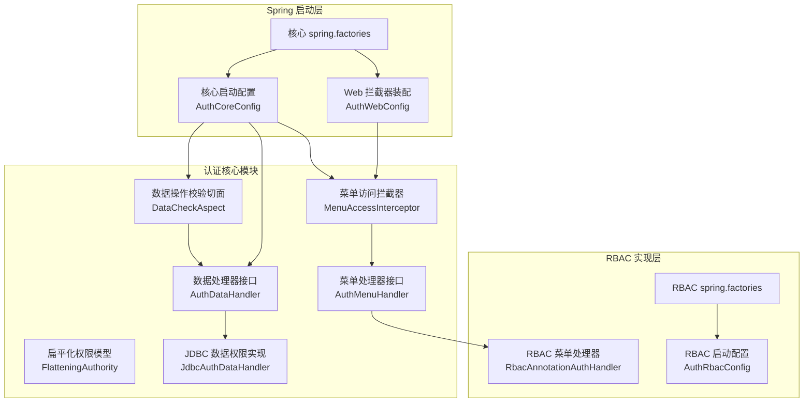
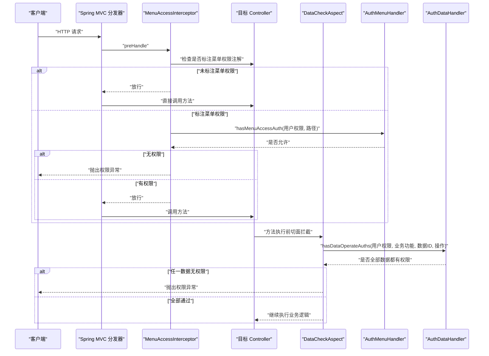
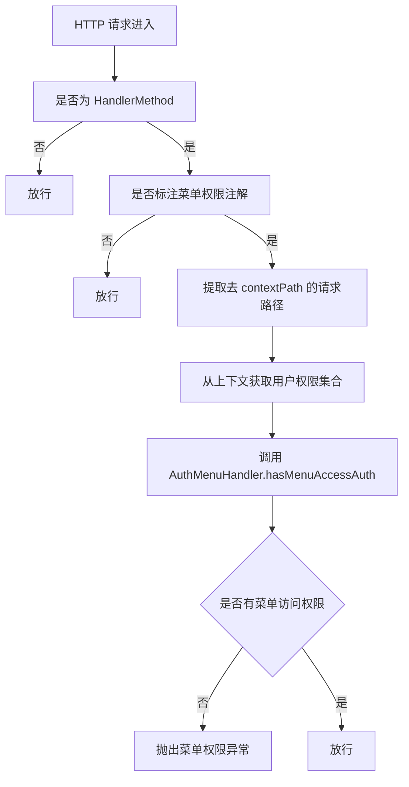
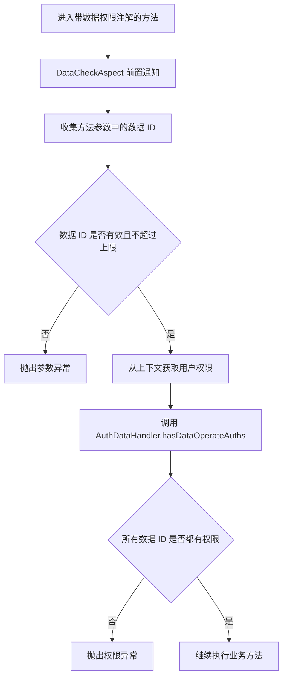
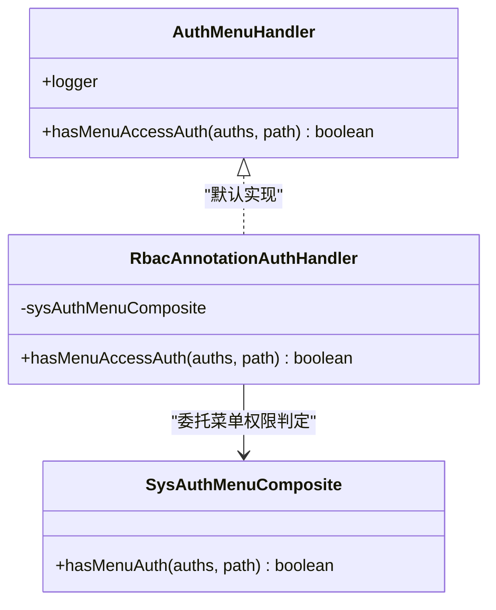
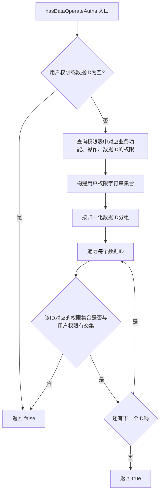
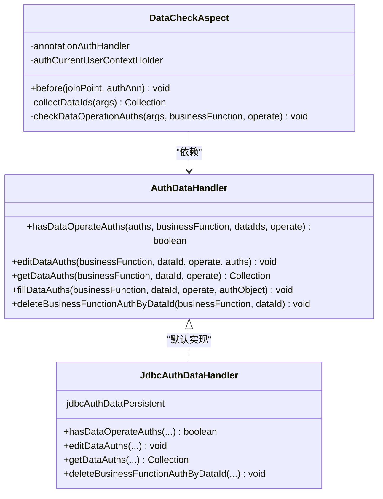
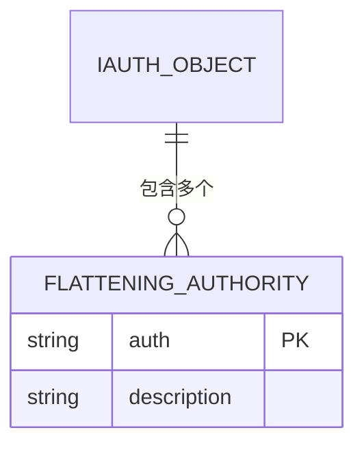
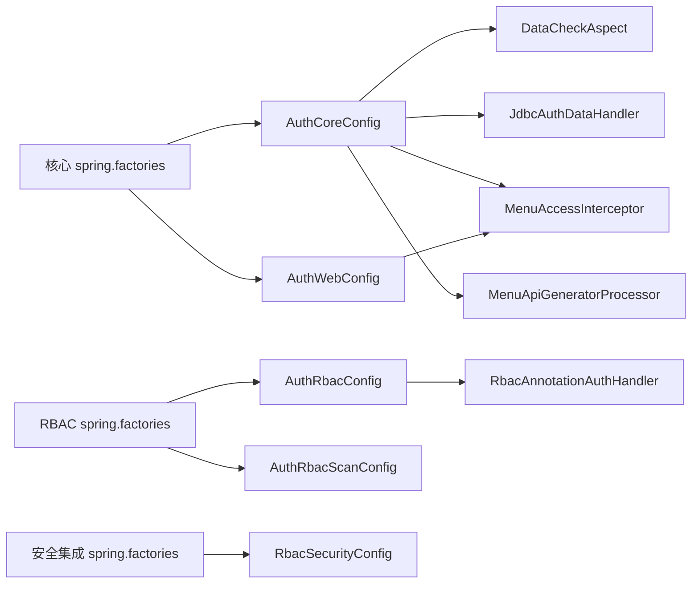
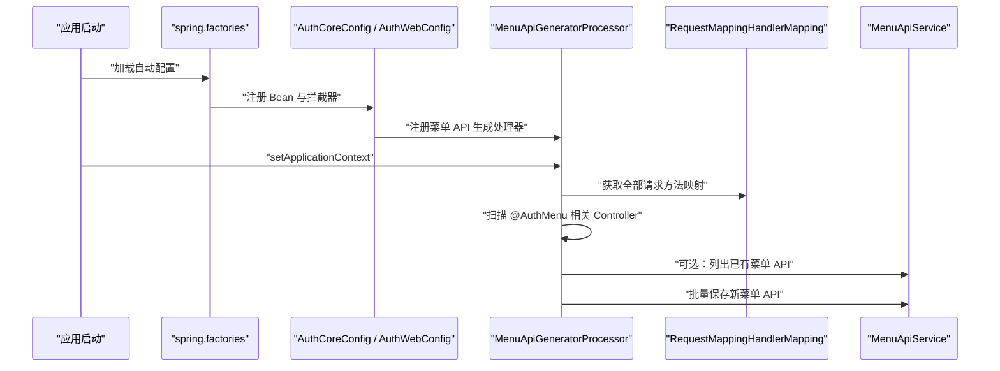

# 注解处理机制

<cite>
**本文引用的文件**   
- [AuthMenuHandler.java](file://auth/auth-core/src/main/java/com/cu/framework/auth/core/menu/AuthMenuHandler.java)
- [AuthDataHandler.java](file://auth/auth-core/src/main/java/com/cu/framework/auth/core/data/AuthDataHandler.java)
- [FlatteningAuthority.java](file://auth/auth-core/src/main/java/com/cu/framework/auth/core/entity/FlatteningAuthority.java)
- [IAuthObject.java](file://auth/auth-core/src/main/java/com/cu/framework/auth/core/entity/IAuthObject.java)
- [MenuAccessInterceptor.java](file://auth/auth-core/src/main/java/com/cu/framework/auth/core/menu/MenuAccessInterceptor.java)
- [MenuApiGeneratorProcessor.java](file://auth/auth-core/src/main/java/com/cu/framework/auth/core/menu/MenuApiGeneratorProcessor.java)
- [DataCheckAspect.java](file://auth/auth-core/src/main/java/com/cu/framework/auth/core/data/edit/DataCheckAspect.java)
- [JdbcAuthDataHandler.java](file://auth/auth-core/src/main/java/com/cu/framework/auth/core/data/JdbcAuthDataHandler.java)
- [AuthCoreConfig.java](file://auth/auth-core-spring-boot-starter/src/main/java/com/cu/framework/boot/auth/core/config/AuthCoreConfig.java)
- [AuthWebConfig.java](file://auth/auth-core-spring-boot-starter/src/main/java/com/cu/framework/boot/auth/core/config/AuthWebConfig.java)
- [AuthRbacConfig.java](file://auth/auth-rbac-spring-boot-starter/src/main/java/com/cu/framework/boot/auth/rbac/config/AuthRbacConfig.java)
- [RbacAnnotationAuthHandler.java](file://auth/auth-rbac/src/main/java/com/cu/framework/auth/rbac/RbacAnnotationAuthHandler.java)
- [spring.factories（核心启动器）](file://auth/auth-core-spring-boot-starter/src/main/resources/META-INF/spring.factories)
- [spring.factories（RBAC 启动器）](file://auth/auth-rbac-spring-boot-starter/src/main/resources/META-INF/spring.factories)
- [spring.factories（安全集成启动器）](file://auth/auth-rbac-security-spring-boot-starter/src/main/resources/META-INF/spring.factories)
- [README.md（权限体说明）](file://auth/auth-core/README.md)
</cite>

## 目录
1. [引言](#引言)
2. [项目结构定位](#项目结构定位)
3. [核心组件总览](#核心组件总览)
4. [架构总览](#架构总览)
5. [注解处理器与切面编程机制](#注解处理器与切面编程机制)
6. [菜单处理器 AuthMenuHandler 详解](#菜单处理器-authmenuhandler-详解)
7. [数据处理器 AuthDataHandler 详解](#数据处理器-authdatahandler-详解)
8. [扁平化权限模型 FlatteningAuthority](#扁平化权限模型-flatteningauthority)
9. [Spring Boot Starter 自动装配机制](#spring-boot-starter-自动装配机制)
10. [应用启动时的初始化流程](#应用启动时的初始化流程)
11. [扩展开发指南：自定义处理器](#扩展开发指南自定义处理器)
12. [性能优化建议](#性能优化建议)
13. [调试技巧与故障排除](#调试技巧与故障排除)
14. [结论](#结论)

## 引言
本文聚焦 Kewen Framework 中“注解驱动”的权限体系，解释以下关键问题：
- 如何通过注解声明菜单访问和数据操作权限。
- AOP 切面如何拦截并执行权限判定。
- `AuthMenuHandler` 与 `AuthDataHandler` 两个核心处理器接口的设计模式与调用链。
- `FlatteningAuthority` 扁平化权限模型的职责、数据结构与转换边界。
- Spring Boot Starter 如何自动装配 Bean、织入切面、注册拦截器。
- 应用启动时如何扫描注解、发现处理器并完成依赖注入。
- 如何扩展自定义菜单处理器和数据处理器。
- 常见问题、性能瓶颈及优化手段。

该机制把“谁可以访问哪个接口”和“哪些用户能操作哪些数据行”拆成两条正交路径：菜单级访问控制走 Web 拦截器链路；数据级操作控制走 AOP 切面链路。两者共享同一套扁平化权限对象，从而复用权限集合，避免重复建模。

**章节来源**
- [README.md（权限体说明）:1-15](file://auth/auth-core/README.md#L1-L15)

## 项目结构定位
本功能横跨三个主要模块：
- `auth-core`：定义权限注解、权限模型、处理器接口、AOP 切面、菜单拦截器和默认 JDBC 实现。
- `auth-core-spring-boot-starter`：将核心能力装配到 Spring 容器中，注册 Bean、拦截器和异常处理器。
- `auth-rbac-spring-boot-starter`：提供 RBAC 默认实现，包括基于数据库的菜单权限处理器和菜单 API 服务装配。

**图表来源**
- [AuthMenuHandler.java:1-27](file://auth/auth-core/src/main/java/com/cu/framework/auth/core/menu/AuthMenuHandler.java#L1-L27)
- [AuthDataHandler.java:1-102](file://auth/auth-core/src/main/java/com/cu/framework/auth/core/data/AuthDataHandler.java#L1-L102)
- [FlatteningAuthority.java:1-63](file://auth/auth-core/src/main/java/com/cu/framework/auth/core/entity/FlatteningAuthority.java#L1-L63)
- [DataCheckAspect.java:1-149](file://auth/auth-core/src/main/java/com/cu/framework/auth/core/data/edit/DataCheckAspect.java#L1-L149)
- [MenuAccessInterceptor.java:1-93](file://auth/auth-core/src/main/java/com/cu/framework/auth/core/menu/MenuAccessInterceptor.java#L1-L93)
- [JdbcAuthDataHandler.java:1-119](file://auth/auth-core/src/main/java/com/cu/framework/auth/core/data/JdbcAuthDataHandler.java#L1-L119)
- [AuthCoreConfig.java:1-203](file://auth/auth-core-spring-boot-starter/src/main/java/com/cu/framework/boot/auth/core/config/AuthCoreConfig.java#L1-L203)
- [AuthWebConfig.java:1-30](file://auth/auth-core-spring-boot-starter/src/main/java/com/cu/framework/boot/auth/core/config/AuthWebConfig.java#L1-L30)
- [RbacAnnotationAuthHandler.java:1-27](file://auth/auth-rbac/src/main/java/com/cu/framework/auth/rbac/RbacAnnotationAuthHandler.java#L1-L27)
- [AuthRbacConfig.java:1-75](file://auth/auth-rbac-spring-boot-starter/src/main/java/com/cu/framework/boot/auth/rbac/config/AuthRbacConfig.java#L1-L75)
- [spring.factories（核心启动器）:1-3](file://auth/auth-core-spring-boot-starter/src/main/resources/META-INF/spring.factories#L1-L3)
- [spring.factories（RBAC 启动器）:1-3](file://auth/auth-rbac-spring-boot-starter/src/main/resources/META-INF/spring.factories#L1-L3)

**章节来源**
- [AuthCoreConfig.java:1-203](file://auth/auth-core-spring-boot-starter/src/main/java/com/cu/framework/boot/auth/core/config/AuthCoreConfig.java#L1-L203)
- [AuthWebConfig.java:1-30](file://auth/auth-core-spring-boot-starter/src/main/java/com/cu/framework/boot/auth/core/config/AuthWebConfig.java#L1-L30)
- [spring.factories（核心启动器）:1-3](file://auth/auth-core-spring-boot-starter/src/main/resources/META-INF/spring.factories#L1-L3)
- [spring.factories（RBAC 启动器）:1-3](file://auth/auth-rbac-spring-boot-starter/src/main/resources/META-INF/spring.factories#L1-L3)

## 核心组件总览
| 组件 | 角色 | 是否可扩展 | 默认实现或关联类 |
|---|---|---|---|
| `AuthMenuHandler` | 菜单访问权限判定入口 | 是 | `RbacAnnotationAuthHandler` |
| `AuthDataHandler` | 数据操作权限读写与判定入口 | 是 | `JdbcAuthDataHandler` |
| `FlatteningAuthority` | 扁平化权限字符串与描述载体 | 否 | 被所有处理器共用 |
| `IAuthObject` | 权限集合体抽象 | 是 | 用户权限、机构权限等实体需实现 |
| `MenuAccessInterceptor` | Web 层菜单权限拦截器 | 否，但可替换 Bean | 由 `AuthWebConfig` 注册 |
| `DataCheckAspect` | AOP 数据操作权限切面 | 否，但可替换其依赖的 `AuthDataHandler` | 由 `AuthCoreConfig` 注册 |
| `MenuApiGeneratorProcessor` | 启动时扫描控制器生成菜单 API | 否，但依赖可选的 `MenuApiService` | 由命令运行器触发 |
| `AuthCoreConfig` | 核心 Bean 装配中心 | 否 | 注册切面、拦截器、持久化、缓存等 |
| `AuthRbacConfig` | RBAC 默认实现装配 | 否 | 注册 RBAC 菜单处理器、菜单存储等 |

**章节来源**
- [AuthMenuHandler.java:1-27](file://auth/auth-core/src/main/java/com/cu/framework/auth/core/menu/AuthMenuHandler.java#L1-L27)
- [AuthDataHandler.java:1-102](file://auth/auth-core/src/main/java/com/cu/framework/auth/core/data/AuthDataHandler.java#L1-L102)
- [FlatteningAuthority.java:1-63](file://auth/auth-core/src/main/java/com/cu/framework/auth/core/entity/FlatteningAuthority.java#L1-L63)
- [IAuthObject.java:1-35](file://auth/auth-core/src/main/java/com/cu/framework/auth/core/entity/IAuthObject.java#L1-L35)
- [MenuAccessInterceptor.java:1-93](file://auth/auth-core/src/main/java/com/cu/framework/auth/core/menu/MenuAccessInterceptor.java#L1-L93)
- [DataCheckAspect.java:1-149](file://auth/auth-core/src/main/java/com/cu/framework/auth/core/data/edit/DataCheckAspect.java#L1-L149)
- [MenuApiGeneratorProcessor.java:1-214](file://auth/auth-core/src/main/java/com/cu/framework/auth/core/menu/MenuApiGeneratorProcessor.java#L1-L214)
- [AuthCoreConfig.java:1-203](file://auth/auth-core-spring-boot-starter/src/main/java/com/cu/framework/boot/auth/core/config/AuthCoreConfig.java#L1-L203)
- [AuthRbacConfig.java:1-75](file://auth/auth-rbac-spring-boot-starter/src/main/java/com/cu/framework/boot/auth/rbac/config/AuthRbacConfig.java#L1-L75)

## 架构总览
Kewen 权限系统的注解处理机制可以理解为三层：
1. **声明层**：通过注解声明“某个 Controller 方法需要菜单权限”，“某个 Service 方法需要数据操作权限”。
2. **拦截层**：
   - Web 请求进入 `MenuAccessInterceptor`，判断是否需要菜单权限。
   - 业务方法进入 `DataCheckAspect`，抽取数据 ID 并调用数据权限处理器。
3. **实现层**：
   - 菜单权限最终交给 `AuthMenuHandler`，默认由 RBAC 实现根据用户权限集合与菜单路径判定。
   - 数据权限最终交给 `AuthDataHandler`，默认由 `JdbcAuthDataHandler` 查询权限表并比对。

**图表来源**
- [MenuAccessInterceptor.java:1-93](file://auth/auth-core/src/main/java/com/cu/framework/auth/core/menu/MenuAccessInterceptor.java#L1-L93)
- [DataCheckAspect.java:1-149](file://auth/auth-core/src/main/java/com/cu/framework/auth/core/data/edit/DataCheckAspect.java#L1-L149)
- [AuthMenuHandler.java:1-27](file://auth/auth-core/src/main/java/com/cu/framework/auth/core/menu/AuthMenuHandler.java#L1-L27)
- [AuthDataHandler.java:1-102](file://auth/auth-core/src/main/java/com/cu/framework/auth/core/data/AuthDataHandler.java#L1-L102)

## 注解处理器与切面编程机制
### 菜单权限：拦截器 + 处理器接口
菜单权限采用“声明式 + 拦截器 + 策略”的组合：
- 声明：在 Controller 类或方法上使用菜单相关注解。
- 拦截：`MenuAccessInterceptor` 在 `preHandle` 阶段判断当前请求是否受菜单管辖。
- 策略：如果受管辖，则从上下文获取当前用户权限集合，再委托给 `AuthMenuHandler.hasMenuAccessAuth` 判定。

这种设计把“何时判定”放在拦截器，“如何判定”交给处理器接口，使菜单权限判定规则可以独立演进。

**图表来源**
- [MenuAccessInterceptor.java:1-93](file://auth/auth-core/src/main/java/com/cu/framework/auth/core/menu/MenuAccessInterceptor.java#L1-L93)
- [AuthMenuHandler.java:1-27](file://auth/auth-core/src/main/java/com/cu/framework/auth/core/menu/AuthMenuHandler.java#L1-L27)

### 数据权限：AOP 切面 + 数据处理器
数据权限使用 Spring AOP 的 `@Before` 切面：
- 切入点：标注数据操作注解的方法。
- 前置逻辑：收集方法参数中的业务数据 ID。
- 权限判定：调用 `AuthDataHandler.hasDataOperateAuths`，要求每个数据 ID 都命中对应业务功能和操作下的权限。
- 失败结果：抛出权限异常。

**图表来源**
- [DataCheckAspect.java:1-149](file://auth/auth-core/src/main/java/com/cu/framework/auth/core/data/edit/DataCheckAspect.java#L1-L149)
- [AuthDataHandler.java:1-102](file://auth/auth-core/src/main/java/com/cu/framework/auth/core/data/AuthDataHandler.java#L1-L102)

**章节来源**
- [MenuAccessInterceptor.java:1-93](file://auth/auth-core/src/main/java/com/cu/framework/auth/core/menu/MenuAccessInterceptor.java#L1-L93)
- [DataCheckAspect.java:1-149](file://auth/auth-core/src/main/java/com/cu/framework/auth/core/data/edit/DataCheckAspect.java#L1-L149)

## 菜单处理器 AuthMenuHandler 详解
`AuthMenuHandler` 是菜单访问权限的策略接口。它只暴露一个核心方法：接收当前用户的扁平化权限集合和目标 URL 路径，返回是否允许访问。

### 设计要点
- **单一职责**：只负责“路径级菜单权限判定”，不关心权限如何加载。
- **可插拔**：框架默认提供 RBAC 实现，但用户可以覆盖 Bean 以替换判定逻辑。
- **与上下文解耦**：不直接持有当前用户，而是由拦截器把已解析的权限集合传入。

### 默认实现
RBAC 模块中的 `RbacAnnotationAuthHandler` 实现了该接口，并把判定委托给 `SysAuthMenuComposite`。这意味着 RBAC 场景下，菜单权限最终由“用户权限集合 + 菜单路由组合器”共同决定。

**图表来源**
- [AuthMenuHandler.java:1-27](file://auth/auth-core/src/main/java/com/cu/framework/auth/core/menu/AuthMenuHandler.java#L1-L27)
- [RbacAnnotationAuthHandler.java:1-27](file://auth/auth-rbac/src/main/java/com/cu/framework/auth/rbac/RbacAnnotationAuthHandler.java#L1-L27)

### 与 Web 层的协作
`MenuAccessInterceptor` 会在以下情况下跳过菜单判定：
- 不是 `HandlerMethod`。
- 方法和所在类都没有菜单权限注解。

只有明确声明受菜单管辖时，才会取当前用户权限集合并调用 `AuthMenuHandler`。

**章节来源**
- [AuthMenuHandler.java:1-27](file://auth/auth-core/src/main/java/com/cu/framework/auth/core/menu/AuthMenuHandler.java#L1-L27)
- [RbacAnnotationAuthHandler.java:1-27](file://auth/auth-rbac/src/main/java/com/cu/framework/auth/rbac/RbacAnnotationAuthHandler.java#L1-L27)
- [MenuAccessInterceptor.java:1-93](file://auth/auth-core/src/main/java/com/cu/framework/auth/core/menu/MenuAccessInterceptor.java#L1-L93)

## 数据处理器 AuthDataHandler 详解
`AuthDataHandler` 是数据级权限的核心扩展点，承担三类职责：
1. **权限判定**：判断某组数据 ID 是否在指定业务功能和操作下拥有权限。
2. **权限编辑**：写入或删除某条数据在指定槽位下的权限。
3. **权限读取与填充**：读取某条数据的权限，并回填到权限对象中。

### 核心方法语义
| 方法 | 输入 | 输出 | 行为说明 |
|---|---|---|---|
| `hasDataOperateAuths` | 用户权限集合、业务功能、数据 ID 集合、操作类型 | 布尔值 | 每个数据 ID 都必须命中权限，否则拒绝 |
| `editDataAuths` | 业务功能、数据 ID、操作类型、扁平化权限集合 | 无 | 更新某条数据在指定操作下的权限 |
| `getDataAuths` | 业务功能、数据 ID、操作类型 | 扁平化权限集合 | 查询某条数据已配置的权限 |
| `fillDataAuths` | 业务功能、数据 ID、操作类型、权限对象 | 无 | 把查询到的权限写入权限对象 |
| `deleteBusinessFunctionAuthByDataId` | 业务功能、数据 ID | 无 | 删除某条业务数据的全部相关权限 |

### 默认实现：JDBC 数据权限处理器
`JdbcAuthDataHandler` 是默认实现，它通过 `JdbcAuthDataPersistent` 访问权限表。其判定逻辑的关键点：
- 空权限集合或空数据 ID 集合直接拒绝。
- 查询数据库中这些业务 ID 在指定业务功能和操作下的权限。
- 把用户权限转为字符串集合。
- 按归一化的数据 ID 分组，判断每组是否与用户权限集合存在交集。
- 只要有一个数据 ID 没有匹配权限，就整体拒绝。

**图表来源**
- [AuthDataHandler.java:1-102](file://auth/auth-core/src/main/java/com/cu/framework/auth/core/data/AuthDataHandler.java#L1-L102)
- [JdbcAuthDataHandler.java:1-119](file://auth/auth-core/src/main/java/com/cu/framework/auth/core/data/JdbcAuthDataHandler.java#L1-L119)

### 与 AOP 切面的关系
`DataCheckAspect` 不负责直接查库，也不直接比较权限字符串，而是：
1. 从方法参数中收集 `DataIdCarrier` 提供的数据 ID。
2. 去重并按字符串归一化。
3. 限制单次最多 100 个 ID，防止一次校验退化到大表扫描。
4. 调用 `AuthDataHandler` 完成实际判定。

**图表来源**
- [DataCheckAspect.java:1-149](file://auth/auth-core/src/main/java/com/cu/framework/auth/core/data/edit/DataCheckAspect.java#L1-L149)
- [AuthDataHandler.java:1-102](file://auth/auth-core/src/main/java/com/cu/framework/auth/core/data/AuthDataHandler.java#L1-L102)
- [JdbcAuthDataHandler.java:1-119](file://auth/auth-core/src/main/java/com/cu/framework/auth/core/data/JdbcAuthDataHandler.java#L1-L119)

**章节来源**
- [AuthDataHandler.java:1-102](file://auth/auth-core/src/main/java/com/cu/framework/auth/core/data/AuthDataHandler.java#L1-L102)
- [JdbcAuthDataHandler.java:1-119](file://auth/auth-core/src/main/java/com/cu/framework/auth/core/data/JdbcAuthDataHandler.java#L1-L119)
- [DataCheckAspect.java:1-149](file://auth/auth-core/src/main/java/com/cu/framework/auth/core/data/edit/DataCheckAspect.java#L1-L149)

## 扁平化权限模型 FlatteningAuthority
`FlatteningAuthority` 是权限系统的通用原子单元，表示一条“权限字符串 + 可读描述”。

### 字段与行为
| 字段 | 类型 | 说明 |
|---|---|---|
| `auth` | 字符串 | 唯一标识权限的字符串，也是相等性和哈希依据 |
| `description` | 字符串 | 与权限字符串对应的可读名称部分 |

### 设计意义
- **统一权限表达**：无论是用户拥有的权限、菜单权限还是数据权限，都转换为扁平化权限字符串进行比较。
- **简化比较逻辑**：`equals` 和 `hashCode` 仅基于 `auth`，便于放入集合做快速去重和查找。
- **与权限对象分离**：`IAuthObject` 负责承载权限集合及其结构，而 `FlatteningAuthority` 只负责单条权限的最小语义单元。

**图表来源**
- [FlatteningAuthority.java:1-63](file://auth/auth-core/src/main/java/com/cu/framework/auth/core/entity/FlatteningAuthority.java#L1-L63)
- [IAuthObject.java:1-35](file://auth/auth-core/src/main/java/com/cu/framework/auth/core/entity/IAuthObject.java#L1-L35)

### 与权限体说明的关系
权限体分为两类：
- 配置型权限对象：用于配置权限字符串，会涉及权限字符串的反解析。
- 用户权限对象：代表当前用户实际拥有的权限，可能包含父级机构等信息。

权限体缺失时，系统倾向于返回空权限集合而不是抛异常，因为装载层缺陷不应伪装成数据问题。

**章节来源**
- [FlatteningAuthority.java:1-63](file://auth/auth-core/src/main/java/com/cu/framework/auth/core/entity/FlatteningAuthority.java#L1-L63)
- [IAuthObject.java:1-35](file://auth/auth-core/src/main/java/com/cu/framework/auth/core/entity/IAuthObject.java#L1-L35)
- [README.md（权限体说明）:1-15](file://auth/auth-core/README.md#L1-L15)

## Spring Boot Starter 自动装配机制
### 核心启动器装配内容
`AuthCoreConfig` 是核心装配类，负责：
- 注册数据校验切面 `DataCheckAspect`。
- 注册数据范围声明缓存 `AuthRangeCache`。
- 注册默认 `AuthDataHandler` 实现 `JdbcAuthDataHandler`，但如果容器已有自定义实现则让位。
- 注册权限数据表元信息 `AuthDataTable`。
- 注册 SQL 注入工具 `SqlAuthInject`。
- 注册 MyBatis 数据范围拦截器 `MybatisDataRangeInterceptor`。
- 注册启动期校验器 `AuthRangeStartupValidator`。
- 注册权限数据持久化组件 `JdbcAuthDataPersistent`。
- 注册权限拒绝响应处理器 `AuthExceptionHandler`。
- 注册菜单访问拦截器 `MenuAccessInterceptor`。
- 注册菜单 API 生成处理器 `MenuApiGeneratorProcessor`。
- 注册菜单 API 初始化命令运行器。

`AuthWebConfig` 负责把 `MenuAccessInterceptor` 加入 Web MVC 拦截器链。

### RBAC 启动器装配内容
`AuthRbacConfig` 负责：
- 在缺少自定义 `AuthMenuHandler` 时注册 `RbacAnnotationAuthHandler`。
- 注册 `AuthDataAdaptor` 适配器，方便在 Service 层直接调用数据权限操作。
- 注册当前用户服务、菜单 API 服务。
- 在缺少自定义 `AuthMenuStore` 时注册内存过期菜单存储。

### Spring Boot 自动发现
三个 starter 通过 `META-INF/spring.factories` 向 Spring Boot 暴露自动配置类：
- 核心启动器：`AuthCoreConfig`、`AuthWebConfig`。
- RBAC 启动器：`AuthRbacConfig`、`AuthRbacScanConfig`。
- 安全集成启动器：`RbacSecurityConfig`。

**图表来源**
- [AuthCoreConfig.java:1-203](file://auth/auth-core-spring-boot-starter/src/main/java/com/cu/framework/boot/auth/core/config/AuthCoreConfig.java#L1-L203)
- [AuthWebConfig.java:1-30](file://auth/auth-core-spring-boot-starter/src/main/java/com/cu/framework/boot/auth/core/config/AuthWebConfig.java#L1-L30)
- [AuthRbacConfig.java:1-75](file://auth/auth-rbac-spring-boot-starter/src/main/java/com/cu/framework/boot/auth/rbac/config/AuthRbacConfig.java#L1-L75)
- [spring.factories（核心启动器）:1-3](file://auth/auth-core-spring-boot-starter/src/main/resources/META-INF/spring.factories#L1-L3)
- [spring.factories（RBAC 启动器）:1-3](file://auth/auth-rbac-spring-boot-starter/src/main/resources/META-INF/spring.factories#L1-L3)
- [spring.factories（安全集成启动器）:1-2](file://auth/auth-rbac-security-spring-boot-starter/src/main/resources/META-INF/spring.factories#L1-L2)

**章节来源**
- [AuthCoreConfig.java:1-203](file://auth/auth-core-spring-boot-starter/src/main/java/com/cu/framework/boot/auth/core/config/AuthCoreConfig.java#L1-L203)
- [AuthWebConfig.java:1-30](file://auth/auth-core-spring-boot-starter/src/main/java/com/cu/framework/boot/auth/core/config/AuthWebConfig.java#L1-L30)
- [AuthRbacConfig.java:1-75](file://auth/auth-rbac-spring-boot-starter/src/main/java/com/cu/framework/boot/auth/rbac/config/AuthRbacConfig.java#L1-L75)
- [spring.factories（核心启动器）:1-3](file://auth/auth-core-spring-boot-starter/src/main/resources/META-INF/spring.factories#L1-L3)
- [spring.factories（RBAC 启动器）:1-3](file://auth/auth-rbac-spring-boot-starter/src/main/resources/META-INF/spring.factories#L1-L3)
- [spring.factories（安全集成启动器）:1-2](file://auth/auth-rbac-security-spring-boot-starter/src/main/resources/META-INF/spring.factories#L1-L2)

## 应用启动时的初始化流程
### 容器启动阶段
1. Spring Boot 读取 `spring.factories`，加载核心与 RBAC 自动配置类。
2. `AuthCoreConfig` 创建并注册切面、拦截器、数据处理器、SQL 注入器、缓存、启动校验器等 Bean。
3. `AuthWebConfig` 把菜单访问拦截器注册到 Web MVC 拦截器链。
4. `AuthRbacConfig` 在缺少自定义菜单处理器时注册 RBAC 菜单处理器。

### 菜单 API 生成阶段
`MenuApiGeneratorProcessor` 是一个 `ApplicationContextAware` 且可运行的处理器：
- 容器启动后通过 `setApplicationContext` 获取所有 `RequestMappingInfo` 到 `HandlerMethod` 的映射。
- 可选获取 `MenuApiService`；若不存在，则跳过入库流程。
- 扫描带有菜单权限注解的 Controller，提取请求路径、菜单名称、父路径。
- 过滤数据库中已存在的路径，为新增 API 生成 ID。
- 根据 `parentPath` 组装 `parentId`；父路径缺失时降级为根节点。
- 批量保存新菜单 API。

**图表来源**
- [MenuApiGeneratorProcessor.java:1-214](file://auth/auth-core/src/main/java/com/cu/framework/auth/core/menu/MenuApiGeneratorProcessor.java#L1-L214)
- [AuthCoreConfig.java:1-203](file://auth/auth-core-spring-boot-starter/src/main/java/com/cu/framework/boot/auth/core/config/AuthCoreConfig.java#L1-L203)
- [AuthWebConfig.java:1-30](file://auth/auth-core-spring-boot-starter/src/main/java/com/cu/framework/boot/auth/core/config/AuthWebConfig.java#L1-L30)
- [spring.factories（核心启动器）:1-3](file://auth/auth-core-spring-boot-starter/src/main/resources/META-INF/spring.factories#L1-L3)

**章节来源**
- [MenuApiGeneratorProcessor.java:1-214](file://auth/auth-core/src/main/java/com/cu/framework/auth/core/menu/MenuApiGeneratorProcessor.java#L1-L214)
- [AuthCoreConfig.java:1-203](file://auth/auth-core-spring-boot-starter/src/main/java/com/cu/framework/boot/auth/core/config/AuthCoreConfig.java#L1-L203)
- [AuthWebConfig.java:1-30](file://auth/auth-core-spring-boot-starter/src/main/java/com/cu/framework/boot/auth/core/config/AuthWebConfig.java#L1-L30)

## 扩展开发指南：自定义处理器
### 自定义菜单处理器
如果你不需要 RBAC 数据库菜单判定，可以实现 `AuthMenuHandler`：
1. 新建类实现 `AuthMenuHandler`。
2. 在 `hasMenuAccessAuth` 中根据 `FlatteningAuthority` 集合和 URL 路径返回判定结果。
3. 将该 Bean 注册到 Spring 容器中。
4. 由于 `AuthRbacConfig` 使用 `@ConditionalOnMissingBean(AuthMenuHandler.class)`，你的自定义 Bean 会自动覆盖默认 RBAC 实现。

适用场景：
- 基于内存配置的路径白名单。
- 基于第三方权限服务的判定。
- 对 RBAC 菜单树进行额外校验。

### 自定义数据处理器
如果你不想直接使用 JDBC 权限表，可以实现 `AuthDataHandler`：
1. 新建类实现 `AuthDataHandler`。
2. 实现 `hasDataOperateAuths`、`editDataAuths`、`getDataAuths` 等方法。
3. 注册为 Spring Bean。
4. `AuthCoreConfig` 使用 `@ConditionalOnMissingBean(AuthDataHandler.class)`，因此自定义实现会取代 `JdbcAuthDataHandler`。

适用场景：
- 基于 Redis 缓存的权限判定。
- 基于消息队列异步更新的权限视图。
- 多租户或多数据源的特殊权限存储。

### 自定义权限对象
如果你的权限结构不只是扁平字符串，需要继承或实现 `IAuthObject`：
1. 实现 `listBaseAuth`，返回扁平化权限集合。
2. 实现 `setProperties`，把扁平权限集合写回内部状态。
3. 确保权限加载逻辑正确填充该对象，以便切面和处理器能读取。

注意：权限体缺失时应遵循框架语义——用户权限缺失时返回空集合，而不是掩盖装载层错误。

**章节来源**
- [AuthMenuHandler.java:1-27](file://auth/auth-core/src/main/java/com/cu/framework/auth/core/menu/AuthMenuHandler.java#L1-L27)
- [AuthDataHandler.java:1-102](file://auth/auth-core/src/main/java/com/cu/framework/auth/core/data/AuthDataHandler.java#L1-L102)
- [IAuthObject.java:1-35](file://auth/auth-core/src/main/java/com/cu/framework/auth/core/entity/IAuthObject.java#L1-L35)
- [AuthRbacConfig.java:1-75](file://auth/auth-rbac-spring-boot-starter/src/main/java/com/cu/framework/boot/auth/rbac/config/AuthRbacConfig.java#L1-L75)
- [AuthCoreConfig.java:1-203](file://auth/auth-core-spring-boot-starter/src/main/java/com/cu/framework/boot/auth/core/config/AuthCoreConfig.java#L1-L203)
- [README.md（权限体说明）:1-15](file://auth/auth-core/README.md#L1-L15)

## 性能优化建议
| 关注点 | 风险 | 建议 |
|---|---|---|
| 数据 ID 数量过大 | `DataCheckAspect` 限制 100 个 ID，超过会直接拒绝；业务侧应分批提交 | 在调用方拆分批次，避免一次性提交大批量数据 |
| 用户权限集合规模不可控 | `JdbcAuthDataHandler` 把用户权限转为集合在内存比对 | 保证权限集合合理大小；必要时在权限加载层做裁剪或缓存 |
| 数据权限表查询 | 每次判定都会查询权限表 | 确保业务功能、操作、数据 ID 索引完善；高频场景可考虑自定义 `AuthDataHandler` 加缓存 |
| 菜单 API 生成 | 全量扫描 Controller 映射并对比数据库 | 只在启动时执行；避免频繁重启；减少无用菜单注解 |
| MyBatis 数据范围拦截 | 启动期需要扫描 Mapper 和 SQL | 保持 `AuthRangeStartupValidator` 启用，尽早发现配置错误 |
| 权限对象为空 | `AuthDataHandler` 默认对空权限对象直接拒绝 | 确保登录流程正确填充当前用户权限 |

[本节为通用性能建议，不直接分析具体代码片段]

## 调试技巧与故障排除
### 菜单权限不生效
**现象**：接口未报错但始终被拒绝，或者根本没有校验。  
**排查步骤**：
1. 确认 Controller 类或方法上是否存在菜单权限注解。
2. 确认请求路径是否正确，`MenuAccessInterceptor` 会去掉 `contextPath` 后再比对。
3. 确认当前用户权限集合是否加载成功。
4. 检查 `AuthMenuHandler` 的实现是否正确匹配路径。

**相关实现位置**
- [MenuAccessInterceptor.java:1-93](file://auth/auth-core/src/main/java/com/cu/framework/auth/core/menu/MenuAccessInterceptor.java#L1-L93)
- [AuthMenuHandler.java:1-27](file://auth/auth-core/src/main/java/com/cu/framework/auth/core/menu/AuthMenuHandler.java#L1-L27)

### 数据权限校验失败
**现象**：Service 方法抛出权限异常。  
**排查步骤**：
1. 确认方法是否标注了数据操作注解。
2. 确认方法参数中是否提供了 `DataIdCarrier` 类型的业务数据 ID。
3. 确认业务功能、操作类型、数据 ID 是否与权限表一致。
4. 检查权限表中是否存在该数据 ID 在该操作下的权限字符串。

**相关实现位置**
- [DataCheckAspect.java:1-149](file://auth/auth-core/src/main/java/com/cu/framework/auth/core/data/edit/DataCheckAspect.java#L1-L149)
- [JdbcAuthDataHandler.java:1-119](file://auth/auth-core/src/main/java/com/cu/framework/auth/core/data/JdbcAuthDataHandler.java#L1-L119)

### 启动期数据范围声明失效
**现象**：`@AuthDataRange` 静默不生效。  
**原因线索**：文档明确指出，如果条件判断发生在配置类注册阶段，可能导致校验器未被创建，从而缓存为空、声明失效。  
**解决思路**：框架已使用 `ObjectProvider` 延迟获取 `SqlSessionFactory`，请确认是否覆盖了相关 Bean 或关闭了自动装配。

**相关实现位置**
- [AuthCoreConfig.java:1-203](file://auth/auth-core-spring-boot-starter/src/main/java/com/cu/framework/boot/auth/core/config/AuthCoreConfig.java#L1-L203)

### 菜单 API 未入库
**现象**：启动后菜单管理中没有新增接口。  
**排查步骤**：
1. 确认是否注入了 `MenuApiService`。
2. 确认 Controller 是否标注了菜单相关注解。
3. 检查日志中是否有“父路径未在已注册菜单中找到”的警告。
4. 确认数据库中没有重复路径导致被过滤。

**相关实现位置**
- [MenuApiGeneratorProcessor.java:1-214](file://auth/auth-core/src/main/java/com/cu/framework/auth/core/menu/MenuApiGeneratorProcessor.java#L1-L214)

### 权限拒绝响应格式异常
**现象**：权限被拒绝时返回 HTTP 500 而非统一错误格式。  
**原因**：权限拒绝处理器如果没有被显式装配，默认不会生效。  
**解决**：确认核心启动器已装配 `AuthExceptionHandler`，或者业务自定义了同类处理器。

**相关实现位置**
- [AuthCoreConfig.java:1-203](file://auth/auth-core-spring-boot-starter/src/main/java/com/cu/framework/boot/auth/core/config/AuthCoreConfig.java#L1-L203)

**章节来源**
- [MenuAccessInterceptor.java:1-93](file://auth/auth-core/src/main/java/com/cu/framework/auth/core/menu/MenuAccessInterceptor.java#L1-L93)
- [DataCheckAspect.java:1-149](file://auth/auth-core/src/main/java/com/cu/framework/auth/core/data/edit/DataCheckAspect.java#L1-L149)
- [JdbcAuthDataHandler.java:1-119](file://auth/auth-core/src/main/java/com/cu/framework/auth/core/data/JdbcAuthDataHandler.java#L1-L119)
- [MenuApiGeneratorProcessor.java:1-214](file://auth/auth-core/src/main/java/com/cu/framework/auth/core/menu/MenuApiGeneratorProcessor.java#L1-L214)
- [AuthCoreConfig.java:1-203](file://auth/auth-core-spring-boot-starter/src/main/java/com/cu/framework/boot/auth/core/config/AuthCoreConfig.java#L1-L203)

## 结论
Kewen Framework 的注解处理机制以“声明式注解 + AOP 切面 + 处理器接口 + Starter 自动装配”为核心骨架：
- 菜单权限通过 Web 拦截器与 `AuthMenuHandler` 解耦，支持多种后端判定策略。
- 数据权限通过 `DataCheckAspect` 与 `AuthDataHandler` 解耦，默认由 JDBC 实现提供基础能力。
- `FlatteningAuthority` 作为统一权限原子，贯穿用户权限、菜单权限和数据权限。
- Spring Boot Starter 通过 `spring.factories` 自动装配 Bean、切面和拦截器，降低接入成本。
- 启动期的菜单 API 生成与数据范围声明校验，帮助开发者提前发现配置问题。

在实际使用中，建议优先通过实现 `AuthMenuHandler` 和 `AuthDataHandler` 来扩展权限策略，同时结合 `IAuthObject` 准确建模用户权限集合，并通过 Starter 的条件装配机制替换默认实现，以获得清晰、可测试、可演进的权限架构。

[本节为总结性内容，不直接分析具体文件]