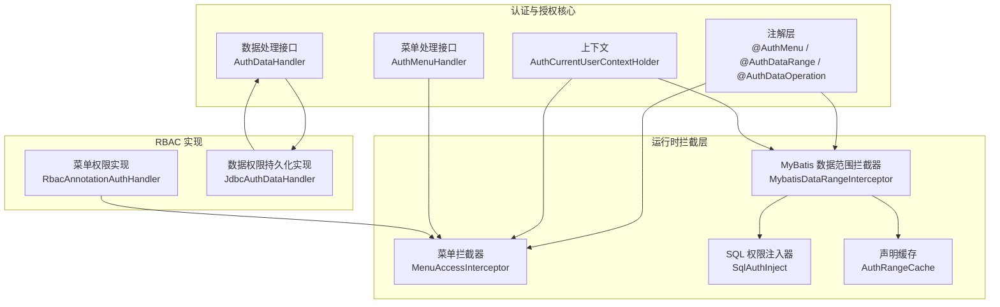
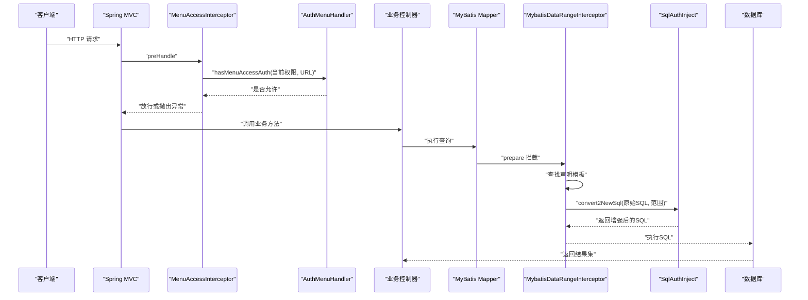
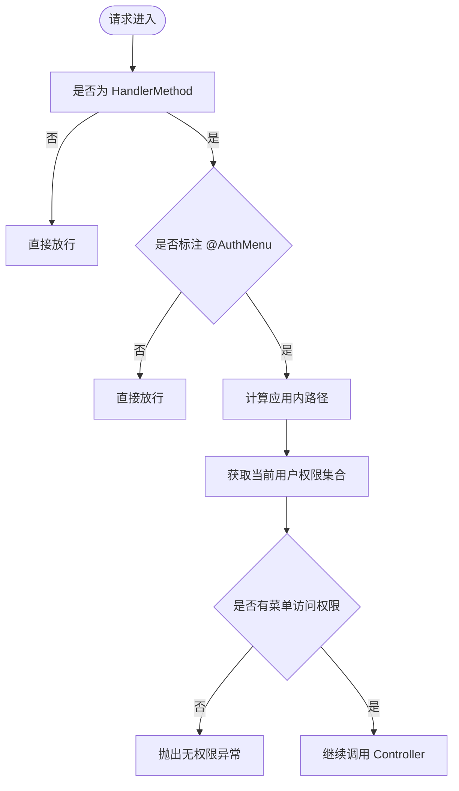
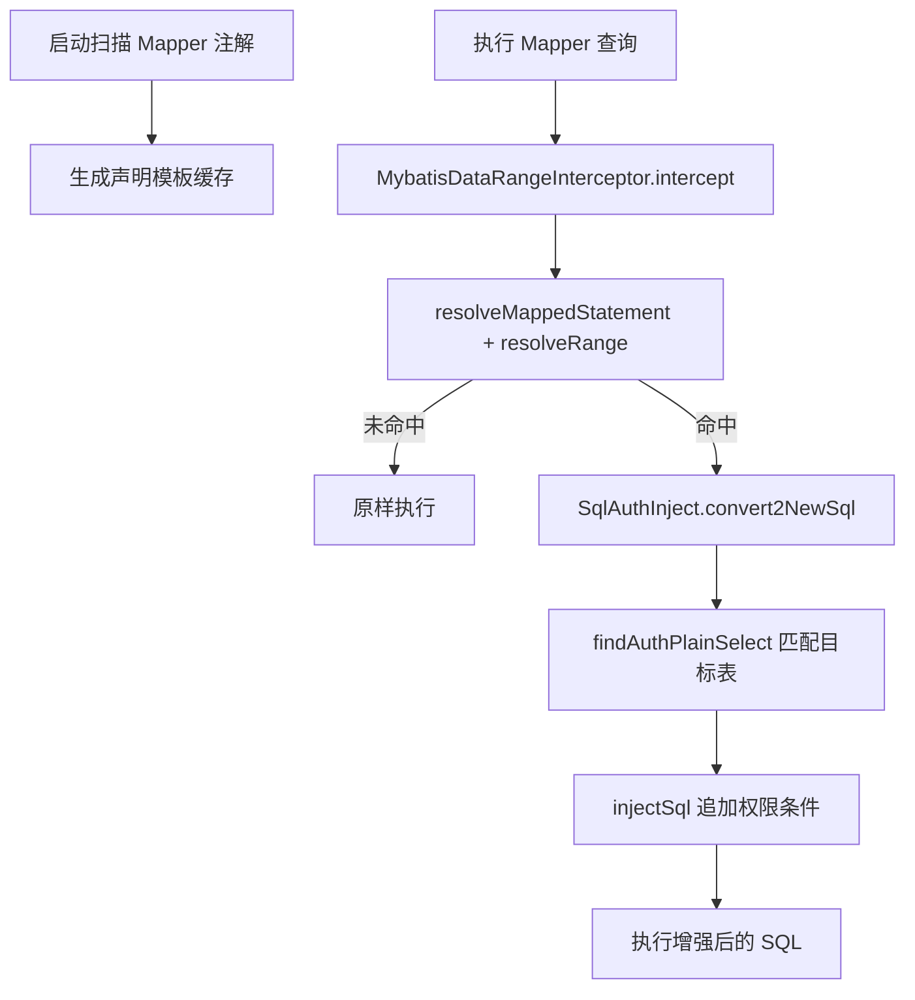
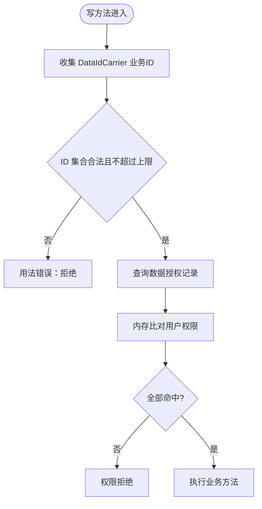
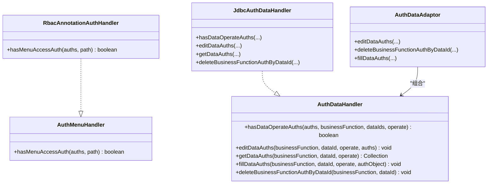
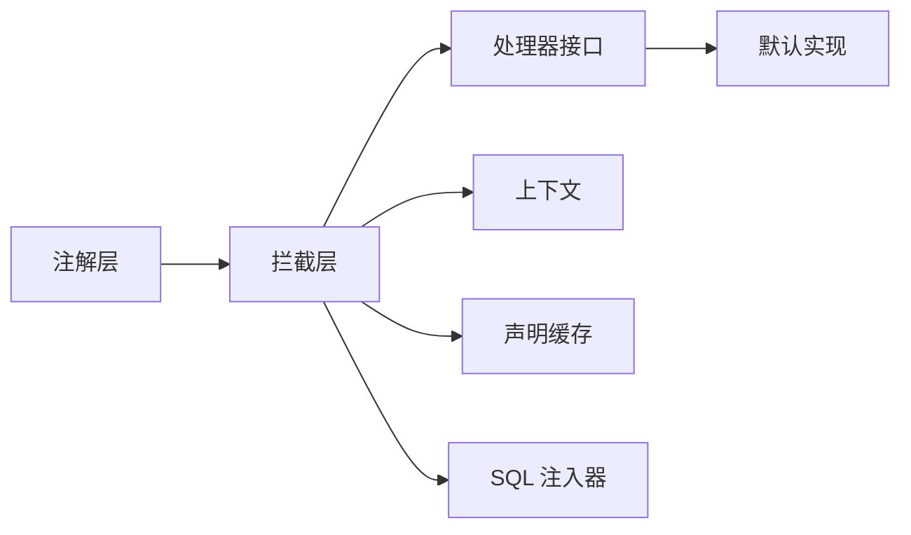

# 注解驱动开发模式

<cite>
**本文引用的文件**   
- [AuthMenu.java](file://auth/auth-core/src/main/java/com/cu/framework/auth/core/AuthMenu.java)
- [AuthMenuDoc.java](file://auth/auth-core/src/main/java/com/cu/framework/auth/core/AuthMenuDoc.java)
- [AuthDataRange.java](file://auth/auth-core/src/main/java/com/cu/framework/auth/core/AuthDataRange.java)
- [AuthDataOperation.java](file://auth/auth-core/src/main/java/com/cu/framework/auth/core/AuthDataOperation.java)
- [AuthCurrentUserContextHolder.java](file://auth/auth-core/src/main/java/com/cu/framework/auth/core/AuthCurrentUserContextHolder.java)
- [AuthDataAdaptor.java](file://auth/auth-core/src/main/java/com/cu/framework/auth/core/AuthDataAdaptor.java)
- [AuthMenuHandler.java](file://auth/auth-core/src/main/java/com/cu/framework/auth/core/menu/AuthMenuHandler.java)
- [RbacAnnotationAuthHandler.java](file://auth/auth-rbac/src/main/java/com/cu/framework/auth/rbac/RbacAnnotationAuthHandler.java)
- [MenuAccessInterceptor.java](file://auth/auth-core/src/main/java/com/cu/framework/auth/core/menu/MenuAccessInterceptor.java)
- [AuthDataHandler.java](file://auth/auth-core/src/main/java/com/cu/framework/auth/core/data/AuthDataHandler.java)
- [JdbcAuthDataHandler.java](file://auth/auth-core/src/main/java/com/cu/framework/auth/core/data/JdbcAuthDataHandler.java)
- [MybatisDataRangeInterceptor.java](file://auth/auth-core/src/main/java/com/cu/framework/auth/core/data/range/MybatisDataRangeInterceptor.java)
- [SqlAuthInject.java](file://auth/auth-core/src/main/java/com/cu/framework/auth/core/data/range/SqlAuthInject.java)
- [AuthRangeCache.java](file://auth/auth-core/src/main/java/com/cu/framework/auth/core/data/range/AuthRangeCache.java)
</cite>

## 目录
1. [引言](#引言)
2. [项目结构](#项目结构)
3. [核心组件](#核心组件)
4. [架构总览](#架构总览)
5. [详细组件分析](#详细组件分析)
6. [依赖关系分析](#依赖关系分析)
7. [性能与扩展性](#性能与扩展性)
8. [故障排查指南](#故障排查指南)
9. [结论](#结论)
10. [附录：使用示例与最佳实践](#附录使用示例与最佳实践)

## 引言
本文件面向使用 Kewen Framework 的开发者，系统阐述基于注解的声明式权限控制机制。重点围绕以下三类能力展开：
- 菜单访问权限：通过 @AuthMenu 声明端点受菜单权限管辖，由拦截器在请求进入 Controller 前完成路径级鉴权。
- 数据范围查询权限：通过 @AuthDataRange 声明 MyBatis 查询方法的数据范围，框架自动注入权限条件，实现“查哪些行”的声明式控制。
- 数据编辑操作权限：通过 @AuthDataOperation 校验写操作涉及的业务数据是否具备对应操作权限，实现“能改哪些数据”的行级控制。

这些能力以注解为入口，结合 Spring MVC 拦截器、AOP、MyBatis 插件以及可扩展处理器接口，形成从“声明到执行”的完整链路。

## 项目结构
Kewen Framework 将注解驱动权限能力集中在 auth 模块中：
- auth-core 提供注解定义、上下文、处理器接口、拦截器与 SQL 注入逻辑。
- auth-rbac 提供 RBAC 风格的菜单权限默认实现。
- sample 模块提供可运行的演示工程，用于验证菜单、数据范围与数据操作权限的组合行为。

**图表来源**
- [AuthMenu.java:1-16](file://auth/auth-core/src/main/java/com/cu/framework/auth/core/AuthMenu.java#L1-L16)
- [AuthDataRange.java:1-81](file://auth/auth-core/src/main/java/com/cu/framework/auth/core/AuthDataRange.java#L1-L81)
- [AuthDataOperation.java:1-51](file://auth/auth-core/src/main/java/com/cu/framework/auth/core/AuthDataOperation.java#L1-L51)
- [MenuAccessInterceptor.java:1-93](file://auth/auth-core/src/main/java/com/cu/framework/auth/core/menu/MenuAccessInterceptor.java#L1-L93)
- [MybatisDataRangeInterceptor.java:1-216](file://auth/auth-core/src/main/java/com/cu/framework/auth/core/data/range/MybatisDataRangeInterceptor.java#L1-L216)
- [SqlAuthInject.java:1-200](file://auth/auth-core/src/main/java/com/cu/framework/auth/core/data/range/SqlAuthInject.java#L1-L200)
- [AuthRangeCache.java:1-155](file://auth/auth-core/src/main/java/com/cu/framework/auth/core/data/range/AuthRangeCache.java#L1-L155)
- [RbacAnnotationAuthHandler.java:1-27](file://auth/auth-rbac/src/main/java/com/cu/framework/auth/rbac/RbacAnnotationAuthHandler.java#L1-L27)
- [JdbcAuthDataHandler.java:1-119](file://auth/auth-core/src/main/java/com/cu/framework/auth/core/data/JdbcAuthDataHandler.java#L1-L119)

**章节来源**
- [AuthMenu.java:1-16](file://auth/auth-core/src/main/java/com/cu/framework/auth/core/AuthMenu.java#L1-L16)
- [AuthDataRange.java:1-81](file://auth/auth-core/src/main/java/com/cu/framework/auth/core/AuthDataRange.java#L1-L81)
- [AuthDataOperation.java:1-51](file://auth/auth-core/src/main/java/com/cu/framework/auth/core/AuthDataOperation.java#L1-L51)

## 核心组件
本节聚焦三个关键注解及其运行期角色。

### @AuthMenu：菜单访问管辖
- 作用：标记某个 Controller 方法或类受菜单权限管辖；显示文案由 @AuthMenuDoc 承担，不参与鉴权判定。
- 目标位置：方法、类型、注解类型。
- 运行机制：被标注的方法或类会被 MenuAccessInterceptor 捕获，调用 AuthMenuHandler.hasMenuAccessAuth 进行路径级鉴权。
- 典型用法：
  - 标在方法上：仅该端点受菜单权限控制。
  - 标在类上：该类所有端点统一受菜单权限控制。

**章节来源**
- [AuthMenu.java:1-16](file://auth/auth-core/src/main/java/com/cu/framework/auth/core/AuthMenu.java#L1-L16)
- [AuthMenuDoc.java:1-22](file://auth/auth-core/src/main/java/com/cu/framework/auth/core/AuthMenuDoc.java#L1-L22)
- [MenuAccessInterceptor.java:1-93](file://auth/auth-core/src/main/java/com/cu/framework/auth/core/menu/MenuAccessInterceptor.java#L1-L93)

### @AuthDataRange：数据范围查询权限
- 作用：声明 MyBatis 查询方法的数据范围，框架在执行时把用户权限映射为 SQL 过滤条件。
- 目标位置：MyBatis Mapper 接口查询方法。
- 关键属性：
  - businessFunction：业务功能标识。
  - table：多表联查时指定主表，未指定则取 from 后的主表。
  - tableAlias：多表同名的别名匹配。
  - dataIdColumn：数据主键列名，默认 id。
  - operate：操作类型，默认 unified。
  - matchMethod：in 或 exists 两种关联方式，默认 in。
- 启动期约束：解析不到语句、非查询、启用二级缓存、静态 SQL 找不到目标表都会导致启动失败。
- 运行期行为：命中后由 SqlAuthInject 改写 SQL，追加权限子查询或恒假条件（权限为空）。

**章节来源**
- [AuthDataRange.java:1-81](file://auth/auth-core/src/main/java/com/cu/framework/auth/core/AuthDataRange.java#L1-L81)
- [AuthRangeCache.java:1-155](file://auth/auth-core/src/main/java/com/cu/framework/auth/core/data/range/AuthRangeCache.java#L1-L155)
- [MybatisDataRangeInterceptor.java:1-216](file://auth/auth-core/src/main/java/com/cu/framework/auth/core/data/range/MybatisDataRangeInterceptor.java#L1-L216)
- [SqlAuthInject.java:1-200](file://auth/auth-core/src/main/java/com/cu/framework/auth/core/data/range/SqlAuthInject.java#L1-L200)

### @AuthDataOperation：数据编辑操作权限
- 作用：校验写方法涉及的单条或多条业务数据是否具备指定操作权限。
- 目标位置：业务方法，通常是 Controller 或 Service 写方法。
- 关键属性：
  - businessFunction：业务功能标识。
  - operate：操作类型，默认 unified。
- 校验规则：
  - 从方法实参中收集实现了 DataIdCarrier 的业务对象，提取其 ID。
  - 支持一层数组和集合元素。
  - 对去重后的数据 ID 逐一判断，全部命中才放行。
  - 一次调用最多 100 个 ID，超出直接失败。
  - 用户权限不进入 SQL 查询条件，避免规模影响性能；ID 按字符串归一化比较。
- 对外语义：用法错误与权限拒绝分别处理；未命中明细只记录日志，对外统一返回拒绝语义。

**章节来源**
- [AuthDataOperation.java:1-51](file://auth/auth-core/src/main/java/com/cu/framework/auth/core/AuthDataOperation.java#L1-L51)
- [JdbcAuthDataHandler.java:1-119](file://auth/auth-core/src/main/java/com/cu/framework/auth/core/data/JdbcAuthDataHandler.java#L1-L119)

## 架构总览
注解驱动权限控制的总体流程如下：
- 菜单访问：Spring MVC 拦截器在 preHandle 阶段检查方法或类是否标注 @AuthMenu，然后委托 AuthMenuHandler 做路径鉴权。
- 数据范围：MyBatis 插件拦截 StatementHandler.prepare，根据声明缓存生成新 SQL，再交由 SqlAuthInject 注入权限条件。
- 数据操作：AOP 切面在写方法执行前收集业务 ID，委托 AuthDataHandler 判断是否全部拥有权限。

**图表来源**
- [MenuAccessInterceptor.java:1-93](file://auth/auth-core/src/main/java/com/cu/framework/auth/core/menu/MenuAccessInterceptor.java#L1-L93)
- [AuthMenuHandler.java:1-27](file://auth/auth-core/src/main/java/com/cu/framework/auth/core/menu/AuthMenuHandler.java#L1-L27)
- [MybatisDataRangeInterceptor.java:1-216](file://auth/auth-core/src/main/java/com/cu/framework/auth/core/data/range/MybatisDataRangeInterceptor.java#L1-L216)
- [SqlAuthInject.java:1-200](file://auth/auth-core/src/main/java/com/cu/framework/auth/core/data/range/SqlAuthInject.java#L1-L200)

## 详细组件分析

### 菜单权限链路：@AuthMenu → MenuAccessInterceptor → AuthMenuHandler
- 管辖判定：如果方法或类标注了 @AuthMenu，则认为该端点受菜单权限管辖。
- 路径计算：去掉 contextPath 的应用内路径作为菜单访问标识。
- 权限来源：AuthCurrentUserContextHolder.getAuths() 返回扁平化权限集合。
- 鉴权实现：RbacAnnotationAuthHandler 委托 SysAuthMenuComposite 完成具体判断。
- 拒绝策略：无菜单访问权限时抛出统一异常。

**图表来源**
- [MenuAccessInterceptor.java:1-93](file://auth/auth-core/src/main/java/com/cu/framework/auth/core/menu/MenuAccessInterceptor.java#L1-L93)
- [RbacAnnotationAuthHandler.java:1-27](file://auth/auth-rbac/src/main/java/com/cu/framework/auth/rbac/RbacAnnotationAuthHandler.java#L1-L27)

**章节来源**
- [AuthMenu.java:1-16](file://auth/auth-core/src/main/java/com/cu/framework/auth/core/AuthMenu.java#L1-L16)
- [MenuAccessInterceptor.java:1-93](file://auth/auth-core/src/main/java/com/cu/framework/auth/core/menu/MenuAccessInterceptor.java#L1-L93)
- [AuthMenuHandler.java:1-27](file://auth/auth-core/src/main/java/com/cu/framework/auth/core/menu/AuthMenuHandler.java#L1-L27)
- [RbacAnnotationAuthHandler.java:1-27](file://auth/auth-rbac/src/main/java/com/cu/framework/auth/rbac/RbacAnnotationAuthHandler.java#L1-L27)

### 数据范围链路：@AuthDataRange → AuthRangeCache → MybatisDataRangeInterceptor → SqlAuthInject
- 声明扫描：AuthRangeCache.scan 遍历已注册 Mapper，收集 @AuthDataRange，并只对 SELECT 语句生成模板。
- 执行拦截：MybatisDataRangeInterceptor 拦截 prepare，按 MappedStatement.id 匹配模板。
- 权限注入：SqlAuthInject 根据 MatchMethod 选择 IN 或 EXISTS 子查询；权限为空时注入恒假条件。
- 表匹配：优先匹配 from 项，其次 with 子句，最后递归条件表达式定位目标表与 PlainSelect。

**图表来源**
- [AuthRangeCache.java:1-155](file://auth/auth-core/src/main/java/com/cu/framework/auth/core/data/range/AuthRangeCache.java#L1-L155)
- [MybatisDataRangeInterceptor.java:1-216](file://auth/auth-core/src/main/java/com/cu/framework/auth/core/data/range/MybatisDataRangeInterceptor.java#L1-L216)
- [SqlAuthInject.java:1-200](file://auth/auth-core/src/main/java/com/cu/framework/auth/core/data/range/SqlAuthInject.java#L1-L200)

**章节来源**
- [AuthDataRange.java:1-81](file://auth/auth-core/src/main/java/com/cu/framework/auth/core/AuthDataRange.java#L1-L81)
- [AuthRangeCache.java:1-155](file://auth/auth-core/src/main/java/com/cu/framework/auth/core/data/range/AuthRangeCache.java#L1-L155)
- [MybatisDataRangeInterceptor.java:1-216](file://auth/auth-core/src/main/java/com/cu/framework/auth/core/data/range/MybatisDataRangeInterceptor.java#L1-L216)
- [SqlAuthInject.java:1-200](file://auth/auth-core/src/main/java/com/cu/framework/auth/core/data/range/SqlAuthInject.java#L1-L200)

### 数据操作链路：@AuthDataOperation → AOP → AuthDataHandler
- 参数收集：切面从实参中收集 DataIdCarrier，支持数组与集合元素，提取业务 ID。
- 去重与上限：去重后最多 100 条，超限视为用法错误。
- 权限判定：JdbcAuthDataHandler 查询数据对应的授权记录，并与当前用户权限集合内存比对。
- 结果语义：任一 ID 未命中即整体拒绝；未命中明细仅记录日志。

**图表来源**
- [AuthDataOperation.java:1-51](file://auth/auth-core/src/main/java/com/cu/framework/auth/core/AuthDataOperation.java#L1-L51)
- [JdbcAuthDataHandler.java:1-119](file://auth/auth-core/src/main/java/com/cu/framework/auth/core/data/JdbcAuthDataHandler.java#L1-L119)

**章节来源**
- [AuthDataOperation.java:1-51](file://auth/auth-core/src/main/java/com/cu/framework/auth/core/AuthDataOperation.java#L1-L51)
- [AuthDataHandler.java:1-102](file://auth/auth-core/src/main/java/com/cu/framework/auth/core/data/AuthDataHandler.java#L1-L102)
- [JdbcAuthDataHandler.java:1-119](file://auth/auth-core/src/main/java/com/cu/framework/auth/core/data/JdbcAuthDataHandler.java#L1-L119)

### 处理器接口与默认实现
- AuthMenuHandler：菜单访问权限判断接口，RbacAnnotationAuthHandler 提供 RBAC 默认实现。
- AuthDataHandler：数据权限读写与校验接口，JdbcAuthDataHandler 提供基于 JDBC 的默认实现。
- AuthDataAdaptor：便捷服务，封装 Edit/Fill/Delete 等数据权限操作，便于在 Service 层直接调用。

**图表来源**
- [AuthMenuHandler.java:1-27](file://auth/auth-core/src/main/java/com/cu/framework/auth/core/menu/AuthMenuHandler.java#L1-L27)
- [RbacAnnotationAuthHandler.java:1-27](file://auth/auth-rbac/src/main/java/com/cu/framework/auth/rbac/RbacAnnotationAuthHandler.java#L1-L27)
- [AuthDataHandler.java:1-102](file://auth/auth-core/src/main/java/com/cu/framework/auth/core/data/AuthDataHandler.java#L1-L102)
- [JdbcAuthDataHandler.java:1-119](file://auth/auth-core/src/main/java/com/cu/framework/auth/core/data/JdbcAuthDataHandler.java#L1-L119)
- [AuthDataAdaptor.java:1-45](file://auth/auth-core/src/main/java/com/cu/framework/auth/core/AuthDataAdaptor.java#L1-L45)

**章节来源**
- [AuthMenuHandler.java:1-27](file://auth/auth-core/src/main/java/com/cu/framework/auth/core/menu/AuthMenuHandler.java#L1-L27)
- [RbacAnnotationAuthHandler.java:1-27](file://auth/auth-rbac/src/main/java/com/cu/framework/auth/rbac/RbacAnnotationAuthHandler.java#L1-L27)
- [AuthDataHandler.java:1-102](file://auth/auth-core/src/main/java/com/cu/framework/auth/core/data/AuthDataHandler.java#L1-L102)
- [JdbcAuthDataHandler.java:1-119](file://auth/auth-core/src/main/java/com/cu/framework/auth/core/data/JdbcAuthDataHandler.java#L1-L119)
- [AuthDataAdaptor.java:1-45](file://auth/auth-core/src/main/java/com/cu/framework/auth/core/AuthDataAdaptor.java#L1-L45)

## 依赖关系分析
- 注解层：@AuthMenu、@AuthDataRange、@AuthDataOperation 仅描述意图，不包含业务实现。
- 上下文层：AuthCurrentUserContextHolder 提供当前登录用户及扁平化权限集合，解耦安全框架细节。
- 拦截层：
  - MenuAccessInterceptor 依赖 AuthMenuHandler 与上下文。
  - MybatisDataRangeInterceptor 依赖 AuthRangeCache、上下文与 SqlAuthInject。
- 实现层：
  - RbacAnnotationAuthHandler 依赖 RBAC 菜单装配组件。
  - JdbcAuthDataHandler 依赖权限持久化组件。

**图表来源**
- [AuthMenu.java:1-16](file://auth/auth-core/src/main/java/com/cu/framework/auth/core/AuthMenu.java#L1-L16)
- [AuthDataRange.java:1-81](file://auth/auth-core/src/main/java/com/cu/framework/auth/core/AuthDataRange.java#L1-L81)
- [AuthDataOperation.java:1-51](file://auth/auth-core/src/main/java/com/cu/framework/auth/core/AuthDataOperation.java#L1-L51)
- [AuthCurrentUserContextHolder.java:1-25](file://auth/auth-core/src/main/java/com/cu/framework/auth/core/AuthCurrentUserContextHolder.java#L1-L25)
- [MenuAccessInterceptor.java:1-93](file://auth/auth-core/src/main/java/com/cu/framework/auth/core/menu/MenuAccessInterceptor.java#L1-L93)
- [MybatisDataRangeInterceptor.java:1-216](file://auth/auth-core/src/main/java/com/cu/framework/auth/core/data/range/MybatisDataRangeInterceptor.java#L1-L216)
- [AuthRangeCache.java:1-155](file://auth/auth-core/src/main/java/com/cu/framework/auth/core/data/range/AuthRangeCache.java#L1-L155)
- [SqlAuthInject.java:1-200](file://auth/auth-core/src/main/java/com/cu/framework/auth/core/data/range/SqlAuthInject.java#L1-L200)

**章节来源**
- [AuthCurrentUserContextHolder.java:1-25](file://auth/auth-core/src/main/java/com/cu/framework/auth/core/AuthCurrentUserContextHolder.java#L1-L25)
- [AuthRangeCache.java:1-155](file://auth/auth-core/src/main/java/com/cu/framework/auth/core/data/range/AuthRangeCache.java#L1-L155)
- [MybatisDataRangeInterceptor.java:1-216](file://auth/auth-core/src/main/java/com/cu/framework/auth/core/data/range/MybatisDataRangeInterceptor.java#L1-L216)

## 性能与扩展性
- 菜单鉴权：
  - 仅在标注 @AuthMenu 的方法或类上触发，减少不必要的鉴权开销。
  - 路径计算简单，权限判断委托给后端实现。
- 数据范围：
  - 声明模板在启动期构建，运行期只做浅拷贝与 SQL 改写。
  - MatchMethod.IN 适合权限表较小场景；MatchMethod.EXISTS 适合权限表较大场景。
  - 权限为空时注入恒假条件，保证零结果而非空参数导致的语法问题。
- 数据操作：
  - 用户权限不入 SQL，避免大权限集合拖慢查询。
  - 数据 ID 去重并按字符串归一化，限制最大 100 条，防止批量越权风险。
- 扩展点：
  - 自定义菜单权限实现：实现 AuthMenuHandler。
  - 自定义数据权限实现：实现 AuthDataHandler。
  - 自定义 SQL 注入策略：扩展 SqlAuthInject 或使用现有转换逻辑。
  - 自定义上下文：实现 AuthCurrentUserContextHolder，对接不同身份体系。

[本节为通用指导，不直接分析具体文件]

## 故障排查指南
- 菜单权限无效：
  - 确认方法或类是否正确标注 @AuthMenu。
  - 检查路径是否与菜单配置一致，注意 contextPath 的影响。
  - 查看 AuthMenuHandler 实现是否返回预期结果。
- 数据范围未生效：
  - 确认 @AuthDataRange 标注在 Mapper 查询方法上。
  - 检查 businessFunction、operate、table、tableAlias、dataIdColumn 配置。
  - 检查 SQL 是否能被 SqlAuthInject 匹配到目标表。
  - 注意二级缓存与数据范围不能共存。
- 数据操作校验失败：
  - 确认写方法是否标注 @AuthDataOperation。
  - 确认实参中存在 DataIdCarrier 且包含有效 ID。
  - 检查一次调用的数据 ID 数量是否超过 100。
  - 核对业务功能与操作类型是否与权限表一致。

**章节来源**
- [MenuAccessInterceptor.java:1-93](file://auth/auth-core/src/main/java/com/cu/framework/auth/core/menu/MenuAccessInterceptor.java#L1-L93)
- [MybatisDataRangeInterceptor.java:1-216](file://auth/auth-core/src/main/java/com/cu/framework/auth/core/data/range/MybatisDataRangeInterceptor.java#L1-L216)
- [SqlAuthInject.java:1-200](file://auth/auth-core/src/main/java/com/cu/framework/auth/core/data/range/SqlAuthInject.java#L1-L200)
- [AuthDataOperation.java:1-51](file://auth/auth-core/src/main/java/com/cu/framework/auth/core/AuthDataOperation.java#L1-L51)
- [JdbcAuthDataHandler.java:1-119](file://auth/auth-core/src/main/java/com/cu/framework/auth/core/data/JdbcAuthDataHandler.java#L1-L119)

## 结论
Kewen Framework 的注解驱动权限模型以最小侵入的方式实现声明式控制：
- @AuthMenu 解决“能否访问某个菜单路径”。
- @AuthDataRange 解决“能查到哪些数据行”。
- @AuthDataOperation 解决“能对哪些数据进行写操作”。

它们通过拦截器、AOP、MyBatis 插件与可扩展处理器协同工作，既保持业务代码简洁，又保留足够的扩展空间供企业级权限体系接入。

[本节为总结性内容，不直接分析具体文件]

## 附录：使用示例与最佳实践

### 菜单权限示例
- 在 Controller 类或方法上标注 @AuthMenu。
- 如需菜单树展示文案，配合 @AuthMenuDoc 提供 name。
- 启动 RBAC 菜单装配，使菜单路径与权限表对应。
- 确保 AuthCurrentUserContextHolder 能返回当前用户的扁平化权限集合。

**章节来源**
- [AuthMenu.java:1-16](file://auth/auth-core/src/main/java/com/cu/framework/auth/core/AuthMenu.java#L1-L16)
- [AuthMenuDoc.java:1-22](file://auth/auth-core/src/main/java/com/cu/framework/auth/core/AuthMenuDoc.java#L1-L22)
- [MenuAccessInterceptor.java:1-93](file://auth/auth-core/src/main/java/com/cu/framework/auth/core/menu/MenuAccessInterceptor.java#L1-L93)

### 数据范围查询示例
- 在 Mapper 查询方法上标注 @AuthDataRange。
- 合理设置 businessFunction、operate、table、tableAlias、dataIdColumn。
- 根据权限表大小选择 MatchMethod.IN 或 MatchMethod.EXISTS。
- 避免在受控语句上开启二级缓存。

**章节来源**
- [AuthDataRange.java:1-81](file://auth/auth-core/src/main/java/com/cu/framework/auth/core/AuthDataRange.java#L1-L81)
- [AuthRangeCache.java:1-155](file://auth/auth-core/src/main/java/com/cu/framework/auth/core/data/range/AuthRangeCache.java#L1-L155)
- [MybatisDataRangeInterceptor.java:1-216](file://auth/auth-core/src/main/java/com/cu/framework/auth/core/data/range/MybatisDataRangeInterceptor.java#L1-L216)
- [SqlAuthInject.java:1-200](file://auth/auth-core/src/main/java/com/cu/framework/auth/core/data/range/SqlAuthInject.java#L1-L200)

### 数据编辑操作示例
- 在写方法上标注 @AuthDataOperation。
- 在业务对象中实现 DataIdCarrier，暴露业务主键。
- 分批提交数据，确保单次调用不超过 100 条。
- 若需维护数据权限，可通过 AuthDataAdaptor 或 AuthDataHandler 调用 edit/fill/delete。

**章节来源**
- [AuthDataOperation.java:1-51](file://auth/auth-core/src/main/java/com/cu/framework/auth/core/AuthDataOperation.java#L1-L51)
- [AuthDataAdaptor.java:1-45](file://auth/auth-core/src/main/java/com/cu/framework/auth/core/AuthDataAdaptor.java#L1-L45)
- [JdbcAuthDataHandler.java:1-119](file://auth/auth-core/src/main/java/com/cu/framework/auth/core/data/JdbcAuthDataHandler.java#L1-L119)