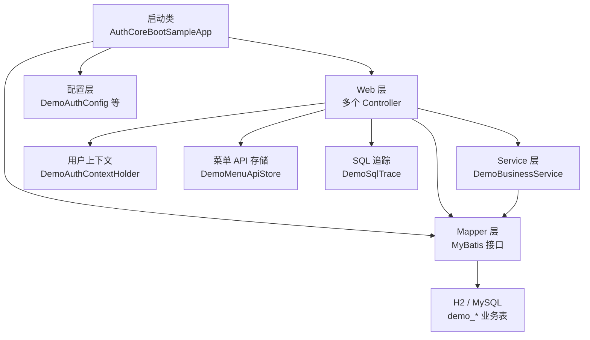
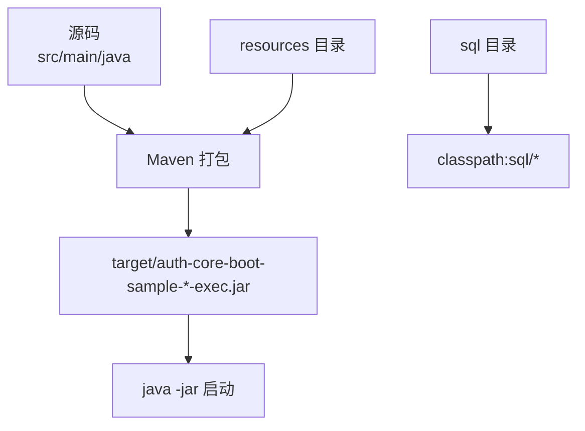
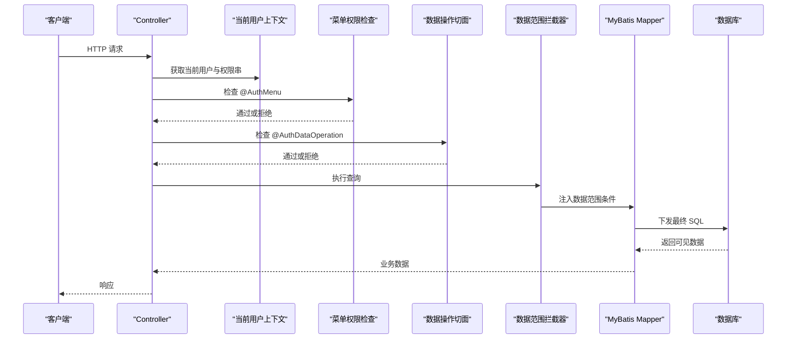
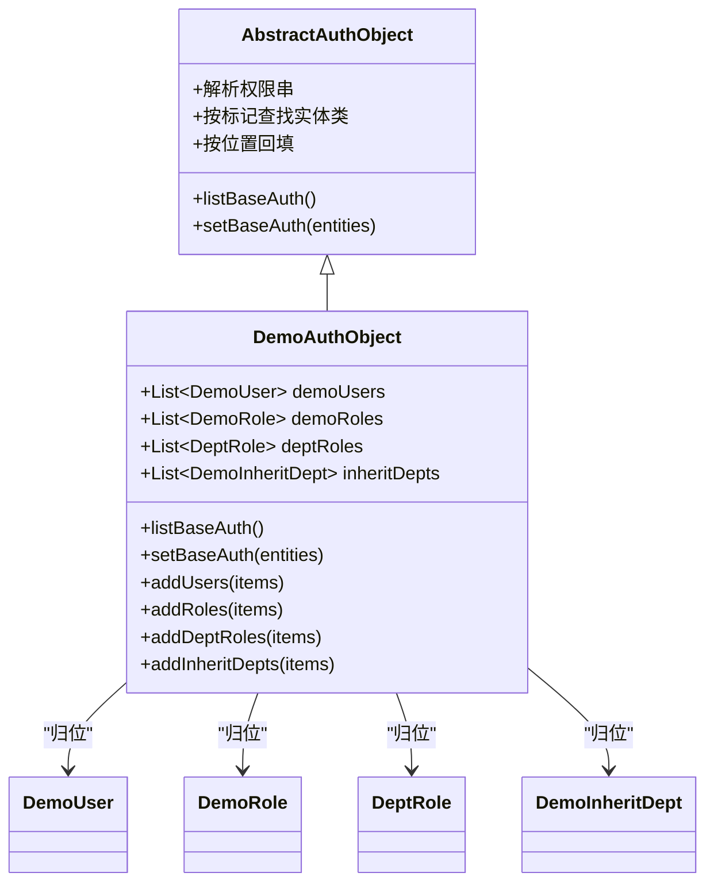
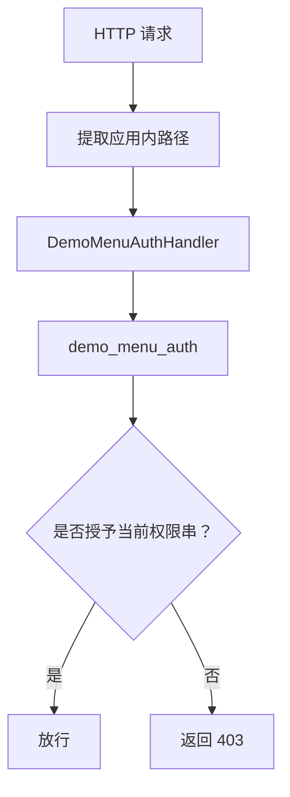
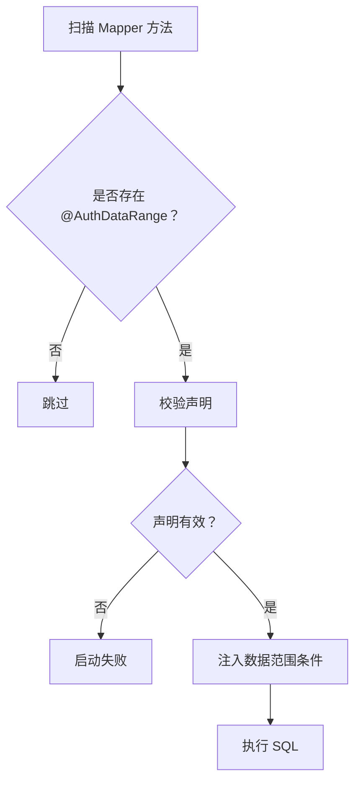
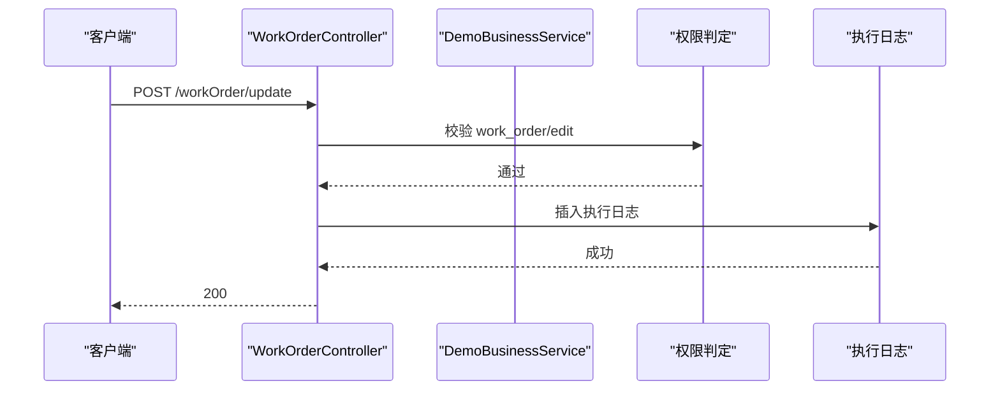
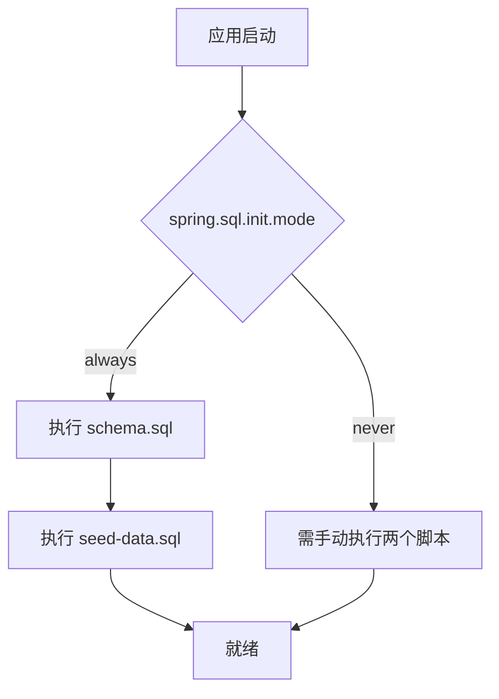
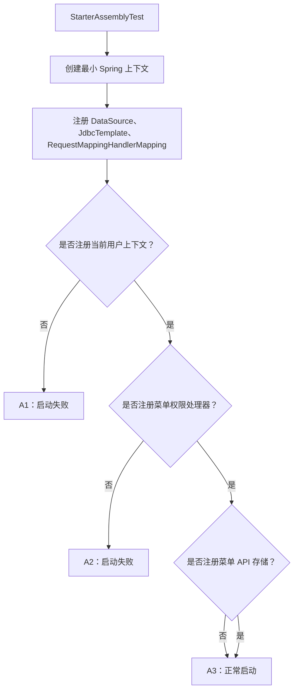
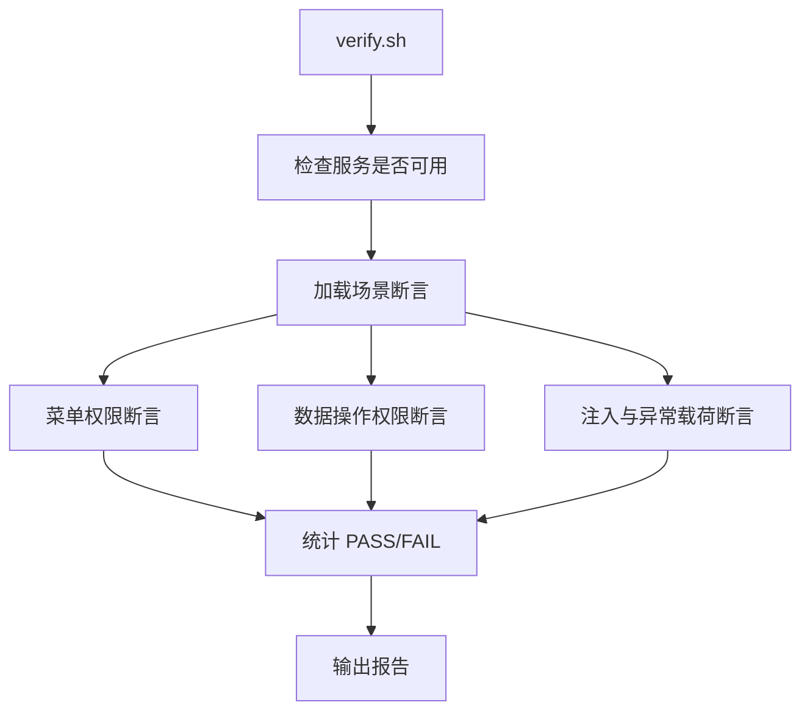

# Auth Core 独立权限验证示例

<cite>
**本文引用的文件**   
- [sample/auth-core-boot-sample/README.md](file://sample/auth-core-boot-sample/README.md)
- [sample/auth-core-boot-sample/pom.xml](file://sample/auth-core-boot-sample/pom.xml)
- [sample/auth-core-boot-sample/sql/schema.sql](file://sample/auth-core-boot-sample/sql/schema.sql)
- [sample/auth-core-boot-sample/sql/seed-data.sql](file://sample/auth-core-boot-sample/sql/seed-data.sql)
- [sample/auth-core-boot-sample/verify.sh](file://sample/auth-core-boot-sample/verify.sh)
- [sample/auth-core-boot-sample/src/main/java/com/cu/framework/sample/authcore/AuthCoreBootSampleApp.java](file://sample/auth-core-boot-sample/src/main/java/com/cu/framework/sample/authcore/AuthCoreBootSampleApp.java)
- [sample/auth-core-boot-sample/src/main/resources/application.yml](file://sample/auth-core-boot-sample/src/main/resources/application.yml)
- [sample/auth-core-boot-sample/src/main/java/com/cu/framework/sample/authcore/authobject/DemoAuthObject.java](file://sample/auth-core-boot-sample/src/main/java/com/cu/framework/sample/authcore/authobject/DemoAuthObject.java)
- [sample/auth-core-boot-sample/src/main/java/com/cu/framework/sample/authcore/web/WorkOrderController.java](file://sample/auth-core-boot-sample/src/main/java/com/cu/framework/sample/authcore/web/WorkOrderController.java)
- [sample/auth-core-boot-sample/src/main/java/com/cu/framework/sample/authcore/service/DemoBusinessService.java](file://sample/auth-core-boot-sample/src/main/java/com/cu/framework/sample/authcore/service/DemoBusinessService.java)
- [sample/auth-core-boot-sample/src/test/java/com/cu/framework/sample/authcore/StarterAssemblyTest.java](file://sample/auth-core-boot-sample/src/test/java/com/cu/framework/sample/authcore/StarterAssemblyTest.java)
- [sample/auth-core-boot-sample/src/test/java/com/cu/framework/sample/authcore/AuthRangeStartupFailureTest.java](file://sample/auth-core-boot-sample/src/test/java/com/cu/framework/sample/authcore/AuthRangeStartupFailureTest.java)
</cite>

## 目录

1. [项目定位与用途](#项目定位与用途)
2. [项目结构总览](#项目结构总览)
3. [依赖配置与构建产物](#依赖配置与构建产物)
4. [启动方式与环境](#启动方式与环境)
5. [核心架构与数据流](#核心架构与数据流)
6. [权限对象定义与编解码](#权限对象定义与编解码)
7. [菜单权限控制](#菜单权限控制)
8. [数据范围权限](#数据范围权限)
9. [数据操作权限](#数据操作权限)
10. [数据库初始化步骤](#数据库初始化步骤)
11. [测试用例说明](#测试用例说明)
12. [功能验证脚本](#功能验证脚本)
13. [常见问题与调试技巧](#常见问题与调试技巧)
14. [结论](#结论)

## 项目定位与用途

`auth-core-boot-sample` 是 Kewen Framework 中 `auth-core` 权限框架的**独立验证示例**。它的目标不是提供一套完整业务系统，而是证明以下两点：

- `auth-core` 只负责“权限如何声明、在哪一步判定、语句如何改写”，不绑定任何具体权限模型。
- 在不引入 `auth-rbac`、不引用框架内置 `sys_*` 表、不加载框架建表脚本的前提下，仍能端到端跑通菜单权限、行级数据操作权限和数据范围权限等能力。

该示例同时承担规格证明职责：它自己实现三个扩展点（当前用户上下文、菜单权限处理器、菜单 API 持久化），自己设计全部八张数据表，并把每个场景落到“一个声明位置 + 一条触发命令 + 一个可观察结果”。

**章节来源**
- [sample/auth-core-boot-sample/README.md:1-16](file://sample/auth-core-boot-sample/README.md#L1-L16)
- [sample/auth-core-boot-sample/README.md:17-33](file://sample/auth-core-boot-sample/README.md#L17-L33)

## 项目结构总览

该模块是一个标准的 Spring Boot 应用，主要组织方式按职责划分：

| 路径 | 职责 |
| --- | --- |
| `src/main/java/.../authcore/AuthCoreBootSampleApp.java` | Spring Boot 启动入口，扫描 MyBatis Mapper |
| `src/main/java/.../authcore/authobject/` | 权限对象定义与权限串编解码 |
| `src/main/java/.../authcore/web/` | REST 控制器，演示菜单管辖与行级判定 |
| `src/main/java/.../authcore/service/` | 业务方法层，演示多参数 ID 收集与未声明判定 |
| `src/main/java/.../authcore/mapper/` | MyBatis 映射接口，承载数据范围声明 |
| `src/main/java/.../authcore/entity/` | 业务实体与权限视图对象 |
| `src/main/java/.../authcore/context/` | 模拟当前用户上下文、请求头注入与菜单授权处理 |
| `src/main/java/.../authcore/config/` | 示例装配配置、启动报告 |
| `src/main/java/.../authcore/store/` | 菜单 API 存储实现 |
| `src/main/java/.../authcore/trace/` | SQL 追踪与权限校验探针 |
| `src/main/resources/mapper/` | MyBatis XML 映射文件 |
| `sql/` | 幂等的建表脚本与种子数据 |
| `src/test/java/.../authcore/` | 装配契约与启动期错误断言 |



**图表来源**
- [sample/auth-core-boot-sample/src/main/java/com/cu/framework/sample/authcore/AuthCoreBootSampleApp.java:1-28](file://sample/auth-core-boot-sample/src/main/java/com/cu/framework/sample/authcore/AuthCoreBootSampleApp.java#L1-L28)
- [sample/auth-core-boot-sample/src/main/java/com/cu/framework/sample/authcore/service/DemoBusinessService.java:1-90](file://sample/auth-core-boot-sample/src/main/java/com/cu/framework/sample/authcore/service/DemoBusinessService.java#L1-L90)
- [sample/auth-core-boot-sample/sql/schema.sql:1-120](file://sample/auth-core-boot-sample/sql/schema.sql#L1-L120)

**章节来源**
- [sample/auth-core-boot-sample/src/main/java/com/cu/framework/sample/authcore/AuthCoreBootSampleApp.java:1-28](file://sample/auth-core-boot-sample/src/main/java/com/cu/framework/sample/authcore/AuthCoreBootSampleApp.java#L1-L28)
- [sample/auth-core-boot-sample/src/main/resources/application.yml:1-85](file://sample/auth-core-boot-sample/src/main/resources/application.yml#L1-L85)

## 依赖配置与构建产物

### Maven 依赖

模块的父工程是 `com.cu.framework.sample:sample`，核心依赖如下：

| 依赖 | 作用 |
| --- | --- |
| `auth-core-spring-boot-starter` | 启用 auth-core 自动装配、切面、异常处理器等 |
| `spring-boot-starter-web` | 提供 REST 控制器与 Spring MVC |
| `mybatis-spring-boot-starter` | 原生 MyBatis，供数据范围注解使用 |
| `h2` | 默认 H2 文件数据库，无需外部数据库即可运行 |
| `mysql-connector-java` | MySQL Profile 下的驱动依赖 |
| `spring-boot-starter-test` | JUnit 测试支持 |

注意：该示例明确不引入 MyBatis-Plus；数据范围注解只对原生 MyBatis 映射语句生效。

### 构建产物

构建插件使用 Spring Boot Maven Plugin，生成可执行 jar：

| 配置项 | 值 |
| --- | --- |
| Main Class | `com.cu.framework.sample.authcore.AuthCoreBootSampleApp` |
| 打包分类器 | `exec` |
| 布局 | ZIP |
| Java 版本 | 8 |



**图表来源**
- [sample/auth-core-boot-sample/pom.xml:1-97](file://sample/auth-core-boot-sample/pom.xml#L1-L97)

**章节来源**
- [sample/auth-core-boot-sample/pom.xml:1-97](file://sample/auth-core-boot-sample/pom.xml#L1-L97)

## 启动方式与环境

### 推荐启动方式

从模块目录启动，并执行无测试打包：

```bash
cd sample/auth-core-boot-sample
mvn -q package -DskipTests
java -jar target/auth-core-boot-sample-0.0.1-SNAPSHOT-exec.jar
```

### 关键环境变量与服务地址

| 项目 | 值 |
| --- | --- |
| 服务端口 | `8082` |
| 上下文路径 | `/coredemo` |
| 前端透视台 | `http://localhost:8082/coredemo/` |
| H2 控制台 | `http://localhost:8082/coredemo/h2-console` |
| 默认数据库 | H2 文件库 `./data/auth_core_sample` |
| 可选 MySQL Profile | `--spring.profiles.active=mysql` |

### 配置文件要点

公共配置包括 MyBatis mapper 扫描路径、驼峰命名、日志级别以及 `cu.auth.auth-data-table.*` 七项权限表重命名。H2 profile 下开启 `spring.sql.init.mode=always`，自动执行 `schema.sql` 和 `seed-data.sql`。MySQL profile 下关闭自动脚本执行，需要手动执行本模块 `sql/` 下的两个脚本。

**章节来源**
- [sample/auth-core-boot-sample/README.md:118-167](file://sample/auth-core-boot-sample/README.md#L118-L167)
- [sample/auth-core-boot-sample/src/main/resources/application.yml:1-85](file://sample/auth-core-boot-sample/src/main/resources/application.yml#L1-L85)

## 核心架构与数据流

auth-core 在本示例中的整体调用链可以理解为三层：

1. **HTTP 进入**：Spring MVC 接收请求，带 `X-Demo-User` 请求头。
2. **身份解析**：`DemoAuthContextHolder` 把请求头用户名解析为当前用户，并从 `demo_user_auth` 加载权限串。
3. **权限判定**：
   - 菜单权限由 `@AuthMenu` 控制端点是否可进入。
   - 行级数据操作权限由 `@AuthDataOperation` 控制方法体是否执行。
   - 数据范围权限由 `@AuthDataRange` 控制查询语句最终返回哪些行。



**图表来源**
- [sample/auth-core-boot-sample/src/main/java/com/cu/framework/sample/authcore/web/WorkOrderController.java:1-200](file://sample/auth-core-boot-sample/src/main/java/com/cu/framework/sample/authcore/web/WorkOrderController.java#L1-L200)
- [sample/auth-core-boot-sample/src/main/java/com/cu/framework/sample/authcore/service/DemoBusinessService.java:1-90](file://sample/auth-core-boot-sample/src/main/java/com/cu/framework/sample/authcore/service/DemoBusinessService.java#L1-L90)
- [sample/auth-core-boot-sample/sql/schema.sql:1-120](file://sample/auth-core-boot-sample/sql/schema.sql#L1-L120)

**章节来源**
- [sample/auth-core-boot-sample/src/main/java/com/cu/framework/sample/authcore/AuthCoreBootSampleApp.java:1-28](file://sample/auth-core-boot-sample/src/main/java/com/cu/framework/sample/authcore/AuthCoreBootSampleApp.java#L1-L28)
- [sample/auth-core-boot-sample/src/main/resources/application.yml:1-85](file://sample/auth-core-boot-sample/src/main/resources/application.yml#L1-L85)

## 权限对象定义与编解码

### 权限对象角色

示例定义了四类权限标记：

| 标记 | 含义 | 对应对象 |
| --- | --- | --- |
| `USER` | 用户维度权限 | `DemoUser` |
| `ROLE` | 角色维度权限 | `DemoRole` |
| `DEPT_ROLE` | 部门+角色组合权限 | `DeptRole` |
| `DEPTINHERIT` | 继承型部门标记 | `DemoInheritDept` |

这些对象都继承自 `AbstractAuthObject`，由框架完成权限串的拆分、类型归位和重新序列化。

### DemoAuthObject 的职责

`DemoAuthObject` 只做两件事：

1. 把框架解析出的权限实体按类型归位到四个列表。
2. 从这些对象重新序列化出权限串集合，用于对比“原文”和“重序列化”是否一致。



**图表来源**
- [sample/auth-core-boot-sample/src/main/java/com/cu/framework/sample/authcore/authobject/DemoAuthObject.java:1-104](file://sample/auth-core-boot-sample/src/main/java/com/cu/framework/sample/authcore/authobject/DemoAuthObject.java#L1-L104)

### 权限串规则

权限串使用两个分隔符：

- `AUTH_SPLIT="__"`：区分标记与值。
- `AUTH_SUB_SPLIT="_"`：区分组合权限的各个位置。

示例强调两条约束：

- 权限标识里的名字不能包含 `_`，否则会被当成第二个位置。
- 权限标识里的名字不能包含 `__`，否则会破坏标记与值的边界。

`listBaseAuth()` 返回的是重新序列化的权限串集合，因此当前用户接口中“原文”和“重序列化”必须一致；双位置组合（如 `DEPT_ROLE__100_20`）也必须能正确解析。

**章节来源**
- [sample/auth-core-boot-sample/src/main/java/com/cu/framework/sample/authcore/authobject/DemoAuthObject.java:1-104](file://sample/auth-core-boot-sample/src/main/java/com/cu/framework/sample/authcore/authobject/DemoAuthObject.java#L1-L104)
- [sample/auth-core-boot-sample/README.md:62-85](file://sample/auth-core-boot-sample/README.md#L62-L85)

## 菜单权限控制

### 声明位置

菜单权限主要通过以下注解控制：

| 注解 | 作用 | 生效位置 |
| --- | --- | --- |
| `@AuthMenu` | 声明该端点受菜单权限管辖 | 方法或类 |
| `@AuthMenuDoc` | 声明菜单显示文案，不参与鉴权 | 方法或类 |

示例覆盖多种场景：

- 方法级声明：仅对单个端点生效。
- 类级声明：对该类所有端点生效，但逐路径独立授权。
- 两处都没有声明：端点不受菜单权限控制。
- 空权限集合：无身份时直接拒绝。
- contextPath 剥离：拒绝消息中使用去掉 `/coredemo` 的应用内路径。
- 菜单 API 自动注册：启动后异步扫描 HandlerMapping，写入 `demo_menu_api`。
- 已有菜单行不被覆写：人工修改 name 或 remark 后重启仍保留。
- 文案缺失回落：无 `@AuthMenuDoc` 时回落到类名与方法名。
- 同名文案独立：两个不同端点可以有相同文案，授权互不影响。
- 继承型标记：`/deptInherit/ledger` 仅授予持有 `DEPTINHERIT__100` 的用户。

### 菜单授权数据来源

菜单授权不是硬编码在代码里，而是来自 `demo_menu_auth` 表。每条记录表示某个应用内路径需要持有哪个权限串。



**图表来源**
- [sample/auth-core-boot-sample/sql/seed-data.sql:162-181](file://sample/auth-core-boot-sample/sql/seed-data.sql#L162-L181)

**章节来源**
- [sample/auth-core-boot-sample/README.md:35-55](file://sample/auth-core-boot-sample/README.md#L35-L55)
- [sample/auth-core-boot-sample/sql/seed-data.sql:162-181](file://sample/auth-core-boot-sample/sql/seed-data.sql#L162-L181)

## 数据范围权限

### 基本机制

数据范围权限通过 `@AuthDataRange` 标注在 **MyBatis Mapper 接口的查询方法**上。框架会在执行前扫描映射语句，把权限条件注入到最终 SQL。

示例中的典型流程是：

1. Controller 调用 Mapper 查询方法。
2. 框架根据 `businessFunction` 和 `operate` 从 `demo_auth_data` 查出当前用户有权访问的数据 ID。
3. MyBatis 拦截器改写原始 SQL，追加 WHERE 条件。
4. 返回给业务层的已经是过滤后的结果集。

### 示例中的数据范围场景

| 场景 | 说明 |
| --- | --- |
| IN 匹配列表 | 通过 `unified` 槽位返回允许查看的工单 |
| EXISTS 匹配列表 | 使用 EXISTS 子句，结果应与 IN 一致 |
| 计数 | 数据范围条件同样注入 COUNT 语句 |
| 同表多别名 | 同一张 `demo_customer` 表有两个别名，权限条件精确挂到指定别名 |
| 动态 SQL | 运行期拼出目标表时正常注入；拼不出时报错 |
| 多槽位 | 同一个 Mapper 中不同方法使用不同槽位，互不回退 |

### 启动期校验

如果 `@AuthDataRange` 声明存在错误，应用会启动失败。测试覆盖了以下情况：

- 解析不到映射语句。
- 声明标在非查询方法上。
- 声明所在语句启用了二级缓存。
- 静态 SQL 中找不到声明指定的目标表。
- 声明残留到业务 bean 而非 Mapper。



**图表来源**
- [sample/auth-core-boot-sample/src/test/java/com/cu/framework/sample/authcore/AuthRangeStartupFailureTest.java:1-200](file://sample/auth-core-boot-sample/src/test/java/com/cu/framework/sample/authcore/AuthRangeStartupFailureTest.java#L1-L200)

**章节来源**
- [sample/auth-core-boot-sample/README.md:24-33](file://sample/auth-core-boot-sample/README.md#L24-L33)
- [sample/auth-core-boot-sample/src/test/java/com/cu/framework/sample/authcore/AuthRangeStartupFailureTest.java:1-200](file://sample/auth-core-boot-sample/src/test/java/com/cu/framework/sample/authcore/AuthRangeStartupFailureTest.java#L1-L200)

## 数据操作权限

### 注解与生效时机

`@AuthDataOperation` 标注在业务方法上，常见用法包括：

- `businessFunction`：业务功能模块，例如 `work_order`、`asset`、`probe`。
- `operate`：操作槽位，例如 `edit`、`approve`、`unified`。

判定发生在方法体执行之前。如果任一业务数据 ID 没有对应权限，整个调用被拒绝，且方法体不会执行。

### Controller 层用法

`WorkOrderController` 展示了典型的 Controller 层用法：

- 写端点同时具备 `@AuthMenu` 和 `@AuthDataOperation`。
- 编辑工单使用 `work_order/edit` 槽位。
- 审批工单使用 `work_order/approve` 槽位。
- 同一张表的不同槽位互不回退。

### Service 层用法

`DemoBusinessService.scattered` 演示了更复杂的 ID 收集：

- 单个载体参数。
- 集合参数。
- 数组参数。

只要其中任意一个 ID 未命中，整批调用都会被拒绝。只有全部通过后，方法体才会执行并记录副作用证据。

### 业务数据 ID 约定

请求体需要实现框架的 `DataIdCarrier<ID>` 接口，这样切面才能从实参中收集 ID。常见形态包括：

- 单个请求对象。
- 集合中的请求对象。
- 数组中的请求对象。
- 嵌套在复杂请求体中的字段。



**图表来源**
- [sample/auth-core-boot-sample/src/main/java/com/cu/framework/sample/authcore/web/WorkOrderController.java:1-200](file://sample/auth-core-boot-sample/src/main/java/com/cu/framework/sample/authcore/web/WorkOrderController.java#L1-L200)
- [sample/auth-core-boot-sample/src/main/java/com/cu/framework/sample/authcore/service/DemoBusinessService.java:1-90](file://sample/auth-core-boot-sample/src/main/java/com/cu/framework/sample/authcore/service/DemoBusinessService.java#L1-L90)

**章节来源**
- [sample/auth-core-boot-sample/README.md:24-33](file://sample/auth-core-boot-sample/README.md#L24-L33)
- [sample/auth-core-boot-sample/src/main/java/com/cu/framework/sample/authcore/web/WorkOrderController.java:1-200](file://sample/auth-core-boot-sample/src/main/java/com/cu/framework/sample/authcore/web/WorkOrderController.java#L1-L200)
- [sample/auth-core-boot-sample/src/main/java/com/cu/framework/sample/authcore/service/DemoBusinessService.java:1-90](file://sample/auth-core-boot-sample/src/main/java/com/cu/framework/sample/authcore/service/DemoBusinessService.java#L1-L90)

## 数据库初始化步骤

### 八张示例自有表

| 表名 | 作用 | 设计要点 |
| --- | --- | --- |
| `demo_auth_data` | 行级数据权限槽位 | 表名和列名全部自定义 |
| `demo_menu_auth` | 路径 → 权限串 | 路径无法放入整型数据ID列，所以单独建表 |
| `demo_menu_api` | 菜单 API 自动注册结果 | BIGINT 主键非自增，雪花算法生成 |
| `demo_user_auth` | 用户 → 权限串 | 当前用户上下文的数据源 |
| `demo_work_order` | 工单业务表 | 两个客户外键，用于多别名测试 |
| `demo_asset` | 资产业务表 | 主键列名为 `asset_id` |
| `demo_customer` | 客户关联表 | 多表语句中的关联表 |
| `demo_execution_log` | 副作用证据表 | 方法体执行一次插一行 |

### schema.sql

`schema.sql` 使用 `CREATE TABLE IF NOT EXISTS`，不删除旧表，也不指定引擎或字符集，交给各数据库默认值。它同时兼容 H2 的 `MODE=MySQL` 和本地 MySQL。

### seed-data.sql

`seed-data.sql` 使用 `WHERE NOT EXISTS` 守卫，保证重复执行不会产生重复行。它填充的内容包括：

- alice：工单管理员 + 用户爱丽丝。
- bob：只读角色。
- dave：研发部资产角色。
- frank：继承型标记 `DEPTINHERIT__100`。
- carol：没有任何权限行，用来演示空权限集合。
- erin：权限串含单引号载荷，用于防注入和字符串比对测试。
- 工单、资产、客户初始数据。
- 工单、资产、多表关联、批量上限、探针模块、引号载荷的权限槽位。
- 菜单授权路径。



**图表来源**
- [sample/auth-core-boot-sample/sql/schema.sql:1-120](file://sample/auth-core-boot-sample/sql/schema.sql#L1-L120)
- [sample/auth-core-boot-sample/sql/seed-data.sql:1-181](file://sample/auth-core-boot-sample/sql/seed-data.sql#L1-L181)
- [sample/auth-core-boot-sample/src/main/resources/application.yml:45-76](file://sample/auth-core-boot-sample/src/main/resources/application.yml#L45-L76)

**章节来源**
- [sample/auth-core-boot-sample/sql/schema.sql:1-120](file://sample/auth-core-boot-sample/sql/schema.sql#L1-L120)
- [sample/auth-core-boot-sample/sql/seed-data.sql:1-181](file://sample/auth-core-boot-sample/sql/seed-data.sql#L1-L181)
- [sample/auth-core-boot-sample/src/main/resources/application.yml:45-85](file://sample/auth-core-boot-sample/src/main/resources/application.yml#L45-L85)

## 测试用例说明

### StarterAssemblyTest：装配契约测试

`StarterAssemblyTest` 验证 auth-core 的三个扩展点在装配阶段的契约：

| 编号 | 测试内容 | 期望 |
| --- | --- | --- |
| A1 | 缺少 `AuthCurrentUserContextHolder` | 启动失败，异常链包含该类型 |
| A2 | 缺少 `AuthMenuHandler` | 启动失败，异常链包含菜单权限处理器或相关拦截器 |
| A3 | 缺少可选的菜单持久化实现 | 正常启动，菜单生成被跳过但不报错 |

测试通过最小化的 `AnnotationConfigApplicationContext` 注册必要 bean，再调用 `ctx.refresh()` 触发自动装配。



**图表来源**
- [sample/auth-core-boot-sample/src/test/java/com/cu/framework/sample/authcore/StarterAssemblyTest.java:1-143](file://sample/auth-core-boot-sample/src/test/java/com/cu/framework/sample/authcore/StarterAssemblyTest.java#L1-L143)

**章节来源**
- [sample/auth-core-boot-sample/src/test/java/com/cu/framework/sample/authcore/StarterAssemblyTest.java:1-143](file://sample/auth-core-boot-sample/src/test/java/com/cu/framework/sample/authcore/StarterAssemblyTest.java#L1-L143)

### AuthRangeStartupFailureTest：数据范围声明错误测试

`AuthRangeStartupFailureTest` 构造错误的 MyBatis 映射语句，并验证框架在启动期拒绝这些非法声明。覆盖场景包括：

- 方法上没有 SQL 注解。
- 声明写在 Update 等非查询方法上。
- 声明所在语句启用二级缓存。
- 声明的目标表不存在。
- 声明误放到业务 bean 上。

每个测试都会构造独立的 `SqlSessionFactory`，确保失败信息唯一指向当前坏声明。

**章节来源**
- [sample/auth-core-boot-sample/src/test/java/com/cu/framework/sample/authcore/AuthRangeStartupFailureTest.java:1-200](file://sample/auth-core-boot-sample/src/test/java/com/cu/framework/sample/authcore/AuthRangeStartupFailureTest.java#L1-L200)

## 功能验证脚本

### verify.sh 的作用

`verify.sh` 是 README 第 6 节场景矩阵的自动化执行器。它不启停应用、不改数据库结构，只通过 curl 调用已启动的服务，并按场景编号输出 PASS 或 FAIL。

### 使用方式

| 命令 | 说明 |
| --- | --- |
| `bash verify.sh` | 跑默认阶段，要求应用已经启动 |
| `bash verify.sh --stage=restart` | 跑需要两次启动的阶段 |
| `BASE=http://host:port/coredemo bash verify.sh` | 指定目标服务地址 |

### 主要断言类别

脚本覆盖三大类场景：

| 类别 | 编号 | 重点 |
| --- | --- | --- |
| A 装配与接缝 | A4、A5 | 权限对象往返一致、继承型标记不对称 |
| B 菜单鉴权 | B1-B12 | 方法级、类级、无声明、contextPath、菜单注册、继承型标记 |
| C 行级数据操作权限 | C1-C19+ | 单 ID、多 ID、散参集合数组、空集合、null、批量上限、SQL 注入载荷、槽位隔离、授权与清空 |

### 常用辅助逻辑

脚本内部封装了若干辅助函数：

- `code_of`：从 JSON 响应中提取 HTTP code。
- `log_count`：读取副作用证据表的执行次数。
- `row_ids`：从响应中提取业务 ID 并排序拼接。
- `get_as`：带 `X-Demo-User` 的请求 GET。
- `post_as`：带用户头和 JSON body 的 POST。
- `trace_of`：根据 traceId 取回 SQL 追踪记录。



**图表来源**
- [sample/auth-core-boot-sample/verify.sh:1-195](file://sample/auth-core-boot-sample/verify.sh#L1-L195)

**章节来源**
- [sample/auth-core-boot-sample/verify.sh:1-195](file://sample/auth-core-boot-sample/verify.sh#L1-L195)

## 常见问题与调试技巧

### 问题一：从仓库根目录启动报权限表不存在

**现象**：菜单鉴权和权限回显正常，但 `@AuthDataRange` 或 `@AuthDataOperation` 接口返回 500，提示 `sys_auth_data` 表不存在。

**原因**：从仓库根目录启动时，根目录的 `application.yml` 会把 `cu.auth.auth-data-table.table-name` 覆盖成 `sys_auth_data`，而本示例的 H2 库只有 `demo_auth_data`。

**解决**：

- 从 `sample/auth-core-boot-sample` 目录启动。
- IDEA 运行配置的 Working directory 设为 `sample/auth-core-boot-sample` 或 `$MODULE_WORKING_DIR$`。
- 不要从仓库根目录直接运行 jar。

### 问题二：H2 控制台连不上

**现象**：打开 H2 控制台时报连接失败。

**原因**：H2 文件库同一时刻只允许一个进程持有。

**解决**：

- 在应用运行时使用 H2 控制台。
- JDBC URL 填 application.yml 中 `datasource.url`。
- 或使用 `AUTO_SERVER=TRUE` 连接。
- 也可以停止应用后清理 `data/` 目录下的 `.mv.db` 文件再启动。

### 问题三：MySQL 模式下没有数据

**现象**：切换到 MySQL profile 后查询为空。

**原因**：MySQL profile 下 `spring.sql.init.mode=never`，不会自动执行脚本。

**解决**：自行按顺序执行本模块 `sql/schema.sql` 和 `sql/seed-data.sql`。

### 调试技巧

| 通道 | 看什么 | 使用方法 |
| --- | --- | --- |
| HTTP 响应 | `Result.code` | 200 放行，403 权限拒绝，400 用法错误 |
| `/demo/trace?traceId=x` | 实际下发的 SQL 全文与判定次数 | 请求携带 `X-Trace-Id: x`，再用另一个请求取回 |
| `/demo/log?apiKey=x` | 方法体执行次数 | 通过 `demo_execution_log` 表计数判断方法体是否执行 |
| `/demo/menu-api` | 自动注册的菜单树 | 查看类虚拟路径行和端点行 |
| `/demo/current-user` | 权限对象往返一致性 | 检查原文与重序列化是否一致 |
| H2 控制台 | 业务表和权限表状态 | `http://localhost:8082/coredemo/h2-console` |

**章节来源**
- [sample/auth-core-boot-sample/README.md:96-117](file://sample/auth-core-boot-sample/README.md#L96-L117)
- [sample/auth-core-boot-sample/src/main/resources/application.yml:1-85](file://sample/auth-core-boot-sample/src/main/resources/application.yml#L1-L85)

## 结论

`auth-core-boot-sample` 是一个高度自洽的权限框架验证示例。它不依赖 RBAC 实现，不引入框架表，却完整演示了 Kewen Framework 核心权限能力的三个关键面：

- 菜单权限：通过 `@AuthMenu` 控制端点访问，并通过 `demo_menu_auth` 解耦路径与权限串。
- 行级数据操作权限：通过 `@AuthDataOperation` 控制方法体执行，并以 `demo_auth_data` 作为通用权限槽位。
- 数据范围权限：通过 `@AuthDataRange` 改写 MyBatis 查询语句，使返回结果天然受限。

配合 `StarterAssemblyTest`、`AuthRangeStartupFailureTest` 和 `verify.sh`，该示例不仅展示了“能用”，还证明了“缺了什么会失败”“声明错了会立刻启动失败”“权限串编解码必须往返一致”。对于希望理解 auth-core 如何在实际项目中落地的人来说，它是比纯文档更可靠的起点。