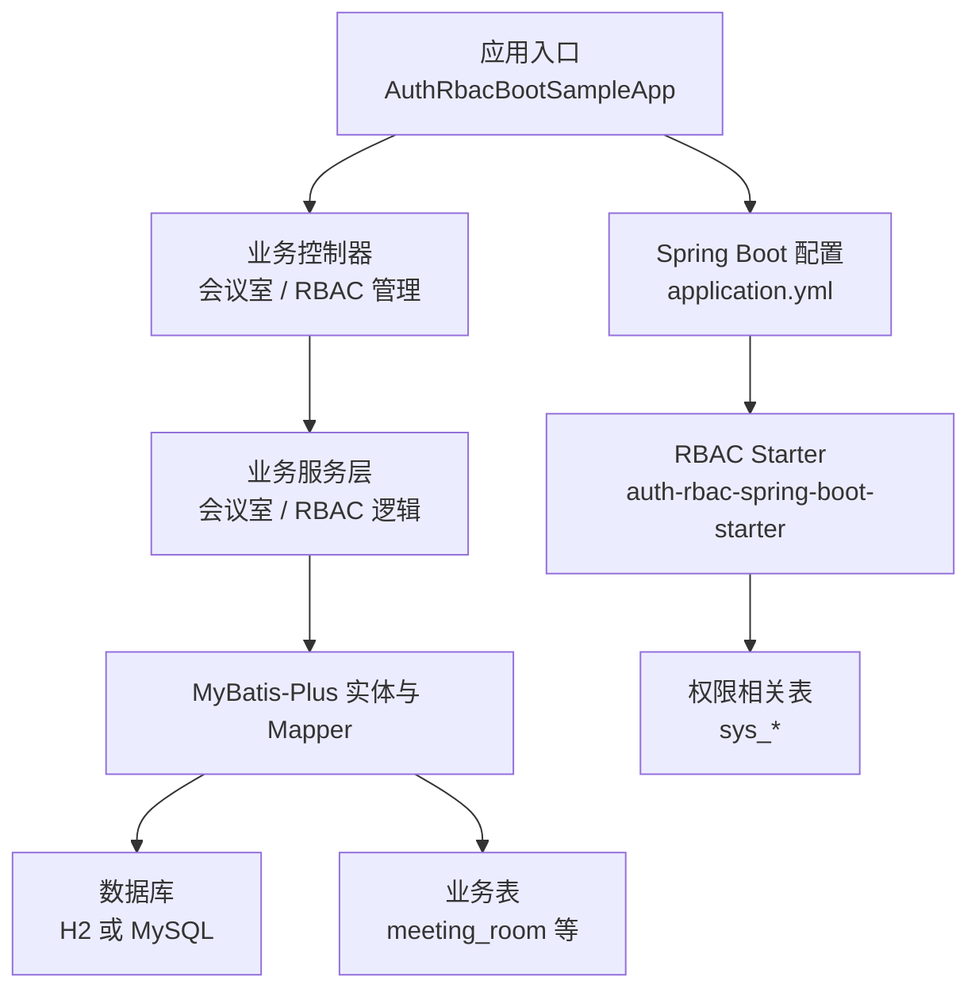
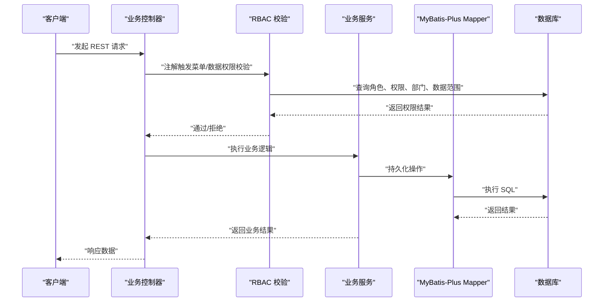
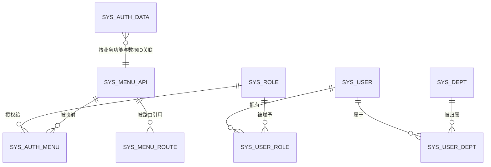
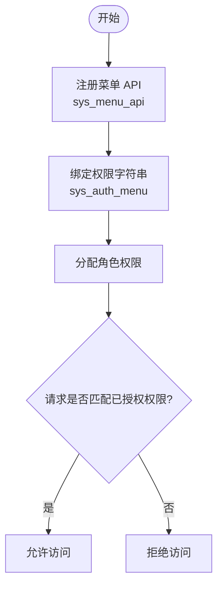
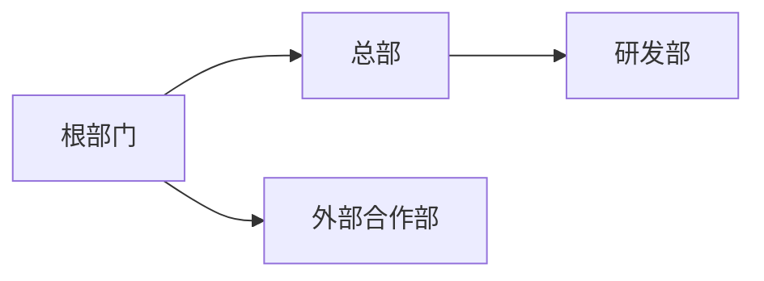
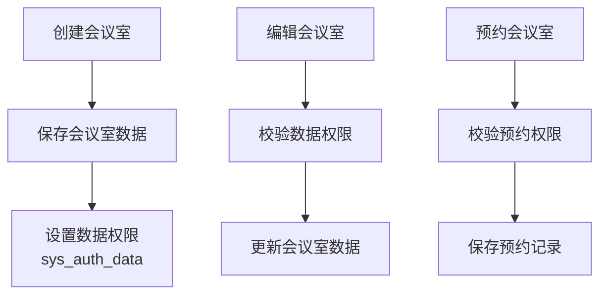
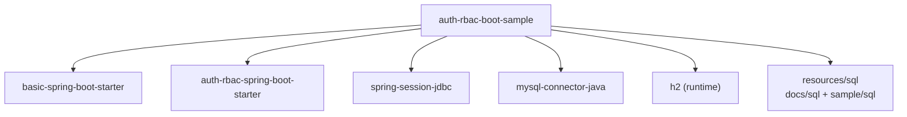

# RBAC 权限管理完整示例

<cite>
**本文引用的文件**   
- [sample/auth-rbac-boot-sample/README.md](file://sample/auth-rbac-boot-sample/README.md)
- [sample/auth-rbac-boot-sample/pom.xml](file://sample/auth-rbac-boot-sample/pom.xml)
- [sample/auth-rbac-boot-sample/sql/schema.sql](file://sample/auth-rbac-boot-sample/sql/schema.sql)
- [sample/auth-rbac-boot-sample/sql/seed-data.sql](file://sample/auth-rbac-boot-sample/sql/seed-data.sql)
- [docs/sql/auth-rbac.sql](file://docs/sql/auth-rbac.sql)
- [sample/auth-rbac-boot-sample/src/main/java/com/cu/framework/auth/sample/AuthRbacBootSampleApp.java](file://sample/auth-rbac-boot-sample/src/main/java/com/cu/framework/auth/sample/AuthRbacBootSampleApp.java)
</cite>

## 目录
1. [引言](#引言)
2. [项目结构](#项目结构)
3. [核心组件](#核心组件)
4. [架构总览](#架构总览)
5. [详细组件分析](#详细组件分析)
6. [依赖关系分析](#依赖关系分析)
7. [性能与最佳实践](#性能与最佳实践)
8. [故障排查指南](#故障排查指南)
9. [结论](#结论)
10. [附录：配置与初始化清单](#附录配置与初始化清单)

## 引言
auth-rbac-boot-sample 是 cu-framework-auth 框架的 RBAC 权限管理完整示例。它围绕“会议室管理”这一真实业务场景，演示了用户、角色、部门、菜单、权限数据范围等 RBAC 核心能力，并给出了基于注解的接口级权限控制、数据级权限控制以及部门继承机制的落地方式。

该示例具有以下特点：
- 开箱即用：默认使用 H2 内存数据库，无需手动建库即可启动。
- 业务贴近实战：以“会议室创建、编辑、预约”为主线，展示菜单权限、数据权限和部门继承的综合用法。
- 可演进性强：通过 Spring Boot Starter 装配 RBAC 能力，便于在已有项目中引入。
- 前后端联动：提供了后端 API 与前端 admin 工程联动的演示入口，也可通过 Apifox 验证接口。

**章节来源**
- [sample/auth-rbac-boot-sample/README.md:1-200](file://sample/auth-rbac-boot-sample/README.md#L1-L200)

## 项目结构
示例模块位于 `sample/auth-rbac-boot-sample`，主要组成如下：
- 应用入口类：`AuthRbacBootSampleApp`
- 配置与资源：`application.yml`、日志、SAML 元数据、SQL 打印配置
- 业务代码：控制器、模型、MyBatis-Plus 实体与 Mapper、当前用户上下文
- SQL 脚本：
  - 权限框架表结构：`../../docs/sql/auth-rbac.sql`
  - 示例业务表结构：`sql/schema.sql`
  - 种子数据：`sql/seed-data.sql`

**图表来源**
- [sample/auth-rbac-boot-sample/pom.xml:1-122](file://sample/auth-rbac-boot-sample/pom.xml#L1-L122)
- [sample/auth-rbac-boot-sample/README.md:1-200](file://sample/auth-rbac-boot-sample/README.md#L1-L200)

**章节来源**
- [sample/auth-rbac-boot-sample/README.md:1-200](file://sample/auth-rbac-boot-sample/README.md#L1-L200)
- [sample/auth-rbac-boot-sample/pom.xml:1-122](file://sample/auth-rbac-boot-sample/pom.xml#L1-L122)

## 核心组件
- 应用启动器：`AuthRbacBootSampleApp` 作为唯一入口，装配 RBAC 与业务模块。
- RBAC 能力注入：通过 `auth-rbac-spring-boot-starter` 自动扫描并注册菜单、路由、权限校验等基础设施。
- 业务领域对象：会议室 `meeting_room` 与测试用业务表 `testauth_annotation_business`，由 `schema.sql` 定义。
- 权限基础设施表：用户、角色、部门、菜单、权限映射、数据权限范围等 `sys_*` 表，由 `docs/sql/auth-rbac.sql` 定义。
- 种子数据：`seed-data.sql` 提供初始角色、用户、部门、菜单、权限映射及示例业务数据。

**章节来源**
- [sample/auth-rbac-boot-sample/src/main/java/com/cu/framework/auth/sample/AuthRbacBootSampleApp.java](file://sample/auth-rbac-boot-sample/src/main/java/com/cu/framework/auth/sample/AuthRbacBootSampleApp.java)
- [sample/auth-rbac-boot-sample/sql/schema.sql:1-36](file://sample/auth-rbac-boot-sample/sql/schema.sql#L1-L36)
- [docs/sql/auth-rbac.sql:1-148](file://docs/sql/auth-rbac.sql#L1-L148)
- [sample/auth-rbac-boot-sample/sql/seed-data.sql:1-200](file://sample/auth-rbac-boot-sample/sql/seed-data.sql#L1-L200)

## 架构总览
下图展示了从请求进入、RBAC 校验到数据访问的整体流程。

**图表来源**
- [sample/auth-rbac-boot-sample/pom.xml:1-122](file://sample/auth-rbac-boot-sample/pom.xml#L1-L122)
- [docs/sql/auth-rbac.sql:1-148](file://docs/sql/auth-rbac.sql#L1-L148)
- [sample/auth-rbac-boot-sample/sql/seed-data.sql:1-200](file://sample/auth-rbac-boot-sample/sql/seed-data.sql#L1-L200)

## 详细组件分析

### RBAC 数据模型与关联关系
示例中的 RBAC 模型包含以下关键实体与关系：
- 用户与角色：多对多（`sys_user_role`）
- 角色与菜单权限：通过 `sys_auth_menu` 将权限字符串与菜单 API 绑定
- 用户与部门：通过 `sys_user_dept` 关联，支持主部门与非主部门
- 部门树：`sys_dept.parent_id` 实现层级继承
- 数据权限范围：`sys_auth_data` 将业务功能、业务主键、操作类型与权限字符串关联
- 菜单与路由：`sys_menu_api` 描述后端路径与权限类型；`sys_menu_route` 描述前端路由与组件映射

**图表来源**
- [docs/sql/auth-rbac.sql:1-148](file://docs/sql/auth-rbac.sql#L1-L148)

**章节来源**
- [docs/sql/auth-rbac.sql:1-148](file://docs/sql/auth-rbac.sql#L1-L148)

### 用户管理与认证
- 用户主信息存储在 `sys_user`，包括姓名、昵称、用户名、联系方式、头像、性别等。
- 登录凭证存储在 `sys_user_credential`，支持密码、过期时间、账号锁定策略等扩展点。
- 示例默认创建管理员账户，用于快速体验 RBAC 全流程。

**章节来源**
- [docs/sql/auth-rbac.sql:1-148](file://docs/sql/auth-rbac.sql#L1-L148)
- [sample/auth-rbac-boot-sample/sql/seed-data.sql:1-200](file://sample/auth-rbac-boot-sample/sql/seed-data.sql#L1-L200)

### 角色管理与权限矩阵
- 角色通过 `sys_role` 维护，角色名与 ID 构成身份基础。
- 权限矩阵体现在“菜单 API + 权限字符串 + 角色”的组合上：
  - `sys_menu_api` 登记所有可访问的后端路径。
  - `sys_auth_menu` 将某个 API 与一个或多个权限字符串绑定。
  - 角色拥有这些权限字符串后，即获得对应菜单与接口的访问权。
- 示例中为超级管理员角色预置了大量菜单权限，便于直接体验。

**图表来源**
- [sample/auth-rbac-boot-sample/sql/seed-data.sql:1-200](file://sample/auth-rbac-boot-sample/sql/seed-data.sql#L1-L200)

**章节来源**
- [sample/auth-rbac-boot-sample/sql/seed-data.sql:1-200](file://sample/auth-rbac-boot-sample/sql/seed-data.sql#L1-L200)

### 部门管理与继承机制
- 部门通过 `sys_dept.parent_id` 形成树形结构。
- 示例种子数据包含根部门、总部、研发部、外部合作部，体现不同组织边界。
- 权限可通过“部门关系”授予，例如只授予某部门的子孙部门成员，从而演示继承效果。

**图表来源**
- [sample/auth-rbac-boot-sample/sql/seed-data.sql:1-200](file://sample/auth-rbac-boot-sample/sql/seed-data.sql#L1-L200)

**章节来源**
- [sample/auth-rbac-boot-sample/sql/seed-data.sql:1-200](file://sample/auth-rbac-boot-sample/sql/seed-data.sql#L1-L200)

### 菜单与路由管理
- 菜单 API：`sys_menu_api` 记录路径、名称、父级、备注、权限类型、删除标记等。
- 菜单权限：`sys_auth_menu` 将 API 与权限字符串关联，支撑菜单可见性与接口访问控制。
- 前端路由：`sys_menu_route` 描述路由名、父路由、路径、重定向、组件名、图标、隐藏、关联 API、类型等，用于生成前端导航。

**章节来源**
- [docs/sql/auth-rbac.sql:1-148](file://docs/sql/auth-rbac.sql#L1-L148)
- [sample/auth-rbac-boot-sample/sql/seed-data.sql:1-200](file://sample/auth-rbac-boot-sample/sql/seed-data.sql#L1-L200)

### 业务模块：会议室管理
示例以会议室为核心业务，提供：
- 会议室基本信息管理：创建、分页查询、编辑、删除。
- 会议室预约：查看可预约列表、预约会议室。
- 数据权限：通过 `sys_auth_data` 将业务数据与权限字符串绑定，实现行级数据访问控制。

**图表来源**
- [sample/auth-rbac-boot-sample/sql/schema.sql:1-36](file://sample/auth-rbac-boot-sample/sql/schema.sql#L1-L36)
- [sample/auth-rbac-boot-sample/sql/seed-data.sql:1-200](file://sample/auth-rbac-boot-sample/sql/seed-data.sql#L1-L200)

**章节来源**
- [sample/auth-rbac-boot-sample/sql/schema.sql:1-36](file://sample/auth-rbac-boot-sample/sql/schema.sql#L1-L36)
- [sample/auth-rbac-boot-sample/sql/seed-data.sql:1-200](file://sample/auth-rbac-boot-sample/sql/seed-data.sql#L1-L200)

## 依赖关系分析
示例模块通过 Maven 引入 RBAC Starter、Basic Starter、Session JDBC、MySQL 驱动与 H2 内存库，并将权限框架脚本与业务脚本打包进 classpath，供 Spring SQL Init 执行。

**图表来源**
- [sample/auth-rbac-boot-sample/pom.xml:1-122](file://sample/auth-rbac-boot-sample/pom.xml#L1-L122)

**章节来源**
- [sample/auth-rbac-boot-sample/pom.xml:1-122](file://sample/auth-rbac-boot-sample/pom.xml#L1-L122)

## 性能与最佳实践
- 使用 H2 进行本地开发时，注意其兼容模式与生产 MySQL 的差异，建议在生产环境先执行 `docs/sql/auth-rbac.sql` 与 `sql/schema.sql`，再导入 `seed-data.sql`。
- 对高频查询的路径与权限映射，建议在数据库层面建立合适索引；示例脚本已为常用组合字段添加索引。
- 避免在业务事务内做过多权限判断，尽量将权限校验下沉到框架层，减少重复计算。
- 使用 p6spy 抓 SQL 时需注意 URL 与驱动配置，示例 README 明确指出 MySQL profile 下默认不走 p6spy，需自行调整。

**章节来源**
- [sample/auth-rbac-boot-sample/README.md:1-200](file://sample/auth-rbac-boot-sample/README.md#L1-L200)
- [docs/sql/auth-rbac.sql:1-148](file://docs/sql/auth-rbac.sql#L1-L148)

## 故障排查指南
- 启动失败或权限表缺失：确认是否已执行 `docs/sql/auth-rbac.sql`；H2 profile 会自动执行，MySQL profile 需手动建表。
- 会话存储表缺失：H2 由 session 自动创建；MySQL 需要执行 spring-session 提供的 schema 脚本。
- 无法访问菜单或接口：检查 `sys_menu_api` 与 `sys_auth_menu` 是否正确关联，以及当前用户角色是否具备相应权限字符串。
- 数据权限不生效：检查 `sys_auth_data` 中业务功能、数据 ID、操作类型与权限字符串是否与业务调用一致。
- SQL 打印无效：若使用 MySQL profile，请确认是否已将驱动改为 p6spy 驱动并将 URL 前缀调整为 p6spy。

**章节来源**
- [sample/auth-rbac-boot-sample/README.md:1-200](file://sample/auth-rbac-boot-sample/README.md#L1-L200)
- [sample/auth-rbac-boot-sample/pom.xml:1-122](file://sample/auth-rbac-boot-sample/pom.xml#L1-L122)

## 结论
auth-rbac-boot-sample 提供了一个完整的 RBAC 权限管理示例，覆盖用户、角色、部门、菜单、权限映射与数据范围控制，并通过会议室管理这一真实场景串联起菜单权限、数据权限与部门继承。借助 Spring Boot Starter 与 MyBatis-Plus，开发者可以快速在自己的项目中集成 RBAC 能力，并按需扩展自定义权限规则与校验逻辑。

[本节为总结性内容，不直接分析具体文件]

## 附录：配置与初始化清单

### 数据库与脚本
- 权限框架表结构与视图：`docs/sql/auth-rbac.sql`
- 示例业务表结构：`sample/auth-rbac-boot-sample/sql/schema.sql`
- 示例种子数据：`sample/auth-rbac-boot-sample/sql/seed-data.sql`

**章节来源**
- [docs/sql/auth-rbac.sql:1-148](file://docs/sql/auth-rbac.sql#L1-L148)
- [sample/auth-rbac-boot-sample/sql/schema.sql:1-36](file://sample/auth-rbac-boot-sample/sql/schema.sql#L1-L36)
- [sample/auth-rbac-boot-sample/sql/seed-data.sql:1-200](file://sample/auth-rbac-boot-sample/sql/seed-data.sql#L1-L200)

### 启动与运行
- 默认 H2 profile：无需手动建库，直接启动应用。
- MySQL profile：修改连接参数，先执行建表脚本，再导入种子数据。
- 启动类：`AuthRbacBootSampleApp`，端口默认 8081。
- 默认管理员账号：admin/123456。

**章节来源**
- [sample/auth-rbac-boot-sample/README.md:1-200](file://sample/auth-rbac-boot-sample/README.md#L1-L200)
- [sample/auth-rbac-boot-sample/src/main/java/com/cu/framework/auth/sample/AuthRbacBootSampleApp.java](file://sample/auth-rbac-boot-sample/src/main/java/com/cu/framework/auth/sample/AuthRbacBootSampleApp.java)

### 前端联动
- 可使用前端 admin 工程配合启动，直观验证菜单、权限与数据范围。
- 也可通过 Apifox 在线文档验证后端接口。

**章节来源**
- [sample/auth-rbac-boot-sample/README.md:1-200](file://sample/auth-rbac-boot-sample/README.md#L1-L200)