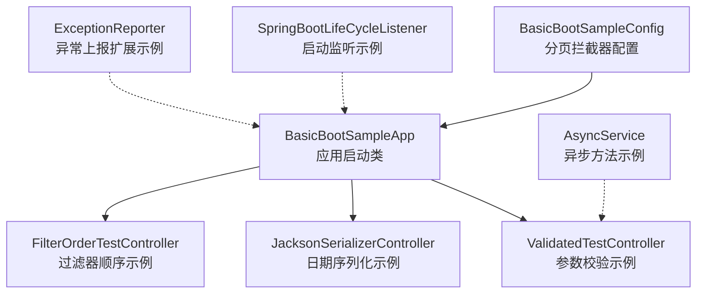
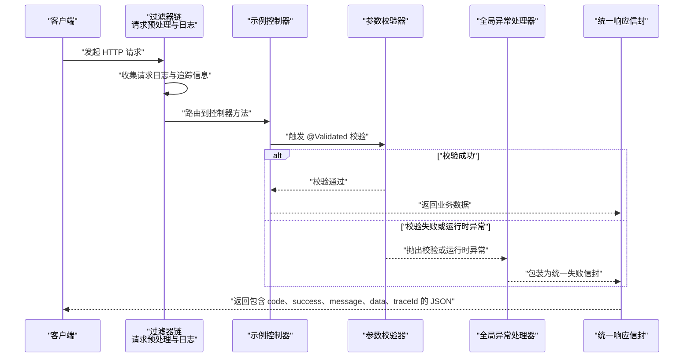
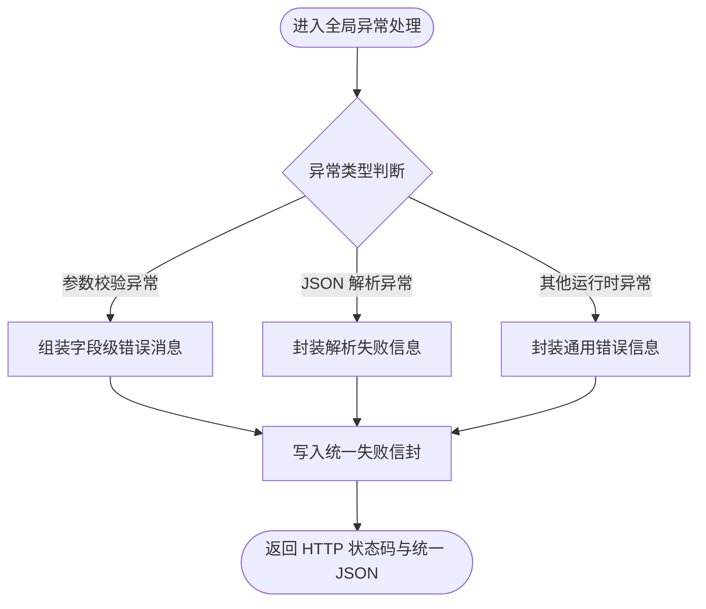
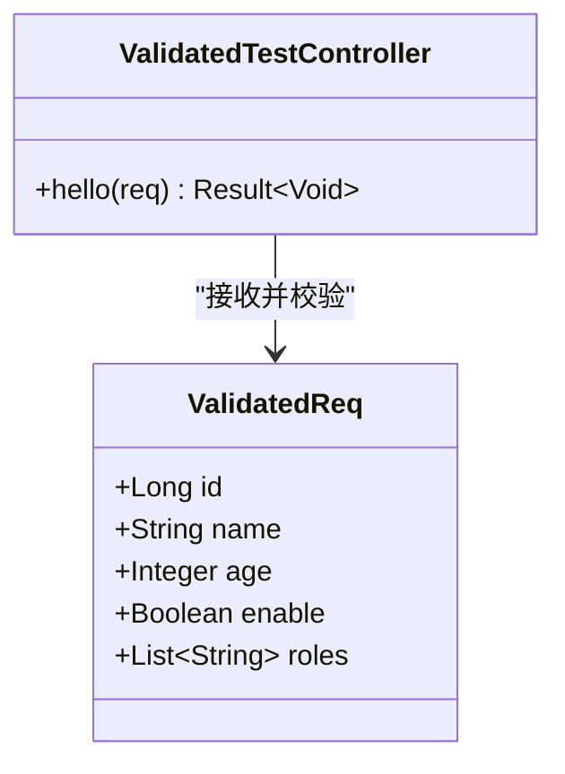
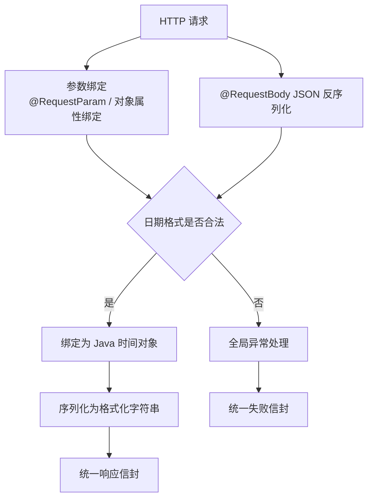
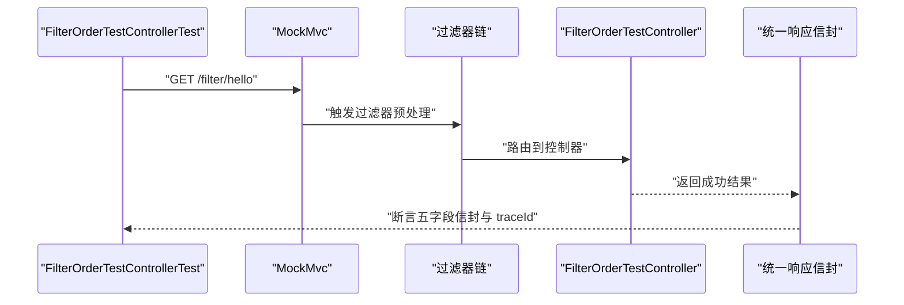
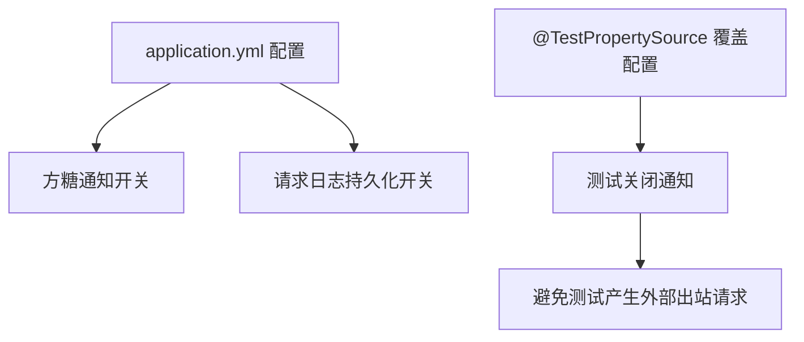
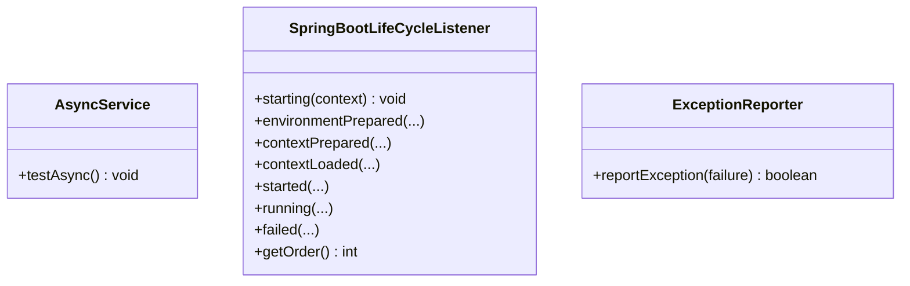
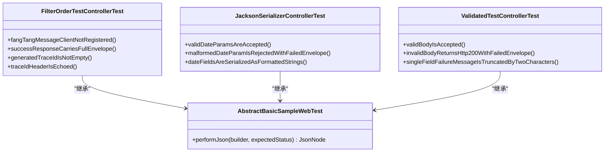
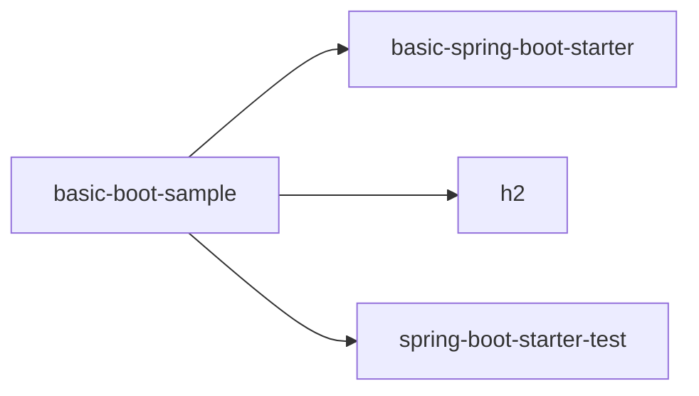

# 基础功能示例

<cite>
**本文引用的文件**   
- [basic-boot-sample/pom.xml](file://sample/basic-boot-sample/pom.xml)
- [BasicBootSampleApp.java](file://sample/basic-boot-sample/src/main/java/com/cu/framework/sample/basic/BasicBootSampleApp.java)
- [BasicBootSampleConfig.java](file://sample/basic-boot-sample/src/main/java/com/cu/framework/sample/basic/config/BasicBootSampleConfig.java)
- [application.yml](file://sample/basic-boot-sample/src/main/resources/application.yml)
- [ValidatedTestController.java](file://sample/basic-boot-sample/src/main/java/com/cu/framework/sample/basic/controller/ValidatedTestController.java)
- [JacksonSerializerController.java](file://sample/basic-boot-sample/src/main/java/com/cu/framework/sample/basic/controller/JacksonSerializerController.java)
- [FilterOrderTestController.java](file://sample/basic-boot-sample/src/main/java/com/cu/framework/sample/basic/controller/FilterOrderTestController.java)
- [LocalDateParam.java](file://sample/basic-boot-sample/src/main/java/com/cu/framework/sample/basic/controller/LocalDateParam.java)
- [ValidatedReq.java](file://sample/basic-boot-sample/src/main/java/com/cu/framework/sample/basic/req/ValidatedReq.java)
- [ExceptionReporter.java](file://sample/basic-boot-sample/src/main/java/com/cu/framework/sample/basic/listener/ExceptionReporter.java)
- [SpringBootLifeCycleListener.java](file://sample/basic-boot-sample/src/main/java/com/cu/framework/sample/basic/listener/SpringBootLifeCycleListener.java)
- [AsyncService.java](file://sample/basic-boot-sample/src/main/java/com/cu/framework/sample/basic/service/AsyncService.java)
- [AbstractBasicSampleWebTest.java](file://sample/basic-boot-sample/src/test/java/com/cu/framework/sample/basic/controller/AbstractBasicSampleWebTest.java)
- [FilterOrderTestControllerTest.java](file://sample/basic-boot-sample/src/test/java/com/cu/framework/sample/basic/controller/FilterOrderTestControllerTest.java)
- [JacksonSerializerControllerTest.java](file://sample/basic-boot-sample/src/test/java/com/cu/framework/sample/basic/controller/JacksonSerializerControllerTest.java)
- [ValidatedTestControllerTest.java](file://sample/basic-boot-sample/src/test/java/com/cu/framework/sample/basic/controller/ValidatedTestControllerTest.java)
- [GlobalExceptionHandlerAdvice.java](file://basic/src/main/java/com/cu/framework/basic/exception/GlobalExceptionHandlerAdvice.java)
- [BizException.java](file://basic/src/main/java/com/cu/framework/basic/exception/BizException.java)
- [BackendException.java](file://basic/src/main/java/com/cu/framework/basic/exception/BackendException.java)
- [ExceptionConstant.java](file://basic/src/main/java/com/cu/framework/basic/exception/ExceptionConstant.java)
- [EarlyRequestFilter.java](file://basic/src/main/java/com/cu/framework/basic/filter/EarlyRequestFilter.java)
- [EarlyRequestFilterProxy.java](file://basic/src/main/java/com/cu/framework/basic/filter/EarlyRequestFilterProxy.java)
- [RequestLoggerFilter.java](file://basic/src/main/java/com/cu/framework/basic/logger/RequestLoggerFilter.java)
- [TraceRequestFilter.java](file://basic/src/main/java/com/cu/framework/basic/logger/TraceRequestFilter.java)
- [BeanUtil.java](file://basic/src/main/java/com/cu/framework/basic/utils/BeanUtil.java)
- [TreeUtil.java](file://basic/src/main/java/com/cu/framework/basic/utils/TreeUtil.java)
- [RegUtil.java](file://basic/src/main/java/com/cu/framework/basic/utils/RegUtil.java)
</cite>

## 目录
1. [简介](#简介)
2. [项目结构](#项目结构)
3. [核心组件](#核心组件)
4. [架构总览](#架构总览)
5. [详细组件分析](#详细组件分析)
6. [依赖关系分析](#依赖关系分析)
7. [性能与扩展性](#性能与扩展性)
8. [故障排查指南](#故障排查指南)
9. [结论](#结论)

## 简介
本文件围绕 `basic-boot-sample` 基础功能示例，系统说明它如何演示 Kewen Framework 的基础支撑能力：全局异常处理、统一响应信封、请求参数校验、Jackson 日期序列化、过滤器链执行顺序、日志记录（请求日志与追踪）、异步方法、以及 Spring Boot 启动生命周期扩展。该示例不直接实现业务逻辑，而是通过轻量控制器和测试用例，验证框架层在 Web 请求进入、处理、返回全链路中的通用行为。

## 项目结构
`basic-boot-sample` 是一个独立的 Spring Boot 示例模块，依赖 `basic-spring-boot-starter`，默认使用 H2 内存数据库，并提供完整的 MockMvc 单元测试。其源码组织以“示例用途”为维度，而非按领域划分：

**图示来源**
- [BasicBootSampleApp.java:10-21](file://sample/basic-boot-sample/src/main/java/com/cu/framework/sample/basic/BasicBootSampleApp.java#L10-L21)
- [ValidatedTestController.java:16-26](file://sample/basic-boot-sample/src/main/java/com/cu/framework/sample/basic/controller/ValidatedTestController.java#L16-L26)
- [JacksonSerializerController.java:20-70](file://sample/basic-boot-sample/src/main/java/com/cu/framework/sample/basic/controller/JacksonSerializerController.java#L20-L70)
- [FilterOrderTestController.java:15-23](file://sample/basic-boot-sample/src/main/java/com/cu/framework/sample/basic/controller/FilterOrderTestController.java#L15-L23)
- [BasicBootSampleConfig.java:10-17](file://sample/basic-boot-sample/src/main/java/com/cu/framework/sample/basic/config/BasicBootSampleConfig.java#L10-L17)
- [SpringBootLifeCycleListener.java:18-78](file://sample/basic-boot-sample/src/main/java/com/cu/framework/sample/basic/listener/SpringBootLifeCycleListener.java#L18-L78)
- [ExceptionReporter.java:12-32](file://sample/basic-boot-sample/src/main/java/com/cu/framework/sample/basic/listener/ExceptionReporter.java#L12-L32)
- [AsyncService.java:15-23](file://sample/basic-boot-sample/src/main/java/com/cu/framework/sample/basic/service/AsyncService.java#L15-L23)

### 关键入口与配置文件
- 应用入口：`BasicBootSampleApp`，排除 MyBatis Plus 自动装配的默认配置，并通过 `SpringApplication.run` 启动。
- 示例配置：`BasicBootSampleConfig` 注册 MyBatis Plus 分页拦截器，用于后续可能涉及分页的场景。
- 运行配置：`application.yml` 提供 H2 与 MySQL 两种 profile，启用通知与请求日志持久化开关，并暴露 H2 Web 控制台。

**章节来源**
- [BasicBootSampleApp.java:10-21](file://sample/basic-boot-sample/src/main/java/com/cu/framework/sample/basic/BasicBootSampleApp.java#L10-L21)
- [BasicBootSampleConfig.java:10-17](file://sample/basic-boot-sample/src/main/java/com/cu/framework/sample/basic/config/BasicBootSampleConfig.java#L10-L17)
- [application.yml:1-79](file://sample/basic-boot-sample/src/main/resources/application.yml#L1-L79)

## 核心组件
本示例的核心不是业务代码，而是对框架能力的“最小可验证契约”：

| 类别 | 示例位置 | 演示目标 |
|---|---|---|
| 应用启动 | `BasicBootSampleApp` | 展示如何禁用框架默认装配、启动示例应用 |
| 参数校验 | `ValidatedTestController` + `ValidatedReq` | 展示 `@Validated` 与 Bean Validation 注解触发的校验流程 |
| Jackson 序列化 | `JacksonSerializerController` + `LocalDateParam` | 展示 `LocalDate`、`LocalDateTime`、`Date` 的全局绑定与输出格式 |
| 过滤器顺序 | `FilterOrderTestController` | 展示请求经过过滤器后的统一响应信封与追踪 ID |
| 异步方法 | `AsyncService` | 展示 `@Async` 异步执行线程上下文 |
| 启动扩展 | `SpringBootLifeCycleListener`、`ExceptionReporter` | 展示 Spring Boot 启动生命周期与异常上报扩展点 |
| 单元测试 | `*Test.java` | 展示基于 MockMvc 的统一响应契约测试 |

**章节来源**
- [BasicBootSampleApp.java:10-21](file://sample/basic-boot-sample/src/main/java/com/cu/framework/sample/basic/BasicBootSampleApp.java#L10-L21)
- [ValidatedTestController.java:16-26](file://sample/basic-boot-sample/src/main/java/com/cu/framework/sample/basic/controller/ValidatedTestController.java#L16-L26)
- [ValidatedReq.java:14-35](file://sample/basic-boot-sample/src/main/java/com/cu/framework/sample/basic/req/ValidatedReq.java#L14-L35)
- [JacksonSerializerController.java:20-70](file://sample/basic-boot-sample/src/main/java/com/cu/framework/sample/basic/controller/JacksonSerializerController.java#L20-L70)
- [LocalDateParam.java:12-17](file://sample/basic-boot-sample/src/main/java/com/cu/framework/sample/basic/controller/LocalDateParam.java#L12-L17)
- [FilterOrderTestController.java:15-23](file://sample/basic-boot-sample/src/main/java/com/cu/framework/sample/basic/controller/FilterOrderTestController.java#L15-L23)
- [AsyncService.java:15-23](file://sample/basic-boot-sample/src/main/java/com/cu/framework/sample/basic/service/AsyncService.java#L15-L23)
- [SpringBootLifeCycleListener.java:18-78](file://sample/basic-boot-sample/src/main/java/com/cu/framework/sample/basic/listener/SpringBootLifeCycleListener.java#L18-L78)
- [ExceptionReporter.java:12-32](file://sample/basic-boot-sample/src/main/java/com/cu/framework/sample/basic/listener/ExceptionReporter.java#L12-L32)

## 架构总览
从一次 HTTP 请求的角度看，`basic-boot-sample` 的典型调用链如下：

**图示来源**
- [FilterOrderTestController.java:15-23](file://sample/basic-boot-sample/src/main/java/com/cu/framework/sample/basic/controller/FilterOrderTestController.java#L15-L23)
- [ValidatedTestController.java:16-26](file://sample/basic-boot-sample/src/main/java/com/cu/framework/sample/basic/controller/ValidatedTestController.java#L16-L26)
- [ValidatedReq.java:14-35](file://sample/basic-boot-sample/src/main/java/com/cu/framework/sample/basic/req/ValidatedReq.java#L14-L35)
- [JacksonSerializerController.java:20-70](file://sample/basic-boot-sample/src/main/java/com/cu/framework/sample/basic/controller/JacksonSerializerController.java#L20-L70)
- [GlobalExceptionHandlerAdvice.java](file://basic/src/main/java/com/cu/framework/basic/exception/GlobalExceptionHandlerAdvice.java)

## 详细组件分析

### 全局异常处理与统一响应
示例没有自定义业务异常类型，但通过测试断言了框架层的统一响应契约：

- 成功响应包含 `code`、`success`、`message`、`data`、`traceId`。
- 校验失败、JSON 反序列化失败等异常会被全局异常处理器捕获，并以失败信封返回。
- 当请求头未携带 `traceId` 时，响应中仍会生成非空追踪值；若请求头携带 `traceId`，则原样回显。

**图示来源**
- [ValidatedTestControllerTest.java:27-54](file://sample/basic-boot-sample/src/test/java/com/cu/framework/sample/basic/controller/ValidatedTestControllerTest.java#L27-L54)
- [JacksonSerializerControllerTest.java:54-72](file://sample/basic-boot-sample/src/test/java/com/cu/framework/sample/basic/controller/JacksonSerializerControllerTest.java#L54-L72)
- [FilterOrderTestControllerTest.java:29-61](file://sample/basic-boot-sample/src/test/java/com/cu/framework/sample/basic/controller/FilterOrderTestControllerTest.java#L29-L61)
- [GlobalExceptionHandlerAdvice.java](file://basic/src/main/java/com/cu/framework/basic/exception/GlobalExceptionHandlerAdvice.java)

#### 相关实现要点
- 示例通过 `ValidatedTestControllerTest` 断言：校验失败时 HTTP 状态码仍为 200，但响应体中 `success=false`、`code=500`，且 `message` 中包含失败字段标记。
- 示例还断言了一个已知缺陷：单字段校验失败时，消息拼接存在截断问题，测试明确记录了该行为以便后续修复回归。
- 框架侧提供 `BizException`、`BackendException`、`ExceptionConstant` 作为统一异常与错误码扩展点；示例未直接使用，但可作为业务扩展参考。

**章节来源**
- [ValidatedTestControllerTest.java:27-54](file://sample/basic-boot-sample/src/test/java/com/cu/framework/sample/basic/controller/ValidatedTestControllerTest.java#L27-L54)
- [GlobalExceptionHandlerAdvice.java](file://basic/src/main/java/com/cu/framework/basic/exception/GlobalExceptionHandlerAdvice.java)
- [BizException.java](file://basic/src/main/java/com/cu/framework/basic/exception/BizException.java)
- [BackendException.java](file://basic/src/main/java/com/cu/framework/basic/exception/BackendException.java)
- [ExceptionConstant.java](file://basic/src/main/java/com/cu/framework/basic/exception/ExceptionConstant.java)

### 参数校验示例
`ValidatedTestController.hello` 接收 `ValidatedReq`，并使用 `@Validated` 触发校验。`ValidatedReq` 展示了常用校验注解：

| 字段 | 校验规则 | 语义 |
|---|---|---|
| id | `@NotNull` | 必填编号 |
| name | `@NotEmpty` | 名称不能为空串 |
| age | `@NotNull(message="年龄不能为空")` | 带自定义提示的必填年龄 |
| enable | `@AssertTrue` | 开关必须为真 |
| roles | `@NotEmpty` | 角色列表不能为空 |

**图示来源**
- [ValidatedTestController.java:16-26](file://sample/basic-boot-sample/src/main/java/com/cu/framework/sample/basic/controller/ValidatedTestController.java#L16-L26)
- [ValidatedReq.java:14-35](file://sample/basic-boot-sample/src/main/java/com/cu/framework/sample/basic/req/ValidatedReq.java#L14-L35)

**章节来源**
- [ValidatedTestController.java:16-26](file://sample/basic-boot-sample/src/main/java/com/cu/framework/sample/basic/controller/ValidatedTestController.java#L16-L26)
- [ValidatedReq.java:14-35](file://sample/basic-boot-sample/src/main/java/com/cu/framework/sample/basic/req/ValidatedReq.java#L14-L35)
- [ValidatedTestControllerTest.java:15-54](file://sample/basic-boot-sample/src/test/java/com/cu/framework/sample/basic/controller/ValidatedTestControllerTest.java#L15-L54)

### Jackson 日期序列化与反序列化
`JacksonSerializerController` 覆盖了三种典型场景：

1. `@RequestParam` 形式的 `LocalDate`、`LocalDateTime` 参数绑定。
2. 对象属性绑定方式的日期字段绑定。
3. `@RequestBody` JSON 中的日期字段反序列化。
4. 返回 `Date`、`LocalDateTime`、`LocalDate` 观察序列化输出。

**图示来源**
- [JacksonSerializerController.java:20-70](file://sample/basic-boot-sample/src/main/java/com/cu/framework/sample/basic/controller/JacksonSerializerController.java#L20-L70)
- [LocalDateParam.java:12-17](file://sample/basic-boot-sample/src/main/java/com/cu/framework/sample/basic/controller/LocalDateParam.java#L12-L17)
- [JacksonSerializerControllerTest.java:23-144](file://sample/basic-boot-sample/src/test/java/com/cu/framework/sample/basic/controller/JacksonSerializerControllerTest.java#L23-L144)

#### 契约要点
- 合法的 `yyyy-MM-dd` 与 `yyyy-MM-dd HH:mm:ss` 应被接受。
- 非法日期应返回统一失败信封，而不是 Spring 默认错误页。
- 输出时 `Date`、`LocalDate`、`LocalDateTime` 应为格式化字符串，而非时间戳数字。
- 可选参数缺失时应返回 null 字段，而不是缺少键。

**章节来源**
- [JacksonSerializerController.java:20-70](file://sample/basic-boot-sample/src/main/java/com/cu/framework/sample/basic/controller/JacksonSerializerController.java#L20-L70)
- [LocalDateParam.java:12-17](file://sample/basic-boot-sample/src/main/java/com/cu/framework/sample/basic/controller/LocalDateParam.java#L12-L17)
- [JacksonSerializerControllerTest.java:23-144](file://sample/basic-boot-sample/src/test/java/com/cu/framework/sample/basic/controller/JacksonSerializerControllerTest.java#L23-L144)

### 过滤器注册与执行顺序
`FilterOrderTestController.filter` 提供一个无业务逻辑的 `/filter/hello` 接口，专门用于验证过滤器链对响应的影响：

- 统一响应信封必须包含 `code`、`success`、`message`、`data`、`traceId`。
- 未传 `traceId` 时应生成非空值。
- 传入 `traceId` 时应原样回显。
- 在测试环境中关闭第三方通知客户端，避免产生外部出站请求。

**图示来源**
- [FilterOrderTestControllerTest.java:19-61](file://sample/basic-boot-sample/src/test/java/com/cu/framework/sample/basic/controller/FilterOrderTestControllerTest.java#L19-L61)
- [FilterOrderTestController.java:15-23](file://sample/basic-boot-sample/src/main/java/com/cu/framework/sample/basic/controller/FilterOrderTestController.java#L15-L23)

#### 过滤器相关框架组件
虽然示例控制器本身不包含过滤逻辑，但框架侧提供了以下组件供理解整体机制：

| 组件 | 职责 |
|---|---|
| `EarlyRequestFilter` | 早期请求过滤器，用于前置预处理 |
| `EarlyRequestFilterProxy` | 早期过滤器代理，协调多个早期过滤器 |
| `RequestLoggerFilter` | 请求日志过滤器，采集请求与响应日志 |
| `TraceRequestFilter` | 追踪过滤器，负责追踪 ID 的生成与传递 |

这些组件共同构成请求预处理、日志记录、追踪 ID 管理的基础能力，而 `FilterOrderTestController` 的测试则固化其对外可见的契约。

**章节来源**
- [FilterOrderTestController.java:15-23](file://sample/basic-boot-sample/src/main/java/com/cu/framework/sample/basic/controller/FilterOrderTestController.java#L15-L23)
- [FilterOrderTestControllerTest.java:19-61](file://sample/basic-boot-sample/src/test/java/com/cu/framework/sample/basic/controller/FilterOrderTestControllerTest.java#L19-L61)
- [EarlyRequestFilter.java](file://basic/src/main/java/com/cu/framework/basic/filter/EarlyRequestFilter.java)
- [EarlyRequestFilterProxy.java](file://basic/src/main/java/com/cu/framework/basic/filter/EarlyRequestFilterProxy.java)
- [RequestLoggerFilter.java](file://basic/src/main/java/com/cu/framework/basic/logger/RequestLoggerFilter.java)
- [TraceRequestFilter.java](file://basic/src/main/java/com/cu/framework/basic/logger/TraceRequestFilter.java)

### 日志记录与追踪
示例通过配置项启用两类日志能力：

- 通知通道：`cu.notify.fang-tang.enabled=true`，配合 `cu.request.message.fang-tang=true`。
- 请求日志持久化：`cu.request.persistent.database=true`。

在测试环境中，基类通过 `@TestPropertySource` 关闭通知与消息发送，确保测试不会向外网发送请求。

**图示来源**
- [application.yml:10-16](file://sample/basic-boot-sample/src/main/resources/application.yml#L10-L16)
- [AbstractBasicSampleWebTest.java:19-27](file://sample/basic-boot-sample/src/test/java/com/cu/framework/sample/basic/controller/AbstractBasicSampleWebTest.java#L19-L27)
- [FilterOrderTestControllerTest.java:21-32](file://sample/basic-boot-sample/src/test/java/com/cu/framework/sample/basic/controller/FilterOrderTestControllerTest.java#L21-L32)

#### 日志相关框架组件
- `LoggerConstant`：日志常量定义。
- `RequestLoggerFilter`：请求日志采集。
- `TraceRequestFilter`：追踪上下文管理。
- `TraceContextTest`：基础模块中对追踪上下文的单元测试。

**章节来源**
- [application.yml:10-16](file://sample/basic-boot-sample/src/main/resources/application.yml#L10-L16)
- [AbstractBasicSampleWebTest.java:19-27](file://sample/basic-boot-sample/src/test/java/com/cu/framework/sample/basic/controller/AbstractBasicSampleWebTest.java#L19-L27)
- [FilterOrderTestControllerTest.java:21-32](file://sample/basic-boot-sample/src/test/java/com/cu/framework/sample/basic/controller/FilterOrderTestControllerTest.java#L21-L32)
- [RequestLoggerFilter.java](file://basic/src/main/java/com/cu/framework/basic/logger/RequestLoggerFilter.java)
- [TraceRequestFilter.java](file://basic/src/main/java/com/cu/framework/basic/logger/TraceRequestFilter.java)

### 工具类使用与扩展
基础模块提供多种通用工具类，示例虽未直接调用全部工具函数，但可在业务中复用：

| 工具类 | 主要用途 |
|---|---|
| `BeanUtil` | Bean 属性拷贝与转换 |
| `TreeUtil` | 树形结构构建与操作 |
| `RegUtil` | 正则表达式校验辅助 |
| `MapUtil` | Map 构建与便捷操作 |
| `FileUtils` | 文件操作辅助 |
| `YmlUtils` | YAML 配置读取辅助 |
| `RequestIpUtil` | 请求 IP 获取辅助 |

其中 `RegUtil` 已在基础模块中提供单元测试，可用于正则校验能力验证；示例工程可通过相同方式引入和使用。

**章节来源**
- [BeanUtil.java](file://basic/src/main/java/com/cu/framework/basic/utils/BeanUtil.java)
- [TreeUtil.java](file://basic/src/main/java/com/cu/framework/basic/utils/TreeUtil.java)
- [RegUtil.java](file://basic/src/main/java/com/cu/framework/basic/utils/RegUtil.java)
- [MapUtil.java](file://basic/src/main/java/com/cu/framework/basic/utils/MapUtil.java)
- [FileUtils.java](file://basic/src/main/java/com/cu/framework/basic/utils/FileUtils.java)
- [YmlUtils.java](file://basic/src/main/java/com/cu/framework/basic/utils/YmlUtils.java)
- [RequestIpUtil.java](file://basic/src/main/java/com/cu/framework/basic/utils/RequestIpUtil.java)

### 异步方法与生命周期扩展
- `AsyncService.testAsync` 使用 `@Async` 展示异步执行，测试可通过线程名判断是否脱离调用线程。
- `SpringBootLifeCycleListener` 实现 `SpringApplicationRunListener`，在 `starting` 阶段打印日志，展示启动生命周期扩展。
- `ExceptionReporter` 实现 `SpringBootExceptionReporter`，展示启动异常上报扩展点。

**图示来源**
- [AsyncService.java:15-23](file://sample/basic-boot-sample/src/main/java/com/cu/framework/sample/basic/service/AsyncService.java#L15-L23)
- [SpringBootLifeCycleListener.java:18-78](file://sample/basic-boot-sample/src/main/java/com/cu/framework/sample/basic/listener/SpringBootLifeCycleListener.java#L18-L78)
- [ExceptionReporter.java:12-32](file://sample/basic-boot-sample/src/main/java/com/cu/framework/sample/basic/listener/ExceptionReporter.java#L12-L32)

**章节来源**
- [AsyncService.java:15-23](file://sample/basic-boot-sample/src/main/java/com/cu/framework/sample/basic/service/AsyncService.java#L15-L23)
- [SpringBootLifeCycleListener.java:18-78](file://sample/basic-boot-sample/src/main/java/com/cu/framework/sample/basic/listener/SpringBootLifeCycleListener.java#L18-L78)
- [ExceptionReporter.java:12-32](file://sample/basic-boot-sample/src/main/java/com/cu/framework/sample/basic/listener/ExceptionReporter.java#L12-L32)

### 单元测试编写示例
示例的测试集中在 `controller` 包下，采用分层策略：

- `AbstractBasicSampleWebTest`：统一测试基类，启用 `h2` profile、关闭通知、封装 `performJson`。
- `FilterOrderTestControllerTest`：验证统一响应信封与追踪 ID。
- `JacksonSerializerControllerTest`：验证日期绑定、序列化、非法输入兜底。
- `ValidatedTestControllerTest`：验证声明式参数校验与全局异常处理契约。

**图示来源**
- [AbstractBasicSampleWebTest.java:14-48](file://sample/basic-boot-sample/src/test/java/com/cu/framework/sample/basic/controller/AbstractBasicSampleWebTest.java#L14-L48)
- [FilterOrderTestControllerTest.java:19-61](file://sample/basic-boot-sample/src/test/java/com/cu/framework/sample/basic/controller/FilterOrderTestControllerTest.java#L19-L61)
- [JacksonSerializerControllerTest.java:23-144](file://sample/basic-boot-sample/src/test/java/com/cu/framework/sample/basic/controller/JacksonSerializerControllerTest.java#L23-L144)
- [ValidatedTestControllerTest.java:15-54](file://sample/basic-boot-sample/src/test/java/com/cu/framework/sample/basic/controller/ValidatedTestControllerTest.java#L15-L54)

**章节来源**
- [AbstractBasicSampleWebTest.java:14-48](file://sample/basic-boot-sample/src/test/java/com/cu/framework/sample/basic/controller/AbstractBasicSampleWebTest.java#L14-L48)
- [FilterOrderTestControllerTest.java:19-61](file://sample/basic-boot-sample/src/test/java/com/cu/framework/sample/basic/controller/FilterOrderTestControllerTest.java#L19-L61)
- [JacksonSerializerControllerTest.java:23-144](file://sample/basic-boot-sample/src/test/java/com/cu/framework/sample/basic/controller/JacksonSerializerControllerTest.java#L23-L144)
- [ValidatedTestControllerTest.java:15-54](file://sample/basic-boot-sample/src/test/java/com/cu/framework/sample/basic/controller/ValidatedTestControllerTest.java#L15-L54)

## 依赖关系分析
`basic-boot-sample` 的 Maven 依赖非常简洁，只引入框架 Starter、H2 内存库与 Spring Boot Test：

| 依赖 | 作用 |
|---|---|
| `basic-spring-boot-starter` | 注入全局异常处理、过滤器、日志、工具类等基础能力 |
| `h2` | 提供内存数据库，便于本地快速启动 |
| `spring-boot-starter-test` | 提供 JUnit 5 与 MockMvc 测试能力 |

**图示来源**
- [basic-boot-sample/pom.xml:12-39](file://sample/basic-boot-sample/pom.xml#L12-L39)

**章节来源**
- [basic-boot-sample/pom.xml:12-39](file://sample/basic-boot-sample/pom.xml#L12-L39)

## 性能与扩展性
- 示例保持最简控制器，避免业务逻辑干扰基础能力验证。
- 测试使用 MockMvc 与 H2，无需真实数据库即可执行完整契约测试。
- 通知与日志持久化可通过配置开关控制，测试环境主动关闭外部通知，避免副作用。
- 若需扩展全局异常处理，可参考框架提供的 `BizException`、`BackendException`、`ExceptionConstant`，并在业务服务中抛出统一异常。
- 若需扩展请求日志或追踪行为，可参考 `RequestLoggerFilter`、`TraceRequestFilter` 的设计思路。

[本节为通用指导，不直接分析具体文件]

## 故障排查指南
| 现象 | 可能原因 | 排查建议 |
|---|---|---|
| 校验失败后返回 HTTP 500 但业务期望 200 | 全局异常处理器将校验失败封装为统一失败信封 | 检查测试断言是否误判 HTTP 状态码；实际契约为 `success=false`、`code=500` |
| 日期参数报错或输出为时间戳 | 全局日期转换器未生效或格式不匹配 | 检查参数是否为 `yyyy-MM-dd` 或 `yyyy-MM-dd HH:mm:ss`，并确认序列化输出为字符串 |
| 测试产生外部网络请求 | 通知客户端未被正确关闭 | 检查 `@TestPropertySource` 是否设置 `cu.notify.fang-tang.enabled=false` |
| 响应缺少 `traceId` | 过滤器未生效或请求头未透传 | 检查 `/filter/hello` 测试是否断言 `traceId` 非空或回显 |
| 单字段校验消息截断 | 已知缺陷：消息拼接截取逻辑存在问题 | 参考 `ValidatedTestControllerTest` 中注释说明，等待框架修复后更新断言 |

**章节来源**
- [ValidatedTestControllerTest.java:27-54](file://sample/basic-boot-sample/src/test/java/com/cu/framework/sample/basic/controller/ValidatedTestControllerTest.java#L27-L54)
- [JacksonSerializerControllerTest.java:54-144](file://sample/basic-boot-sample/src/test/java/com/cu/framework/sample/basic/controller/JacksonSerializerControllerTest.java#L54-L144)
- [AbstractBasicSampleWebTest.java:19-27](file://sample/basic-boot-sample/src/test/java/com/cu/framework/sample/basic/controller/AbstractBasicSampleWebTest.java#L19-L27)
- [FilterOrderTestControllerTest.java:29-61](file://sample/basic-boot-sample/src/test/java/com/cu/framework/sample/basic/controller/FilterOrderTestControllerTest.java#L29-L61)

## 结论
`basic-boot-sample` 是一个高度聚焦于框架基础能力的示例工程。它不追求复杂业务，而是通过少量控制器和一组契约测试，证明 Kewen Framework 在异常处理、参数校验、Jackson 序列化、过滤器链、日志与追踪、异步执行、启动生命周期扩展等方面的可用性与一致性。对于使用者而言，它既是接入样板，也是行为基准：当框架升级时，这些测试能优先暴露破坏性变更；当业务接入时，可直接参考其中的控制器、请求模型与测试写法，复用统一响应、校验与日志模式。