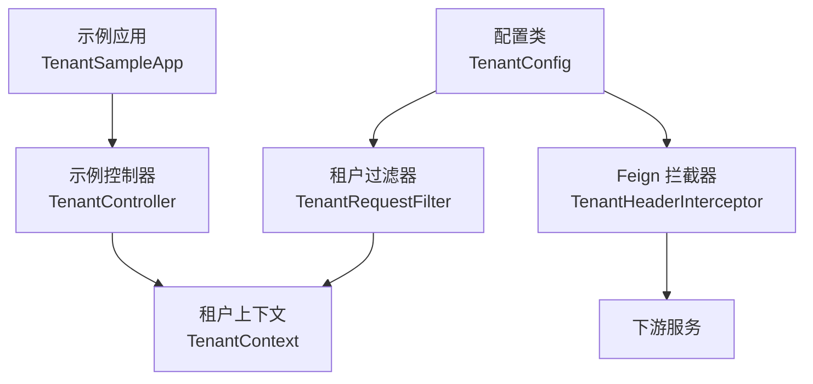
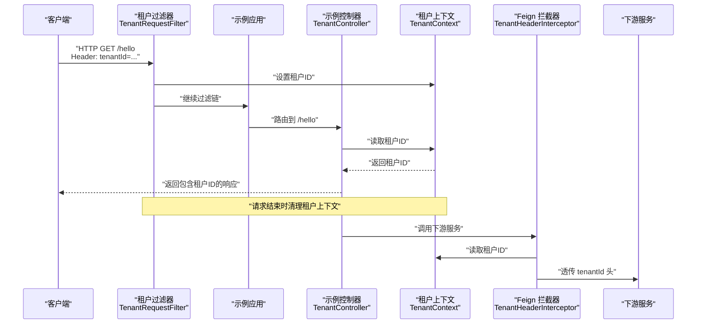
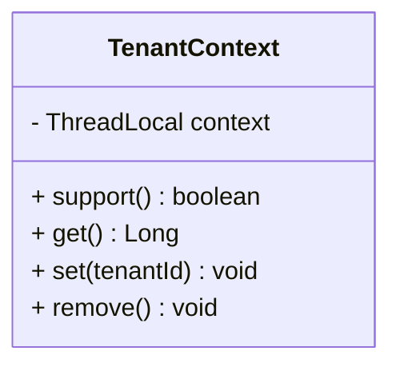
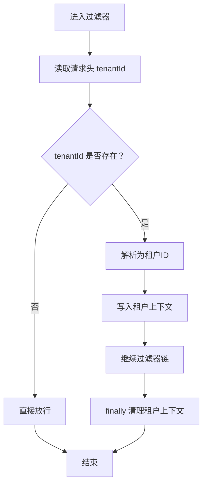
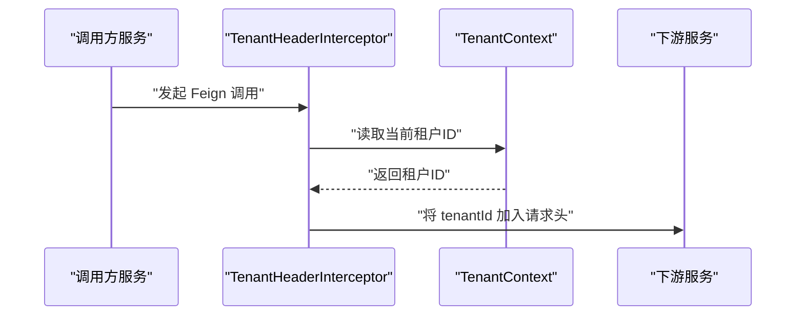
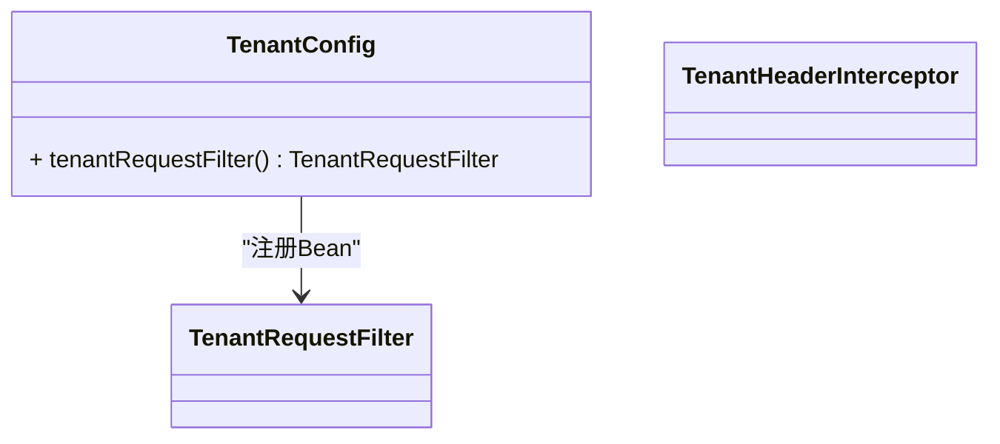
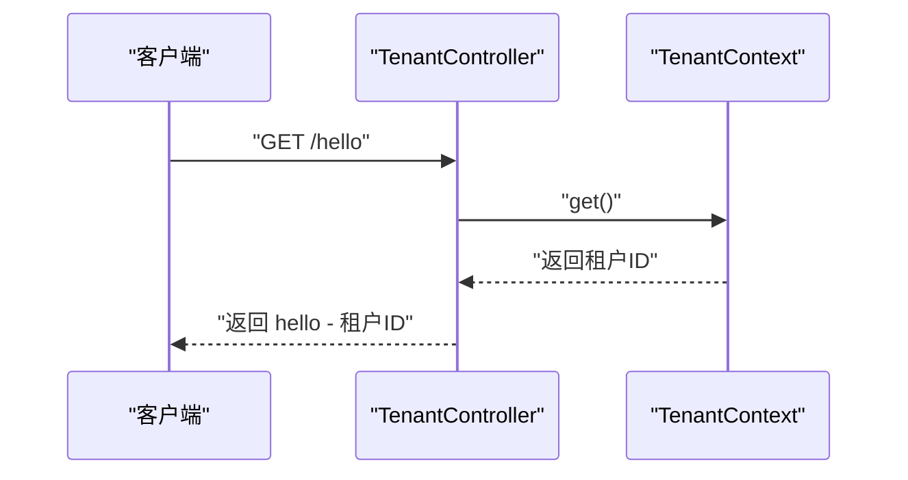
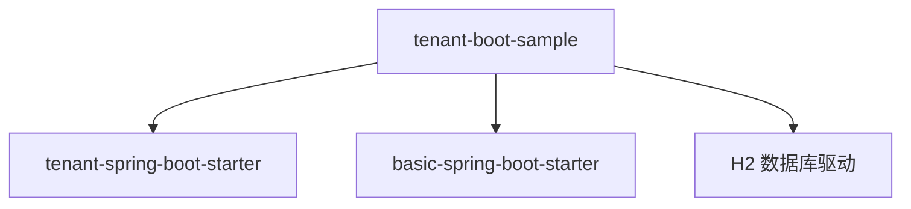
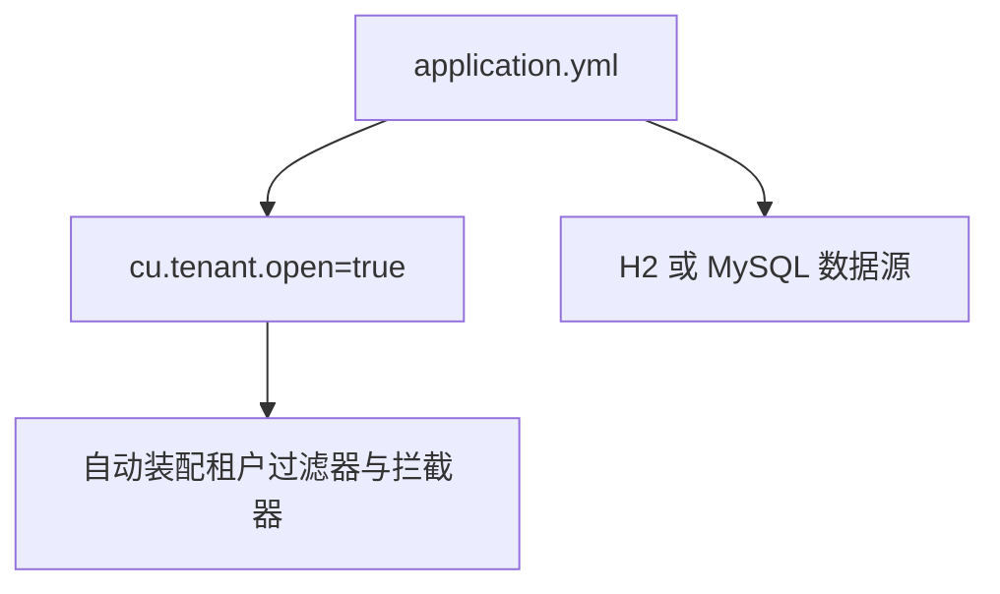

# 多租户示例

<cite>
**本文引用的文件**   
- [sample/tenant-boot-sample/pom.xml](file://sample/tenant-boot-sample/pom.xml)
- [sample/tenant-boot-sample/src/main/resources/application.yml](file://sample/tenant-boot-sample/src/main/resources/application.yml)
- [sample/tenant-boot-sample/src/main/java/com/cu/framework/sample/tenant/TenantSampleApp.java](file://sample/tenant-boot-sample/src/main/java/com/cu/framework/sample/tenant/TenantSampleApp.java)
- [sample/tenant-boot-sample/src/main/java/com/cu/framework/sample/tenant/controller/TenantController.java](file://sample/tenant-boot-sample/src/main/java/com/cu/framework/sample/tenant/controller/TenantController.java)
- [boot/tenant-spring-boot-starter/src/main/java/com/cu/framework/tenant/TenantContext.java](file://boot/tenant-spring-boot-starter/src/main/java/com/cu/framework/tenant/TenantContext.java)
- [boot/tenant-spring-boot-starter/src/main/java/com/cu/framework/tenant/TenantRequestFilter.java](file://boot/tenant-spring-boot-starter/src/main/java/com/cu/framework/tenant/TenantRequestFilter.java)
- [boot/tenant-spring-boot-starter/src/main/java/com/cu/framework/tenant/config/TenantConfig.java](file://boot/tenant-spring-boot-starter/src/main/java/com/cu/framework/tenant/config/TenantConfig.java)
- [boot/tenant-spring-boot-starter/src/main/java/com/cu/framework/tenant/TenantConstant.java](file://boot/tenant-spring-boot-starter/src/main/java/com/cu/framework/tenant/TenantConstant.java)
- [boot/tenant-spring-boot-starter/src/main/java/com/cu/framework/tenant/feign/TenantHeaderInterceptor.java](file://boot/tenant-spring-boot-starter/src/main/java/com/cu/framework/tenant/feign/TenantHeaderInterceptor.java)
- [boot/tenant-spring-boot-starter/src/main/resources/META-INF/spring.factories](file://boot/tenant-spring-boot-starter/src/main/resources/META-INF/spring.factories)
- [boot/tenant-spring-boot-starter/src/main/resources/META-INF/additional-spring-configuration-metadata.json](file://boot/tenant-spring-boot-starter/src/main/resources/META-INF/additional-spring-configuration-metadata.json)
</cite>

## 目录
1. [简介](#简介)
2. [项目结构](#项目结构)
3. [核心组件](#核心组件)
4. [架构总览](#架构总览)
5. [详细组件分析](#详细组件分析)
6. [依赖关系分析](#依赖关系分析)
7. [性能与部署注意事项](#性能与部署注意事项)
8. [故障排查指南](#故障排查指南)
9. [结论](#结论)

## 简介
本文件围绕 `tenant-boot-sample` 多租户示例，说明 Kewen Framework 如何通过 `tenant-spring-boot-starter` 提供多租户能力。示例工程演示了：
- 通过请求头携带租户标识；
- 在请求生命周期内维护线程级租户上下文；
- 业务接口直接读取当前租户标识；
- 使用 Feign 调用下游服务时自动透传租户头；
- 通过配置开关控制多租户功能是否启用。

该示例不直接访问数据库表，重点展示租户识别、上下文传递和横切处理流程。

## 项目结构
`tenant-boot-sample` 是一个最小可运行的 Spring Boot 示例模块，其职责是：
- 引入 `tenant-spring-boot-starter` 与基础启动器；
- 提供示例应用入口；
- 提供一个简单控制器，从租户上下文中读取当前租户 ID；
- 使用 H2 内存库或 MySQL Profile 满足数据源前置条件；
- 通过 `cu.tenant.open=true` 开启多租户相关自动装配。

**图表来源**
- [sample/tenant-boot-sample/src/main/java/com/cu/framework/sample/tenant/TenantSampleApp.java:1-21](file://sample/tenant-boot-sample/src/main/java/com/cu/framework/sample/tenant/TenantSampleApp.java#L1-L21)
- [sample/tenant-boot-sample/src/main/java/com/cu/framework/sample/tenant/controller/TenantController.java:1-26](file://sample/tenant-boot-sample/src/main/java/com/cu/framework/sample/tenant/controller/TenantController.java#L1-L26)
- [boot/tenant-spring-boot-starter/src/main/java/com/cu/framework/tenant/TenantContext.java:1-43](file://boot/tenant-spring-boot-starter/src/main/java/com/cu/framework/tenant/TenantContext.java#L1-L43)
- [boot/tenant-spring-boot-starter/src/main/java/com/cu/framework/tenant/TenantRequestFilter.java:1-46](file://boot/tenant-spring-boot-starter/src/main/java/com/cu/framework/tenant/TenantRequestFilter.java#L1-L46)
- [boot/tenant-spring-boot-starter/src/main/java/com/cu/framework/tenant/feign/TenantHeaderInterceptor.java:1-36](file://boot/tenant-spring-boot-starter/src/main/java/com/cu/framework/tenant/feign/TenantHeaderInterceptor.java#L1-L36)
- [boot/tenant-spring-boot-starter/src/main/java/com/cu/framework/tenant/config/TenantConfig.java:1-22](file://boot/tenant-spring-boot-starter/src/main/java/com/cu/framework/tenant/config/TenantConfig.java#L1-L22)

**章节来源**
- [sample/tenant-boot-sample/pom.xml:1-42](file://sample/tenant-boot-sample/pom.xml#L1-L42)
- [sample/tenant-boot-sample/src/main/resources/application.yml:1-37](file://sample/tenant-boot-sample/src/main/resources/application.yml#L1-L37)

## 核心组件
- `TenantSampleApp`：示例应用的 Spring Boot 启动类。
- `TenantController`：示例接口 `/hello`，从 `TenantContext` 获取当前租户 ID 并返回。
- `TenantContext`：基于 `InheritableThreadLocal` 的线程级租户上下文，提供判断、设置、获取、清除方法。
- `TenantRequestFilter`：在请求进入业务前解析请求头中的租户 ID，写入上下文并在请求结束后清理。
- `TenantConfig`：根据 `cu.tenant.open=true` 注册过滤器与 Feign 拦截器。
- `TenantHeaderInterceptor`：在 Feign 发起远程调用前，把当前租户 ID 注入到请求头中传递给下游服务。
- `TenantConstant`：定义租户头常量，值为 `tenantId`。
- `spring.factories`：声明自动装配入口，加载 `TenantConfig` 与 `TenantHeaderInterceptor`。
- `additional-spring-configuration-metadata.json`：暴露 `cu.tenant.open` 配置元信息。

**章节来源**
- [sample/tenant-boot-sample/src/main/java/com/cu/framework/sample/tenant/TenantSampleApp.java:1-21](file://sample/tenant-boot-sample/src/main/java/com/cu/framework/sample/tenant/TenantSampleApp.java#L1-L21)
- [sample/tenant-boot-sample/src/main/java/com/cu/framework/sample/tenant/controller/TenantController.java:1-26](file://sample/tenant-boot-sample/src/main/java/com/cu/framework/sample/tenant/controller/TenantController.java#L1-L26)
- [boot/tenant-spring-boot-starter/src/main/java/com/cu/framework/tenant/TenantContext.java:1-43](file://boot/tenant-spring-boot-starter/src/main/java/com/cu/framework/tenant/TenantContext.java#L1-L43)
- [boot/tenant-spring-boot-starter/src/main/java/com/cu/framework/tenant/TenantRequestFilter.java:1-46](file://boot/tenant-spring-boot-starter/src/main/java/com/cu/framework/tenant/TenantRequestFilter.java#L1-L46)
- [boot/tenant-spring-boot-starter/src/main/java/com/cu/framework/tenant/config/TenantConfig.java:1-22](file://boot/tenant-spring-boot-starter/src/main/java/com/cu/framework/tenant/config/TenantConfig.java#L1-L22)
- [boot/tenant-spring-boot-starter/src/main/java/com/cu/framework/tenant/feign/TenantHeaderInterceptor.java:1-36](file://boot/tenant-spring-boot-starter/src/main/java/com/cu/framework/tenant/feign/TenantHeaderInterceptor.java#L1-L36)
- [boot/tenant-spring-boot-starter/src/main/java/com/cu/framework/tenant/TenantConstant.java:1-11](file://boot/tenant-spring-boot-starter/src/main/java/com/cu/framework/tenant/TenantConstant.java#L1-L11)
- [boot/tenant-spring-boot-starter/src/main/resources/META-INF/spring.factories:1-3](file://boot/tenant-spring-boot-starter/src/main/resources/META-INF/spring.factories#L1-L3)
- [boot/tenant-spring-boot-starter/src/main/resources/META-INF/additional-spring-configuration-metadata.json:1-10](file://boot/tenant-spring-boot-starter/src/main/resources/META-INF/additional-spring-configuration-metadata.json#L1-L10)

## 架构总览
下图展示了示例请求在多租户框架中的完整流转过程：客户端发送带 `tenantId` 的请求，过滤器解析并写入线程上下文，业务控制器读取上下文返回结果；若业务代码调用下游服务，Feign 拦截器会把租户头继续透传给下游。

**图表来源**
- [boot/tenant-spring-boot-starter/src/main/java/com/cu/framework/tenant/TenantRequestFilter.java:1-46](file://boot/tenant-spring-boot-starter/src/main/java/com/cu/framework/tenant/TenantRequestFilter.java#L1-L46)
- [sample/tenant-boot-sample/src/main/java/com/cu/framework/sample/tenant/controller/TenantController.java:1-26](file://sample/tenant-boot-sample/src/main/java/com/cu/framework/sample/tenant/controller/TenantController.java#L1-L26)
- [boot/tenant-spring-boot-starter/src/main/java/com/cu/framework/tenant/TenantContext.java:1-43](file://boot/tenant-spring-boot-starter/src/main/java/com/cu/framework/tenant/TenantContext.java#L1-L43)
- [boot/tenant-spring-boot-starter/src/main/java/com/cu/framework/tenant/feign/TenantHeaderInterceptor.java:1-36](file://boot/tenant-spring-boot-starter/src/main/java/com/cu/framework/tenant/feign/TenantHeaderInterceptor.java#L1-L36)

## 详细组件分析

### 租户上下文 `TenantContext`
`TenantContext` 是租户隔离的核心抽象。它使用可继承的线程本地变量保存当前线程的租户 ID，并提供以下能力：
- `support()`：判断当前线程是否已设置租户 ID；
- `get()`：获取当前租户 ID；
- `set(Long)`：设置当前租户 ID；
- `remove()`：清理当前租户 ID。

由于使用 `InheritableThreadLocal`，异步子线程通常能继承父线程的租户上下文，但具体行为仍取决于线程池实现与任务提交方式。

**图表来源**
- [boot/tenant-spring-boot-starter/src/main/java/com/cu/framework/tenant/TenantContext.java:1-43](file://boot/tenant-spring-boot-starter/src/main/java/com/cu/framework/tenant/TenantContext.java#L1-L43)

**章节来源**
- [boot/tenant-spring-boot-starter/src/main/java/com/cu/framework/tenant/TenantContext.java:1-43](file://boot/tenant-spring-boot-starter/src/main/java/com/cu/framework/tenant/TenantContext.java#L1-L43)

### 租户识别过滤器 `TenantRequestFilter`
`TenantRequestFilter` 实现了早期请求过滤器接口，并按较低顺序执行。其主要逻辑为：
1. 从请求头读取 `tenantId`；
2. 如果请求头非空，则解析为长整型并写入 `TenantContext`；
3. 在业务处理完成后，确保清理 `TenantContext`；
4. 如果请求头为空，则直接放行，不设置租户上下文。

这保证了同一请求生命周期内的线程都能看到相同的租户 ID，且不会泄漏到其他请求。

**图表来源**
- [boot/tenant-spring-boot-starter/src/main/java/com/cu/framework/tenant/TenantRequestFilter.java:1-46](file://boot/tenant-spring-boot-starter/src/main/java/com/cu/framework/tenant/TenantRequestFilter.java#L1-L46)
- [boot/tenant-spring-boot-starter/src/main/java/com/cu/framework/tenant/TenantConstant.java:1-11](file://boot/tenant-spring-boot-starter/src/main/java/com/cu/framework/tenant/TenantConstant.java#L1-L11)

**章节来源**
- [boot/tenant-spring-boot-starter/src/main/java/com/cu/framework/tenant/TenantRequestFilter.java:1-46](file://boot/tenant-spring-boot-starter/src/main/java/com/cu/framework/tenant/TenantRequestFilter.java#L1-L46)
- [boot/tenant-spring-boot-starter/src/main/java/com/cu/framework/tenant/TenantConstant.java:1-11](file://boot/tenant-spring-boot-starter/src/main/java/com/cu/framework/tenant/TenantConstant.java#L1-L11)

### Feign 透传拦截器 `TenantHeaderInterceptor`
当业务代码通过 Feign 调用下游服务时，`TenantHeaderInterceptor` 会：
- 检查当前 `TenantContext` 中是否存在租户 ID；
- 如果存在，则将租户 ID 写入 Feign 请求头 `tenantId`；
- 这样下游服务同样可以从请求头中识别租户。

该拦截器仅在同时满足以下条件时生效：
- 配置项 `cu.tenant.open=true`；
- 类路径中存在 Feign 类。

**图表来源**
- [boot/tenant-spring-boot-starter/src/main/java/com/cu/framework/tenant/feign/TenantHeaderInterceptor.java:1-36](file://boot/tenant-spring-boot-starter/src/main/java/com/cu/framework/tenant/feign/TenantHeaderInterceptor.java#L1-L36)
- [boot/tenant-spring-boot-starter/src/main/java/com/cu/framework/tenant/TenantContext.java:1-43](file://boot/tenant-spring-boot-starter/src/main/java/com/cu/framework/tenant/TenantContext.java#L1-L43)
- [boot/tenant-spring-boot-starter/src/main/java/com/cu/framework/tenant/TenantConstant.java:1-11](file://boot/tenant-spring-boot-starter/src/main/java/com/cu/framework/tenant/TenantConstant.java#L1-L11)

**章节来源**
- [boot/tenant-spring-boot-starter/src/main/java/com/cu/framework/tenant/feign/TenantHeaderInterceptor.java:1-36](file://boot/tenant-spring-boot-starter/src/main/java/com/cu/framework/tenant/feign/TenantHeaderInterceptor.java#L1-L36)

### 自动装配配置 `TenantConfig`
`TenantConfig` 是租户功能的装配中心，关键特性包括：
- 使用 `@ConditionalOnProperty(name = "cu.tenant.open", havingValue = "true")` 控制是否启用；
- 注册 `TenantRequestFilter` Bean；
- 与 `TenantHeaderInterceptor` 一起通过 `spring.factories` 自动装配。

这意味着示例应用只需要在配置文件中开启 `cu.tenant.open=true`，就能获得请求级租户识别与 Feign 透传能力。

**图表来源**
- [boot/tenant-spring-boot-starter/src/main/java/com/cu/framework/tenant/config/TenantConfig.java:1-22](file://boot/tenant-spring-boot-starter/src/main/java/com/cu/framework/tenant/config/TenantConfig.java#L1-L22)
- [boot/tenant-spring-boot-starter/src/main/java/com/cu/framework/tenant/TenantRequestFilter.java:1-46](file://boot/tenant-spring-boot-starter/src/main/java/com/cu/framework/tenant/TenantRequestFilter.java#L1-L46)
- [boot/tenant-spring-boot-starter/src/main/java/com/cu/framework/tenant/feign/TenantHeaderInterceptor.java:1-36](file://boot/tenant-spring-boot-starter/src/main/java/com/cu/framework/tenant/feign/TenantHeaderInterceptor.java#L1-L36)

**章节来源**
- [boot/tenant-spring-boot-starter/src/main/java/com/cu/framework/tenant/config/TenantConfig.java:1-22](file://boot/tenant-spring-boot-starter/src/main/java/com/cu/framework/tenant/config/TenantConfig.java#L1-L22)
- [boot/tenant-spring-boot-starter/src/main/resources/META-INF/spring.factories:1-3](file://boot/tenant-spring-boot-starter/src/main/resources/META-INF/spring.factories#L1-L3)

### 示例控制器 `TenantController`
`TenantController` 提供了一个极简接口 `/hello`，用于验证租户上下文是否正常工作：
- 接口读取 `TenantContext.get()`；
- 返回包含租户 ID 的字符串。

这是理解多租户工作方式的入口点：只要客户端请求头携带 `tenantId`，业务层就能拿到当前租户标识。

**图表来源**
- [sample/tenant-boot-sample/src/main/java/com/cu/framework/sample/tenant/controller/TenantController.java:1-26](file://sample/tenant-boot-sample/src/main/java/com/cu/framework/sample/tenant/controller/TenantController.java#L1-L26)
- [boot/tenant-spring-boot-starter/src/main/java/com/cu/framework/tenant/TenantContext.java:1-43](file://boot/tenant-spring-boot-starter/src/main/java/com/cu/framework/tenant/TenantContext.java#L1-L43)

**章节来源**
- [sample/tenant-boot-sample/src/main/java/com/cu/framework/sample/tenant/controller/TenantController.java:1-26](file://sample/tenant-boot-sample/src/main/java/com/cu/framework/sample/tenant/controller/TenantController.java#L1-L26)

### 示例应用 `TenantSampleApp`
`TenantSampleApp` 是示例工程的 Spring Boot 启动类，主要作用是：
- 标注 `@SpringBootApplication`；
- 作为程序入口调用 `SpringApplication.run`。

该示例没有复杂初始化逻辑，重点在于依赖 `tenant-spring-boot-starter` 后由框架完成租户能力的装配。

**章节来源**
- [sample/tenant-boot-sample/src/main/java/com/cu/framework/sample/tenant/TenantSampleApp.java:1-21](file://sample/tenant-boot-sample/src/main/java/com/cu/framework/sample/tenant/TenantSampleApp.java#L1-L21)

## 依赖关系分析
示例模块的 Maven 依赖表明：
- 引入 `tenant-spring-boot-starter`，获得多租户能力；
- 引入 `basic-spring-boot-starter`，获得基础能力；
- 引入 H2 内存数据库驱动，仅为了满足 MyBatis Plus 启动所需的数据源前提，示例本身不操作任何表。

**图表来源**
- [sample/tenant-boot-sample/pom.xml:1-42](file://sample/tenant-boot-sample/pom.xml#L1-L42)

**章节来源**
- [sample/tenant-boot-sample/pom.xml:1-42](file://sample/tenant-boot-sample/pom.xml#L1-L42)

## 性能与部署注意事项

### 多租户设计原理
当前示例采用“请求头识别 + 线程上下文”的多租户模型：
- 租户识别策略：从 HTTP 请求头 `tenantId` 中读取租户标识；
- 数据隔离机制：示例未实现数据库级隔离，只演示如何在业务层感知租户；
- 上下文传播：通过 `TenantContext` 在请求链路中共享租户信息；
- 跨服务传播：通过 Feign 拦截器将租户头透传到下游服务。

这种模式适合轻量级 SaaS 场景，尤其是租户数量不多、允许单库多表或单库单表的系统。

### 配置方法
示例通过配置文件开启多租户：
- 全局开关：`cu.tenant.open=true`；
- 默认使用 H2 Profile，也可切换到 MySQL Profile；
- 数据源只是启动前提，示例不执行建表脚本。

**图表来源**
- [sample/tenant-boot-sample/src/main/resources/application.yml:1-37](file://sample/tenant-boot-sample/src/main/resources/application.yml#L1-L37)
- [boot/tenant-spring-boot-starter/src/main/java/com/cu/framework/tenant/config/TenantConfig.java:1-22](file://boot/tenant-spring-boot-starter/src/main/java/com/cu/framework/tenant/config/TenantConfig.java#L1-L22)
- [boot/tenant-spring-boot-starter/src/main/resources/META-INF/additional-spring-configuration-metadata.json:1-10](file://boot/tenant-spring-boot-starter/src/main/resources/META-INF/additional-spring-configuration-metadata.json#L1-L10)

**章节来源**
- [sample/tenant-boot-sample/src/main/resources/application.yml:1-37](file://sample/tenant-boot-sample/src/main/resources/application.yml#L1-L37)
- [boot/tenant-spring-boot-starter/src/main/resources/META-INF/additional-spring-configuration-metadata.json:1-10](file://boot/tenant-spring-boot-starter/src/main/resources/META-INF/additional-spring-configuration-metadata.json#L1-L10)

### 业务代码中使用租户上下文
在业务代码中，应遵循以下原则：
- 优先通过 `TenantContext.get()` 获取当前租户 ID；
- 不要在业务层手动设置租户 ID，除非是后台管理任务；
- 对异步任务、消息消费者、定时任务等场景，需要显式传递租户 ID；
- 所有可能修改线程状态的地方，都应确保清理 `TenantContext`。

### 数据隔离策略建议
虽然示例没有实现数据库隔离，但在实际系统中可按租户规模选择策略：
- 单库单表加租户字段：最简单，适合中小租户规模；
- 单库多表按租户命名：中等复杂度，便于定位租户数据；
- 分库分表：适合大规模租户场景；
- 独立数据库实例：最强隔离，适合强合规和多租户租户隔离需求。

### 横切关注点
- 权限控制：可在过滤器或拦截器中结合用户身份与租户 ID 进行权限校验；
- 日志记录：建议在日志中记录租户 ID，便于问题追踪；
- 监控告警：可对无租户头、非法租户 ID、租户切换异常等事件埋点；
- 审计：记录租户相关操作，包括创建、切换、删除等生命周期事件。

### 性能优化建议
- 避免在高频路径中重复解析租户 ID；
- 对租户上下文访问做必要校验，但不要引入昂贵逻辑；
- 合理设置线程池，避免线程复用导致上下文污染；
- 对于跨服务调用，尽量复用连接池并减少额外序列化开销；
- 对租户相关配置进行缓存，避免频繁 IO。

### 部署注意事项
- 生产环境务必关闭测试用的 H2 Profile，改用真实数据库；
- 确保上游网关或认证系统在进入业务服务前正确注入 `tenantId`；
- 若使用微服务架构，需保证下游服务也启用租户透传；
- 对租户相关错误统一处理，避免泄露敏感信息；
- 定期审查线程池与异步任务中的租户上下文传播是否正确。

## 故障排查指南

### 常见问题
- 接口返回租户 ID 为空：
  - 检查请求是否携带 `tenantId` 请求头；
  - 确认 `cu.tenant.open=true` 已启用；
  - 检查过滤器是否被其他组件提前拦截或禁用。

- 下游服务拿不到租户 ID：
  - 检查下游服务是否启用 `tenant-spring-boot-starter`；
  - 检查 Feign 调用链路中是否丢失租户头；
  - 确认下游服务过滤器能读取 `tenantId`。

- 异步任务租户上下文丢失：
  - 检查异步线程池是否支持继承 `InheritableThreadLocal`；
  - 在任务提交前显式传递租户 ID；
  - 避免在线程池中混用不同租户的任务。

- 数据源启动失败：
  - 示例依赖 `basic-spring-boot-starter`，间接引入 MyBatis Plus，因此数据源是启动前提；
  - 开发环境可使用 H2，生产环境请配置真实数据库；
  - 注意 Profile 激活参数是否正确。

**章节来源**
- [sample/tenant-boot-sample/src/main/resources/application.yml:1-37](file://sample/tenant-boot-sample/src/main/resources/application.yml#L1-L37)
- [boot/tenant-spring-boot-starter/src/main/java/com/cu/framework/tenant/TenantRequestFilter.java:1-46](file://boot/tenant-spring-boot-starter/src/main/java/com/cu/framework/tenant/TenantRequestFilter.java#L1-L46)
- [boot/tenant-spring-boot-starter/src/main/java/com/cu/framework/tenant/feign/TenantHeaderInterceptor.java:1-36](file://boot/tenant-spring-boot-starter/src/main/java/com/cu/framework/tenant/feign/TenantHeaderInterceptor.java#L1-L36)

## 结论
`tenant-boot-sample` 是一个简洁而完整的 Kewen Framework 多租户示例。它通过请求头识别租户、线程上下文传播租户、Feign 透传租户头，展示了多租户在 Web 请求中的基本工作方式。实际项目中，可以在这个基础上扩展：
- 增加租户元数据管理；
- 实现更严格的数据隔离；
- 集成权限系统与审计日志；
- 完善监控与告警；
- 针对高并发和异步场景优化线程上下文传播。

该示例适合作为接入多租户能力的起点，帮助开发者快速理解租户识别、上下文管理与跨服务传播的核心思路。