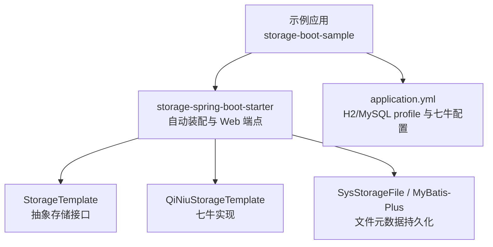
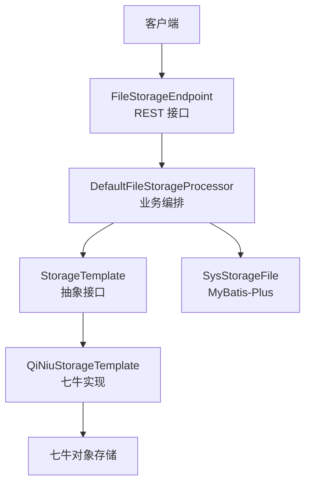
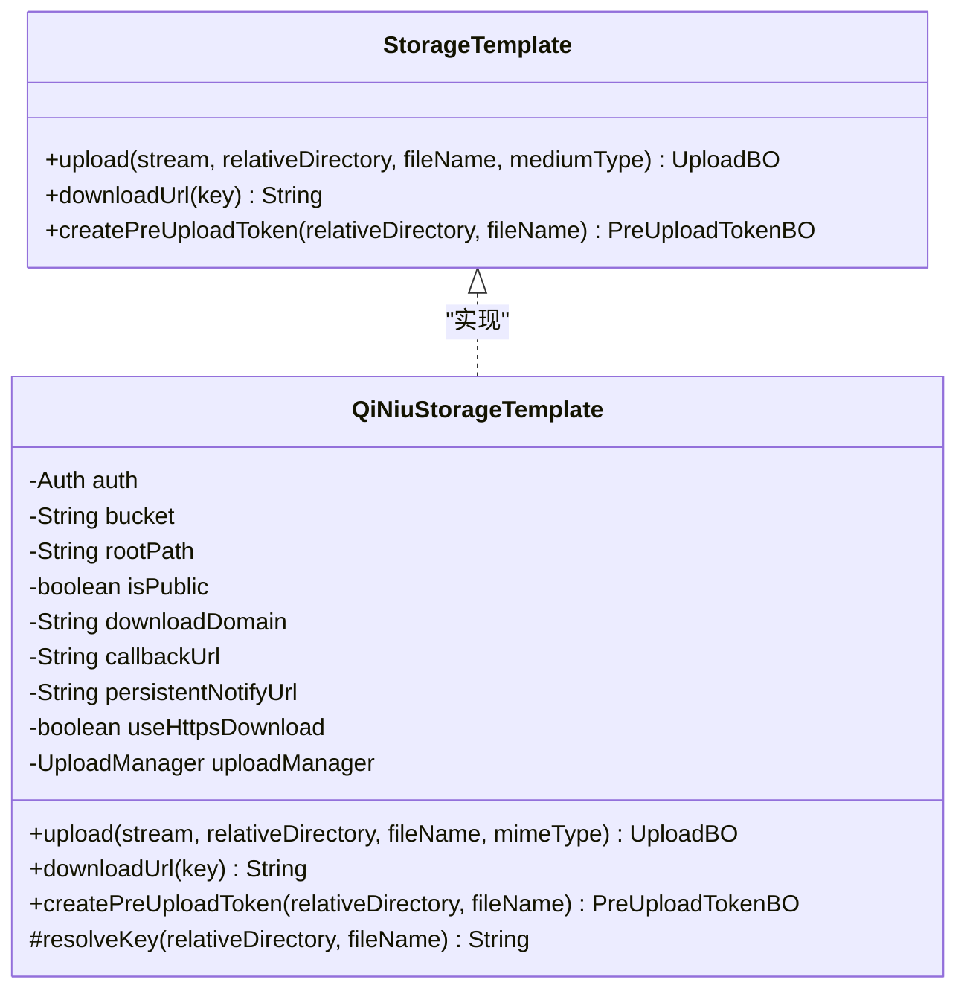
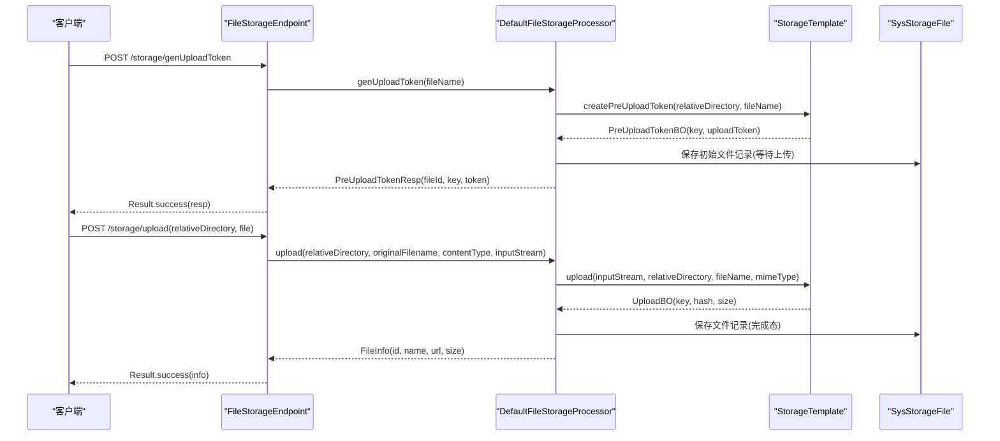
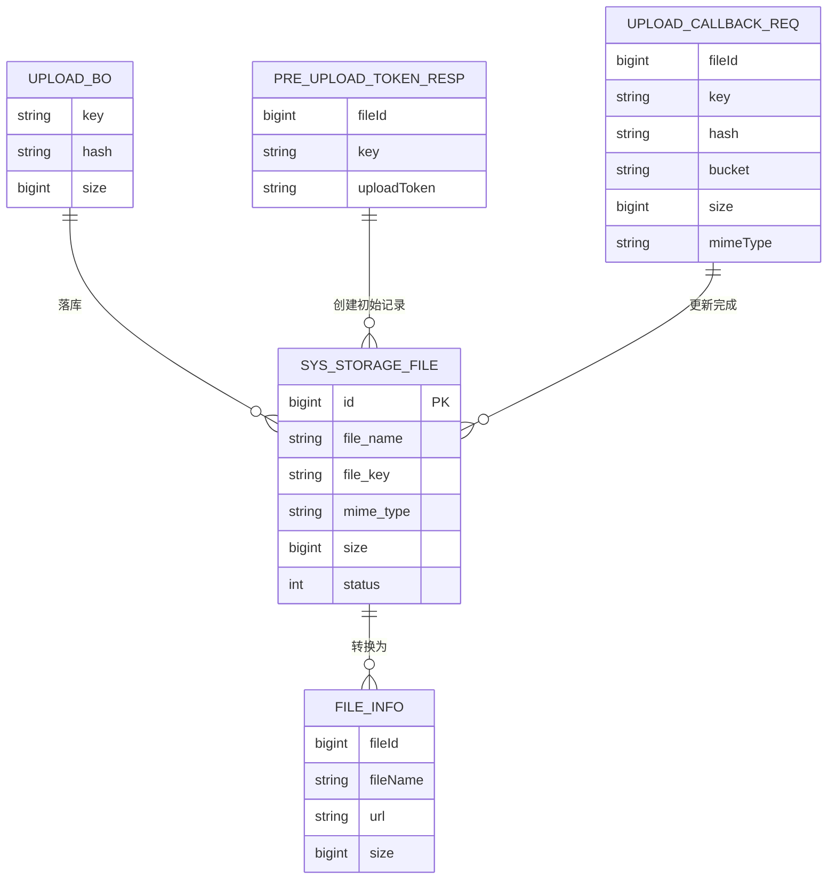
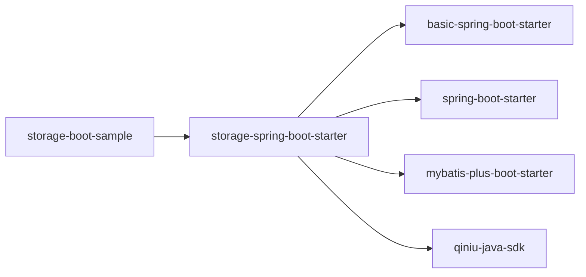
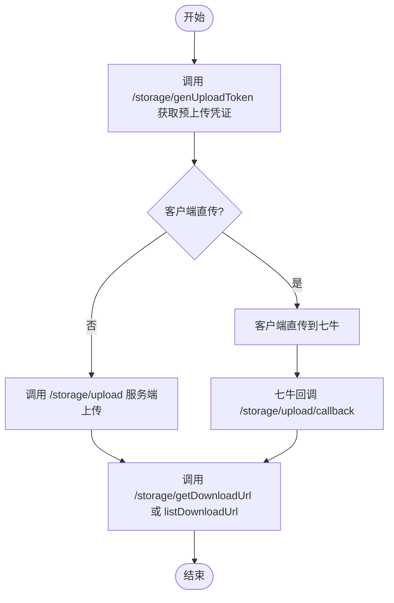

# 文件存储示例

<cite>
**本文引用的文件**   
- [sample/storage-boot-sample/pom.xml](file://sample/storage-boot-sample/pom.xml)
- [sample/storage-boot-sample/src/main/java/com/cu/framework/sample/storage/StorageBootSample.java](file://sample/storage-boot-sample/src/main/java/com/cu/framework/sample/storage/StorageBootSample.java)
- [sample/storage-boot-sample/src/main/resources/application.yml](file://sample/storage-boot-sample/src/main/resources/application.yml)
- [boot/storage-spring-boot-starter/pom.xml](file://boot/storage-spring-boot-starter/pom.xml)
- [boot/storage-spring-boot-starter/README.md](file://boot/storage-spring-boot-starter/README.md)
- [boot/storage-spring-boot-starter/src/main/java/com/cu/framework/storage/boot/StorageAutoConfiguration.java](file://boot/storage-spring-boot-starter/src/main/java/com/cu/framework/storage/boot/StorageAutoConfiguration.java)
- [boot/storage-spring-boot-starter/src/main/java/com/cu/framework/storage/boot/StorageProperties.java](file://boot/storage-spring-boot-starter/src/main/java/com/cu/framework/storage/boot/StorageProperties.java)
- [boot/storage-spring-boot-starter/src/main/java/com/cu/framework/storage/core/StorageTemplate.java](file://boot/storage-spring-boot-starter/src/main/java/com/cu/framework/storage/core/StorageTemplate.java)
- [boot/storage-spring-boot-starter/src/main/java/com/cu/framework/storage/core/qiniu/QiNiuStorageTemplate.java](file://boot/storage-spring-boot-starter/src/main/java/com/cu/framework/storage/core/qiniu/QiNiuStorageTemplate.java)
- [boot/storage-spring-boot-starter/src/main/java/com/cu/framework/storage/web/FileStorageEndpoint.java](file://boot/storage-spring-boot-starter/src/main/java/com/cu/framework/storage/web/FileStorageEndpoint.java)
- [boot/storage-spring-boot-starter/src/main/java/com/cu/framework/storage/web/FileStorageCallbackEndpoint.java](file://boot/storage-spring-boot-starter/src/main/java/com/cu/framework/storage/web/FileStorageCallbackEndpoint.java)
- [boot/storage-spring-boot-starter/src/main/java/com/cu/framework/storage/web/FileStorageProcessor.java](file://boot/storage-spring-boot-starter/src/main/java/com/cu/framework/storage/web/FileStorageProcessor.java)
- [boot/storage-spring-boot-starter/src/main/java/com/cu/framework/storage/web/impl/DefaultFileStorageProcessor.java](file://boot/storage-spring-boot-starter/src/main/java/com/cu/framework/storage/web/impl/DefaultFileStorageProcessor.java)
- [boot/storage-spring-boot-starter/src/main/java/com/cu/framework/storage/core/model/FileInfo.java](file://boot/storage-spring-boot-starter/src/main/java/com/cu/framework/storage/core/model/FileInfo.java)
- [boot/storage-spring-boot-starter/src/main/java/com/cu/framework/storage/core/model/UploadBO.java](file://boot/storage-spring-boot-starter/src/main/java/com/cu/framework/storage/core/model/UploadBO.java)
- [boot/storage-spring-boot-starter/src/main/java/com/cu/framework/storage/web/mp/entity/SysStorageFile.java](file://boot/storage-spring-boot-starter/src/main/java/com/cu/framework/storage/web/mp/entity/SysStorageFile.java)
- [boot/storage-spring-boot-starter/src/main/java/com/cu/framework/storage/web/model/PreUploadTokenReq.java](file://boot/storage-spring-boot-starter/src/main/java/com/cu/framework/storage/web/model/PreUploadTokenReq.java)
- [boot/storage-spring-boot-starter/src/main/java/com/cu/framework/storage/web/model/PreUploadTokenResp.java](file://boot/storage-spring-boot-starter/src/main/java/com/storage-spring-boot-starter/src/main/java/com/cu/framework/storage/web/model/PreUploadTokenResp.java)
- [boot/storage-spring-boot-starter/src/main/java/com/cu/framework/storage/web/model/UploadCallbackReq.java](file://boot/storage-spring-boot-starter/src/main/java/com/cu/framework/storage/web/model/UploadCallbackReq.java)
- [boot/storage-spring-boot-starter/src/test/java/com/cu/framework/storage/core/qiniu/QiNiuStorageTemplateTest.java](file://boot/storage-spring-boot-starter/src/test/java/com/cu/framework/storage/core/qiniu/QiNiuStorageTemplateTest.java)
</cite>

## 目录
1. [引言](#引言)
2. [项目结构](#项目结构)
3. [核心组件](#核心组件)
4. [架构总览](#架构总览)
5. [详细组件分析](#详细组件分析)
6. [依赖关系分析](#依赖关系分析)
7. [性能与扩展性](#性能与扩展性)
8. [配置指南](#配置指南)
9. [使用流程与最佳实践](#使用流程与最佳实践)
10. [故障排查](#故障排查)
11. [结论](#结论)

## 引言
本文件围绕 `storage-boot-sample` 示例工程，系统性说明 Kewen Framework 中 `storage-spring-boot-starter` 提供的文件存储能力。该示例演示如何引入存储自动装配、通过配置接入七牛云存储、调用 REST 接口完成上传下载、以及处理上传回调和文件元数据记录。文档同时解释存储适配器设计模式、`StorageTemplate` 的调用方式、分片上传与断点续传支持、大文件与并发上传注意事项，以及如何扩展自定义存储后端。

## 项目结构
`storage-boot-sample` 是一个最小可运行的 Spring Boot 示例应用，主要职责是：
- 引入 `storage-spring-boot-starter`，获得文件存储相关的 Bean、Web 端点和数据库映射能力。
- 提供 `application.yml`，演示默认 H2 内存库与 MySQL profile 的数据源切换，以及七牛云存储的配置项。
- 提供一个启动类，用于运行整个示例服务。

**图表来源**
- [sample/storage-boot-sample/pom.xml:1-38](file://sample/storage-boot-sample/pom.xml#L1-L38)
- [sample/storage-boot-sample/src/main/java/com/cu/framework/sample/storage/StorageBootSample.java:1-22](file://sample/storage-boot-sample/src/main/java/com/cu/framework/sample/storage/StorageBootSample.java#L1-L22)
- [sample/storage-boot-sample/src/main/resources/application.yml:1-55](file://sample/storage-boot-sample/src/main/resources/application.yml#L1-L55)
- [boot/storage-spring-boot-starter/src/main/java/com/cu/framework/storage/boot/StorageAutoConfiguration.java:1-100](file://boot/storage-spring-boot-starter/src/main/java/com/cu/framework/storage/boot/StorageAutoConfiguration.java#L1-L100)
- [boot/storage-spring-boot-starter/src/main/java/com/cu/framework/storage/core/StorageTemplate.java:1-23](file://boot/storage-spring-boot-starter/src/main/java/com/cu/framework/storage/core/StorageTemplate.java#L1-L23)
- [boot/storage-spring-boot-starter/src/main/java/com/cu/framework/storage/core/qiniu/QiNiuStorageTemplate.java:1-218](file://boot/storage-spring-boot-starter/src/main/java/com/cu/framework/storage/core/qiniu/QiNiuStorageTemplate.java#L1-L218)
- [boot/storage-spring-boot-starter/src/main/java/com/cu/framework/storage/web/mp/entity/SysStorageFile.java:1-74](file://boot/storage-spring-boot-starter/src/main/java/com/cu/framework/storage/web/mp/entity/SysStorageFile.java#L1-L74)

**章节来源**
- [sample/storage-boot-sample/pom.xml:1-38](file://sample/storage-boot-sample/pom.xml#L1-L38)
- [sample/storage-boot-sample/src/main/java/com/cu/framework/sample/storage/StorageBootSample.java:1-22](file://sample/storage-boot-sample/src/main/java/com/cu/framework/sample/storage/StorageBootSample.java#L1-L22)
- [sample/storage-boot-sample/src/main/resources/application.yml:1-55](file://sample/storage-boot-sample/src/main/resources/application.yml#L1-L55)

## 核心组件
- `StorageTemplate`：定义文件传输的抽象接口，包括服务端流式上传、生成下载链接、客户端直传凭证创建。
- `QiNiuStorageTemplate`：基于七牛 SDK 的具体实现，负责上传凭证、对象 key 拼接、V2 分片上传、HTTPS 域名、公开或私有空间签名下载等。
- `FileStorageEndpoint`：对外暴露的文件存储 REST 接口，包括生成上传凭证、服务端上传、获取单个或批量文件下载信息。
- `FileStorageCallbackEndpoint`：处理七牛上传成功回调、按 ID 查询文件下载信息，以及异步回调入口占位。
- `FileStorageProcessor` 与 `DefaultFileStorageProcessor`：业务编排层，协调存储模板与文件元数据持久化。
- `SysStorageFile`：文件元数据实体，对应数据库表，记录文件名、key、MIME、大小、状态等。
- `StorageAutoConfiguration` 与 `StorageProperties`：Spring Boot 自动装配与配置属性绑定，构建 `QiNiuStorageTemplate` 并注册控制器与服务。

**章节来源**
- [boot/storage-spring-boot-starter/src/main/java/com/cu/framework/storage/core/StorageTemplate.java:1-23](file://boot/storage-spring-boot-starter/src/main/java/com/cu/framework/storage/core/StorageTemplate.java#L1-L23)
- [boot/storage-spring-boot-starter/src/main/java/com/cu/framework/storage/core/qiniu/QiNiuStorageTemplate.java:1-218](file://boot/storage-spring-boot-starter/src/main/java/com/cu/framework/storage/core/qiniu/QiNiuStorageTemplate.java#L1-L218)
- [boot/storage-spring-boot-starter/src/main/java/com/cu/framework/storage/web/FileStorageEndpoint.java:1-98](file://boot/storage-spring-boot-starter/src/main/java/com/cu/framework/storage/web/FileStorageEndpoint.java#L1-L98)
- [boot/storage-spring-boot-starter/src/main/java/com/cu/framework/storage/web/FileStorageCallbackEndpoint.java:1-70](file://boot/storage-spring-boot-starter/src/main/java/com/cu/framework/storage/web/FileStorageCallbackEndpoint.java#L1-L70)
- [boot/storage-spring-boot-starter/src/main/java/com/cu/framework/storage/web/FileStorageProcessor.java:1-54](file://boot/storage-spring-boot-starter/src/main/java/com/cu/framework/storage/web/FileStorageProcessor.java#L1-L54)
- [boot/storage-spring-boot-starter/src/main/java/com/cu/framework/storage/web/impl/DefaultFileStorageProcessor.java:1-122](file://boot/storage-spring-boot-starter/src/main/java/com/cu/framework/storage/web/impl/DefaultFileStorageProcessor.java#L1-L122)
- [boot/storage-spring-boot-starter/src/main/java/com/cu/framework/storage/web/mp/entity/SysStorageFile.java:1-74](file://boot/storage-spring-boot-starter/src/main/java/com/cu/framework/storage/web/mp/entity/SysStorageFile.java#L1-L74)
- [boot/storage-spring-boot-starter/src/main/java/com/cu/framework/storage/boot/StorageAutoConfiguration.java:1-100](file://boot/storage-spring-boot-starter/src/main/java/com/cu/framework/storage/boot/StorageAutoConfiguration.java#L1-L100)
- [boot/storage-spring-boot-starter/src/main/java/com/cu/framework/storage/boot/StorageProperties.java:1-63](file://boot/storage-spring-boot-starter/src/main/java/com/cu/framework/storage/boot/StorageProperties.java#L1-L63)

## 架构总览
下图展示从示例应用到存储后端的整体交互路径：示例应用依赖 starter，starter 自动装配存储模板与 Web 端点；Web 端点调用处理器，处理器协调存储模板与数据库；存储模板对接七牛 SDK；元数据通过 MyBatis-Plus 持久化。

**图表来源**
- [boot/storage-spring-boot-starter/src/main/java/com/cu/framework/storage/web/FileStorageEndpoint.java:1-98](file://boot/storage-spring-boot-starter/src/main/java/com/cu/framework/storage/web/FileStorageEndpoint.java#L1-L98)
- [boot/storage-spring-boot-starter/src/main/java/com/cu/framework/storage/web/impl/DefaultFileStorageProcessor.java:1-122](file://boot/storage-spring-boot-starter/src/main/java/com/cu/framework/storage/web/impl/DefaultFileStorageProcessor.java#L1-L122)
- [boot/storage-spring-boot-starter/src/main/java/com/cu/framework/storage/core/StorageTemplate.java:1-23](file://boot/storage-spring-boot-starter/src/main/java/com/cu/framework/storage/core/StorageTemplate.java#L1-L23)
- [boot/storage-spring-boot-starter/src/main/java/com/cu/framework/storage/core/qiniu/QiNiuStorageTemplate.java:1-218](file://boot/storage-spring-boot-starter/src/main/java/com/cu/framework/storage/core/qiniu/QiNiuStorageTemplate.java#L1-L218)
- [boot/storage-spring-boot-starter/src/main/java/com/cu/framework/storage/web/mp/entity/SysStorageFile.java:1-74](file://boot/storage-spring-boot-starter/src/main/java/com/cu/framework/storage/web/mp/entity/SysStorageFile.java#L1-L74)

## 详细组件分析

### 存储模板接口与七牛实现
`StorageTemplate` 定义了三个核心方法：
- `upload(InputStream, relativeDirectory, fileName, mediumType)`：服务端流式上传，返回 `UploadBO`（包含 key、hash、size）。
- `downloadUrl(key)`：根据 key 生成下载链接，公开空间直接拼接 URL，私有空间生成带签名的有效期链接。
- `createPreUploadToken(relativeDirectory, fileName)`：为客户端直传生成预上传凭证，返回 `PreUploadTokenBO`（包含 key 与 uploadToken）。

`QiNiuStorageTemplate` 实现了上述接口，并在构造时创建鉴权对象、七牛 Configuration 与 UploadManager。其关键行为包括：
- 服务端上传：设置 returnBody 策略，生成 20 秒有效期的上传凭证，再执行上传并解析响应为 `UploadBO`。
- 下载链接：公开空间直接构建 URL；私有空间使用 Auth 签名，默认 1 小时有效期。
- 预上传凭证：写入 callbackUrl、callbackBody、persistentNotifyUrl（可选），凭证有效期 120 秒。
- key 拼接规则：将 rootPath、relativeDirectory、fileName 三段以 `/` 连接，过滤空段与首尾多余分隔符，保证无前导、尾随或连续分隔符。

**图表来源**
- [boot/storage-spring-boot-starter/src/main/java/com/cu/framework/storage/core/StorageTemplate.java:1-23](file://boot/storage-spring-boot-starter/src/main/java/com/cu/framework/storage/core/StorageTemplate.java#L1-L23)
- [boot/storage-spring-boot-starter/src/main/java/com/cu/framework/storage/core/qiniu/QiNiuStorageTemplate.java:1-218](file://boot/storage-spring-boot-starter/src/main/java/com/cu/framework/storage/core/qiniu/QiNiuStorageTemplate.java#L1-L218)

**章节来源**
- [boot/storage-spring-boot-starter/src/main/java/com/cu/framework/storage/core/StorageTemplate.java:1-23](file://boot/storage-spring-boot-starter/src/main/java/com/cu/framework/storage/core/StorageTemplate.java#L1-L23)
- [boot/storage-spring-boot-starter/src/main/java/com/cu/framework/storage/core/qiniu/QiNiuStorageTemplate.java:1-218](file://boot/storage-spring-boot-starter/src/main/java/com/cu/framework/storage/core/qiniu/QiNiuStorageTemplate.java#L1-L218)
- [boot/storage-spring-boot-starter/src/test/java/com/cu/framework/storage/core/qiniu/QiNiuStorageTemplateTest.java:1-106](file://boot/storage-spring-boot-starter/src/test/java/com/cu/framework/storage/core/qiniu/QiNiuStorageTemplateTest.java#L1-L106)

### Web 端点与处理器
- `FileStorageEndpoint`：
  - `POST /storage/genUploadToken`：接收 `PreUploadTokenReq`，调用处理器生成 `PreUploadTokenResp`（包含 fileId、key、uploadToken）。
  - `POST /storage/upload`：服务端上传，读取 MultipartFile 的 InputStream，调用处理器返回 `FileInfo`（包含 fileId、fileName、url、size）。
  - `GET /storage/getDownloadUrl`：按 fileId 获取下载信息。
  - `GET /storage/listDownloadUrl`：批量获取多个 fileId 的下载信息。
- `FileStorageCallbackEndpoint`：
  - `ANY /storage/upload/callback`：处理七牛上传回调，更新文件 MIME、大小与状态。
  - `GET /storage/fileId`：按文件 ID 查询下载信息。
  - `POST /storage/upload/callbackAsync`：异步回调入口占位。
- `DefaultFileStorageProcessor`：
  - `genUploadToken`：调用存储模板创建预上传凭证，保存初始文件记录（等待上传），返回预上传响应。
  - `uploadCallback`：根据回调请求中的 fileId 更新文件状态为“完成”，并填充 MIME 与 size。
  - `upload`：调用存储模板上传，保存文件记录（完成态），并生成下载链接。
  - `getDownloadInfo` / `listDownloadInfo`：从数据库加载文件记录，调用存储模板生成下载链接。

**图表来源**
- [boot/storage-spring-boot-starter/src/main/java/com/cu/framework/storage/web/FileStorageEndpoint.java:1-98](file://boot/storage-spring-boot-starter/src/main/java/com/cu/framework/storage/web/FileStorageEndpoint.java#L1-L98)
- [boot/storage-spring-boot-starter/src/main/java/com/cu/framework/storage/web/impl/DefaultFileStorageProcessor.java:1-122](file://boot/storage-spring-boot-starter/src/main/java/com/cu/framework/storage/web/impl/DefaultFileStorageProcessor.java#L1-L122)
- [boot/storage-spring-boot-starter/src/main/java/com/cu/framework/storage/core/StorageTemplate.java:1-23](file://boot/storage-spring-boot-starter/src/main/java/com/cu/framework/storage/core/StorageTemplate.java#L1-L23)
- [boot/storage-spring-boot-starter/src/main/java/com/cu/framework/storage/web/mp/entity/SysStorageFile.java:1-74](file://boot/storage-spring-boot-starter/src/main/java/com/cu/framework/storage/web/mp/entity/SysStorageFile.java#L1-L74)

**章节来源**
- [boot/storage-spring-boot-starter/src/main/java/com/cu/framework/storage/web/FileStorageEndpoint.java:1-98](file://boot/storage-spring-boot-starter/src/main/java/com/cu/framework/storage/web/FileStorageEndpoint.java#L1-L98)
- [boot/storage-spring-boot-starter/src/main/java/com/cu/framework/storage/web/FileStorageCallbackEndpoint.java:1-70](file://boot/storage-spring-boot-starter/src/main/java/com/cu/framework/storage/web/FileStorageCallbackEndpoint.java#L1-L70)
- [boot/storage-spring-boot-starter/src/main/java/com/cu/framework/storage/web/FileStorageProcessor.java:1-54](file://boot/storage-spring-boot-starter/src/main/java/com/cu/framework/storage/web/FileStorageProcessor.java#L1-L54)
- [boot/storage-spring-boot-starter/src/main/java/com/cu/framework/storage/web/impl/DefaultFileStorageProcessor.java:1-122](file://boot/storage-spring-boot-starter/src/main/java/com/cu/framework/storage/web/impl/DefaultFileStorageProcessor.java#L1-L122)

### 数据模型与元数据管理
- `FileInfo`：对外返回的文件信息，包含 fileId、fileName、url、size。
- `UploadBO`：存储模板上传返回结果，包含 key、hash、size。
- `SysStorageFile`：持久化的文件元数据，字段包括 id、fileName、fileKey、mimeType、size、status（0 等待上传、1 上传中、2 完成、3 失败）。
- `PreUploadTokenReq` / `PreUploadTokenResp`：客户端预上传请求与响应，包含 fileName、fileId、key、uploadToken。
- `UploadCallbackReq`：七牛上传回调请求体，包含 fileId、key、hash、bucket、size、mimeType。

**图表来源**
- [boot/storage-spring-boot-starter/src/main/java/com/cu/framework/storage/core/model/FileInfo.java:1-28](file://boot/storage-spring-boot-starter/src/main/java/com/cu/framework/storage/core/model/FileInfo.java#L1-L28)
- [boot/storage-spring-boot-starter/src/main/java/com/cu/framework/storage/core/model/UploadBO.java:1-19](file://boot/storage-spring-boot-starter/src/main/java/com/cu/framework/storage/core/model/UploadBO.java#L1-L19)
- [boot/storage-spring-boot-starter/src/main/java/com/cu/framework/storage/web/mp/entity/SysStorageFile.java:1-74](file://boot/storage-spring-boot-starter/src/main/java/com/cu/framework/storage/web/mp/entity/SysStorageFile.java#L1-L74)
- [boot/storage-spring-boot-starter/src/main/java/com/cu/framework/storage/web/model/PreUploadTokenResp.java:1-22](file://boot/storage-spring-boot-starter/src/main/java/com/storage-spring-boot-starter/src/main/java/com/cu/framework/storage/web/model/PreUploadTokenResp.java#L1-L22)
- [boot/storage-spring-boot-starter/src/main/java/com/cu/framework/storage/web/model/UploadCallbackReq.java:1-25](file://boot/storage-spring-boot-starter/src/main/java/com/cu/framework/storage/web/model/UploadCallbackReq.java#L1-L25)

**章节来源**
- [boot/storage-spring-boot-starter/src/main/java/com/cu/framework/storage/core/model/FileInfo.java:1-28](file://boot/storage-spring-boot-starter/src/main/java/com/cu/framework/storage/core/model/FileInfo.java#L1-L28)
- [boot/storage-spring-boot-starter/src/main/java/com/cu/framework/storage/core/model/UploadBO.java:1-19](file://boot/storage-spring-boot-starter/src/main/java/com/cu/framework/storage/core/model/UploadBO.java#L1-L19)
- [boot/storage-spring-boot-starter/src/main/java/com/cu/framework/storage/web/mp/entity/SysStorageFile.java:1-74](file://boot/storage-spring-boot-starter/src/main/java/com/cu/framework/storage/web/mp/entity/SysStorageFile.java#L1-L74)
- [boot/storage-spring-boot-starter/src/main/java/com/cu/framework/storage/web/model/PreUploadTokenReq.java:1-19](file://boot/storage-spring-boot-starter/src/main/java/com/cu/framework/storage/web/model/PreUploadTokenReq.java#L1-L19)
- [boot/storage-spring-boot-starter/src/main/java/com/cu/framework/storage/web/model/PreUploadTokenResp.java:1-22](file://boot/storage-spring-boot-starter/src/main/java/com/storage-spring-boot-starter/src/main/java/com/cu/framework/storage/web/model/PreUploadTokenResp.java#L1-L22)
- [boot/storage-spring-boot-starter/src/main/java/com/cu/framework/storage/web/model/UploadCallbackReq.java:1-25](file://boot/storage-spring-boot-starter/src/main/java/com/cu/framework/storage/web/model/UploadCallbackReq.java#L1-L25)

### 自动装配与配置
`StorageAutoConfiguration` 负责：
- 启用 `StorageProperties`。
- 扫描 Mapper 与服务包。
- 构建 `QiNiuStorageTemplate` Bean，传入 access-key、secret-key、region、bucket、root-path、is-public、download-domain、upload-callback-url、persistent-notify-url、use-https-download。
- 解析 region 字符串到七牛 Region，非法值抛出异常。
- 注册 `FileStorageEndpoint`、`FileStorageCallbackEndpoint`、`FileResponseBodyAdvance`、`DefaultFileStorageProcessor`。

`StorageProperties` 提供 `cu.storage.*` 配置项绑定，包括 type（当前未使用）、access-key、secret-key、bucket、root-path、is-public、download-domain、upload-callback-url、region、persistent-notify-url、use-https-download。

**章节来源**
- [boot/storage-spring-boot-starter/src/main/java/com/cu/framework/storage/boot/StorageAutoConfiguration.java:1-100](file://boot/storage-spring-boot-starter/src/main/java/com/cu/framework/storage/boot/StorageAutoConfiguration.java#L1-L100)
- [boot/storage-spring-boot-starter/src/main/java/com/cu/framework/storage/boot/StorageProperties.java:1-63](file://boot/storage-spring-boot-starter/src/main/java/com/cu/framework/storage/boot/StorageProperties.java#L1-L63)
- [boot/storage-spring-boot-starter/README.md:1-48](file://boot/storage-spring-boot-starter/README.md#L1-L48)

## 依赖关系分析
示例应用仅引入 `storage-spring-boot-starter` 与 `basic-spring-boot-starter`，并使用 H2 作为默认内存数据库；starter 内部依赖 Spring Boot Starter、MyBatis-Plus、七牛 Java SDK。

**图表来源**
- [sample/storage-boot-sample/pom.xml:1-38](file://sample/storage-boot-sample/pom.xml#L1-L38)
- [boot/storage-spring-boot-starter/pom.xml:1-51](file://boot/storage-spring-boot-starter/pom.xml#L1-L51)

**章节来源**
- [sample/storage-boot-sample/pom.xml:1-38](file://sample/storage-boot-sample/pom.xml#L1-L38)
- [boot/storage-spring-boot-starter/pom.xml:1-51](file://boot/storage-spring-boot-starter/pom.xml#L1-L51)

## 性能与扩展性

### 分片上传与断点续传
- `QiNiuStorageTemplate` 在构造 Configuration 时设置 `resumableUploadAPIVersion = V2` 并启用 HTTPS 域名，从而启用七牛的 V2 分片上传能力。
- 服务端上传通过 `UploadManager.put(InputStream, key, upToken, policy, mimeType)` 进行流式上传，适合较大文件的稳定传输。
- 客户端直传通过预上传凭证（uploadToken）由浏览器或移动端直连七牛，减轻应用服务器带宽压力。

**章节来源**
- [boot/storage-spring-boot-starter/src/main/java/com/cu/framework/storage/core/qiniu/QiNiuStorageTemplate.java:1-218](file://boot/storage-spring-boot-starter/src/main/java/com/cu/framework/storage/core/qiniu/QiNiuStorageTemplate.java#L1-L218)

### 大文件与并发上传建议
- 优先采用客户端直传模式：通过 `/storage/genUploadToken` 获取凭证，让客户端直接上传至七牛，避免应用服务器成为瓶颈。
- 服务端上传适用于内部系统或服务间集成场景，注意限制单次文件大小、合理设置超时与重试策略。
- 对于高并发上传，建议在网关或前置层做限流与去重；结合 `SysStorageFile.status` 区分等待上传、上传中、完成与失败状态，便于监控与补偿。

### 存储空间管理与清理
- 当前示例未内置存储空间配额检查与清理逻辑，可在业务层扩展：定期扫描 `sys_storage_file` 中长时间未完成或失败的文件，触发清理或告警。
- 若需多租户或多环境隔离，可通过 `rootPath` 配置不同前缀，或在相对目录维度进行命名规范。

### 缓存策略与连接池
- 下载链接生成可能频繁访问七牛 SDK 签名逻辑，可在业务层对短期有效的下载链接进行短时缓存（例如 Redis 缓存 key 到 URL 的映射，过期时间与签名有效期一致）。
- 七牛 SDK 的连接池与线程池参数由其内部实现决定，通常无需手动调整；如需调优，应在生产环境评估网络延迟与吞吐后再优化。

[本节为通用性能指导，不直接分析具体源码文件]

## 配置指南

### 示例应用配置
`application.yml` 中演示了以下要点：
- 默认激活 H2 profile，无需本地 MySQL 即可启动。
- `cu.storage.type` 固定为 `qiniu`，当前 starter 实际固定使用七牛实现。
- 必填项包括 `access-key`、`secret-key`、`bucket`、`download-domain`；可选项包括 `is-public`、`upload-callback-url`。
- H2 profile 下初始化建表脚本为 `classpath:sql/basic-support.sql`，开启 H2 Web 控制台。
- MySQL profile 使用 p6spy 驱动，需提前执行建表脚本。

**章节来源**
- [sample/storage-boot-sample/src/main/resources/application.yml:1-55](file://sample/storage-boot-sample/src/main/resources/application.yml#L1-L55)

### 存储相关配置项说明
| 配置键 | 默认值 | 是否必填 | 说明 |
| --- | --- | --- | --- |
| `cu.storage.type` | — | 否 | 预留字段，当前固定使用七牛，不会切换存储类型 |
| `cu.storage.access-key` | — | 使用时必填 | 七牛 AccessKey |
| `cu.storage.secret-key` | — | 使用时必填 | 七牛 SecretKey |
| `cu.storage.bucket` | — | 使用时必填 | 七牛存储桶名称 |
| `cu.storage.root-path` | `""` | 否 | 对象 key 前缀；空串表示不加前缀 |
| `cu.storage.is-public` | `true` | 否 | 公开空间；false 时下载链接带签名有效期 |
| `cu.storage.download-domain` | — | 下载时必填 | 下载域名 |
| `cu.storage.upload-callback-url` | — | 否 | 上传成功回调地址 |
| `cu.storage.region` | `region2` | 否 | 区域标识；非法值启动失败 |
| `cu.storage.persistent-notify-url` | — | 否 | 数据处理异步通知地址；为空时不写入策略 |
| `cu.storage.use-https-download` | `false` | 否 | 下载链接是否使用 https |

**章节来源**
- [boot/storage-spring-boot-starter/src/main/java/com/cu/framework/storage/boot/StorageProperties.java:1-63](file://boot/storage-spring-boot-starter/src/main/java/com/cu/framework/storage/boot/StorageProperties.java#L1-L63)
- [boot/storage-spring-boot-starter/README.md:1-48](file://boot/storage-spring-boot-starter/README.md#L1-L48)

## 使用流程与最佳实践

### 基本操作流程
- 启动示例应用，确保数据库表已就绪（H2 profile 自动建表；MySQL profile 需自行执行脚本）。
- 调用 `/storage/genUploadToken` 获取预上传凭证，前端据此直传七牛。
- 七牛回调 `/storage/upload/callback`，服务端更新文件元数据为完成状态。
- 调用 `/storage/getDownloadUrl` 或 `/storage/listDownloadUrl` 获取下载链接。
- 如需服务端直传，调用 `/storage/upload` 提交文件流，返回文件信息与下载链接。

**图表来源**
- [boot/storage-spring-boot-starter/src/main/java/com/cu/framework/storage/web/FileStorageEndpoint.java:1-98](file://boot/storage-spring-boot-starter/src/main/java/com/cu/framework/storage/web/FileStorageEndpoint.java#L1-L98)
- [boot/storage-spring-boot-starter/src/main/java/com/cu/framework/storage/web/FileStorageCallbackEndpoint.java:1-70](file://boot/storage-spring-boot-starter/src/main/java/com/cu/framework/storage/web/FileStorageCallbackEndpoint.java#L1-L70)
- [boot/storage-spring-boot-starter/src/main/java/com/cu/framework/storage/web/impl/DefaultFileStorageProcessor.java:1-122](file://boot/storage-spring-boot-starter/src/main/java/com/cu/framework/storage/web/impl/DefaultFileStorageProcessor.java#L1-L122)

### 文件上传、下载、删除与查询
- 上传：
  - 客户端直传：先获取预上传凭证，再由客户端直传七牛。
  - 服务端上传：直接调用上传接口，返回文件信息与下载链接。
- 下载：
  - 公开空间：直接拼接下载域名与 key。
  - 私有空间：生成带签名有效期的下载链接。
- 删除：
  - 当前 starter 未提供删除 API；如需要，可在业务层扩展控制器并调用七牛 SDK 删除对象，同时更新或删除 `sys_storage_file` 记录。
- 查询：
  - 按 fileId 查询下载信息，或批量查询多个 fileId 的下载信息。

**章节来源**
- [boot/storage-spring-boot-starter/src/main/java/com/cu/framework/storage/core/qiniu/QiNiuStorageTemplate.java:1-218](file://boot/storage-spring-boot-starter/src/main/java/com/cu/framework/storage/core/qiniu/QiNiuStorageTemplate.java#L1-L218)
- [boot/storage-spring-boot-starter/src/main/java/com/cu/framework/storage/web/FileStorageEndpoint.java:1-98](file://boot/storage-spring-boot-starter/src/main/java/com/cu/framework/storage/web/FileStorageEndpoint.java#L1-L98)

### 高级功能：元数据、分片上传、断点续传
- 元数据管理：
  - `SysStorageFile` 记录文件名、key、MIME、大小、状态；上传完成后由回调或服务端上传流程更新。
- 分片上传与断点续传：
  - 通过七牛 V2 分片上传 API 支持；服务端上传使用 UploadManager 流式上传，客户端直传通过预上传凭证直连七牛。
- 异步通知：
  - 通过 `persistent-notify-url` 配置数据处理异步通知；仅在配置时写入凭证策略。

**章节来源**
- [boot/storage-spring-boot-starter/src/main/java/com/cu/framework/storage/web/mp/entity/SysStorageFile.java:1-74](file://boot/storage-spring-boot-starter/src/main/java/com/cu/framework/storage/web/mp/entity/SysStorageFile.java#L1-L74)
- [boot/storage-spring-boot-starter/src/main/java/com/cu/framework/storage/core/qiniu/QiNiuStorageTemplate.java:1-218](file://boot/storage-spring-boot-starter/src/main/java/com/cu/framework/storage/core/qiniu/QiNiuStorageTemplate.java#L1-L218)

### 存储适配器扩展指南
当前 starter 固定使用七牛实现，但提供了清晰的扩展点：
- 新增自定义存储适配器：
  - 实现 `StorageTemplate` 接口，封装其他存储 SDK 的上传、下载、预上传凭证等逻辑。
  - 修改 `StorageAutoConfiguration#storageTemplate()`，根据配置选择不同实现。
  - 注意保持 key 拼接规则一致，避免服务端直传与客户端直传产生不一致的对象路径。
- 保持现有 Web 层不变：
  - `FileStorageEndpoint` 与 `DefaultFileStorageProcessor` 只依赖 `StorageTemplate` 接口，无需改动即可适配新后端。

**章节来源**
- [boot/storage-spring-boot-starter/src/main/java/com/cu/framework/storage/core/StorageTemplate.java:1-23](file://boot/storage-spring-boot-starter/src/main/java/com/cu/framework/storage/core/StorageTemplate.java#L1-L23)
- [boot/storage-spring-boot-starter/src/main/java/com/cu/framework/storage/boot/StorageAutoConfiguration.java:1-100](file://boot/storage-spring-boot-starter/src/main/java/com/cu/framework/storage/boot/StorageAutoConfiguration.java#L1-L100)

## 故障排查
- 区域配置错误：
  - 当 `cu.storage.region` 无法识别时，自动装配会抛出异常，避免静默落到错误机房。
- 缺少 DataSource 或表：
  - starter 依赖 `sys_storage_file`、`file_detail`、`file_part_detail` 三张表；H2 profile 会自动执行脚本，MySQL profile 需提前执行。
- 缺少必要配置：
  - 上传需要 access-key、secret-key、bucket；下载需要 download-domain。
- 回调失败：
  - 回调请求中的 fileId 必须与预上传阶段保存的记录匹配，否则处理器会抛出异常。

**章节来源**
- [boot/storage-spring-boot-starter/src/main/java/com/cu/framework/storage/boot/StorageAutoConfiguration.java:1-100](file://boot/storage-spring-boot-starter/src/main/java/com/cu/framework/storage/boot/StorageAutoConfiguration.java#L1-L100)
- [boot/storage-spring-boot-starter/README.md:1-48](file://boot/storage-spring-boot-starter/README.md#L1-L48)
- [boot/storage-spring-boot-starter/src/main/java/com/cu/framework/storage/web/impl/DefaultFileStorageProcessor.java:1-122](file://boot/storage-spring-boot-starter/src/main/java/com/cu/framework/storage/web/impl/DefaultFileStorageProcessor.java#L1-L122)

## 结论
`storage-boot-sample` 提供了一个完整且易用的文件存储示例，展示了如何通过 Spring Boot 自动装配接入七牛云存储，并以统一的 `StorageTemplate` 抽象屏蔽后端差异。示例涵盖了客户端直传与服务端上传、下载链接生成、上传回调、文件元数据持久化等关键流程，并通过测试验证了对象 key 拼接与预上传凭证策略的正确性。在生产环境中，建议优先采用客户端直传以提升性能，结合业务层进行空间管理、限流与监控，并根据需要扩展自定义存储适配器以满足多云或多厂商存储需求。