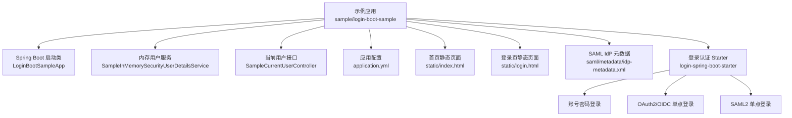
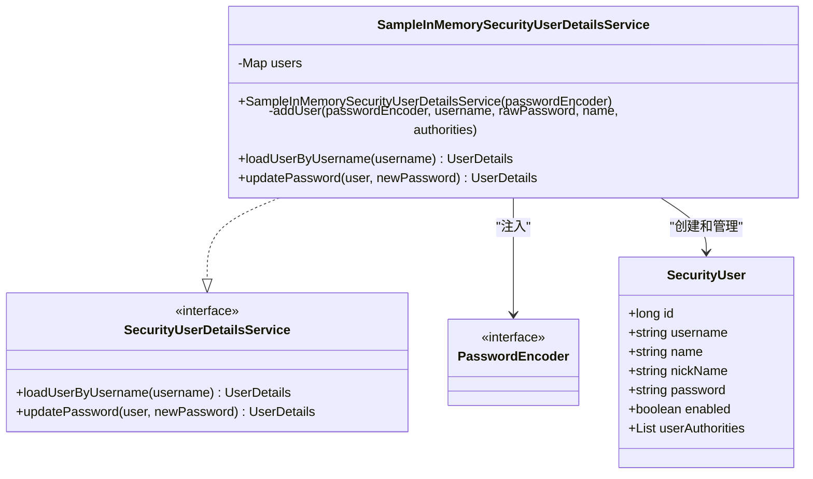
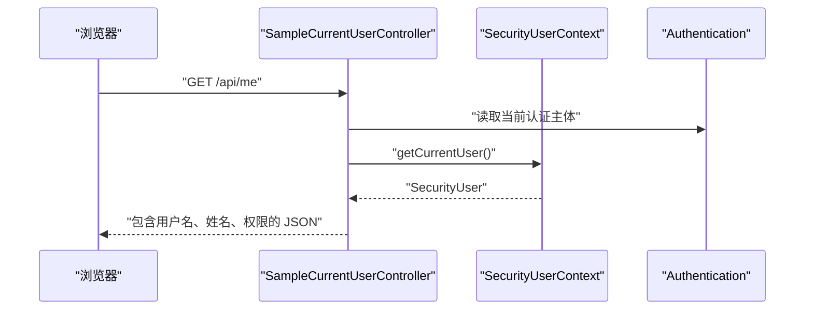
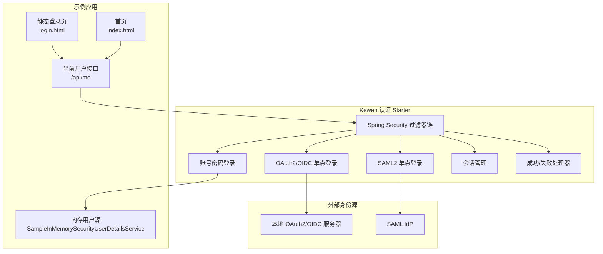
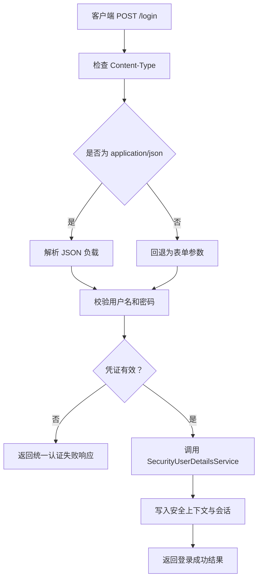
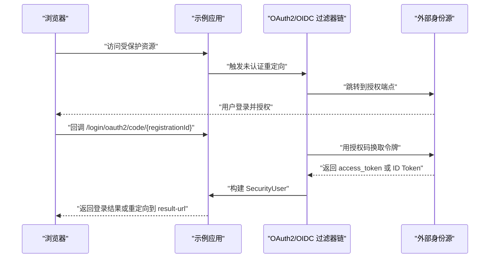
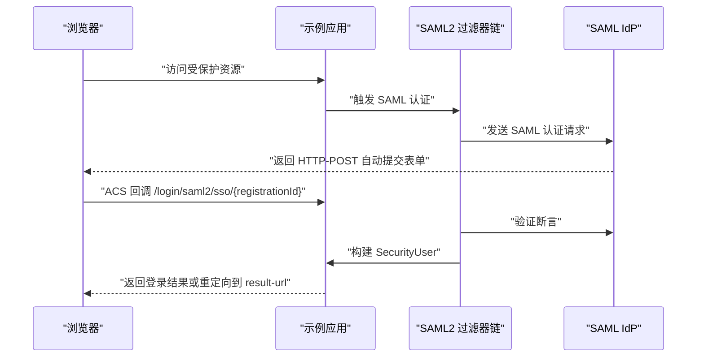
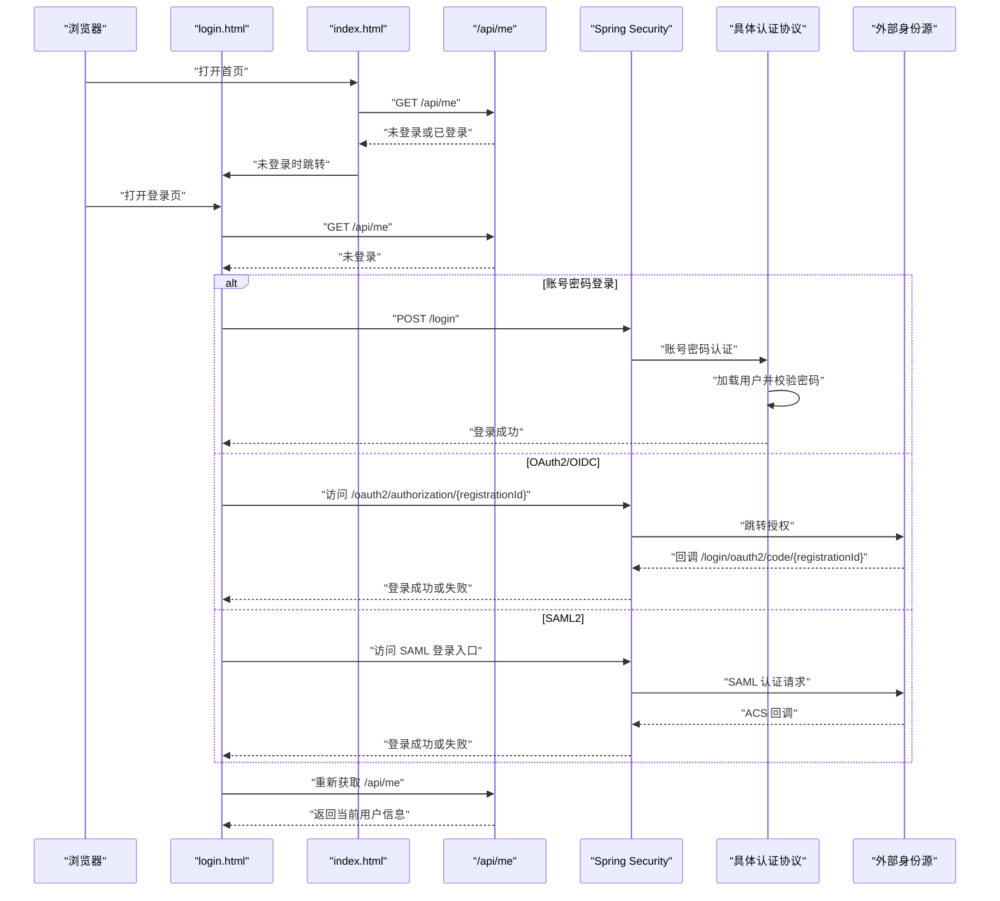
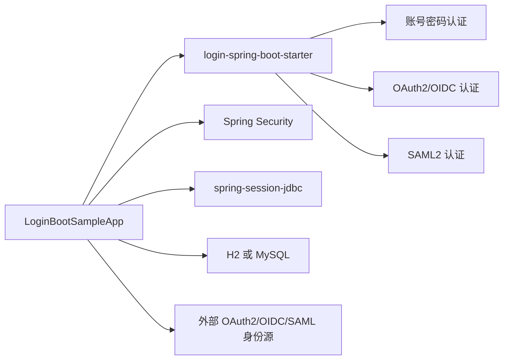

# 登录认证示例

<cite>
**本文引用的文件**   
- [LoginBootSampleApp.java](file://sample/login-boot-sample/src/main/java/com/cu/framework/sample/login/LoginBootSampleApp.java)
- [SampleInMemorySecurityUserDetailsService.java](file://sample/login-boot-sample/src/main/java/com/cu/framework/sample/login/SampleInMemorySecurityUserDetailsService.java)
- [SampleCurrentUserController.java](file://sample/login-boot-sample/src/main/java/com/cu/framework/sample/login/SampleCurrentUserController.java)
- [application.yml](file://sample/login-boot-sample/src/main/resources/application.yml)
- [index.html](file://sample/login-boot-sample/src/main/resources/static/index.html)
- [login.html](file://sample/login-boot-sample/src/main/resources/static/login.html)
- [idp-metadata.xml](file://sample/login-boot-sample/src/main/resources/saml/metadata/idp-metadata.xml)
- [README.md（login-spring-boot-starter）](file://login-spring-boot-starter/README.md)
- [README-SSO.md（login-spring-boot-starter）](file://login-spring-boot-starter/README-SSO.md)
</cite>

## 目录

1. [简介](#简介)
2. [项目结构](#项目结构)
3. [核心组件](#核心组件)
4. [架构总览](#架构总览)
5. [详细组件分析](#详细组件分析)
6. [配置说明](#配置说明)
7. [认证流程](#认证流程)
8. [依赖关系分析](#依赖关系分析)
9. [性能与并发特性](#性能与并发特性)
10. [故障排查指南](#故障排查指南)
11. [结论](#结论)

## 简介

`login-boot-sample` 是 Kewen Framework 的登录认证示例应用，用于演示如何在 Spring Boot 应用中接入身份认证能力。该示例不实现完整业务系统，而是围绕以下目标展开：

- 演示账号密码登录。
- 演示 OAuth2 / OIDC 单点登录。
- 演示 SAML2 单点登录。
- 展示如何通过 `SecurityUserContext` 获取当前用户信息。
- 展示静态登录页如何判断登录态、发起账号密码登录和跳转单点登录入口。
- 通过 `application.yml` 集中演示三类认证协议的配置方式。

该项目依赖 `login-spring-boot-starter`，后者在 Spring Security 过滤器链上统一挂载多种登录协议，并对外暴露共享的成功处理器、失败处理器、会话解析器、安全异常处理等基础设施。

## 项目结构

示例应用位于 `sample/login-boot-sample`，代码非常精简，主要职责是装配启动类、提供内存用户源、暴露当前用户接口，并通过配置文件启用各类认证协议。

**图表来源**   
- [LoginBootSampleApp.java:1-11](file://sample/login-boot-sample/src/main/java/com/cu/framework/sample/login/LoginBootSampleApp.java#L1-L11)
- [SampleInMemorySecurityUserDetailsService.java:1-78](file://sample/login-boot-sample/src/main/java/com/cu/framework/sample/login/SampleInMemorySecurityUserDetailsService.java#L1-L78)
- [SampleCurrentUserController.java:1-50](file://sample/login-boot-sample/src/main/java/com/cu/framework/sample/login/SampleCurrentUserController.java#L1-L50)
- [application.yml:1-207](file://sample/login-boot-sample/src/main/resources/application.yml#L1-L207)
- [index.html:1-32](file://sample/login-boot-sample/src/main/resources/static/index.html#L1-L32)
- [login.html:1-56](file://sample/login-boot-sample/src/main/resources/static/login.html#L1-L56)
- [idp-metadata.xml:1-27](file://sample/login-boot-sample/src/main/resources/saml/metadata/idp-metadata.xml#L1-L27)

### 关键目录与文件

| 路径 | 作用 |
|---|---|
| `src/main/java/com/cu/framework/sample/login/LoginBootSampleApp.java` | Spring Boot 启动入口 |
| `src/main/java/com/cu/framework/sample/login/SampleInMemorySecurityUserDetailsService.java` | 账号密码登录使用的内存用户源 |
| `src/main/java/com/cu/framework/sample/login/SampleCurrentUserController.java` | 供前端判断当前用户信息的接口 |
| `src/main/resources/application.yml` | 示例应用的所有认证与基础配置 |
| `src/main/resources/static/index.html` | 需要登录后才能停留的首页 |
| `src/main/resources/static/login.html` | 纯前端渲染的登录页 |
| `src/main/resources/saml/metadata/idp-metadata.xml` | 本地 SAML IdP 的元数据占位文件 |

**章节来源**   
- [LoginBootSampleApp.java:1-11](file://sample/login-boot-sample/src/main/java/com/cu/framework/sample/login/LoginBootSampleApp.java#L1-L11)
- [application.yml:1-207](file://sample/login-boot-sample/src/main/resources/application.yml#L1-L207)

## 核心组件

### 启动类

`AuthRbacSecurityBootSampleApp` 是最简单的 Spring Boot 启动类，没有额外逻辑，只负责启动应用。所有认证能力来自 starter 的自动装配。

**章节来源**   
- [LoginBootSampleApp.java:1-11](file://sample/login-boot-sample/src/main/java/com/cu/framework/sample/login/LoginBootSampleApp.java#L1-L11)

### 内存用户服务

`SampleInMemorySecurityUserDetailsService` 实现了框架要求的 `SecurityUserDetailsService`，用于演示账号密码登录的用户加载逻辑。

它的关键行为包括：

- 使用进程内 `LinkedHashMap` 保存用户。
- 初始化两个演示账号：`admin` 与 `demo`。
- 使用注入的 `PasswordEncoder` 对明文密码进行编码。
- 将用户名映射到 `SecurityUser`，并设置角色权限。
- `loadUserByUsername` 找不到用户时抛出 `UsernameNotFoundException`。
- `updatePassword` 支持更新内存中的密码字段。

该实现适合示例和本地测试；生产环境应替换为数据库或远程用户服务。

**图表来源**   
- [SampleInMemorySecurityUserDetailsService.java:1-78](file://sample/login-boot-sample/src/main/java/com/cu/framework/sample/login/SampleInMemorySecurityUserDetailsService.java#L1-L78)

**章节来源**   
- [SampleInMemorySecurityUserDetailsService.java:1-78](file://sample/login-boot-sample/src/main/java/com/cu/framework/sample/login/SampleInMemorySecurityUserDetailsService.java#L1-L78)

### 当前用户接口

`SampleCurrentUserController` 暴露 `GET /api/me`，用于让前端判断当前会话是否已登录，以及读取用户名、姓名和权限列表。

关键点：

- 方法参数直接使用 Spring Security 的 `Authentication`。
- 通过 `SecurityUserContext.getCurrentUser()` 获取框架封装后的 `SecurityUser`。
- 从 `Authentication.getAuthorities()` 收集权限字符串。
- 接口本身没有加“免登录放行”注解，因此未登录访问会进入统一未认证响应流程。

**图表来源**   
- [SampleCurrentUserController.java:1-50](file://sample/login-boot-sample/src/main/java/com/cu/framework/sample/login/SampleCurrentUserController.java#L1-L50)

**章节来源**   
- [SampleCurrentUserController.java:1-50](file://sample/login-boot-sample/src/main/java/com/cu/framework/sample/login/SampleCurrentUserController.java#L1-L50)

## 架构总览

从示例应用的角度看，整个认证体系分为三层：

1. **示例应用层**：启动应用、提供内存用户源、暴露当前用户接口、提供静态登录页。
2. **Starter 认证层**：由 `login-spring-boot-starter` 提供，统一处理账号密码、OAuth2/OIDC、SAML2 三种认证。
3. **外部身份源层**：可选的本地 IDP、OIDC 提供者、SAML IdP，负责证明“用户是谁”。

**图表来源**   
- [LoginBootSampleApp.java:1-11](file://sample/login-boot-sample/src/main/java/com/cu/framework/sample/login/LoginBootSampleApp.java#L1-L11)
- [SampleInMemorySecurityUserDetailsService.java:1-78](file://sample/login-boot-sample/src/main/java/com/cu/framework/sample/login/SampleInMemorySecurityUserDetailsService.java#L1-L78)
- [SampleCurrentUserController.java:1-50](file://sample/login-boot-sample/src/main/java/com/cu/framework/sample/login/SampleCurrentUserController.java#L1-L50)
- [application.yml:1-207](file://sample/login-boot-sample/src/main/resources/application.yml#L1-L207)
- [README.md（login-spring-boot-starter）:1-200](file://login-spring-boot-starter/README.md#L1-L200)

## 详细组件分析

### 账号密码登录

示例应用使用 `cu.security.login.password` 下的配置启用账号密码登录。默认登录端点是 `/login`，请求体采用 JSON 格式，字段名为 `username` 和 `password`。

#### 配置要点

- 登录 URL：`cu.security.login.password.login-url`
- 用户名参数名：`cu.security.login.password.username-parameter`
- 密码参数名：`cu.security.login.password.password-parameter`

示例中保留默认值，因此可直接向 `/login` 发送 POST 请求。

#### 认证流程

**图表来源**   
- [application.yml:1-207](file://sample/login-boot-sample/src/main/resources/application.yml#L1-L207)
- [README.md（login-spring-boot-starter）:1-200](file://login-spring-boot-starter/README.md#L1-L200)

#### 示例应用中的账号

示例内存用户源提供两个账号：

| 用户名 | 密码 | 角色 |
|---|---|---|
| admin | admin123 | ROLE_ADMIN、ROLE_USER |
| demo | demo123 | ROLE_USER |

这些账号仅存在于内存中，重启后重置。

#### 登录页交互

`login.html` 是一个纯前端页面：

- 显示用户名和密码输入框。
- 提交账号密码到 `/login`。
- 根据后端响应切换“未登录视图”和“已登录视图”。
- 显示可用单点登录入口。
- 提供退出登录按钮。

**章节来源**   
- [application.yml:1-207](file://sample/login-boot-sample/src/main/resources/application.yml#L1-L207)
- [SampleInMemorySecurityUserDetailsService.java:1-78](file://sample/login-boot-sample/src/main/java/com/cu/framework/sample/login/SampleInMemorySecurityUserDetailsService.java#L1-L78)
- [login.html:1-56](file://sample/login-boot-sample/src/main/resources/static/login.html#L1-L56)
- [README.md（login-spring-boot-starter）:1-200](file://login-spring-boot-starter/README.md#L1-L200)

### OAuth2 / OIDC 单点登录

示例配置了多个 OAuth2 客户端和一个 OIDC 客户端。OAuth2 模式使用手动配置的授权端点、令牌端点和用户信息端点；OIDC 模式通过 `issuer-uri` 启动时拉取 OpenID Connect 配置。

#### 配置要点

| 配置项 | 含义 |
|---|---|
| `cu.security.login.oauth2.sso-authorization-uri` | 本地发起授权的入口基址 |
| `cu.security.login.oauth2.login-processing-url` | 回调处理端点 |
| `cu.security.login.oauth2.clients[]` | OAuth2/OIDC 客户端列表 |
| `registration-id` | 客户端注册标识 |
| `protocol-type` | `oauth2` 或 `oidc` |
| `client-id` / `client-secret` | 身份源分配的客户端凭据 |
| `authorization-uri` / `token-uri` / `user-info-uri` | 手动 OAuth2 端点 |
| `issuer-uri` | OIDC 发行者地址 |
| `scopes` | 申请的权限范围 |
| `user-name-attribute-name` | 指向本系统用户名的声明字段 |

#### 多客户端示例

示例中包含：

- `demo-oauth2`：手动端点模式的 OAuth2 客户端。
- `demo-oauth2-secondary`：第二个入口，用于演示入口数量随配置变化。
- `demo-oauth2-third`：第三个入口。
- `demo-oidc`：基于 `issuer-uri` 的 OIDC 客户端，需要 `openid` scope。

#### 认证流程

**图表来源**   
- [application.yml:1-207](file://sample/login-boot-sample/src/main/resources/application.yml#L1-L207)
- [README-SSO.md（login-spring-boot-starter）:1-200](file://login-spring-boot-starter/README-SSO.md#L1-L200)

#### 注意事项

- OIDC 模式下，应用启动时会尝试访问 `{issuer-uri}/.well-known/openid-configuration`，如果身份源不可用，应用可能无法启动。
- `user-name-attribute-name` 指定的声明值必须等于本系统的用户名，否则无法匹配本地账号。
- 回调地址需要在身份源后台登记。

**章节来源**   
- [application.yml:1-207](file://sample/login-boot-sample/src/main/resources/application.yml#L1-L207)
- [README-SSO.md（login-spring-boot-starter）:1-200](file://login-spring-boot-starter/README-SSO.md#L1-L200)

### SAML2 单点登录

示例配置了一个 SAML2 客户端，使用 `classpath:saml/metadata/idp-metadata.xml` 作为 IdP 元数据来源。

#### 配置要点

| 配置项 | 含义 |
|---|---|
| `cu.security.login.saml.login-processing-url` | SAML ACS 回调地址模板 |
| `cu.security.login.saml.logout-request-url` | SAML 登出请求地址 |
| `cu.security.login.saml.logout-response-url` | SAML 登出响应地址 |
| `registrations[].registration-id` | SAML 注册标识 |
| `registrations[].sp-entity-id` | SP 实体标识 |
| `registrations[].metadata-resource` | IdP 元数据资源路径 |
| `sp-signing-keystore` | SP 签名密钥库（可选） |

#### SAML 元数据

`idp-metadata.xml` 是一个本地占位元数据文件，包含：

- IdP 实体标识。
- 验签证书。
- NameID 格式。
- SingleSignOnService 地址。

该文件用于本地跑通 SAML 流程；接入真实 IdP 时需要整份替换。

#### SAML 认证流程

**图表来源**   
- [application.yml:1-207](file://sample/login-boot-sample/src/main/resources/application.yml#L1-L207)
- [idp-metadata.xml:1-27](file://sample/login-boot-sample/src/main/resources/saml/metadata/idp-metadata.xml#L1-L27)

#### 注意事项

- 如果 IdP 要求 `WantAuthnRequestsSigned=true`，则需要配置 `sp-signing-keystore`。
- 示例中 IdP 元数据关闭了签名校验，因此可以留空 SP 签名密钥库。
- NameID 必须与本系统用户名一致。

**章节来源**   
- [application.yml:1-207](file://sample/login-boot-sample/src/main/resources/application.yml#L1-L207)
- [idp-metadata.xml:1-27](file://sample/login-boot-sample/src/main/resources/saml/metadata/idp-metadata.xml#L1-L27)

### 登录页面与当前用户信息

示例的前端由两个静态 HTML 页面组成：

- `index.html`：首页，需要登录后才能停留。
- `login.html`：登录页，负责账号密码登录、单点登录入口展示和状态切换。

#### 首页行为

`index.html` 隐藏主内容区域，加载脚本后调用 `/api/me`。如果接口返回未登录，则跳转到登录页；如果返回已登录，则显示用户名和权限。

#### 登录页行为

`login.html` 包含：

- 用户名输入框。
- 密码输入框。
- 登录按钮。
- 单点登录入口列表。
- 已登录后的个人信息展示区。
- 退出登录按钮。

#### 当前用户接口

`SampleCurrentUserController.me` 返回：

- 用户名。
- 姓名。
- 是否已认证。
- 权限列表。

这个接口是前后端分离场景下判断登录态的核心依据。

**章节来源**   
- [index.html:1-32](file://sample/login-boot-sample/src/main/resources/static/index.html#L1-L32)
- [login.html:1-56](file://sample/login-boot-sample/src/main/resources/static/login.html#L1-L56)
- [SampleCurrentUserController.java:1-50](file://sample/login-boot-sample/src/main/java/com/cu/framework/sample/login/SampleCurrentUserController.java#L1-L50)

## 配置说明

### 通用配置

示例应用的通用配置集中在 `application.yml` 中，涵盖以下内容：

| 配置前缀 | 用途 |
|---|---|
| `server.port` | 示例应用端口 |
| `spring.application.name` | 应用名称 |
| `spring.profiles.active` | 激活数据源 profile |
| `spring.session.store-type` | 会话存储类型 |
| `spring.session.timeout` | 会话超时时间 |
| `cu.auth.permit-url` | 免登录放行的 URL |
| `cu.security.current-user-url` | 当前用户接口地址 |
| `cu.security.session.*` | 会话并发控制 |
| `cu.security.remember-me.*` | “记住我”相关配置 |
| `cu.security.login.sso.result-url` | 单点登录结果页地址 |
| `cu.security.login.password.*` | 账号密码登录配置 |
| `cu.security.login.oauth2.*` | OAuth2/OIDC 配置 |
| `cu.security.login.saml.*` | SAML2 配置 |

### 会话与会话持久化

示例默认使用 H2 内存数据库，并开启 `spring-session-jdbc`。会话表由 session JDBC schema 初始化，会话过期时间为 2 天。

并发会话控制通过 `cu.security.session.maximum-sessions` 和 `max-sessions-prevents-login` 控制：

- `maximum-sessions`：同一用户最大并发会话数。
- `max-sessions-prevents-login`：达到上限时阻止新登录或挤掉最早会话。

### 单点登录结果页

`cu.security.login.sso.result-url` 配置单点登录结果页地址。配置后，OAuth2/OIDC/SAML2 认证成功或失败都会 302 重定向到该地址，并携带 `loginState=success` 或 `loginState=failure`。

示例中设置为 `/login.html`，因此单点登录完成后会回到登录页。

### 数据源配置

示例提供两个 profile：

- `h2`：H2 内存数据库，适合本机快速运行。
- `mysql`：MySQL 数据源，需要自行配置连接信息并执行会话表建表脚本。

**章节来源**   
- [application.yml:1-207](file://sample/login-boot-sample/src/main/resources/application.yml#L1-L207)
- [README.md（login-spring-boot-starter）:1-200](file://login-spring-boot-starter/README.md#L1-L200)

## 认证流程

### 整体登录时序

**图表来源**   
- [login.html:1-56](file://sample/login-boot-sample/src/main/resources/static/login.html#L1-L56)
- [index.html:1-32](file://sample/login-boot-sample/src/main/resources/static/index.html#L1-L32)
- [SampleCurrentUserController.java:1-50](file://sample/login-boot-sample/src/main/java/com/cu/framework/sample/login/SampleCurrentUserController.java#L1-L50)
- [application.yml:1-207](file://sample/login-boot-sample/src/main/resources/application.yml#L1-L207)

### 成功后用户信息获取

认证成功后，示例应用通过以下方式获取用户信息：

1. 前端调用 `GET /api/me`。
2. 控制器接收 `Authentication`。
3. 通过 `SecurityUserContext.getCurrentUser()` 获取 `SecurityUser`。
4. 返回用户名、姓名和权限列表。

这种方式的优势是：

- 不直接暴露敏感字段。
- 统一返回格式。
- 便于前端根据权限控制界面。

### 会话管理

示例使用 Spring Session JDBC 持久化会话。会话凭 Cookie 维持，刷新页面后仍可通过 `/api/me` 判定登录态。

需要注意：

- 单点登录成功后，会话由 Cookie 生效。
- `result-url` 配置后，单点登录重定向 URL 中不包含会话标识。
- 如果部署多实例，需要确保会话能跨实例共享（示例通过 JDBC 会话存储解决）。

### 令牌刷新

示例应用聚焦于登录认证和用户信息获取，没有专门演示令牌刷新逻辑。实际项目中：

- OAuth2/OIDC 的 access_token 刷新通常由身份源或前端 SDK 处理。
- 示例中的 `SampleCurrentUserController` 只返回当前会话用户信息，不负责刷新第三方令牌。
- 如果需要刷新长期令牌，应在业务层或前端安全策略中实现。

**章节来源**   
- [SampleCurrentUserController.java:1-50](file://sample/login-boot-sample/src/main/java/com/cu/framework/sample/login/SampleCurrentUserController.java#L1-L50)
- [application.yml:1-207](file://sample/login-boot-sample/src/main/resources/application.yml#L1-L207)

## 依赖关系分析

示例应用对外部依赖非常克制，主要依赖如下：

**图表来源**   
- [LoginBootSampleApp.java:1-11](file://sample/login-boot-sample/src/main/java/com/cu/framework/sample/login/LoginBootSampleApp.java#L1-L11)
- [application.yml:1-207](file://sample/login-boot-sample/src/main/resources/application.yml#L1-L207)

### 组件耦合关系

- `SampleInMemorySecurityUserDetailsService` 只依赖框架提供的 `SecurityUserDetailsService` 和 `PasswordEncoder`。
- `SampleCurrentUserController` 依赖 Spring Security 的 `Authentication` 和框架的 `SecurityUserContext`。
- `AuthRbacSecurityBootSampleApp` 不直接依赖任何认证细节，全部由 starter 自动装配。
- 示例应用与外部身份源之间没有直接 Java 依赖，只有协议层面的交互。

**章节来源**   
- [SampleInMemorySecurityUserDetailsService.java:1-78](file://sample/login-boot-sample/src/main/java/com/cu/framework/sample/login/SampleInMemorySecurityUserDetailsService.java#L1-L78)
- [SampleCurrentUserController.java:1-50](file://sample/login-boot-sample/src/main/java/com/cu/framework/sample/login/SampleCurrentUserController.java#L1-L50)
- [LoginBootSampleApp.java:1-11](file://sample/login-boot-sample/src/main/java/com/cu/framework/sample/login/LoginBootSampleApp.java#L1-L11)

## 性能与并发特性

### 内存用户源的性能特征

`SampleInMemorySecurityUserDetailsService` 使用 `LinkedHashMap` 存储用户，查询复杂度为 O(1)。这适合少量演示账号，但不适合生产环境的大规模用户。

### 会话并发控制

示例通过 `cu.security.session.maximum-sessions` 限制同一用户的最大会话数，并通过 `max-sessions-prevents-login` 决定超限时的行为：

- 阻止新登录：更安全，但用户体验更严格。
- 挤掉最早会话：允许继续登录，但旧会话失效。

### 静态资源与登录态判断

首页和登录页都是静态 HTML，由浏览器 JS 调用 `/api/me` 判断登录态。这种设计避免后端直接渲染页面，适合前后端分离场景。

**章节来源**   
- [SampleInMemorySecurityUserDetailsService.java:1-78](file://sample/login-boot-sample/src/main/java/com/cu/framework/sample/login/SampleInMemorySecurityUserDetailsService.java#L1-L78)
- [application.yml:1-207](file://sample/login-boot-sample/src/main/resources/application.yml#L1-L207)
- [index.html:1-32](file://sample/login-boot-sample/src/main/resources/static/index.html#L1-L32)
- [login.html:1-56](file://sample/login-boot-sample/src/main/resources/static/login.html#L1-L56)

## 故障排查指南

### 账号密码登录失败

常见问题：

1. **用户名不存在**：`SampleInMemorySecurityUserDetailsService.loadUserByUsername` 抛出 `UsernameNotFoundException`。
2. **密码错误**：由 Spring Security 认证失败流程处理。
3. **Content-Type 不匹配**：示例说明指出，非精确匹配的 `application/json` 可能回退为 form 分支，导致读不到字段。
4. **密码编码器问题**：如果历史密码没有正确前缀，可能出现密码编码器映射错误。

建议排查步骤：

- 确认请求头 `Content-Type` 为 `application/json`。
- 确认请求体包含 `username` 和 `password`。
- 确认使用示例账号 `admin/admin123` 或 `demo/demo123`。
- 检查是否启用了正确的 profile。

**章节来源**   
- [SampleInMemorySecurityUserDetailsService.java:1-78](file://sample/login-boot-sample/src/main/java/com/cu/framework/sample/login/SampleInMemorySecurityUserDetailsService.java#L1-L78)
- [README.md（login-spring-boot-starter）:1-200](file://login-spring-boot-starter/README.md#L1-L200)

### OAuth2/OIDC 单点登录失败

常见问题：

1. **回调地址未登记**：身份源拒绝 `invalid_redirect_uri`。
2. **OIDC 配置拉取失败**：启动时访问 `.well-known/openid-configuration` 失败。
3. **用户名声明不一致**：`user-name-attribute-name` 的值不等于本系统用户名。
4. **scope 不足**：OIDC 缺少 `openid` scope 可能导致 ID Token 缺失。

建议排查步骤：

- 检查 `registration-id` 与身份源侧配置一致。
- 检查 `issuer-uri` 或手动端点是否可达。
- 检查 `scopes` 是否包含所需权限。
- 检查回调地址是否被身份源接受。

**章节来源**   
- [application.yml:1-207](file://sample/login-boot-sample/src/main/resources/application.yml#L1-L207)
- [README-SSO.md（login-spring-boot-starter）:1-200](file://login-spring-boot-starter/README-SSO.md#L1-L200)

### SAML2 单点登录失败

常见问题：

1. **IdP 元数据不可用**：`classpath:saml/metadata/idp-metadata.xml` 路径错误或内容不完整。
2. **签名校验失败**：IdP 要求签名但 SP 未配置密钥库。
3. **NameID 不匹配**：SAML 断言中的 NameID 不是本系统用户名。
4. **ACS 地址未登记**：身份源未登记 SAML 回调地址。

建议排查步骤：

- 检查 `metadata-resource` 是否能加载。
- 检查 `WantAuthnRequestsSigned` 是否与 IdP 要求一致。
- 如需签名，配置 `sp-signing-keystore`。
- 核对 NameID 和本系统用户名取值口径。

**章节来源**   
- [application.yml:1-207](file://sample/login-boot-sample/src/main/resources/application.yml#L1-L207)
- [idp-metadata.xml:1-27](file://sample/login-boot-sample/src/main/resources/saml/metadata/idp-metadata.xml#L1-L27)

### 登录态判断异常

常见问题：

1. **`/api/me` 返回未登录**：Cookie 丢失或会话已过期。
2. **首页闪屏或提前显示内容**：静态页面未正确隐藏未登录内容。
3. **未登录响应语义混淆**：未登录不一定返回 HTTP 401，可能是业务码表示未认证。

建议排查步骤：

- 检查浏览器 Cookie 是否存在。
- 检查 `spring.session.timeout` 是否过短。
- 检查前端是否正确处理 `/api/me` 的返回结构。
- 不要仅凭 HTTP 状态码判断登录态，应结合业务响应。

**章节来源**   
- [SampleCurrentUserController.java:1-50](file://sample/login-boot-sample/src/main/java/com/cu/framework/sample/login/SampleCurrentUserController.java#L1-L50)
- [index.html:1-32](file://sample/login-boot-sample/src/main/resources/static/index.html#L1-L32)
- [login.html:1-56](file://sample/login-boot-sample/src/main/resources/static/login.html#L1-L56)

## 结论

`login-boot-sample` 是一个轻量但完整的登录认证示例。它通过极少的业务代码，展示了 Kewen Framework 在以下方面的能力：

- 统一接入账号密码、OAuth2/OIDC、SAML2 三种认证协议。
- 通过 `SecurityUserContext` 获取当前用户信息。
- 使用静态登录页与后端 JSON 接口协作完成登录态判断。
- 通过 `application.yml` 集中管理认证协议配置。
- 借助 `login-spring-boot-starter` 复用安全过滤链、会话管理和结果处理器。

对于想集成 Kewen Framework 认证能力的开发者，推荐按以下步骤学习：

1. 先跑通账号密码登录。
2. 理解 `/api/me` 的作用。
3. 接入一个 OAuth2/OIDC 身份源。
4. 接入一个 SAML2 身份源。
5. 将内存用户源替换为真实用户服务。
6. 在生产环境中完善会话持久化、安全配置和日志审计。