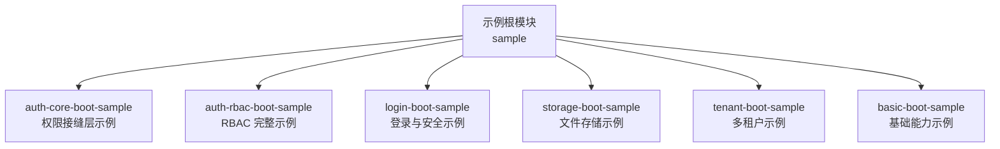
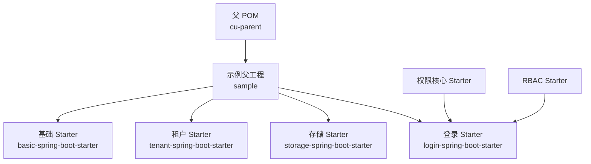
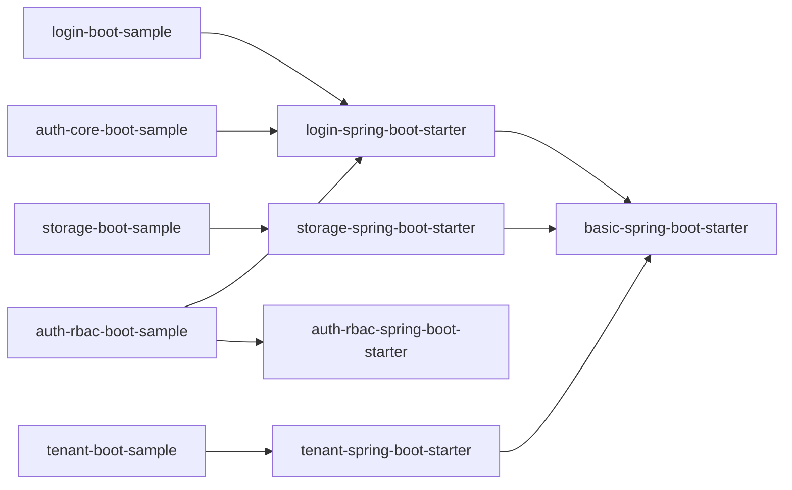
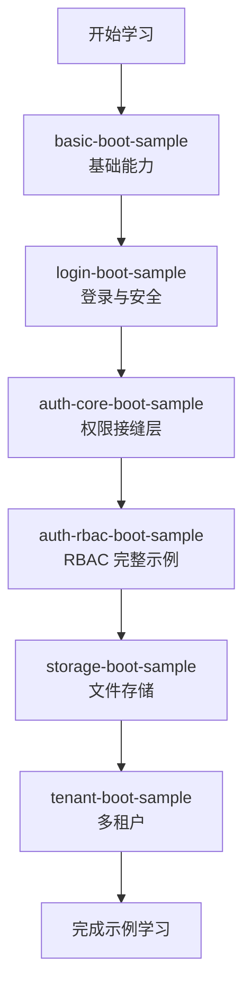

# 示例应用

<cite>
**本文引用的文件**
- [README_Auth.md](file://README_Auth.md)
- [pom.xml](file://pom.xml)
- [sample/auth-core-boot-sample/README.md](file://sample/auth-core-boot-sample/README.md)
- [sample/auth-rbac-boot-sample/README.md](file://sample/auth-rbac-boot-sample/README.md)
- [sample/login-boot-sample/pom.xml](file://sample/login-boot-sample/pom.xml)
- [sample/storage-boot-sample/pom.xml](file://sample/storage-boot-sample/pom.xml)
- [sample/tenant-boot-sample/pom.xml](file://sample/tenant-boot-sample/pom.xml)
- [sample/basic-boot-sample/pom.xml](file://sample/basic-boot-sample/pom.xml)
- [sample/auth-core-boot-sample/src/main/resources/application.yml](file://sample/auth-core-boot-sample/src/main/resources/application.yml)
- [sample/auth-rbac-boot-sample/src/main/resources/application.yml](file://sample/auth-rbac-boot-sample/src/main/resources/application.yml)
- [sample/login-boot-sample/src/main/resources/application.yml](file://sample/login-boot-sample/src/main/resources/application.yml)
- [sample/storage-boot-sample/src/main/resources/application.yml](file://sample/storage-boot-sample/src/main/resources/application.yml)
- [sample/tenant-boot-sample/src/main/resources/application.yml](file://sample/tenant-boot-sample/src/main/resources/application.yml)
</cite>

## 目录
1. [引言](#引言)
2. [项目结构](#项目结构)
3. [核心示例总览](#核心示例总览)
4. [架构总览](#架构总览)
5. [详细示例说明与启动指南](#详细示例说明与启动指南)
6. [依赖关系分析](#依赖关系分析)
7. [性能与运行特性](#性能与运行特性)
8. [故障排查指南](#故障排查指南)
9. [从简单到复杂的学习路径](#从简单到复杂的学习路径)
10. [结论](#结论)

## 引言
Kewen Framework 示例应用位于仓库的 `sample` 模块下，覆盖权限验证、RBAC 完整能力、登录认证、文件存储、多租户等典型使用场景。每个示例都尽量做到“可独立启动”，多数默认使用 H2 内存数据库，避免必须安装 MySQL；需要生产对接时再切换到 MySQL profile。

整体目标：
- 演示框架的核心能力，而不是重复实现业务系统。
- 通过最小配置快速跑通，再通过更复杂的示例理解权限、安全、存储和租户等能力的组合方式。
- 提供可复现的脚本、配置文件、测试和文档，帮助开发者对照预期行为进行调试和学习。

**章节来源**
- [README_Auth.md:1-40](file://README_Auth.md#L1-L40)
- [pom.xml:23-42](file://pom.xml#L23-L42)

## 项目结构
示例应用集中在 `sample` 目录下，按功能拆分多个 Spring Boot 子工程：
- `auth-core-boot-sample`：不依赖 RBAC 具体模型，只实现权限接缝层所需扩展点，证明权限声明与数据判定可以脱离具体权限表结构。
- `auth-rbac-boot-sample`：基于用户-角色-部门的 RBAC 完整示例，演示会议室管理与预约等业务场景中的菜单权限、数据权限和登录流程。
- `login-boot-sample`：演示登录与安全相关 Starter 的配置，包括密码登录、OAuth2、OIDC、SAML 单点登录等。
- `storage-boot-sample`：演示文件存储 Starter，默认使用七牛云存储配置占位值，配合基础 Starter 与 H2 启动。
- `tenant-boot-sample`：演示多租户上下文注入，业务代码从租户上下文读取租户标识。
- `basic-boot-sample`：演示基础 Starter，包含通用响应、校验、日志、工具等基础能力。

**图表来源**
- [pom.xml:23-42](file://pom.xml#L23-L42)

**章节来源**
- [sample/auth-core-boot-sample/README.md:1-20](file://sample/auth-core-boot-sample/README.md#L1-L20)
- [sample/auth-rbac-boot-sample/README.md:1-20](file://sample/auth-rbac-boot-sample/README.md#L1-L20)

## 核心示例总览

| 示例 | 主要用途 | 关键依赖 | 默认端口 | 是否需要真实数据库 | 适合阶段 |
|---|---|---|---:|---|---|
| `auth-core-boot-sample` | 演示权限接缝层的能力边界，不引入 RBAC 具体模型 | `login-spring-boot-starter`、权限核心 Starter、H2 | 8082 | 可选；默认 H2 文件库 | 深入理解权限抽象与扩展点 |
| `auth-rbac-boot-sample` | 演示完整的 RBAC 权限体系与登录鉴权 | RBAC Starter、登录 Starter、Spring Security、H2/MySQL | 8081 | 可选；默认 H2 内存库 | 学习完整权限与业务结合 |
| `login-boot-sample` | 演示密码登录、OAuth2、OIDC、SAML 单点登录 | `login-spring-boot-starter`、H2/MySQL | 8080 | 可选；默认 H2 内存库 | 先掌握登录与安全配置 |
| `storage-boot-sample` | 演示文件上传、下载、回调等存储能力 | `storage-spring-boot-starter`、`basic-spring-boot-starter`、H2 | 8080 | 可选；默认 H2 内存库 | 了解存储扩展点 |
| `tenant-boot-sample` | 演示租户上下文注入与请求隔离思路 | `tenant-spring-boot-starter`、`basic-spring-boot-starter`、H2 | 8080 | 不需要业务表 | 理解多租户上下文 |
| `basic-boot-sample` | 演示基础响应、校验、日志、工具等 | `basic-spring-boot-starter`、H2 | 8080 | 不需要业务表 | 入门框架基础能力 |

**章节来源**
- [sample/auth-core-boot-sample/README.md:1-20](file://sample/auth-core-boot-sample/README.md#L1-L20)
- [sample/auth-rbac-boot-sample/README.md:1-20](file://sample/auth-rbac-boot-sample/README.md#L1-L20)
- [sample/login-boot-sample/pom.xml:1-65](file://sample/login-boot-sample/pom.xml#L1-L65)
- [sample/storage-boot-sample/pom.xml:1-38](file://sample/storage-boot-sample/pom.xml#L1-L38)
- [sample/tenant-boot-sample/pom.xml:1-42](file://sample/tenant-boot-sample/pom.xml#L1-L42)
- [sample/basic-boot-sample/pom.xml:1-41](file://sample/basic-boot-sample/pom.xml#L1-L41)

## 架构总览
示例应用的底层依赖由父 POM 统一管理，核心方向是：
- 所有示例继承公共示例父工程。
- 示例通过引入不同的 Starter 启用不同能力。
- 默认使用 H2 内存库或文件库，降低本地启动门槛。
- 切换 MySQL 时需要额外执行建表与种子脚本。

**图表来源**
- [pom.xml:23-42](file://pom.xml#L23-L42)
- [sample/login-boot-sample/pom.xml:1-65](file://sample/login-boot-sample/pom.xml#L1-L65)
- [sample/storage-boot-sample/pom.xml:1-38](file://sample/storage-boot-sample/pom.xml#L1-L38)
- [sample/tenant-boot-sample/pom.xml:1-42](file://sample/tenant-boot-sample/pom.xml#L1-L42)

**章节来源**
- [pom.xml:23-42](file://pom.xml#L23-L42)

## 详细示例说明与启动指南

### auth-core-boot-sample：独立权限验证示例

#### 用途与特点
该示例是权限框架的“接缝层”演示：它不引用 RBAC 具体模型，也不依赖框架默认的 `sys_*` 权限表；示例自己实现当前用户上下文、菜单权限处理器、菜单 API 持久化等扩展点，并使用自己的八张表承载权限、菜单和业务数据。它的目标是证明权限声明、权限判定和数据范围改写可以完全独立于具体权限模型。

核心能力包括：
- 菜单管辖声明与显示文案。
- 启动后异步扫描并注册菜单 API。
- 行级数据操作权限校验。
- Mapper 接口上的数据范围过滤。
- 权限表名与列名全部重命名，用于验证框架没有硬编码。
- Service 层直接维护权限。
- 统一拒绝响应与错误提示。

#### 环境准备
- JDK 8。
- Maven。
- 可选：MySQL（切换 profile 时使用）。
- 默认使用 H2 文件数据库，无需安装外部数据库即可启动。

#### 依赖配置
该示例通过示例父工程继承公共版本，并引入登录 Starter 与权限相关 Starter。其配置重点在 `application.yml`：
- 应用端口为 8082。
- 上下文路径为 `/coredemo`。
- 默认激活 `h2` profile。
- 将权限数据存储映射到 `demo_auth_data` 等示例自有表。
- H2 profile 自动执行 `schema.sql` 与 `seed-data.sql`。
- MySQL profile 不执行任何脚本，需手动执行。

#### 数据库初始化
- H2 模式：首次启动会自动创建 `data/auth_core_sample.*` 文件库，并执行幂等建表与种子脚本。
- MySQL 模式：使用 `--spring.profiles.active=mysql`，然后自行执行本模块 `sql/schema.sql` 与 `sql/seed-data.sql`。

#### 启动步骤
1. 进入模块目录：`cd sample/auth-core-boot-sample`。
2. 打包：`mvn -q package -DskipTests`。
3. 从模块目录启动 jar：`java -jar target/auth-core-boot-sample-0.0.1-SNAPSHOT-exec.jar`。
4. 打开浏览器访问：`http://localhost:8082/coredemo/`。
5. 如需查看数据库：`http://localhost:8082/coredemo/h2-console`。

#### 关键行为与观察点
- 浏览器权限透视台展示每个判权场景的期望结果与实际结果。
- HTTP 响应中，200 表示放行，403 表示权限拒绝，400 表示用法错误。
- 可通过 trace 接口查看实际下发的 SQL。
- 可通过日志接口查看方法体是否被调用。
- 重启不会丢失手工授予的权限，因为脚本幂等。

#### 常见问题
- 从仓库根目录启动会加载根目录 `application.yml`，可能把权限表名覆盖回默认值，导致 `sys_auth_data` 找不到。
- H2 Web 控制台要求应用进程持有文件库，建议应用运行时单独打开控制台。

**章节来源**
- [sample/auth-core-boot-sample/README.md:1-20](file://sample/auth-core-boot-sample/README.md#L1-L20)
- [sample/auth-core-boot-sample/README.md:40-85](file://sample/auth-core-boot-sample/README.md#L40-L85)
- [sample/auth-core-boot-sample/src/main/resources/application.yml:1-85](file://sample/auth-core-boot-sample/src/main/resources/application.yml#L1-L85)

### auth-rbac-boot-sample：RBAC 完整示例

#### 用途与特点
该示例以会议室管理为核心案例，演示 RBAC 体系下的菜单权限、数据权限、登录态与会话、权限编辑等完整流程。它依赖 RBAC Starter 与登录 Starter，支持 H2 内存库和 MySQL。

核心能力包括：
- 用户、角色、部门、岗位等 RBAC 模型。
- 菜单 API 自动注册与权限映射。
- 数据操作权限与数据范围权限。
- 登录、记住我、会话超时、最大会话数等安全配置。
- 会议室创建、删除、编辑、预约等业务场景。

#### 环境准备
- JDK 8。
- Maven。
- 可选：MySQL。
- 可选：Node.js 与前端工程（用于可视化验证）。

#### 依赖配置
示例默认端口为 8081，默认激活 `h2` profile，会话存储类型为 JDBC，并配置了登录参数、当前用户接口地址、缓存策略等。H2 profile 会自动执行框架权限表脚本、示例业务表脚本和种子数据；MySQL profile 不执行脚本，需手动执行。

#### 数据库初始化
- H2 模式：首次启动自动建表并灌入种子数据。
- MySQL 模式：
  1. 执行 `docs/sql/auth-rbac.sql`。
  2. 可选执行 `docs/sql/basic-support.sql`。
  3. 执行本模块 `sql/schema.sql`。
  4. 执行本模块 `sql/seed-data.sql`。
  5. 如需 JDBC 会话表，执行 spring-session 提供的 MySQL 会话脚本。

#### 启动步骤
1. 直接启动主类：`AuthRbacBootSampleApp`。
2. 或使用 Maven 命令：`mvn -pl sample/auth-rbac-boot-sample spring-boot:run`。
3. 默认账号密码：`admin/123456`。
4. 可访问 H2 控制台：`http://localhost:8081/h2-console`。
5. 可配合前端工程进行可视化验证。

#### 关键行为与观察点
- 创建会议室时会添加会议室的管理权限。
- 菜单 API 会在启动后自动登记。
- 可通过数据库或前端页面查看菜单权限与数据权限映射。
- 登录后可以调用会议室相关接口进行增删改查和预约。

**章节来源**
- [sample/auth-rbac-boot-sample/README.md:1-20](file://sample/auth-rbac-boot-sample/README.md#L1-L20)
- [sample/auth-rbac-boot-sample/README.md:20-80](file://sample/auth-rbac-boot-sample/README.md#L20-L80)
- [sample/auth-rbac-boot-sample/src/main/resources/application.yml:1-117](file://sample/auth-rbac-boot-sample/src/main/resources/application.yml#L1-L117)

### login-boot-sample：登录示例

#### 用途与特点
该示例聚焦登录与安全能力，演示密码登录、OAuth2、OIDC、SAML 单点登录等登录方式的配置入口。它依赖 `login-spring-boot-starter`，默认使用 H2 内存库，并配置 Spring Session JDBC。

关键配置项包括：
- 免登录放行 URL。
- 当前用户接口地址。
- Session 数量限制与超时。
- 记住我开关与有效期。
- OAuth2/OIDC/SAML 客户端与端点配置。
- SSO 登录结果页地址。

#### 环境准备
- JDK 8。
- Maven。
- 可选：本地 OAuth2/OIDC/SAML 身份源（仅用于联调）。
- 默认 H2 内存库，无需本地 MySQL。

#### 依赖配置
POM 引入 `login-spring-boot-starter`、`spring-boot-starter-jdbc` 与 H2。`application.yml` 中配置了各类登录协议、Session、数据源等。

#### 启动步骤
1. 启动主类：`com.cu.framework.sample.login.LoginBootSampleApp`。
2. 默认端口：8080。
3. 默认使用 H2 内存库，可直接启动。
4. 切换 MySQL 时启用 `mysql` profile 并补充连接信息。

#### 关键行为与观察点
- 未登录访问受保护资源会被引导到登录流程。
- OAuth2/OIDC/SAML 客户端条目越多，登录页可展示的入口越多。
- 配置中若遗漏必要的客户端条目，可能启动失败。

**章节来源**
- [sample/login-boot-sample/pom.xml:1-65](file://sample/login-boot-sample/pom.xml#L1-L65)
- [sample/login-boot-sample/src/main/resources/application.yml:1-207](file://sample/login-boot-sample/src/main/resources/application.yml#L1-L207)

### storage-boot-sample：存储示例

#### 用途与特点
该示例演示文件存储 Starter 的使用方式，默认配置七牛云存储的访问密钥、存储桶、公开性、下载域名与上传回调地址。它同时引入基础 Starter，并提供 H2 内存库以满足 MyBatis-Plus 的 DataSource 前提。

#### 环境准备
- JDK 8。
- Maven。
- 可选：七牛云账号与存储空间。
- 默认 H2 内存库。

#### 依赖配置
POM 引入 `storage-spring-boot-starter`、`basic-spring-boot-starter` 与 H2。`application.yml` 中设置存储类型、访问凭据、存储桶、公开性与回调地址。

#### 启动步骤
1. 启动该示例应用。
2. 如需真实上传，替换七牛云配置中的访问密钥、密钥、存储桶与下载域名。
3. 默认 H2 模式会自动执行 `basic-support.sql`，创建文件存储相关表。

#### 关键行为与观察点
- 存储类型由 `cu.storage.type` 控制。
- 文件详情、分片详情与系统存储文件表由基础支撑模块提供。
- MySQL profile 中使用 p6spy 驱动便于抓 SQL。

**章节来源**
- [sample/storage-boot-sample/pom.xml:1-38](file://sample/storage-boot-sample/pom.xml#L1-L38)
- [sample/storage-boot-sample/src/main/resources/application.yml:1-55](file://sample/storage-boot-sample/src/main/resources/application.yml#L1-L55)

### tenant-boot-sample：多租户示例

#### 用途与特点
该示例演示多租户 Starter 的上下文注入方式。业务代码从租户上下文获取租户 ID，而不直接访问业务表。示例本身不执行业务 CRUD，因此不需要业务表；但基础 Starter 传递引入了 MyBatis-Plus，所以仍需要一个可用的 DataSource。

#### 环境准备
- JDK 8。
- Maven。
- 默认 H2 内存库。

#### 依赖配置
POM 引入 `tenant-spring-boot-starter`、`basic-spring-boot-starter` 与 H2。`application.yml` 中开启租户功能，并配置 H2 数据源。

#### 启动步骤
1. 启动该示例应用。
2. 业务代码可从租户上下文读取租户标识。
3. 切换 MySQL 时只需补充连接信息，无需建表。

#### 关键行为与观察点
- 租户开关由 `cu.tenant.open` 控制。
- 示例重点在于租户上下文，而不是具体租户隔离 SQL。
- H2 profile 提供一个能连上的空库，满足启动前提。

**章节来源**
- [sample/tenant-boot-sample/pom.xml:1-42](file://sample/tenant-boot-sample/pom.xml#L1-L42)
- [sample/tenant-boot-sample/src/main/resources/application.yml:1-37](file://sample/tenant-boot-sample/src/main/resources/application.yml#L1-L37)

### basic-boot-sample：基础能力示例

#### 用途与特点
该示例演示基础 Starter 提供的通用能力，包括统一响应、异常处理、过滤器、日志、工具类等。它是最轻量级的示例之一，适合初学者理解框架的基础约定。

#### 环境准备
- JDK 8。
- Maven。
- 默认 H2 内存库。

#### 依赖配置
POM 引入 `basic-spring-boot-starter` 与 H2，并包含单元测试依赖。

#### 启动步骤
1. 启动该示例应用。
2. 调用示例 Controller 接口，观察统一响应格式、校验结果与日志输出。

**章节来源**
- [sample/basic-boot-sample/pom.xml:1-41](file://sample/basic-boot-sample/pom.xml#L1-L41)

## 依赖关系分析

**图表来源**
- [sample/login-boot-sample/pom.xml:1-65](file://sample/login-boot-sample/pom.xml#L1-L65)
- [sample/storage-boot-sample/pom.xml:1-38](file://sample/storage-boot-sample/pom.xml#L1-L38)
- [sample/tenant-boot-sample/pom.xml:1-42](file://sample/tenant-boot-sample/pom.xml#L1-L42)
- [sample/auth-core-boot-sample/README.md:1-20](file://sample/auth-core-boot-sample/README.md#L1-L20)
- [sample/auth-rbac-boot-sample/README.md:1-20](file://sample/auth-rbac-boot-sample/README.md#L1-L20)

**章节来源**
- [sample/login-boot-sample/pom.xml:1-65](file://sample/login-boot-sample/pom.xml#L1-L65)
- [sample/storage-boot-sample/pom.xml:1-38](file://sample/storage-boot-sample/pom.xml#L1-L38)
- [sample/tenant-boot-sample/pom.xml:1-42](file://sample/tenant-boot-sample/pom.xml#L1-L42)

## 性能与运行特性
- 示例默认使用 H2，适合本地开发验证，不适合高并发生产场景。
- `auth-core-boot-sample` 使用 H2 文件库，数据落盘，重启后仍可保留手工修改的权限。
- `auth-rbac-boot-sample` 使用 H2 内存库，每次启动重建，适合快速验证 RBAC 全流程。
- `login-boot-sample` 使用 JDBC Session，适合验证会话持久化。
- `storage-boot-sample` 的存储性能取决于后端存储系统，例如七牛云。
- `tenant-boot-sample` 不执行业务 SQL，启动成本较低，主要用于验证租户上下文。

[本节为通用运行特性说明，不直接分析具体源码文件]

## 故障排查指南

### 权限表名不一致导致 500
如果从仓库根目录启动 `auth-core-boot-sample`，根目录 `application.yml` 可能覆盖权限表名，导致框架访问 `sys_auth_data`，而 H2 中只有 `demo_auth_data`。

处理方法：
- 始终从模块目录启动该示例。
- 检查工作目录是否正确。
- 确认权限表映射配置没有被上层配置覆盖。

**章节来源**
- [sample/auth-core-boot-sample/README.md:40-85](file://sample/auth-core-boot-sample/README.md#L40-L85)
- [sample/auth-core-boot-sample/src/main/resources/application.yml:1-40](file://sample/auth-core-boot-sample/src/main/resources/application.yml#L1-L40)

### MySQL Profile 未执行脚本
多个示例的 MySQL profile 都不会自动执行建表脚本。切换到 MySQL 时必须先执行对应脚本。

常见缺失：
- `auth-rbac-boot-sample` 缺少框架权限表或示例业务表。
- `storage-boot-sample` 缺少文件存储相关表。
- `login-boot-sample` 缺少 Spring Session 会话表。

**章节来源**
- [sample/auth-rbac-boot-sample/README.md:20-80](file://sample/auth-rbac-boot-sample/README.md#L20-L80)
- [sample/storage-boot-sample/src/main/resources/application.yml:1-55](file://sample/storage-boot-sample/src/main/resources/application.yml#L1-L55)
- [sample/login-boot-sample/src/main/resources/application.yml:1-207](file://sample/login-boot-sample/src/main/resources/application.yml#L1-L207)

### 登录单点配置启动失败
`login-boot-sample` 的 OAuth2/OIDC/SAML 配置要求至少有一个有效客户端条目。如果留空或配置不完整，可能在启动时遍历客户端集合时报错。

处理方法：
- 确保至少配置一个 OAuth2/OIDC/SAML 客户端。
- 如果是 OIDC，确保启动时 OIDC 发现服务可用。
- 如果使用 SAML，确保元数据资源可解析。

**章节来源**
- [sample/login-boot-sample/src/main/resources/application.yml:1-207](file://sample/login-boot-sample/src/main/resources/application.yml#L1-L207)

### H2 控制台无法连接
H2 文件库同一时刻只允许一个进程持有。如果应用已启动，控制台应复用该进程；如果需要外部连接，应调整 H2 连接方式。

**章节来源**
- [sample/auth-core-boot-sample/README.md:40-85](file://sample/auth-core-boot-sample/README.md#L40-L85)
- [sample/auth-core-boot-sample/src/main/resources/application.yml:1-85](file://sample/auth-core-boot-sample/src/main/resources/application.yml#L1-L85)

## 从简单到复杂的学习路径

推荐学习顺序如下：

1. **入门基础**
   - 先看 `basic-boot-sample`，理解统一响应、校验、日志、工具等基础约定。
   - 目标：知道框架如何封装通用能力。

2. **登录与安全**
   - 再看 `login-boot-sample`，理解密码登录、Session、记住我、OAuth2、OIDC、SAML 等登录能力。
   - 目标：掌握登录入口、安全拦截与单点登录配置。

3. **权限接缝层**
   - 接着看 `auth-core-boot-sample`，理解权限声明、菜单权限、数据权限、数据范围、权限表重命名等能力。
   - 目标：理解权限框架与具体权限模型解耦的设计。

4. **RBAC 完整流程**
   - 然后看 `auth-rbac-boot-sample`，理解用户、角色、部门、菜单、数据权限的组合使用。
   - 目标：能在业务系统中落地完整权限方案。

5. **文件存储**
   - 再看 `storage-boot-sample`，理解存储类型、上传、下载、回调等能力。
   - 目标：能将框架存储 Starter 接入业务系统。

6. **多租户**
   - 最后看 `tenant-boot-sample`，理解租户上下文注入。
   - 目标：在多租户场景中正确读取和使用租户标识。

[本节为概念性学习路径，不直接分析具体源码文件]

## 结论
Kewen Framework 示例应用通过六个独立示例，覆盖了权限、RBAC、登录、存储、多租户和基础能力等关键领域。对于初学者，可以从 `basic-boot-sample` 和 `login-boot-sample` 入手；对于需要落地权限系统的开发者，`auth-core-boot-sample` 和 `auth-rbac-boot-sample` 提供了从抽象到实现的完整参考；`storage-boot-sample` 和 `tenant-boot-sample` 则展示了与其他系统能力的组合方式。

建议在本地优先使用 H2 快速验证，再逐步切换到 MySQL 和生产配置，并结合示例中的脚本、测试和文档逐项核对预期行为。

[本节为总结性内容，不直接分析具体源码文件]