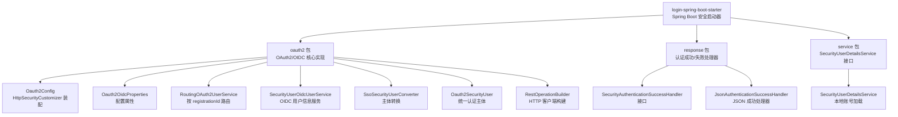
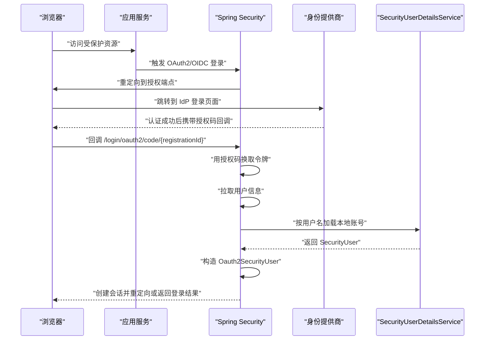
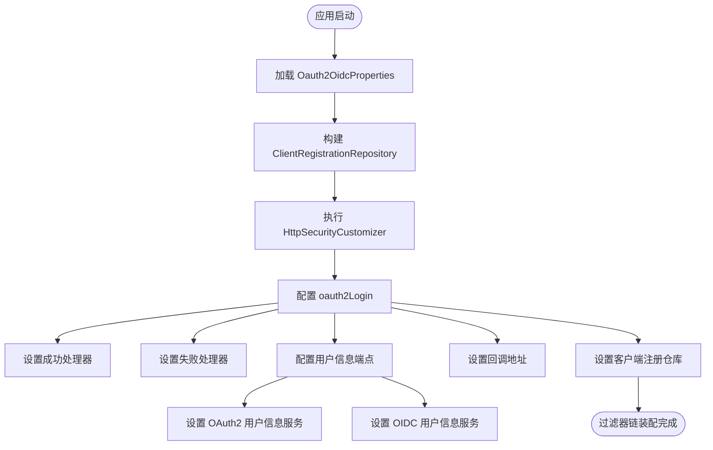
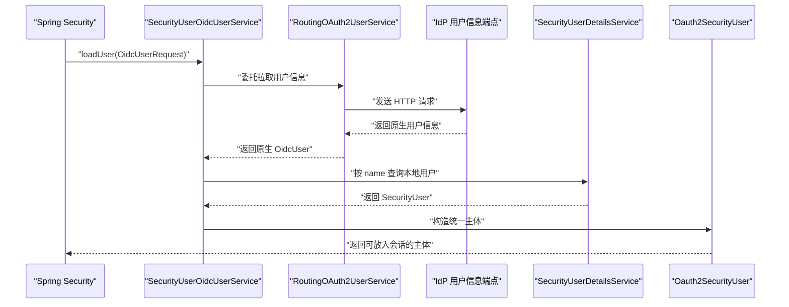
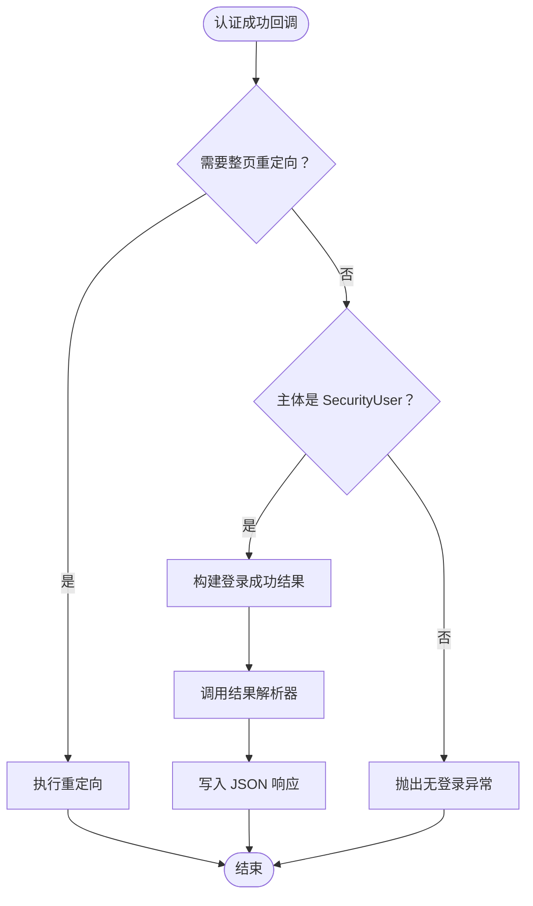
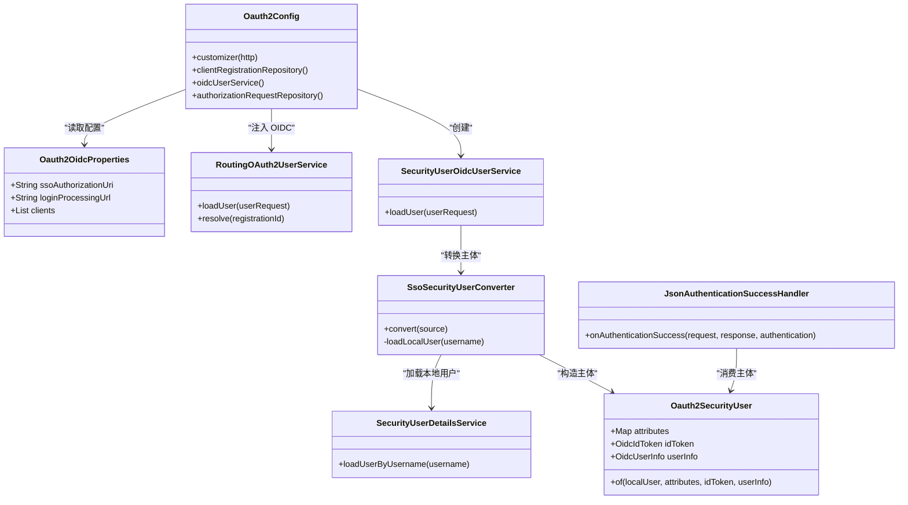

# OAuth2/OIDC 单点登录

<cite>
**本文引用的文件**   
- [Oauth2Config.java](file://login-spring-boot-starter/src/main/java/com/cu/framework/authentication/oauth2/Oauth2Config.java)
- [Oauth2OidcProperties.java](file://login-spring-boot-starter/src/main/java/com/cu/framework/authentication/oauth2/Oauth2OidcProperties.java)
- [RoutingOAuth2UserService.java](file://login-spring-boot-starter/src/main/java/com/cu/framework/authentication/oauth2/RoutingOAuth2UserService.java)
- [SecurityUserOidcUserService.java](file://login-spring-boot-starter/src/main/java/com/cu/framework/authentication/oauth2/SecurityUserOidcUserService.java)
- [SsoSecurityUserConverter.java](file://login-spring-boot-starter/src/main/java/com/cu/framework/authentication/oauth2/SsoSecurityUserConverter.java)
- [Oauth2SecurityUser.java](file://login-spring-boot-starter/src/main/java/com/cu/framework/authentication/oauth2/Oauth2SecurityUser.java)
- [RestOperationBuilder.java](file://login-spring-boot-starter/src/main/java/com/cu/framework/authentication/oauth2/RestOperationBuilder.java)
- [SecurityAuthenticationSuccessHandler.java](file://login-spring-boot-starter/src/main/java/com/cu/framework/authentication/response/SecurityAuthenticationSuccessHandler.java)
- [JsonAuthenticationSuccessHandler.java](file://login-spring-boot-starter/src/main/java/com/cu/framework/authentication/response/JsonAuthenticationSuccessHandler.java)
- [SecurityUserDetailsService.java](file://login-spring-boot-starter/src/main/java/com/cu/framework/authentication/service/SecurityUserDetailsService.java)
- [README-SSO.md](file://login-spring-boot-starter/README-SSO.md)
</cite>

## 目录
1. [引言](#引言)
2. [项目结构](#项目结构)
3. [核心组件](#核心组件)
4. [架构总览](#架构总览)
5. [详细组件分析](#详细组件分析)
6. [依赖关系分析](#依赖关系分析)
7. [性能与安全性考虑](#性能与安全性考虑)
8. [OIDC 集成配置示例](#oidc-集成配置示例)
9. [令牌生命周期与刷新说明](#令牌生命周期与刷新说明)
10. [常见问题排查指南](#常见问题排查指南)
11. [结论](#结论)

## 引言
本仓库通过 `login-spring-boot-starter` 提供基于 Spring Security 的 OAuth2 与 OIDC 单点登录能力。身份提供商（IdP）只负责证明“这个人是谁”，认证后的账号信息、权限、菜单等均由业务侧的 `SecurityUserDetailsService` 加载；协议层返回的身份源声明和 ID Token 仅保留在统一认证主体上，供依赖 OIDC 的功能使用，不直接参与授权判定。

该实现支持：
- 授权码模式的 OAuth2 与 OIDC 登录
- 多客户端注册，支持手动端点配置或 OIDC Issuer 自动发现
- 按客户端区分用户信息拉取行为，包括是否跳过 SSL 校验
- 将身份源主体转换为框架统一的 `Oauth2SecurityUser`
- 统一的认证成功处理逻辑，既支持 JSON 响应也支持整页重定向

## 项目结构
OAuth2/OIDC 相关代码集中在 `login-spring-boot-starter` 模块中，核心目录如下：

**图表来源**
- [Oauth2Config.java:1-120](file://login-spring-boot-starter/src/main/java/com/cu/framework/authentication/oauth2/Oauth2Config.java#L1-L120)
- [Oauth2OidcProperties.java:1-80](file://login-spring-boot-starter/src/main/java/com/cu/framework/authentication/oauth2/Oauth2OidcProperties.java#L1-L80)
- [RoutingOAuth2UserService.java:1-99](file://login-spring-boot-starter/src/main/java/com/cu/framework/authentication/oauth2/RoutingOAuth2UserService.java#L1-L99)
- [SecurityUserOidcUserService.java:1-37](file://login-spring-boot-starter/src/main/java/com/cu/framework/authentication/oauth2/SecurityUserOidcUserService.java#L1-L37)
- [SsoSecurityUserConverter.java:1-75](file://login-spring-boot-starter/src/main/java/com/cu/framework/authentication/oauth2/SsoSecurityUserConverter.java#L1-L75)
- [Oauth2SecurityUser.java:1-81](file://login-spring-boot-starter/src/main/java/com/cu/framework/authentication/oauth2/Oauth2SecurityUser.java#L1-L81)
- [RestOperationBuilder.java:1-107](file://login-spring-boot-starter/src/main/java/com/cu/framework/authentication/oauth2/RestOperationBuilder.java#L1-L107)
- [SecurityAuthenticationSuccessHandler.java:1-32](file://login-spring-boot-starter/src/main/java/com/cu/framework/authentication/response/SecurityAuthenticationSuccessHandler.java#L1-L32)
- [JsonAuthenticationSuccessHandler.java:1-95](file://login-spring-boot-starter/src/main/java/com/cu/framework/authentication/response/JsonAuthenticationSuccessHandler.java#L1-L95)
- [SecurityUserDetailsService.java:1-27](file://login-spring-boot-starter/src/main/java/com/cu/framework/authentication/service/SecurityUserDetailsService.java#L1-L27)

**章节来源**
- [Oauth2Config.java:1-120](file://login-spring-boot-starter/src/main/java/com/cu/framework/authentication/oauth2/Oauth2Config.java#L1-L120)
- [README-SSO.md:1-120](file://login-spring-boot-starter/README-SSO.md#L1-L120)

## 核心组件
本节从配置、协议装配、用户信息同步、主体转换和认证成功处理五个维度说明核心组件。

### Oauth2Config：OAuth2/OIDC 装配入口
`Oauth2Config` 实现 `HttpSecurityCustomizer`，把 OAuth2/OIDC 登录配置注入到 Spring Security 过滤器链中。它的主要职责包括：
- 创建并注册 `AuthorizationRequestRepository`，用于保存授权请求中的 `state` 等参数。
- 注册默认的令牌交换客户端。
- 构建内存版 `ClientRegistrationRepository`，根据配置生成多个 OAuth2/OIDC 客户端。
- 为 OAuth2 非 OIDC 场景注册 `securityUserOAuth2UserService()`，为 OIDC 场景注册 `oidcUserService()`。
- 设置 `oauth2Login` 的成功处理器、失败处理器、回调地址、用户信息服务和客户端注册仓库。
- 为 OIDC RP-Initiated Logout 提供默认成功处理器。

关键流程位置：
- `customizer(HttpSecurity)`：装配 `oauth2Login` 过滤器链。
- `clientRegistrationRepository()`：按 `protocolType` 分支构造 `ClientRegistration`。
- `createOAuth2ClientRegistration()`：手动端点模式。
- `createOidcClientRegistration()`：Issuer 自动发现模式。

**章节来源**
- [Oauth2Config.java:1-120](file://login-spring-boot-starter/src/main/java/com/cu/framework/authentication/oauth2/Oauth2Config.java#L1-L120)
- [Oauth2Config.java:180-271](file://login-spring-boot-starter/src/main/java/com/cu/framework/authentication/oauth2/Oauth2Config.java#L180-L271)

### Oauth2OidcProperties：配置模型
`Oauth2OidcProperties` 是统一配置入口，前缀为 `cu.security.login.oauth2`。它定义全局配置以及每个客户端的注册属性。

重要字段含义：
| 配置项 | 类型 | 必填 | 说明 |
|---|---|---:|---|
| `ssoAuthorizationUri` | String | 否 | 本地发起认证的授权端点基础路径，默认为 `/oauth2/authorization` |
| `loginProcessingUrl` | String | 否 | 身份提供商回调处理端点，默认由 Spring Security 提供 |
| `clients` | List | 是 | 客户端注册列表，支持多个 IdP |
| `clients[].registrationId` | String | 是 | 客户端唯一标识，用于 URL 和日志区分不同 IdP |
| `clients[].clientId` | String | 是 | 身份提供商分配的客户端 ID |
| `clients[].clientSecret` | String | 是 | 身份提供商分配的客户端密钥 |
| `clients[].clientName` | String | 否 | 客户端显示名称，用于日志和调试 |
| `clients[].clientAuthenticationMethod` | Enum | 否 | 客户端认证方式，如 Basic、POST、None |
| `clients[].authorizationGrantType` | Enum | 否 | 当前仅支持授权码模式 |
| `clients[].redirectUriTemplate` | String | 否 | 回调地址模板，默认包含 `{baseUrl}` 和 `{registrationId}` |
| `clients[].scopes` | Set<String> | 是 | 申请的权限范围；OIDC 模式下会自动确保包含 `openid` |
| `clients[].issuerUri` | String | OIDC 时推荐 | OIDC 自动发现端点，省略手动端点后由系统自动发现 |
| `clients[].authorizationUri` | String | 手动 OAuth2 时必填 | 授权端点 URL |
| `clients[].tokenUri` | String | 手动 OAuth2 时必填 | 令牌端点 URL |
| `clients[].userInfoUri` | String | 手动 OAuth2 时必填 | 用户信息端点 URL |
| `clients[].userInfoAuthenticationMethod` | Enum | 否 | 用户信息端点认证方式，默认 Header |
| `clients[].userNameAttributeName` | String | 推荐 | 用户名属性名，用于映射到本地账号 |
| `clients[].jwkSetUri` | String | 否 | JWK Set 端点，用于验证 ID Token |
| `clients[].ignoreSsl` | boolean | 否 | 是否跳过 userinfo 端点的 SSL 证书与主机名校验，生产环境必须关闭 |

OIDC 模式下，如果未显式配置 `userNameAttributeName`，则主体标识会回退到 `sub`。由于 `sub` 通常是身份提供商的内部数字 ID，一般不等于本系统用户名，因此建议显式配置为 `preferred_username` 或其他能对应本地账号的属性。

**章节来源**
- [Oauth2OidcProperties.java:1-120](file://login-spring-boot-starter/src/main/java/com/cu/framework/authentication/oauth2/Oauth2OidcProperties.java#L1-L120)
- [Oauth2OidcProperties.java:180-236](file://login-spring-boot-starter/src/main/java/com/cu/framework/authentication/oauth2/Oauth2OidcProperties.java#L180-L236)

### RoutingOAuth2UserService：按客户端路由的用户信息拉取
`RoutingOAuth2UserService` 是一个 `OAuth2UserService` 实现，核心职责是“按 `registrationId` 决定这次用户信息请求走哪个 HTTP 客户端”，不负责把身份源主体转换成框架统一主体。

关键特性：
- 构造期根据配置建立 `registrationId` 到 `OAuth2UserService` 的映射。
- 对 `ignoreSsl=true` 的客户端，替换底层 `RestOperations`，跳过证书与主机名校验，并记录告警日志。
- 对未匹配到的 `registrationId`，返回标准安全回退实现，避免“漏配客户端”导致静默信任所有证书。
- 自定义 `RestOperationBuilder` 不仅控制 SSL，还替换消息转换器与错误处理器，容忍部分 IdP 返回的非标准响应。

**章节来源**
- [RoutingOAuth2UserService.java:1-99](file://login-spring-boot-starter/src/main/java/com/cu/framework/authentication/oauth2/RoutingOAuth2UserService.java#L1-L99)
- [RestOperationBuilder.java:1-107](file://login-spring-boot-starter/src/main/java/com/cu/framework/authentication/oauth2/RestOperationBuilder.java#L1-L107)

### SecurityUserOidcUserService：OIDC 用户信息同步
`SecurityUserOidcUserService` 继承 Spring Security 的 `OidcUserService`，复用父类的 ID Token 校验、nonce 校验和用户信息拉取逻辑，只在拿到原生 `OidcUser` 之后调用 `SsoSecurityUserConverter` 转换为统一主体。

这意味着：
- OIDC 的标准校验发生在主体转换之前。
- 最终主体仍实现 `OidcUser`，因此依赖 ID Token 的会话终止等功能不受影响。
- 原始声明、ID Token、UserInfo 会进入统一主体，供上层使用。

**章节来源**
- [SecurityUserOidcUserService.java:1-37](file://login-spring-boot-starter/src/main/java/com/cu/framework/authentication/oauth2/SecurityUserOidcUserService.java#L1-L37)

### SsoSecurityUserConverter：身份源主体到统一主体
`SsoSecurityUserConverter` 把身份提供商返回的原生 `OAuth2User` 转换为 `Oauth2SecurityUser`。其流程：
1. 以原生主体的 `name` 作为本地用户名。
2. 调用 `SecurityUserDetailsService.loadUserByUsername` 获取本地账号。
3. 如果找不到本地账号，抛出带明确错误码的异常，而不是创建空权限会话。
4. 如果是 OIDC 主体，则取出 ID Token 和 UserInfo。
5. 构造 `Oauth2SecurityUser`，复制本地用户信息，并挂上身份源原始声明。

这个设计保证：
- 身份源只提供“身份”，权限由本地系统提供。
- 认证失败方向明确：本地没有该用户时登录失败。
- OIDC 元数据不会丢失，仍可被依赖 `OidcUser` 的逻辑使用。

**章节来源**
- [SsoSecurityUserConverter.java:1-75](file://login-spring-boot-starter/src/main/java/com/cu/framework/authentication/oauth2/SsoSecurityUserConverter.java#L1-L75)

### Oauth2SecurityUser：统一认证主体
`Oauth2SecurityUser` 继承框架的 `SecurityUser` 并实现 `OidcUser`，是 OAuth2 与 OIDC 登录后的统一主体类型。

主要字段：
- `attributes`：身份源返回的原始声明；OIDC 下为 ID Token 与 UserInfo 合并后的声明集。
- `idToken`：OIDC 的 ID Token；纯 OAuth2 客户端为 null。
- `userInfo`：OIDC 的 UserInfo；未拉取用户信息端点时为 null。

工厂方法 `of` 会复制本地用户信息，并把身份源原始数据设为不可变映射，避免外部篡改。

**章节来源**
- [Oauth2SecurityUser.java:1-81](file://login-spring-boot-starter/src/main/java/com/cu/framework/authentication/oauth2/Oauth2SecurityUser.java#L1-L81)

### 认证成功处理器：SecurityAuthenticationSuccessHandler 与 JsonAuthenticationSuccessHandler
`SecurityAuthenticationSuccessHandler` 是认证成功处理器的统一接口，同时兼容登出成功处理。  
`JsonAuthenticationSuccessHandler` 是具体实现，主要职责：
- 判断是否需要整页重定向：单点登录回调通常由浏览器承载，应返回重定向。
- 校验认证主体是否为 `SecurityUser`，不是则抛出无登录异常。
- 组装登录成功结果，填充会话 ID 和登录时间。
- 通过 `AuthenticationSuccessResultResolver` 生成最终结果并序列化为 JSON。

注意：文档中提到的 `OAuth2AuthenticationSuccessHandler` 并非本项目实现的类；本项目的 OAuth2 成功处理入口是 `SecurityAuthenticationSuccessHandler` 及其实现 `JsonAuthenticationSuccessHandler`，并由 `Oauth2Config` 装配到 `oauth2Login.successHandler`。

**章节来源**
- [SecurityAuthenticationSuccessHandler.java:1-32](file://login-spring-boot-starter/src/main/java/com/cu/framework/authentication/response/SecurityAuthenticationSuccessHandler.java#L1-L32)
- [JsonAuthenticationSuccessHandler.java:1-95](file://login-spring-boot-starter/src/main/java/com/cu/framework/authentication/response/JsonAuthenticationSuccessHandler.java#L1-L95)
- [Oauth2Config.java:60-120](file://login-spring-boot-starter/src/main/java/com/cu/framework/authentication/oauth2/Oauth2Config.java#L60-L120)

## 架构总览
下图展示 OAuth2/OIDC 登录从浏览器访问受保护资源到创建本地会话的整体流程。

**图表来源**
- [Oauth2Config.java:60-120](file://login-spring-boot-starter/src/main/java/com/cu/framework/authentication/oauth2/Oauth2Config.java#L60-L120)
- [SsoSecurityUserConverter.java:30-75](file://login-spring-boot-starter/src/main/java/com/cu/framework/authentication/oauth2/SsoSecurityUserConverter.java#L30-L75)
- [JsonAuthenticationSuccessHandler.java:30-95](file://login-spring-boot-starter/src/main/java/com/cu/framework/authentication/response/JsonAuthenticationSuccessHandler.java#L30-L95)

## 详细组件分析

### 配置装配流程
`Oauth2Config.customizer` 是 OAuth2/OIDC 登录的核心装配点。它完成以下工作：
1. 读取 `Oauth2OidcProperties`。
2. 构建 `ClientRegistrationRepository`。
3. 配置 `oauth2Login` 的成功处理器、失败处理器、授权端点基础路径、回调地址。
4. 为 `userInfoEndpoint` 设置非 OIDC 用户的 `userService` 和 OIDC 的 `oidcUserService`。
5. 为 OIDC 提供 RP-Initiated Logout 处理器。

**图表来源**
- [Oauth2Config.java:60-120](file://login-spring-boot-starter/src/main/java/com/cu/framework/authentication/oauth2/Oauth2Config.java#L60-L120)
- [Oauth2Config.java:180-271](file://login-spring-boot-starter/src/main/java/com/cu/framework/authentication/oauth2/Oauth2Config.java#L180-L271)

**章节来源**
- [Oauth2Config.java:60-120](file://login-spring-boot-starter/src/main/java/com/cu/framework/authentication/oauth2/Oauth2Config.java#L60-L120)
- [Oauth2Config.java:180-271](file://login-spring-boot-starter/src/main/java/com/cu/framework/authentication/oauth2/Oauth2Config.java#L180-L271)

### OIDC 用户信息同步机制
OIDC 的用户信息同步链路如下：
1. Spring Security 使用 `OidcUserService` 拉取用户信息。
2. `OidcUserService` 内部委托给 `routingOauth2UserService()`，即 `RoutingOAuth2UserService`。
3. `RoutingOAuth2UserService` 根据 `registrationId` 选择是否启用 SSL 白名单。
4. 成功后返回原生 `OidcUser`。
5. `SecurityUserOidcUserService` 调用 `SsoSecurityUserConverter.convert`。
6. 转换器以主体 `name` 调用 `SecurityUserDetailsService` 加载本地用户。
7. 构造 `Oauth2SecurityUser`，保留 ID Token 和 UserInfo。

**图表来源**
- [SecurityUserOidcUserService.java:1-37](file://login-spring-boot-starter/src/main/java/com/cu/framework/authentication/oauth2/SecurityUserOidcUserService.java#L1-L37)
- [RoutingOAuth2UserService.java:1-99](file://login-spring-boot-starter/src/main/java/com/cu/framework/authentication/oauth2/RoutingOAuth2UserService.java#L1-L99)
- [SsoSecurityUserConverter.java:1-75](file://login-spring-boot-starter/src/main/java/com/cu/framework/authentication/oauth2/SsoSecurityUserConverter.java#L1-L75)
- [Oauth2SecurityUser.java:1-81](file://login-spring-boot-starter/src/main/java/com/cu/framework/authentication/oauth2/Oauth2SecurityUser.java#L1-L81)

**章节来源**
- [SecurityUserOidcUserService.java:1-37](file://login-spring-boot-starter/src/main/java/com/cu/framework/authentication/oauth2/SecurityUserOidcUserService.java#L1-L37)
- [RoutingOAuth2UserService.java:1-99](file://login-spring-boot-starter/src/main/java/com/cu/framework/authentication/oauth2/RoutingOAuth2UserService.java#L1-L99)
- [SsoSecurityUserConverter.java:1-75](file://login-spring-boot-starter/src/main/java/com/cu/framework/authentication/oauth2/SsoSecurityUserConverter.java#L1-L75)

### 认证成功处理流程
认证成功后，Spring Security 调用 `SecurityAuthenticationSuccessHandler`。在本项目中，默认实现是 `JsonAuthenticationSuccessHandler`。

处理步骤：
1. 判断本次登录是否应该整页重定向。
2. 检查主体是否为 `SecurityUser`。
3. 封装 `LoginSuccessResult`，包含本地用户、会话 ID、登录时间。
4. 调用结果解析器生成最终响应体。
5. 以 JSON 形式写出响应。

**图表来源**
- [JsonAuthenticationSuccessHandler.java:30-95](file://login-spring-boot-starter/src/main/java/com/cu/framework/authentication/response/JsonAuthenticationSuccessHandler.java#L30-L95)

**章节来源**
- [JsonAuthenticationSuccessHandler.java:1-95](file://login-spring-boot-starter/src/main/java/com/cu/framework/authentication/response/JsonAuthenticationSuccessHandler.java#L1-L95)

## 依赖关系分析
下图展示 OAuth2/OIDC 核心类之间的依赖关系。

**图表来源**
- [Oauth2Config.java:1-120](file://login-spring-boot-starter/src/main/java/com/cu/framework/authentication/oauth2/Oauth2Config.java#L1-L120)
- [Oauth2OidcProperties.java:1-120](file://login-spring-boot-starter/src/main/java/com/cu/framework/authentication/oauth2/Oauth2OidcProperties.java#L1-L120)
- [RoutingOAuth2UserService.java:1-99](file://login-spring-boot-starter/src/main/java/com/cu/framework/authentication/oauth2/RoutingOAuth2UserService.java#L1-L99)
- [SecurityUserOidcUserService.java:1-37](file://login-spring-boot-starter/src/main/java/com/cu/framework/authentication/oauth2/SecurityUserOidcUserService.java#L1-L37)
- [SsoSecurityUserConverter.java:1-75](file://login-spring-boot-starter/src/main/java/com/framework/authentication/oauth2/SsoSecurityUserConverter.java#L1-L75)
- [Oauth2SecurityUser.java:1-81](file://login-spring-boot-starter/src/main/java/com/cu/framework/authentication/oauth2/Oauth2SecurityUser.java#L1-L81)
- [SecurityUserDetailsService.java:1-27](file://login-spring-boot-starter/src/main/java/com/cu/framework/authentication/service/SecurityUserDetailsService.java#L1-L27)
- [JsonAuthenticationSuccessHandler.java:1-95](file://login-spring-boot-starter/src/main/java/com/cu/framework/authentication/response/JsonAuthenticationSuccessHandler.java#L1-L95)

**章节来源**
- [Oauth2Config.java:1-120](file://login-spring-boot-starter/src/main/java/com/cu/framework/authentication/oauth2/Oauth2Config.java#L1-L120)
- [SsoSecurityUserConverter.java:1-75](file://login-spring-boot-starter/src/main/java/com/cu/framework/authentication/oauth2/SsoSecurityUserConverter.java#L1-L75)
- [Oauth2SecurityUser.java:1-81](file://login-spring-boot-starter/src/main/java/com/cu/framework/authentication/oauth2/Oauth2SecurityUser.java#L1-L81)

## 性能与安全性考虑

### 性能特征
- 用户信息拉取按 `registrationId` 路由，避免向多个 IdP 重复发请求。
- 非 OIDC 与 OIDC 两条链路各进行一次统一主体转换，避免重复查库。
- `RoutingOAuth2UserService` 对 `ignoreSsl=false` 的客户端复用安全回退实现，减少对象创建。
- `JsonAuthenticationSuccessHandler` 先判断是否需要重定向，再序列化响应，避免无谓的结果解析。

### 安全性建议
- 生产环境不要开启 `ignoreSsl=true`。该选项只影响 userinfo 端点，且会跳过证书与主机名校验。
- OIDC 模式下优先使用 `issuerUri` 自动发现，并通过 JWK Set 验证 ID Token。
- 显式配置 `userNameAttributeName`，避免误用 `sub` 导致本地账号无法匹配。
- 会话表可能包含原始声明和 ID Token，不应导出或写入日志。

**章节来源**
- [RoutingOAuth2UserService.java:1-99](file://login-spring-boot-starter/src/main/java/com/cu/framework/authentication/oauth2/RoutingOAuth2UserService.java#L1-L99)
- [RestOperationBuilder.java:1-107](file://login-spring-boot-starter/src/main/java/com/cu/framework/authentication/oauth2/RestOperationBuilder.java#L1-L107)
- [Oauth2OidcProperties.java:180-236](file://login-spring-boot-starter/src/main/java/com/cu/framework/authentication/oauth2/Oauth2OidcProperties.java#L180-L236)
- [README-SSO.md:1-120](file://login-spring-boot-starter/README-SSO.md#L1-L120)

## OIDC 集成配置示例

### 通用配置要点
无论使用哪种身份提供商，都应关注：
- `registrationId`：唯一标识，出现在授权 URL 和回调 URL 中。
- `client-id` 与 `client-secret`：从身份提供商应用注册处获取。
- `authorization-uri`、`token-uri`、`user-info-uri`：手动 OAuth2 模式必填。
- `issuer-uri`：OIDC 模式推荐，可自动发现端点。
- `user-name-attribute-name`：映射到本地账号的用户名字段。
- `scopes`：OIDC 必须包含 `openid`；其他常见值包括 `profile`、`email`。
- `redirect-uri-template`：需与身份提供商后台注册的回调地址一致。

### Azure AD 集成
Azure AD 通常使用 OIDC，推荐配置方式：
- 使用 `issuerUri` 指向企业租户的 OIDC 发行者地址。
- 在 Azure AD 应用注册中配置：
  - 重定向 URI 为应用回调地址。
  - 暴露 API 或申请所需 scope。
- 将 `user-name-attribute-name` 设置为能对应本地用户名的声明，例如 `preferred_username` 或业务邮箱。
- 如需 JWT 签名验证，确保 JWK Set 可从 `issuerUri` 自动发现。

注意事项：
- Azure AD 的 `sub` 通常不是本地用户名，不建议直接用作 `user-name-attribute-name`。
- 若企业内部有自定义声明，需要在 Azure AD 应用 manifest 或声明映射中输出到 OIDC 响应。

### Google 集成
Google 支持 OIDC，典型配置：
- 使用 `issuerUri` 指向 Google 的 OIDC 发行者。
- 在 Google Cloud Console 配置 OAuth 客户端类型和重定向 URI。
- 常用 `user-name-attribute-name` 为 `email` 或 `preferred_username`，取决于应用需求和本地账号策略。
- 申请 `openid`、`profile`、`email` 等 scope。

注意事项：
- Google 可能限制某些域名或组织策略，需在 Google Admin 控制台确认允许范围。
- 测试环境网络不通时，优先检查 DNS 和出站网络，而不是开启 `ignoreSsl`。

### Keycloak 集成
Keycloak 作为自托管 IdP，适合企业内网部署：
- 使用 `issuerUri` 指向 Keycloak Realm 的 OIDC 发行者地址。
- 在 Keycloak 客户端配置中设置：
  - Client ID、Client Secret。
  - Valid Redirect URIs。
  - 需要的 Scope。
- 将 `user-name-attribute-name` 映射到 Keycloak 用户属性，如 `username`、`email` 或自定义 claim。
- 如果需要部门、角色等额外信息，可在 Keycloak Mapper 中映射到 OIDC 声明。

注意事项：
- Keycloak 默认颁发 JWT 格式的 ID Token，JWK Set 可由 `issuerUri` 自动发现。
- 若使用反向代理，注意 `baseUrl`、HTTPS、端口转发对回调地址的影响。

### 多客户端配置
同一应用可同时接入多个 IdP，例如一个用于企业域，一个用于第三方平台。每个客户端独立配置 `registrationId`、端点和用户名映射。

**章节来源**
- [Oauth2OidcProperties.java:1-120](file://login-spring-boot-starter/src/main/java/com/cu/framework/authentication/oauth2/Oauth2OidcProperties.java#L1-L120)
- [Oauth2OidcProperties.java:180-236](file://login-spring-boot-starter/src/main/java/com/cu/framework/authentication/oauth2/Oauth2OidcProperties.java#L180-L236)
- [README-SSO.md:1-200](file://login-spring-boot-starter/README-SSO.md#L1-L200)

## 令牌生命周期与刷新说明

### 当前实现覆盖范围
根据现有代码：
- 授权码模式用于换取 access_token。
- OIDC 模式下使用 `OidcUserService` 处理 ID Token 和用户信息。
- 统一主体 `Oauth2SecurityUser` 保留 `idToken` 和 `userInfo`。
- 成功处理器会将会话 ID 写入登录结果。
- OIDC 登出通过 `OidcClientInitiatedLogoutSuccessHandler` 处理。

但代码中没有看到专门的“刷新令牌存储”“主动刷新 access_token”“刷新令牌持久化”等实现。因此，令牌刷新属于扩展点，应由业务根据 IdP 支持的 token 类型和刷新策略进行补充。

### 企业级刷新建议
如果身份提供商返回 refresh_token，并且业务需要长连接服务：
1. 在 `SecurityUserDetailsService` 或扩展服务中维护 refresh_token 与本地用户的关系。
2. 在访问受限资源前检测 access_token 是否过期。
3. 调用身份提供商的 token 刷新端点获取新令牌。
4. 更新会话中的令牌状态，避免频繁刷新。
5. 处理刷新失败、令牌失效、用户注销等情况。
6. 对于服务端间调用，结合网关或 Feign 拦截器统一注入 access_token。

注意：刷新令牌本身是敏感数据，应加密存储，不应进入普通日志。

**章节来源**
- [Oauth2Config.java:180-271](file://login-spring-boot-starter/src/main/java/com/cu/framework/authentication/oauth2/Oauth2Config.java#L180-L271)
- [Oauth2SecurityUser.java:1-81](file://login-spring-boot-starter/src/main/java/com/cu/framework/authentication/oauth2/Oauth2SecurityUser.java#L1-L81)
- [SecurityUserDetailsService.java:1-27](file://login-spring-boot-starter/src/main/java/com/cu/framework/authentication/service/SecurityUserDetailsService.java#L1-L27)

## 常见问题排查指南

### 问题一：令牌验证失败
可能原因：
- JWK Set 端点不可达。
- `issuerUri` 与 IdP 实际发行者不一致。
- 网络防火墙或反向代理阻断了 `.well-known/openid-configuration` 或 JWK Set。
- 使用了错误的 HTTPS 证书或中间证书缺失。

排查建议：
- 检查 `issuerUri` 是否能正常解析 OIDC 元数据。
- 检查 JWK Set 端点是否可访问。
- 生产环境不要使用 `ignoreSsl=true`，而是导入正确证书。
- 查看启动和认证过程中的网络错误日志。

**章节来源**
- [Oauth2OidcProperties.java:180-236](file://login-spring-boot-starter/src/main/java/com/cu/framework/authentication/oauth2/Oauth2OidcProperties.java#L180-L236)
- [Oauth2Config.java:180-271](file://login-spring-boot-starter/src/main/java/com/cu/framework/authentication/oauth2/Oauth2Config.java#L180-L271)

### 问题二：用户信息不同步
可能原因：
- `user-name-attribute-name` 配置错误。
- 身份提供商未返回该声明。
- 本地 `SecurityUserDetailsService` 没有该用户名对应的账号。
- OIDC 模式下误用 `sub` 作为用户名。

排查建议：
- 确认 IdP 返回的用户信息中包含配置的属性名。
- 确认本地系统存在该用户名。
- 如果使用 OIDC，优先使用 `preferred_username` 而非 `sub`。
- 检查 `RoutingOAuth2UserService` 是否因 `ignoreSsl` 配置差异导致请求失败。

**章节来源**
- [SsoSecurityUserConverter.java:30-75](file://login-spring-boot-starter/src/main/java/com/cu/framework/authentication/oauth2/SsoSecurityUserConverter.java#L30-L75)
- [RoutingOAuth2UserService.java:1-99](file://login-spring-boot-starter/src/main/java/com/cu/framework/authentication/oauth2/RoutingOAuth2UserService.java#L1-L99)

### 问题三：回调地址错误
可能原因：
- 应用公网地址与 IdP 后台注册的回调地址不一致。
- 使用了反向代理但未正确配置 `baseUrl`。
- `redirect-uri-template` 被覆盖为错误值。
- 开发环境与生产环境共用同一个 IdP 客户端配置。

排查建议：
- 核对浏览器实际跳转的回调地址。
- 检查应用对外暴露的根地址。
- 在 IdP 后台检查已注册的 redirect URI。
- 区分不同环境的 `registrationId` 和客户端配置。

**章节来源**
- [Oauth2OidcProperties.java:1-120](file://login-spring-boot-starter/src/main/java/com/cu/framework/authentication/oauth2/Oauth2OidcProperties.java#L1-L120)
- [README-SSO.md:1-200](file://login-spring-boot-starter/README-SSO.md#L1-L200)

### 问题四：登录后权限为空或用户不存在
可能原因：
- 身份源用户名与本地账号不匹配。
- `SecurityUserDetailsService` 实现没有返回权限数据。
- 本地用户被禁用或缺少必要角色。

排查建议：
- 检查 `SsoSecurityUserConverter` 抛出的本地用户不存在错误。
- 确认 `SecurityUserDetailsService.loadUserByUsername` 能加载到完整权限。
- 不要依赖身份提供商返回的角色做授权，应以本地系统为准。

**章节来源**
- [SsoSecurityUserConverter.java:30-75](file://login-spring-boot-starter/src/main/java/com/cu/framework/authentication/oauth2/SsoSecurityUserConverter.java#L30-L75)
- [SecurityUserDetailsService.java:1-27](file://login-spring-boot-starter/src/main/java/com/cu/framework/authentication/service/SecurityUserDetailsService.java#L1-L27)

## 结论
本项目的 OAuth2/OIDC 单点登录实现围绕四个关键点展开：
1. **配置驱动**：通过 `Oauth2OidcProperties` 统一管理 OAuth2 手动模式和 OIDC 自动发现模式。
2. **协议解耦**：`RoutingOAuth2UserService` 只负责按客户端路由用户信息拉取，`SecurityUserOidcUserService` 只负责 OIDC 主体转换。
3. **身份与权限分离**：身份源只提供身份，权限来自 `SecurityUserDetailsService`，最终统一为 `Oauth2SecurityUser`。
4. **统一认证成功处理**：`SecurityAuthenticationSuccessHandler` 与 `JsonAuthenticationSuccessHandler` 提供一致的登录结果处理。

在企业环境中，应重点完善：
- 多 IdP 的配置管理。
- 本地账号与身份源属性的稳定映射。
- 刷新令牌的生命周期管理。
- 反向代理、证书、域名和回调地址的一致性治理。