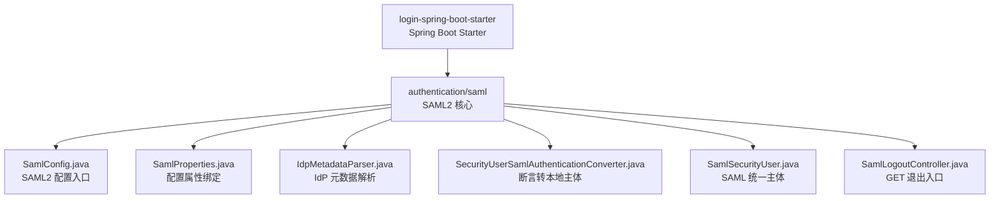
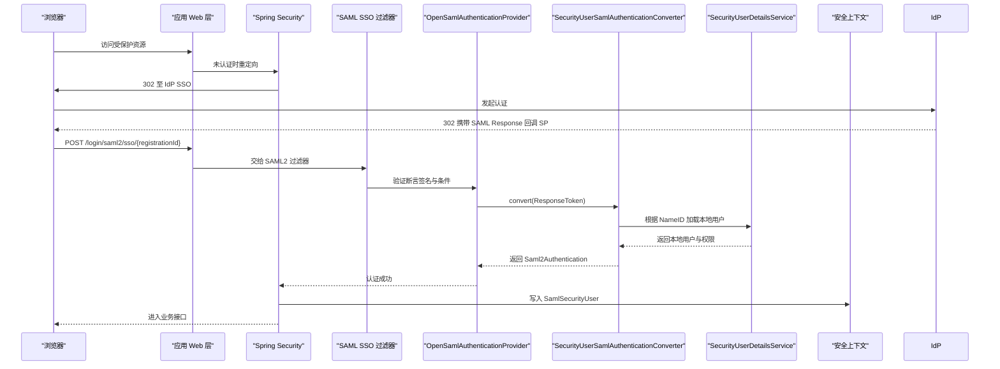
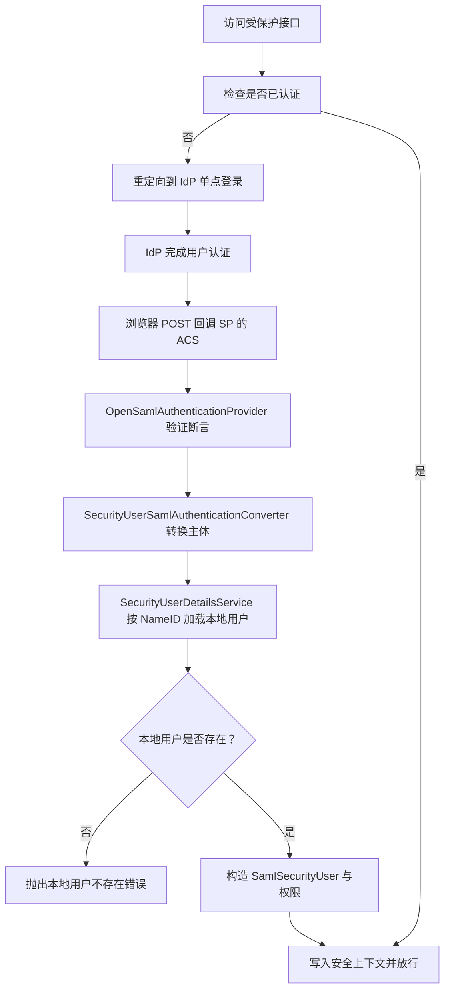
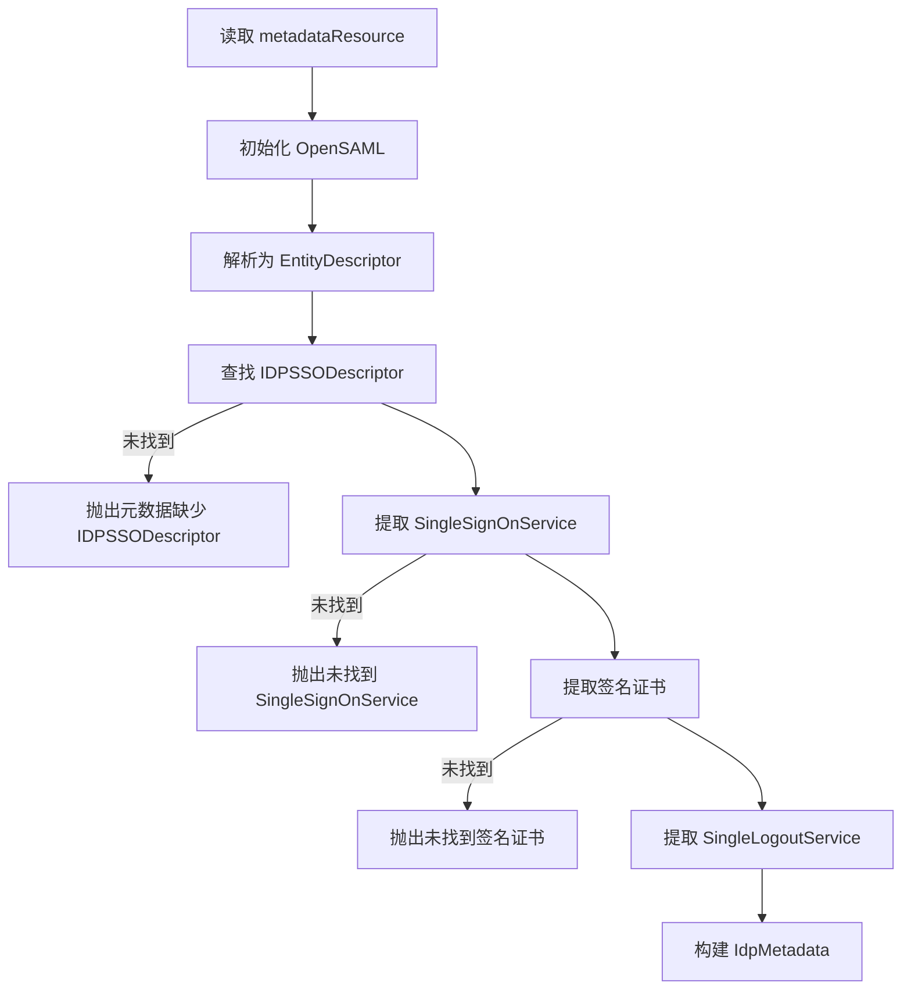
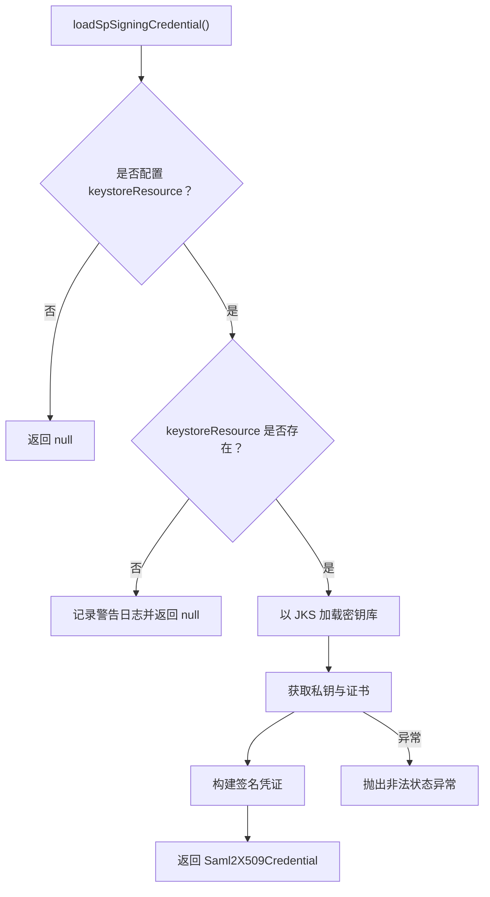
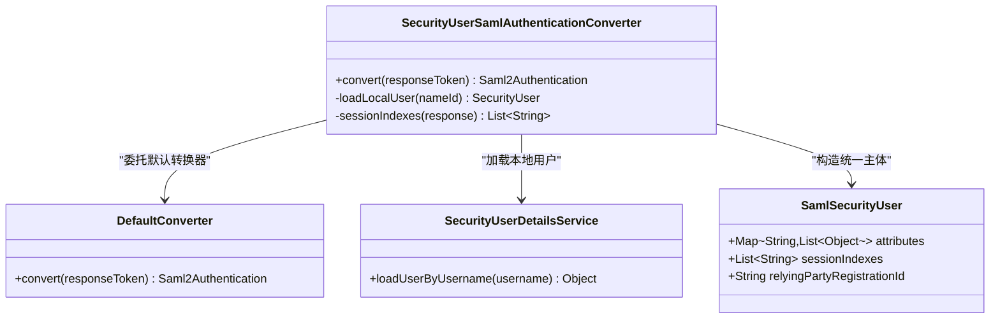
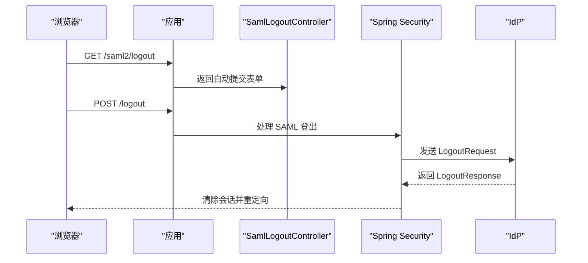
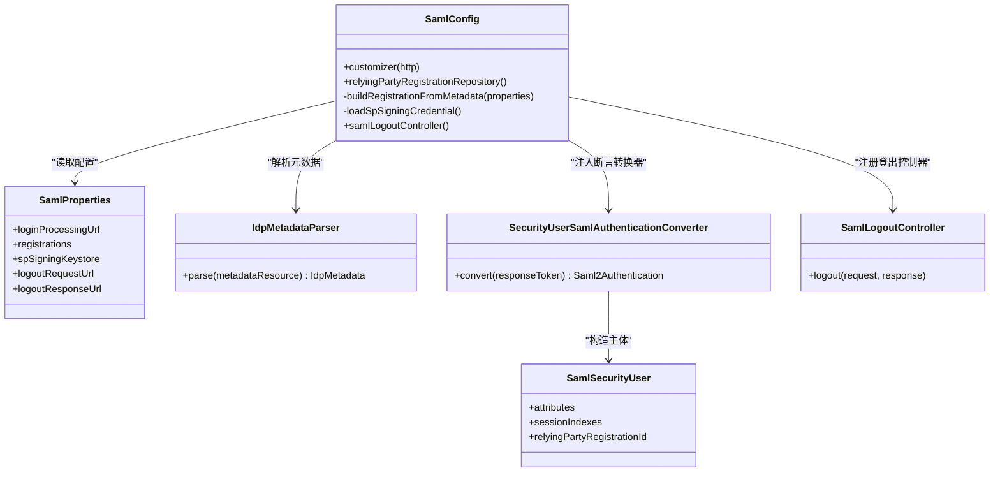

# SAML2 单点登录

<cite>
**本文引用的文件**   
- [SamlConfig.java](file://login-spring-boot-starter/src/main/java/com/cu/framework/authentication/saml/SamlConfig.java)
- [SamlProperties.java](file://login-spring-boot-starter/src/main/java/com/cu/framework/authentication/saml/properties/SamlProperties.java)
- [IdpMetadataParser.java](file://login-spring-boot-starter/src/main/java/com/cu/framework/authentication/saml/IdpMetadataParser.java)
- [SecurityUserSamlAuthenticationConverter.java](file://login-spring-boot-starter/src/main/java/com/cu/framework/authentication/saml/SecurityUserSamlAuthenticationConverter.java)
- [SamlSecurityUser.java](file://login-spring-boot-starter/src/main/java/com/cu/framework/authentication/saml/SamlSecurityUser.java)
- [SamlLogoutController.java](file://login-spring-boot-starter/src/main/java/com/cu/framework/authentication/saml/SamlLogoutController.java)
- [README.md](file://login-spring-boot-starter/README.md)
</cite>

## 目录
1. [引言](#引言)
2. [项目结构定位](#项目结构定位)
3. [核心组件总览](#核心组件总览)
4. [架构概览](#架构概览)
5. [配置详解：SamlConfig 与 SamlProperties](#配置详解samlconfig-与-samlproperties)
6. [SAML 认证流程](#saml-认证流程)
7. [身份提供商元数据解析器](#身份提供商元数据解析器)
8. [证书管理与密钥库配置](#证书管理与密钥库配置)
9. [断言处理、用户映射与权限转换](#断言处理用户映射与权限转换)
10. [单点登出流程](#单点登出流程)
11. [多身份提供商配置示例](#多身份提供商配置示例)
12. [依赖关系分析](#依赖关系分析)
13. [性能与可靠性特征](#性能与可靠性特征)
14. [常见问题诊断与解决方案](#常见问题诊断与解决方案)
15. [结论](#结论)

## 引言
本文面向需要在本框架中集成 SAML2 单点登录的开发者与运维人员，围绕 `SamlConfig` 配置类、`SamlProperties` 配置属性、身份提供商元数据解析器、断言转换器、证书密钥库以及单点登出控制器展开。文档既给出代码级实现路径，也提供可操作的配置说明和故障排查建议。

本仓库中的 SAML2 服务提供方能力集中在 `login-spring-boot-starter` 模块的 `com.cu.framework.authentication.saml` 包下，通过 Spring Security 的 SAML2 扩展与 OpenSAML 实现交互，并把自己的统一认证主体注入到安全上下文。

## 项目结构定位
SAML2 相关源码位于 `login-spring-boot-starter` 模块：

**图表来源**
- [SamlConfig.java:1-233](file://login-spring-boot-starter/src/main/java/com/cu/framework/authentication/saml/SamlConfig.java#L1-L233)
- [SamlProperties.java:1-149](file://login-spring-boot-starter/src/main/java/com/cu/framework/authentication/saml/properties/SamlProperties.java#L1-L149)
- [IdpMetadataParser.java:1-232](file://login-spring-boot-starter/src/main/java/com/cu/framework/authentication/saml/IdpMetadataParser.java#L1-L232)
- [SecurityUserSamlAuthenticationConverter.java:1-89](file://login-spring-boot-starter/src/main/java/com/cu/framework/authentication/saml/SecurityUserSamlAuthenticationConverter.java#L1-L89)
- [SamlSecurityUser.java:1-72](file://login-spring-boot-starter/src/main/java/com/cu/framework/authentication/saml/SamlSecurityUser.java#L1-L72)
- [SamlLogoutController.java:1-50](file://login-spring-boot-starter/src/main/java/com/cu/framework/authentication/saml/SamlLogoutController.java#L1-L50)

**章节来源**
- [SamlConfig.java:1-233](file://login-spring-boot-starter/src/main/java/com/cu/framework/authentication/saml/SamlConfig.java#L1-L233)

## 核心组件总览
| 组件 | 职责 | 关键行为 |
|---|---|---|
| `SamlConfig` | 将 SAML2 登录、登出、SP metadata 端点注入 Spring Security | 创建 `OpenSamlAuthenticationProvider`、注册 `RelyingPartyRegistrationRepository`、挂载 `Saml2MetadataFilter` |
| `SamlProperties` | 绑定 `cu.security.login.saml.*` 配置项 | 定义 ACS 地址、registrations、SP 签名密钥库、登出回调地址 |
| `IdpMetadataParser` | 从 IdP 的 `metadata.xml` 解析实体标识、SSO URL、绑定方式、验签证书、WantAuthnRequestsSigned、SLO 地址 | 优先 HTTP-POST，其次 HTTP-Redirect；解析 X.509 证书 |
| `SecurityUserSamlAuthenticationConverter` | 接管断言校验后的主体组装 | 调用默认转换器取属性与 NameID，再加载本地用户，产出 `Saml2Authentication` |
| `SamlSecurityUser` | SAML 统一认证主体 | 继承本地 `SecurityUser`，同时实现 `Saml2AuthenticatedPrincipal`，保留原始属性与会话索引 |
| `SamlLogoutController` | 提供 GET 退出入口 | 返回自动提交 POST `/logout` 的页面，触发 Spring Security 的 SAML 登出 |

**章节来源**
- [SamlConfig.java:49-233](file://login-spring-boot-starter/src/main/java/com/cu/framework/authentication/saml/SamlConfig.java#L49-L233)
- [SamlProperties.java:24-149](file://login-spring-boot-starter/src/main/java/com/cu/framework/authentication/saml/properties/SamlProperties.java#L24-L149)
- [IdpMetadataParser.java:1-232](file://login-spring-boot-starter/src/main/java/com/cu/framework/authentication/saml/IdpMetadataParser.java#L1-L232)
- [SecurityUserSamlAuthenticationConverter.java:1-89](file://login-spring-boot-starter/src/main/java/com/cu/framework/authentication/saml/SecurityUserSamlAuthenticationConverter.java#L1-L89)
- [SamlSecurityUser.java:1-72](file://login-spring-boot-starter/src/main/java/com/cu/framework/authentication/saml/SamlSecurityUser.java#L1-L72)
- [SamlLogoutController.java:1-50](file://login-spring-boot-starter/src/main/java/com/cu/framework/authentication/saml/SamlLogoutController.java#L1-L50)

## 架构概览
下图展示应用启动后，SAML2 在 Spring Security 过滤链中的位置及主要对象关系。

**图表来源**
- [SamlConfig.java:72-102](file://login-spring-boot-starter/src/main/java/com/cu/framework/authentication/saml/SamlConfig.java#L72-L102)
- [SecurityUserSamlAuthenticationConverter.java:38-89](file://login-spring-boot-starter/src/main/java/com/cu/framework/authentication/saml/SecurityUserSamlAuthenticationConverter.java#L38-L89)

## 配置详解：SamlConfig 与 SamlProperties

### SamlConfig 的职责
`SamlConfig` 是 SAML2 的核心装配类，实现了 `HttpSecurityCustomizer`，在 Spring Security 初始化时完成以下工作：

1. 创建 `OpenSamlAuthenticationProvider`，并通过 `setResponseAuthenticationConverter` 替换默认的断言主体组装逻辑。
2. 显式使用 `ProviderManager(samlAuthenticationProvider)`，避免 Spring Security 自注册默认 provider 覆盖自定义转换器。
3. 注册 `RelyingPartyRegistrationRepository`，当前实现为内存注册表，由 `buildRegistrationFromMetadata` 生成。
4. 设置登录成功处理器与失败处理器，并绑定登录回调地址。
5. 配置 SAML2 登出：`/logout` 作为统一登出入口，`/logout/saml2/slo` 作为 SAML LogoutRequest 与 LogoutResponse 的接收地址。
6. 手动挂载 `Saml2MetadataFilter`，暴露 SP 的 metadata 端点，这是 Spring Security 默认不注册的增强。

**章节来源**
- [SamlConfig.java:49-102](file://login-spring-boot-starter/src/main/java/com/cu/framework/authentication/saml/SamlConfig.java#L49-L102)
- [SamlConfig.java:108-115](file://login-spring-boot-starter/src/main/java/com/cu/framework/authentication/saml/SamlConfig.java#L108-L115)

### SamlProperties 配置项
SAML 配置通过前缀 `cu.security.login.saml` 绑定。

| 配置键 | 类型 | 默认值 | 含义 |
|---|---|---|---|
| `cu.security.login.saml.login-processing-url` | 字符串 | `/login/saml2/sso/{registrationId}` | SP 的 SAML Assertion Consumer Service 地址模板 |
| `cu.security.login.saml.registrations` | 列表 | 无 | 一个或多个 IdP 注册项，至少一条 |
| `cu.security.login.saml.sp-signing-keystore.keystore-resource` | Resource | 空 | SP 签名密钥库路径 |
| `cu.security.login.saml.sp-signing-keystore.keystore-password` | 字符串 | `changeit` | JKS 密码 |
| `cu.security.login.saml.sp-signing-keystore.key-alias` | 字符串 | `sp-signing` | 密钥别名 |
| `cu.security.login.saml.sp-signing-keystore.key-password` | 字符串 | `changeit` | 私钥密码 |
| `cu.security.login.saml.logout-request-url` | 字符串 | `/logout/saml2/slo` | SAML LogoutRequest 接收地址 |
| `cu.security.login.saml.logout-response-url` | 字符串 | `/logout/saml2/slo` | SAML LogoutResponse 接收地址 |
| `cu.security.login.saml.login-page-url` | 字符串 | 空 | 已废弃字段，仅保留兼容性 |

每个 `registrations[i]` 支持：

| 子配置键 | 类型 | 默认值 | 含义 |
|---|---|---|---|
| `registrations[i].metadata-resource` | Resource | `classpath:saml/idp-metadata.xml` | IdP 元数据文件路径 |
| `registrations[i].registration-id` | 字符串 | 空 | Spring Security 注册标识；为空时回退为 `sp-entity-id` |
| `registrations[i].sp-entity-id` | 字符串 | `cu-saml` | SP 实体标识，必须与 IdP 侧配置的 Audience 一致 |
| `registrations[i].display-name` | 字符串 | 空 | 前端登录页展示名；未配置时回退到 registrationId |

注意：当前实现直接遍历 `registrations`，因此 **不能留空**，否则会在启动阶段抛异常。

**章节来源**
- [SamlProperties.java:24-149](file://login-spring-boot-starter/src/main/java/com/cu/framework/authentication/saml/properties/SamlProperties.java#L24-L149)
- [SamlConfig.java:117-148](file://login-spring-boot-starter/src/main/java/com/cu/framework/authentication/saml/SamlConfig.java#L117-L148)
- [README.md:278-288](file://login-spring-boot-starter/README.md#L278-L288)

### 配置优先级与建议
- 推荐通过 `metadata-resource` 自动解析 IdP 的 entityId、SSO URL、绑定方式、验签证书与 SLO 地址。
- `sp-entity-id` 必须与 IdP 后台配置的 SP Entity ID/Audience 完全一致。
- 如果 IdP 要求对 AuthnRequest 或 LogoutRequest 签名，应配置 `sp-signing-keystore`。
- 若 IdP 的元数据中没有 SingleLogoutService，仍需保证 `logout-request-url` 与 `logout-response-url` 指向同一 SP 接收地址，否则登出可能因 destination 校验失败。

**章节来源**
- [SamlConfig.java:146-191](file://login-spring-boot-starter/src/main/java/com/cu/framework/authentication/saml/SamlConfig.java#L146-L191)
- [README.md:381](file://login-spring-boot-starter/README.md#L381)

## SAML 认证流程
SAML2 认证从浏览器访问受保护资源开始，到本地用户进入安全上下文结束。

关键点：
- 断言签名、时间窗口、Audience、Subject 等校验发生在 `OpenSamlAuthenticationProvider` 内部，转换器只负责后续主体组装。
- 用户名来源于断言的 NameID，权限和本地账号信息来自 `SecurityUserDetailsService`。
- 如果本地找不到对应用户，会返回明确的 SAML 认证错误，而不是创建一个空权限会话。

**图表来源**
- [SamlConfig.java:72-102](file://login-spring-boot-starter/src/main/java/com/cu/framework/authentication/saml/SamlConfig.java#L72-L102)
- [SecurityUserSamlAuthenticationConverter.java:38-89](file://login-spring-boot-starter/src/main/java/com/cu/framework/authentication/saml/SecurityUserSamlAuthenticationConverter.java#L38-L89)

**章节来源**
- [SamlConfig.java:72-102](file://login-spring-boot-starter/src/main/java/com/cu/framework/authentication/saml/SamlConfig.java#L72-L102)
- [SecurityUserSamlAuthenticationConverter.java:38-89](file://login-spring-boot-starter/src/main/java/com/cu/framework/authentication/saml/SecurityUserSamlAuthenticationConverter.java#L38-L89)

## 身份提供商元数据解析器
`IdpMetadataParser` 负责解析 IdP 提供的 `metadata.xml`，并输出 `IdpMetadata` 对象。它独立于 Spring Security 版本，便于后续升级 OpenSAML 或迁移底层实现。

### 解析内容
| 字段 | 来源 | 用途 |
|---|---|---|
| `entityId` | `EntityDescriptor.getEntityID()` | 配置 asserting party 的 entityId |
| `ssoUrl` | `SingleSignOnService.location` | 构建 AuthnRequest 的目标地址 |
| `ssoBinding` | `SingleSignOnService.binding` | 选择 HTTP-POST 或 HTTP-Redirect |
| `signingCertificate` | `KeyDescriptor` 中的 X.509 证书 | 验证 IdP 响应的签名 |
| `wantAuthnRequestsSigned` | `IDPSSODescriptor.getWantAuthnRequestsSigned()` | 控制是否要求 SP 对认证请求签名 |
| `logoutUrl` | `SingleLogoutService.location` | 可选：用于补充 IdP 侧 SLO 地址 |
| `logoutBinding` | `SingleLogoutService.binding` | 可选：用于补充 IdP 侧 SLO 绑定 |

### 解析规则
- 根元素必须是 `EntityDescriptor`。
- 必须存在 `IDPSSODescriptor`。
- 必须找到 `SingleSignOnService`，否则抛异常。
- 优先选择 HTTP-POST 绑定，其次 HTTP-Redirect。
- 签名证书来自 `KeyDescriptor` 且 `use` 为 `SIGNING` 或未指定。
- 单点登出端点是可选的；没有找到时不会阻止登录，但会影响 IdP 主动发起的单点登出。

**图表来源**
- [IdpMetadataParser.java:36-73](file://login-spring-boot-starter/src/main/java/com/cu/framework/authentication/saml/IdpMetadataParser.java#L36-L73)
- [IdpMetadataParser.java:79-114](file://login-spring-boot-starter/src/main/java/com/cu/framework/authentication/saml/IdpMetadataParser.java#L79-L114)
- [IdpMetadataParser.java:116-174](file://login-spring-boot-starter/src/main/java/com/cu/framework/authentication/saml/IdpMetadataParser.java#L116-L174)

**章节来源**
- [IdpMetadataParser.java:1-232](file://login-spring-boot-starter/src/main/java/com/cu/framework/authentication/saml/IdpMetadataParser.java#L1-L232)

## 证书管理与密钥库配置

### SP 签名密钥库
当 IdP 要求对 AuthnRequest 或 LogoutRequest 签名时，需要在 `sp-signing-keystore` 中配置 SP 的私钥与证书。

`SamlConfig.loadSpSigningCredential()` 的行为如下：
1. 若未配置 keystore，返回 null，表示不使用 SP 签名。
2. 若 keystore 资源不存在，打印警告日志并返回 null。
3. 若 keystore 存在，尝试以 JKS 格式加载。
4. 从 keystore 中读取私钥与证书，并包装为 `Saml2X509Credential.signing(...)`。
5. 加载失败时抛出 `IllegalStateException`。

**图表来源**
- [SamlConfig.java:193-227](file://login-spring-boot-starter/src/main/java/com/cu/framework/authentication/saml/SamlConfig.java#L193-L227)

### 运维建议
- 开发环境可使用自签名 JKS；生产环境建议使用企业 CA 签发。
- 密钥别名、JKS 密码、私钥密码应与 IdP 侧期望保持一致。
- 如果 IdP 元数据声明 `WantAuthnRequestsSigned=true`，但未配置 SP 签名密钥库，登录时会失败。
- 证书轮换时，应先更新 IdP 侧信任的 SP 公钥，再滚动应用实例，避免中断正在进行的请求。
- 若只使用 IdP 响应签名验证而不要求 SP 签名请求，可以不配置 `sp-signing-keystore`。

**章节来源**
- [SamlConfig.java:193-227](file://login-spring-boot-starter/src/main/java/com/cu/framework/authentication/saml/SamlConfig.java#L193-L227)
- [README.md:23](file://sample/login-boot-sample/src/main/resources/saml/sp-keystore/keystore说明.md#L23)

## 断言处理、用户映射与权限转换
SAML 断言只证明“身份源认为该用户已通过认证”，但权限应由本系统决定。

`SecurityUserSamlAuthenticationConverter` 的工作流程：
1. 委托 Spring Security 默认转换器取得已完成校验的断言结果。
2. 从 `Saml2AuthenticatedPrincipal` 取出 NameID、断言属性与服务注册标识。
3. 用 NameID 调用 `SecurityUserDetailsService.loadUserByUsername` 加载本地用户。
4. 使用本地用户的账号信息和权限，构造 `SamlSecurityUser`。
5. 从第一个断言的 `AuthnStatement` 中提取会话索引，用于单点登出。
6. 返回 `Saml2Authentication`，主体是 `SamlSecurityUser`。

**图表来源**
- [SecurityUserSamlAuthenticationConverter.java:20-89](file://login-spring-boot-starter/src/main/java/com/cu/framework/authentication/saml/SecurityUserSamlAuthenticationConverter.java#L20-L89)
- [SamlSecurityUser.java:17-72](file://login-spring-boot-starter/src/main/java/com/cu/framework/authentication/saml/SamlSecurityUser.java#L17-L72)

### 用户属性映射与角色权限
- 断言中的原始属性保存在 `SamlSecurityUser.attributes` 中，类型为 `Map<String, List<Object>>`。
- 权限不是直接从断言属性映射为 Spring Security 权限，而是由 `SecurityUserDetailsService` 返回的本地用户权限决定。
- 如果需要把 IdP 属性映射为系统角色，应在 `SecurityUserDetailsService` 或相关业务层完成，而不是放在 SAML 协议适配层。

**章节来源**
- [SecurityUserSamlAuthenticationConverter.java:20-89](file://login-spring-boot-starter/src/main/java/com/cu/framework/authentication/saml/SecurityUserSamlAuthenticationConverter.java#L20-L89)
- [SamlSecurityUser.java:17-72](file://login-spring-boot-starter/src/main/java/com/cu/framework/authentication/saml/SamlSecurityUser.java#L17-L72)

## 单点登出流程
SAML 单点登出分为两类：
1. SP 主动发起：用户点击登出，SP 向 IdP 发送 LogoutRequest。
2. IdP 主动发起：IdP 向 SP 发送 LogoutResponse。

本仓库的登出配置：
- `http.saml2Logout().logoutUrl("/logout")`：统一登出入口。
- `logoutRequest().logoutUrl("/logout/saml2/slo")`：接收 IdP 发来的 LogoutRequest。
- `logoutResponse().logoutUrl("/logout/saml2/slo")`：接收 IdP 发来的 LogoutResponse。
- `SamlLogoutController` 提供 GET `/saml2/logout`，返回自动提交 POST `/logout` 的页面，方便浏览器发起登出。

**图表来源**
- [SamlConfig.java:86-102](file://login-spring-boot-starter/src/main/java/com/cu/framework/authentication/saml/SamlConfig.java#L86-L102)
- [SamlLogoutController.java:21-50](file://login-spring-boot-starter/src/main/java/com/cu/framework/authentication/saml/SamlLogoutController.java#L21-L50)

### Destination 严格匹配
当 IdP 返回 LogoutResponse 时，Spring Security 会对 destination 做全匹配校验。反向代理场景中，如果 host 拼接不正确，会导致登出失败。因此需要确保：
- `singleLogoutServiceLocation` 与 `singleLogoutServiceResponseLocation` 都通过 `{baseUrl}` 拼接。
- 反向代理的 `server.forward-headers-strategy` 或网关头部正确传递真实 host。
- IdP 配置的 SP SLO 地址与应用的 `/logout/saml2/slo` 一致。

**章节来源**
- [SamlConfig.java:86-102](file://login-spring-boot-starter/src/main/java/com/cu/framework/authentication/saml/SamlConfig.java#L86-L102)
- [SamlConfig.java:156-171](file://login-spring-boot-starter/src/main/java/com/cu/framework/authentication/saml/SamlConfig.java#L156-L171)
- [SamlLogoutController.java:21-50](file://login-spring-boot-starter/src/main/java/com/cu/framework/authentication/saml/SamlLogoutController.java#L21-L50)
- [README.md:381](file://login-spring-boot-starter/README.md#L381)

## 多身份提供商配置示例
当前实现支持多个 `registrations`，每个 registration 对应一个 IdP。典型场景包括：
- Active Directory Federation Services
- Okta
- OneLogin
- 企业内部自研 IdP

虽然各 IdP 的 metadata.xml 不同，但本仓库的通用配置方式是统一的：
1. 在每个 IdP 管理后台配置 SP Entity ID、ACS 地址、SLO 地址。
2. 下载 IdP 的 `metadata.xml`，放入 classpath，例如 `classpath:saml/idp-metadata-xxx.xml`。
3. 在 `cu.security.login.saml.registrations` 中添加多条记录，分别指向不同 metadata 文件。
4. 如需签名请求，配置共享或独立的 `sp-signing-keystore`。
5. 登录页会根据 registrations 数量渲染多个单点登录入口。

由于 IdP 元数据已经包含 entityId、SSO URL、绑定方式和证书，SP 侧不需要逐个手写这些协议字段，只需保证：
- `sp-entity-id` 与 IdP 后台一致。
- `login-processing-url` 与 IdP 后台 ACS 一致。
- `logout-request-url` 与 `logout-response-url` 与 IdP 后台 SLO 一致。
- 如 IdP 要求签名请求，则配置有效的 SP 签名密钥库。

**章节来源**
- [SamlProperties.java:36-149](file://login-spring-boot-starter/src/main/java/com/cu/framework/authentication/saml/properties/SamlProperties.java#L36-L149)
- [SamlConfig.java:117-191](file://login-spring-boot-starter/src/main/java/com/cu/framework/authentication/saml/SamlConfig.java#L117-L191)
- [README.md:282-288](file://login-spring-boot-starter/README.md#L282-L288)

## 依赖关系分析

**图表来源**
- [SamlConfig.java:49-233](file://login-spring-boot-starter/src/main/java/com/cu/framework/authentication/saml/SamlConfig.java#L49-L233)
- [SamlProperties.java:24-149](file://login-spring-boot-starter/src/main/java/com/cu/framework/authentication/saml/properties/SamlProperties.java#L24-L149)
- [IdpMetadataParser.java:1-232](file://login-spring-boot-starter/src/main/java/com/cu/framework/authentication/saml/IdpMetadataParser.java#L1-L232)
- [SecurityUserSamlAuthenticationConverter.java:1-89](file://login-spring-boot-starter/src/main/java/com/cu/framework/authentication/saml/SecurityUserSamlAuthenticationConverter.java#L1-L89)
- [SamlSecurityUser.java:1-72](file://login-spring-boot-starter/src/main/java/com/cu/framework/authentication/saml/SamlSecurityUser.java#L1-L72)
- [SamlLogoutController.java:1-50](file://login-spring-boot-starter/src/main/java/com/cu/framework/authentication/saml/SamlLogoutController.java#L1-L50)

**章节来源**
- [SamlConfig.java:49-233](file://login-spring-boot-starter/src/main/java/com/cu/framework/authentication/saml/SamlConfig.java#L49-L233)

## 性能与可靠性特征
- 元数据解析在构建 `RelyingPartyRegistrationRepository` 时执行，属于启动期开销。
- `IdpMetadataParser` 每次解析都会初始化 OpenSAML 并解析 XML，但由于注册表是内存对象，实际运行期不会重复解析。
- 登录回调路径带 `{registrationId}`，Spring Security 可通过注册标识快速定位 IdP。
- 认证过程中，NameID 到本地用户的查询发生在 `SecurityUserDetailsService`，其性能取决于后端用户服务。
- 登出对 destination 做严格匹配，适合反向代理场景，但要求配置准确。

[本节为通用性能讨论，不直接分析具体代码行]

## 常见问题诊断与解决方案

| 问题 | 现象 | 原因 | 解决方案 |
|---|---|---|---|
| 启动时报 `registrations` 空指针 | 应用无法启动 | `SamlConfig.buildRegistrationFromMetadata` 直接对 `registrations.stream()` 操作 | 至少配置一条 `registrations` |
| 元数据解析失败 | 启动或运行时抛异常 | metadata.xml 缺少 `IDPSSODescriptor`、`SingleSignOnService` 或签名证书 | 检查 IdP 提供的 metadata.xml 是否完整有效 |
| 无法找到 SingleSignOnService | 解析过程抛异常 | metadata.xml 中没有可用的 SSO 服务 | 确认 IdP 元数据包含 HTTP-POST 或 HTTP-Redirect 的 SSO 端点 |
| 无法找到签名证书 | 解析过程抛异常 | metadata.xml 没有 SIGNING 类型的 KeyDescriptor | 从 IdP 下载包含签名证书的 metadata.xml |
| WantAuthnRequestsSigned 导致登录失败 | 登录后被拒绝 | IdP 要求签名请求，但 SP 未配置密钥库 | 配置 `sp-signing-keystore`，并确保密钥有效 |
| SP 签名密钥库不存在 | 启动不报错但登录失败 | keystore 路径错误或文件缺失 | 修正 keystore 路径、JKS 密码、别名和密码 |
| 本地用户不存在 | 认证成功但无法登录 | NameID 在本系统用户表中没有对应账号 | 同步 IdP 用户名到本地系统，或在 `SecurityUserDetailsService` 中完善账号发现逻辑 |
| 登出 destination 不匹配 | 点击登出后 IdP 返回错误 | 反向代理 host 不一致或 SLO 地址不一致 | 检查 `logout-request-url`、`logout-response-url` 与反向代理 header 配置 |
| SP metadata 端点不可访问 | 无法查看 SP metadata | Spring Security 默认不注册 SP metadata 过滤器 | 本仓库已在 `SamlConfig` 中手动挂载 `Saml2MetadataFilter`，无需额外配置 |

**章节来源**
- [README.md:278-288](file://login-spring-boot-starter/README.md#L278-L288)
- [README.md:323](file://login-spring-boot-starter/README.md#L323)
- [README.md:376](file://login-spring-boot-starter/README.md#L376)
- [README.md:381](file://login-spring-boot-starter/README.md#L381)
- [SamlConfig.java:117-148](file://login-spring-boot-starter/src/main/java/com/cu/framework/authentication/saml/SamlConfig.java#L117-L148)
- [SamlConfig.java:193-227](file://login-spring-boot-starter/src/main/java/com/cu/framework/authentication/saml/SamlConfig.java#L193-L227)
- [IdpMetadataParser.java:36-73](file://login-spring-boot-starter/src/main/java/com/cu/framework/authentication/saml/IdpMetadataParser.java#L36-L73)
- [SecurityUserSamlAuthenticationConverter.java:58-89](file://login-spring-boot-starter/src/main/java/com/cu/framework/authentication/saml/SecurityUserSamlAuthenticationConverter.java#L58-L89)

## 结论
本项目的 SAML2 单点登录实现以 `SamlConfig` 为核心，通过 `SamlProperties` 绑定配置，使用 `IdpMetadataParser` 解析 IdP 元数据，用 `SecurityUserSamlAuthenticationConverter` 将 SAML 断言转换为框架统一主体，并以 `SamlSecurityUser` 承载本地用户、断言属性与会话索引。整体设计遵循“身份由 IdP 提供、权限由本系统决定”的原则，适合对接多种身份提供商，包括 AD FS、Okta、OneLogin 等企业 IdP。

在实际部署中，最重要的三个环节是：
1. 确保 `sp-entity-id`、ACS 地址、SLO 地址与 IdP 后台一致。
2. 确保 IdP 元数据完整且签名证书有效。
3. 若 IdP 要求签名请求，则配置有效的 SP 签名密钥库。