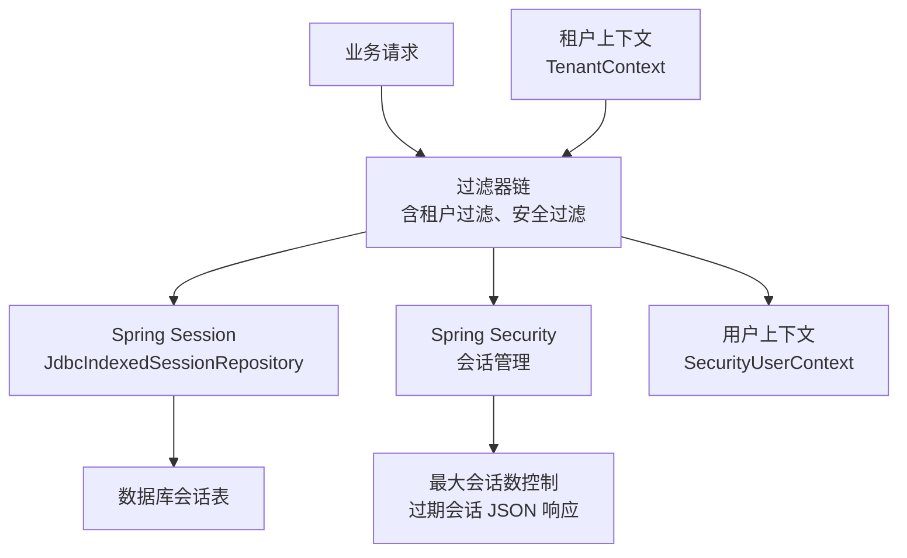
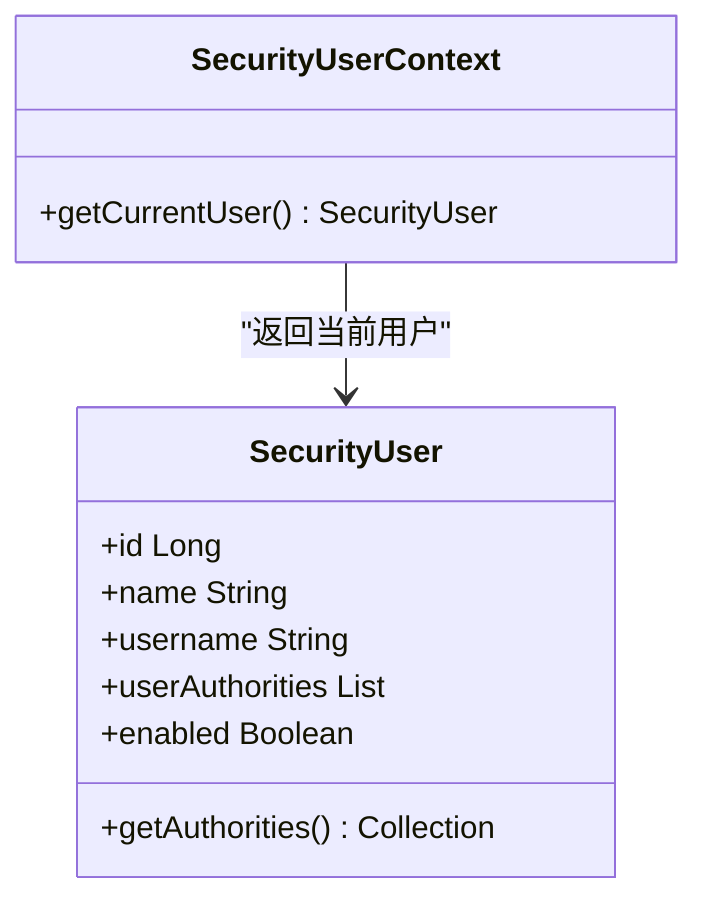
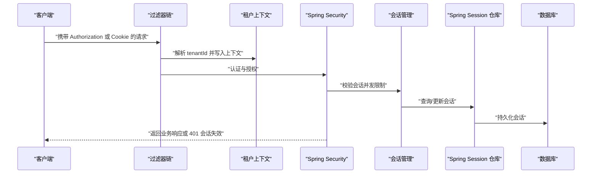
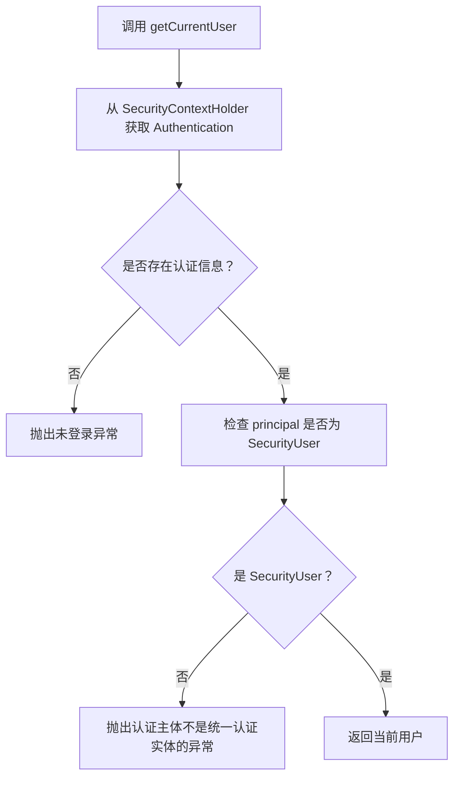
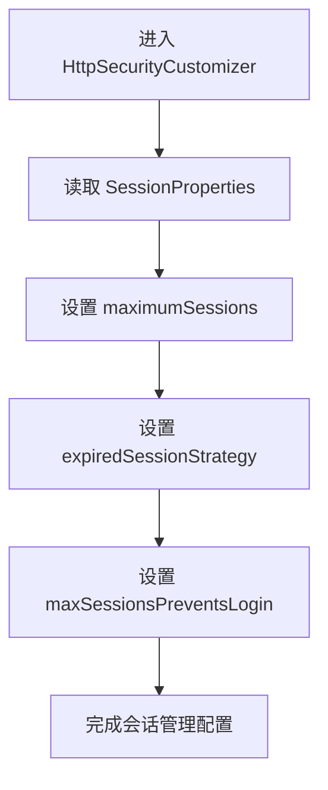
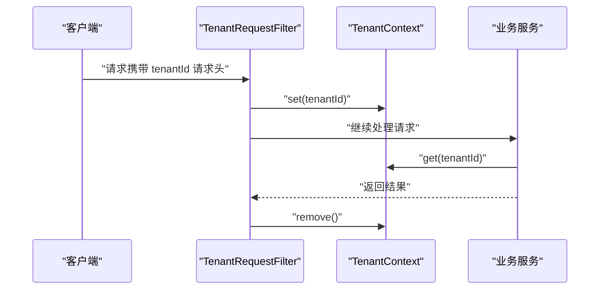
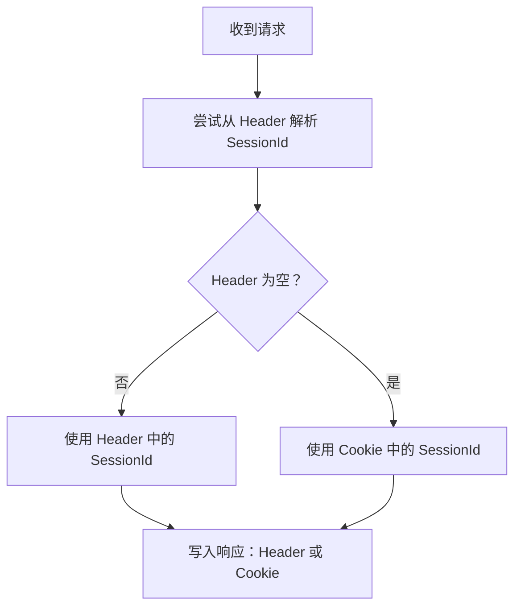
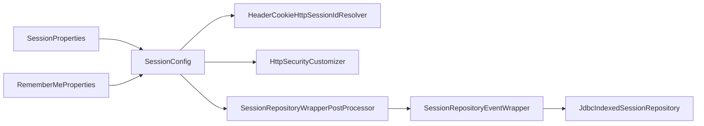

# 会话管理

<cite>
**本文引用的文件**   
- [SecurityUserContext.java](file://login-spring-boot-starter/src/main/java/com/cu/framework/authentication/SecurityUserContext.java)
- [SecurityUser.java](file://login-spring-boot-starter/src/main/java/com/cu/framework/authentication/model/SecurityUser.java)
- [SessionConfig.java](file://login-spring-boot-starter/src/main/java/com/cu/framework/authentication/config/SessionConfig.java)
- [SessionProperties.java](file://login-spring-boot-starter/src/main/java/com/cu/framework/authentication/properties/SessionProperties.java)
- [SecurityConfig.java](file://login-spring-boot-starter/src/main/java/com/cu/framework/authentication/config/SecurityConfig.java)
- [HeaderCookieHttpSessionIdResolver.java](file://login-spring-boot-starter/src/main/java/com/cu/framework/authentication/extension/HeaderCookieHttpSessionIdResolver.java)
- [SessionRepositoryEventAspect.java](file://login-spring-boot-starter/src/main/java/com/cu/framework/authentication/handler/SessionRepositoryEventAspect.java)
- [SessionRepositoryEventWrapper.java](file://login-spring-boot-starter/src/main/java/com/cu/framework/authentication/handler/SessionRepositoryEventWrapper.java)
- [SessionRepositoryWrapperPostProcessor.java](file://login-spring-boot-starter/src/main/java/com/cu/framework/authentication/config/SessionRepositoryWrapperPostProcessor.java)
- [TenantContext.java](file://boot/tenant-spring-boot-starter/src/main/java/com/cu/framework/tenant/TenantContext.java)
- [TenantRequestFilter.java](file://boot/tenant-spring-boot-starter/src/main/java/com/cu/framework/tenant/TenantRequestFilter.java)
- [application.yml](file://sample/login-boot-sample/src/main/resources/application.yml)
- [application.yml](file://sample/auth-rbac-boot-sample/src/main/resources/application.yml)
- [application.yml](file://sample/tenant-boot-sample/src/main/resources/application.yml)
- [application.yml](file://docs/application.yml)
</cite>

## 目录
1. [引言](#引言)
2. [项目结构与会话相关模块](#项目结构与会话相关模块)
3. [核心组件](#核心组件)
4. [架构总览](#架构总览)
5. [详细组件分析](#详细组件分析)
6. [依赖关系分析](#依赖关系分析)
7. [性能与扩展性](#性能与扩展性)
8. [监控与调试](#监控与调试)
9. [常见问题排查](#常见问题排查)
10. [配置示例与最佳实践](#配置示例与最佳实践)
11. [结论](#结论)

## 引言
本文件面向使用 Spring Security 和 Spring Session 的 Java Web 应用，聚焦本仓库中的会话管理实现。内容覆盖：
- Spring Security 会话控制的核心选项：最大会话数、并发登录策略、会话过期响应。
- 用户上下文 `SecurityUserContext` 如何从 Spring Security 安全上下文中获取当前用户及其权限数据。
- 最大会话数控制的实现原理与行为差异：阻止新登录 vs 踢出最早会话。
- 多租户环境下的会话隔离思路：`TenantContext` 与认证流程的配合方式。
- 基于 Spring Session JDBC 的分布式会话基础，以及生产环境建议。
- 会话监控、调试技巧及常见问题的定位方法。

## 项目结构与会话相关模块
本仓库中与会话相关的代码主要分布在以下模块：
- `login-spring-boot-starter`：认证、会话、Remember-Me、Spring Session 事件增强、会话 ID 解析等。
- `boot/tenant-spring-boot-starter`：多租户上下文与请求过滤。
- 各 sample 应用的 `application.yml`：演示会话超时、记住我、最大会话数等配置。

**图表来源**
- [SecurityConfig.java:70-120](file://login-spring-boot-starter/src/main/java/com/cu/framework/authentication/config/SecurityConfig.java#L70-L120)
- [SessionConfig.java:20-124](file://login-spring-boot-starter/src/main/java/com/cu/framework/authentication/config/SessionConfig.java#L20-L124)
- [SessionRepositoryWrapperPostProcessor.java:20-51](file://login-spring-boot-starter/src/main/java/com/cu/framework/authentication/config/SessionRepositoryWrapperPostProcessor.java#L20-L51)
- [TenantRequestFilter.java:20-46](file://boot/tenant-spring-boot-starter/src/main/java/com/cu/framework/tenant/TenantRequestFilter.java#L20-L46)

**章节来源**
- [SessionConfig.java:20-124](file://login-spring-boot-starter/src/main/java/com/cu/framework/authentication/config/SessionConfig.java#L20-L124)
- [SecurityConfig.java:60-120](file://login-spring-boot-starter/src/main/java/com/cu/framework/authentication/config/SecurityConfig.java#L60-L120)
- [TenantRequestFilter.java:20-46](file://boot/tenant-spring-boot-starter/src/main/java/com/cu/framework/tenant/TenantRequestFilter.java#L20-L46)

## 核心组件
本节梳理与会话和用户上下文直接相关的核心类及其职责。

### 用户上下文 `SecurityUserContext`
- 从 `SecurityContextHolder` 获取当前认证主体。
- 要求主体为统一认证实体 `SecurityUser`；否则抛出未登录异常。
- 屏蔽了不同登录协议（账号密码、OAuth2、OIDC、SAML）的差异，业务层只感知 `SecurityUser`。

**图表来源**
- [SecurityUserContext.java:10-37](file://login-spring-boot-starter/src/main/java/com/cu/framework/authentication/SecurityUserContext.java#L10-L37)
- [SecurityUser.java:10-161](file://login-spring-boot-starter/src/main/java/com/cu/framework/authentication/model/SecurityUser.java#L10-L161)

**章节来源**
- [SecurityUserContext.java:10-37](file://login-spring-boot-starter/src/main/java/com/cu/framework/authentication/SecurityUserContext.java#L10-L37)
- [SecurityUser.java:10-161](file://login-spring-boot-starter/src/main/java/com/cu/framework/authentication/model/SecurityUser.java#L10-L161)

### 会话配置 `SessionConfig`
- 定义 `HttpSessionIdResolver`，支持 Header 和 Cookie 两种会话标识解析方式。
- 可选注册 Remember-Me 服务。
- 通过 `HttpSecurityCustomizer` 设置最大会话数和会话过期响应。
- 为 Spring Session JDBC 补充会话创建/删除事件发布能力。

**章节来源**
- [SessionConfig.java:20-124](file://login-spring-boot-starter/src/main/java/com/cu/framework/authentication/config/SessionConfig.java#L20-L124)

### 会话属性 `SessionProperties`
- 绑定前缀 `cu.security.session`。
- 提供两个关键参数：
  - `maximumSessions`：每个用户允许的最大会话数。
  - `maxSessionsPreventsLogin`：达到上限时是阻止新登录，还是踢出最早会话。

**章节来源**
- [SessionProperties.java:1-22](file://login-spring-boot-starter/src/main/java/com/cu/framework/authentication/properties/SessionProperties.java#L1-L22)

### 安全配置 `SecurityConfig`
- 启用 `HttpSessionEventPublisher`，让容器感知 HTTP Session 生命周期事件。
- 放行静态资源路径。
- 将认证入口、登出成功处理器、访问拒绝处理器接入 Spring Security。
- 收集并执行自定义 `HttpSecurityCustomizer`，从而把会话并发控制逻辑注入到安全配置中。

**章节来源**
- [SecurityConfig.java:1-144](file://login-spring-boot-starter/src/main/java/com/cu/framework/authentication/config/SecurityConfig.java#L1-L144)

### 多租户上下文 `TenantContext` 与 `TenantRequestFilter`
- `TenantContext` 使用可继承线程局部变量保存租户 ID。
- `TenantRequestFilter` 从请求头读取租户 ID，写入上下文并在请求结束后清理。

**章节来源**
- [TenantContext.java:1-43](file://boot/tenant-spring-boot-starter/src/main/java/com/cu/framework/tenant/TenantContext.java#L1-L43)
- [TenantRequestFilter.java:1-46](file://boot/tenant-spring-boot-starter/src/main/java/com/cu/framework/tenant/TenantRequestFilter.java#L1-L46)

## 架构总览
下图展示一次带认证的请求在会话管理相关组件中的流转：

**图表来源**
- [HeaderCookieHttpSessionIdResolver.java:1-80](file://login-spring-boot-starter/src/main/java/com/cu/framework/authentication/extension/HeaderCookieHttpSessionIdResolver.java#L1-L80)
- [TenantRequestFilter.java:20-46](file://boot/tenant-spring-boot-starter/src/main/java/com/cu/framework/tenant/TenantRequestFilter.java#L20-L46)
- [SessionConfig.java:60-124](file://login-spring-boot-starter/src/main/java/com/cu/framework/authentication/config/SessionConfig.java#L60-L124)
- [SessionRepositoryWrapperPostProcessor.java:20-51](file://login-spring-boot-starter/src/main/java/com/cu/framework/authentication/config/SessionRepositoryWrapperPostProcessor.java#L20-L51)

## 详细组件分析

### Spring Security 会话配置的核心选项
本仓库没有直接使用传统 `HttpSession` 的固定超时时间配置字段来控制所有场景，而是依赖 Spring Session 的会话超时机制，并通过 `SessionProperties` 控制并发行为。

| 配置项 | 含义 | 默认值或行为 | 说明 |
|---|---|---:|---|
| `spring.session.store-type` | 会话存储类型 | 示例中使用 `jdbc` | 表示使用 Spring Session JDBC 将会话持久化到数据库。 |
| `spring.session.timeout` | 会话超时时间 | 示例中为 `2D` | 由 Spring Session 管理；超过该时间的会话会被视为过期。 |
| `cu.security.session.maximum-sessions` | 单用户最大会话数 | 默认 `10` | 超过后根据 `maxSessionsPreventsLogin` 决定行为。 |
| `cu.security.session.max-sessions-prevents-login` | 超限策略 | 默认 `false` | `true` 阻止新登录；`false` 踢出最早会话。 |
| `cu.security.remember-me.enabled` | 是否启用记住我 | 示例中为 `true` | 开启后注册基于 Spring Session 的 Remember-Me 服务。 |
| `cu.security.remember-me.validity-seconds` | 记住我有效期 | 示例中为 `2592000` 秒 | 即约 30 天。 |

#### 会话超时
- 示例应用通过 `spring.session.timeout` 指定会话超时，例如 `2D` 表示两天。
- 会话过期时，`SessionConfig` 中的过期策略会将响应状态设为 `401`，并返回统一的 JSON 提示“登录状态失效，请重新登录”。

#### 并发会话控制
- 通过 `sessionManagement().maximumSessions(...)` 设置最大会话数。
- 通过 `maxSessionsPreventsLogin(...)` 切换行为：
  - `true`：达到最大会话数后阻止新登录。
  - `false`：允许新登录，但会踢出最早的会话。

#### 会话固定攻击防护
- 代码中没有显式配置 `sessionFixation().changeSessionId()` 或 `none()` 来定制会话固定攻击防护策略。
- 由于本项目使用 Spring Session，通常由 Spring Session 自身负责会话 ID 生成与传播；若需要更严格的会话固定攻击防护，可在自定义 `HttpSecurityCustomizer` 中进一步调整。

**章节来源**
- [SessionConfig.java:60-124](file://login-spring-boot-starter/src/main/java/com/cu/framework/authentication/config/SessionConfig.java#L60-L124)
- [SessionProperties.java:1-22](file://login-spring-boot-starter/src/main/java/com/cu/framework/authentication/properties/SessionProperties.java#L1-L22)
- [application.yml](file://sample/login-boot-sample/src/main/resources/application.yml#L1-L120)

### `SecurityUserContext` 的用户上下文管理机制
`SecurityUserContext` 的职责很明确：把 Spring Security 的安全上下文转换为业务可直接使用的统一用户对象。

**图表来源**
- [SecurityUserContext.java:10-37](file://login-spring-boot-starter/src/main/java/com/cu/framework/authentication/SecurityUserContext.java#L10-L37)

#### 如何在业务代码中获取当前用户和权限
- 调用 `SecurityUserContext.getCurrentUser()` 获取 `SecurityUser`。
- 从 `SecurityUser` 中读取基本信息，如 `id`、`name`、`username`、`email`、`phone`、`enabled` 等。
- 权限数据位于 `userAuthorities`，同时实现 `GrantedAuthority` 接口集合，供 Spring Security 的授权判断使用。

**章节来源**
- [SecurityUserContext.java:10-37](file://login-spring-boot-starter/src/main/java/com/cu/framework/authentication/SecurityUserContext.java#L10-L37)
- [SecurityUser.java:10-161](file://login-spring-boot-starter/src/main/java/com/cu/framework/authentication/model/SecurityUser.java#L10-L161)

### 最大会话数控制功能实现原理
最大会话数控制由 `SessionConfig` 中的 `HttpSecurityCustomizer` 完成。

**图表来源**
- [SessionConfig.java:60-124](file://login-spring-boot-starter/src/main/java/com/cu/framework/authentication/config/SessionConfig.java#L60-L124)
- [SessionProperties.java:1-22](file://login-spring-boot-starter/src/main/java/com/cu/framework/authentication/properties/SessionProperties.java#L1-L22)

#### 防并发登录策略
- 当 `maxSessionsPreventsLogin=true` 时，如果某用户已有等于或超过最大会话数的会话，则新登录会被阻止。
- 当 `maxSessionsPreventsLogin=false` 时，新登录会触发旧会话失效，从而实现“挤下线”。

#### 旧会话踢出机制
- 旧会话踢出依赖 Spring Session 的事件机制。
- 因为 `JdbcIndexedSessionRepository` 不会自动发布会话创建和删除事件，框架通过包装器补发事件，使并发会话控制能够感知会话变化。

#### 会话共享策略
- 本仓库示例默认使用 Spring Session JDBC，会话存储在数据库中。
- 多个应用实例只要连接同一个数据库，就能共享会话。
- 如果需要 Redis 或其他存储方案，应替换 Spring Session 的底层实现；当前代码对存储实现做了一定解耦，但示例以 JDBC 为主。

**章节来源**
- [SessionConfig.java:60-124](file://login-spring-boot-starter/src/main/java/com/cu/framework/authentication/config/SessionConfig.java#L60-L124)
- [SessionRepositoryEventWrapper.java:1-87](file://login-spring-boot-starter/src/main/java/com/cu/framework/authentication/handler/SessionRepositoryEventWrapper.java#L1-L87)
- [SessionRepositoryWrapperPostProcessor.java:20-51](file://login-spring-boot-starter/src/main/java/com/cu/framework/authentication/config/SessionRepositoryWrapperPostProcessor.java#L20-L51)

### 多租户环境下的会话隔离机制
本仓库的多租户机制以 `TenantContext` 为核心，通过请求头传递租户 ID。它并不直接修改 Spring Session 的键空间，而是作为业务级租户上下文存在。

**图表来源**
- [TenantRequestFilter.java:20-46](file://boot/tenant-spring-boot-starter/src/main/java/com/cu/framework/tenant/TenantRequestFilter.java#L20-L46)
- [TenantContext.java:10-43](file://boot/tenant-spring-boot-starter/src/main/java/com/cu/framework/tenant/TenantContext.java#L10-L43)

#### 与认证系统的协作
- 认证系统负责确定“哪个用户”已登录，并将 `SecurityUser` 放入 Spring Security 上下文。
- 租户上下文负责确定“哪个租户”的请求正在被处理。
- 二者可以组合使用：同一用户在多个租户下可能拥有不同的权限和数据范围。
- 若需要严格实现“按租户隔离会话”，应在会话键中加入租户维度，或在认证阶段结合租户上下文构造唯一会话标识；当前仓库未提供现成的租户会话键实现。

**章节来源**
- [TenantContext.java:10-43](file://boot/tenant-spring-boot-starter/src/main/java/com/cu/framework/tenant/TenantContext.java#L10-L43)
- [TenantRequestFilter.java:20-46](file://boot/tenant-spring-boot-starter/src/main/java/com/cu/framework/tenant/TenantRequestFilter.java#L20-L46)
- [SecurityUserContext.java:10-37](file://login-spring-boot-starter/src/main/java/com/cu/framework/authentication/SecurityUserContext.java#L10-L37)

### 会话 ID 解析与双模式兼容
`HeaderCookieHttpSessionIdResolver` 实现了 Header 与 Cookie 两种方式：
- 优先从指定 Header（示例中为 `Authorization`）解析会话 ID。
- 如果没有 Header 值，回退到 Cookie。
- 写入时根据本次解析来源决定返回 Header 还是 Cookie。

**图表来源**
- [HeaderCookieHttpSessionIdResolver.java:1-80](file://login-spring-boot-starter/src/main/java/com/cu/framework/authentication/extension/HeaderCookieHttpSessionIdResolver.java#L1-L80)

**章节来源**
- [HeaderCookieHttpSessionIdResolver.java:1-80](file://login-spring-boot-starter/src/main/java/com/cu/framework/authentication/extension/HeaderCookieHttpSessionIdResolver.java#L1-L80)
- [SessionConfig.java:20-35](file://login-spring-boot-starter/src/main/java/com/cu/framework/authentication/config/SessionConfig.java#L20-L35)

## 依赖关系分析
下面从 Bean 装配角度分析会话相关依赖：

**图表来源**
- [SessionProperties.java:1-22](file://login-spring-boot-starter/src/main/java/com/cu/framework/authentication/properties/SessionProperties.java#L1-L22)
- [SessionConfig.java:20-124](file://login-spring-boot-starter/src/main/java/com/cu/framework/authentication/config/SessionConfig.java#L20-L124)
- [SessionRepositoryWrapperPostProcessor.java:20-51](file://login-spring-boot-starter/src/main/java/com/cu/framework/authentication/config/SessionRepositoryWrapperPostProcessor.java#L20-L51)
- [SessionRepositoryEventWrapper.java:1-87](file://login-spring-boot-starter/src/main/java/com/cu/framework/authentication/handler/SessionRepositoryEventWrapper.java#L1-L87)

### 组件耦合与注意事项
- `SessionConfig` 直接依赖 `SessionProperties` 和 `RememberMeProperties`，属于配置驱动型组件。
- `SessionRepositoryWrapperPostProcessor` 仅作用于 `JdbcIndexedSessionRepository`，避免直接作为 `SessionRepository` Bean 注册，防止触发 Spring Session 自动配置的缺 Bean 条件。
- 旧的 `SessionRepositoryEventAspect` 已被标记为废弃，新的方案通过 `SessionRepositoryEventWrapper` 与 `SessionRepositoryWrapperPostProcessor` 配合实现。

**章节来源**
- [SessionRepositoryEventAspect.java:1-72](file://login-spring-boot-starter/src/main/java/com/cu/framework/authentication/handler/SessionRepositoryEventAspect.java#L1-L72)
- [SessionRepositoryEventWrapper.java:1-87](file://login-spring-boot-starter/src/main/java/com/cu/framework/authentication/handler/SessionRepositoryEventWrapper.java#L1-L87)
- [SessionRepositoryWrapperPostProcessor.java:20-51](file://login-spring-boot-starter/src/main/java/com/cu/framework/authentication/config/SessionRepositoryWrapperPostProcessor.java#L20-L51)

## 性能与扩展性
### 性能特征
- Spring Session JDBC 会把会话读写落到数据库，高并发场景下数据库压力较大。
- 会话过期和并发控制依赖会话事件，JDBC 实现需要主动补发事件，因此会增加少量额外操作。
- 最大会话数控制会在认证过程中进行会话计数和比较，属于轻量逻辑，但高频登录时会累积开销。

### 优化建议
- 使用合适的会话超时时间，避免会话长期堆积。
- 合理设置 `maximum-sessions`，防止单个用户占用过多会话。
- 在高并发场景中考虑 Redis 作为 Spring Session 后端，减少数据库压力。
- 关注数据库连接池与会话表索引，避免会话读写成为瓶颈。

[本节为通用性能建议，不直接分析具体代码文件]

## 监控与调试
### 会话状态查看
- 如果使用 Spring Session JDBC，可通过数据库中的会话表查看会话记录。
- 示例应用使用 H2 内存库或 MySQL，可根据实际 profile 选择对应数据库工具。

### 性能分析
- 开启 Spring Security 日志级别，观察认证与授权流程。
- 关注会话创建、保存、删除操作的日志，尤其是 `SessionRepositoryEventWrapper` 补充事件的场景。
- 监控数据库慢查询，识别会话持久化热点。

### 内存泄漏检测
- 避免在 `SecurityUser` 或会话属性中存放过大对象。
- 确保异步任务或线程池不会持有当前请求的线程局部变量，避免租户上下文或用户上下文泄漏。
- 在长时间运行的应用中，定期检查会话数量与数据库会话表大小。

**章节来源**
- [SessionRepositoryEventWrapper.java:1-87](file://login-spring-boot-starter/src/main/java/com/cu/framework/authentication/handler/SessionRepositoryEventWrapper.java#L1-L87)
- [application.yml](file://sample/auth-rbac-boot-sample/src/main/resources/application.yml#L1-L40)

## 常见问题排查
### 会话丢失
- 检查 `spring.session.store-type` 是否配置为预期存储类型。
- 检查数据库连接是否正常，Spring Session JDBC 是否能正确建表或访问会话表。
- 确认客户端是否正确传递会话标识：Header 模式需包含指定 Header，Cookie 模式需允许 Cookie。

**章节来源**
- [application.yml](file://sample/login-boot-sample/src/main/resources/application.yml#L1-L60)
- [HeaderCookieHttpSessionIdResolver.java:1-80](file://login-spring-boot-starter/src/main/java/com/cu/framework/authentication/extension/HeaderCookieHttpSessionIdResolver.java#L1-L80)

### 并发登录冲突
- 如果期望“不允许挤下线”，应将 `max-sessions-prevents-login` 设置为 `true`。
- 如果期望“允许挤下线”，应设置为 `false`，并确认会话过期策略能返回 401。
- 注意最大会话数不宜过小，否则会频繁踢出旧会话。

**章节来源**
- [SessionConfig.java:60-124](file://login-spring-boot-starter/src/main/java/com/cu/framework/authentication/config/SessionConfig.java#L60-L124)
- [application.yml](file://sample/auth-rbac-boot-sample/src/main/resources/application.yml#L1-L60)

### 内存溢出
- 检查是否在每个会话中缓存大量数据。
- 检查异步线程是否错误引用 `ThreadLocal`，特别是 `TenantContext`。
- 关注会话数量和数据库会话表增长趋势。

**章节来源**
- [TenantContext.java:10-43](file://boot/tenant-spring-boot-starter/src/main/java/com/cu/framework/tenant/TenantContext.java#L10-L43)

## 配置示例与最佳实践
### 示例配置参考
以下示例来自仓库中的 sample 应用和文档配置：

| 应用场景 | 关键配置 | 说明 |
|---|---|---|
| 登录示例 | `spring.session.store-type=jdbc`、`spring.session.timeout=2D`、`cu.security.session.maximum-sessions=10`、`cu.security.session.max-sessions-prevents-login=false`、`cu.security.remember-me.enabled=true` | 使用 JDBC 存储会话，会话超时两天，最大会话数为 10，允许挤下线，启用记住我。 |
| RBAC 示例 | `spring.session.timeout=2D`、`cu.security.session.maximum-sessions=10`、`cu.security.session.max-sessions-prevents-login=true` | 禁止挤下线，达到最大会话数后阻止新登录。 |
| 多租户示例 | `cu.tenant.open=true` | 启用租户上下文；会话隔离仍需结合业务设计。 |

**章节来源**
- [application.yml](file://sample/login-boot-sample/src/main/resources/application.yml#L1-L120)
- [application.yml](file://sample/auth-rbac-boot-sample/src/main/resources/application.yml#L1-L60)
- [application.yml](file://sample/tenant-boot-sample/src/main/resources/application.yml#L1-L37)
- [application.yml](file://docs/application.yml#L1-L20)

### 生产环境建议
- 使用稳定可靠的数据库连接池，并为会话表建立必要索引。
- 根据业务需求调整 `spring.session.timeout`，避免会话过长导致内存或数据库膨胀。
- 根据用户规模设置 `maximum-sessions`，兼顾用户体验与安全。
- 如需分布式部署，优先考虑 Redis 作为 Spring Session 后端，降低数据库压力。
- 对认证失败、会话过期、并发登录限制等场景输出结构化日志，便于监控和告警。

[本节为通用最佳实践，不直接分析具体代码文件]

## 结论
本仓库的会话管理以 Spring Security 和 Spring Session 为基础，重点实现了：
- 基于 `SessionProperties` 的最大会话数控制。
- 基于 Spring Session JDBC 的会话持久化。
- 针对 JDBC 实现的会话事件补发，保证并发会话控制正常工作。
- 支持 Header 与 Cookie 双模式的会话 ID 解析。
- 通过 `TenantContext` 提供多租户上下文，但不直接实现租户级别的会话隔离。

在实际生产中，应根据业务规模和安全策略调整会话超时、最大会话数、记住我有效期和会话存储方案，并结合监控手段持续跟踪会话健康状态。