# 认证扩展开发

<cite>
**本文引用的文件**   
- [login-spring-boot-starter/README.md](file://login-spring-boot-starter/README.md)
- [SecurityConfig.java](file://login-spring-boot-starter/src/main/java/com/cu/framework/authentication/config/SecurityConfig.java)
- [HttpSecurityCustomizer.java](file://login-spring-boot-starter/src/main/java/com/cu/framework/authentication/config/HttpSecurityCustomizer.java)
- [PasswordSecurityConfig.java](file://login-spring-boot-starter/src/main/java/com/cu/framework/authentication/password/config/PasswordSecurityConfig.java)
- [JsonLoginAuthenticationFilterConfigurer.java](file://login-spring-boot-starter/src/main/java/com/cu/framework/authentication/password/config/JsonLoginAuthenticationFilterConfigurer.java)
- [JsonLoginFilter.java](file://login-spring-boot-starter/src/main/java/com/cu/framework/authentication/password/filter/JsonLoginFilter.java)
- [SecurityUserDetailsService.java](file://login-spring-boot-starter/src/main/java/com/cu/framework/authentication/service/SecurityUserDetailsService.java)
- [AuthenticationSuccessResultResolver.java](file://login-spring-boot-starter/src/main/java/com/cu/framework/authentication/response/AuthenticationSuccessResultResolver.java)
- [SecurityAuthenticationSuccessHandler.java](file://login-spring-boot-starter/src/main/java/com/cu/framework/authentication/response/SecurityAuthenticationSuccessHandler.java)
- [JsonAuthenticationSuccessHandler.java](file://login-spring-boot-starter/src/main/java/com/cu/framework/authentication/response/JsonAuthenticationSuccessHandler.java)
- [SecurityAuthenticationExceptionResolverHandler.java](file://login-spring-boot-starter/src/main/java/com/cu/framework/authentication/response/SecurityAuthenticationExceptionResolverHandler.java)
- [AuthCurrentUserContextHolder.java](file://auth/auth-core/src/main/java/com/cu/framework/auth/core/AuthCurrentUserContextHolder.java)
- [AuthMenu.java](file://auth/auth-core/src/main/java/com/cu/framework/auth/core/AuthMenu.java)
- [AuthDataOperation.java](file://auth/auth-core/src/main/java/com/cu/framework/auth/core/AuthDataOperation.java)
- [MenuAccessInterceptor.java](file://auth/auth-core/src/main/java/com/cu/framework/auth/core/menu/MenuAccessInterceptor.java)
- [AuthMenuHandler.java](file://auth/auth-core/src/main/java/com/cu/framework/auth/core/menu/AuthMenuHandler.java)
- [DataCheckAspect.java](file://auth/auth-core/src/main/java/com/cu/framework/auth/core/data/edit/DataCheckAspect.java)
- [RbacSecurityConfig.java](file://auth/auth-rbac-security-spring-boot-starter/src/main/java/com/cu/framework/auth/rbac/security/RbacSecurityConfig.java)
- [RbacSecurityUserDetailsService.java](file://auth/auth-rbac-security-spring-boot-starter/src/main/java/com/cu/framework/auth/rbac/security/RbacSecurityUserDetailsService.java)
- [RbacSecurityAuthCurrentUserContextHolder.java](file://auth/auth-rbac-security-spring-boot-starter/src/main/java/com/cu/framework/auth/rbac/security/RbacSecurityAuthCurrentUserContextHolder.java)
- [README.md（auth-core 示例）](file://sample/auth-core-boot-sample/README.md)
</cite>

## 目录
1. [引言](#引言)
2. [项目结构](#项目结构)
3. [核心扩展点总览](#核心扩展点总览)
4. [架构总览](#架构总览)
5. [详细组件分析](#详细组件分析)
6. [依赖关系分析](#依赖关系分析)
7. [性能与线程安全注意事项](#性能与线程安全注意事项)
8. [故障排查指南](#故障排查指南)
9. [结论](#结论)

## 引言
本文面向需要在现有认证与安全框架基础上进行扩展开发的工程师，围绕以下目标展开：
- 说明认证系统的扩展点与 SPI 接口，包括 `AuthenticationSuccessResultResolver` 和 `HttpSecurityCustomizer`。
- 解释自定义认证过滤器的开发流程，包括过滤器链插入位置、请求处理逻辑、异常处理机制。
- 描述统一认证响应格式的处理方式，以及错误码规范。
- 说明菜单权限注解 `@AuthMenu`、数据操作权限注解 `@AuthDataOperation` 的使用方式，并给出业务特定权限校验思路。
- 提供第三方认证源集成、自定义用户信息处理、业务权限校验的完整扩展路径。
- 说明通过 Spring Boot 自动装配发现并注册自定义组件的方式。
- 总结扩展开发中的线程安全性、性能优化和错误处理最佳实践。

需要特别说明的是：仓库中未定义名为 `@Authenticate` 的注解；当前框架在认证入口层使用 Spring Security 的 `AuthenticationProvider` 体系，在权限判定层使用 `@AuthMenu` 和 `@AuthDataOperation`。本文后续将按实际代码中的注解命名进行说明，并在涉及“认证检查逻辑”时同时覆盖认证阶段与权限判定阶段。

## 项目结构
认证相关能力分布在多个模块中：
- `login-spring-boot-starter`：登录协议适配、Spring Security 过滤器链组装、认证成功/失败处理器、统一结果解析器。
- `auth/auth-core`：权限接缝层，定义用户上下文、菜单权限、数据操作权限等抽象。
- `auth/auth-rbac` 与 `auth/auth-rbac-security-spring-boot-starter`：基于 RBAC 的具体实现，包括用户详情服务、当前用户上下文、安全配置等。
- `sample/auth-core-boot-sample`：不依赖 RBAC 的独立验证示例，演示如何只使用 auth-core 完成菜单和数据权限扩展。

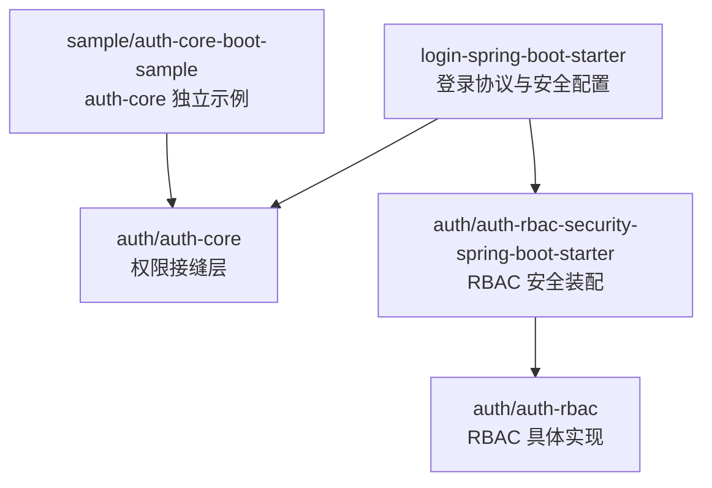

**图表来源**
- [SecurityConfig.java:56-140](file://login-spring-boot-starter/src/main/java/com/cu/framework/authentication/config/SecurityConfig.java#L56-L140)
- [AuthCurrentUserContextHolder.java:1-25](file://auth/auth-core/src/main/java/com/cu/framework/auth/core/AuthCurrentUserContextHolder.java#L1-L25)
- [RbacSecurityConfig.java:11-12](file://auth/auth-rbac-security-spring-boot-starter/src/main/java/com/cu/framework/auth/rbac/security/RbacSecurityConfig.java#L11-L12)

**章节来源**
- [login-spring-boot-starter/README.md:1-60](file://login-spring-boot-starter/README.md#L1-L60)
- [sample/auth-core-boot-sample/README.md:1-40](file://sample/auth-core-boot-sample/README.md#L1-L40)

## 核心扩展点总览
本项目的认证扩展主要围绕以下 SPI：

| 扩展点 | 所在包或类 | 作用 | 典型使用场景 |
|---|---|---|---|
| `SecurityUserDetailsService` | `login-spring-boot-starter` | 账号密码认证的用户加载与密码刷新 | 从数据库或外部系统加载用户、角色、权限 |
| `AuthenticationSuccessResultResolver` | `login-spring-boot-starter` | 封装认证成功、登出成功、获取当前用户等返回体 | 统一 JSON 结构、附加业务字段 |
| `SecurityAuthenticationSuccessHandler` | `login-spring-boot-starter` | 统一认证成功与登出成功处理契约 | 自定义成功处理策略 |
| `HttpSecurityCustomizer` | `login-spring-boot-starter` | 注入自定义 Spring Security 配置 | 新增 OAuth2/OIDC/SAML2、自定义过滤器 |
| `AuthCurrentUserContextHolder` | `auth/auth-core` | 暴露当前用户及基础权限集合 | 菜单权限、数据权限、业务鉴权 |
| `AuthMenuHandler` | `auth/auth-core` | 判断当前用户是否拥有菜单访问权限 | RBAC、自定义菜单模型 |
| `AuthDataHandler` | `auth/auth-core` | 判断当前用户是否拥有一组数据 ID 的操作权限 | 行级数据权限 |

**章节来源**
- [SecurityUserDetailsService.java:1-27](file://login-spring-boot-starter/src/main/java/com/cu/framework/authentication/service/SecurityUserDetailsService.java#L1-L27)
- [AuthenticationSuccessResultResolver.java:1-23](file://login-spring-boot-starter/src/main/java/com/cu/framework/authentication/response/AuthenticationSuccessResultResolver.java#L1-L23)
- [SecurityAuthenticationSuccessHandler.java:1-32](file://login-spring-boot-starter/src/main/java/com/cu/framework/authentication/response/SecurityAuthenticationSuccessHandler.java#L1-L32)
- [HttpSecurityCustomizer.java:1-17](file://login-spring-boot-starter/src/main/java/com/cu/framework/authentication/config/HttpSecurityCustomizer.java#L1-L17)
- [AuthCurrentUserContextHolder.java:1-25](file://auth/auth-core/src/main/java/com/cu/framework/auth/core/AuthCurrentUserContextHolder.java#L1-L25)
- [AuthMenuHandler.java:1-27](file://auth/auth-core/src/main/java/com/cu/framework/auth/core/menu/AuthMenuHandler.java#L1-L27)

## 架构总览
认证流程可划分为三个阶段：
1. **认证阶段**：由 Spring Security 过滤器链触发，例如账号密码登录走 `JsonLoginFilter`，单点登录走 OAuth2/OIDC/SAML2 对应过滤器。
2. **成功处理阶段**：由 `SecurityAuthenticationSuccessHandler` 统一处理，再委托给 `AuthenticationSuccessResultResolver` 输出最终响应。
3. **权限判定阶段**：进入业务方法前，由菜单权限拦截器和数据操作权限切面结合 `AuthCurrentUserContextHolder` 执行权限检查。

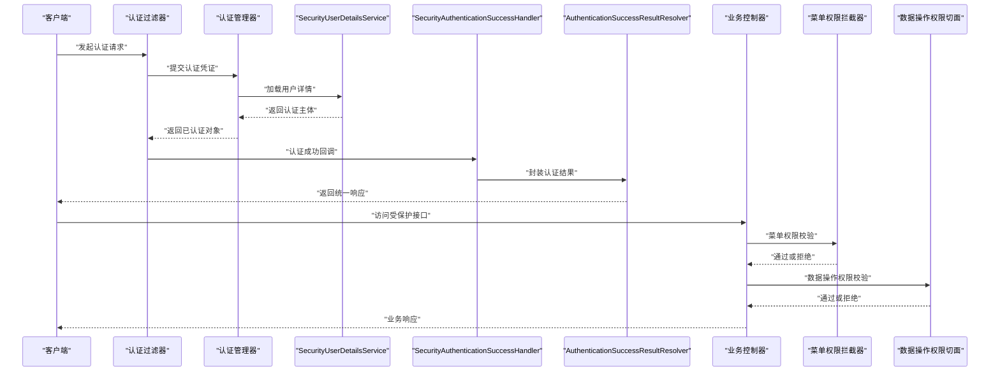

**图表来源**
- [JsonLoginFilter.java:23-55](file://login-spring-boot-starter/src/main/java/com/cu/framework/authentication/password/filter/JsonLoginFilter.java#L23-L55)
- [SecurityConfig.java:86-140](file://login-spring-boot-starter/src/main/java/com/cu/framework/authentication/config/SecurityConfig.java#L86-L140)
- [JsonAuthenticationSuccessHandler.java:40-95](file://login-spring-boot-starter/src/main/java/com/cu/framework/authentication/response/JsonAuthenticationSuccessHandler.java#L40-L95)
- [MenuAccessInterceptor.java:38-93](file://auth/auth-core/src/main/java/com/cu/framework/auth/core/menu/MenuAccessInterceptor.java#L38-L93)
- [DataCheckAspect.java:61-149](file://auth/auth-core/src/main/java/com/cu/framework/auth/core/data/edit/DataCheckAspect.java#L61-L149)

## 详细组件分析

### 认证成功结果解析器 `AuthenticationSuccessResultResolver`
该接口是认证成功后返回体的扩展点。默认实现会调用统一的 JSON 成功处理器，把 `SecurityUser` 转换为 `LoginSuccessResult`，再通过解析器输出最终对象。

关键行为：
- 接收 `HttpServletRequest`、`HttpServletResponse` 和待返回的数据。
- 返回一个对象，由成功处理器序列化为 JSON。
- 可用于追加业务字段、统一响应包装、日志埋点等。

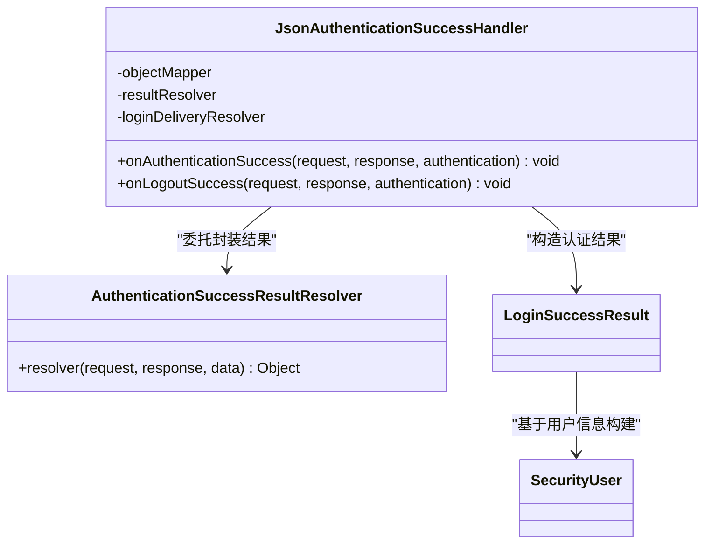

**图表来源**
- [AuthenticationSuccessResultResolver.java:1-23](file://login-spring-boot-starter/src/main/java/com/cu/framework/authentication/response/AuthenticationSuccessResultResolver.java#L1-L23)
- [JsonAuthenticationSuccessHandler.java:20-95](file://login-spring-boot-starter/src/main/java/com/cu/framework/authentication/response/JsonAuthenticationSuccessHandler.java#L20-L95)

**章节来源**
- [AuthenticationSuccessResultResolver.java:1-23](file://login-spring-boot-starter/src/main/java/com/cu/framework/authentication/response/AuthenticationSuccessResultResolver.java#L1-L23)
- [JsonAuthenticationSuccessHandler.java:40-95](file://login-spring-boot-starter/src/main/java/com/cu/framework/authentication/response/JsonAuthenticationSuccessHandler.java#L40-L95)

### HTTP 安全配置定制器 `HttpSecurityCustomizer`
这是扩展 Spring Security 过滤链的核心 SPI。所有实现了该接口的 Bean 会被 `SecurityConfig` 依次调用，从而允许业务或子模块覆盖默认的安全配置。

典型用途：
- 注册新的登录协议，如 OAuth2/OIDC/SAML2。
- 添加自定义过滤器到过滤器链。
- 修改授权规则、会话管理、跨域策略等。

默认行为：
- `SecurityConfig` 先建立基础安全配置，包括放行静态资源、统一未认证和拒绝访问的处理器、禁用 CSRF。
- 然后遍历容器中所有 `HttpSecurityCustomizer`，逐个调用其 `customizer(HttpSecurity)`。

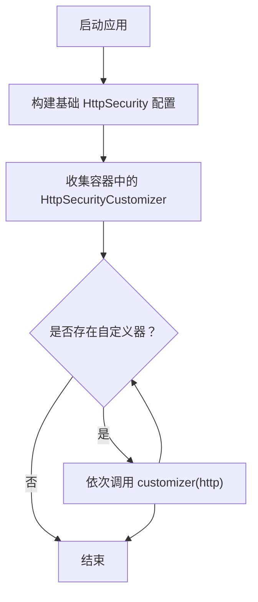

**图表来源**
- [SecurityConfig.java:86-140](file://login-spring-boot-starter/src/main/java/com/cu/framework/authentication/config/SecurityConfig.java#L86-L140)
- [HttpSecurityCustomizer.java:1-17](file://login-spring-boot-starter/src/main/java/com/cu/framework/authentication/config/HttpSecurityCustomizer.java#L1-L17)

**章节来源**
- [HttpSecurityCustomizer.java:1-17](file://login-spring-boot-starter/src/main/java/com/cu/framework/authentication/config/HttpSecurityCustomizer.java#L1-L17)
- [SecurityConfig.java:86-140](file://login-spring-boot-starter/src/main/java/com/cu/framework/authentication/config/SecurityConfig.java#L86-L140)

### 自定义认证过滤器开发流程
以账号密码登录为例，过滤器链的关键组件如下：

- `JsonLoginAuthenticationFilterConfigurer`：继承 Spring Security 的认证过滤器配置器，注册 `JsonLoginFilter`，并禁止登录页。
- `JsonLoginFilter`：继承 `UsernamePasswordAuthenticationFilter`，优先解析 JSON 请求体，非 POST 或非 JSON 时回退表单模式。
- `PasswordSecurityConfig`：实现 `HttpSecurityCustomizer`，把 JSON 登录 URL、用户名/密码参数、成功处理器、失败处理器应用到 `HttpSecurity`。

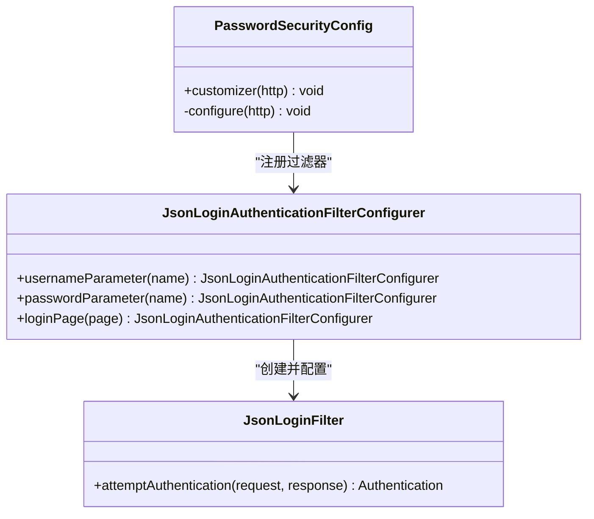

**图表来源**
- [PasswordSecurityConfig.java:24-54](file://login-spring-boot-starter/src/main/java/com/cu/framework/authentication/password/config/PasswordSecurityConfig.java#L24-L54)
- [JsonLoginAuthenticationFilterConfigurer.java:21-59](file://login-spring-boot-starter/src/main/java/com/cu/framework/authentication/password/config/JsonLoginAuthenticationFilterConfigurer.java#L21-L59)
- [JsonLoginFilter.java:23-55](file://login-spring-boot-starter/src/main/java/com/cu/framework/authentication/password/filter/JsonLoginFilter.java#L23-L55)

**章节来源**
- [PasswordSecurityConfig.java:24-54](file://login-spring-boot-starter/src/main/java/com/cu/framework/authentication/password/config/PasswordSecurityConfig.java#L24-L54)
- [JsonLoginAuthenticationFilterConfigurer.java:21-59](file://login-spring-boot-starter/src/main/java/com/cu/framework/authentication/password/config/JsonLoginAuthenticationFilterConfigurer.java#L21-L59)
- [JsonLoginFilter.java:23-55](file://login-spring-boot-starter/src/main/java/com/cu/framework/authentication/password/filter/JsonLoginFilter.java#L23-L55)

### 请求处理逻辑与异常处理机制
- 认证成功：由 `SecurityAuthenticationSuccessHandler` 统一处理。默认实现 `JsonAuthenticationSuccessHandler` 会把 `Authentication` 的主体要求为 `SecurityUser`，并构造 `LoginSuccessResult`。
- 认证失败：由 `SecurityAuthenticationExceptionResolverHandler` 统一处理。它会尝试交给 Spring MVC 的 `HandlerExceptionResolver` 列表解析；如果无法解析，则返回兜底 JSON。
- 单点登录场景：成功或失败可能根据 `LoginDeliveryResolver` 改为 302 重定向到前端页面，而不是直接写 JSON。

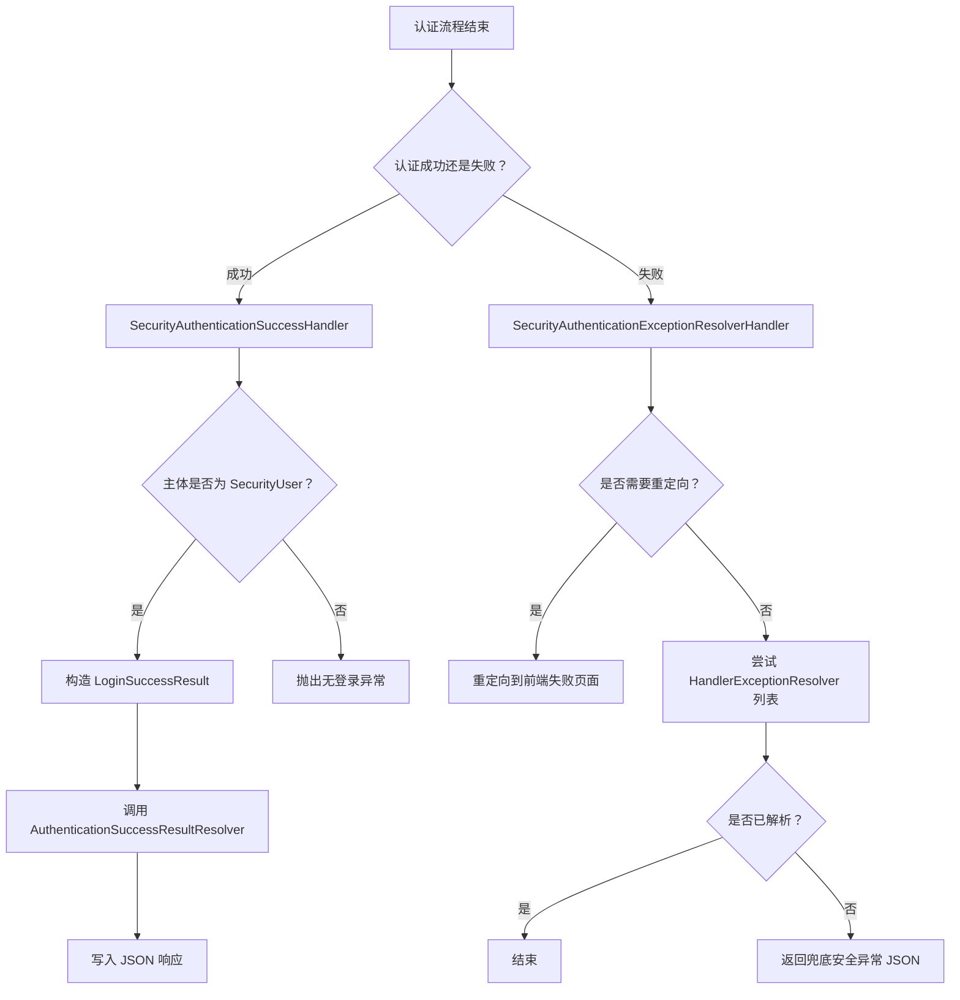

**图表来源**
- [JsonAuthenticationSuccessHandler.java:40-95](file://login-spring-boot-starter/src/main/java/com/cu/framework/authentication/response/JsonAuthenticationSuccessHandler.java#L40-L95)
- [SecurityAuthenticationExceptionResolverHandler.java:39-110](file://login-spring-boot-starter/src/main/java/com/cu/framework/authentication/response/SecurityAuthenticationExceptionResolverHandler.java#L39-L110)

**章节来源**
- [SecurityAuthenticationSuccessHandler.java:1-32](file://login-spring-boot-starter/src/main/java/com/cu/framework/authentication/response/SecurityAuthenticationSuccessHandler.java#L1-L32)
- [JsonAuthenticationSuccessHandler.java:40-95](file://login-spring-boot-starter/src/main/java/com/cu/framework/authentication/response/JsonAuthenticationSuccessHandler.java#L40-L95)
- [SecurityAuthenticationExceptionResolverHandler.java:39-110](file://login-spring-boot-starter/src/main/java/com/cu/framework/authentication/response/SecurityAuthenticationExceptionResolverHandler.java#L39-L110)

### 统一认证响应结构与错误码规范
统一响应由成功处理器与结果解析器共同决定：
- 成功响应：`JsonAuthenticationSuccessHandler` 构造 `LoginSuccessResult`，并把会话 ID、登录时间等信息附加后交给 `AuthenticationSuccessResultResolver`。
- 失败响应：`SecurityAuthenticationExceptionResolverHandler` 优先交给 `HandlerExceptionResolver` 列表处理；如果没有业务侧的统一异常处理，会返回兜底字符串。
- 单点登录成功/失败：若配置了结果页地址，认证回调可能改为 302 跳转，此时不会输出 JSON 响应体。

注意：
- 未登录访问受保护资源时，默认不是 HTTP 401，而是由入口点处理器输出业务码表示未登录。
- 账号密码登录始终返回 JSON；单点登录回调在配置结果页时会改为整页跳转。

**章节来源**
- [login-spring-boot-starter/README.md:60-140](file://login-spring-boot-starter/README.md#L60-L140)
- [JsonAuthenticationSuccessHandler.java:40-95](file://login-spring-boot-starter/src/main/java/com/cu/framework/authentication/response/JsonAuthenticationSuccessHandler.java#L40-L95)
- [SecurityAuthenticationExceptionResolverHandler.java:39-110](file://login-spring-boot-starter/src/main/java/com/cu/framework/authentication/response/SecurityAuthenticationExceptionResolverHandler.java#L39-L110)

### 注解式权限检查：`@AuthMenu` 与 `@AuthDataOperation`
仓库中没有名为 `@Authenticate` 的注解。当前权限检查分为两类：

#### 菜单权限：`@AuthMenu`
- 声明在方法或类上，表示该端点受菜单权限管辖。
- `MenuAccessInterceptor` 在 `preHandle` 中判断是否有 `@AuthMenu`，若无则跳过校验。
- 若有，则从 `AuthCurrentUserContextHolder.getAuths()` 获取权限集合，再交由 `AuthMenuHandler.hasMenuAccessAuth` 判断路径访问权限。
- 没有权限时抛出 `AuthException`。

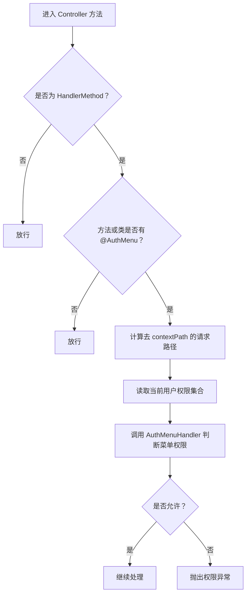

**图表来源**
- [AuthMenu.java:1-16](file://auth/auth-core/src/main/java/com/cu/framework/auth/core/AuthMenu.java#L1-L16)
- [MenuAccessInterceptor.java:38-93](file://auth/auth-core/src/main/java/com/cu/framework/auth/core/menu/MenuAccessInterceptor.java#L38-L93)
- [AuthMenuHandler.java:1-27](file://auth/auth-core/src/main/java/com/cu/framework/auth/core/menu/AuthMenuHandler.java#L1-L27)

#### 数据操作权限：`@AuthDataOperation`
- 声明在业务方法上，用于校验对一组业务数据 ID 的操作权限。
- `DataCheckAspect` 在方法执行前收集参数中的 `DataIdCarrier`，提取数据 ID，去重后最多允许 100 条。
- 通过 `AuthDataHandler.hasDataOperateAuths` 查询并比对权限。
- 任一数据 ID 无权限即整体拒绝，方法体不执行。

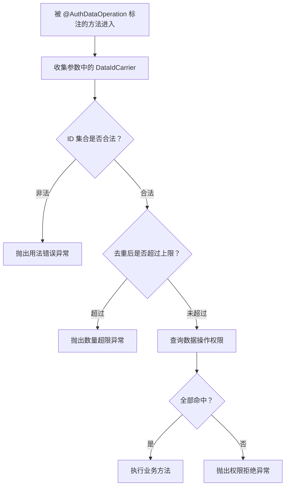

**图表来源**
- [AuthDataOperation.java:1-51](file://auth/auth-core/src/main/java/com/cu/framework/auth/core/AuthDataOperation.java#L1-L51)
- [DataCheckAspect.java:61-149](file://auth/auth-core/src/main/java/com/cu/framework/auth/core/data/edit/DataCheckAspect.java#L61-L149)

**章节来源**
- [AuthMenu.java:1-16](file://auth/auth-core/src/main/java/com/cu/framework/auth/core/AuthMenu.java#L1-L16)
- [MenuAccessInterceptor.java:38-93](file://auth/auth-core/src/main/java/com/cu/framework/auth/core/menu/MenuAccessInterceptor.java#L38-L93)
- [AuthMenuHandler.java:1-27](file://auth/auth-core/src/main/java/com/cu/framework/auth/core/menu/AuthMenuHandler.java#L1-L27)
- [AuthDataOperation.java:1-51](file://auth/auth-core/src/main/java/com/cu/framework/auth/core/AuthDataOperation.java#L1-L51)
- [DataCheckAspect.java:61-149](file://auth/auth-core/src/main/java/com/cu/framework/auth/core/data/edit/DataCheckAspect.java#L61-L149)

### 自定义用户信息处理与第三方认证源集成
- 账号密码认证强依赖 `SecurityUserDetailsService`。如果不提供实现，启动时会报错。
- OAuth2/OIDC/SAML2 单点登录不依赖 `SecurityUserDetailsService`，用户信息来自身份提供方。
- RBAC 安全模块提供了 `RbacSecurityUserDetailsService` 作为 RBAC 场景下的用户详情服务实现。
- 第三方认证源集成通常通过 `HttpSecurityCustomizer` 注册 OAuth2/OIDC/SAML2 配置，并配合 `AuthenticationSuccessResultResolver` 把认证结果转换为本系统统一的用户对象。

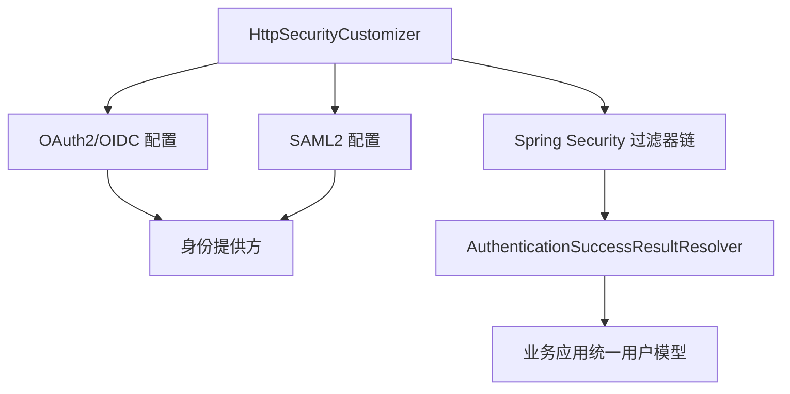

**图表来源**
- [login-spring-boot-starter/README.md:1-60](file://login-spring-boot-starter/README.md#L1-L60)
- [SecurityUserDetailsService.java:1-27](file://login-spring-boot-starter/src/main/java/com/cu/framework/authentication/service/SecurityUserDetailsService.java#L1-L27)
- [RbacSecurityUserDetailsService.java:29-29](file://auth/auth-rbac-security-spring-boot-starter/src/main/java/com/cu/framework/auth/rbac/security/RbacSecurityUserDetailsService.java#L29-L29)

**章节来源**
- [login-spring-boot-starter/README.md:1-60](file://login-spring-boot-starter/README.md#L1-L60)
- [SecurityUserDetailsService.java:1-27](file://login-spring-boot-starter/src/main/java/com/cu/framework/authentication/service/SecurityUserDetailsService.java#L1-L27)
- [RbacSecurityUserDetailsService.java:29-29](file://auth/auth-rbac-security-spring-boot-starter/src/main/java/com/cu/framework/auth/rbac/security/RbacSecurityUserDetailsService.java#L29-L29)

### 扩展点的注册与发现机制
- `SecurityConfig` 通过 `ObjectProvider<HttpSecurityCustomizer>` 和 `ObjectProvider<UrlSecurityCustomizer>` 收集容器中的自定义组件。
- 所有 `HttpSecurityCustomizer` 会在基础安全配置之后依次应用，从而支持覆盖默认行为。
- `AuthenticationSuccessResultResolver` 也是通过依赖注入被 `SecurityConfig` 注入，并由成功处理器消费。
- RBAC 安全模块通过 `RbacSecurityConfig` 装配 RBAC 相关的用户详情服务和当前用户上下文，供 login starter 使用。

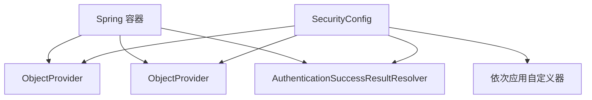

**图表来源**
- [SecurityConfig.java:56-140](file://login-spring-boot-starter/src/main/java/com/cu/framework/authentication/config/SecurityConfig.java#L56-L140)
- [RbacSecurityConfig.java:11-12](file://auth/auth-rbac-security-spring-boot-starter/src/main/java/com/cu/framework/auth/rbac/security/RbacSecurityConfig.java#L11-L12)

**章节来源**
- [SecurityConfig.java:56-140](file://login-spring-boot-starter/src/main/java/com/cu/framework/authentication/config/SecurityConfig.java#L56-L140)
- [RbacSecurityConfig.java:11-12](file://auth/auth-rbac-security-spring-boot-starter/src/main/java/com/cu/framework/auth/rbac/security/RbacSecurityConfig.java#L11-L12)

## 依赖关系分析
认证相关模块之间的依赖关系如下：
- `login-spring-boot-starter` 依赖 Spring Security、Jackson、Servlet API，并提供登录协议适配和安全配置。
- `auth/auth-core` 不依赖登录协议实现，只定义权限语义和拦截点。
- `auth/auth-rbac-security-spring-boot-starter` 依赖 `auth/auth-core`，提供 RBAC 实现和用户上下文。
- `sample/auth-core-boot-sample` 只依赖 `auth/auth-core`，证明权限接缝层可以脱离 RBAC 运行。

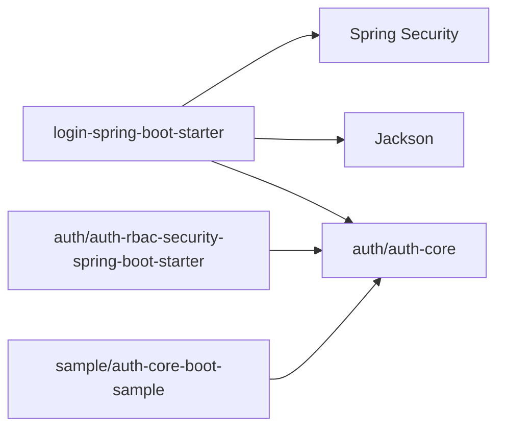

**图表来源**
- [SecurityConfig.java:1-55](file://login-spring-boot-starter/src/main/java/com/cu/framework/authentication/config/SecurityConfig.java#L1-L55)
- [AuthCurrentUserContextHolder.java:1-25](file://auth/auth-core/src/main/java/com/cu/framework/auth/core/AuthCurrentUserContextHolder.java#L1-L25)
- [RbacSecurityConfig.java:11-12](file://auth/auth-rbac-security-spring-boot-starter/src/main/java/com/cu/framework/auth/rbac/security/RbacSecurityConfig.java#L11-L12)
- [sample/auth-core-boot-sample/README.md:1-20](file://sample/auth-core-boot-sample/README.md#L1-L20)

**章节来源**
- [security 配置类](file://login-spring-boot-starter/src/main/java/com/cu/framework/authentication/config/SecurityConfig.java#L1-L55)
- [auth-core 用户上下文](file://auth/auth-core/src/main/java/com/cu/framework/auth/core/AuthCurrentUserContextHolder.java#L1-L25)
- [rbac 安全配置](file://auth/auth-rbac-security-spring-boot-starter/src/main/java/com/cu/framework/auth/rbac/security/RbacSecurityConfig.java#L11-L12)
- [auth-core 示例说明](file://sample/auth-core-boot-sample/README.md#L1-L20)

## 性能与线程安全注意事项
- 用户上下文必须线程安全：`AuthCurrentUserContextHolder` 在每个请求中暴露当前用户和权限集合，不能持有跨请求可变状态。
- 权限集合应缓存但不可共享可变实例：菜单权限和数据权限都依赖 `FlatteningAuthority` 集合，建议按用户维度缓存不可变集合。
- 数据操作权限有明确上限：`DataCheckAspect` 限制单次校验最多 100 个数据 ID，避免批量操作退化成大事务或大规模数据库查询。
- 认证结果解析器应避免阻塞：`AuthenticationSuccessResultResolver.resolver` 会参与响应写出前的序列化链路，不应执行耗时 I/O。
- 单点登录重定向与 JSON 输出互斥：成功处理器会根据 `LoginDeliveryResolver` 决定是否重定向，自定义解析器不应假设每次都会拿到数据。

[本节为通用指导，不直接分析具体代码片段]

## 故障排查指南
常见问题和定位方向：

| 现象 | 可能原因 | 排查建议 |
|---|---|---|
| 启动时报找不到 `SecurityUserDetailsService` | 账号密码登录模式下未提供实现 | 检查是否实现了 `SecurityUserDetailsService` |
| 登录接口报认证方法不支持 | 非 POST 请求或 JSON 解析失败 | 检查请求方法和 `Content-Type` |
| 登录后仍提示未登录 | 未认证主体不是 `SecurityUser` | 检查自定义 `AuthenticationProvider` 是否正确返回统一用户对象 |
| 单点登录成功/失败没有 JSON | 配置了结果页地址，改为 302 跳转 | 检查 `result-url` 配置和 `LoginDeliveryResolver` |
| 菜单权限总是拒绝 | `AuthMenuHandler` 未正确实现或未注册 | 检查菜单权限实现和 `AuthCurrentUserContextHolder` |
| 数据操作权限报用法错误 | 没有携带 `DataIdCarrier`、ID 为空或超上限 | 检查业务方法参数和 `@AuthDataOperation` 使用方式 |
| 自定义安全配置未生效 | 未实现 `HttpSecurityCustomizer` 或未被容器扫描 | 确认 Bean 存在并被 Spring 容器管理 |

**章节来源**
- [login-spring-boot-starter/README.md:140-200](file://login-spring-boot-starter/README.md#L140-L200)
- [JsonLoginFilter.java:23-55](file://login-spring-boot-starter/src/main/java/com/cu/framework/authentication/password/filter/JsonLoginFilter.java#L23-L55)
- [JsonAuthenticationSuccessHandler.java:40-95](file://login-spring-boot-starter/src/main/java/com/cu/framework/authentication/response/JsonAuthenticationSuccessHandler.java#L40-L95)
- [DataCheckAspect.java:61-149](file://auth/auth-core/src/main/java/com/cu/framework/auth/core/data/edit/DataCheckAspect.java#L61-L149)

## 结论
本项目的认证扩展体系以 Spring Security 为基础，通过 `HttpSecurityCustomizer` 开放过滤器链定制能力，通过 `AuthenticationSuccessResultResolver` 开放认证成功结果封装能力，并通过 `AuthCurrentUserContextHolder`、`AuthMenuHandler`、`@AuthMenu`、`@AuthDataOperation` 等扩展点开放权限判定能力。开发者可以在不侵入业务代码的前提下完成第三方认证源接入、统一响应封装、菜单权限和数据权限控制。扩展开发时应重点关注线程安全、缓存策略、异常统一处理和性能边界，尤其要避免在认证和权限判定路径中引入不可控的批量 I/O。

[本节为总结性内容，不直接分析具体文件]