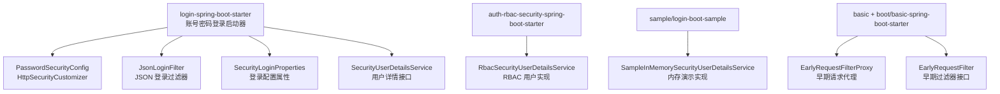
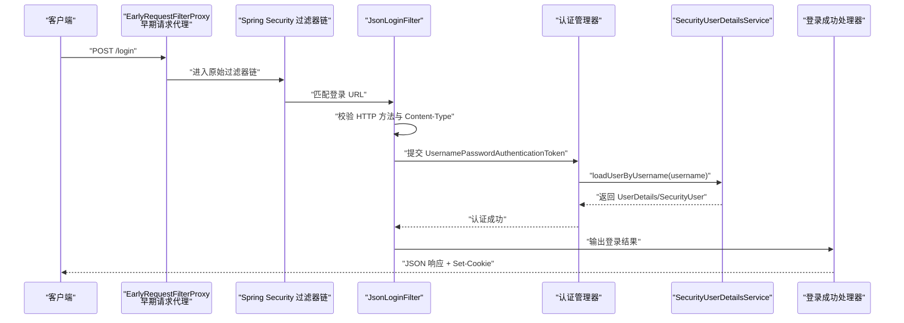
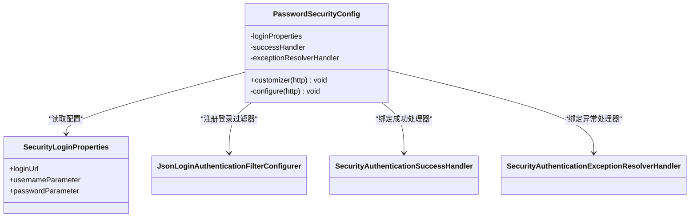
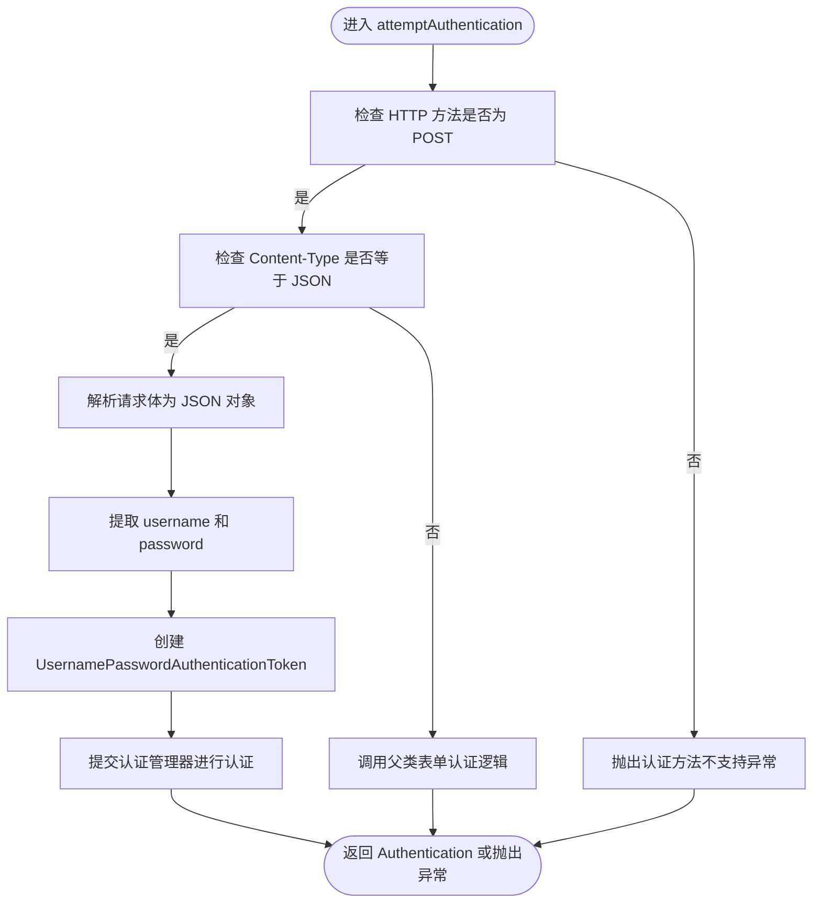
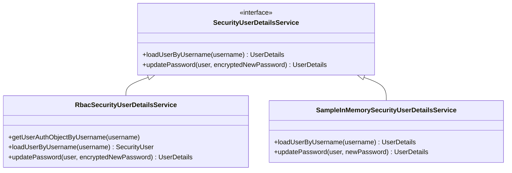
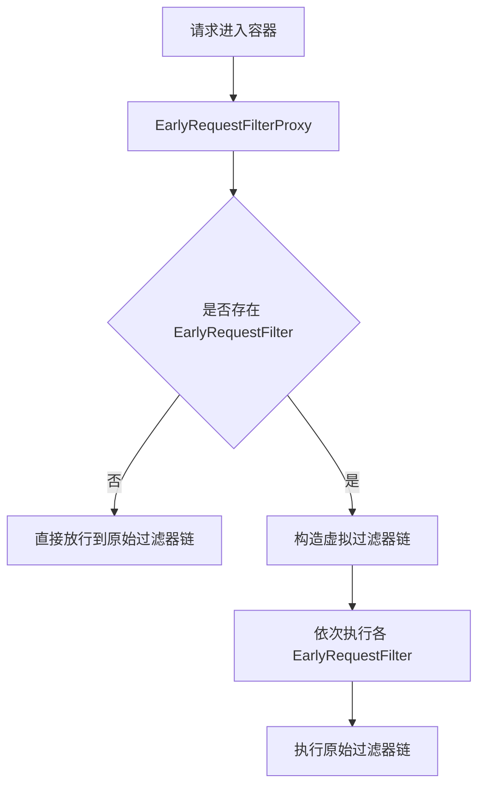
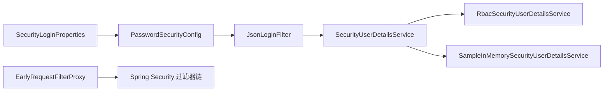

# 账号密码登录

<cite>
**本文引用的文件**   
- [login-spring-boot-starter/README.md](file://login-spring-boot-starter/README.md)
- [PasswordSecurityConfig.java](file://login-spring-boot-starter/src/main/java/com/cu/framework/authentication/password/config/PasswordSecurityConfig.java)
- [SecurityLoginProperties.java](file://login-spring-boot-starter/src/main/java/com/cu/framework/authentication/password/properties/SecurityLoginProperties.java)
- [JsonLoginFilter.java](file://login-spring-boot-starter/src/main/java/com/cu/framework/authentication/password/filter/JsonLoginFilter.java)
- [SecurityUserDetailsService.java](file://login-spring-boot-starter/src/main/java/com/cu/framework/authentication/service/SecurityUserDetailsService.java)
- [RbacSecurityUserDetailsService.java](file://auth/auth-rbac-security-spring-boot-starter/src/main/java/com/cu/framework/auth/rbac/security/RbacSecurityUserDetailsService.java)
- [SampleInMemorySecurityUserDetailsService.java](file://sample/login-boot-sample/src/main/java/com/cu/framework/sample/login/SampleInMemorySecurityUserDetailsService.java)
- [EarlyRequestFilter.java](file://basic/src/main/java/com/cu/framework/basic/filter/EarlyRequestFilter.java)
- [EarlyRequestFilterProxy.java](file://basic/src/main/java/com/cu/framework/basic/filter/EarlyRequestFilterProxy.java)
- [EarlyFilterConfig.java](file://boot/basic-spring-boot-starter/src/main/java/com/cu/framework/boot/basic/config/EarlyFilterConfig.java)
</cite>

## 目录
1. [简介](#简介)
2. [项目结构定位](#项目结构定位)
3. [核心组件总览](#核心组件总览)
4. [架构概览](#架构概览)
5. [详细组件分析](#详细组件分析)
6. [依赖关系分析](#依赖关系分析)
7. [完整配置示例](#完整配置示例)
8. [常见问题与排查](#常见问题与排查)
9. [最佳实践](#最佳实践)
10. [结论](#结论)

## 简介
本文件聚焦于该仓库中“账号密码登录”能力，围绕以下目标展开：
- 说明 `PasswordSecurityConfig` 的配置职责、默认行为及可定制点。
- 解释 `SecurityUserDetailsService` 接口的设计意图、用户加载流程以及扩展方式。
- 梳理认证过滤器链，特别是 `JsonLoginFilter` 的 JSON 登录处理逻辑。
- 说明请求进入阶段最前端的 `EarlyRequestFilter` 体系及其代理机制。
- 提供从数据库用户表、密码编码到登录控制器和登出行为的完整落地参考。
- 给出密码加密失败、用户信息加载异常、会话创建失败等常见问题的排查思路与安全加固建议。

## 项目结构定位
账号密码登录的核心代码位于 `login-spring-boot-starter` 模块；RBAC 场景下的用户详情实现位于 `auth/auth-rbac-security-spring-boot-starter`；通用早期请求过滤能力位于 `basic` 和 `boot/basic-spring-boot-starter`。



**图示来源**
- [PasswordSecurityConfig.java:1-54](file://login-spring-boot-starter/src/main/java/com/cu/framework/authentication/password/config/PasswordSecurityConfig.java#L1-L54)
- [JsonLoginFilter.java:1-55](file://login-spring-boot-starter/src/main/java/com/cu/framework/authentication/password/filter/JsonLoginFilter.java#L1-L55)
- [SecurityLoginProperties.java:1-29](file://login-spring-boot-starter/src/main/java/com/cu/framework/authentication/password/properties/SecurityLoginProperties.java#L1-L29)
- [SecurityUserDetailsService.java:1-27](file://login-spring-boot-starter/src/main/java/com/cu/framework/authentication/service/SecurityUserDetailsService.java#L1-L27)
- [RbacSecurityUserDetailsService.java:1-104](file://auth/auth-rbac-security-spring-boot-starter/src/main/java/com/cu/framework/auth/rbac/security/RbacSecurityUserDetailsService.java#L1-L104)
- [SampleInMemorySecurityUserDetailsService.java:1-78](file://sample/login-boot-sample/src/main/java/com/cu/framework/sample/login/SampleInMemorySecurityUserDetailsService.java#L1-L78)
- [EarlyRequestFilter.java:1-23](file://basic/src/main/java/com/cu/framework/basic/filter/EarlyRequestFilter.java#L1-L23)
- [EarlyRequestFilterProxy.java:1-94](file://basic/src/main/java/com/cu/framework/basic/filter/EarlyRequestFilterProxy.java#L1-L94)
- [EarlyFilterConfig.java:1-47](file://boot/basic-spring-boot-starter/src/main/java/com/cu/framework/boot/basic/config/EarlyFilterConfig.java#L1-L47)

**章节来源**
- [login-spring-boot-starter/README.md:1-120](file://login-spring-boot-starter/README.md#L1-L120)

## 核心组件总览
- `PasswordSecurityConfig`：将账号密码登录装配进 Spring Security 的 `HttpSecurity`，并注入成功处理器和异常处理器。
- `SecurityLoginProperties`：承载 `cu.security.login.password` 前缀下的登录路径、用户名参数名、密码参数名。
- `JsonLoginFilter`：继承 `UsernamePasswordAuthenticationFilter`，优先解析 JSON 请求体，非 JSON 回退表单模式。
- `SecurityUserDetailsService`：统一按用户名加载用户并支持更新已编码密码，是账号密码登录强制依赖的用户源抽象。
- `RbacSecurityUserDetailsService`：基于 RBAC 体系组装 `SecurityUser`，填充用户基本信息、权限、凭证状态。
- `SampleInMemorySecurityUserDetailsService`：演示用内存用户服务，用于快速验证登录流程。
- `EarlyRequestFilter` / `EarlyRequestFilterProxy`：在 Spring Security 过滤器链之前执行日志、追踪等早期处理逻辑。

**章节来源**
- [PasswordSecurityConfig.java:1-54](file://login-spring-boot-starter/src/main/java/com/cu/framework/authentication/password/config/PasswordSecurityConfig.java#L1-L54)
- [SecurityLoginProperties.java:1-29](file://login-spring-boot-starter/src/main/java/com/cu/framework/authentication/password/properties/SecurityLoginProperties.java#L1-L29)
- [JsonLoginFilter.java:1-55](file://login-spring-boot-starter/src/main/java/com/cu/framework/authentication/password/filter/JsonLoginFilter.java#L1-L55)
- [SecurityUserDetailsService.java:1-27](file://login-spring-boot-starter/src/main/java/com/cu/framework/authentication/service/SecurityUserDetailsService.java#L1-L27)
- [RbacSecurityUserDetailsService.java:1-104](file://auth/auth-rbac-security-spring-boot-starter/src/main/java/com/cu/framework/auth/rbac/security/RbacSecurityUserDetailsService.java#L1-L104)
- [SampleInMemorySecurityUserDetailsService.java:1-78](file://sample/login-boot-sample/src/main/java/com/cu/framework/sample/login/SampleInMemorySecurityUserDetailsService.java#L1-L78)
- [EarlyRequestFilter.java:1-23](file://basic/src/main/java/com/cu/framework/basic/filter/EarlyRequestFilter.java#L1-L23)
- [EarlyRequestFilterProxy.java:1-94](file://basic/src/main/java/com/cu/framework/basic/filter/EarlyRequestFilterProxy.java#L1-L94)

## 架构概览
账号密码登录的整体调用链路如下：客户端发起 POST 登录请求 → 早期请求过滤器执行日志和追踪 → Spring Security 过滤器链命中 `JsonLoginFilter` → 认证管理器校验用户名和密码 → 通过 `SecurityUserDetailsService` 加载用户 → 成功后写入安全上下文并通过 JSON 返回结果，同时建立会话 Cookie。



**图示来源**
- [EarlyRequestFilterProxy.java:1-94](file://basic/src/main/java/com/cu/framework/basic/filter/EarlyRequestFilterProxy.java#L1-L94)
- [JsonLoginFilter.java:1-55](file://login-spring-boot-starter/src/main/java/com/cu/framework/authentication/password/filter/JsonLoginFilter.java#L1-L55)
- [SecurityUserDetailsService.java:1-27](file://login-spring-boot-starter/src/main/java/com/cu/framework/authentication/service/SecurityUserDetailsService.java#L1-L27)

## 详细组件分析

### PasswordSecurityConfig 配置类
`PasswordSecurityConfig` 是一个 `@Configuration` 类，实现 `HttpSecurityCustomizer`，负责把账号密码登录装配到 Spring Security。它启用 `SecurityLoginProperties`，并通过 `JsonLoginAuthenticationFilterConfigurer` 注册登录 URL、用户名参数、密码参数，同时绑定全局的成功处理器和异常处理器。

关键要点：
- 不直接定义登录页；文档指出本 starter 禁用 `formLogin` 的默认登录页，前端分离场景下 `/login` GET 不会返回页面。
- 登录成功统一由共享的 `SecurityAuthenticationSuccessHandler` 输出 JSON。
- 登录失败统一由 `SecurityAuthenticationExceptionResolverHandler` 解析异常并返回统一结构。
- 密码编码器使用 Spring Security 默认的 `DelegatingPasswordEncoder`，数据库密文需要带算法标识前缀。



**图示来源**
- [PasswordSecurityConfig.java:1-54](file://login-spring-boot-starter/src/main/java/com/cu/framework/authentication/password/config/PasswordSecurityConfig.java#L1-L54)
- [SecurityLoginProperties.java:1-29](file://login-spring-boot-starter/src/main/java/com/cu/framework/authentication/password/properties/SecurityLoginProperties.java#L1-L29)

**章节来源**
- [PasswordSecurityConfig.java:1-54](file://login-spring-boot-starter/src/main/java/com/cu/framework/authentication/password/config/PasswordSecurityConfig.java#L1-L54)
- [login-spring-boot-starter/README.md:120-220](file://login-spring-boot-starter/README.md#L120-L220)

### SecurityLoginProperties 配置项
配置前缀为 `cu.security.login.password`，字段包括：
- `login-url`：POST 登录路径，默认 `/login`。
- `username-parameter`：用户名参数名，默认 `username`。
- `password-parameter`：密码参数名，默认 `password`。

这些值会被 `PasswordSecurityConfig` 传入登录过滤器配置中，决定 `JsonLoginFilter` 接受的请求路径和参数键。

**章节来源**
- [SecurityLoginProperties.java:1-29](file://login-spring-boot-starter/src/main/java/com/cu/framework/authentication/password/properties/SecurityLoginProperties.java#L1-L29)
- [login-spring-boot-starter/README.md:140-180](file://login-spring-boot-starter/README.md#L140-L180)

### JsonLoginFilter 认证过滤器
`JsonLoginFilter` 继承 Spring Security 的 `UsernamePasswordAuthenticationFilter`，主要扩展了 `attemptAuthentication`：
- 仅接受 POST 请求，否则抛出认证方法不支持异常。
- 当 `Content-Type` 精确等于 JSON 类型时，从请求体解析 JSON 对象，取出用户名和密码字段后构造 `UsernamePasswordAuthenticationToken`。
- 非 JSON 请求则回退父类的表单参数处理逻辑。



**图示来源**
- [JsonLoginFilter.java:1-55](file://login-spring-boot-starter/src/main/java/com/cu/framework/authentication/password/filter/JsonLoginFilter.java#L1-L55)

**章节来源**
- [JsonLoginFilter.java:1-55](file://login-spring-boot-starter/src/main/java/com/cu/framework/authentication/password/filter/JsonLoginFilter.java#L1-L55)
- [login-spring-boot-starter/README.md:160-200](file://login-spring-boot-starter/README.md#L160-L200)

### SecurityUserDetailsService 用户服务接口
`SecurityUserDetailsService` 组合了 `UserDetailsService` 与 `UserDetailsPasswordService`，统一对外暴露两个能力：
- `loadUserByUsername`：按用户名加载用户详情，账号密码登录强依赖此实现。
- `updatePassword`：更新已编码的新密码，常用于密码算法升级后的首次登录刷新。

该接口要求业务侧必须提供实现，否则启动即失败；OAuth2/OIDC/SAML2 单点登录不依赖它。



**图示来源**
- [SecurityUserDetailsService.java:1-27](file://login-spring-boot-starter/src/main/java/com/cu/framework/authentication/service/SecurityUserDetailsService.java#L1-L27)
- [RbacSecurityUserDetailsService.java:1-104](file://auth/auth-rbac-security-spring-boot-starter/src/main/java/com/cu/framework/auth/rbac/security/RbacSecurityUserDetailsService.java#L1-L104)
- [SampleInMemorySecurityUserDetailsService.java:1-78](file://sample/login-boot-sample/src/main/java/com/cu/framework/sample/login/SampleInMemorySecurityUserDetailsService.java#L1-L78)

**章节来源**
- [SecurityUserDetailsService.java:1-27](file://login-spring-boot-starter/src/main/java/com/cu/framework/authentication/service/SecurityUserDetailsService.java#L1-L27)
- [login-spring-boot-starter/README.md:1-40](file://login-spring-boot-starter/README.md#L1-L40)

### RbacSecurityUserDetailsService 实现原理
RBAC 实现从复合查询对象中获取用户、凭证和权限信息，再组装成 `SecurityUser`：
- 根据用户名获取 `UserAuthObject`，为空时抛出“未找到用户”。
- 将基础权限转换为 `SecurityUserAuthority` 列表。
- 若存在凭证，设置密码、过期时间、锁定截止时间、启用状态。
- 提供 `updatePassword` 方法，调用底层持久层更新密码，失败时抛运行时异常。

该实现强调：无凭证的用户仍可被装载，只是权限集合为空；这是合法状态而非异常。

**章节来源**
- [RbacSecurityUserDetailsService.java:1-104](file://auth/auth-rbac-security-spring-boot-starter/src/main/java/com/cu/framework/auth/rbac/security/RbacSecurityUserDetailsService.java#L1-L104)

### SampleInMemorySecurityUserDetailsService 演示实现
演示实现使用进程内 `Map` 存储用户，构造函数中使用 `PasswordEncoder` 对明文密码进行编码，并构建 `SecurityUserAuthority`。`loadUserByUsername` 找不到用户时抛出 `UsernameNotFoundException`，`updatePassword` 直接写回新密码。

适合用于本地快速验证登录流程，生产环境应替换为数据库或远程用户服务。

**章节来源**
- [SampleInMemorySecurityUserDetailsService.java:1-78](file://sample/login-boot-sample/src/main/java/com/cu/framework/sample/login/SampleInMemorySecurityUserDetailsService.java#L1-L78)

### EarlyRequestFilter 与请求早期处理
`EarlyRequestFilter` 是框架定义的早期过滤器接口，用于在请求进入主过滤器链前执行日志记录、追踪等逻辑。`EarlyRequestFilterProxy` 以 `@Order(-101)` 注册，早于 Spring Security 默认过滤器顺序 `-100`，会从容器中收集所有 `EarlyRequestFilter`，并按顺序执行一个虚拟过滤器链，最后才进入原始过滤器链。

`EarlyFilterConfig` 暴露了追踪过滤器、请求日志过滤器以及早期请求代理 Bean。



**图示来源**
- [EarlyRequestFilter.java:1-23](file://basic/src/main/java/com/cu/framework/basic/filter/EarlyRequestFilter.java#L1-L23)
- [EarlyRequestFilterProxy.java:1-94](file://basic/src/main/java/com/cu/framework/basic/filter/EarlyRequestFilterProxy.java#L1-L94)
- [EarlyFilterConfig.java:1-47](file://boot/basic-spring-boot-starter/src/main/java/com/cu/framework/boot/basic/config/EarlyFilterConfig.java#L1-L47)

**章节来源**
- [EarlyRequestFilter.java:1-23](file://basic/src/main/java/com/cu/framework/basic/filter/EarlyRequestFilter.java#L1-L23)
- [EarlyRequestFilterProxy.java:1-94](file://basic/src/main/java/com/cu/framework/basic/filter/EarlyRequestFilterProxy.java#L1-L94)
- [EarlyFilterConfig.java:1-47](file://boot/basic-spring-boot-starter/src/main/java/com/cu/framework/boot/basic/config/EarlyFilterConfig.java#L1-L47)

## 依赖关系分析
账号密码登录的关键依赖关系如下：
- `PasswordSecurityConfig` 依赖 `SecurityLoginProperties`、成功处理器、异常处理器。
- 登录入口依赖 `JsonLoginFilter`，其认证过程依赖 `SecurityUserDetailsService`。
- RBAC 场景下，`RbacSecurityUserDetailsService` 依赖 RBAC 数据模型和复合查询服务。
- 早期请求处理依赖 `EarlyRequestFilter` 集合和 `EarlyRequestFilterProxy`。



**图示来源**
- [PasswordSecurityConfig.java:1-54](file://login-spring-boot-starter/src/main/java/com/cu/framework/authentication/password/config/PasswordSecurityConfig.java#L1-L54)
- [SecurityLoginProperties.java:1-29](file://login-spring-boot-starter/src/main/java/com/cu/framework/authentication/password/properties/SecurityLoginProperties.java#L1-L29)
- [JsonLoginFilter.java:1-55](file://login-spring-boot-starter/src/main/java/com/cu/framework/authentication/password/filter/JsonLoginFilter.java#L1-L55)
- [SecurityUserDetailsService.java:1-27](file://login-spring-boot-starter/src/main/java/com/cu/framework/authentication/service/SecurityUserDetailsService.java#L1-L27)
- [RbacSecurityUserDetailsService.java:1-104](file://auth/auth-rbac-security-spring-boot-starter/src/main/java/com/cu/framework/auth/rbac/security/RbacSecurityUserDetailsService.java#L1-L104)
- [SampleInMemorySecurityUserDetailsService.java:1-78](file://sample/login-boot-sample/src/main/java/com/cu/framework/sample/login/SampleInMemorySecurityUserDetailsService.java#L1-L78)
- [EarlyRequestFilterProxy.java:1-94](file://basic/src/main/java/com/cu/framework/basic/filter/EarlyRequestFilterProxy.java#L1-L94)

## 完整配置示例
下面给出一个可直接落地的账号密码登录配置方案，包含数据库表设计、密码编码、登录端点和控制器约定。

### 数据库用户表设计
建议至少包含以下字段：
- 用户唯一标识：如 `id`、`username`。
- 用户展示信息：如 `name`、`nick_name`、`phone`、`email`、`avatar_file_id`。
- 账户状态：如 `enabled`、`account_locked_deadline`。
- 密码凭证：如 `password`、`password_expired_time`。
- 权限相关：可通过关联表存储角色、菜单、数据范围等；RBAC 实现会把这些权限转换为 `FlatteningAuthority` 列表。

参考 RBAC 实现中的字段映射：用户实体包含 ID、名称、昵称、电话、邮箱、头像、性别、创建时间、更新时间；凭证实体包含密码、密码过期时间、账户锁定截止时间、启用状态。

**章节来源**
- [RbacSecurityUserDetailsService.java:30-90](file://auth/auth-rbac-security-spring-boot-starter/src/main/java/com/cu/framework/auth/rbac/security/RbacSecurityUserDetailsService.java#L30-L90)

### 密码加密配置
- 框架默认使用 `DelegatingPasswordEncoder`。
- 数据库中存储的密码必须带算法标识前缀，例如 `{bcrypt}` 开头的哈希值。
- 如果历史库中存的是裸哈希或明文，需要在导入数据时补前缀，或在业务侧覆盖 `PasswordEncoder` Bean。

**章节来源**
- [login-spring-boot-starter/README.md:170-210](file://login-spring-boot-starter/README.md#L170-L210)

### 应用配置
在 `application.yml` 或 `application-{profile}.yml` 中配置账号密码登录：

```yaml
cu:
  security:
    login:
      password:
        login-url: /login
        username-parameter: username
        password-parameter: password
```

登录端点默认为 `POST /login`，登出端点为 `POST /logout`，均由 Spring Security 默认机制与本 starter 共同支撑。

**章节来源**
- [login-spring-boot-starter/README.md:140-200](file://login-spring-boot-starter/README.md#L140-L200)

### 登录控制器实现建议
虽然 `JsonLoginFilter` 已经处理认证，但业务系统通常仍需要一个登录控制器用于：
- 返回登录页或登录态预检结果（需显式放行）。
- 提供“期望与实际结果对比”之类的只读预检接口。
- 封装统一的登录结果响应。

注意：
- 不要重复定义 `/login` 的受保护规则；starter 会根据配置的 `login-url` 自动放行。
- 如果自定义了 `login-url`，确保该路径不被业务权限拦截。
- 未登录访问受保护资源时，统一异常处理器会返回 JSON 结构，而不是 401 HTTP 状态码。

**章节来源**
- [login-spring-boot-starter/README.md:100-170](file://login-spring-boot-starter/README.md#L100-L170)

### 登出处理
登出走 Spring Security 默认 `LogoutFilter`，路径为 `/logout`。文档指出本 starter 未覆盖登出逻辑，因此建议使用默认行为并结合会话管理策略。

**章节来源**
- [login-spring-boot-starter/README.md:180-200](file://login-spring-boot-starter/README.md#L180-L200)

## 常见问题与排查

### 密码加密失败
现象：
- 提示没有映射的 `PasswordEncoder`，或历史密码无法比对。

原因：
- 数据库中密码缺少算法标识前缀，`DelegatingPasswordEncoder` 无法识别。

解决：
- 给历史密码补上 `{bcrypt}` 或其他算法前缀。
- 在业务侧覆盖 `PasswordEncoder` Bean，适配现有密码格式。
- 结合 `SecurityUserDetailsService.updatePassword`，在用户首次登录后刷新为当前算法的密文。

**章节来源**
- [login-spring-boot-starter/README.md:190-210](file://login-spring-boot-starter/README.md#L190-L210)
- [SecurityUserDetailsService.java:10-27](file://login-spring-boot-starter/src/main/java/com/cu/framework/authentication/service/SecurityUserDetailsService.java#L10-L27)

### 用户信息加载异常
现象：
- 登录时报“未找到用户”或认证失败。

原因：
- `SecurityUserDetailsService` 未实现或未正确注入。
- 用户名不存在、用户被禁用、权限数据缺失导致业务逻辑异常。

解决：
- 确保实现类被 Spring 管理，且实现了 `loadUserByUsername`。
- 检查用户表数据、启用状态、权限表数据。
- 在 RBAC 场景中确认 `SysUserComposite` 能正确返回用户、凭证和权限对象。

**章节来源**
- [RbacSecurityUserDetailsService.java:35-104](file://auth/auth-rbac-security-spring-boot-starter/src/main/java/com/cu/framework/auth/rbac/security/RbacSecurityUserDetailsService.java#L35-L104)
- [login-spring-boot-starter/README.md:1-40](file://login-spring-boot-starter/README.md#L1-L40)

### 会话创建失败
现象：
- 登录成功但没有 Cookie，后续请求仍被判定未登录。

原因：
- 会话配置不正确。
- 登录成功处理器未正确写入会话。
- 前端跨域或 Cookie 域名/路径配置不当。

解决：
- 检查会话配置和remember-me配置，文档指出这些与 password 模块解耦。
- 确认登录成功处理器输出 JSON 的同时建立了会话。
- 检查浏览器 Cookie 是否被接收，尤其是跨域、SameSite、Secure 等属性。

**章节来源**
- [login-spring-boot-starter/README.md:210-240](file://login-spring-boot-starter/README.md#L210-L240)

### 登录请求 Content-Type 不匹配
现象：
- JSON 登录报参数缺失或认证失败。

原因：
- `JsonLoginFilter` 判断 `Content-Type` 使用精确相等，不是前缀匹配。
- 前端发送 `application/json;charset=utf-8`（小写）可能不走 JSON 分支。

解决：
- 前端使用 `application/json` 或大写 UTF-8 的 `application/json;charset=UTF-8`。
- 如需表单登录，避免使用 JSON body，改用 form 参数。

**章节来源**
- [JsonLoginFilter.java:18-55](file://login-spring-boot-starter/src/main/java/com/cu/framework/authentication/password/filter/JsonLoginFilter.java#L18-L55)
- [login-spring-boot-starter/README.md:200-220](file://login-spring-boot-starter/README.md#L200-L220)

### 登录页被拦截
现象：
- GET `/login` 返回 401 或无登录页。

原因：
- 本 starter 不启用 `formLogin`，没有默认登录页。
- 登录页路径未被放行。

解决：
- 通过 `UrlSecurityCustomizer.permitAll()` 或 `cu.auth.permit-url` 放行登录页。
- 不要误以为 `/login` GET 会自动返回页面。

**章节来源**
- [login-spring-boot-starter/README.md:120-170](file://login-spring-boot-starter/README.md#L120-L170)

### 统一异常响应为空或兜底字符串
现象：
- 登录失败返回硬编码兜底字符串，而不是结构化 JSON。

原因：
- 容器中没有扫描到 `@ControllerAdvice`，异常处理器不可用。

解决：
- 项目中至少提供一个统一异常处理类。
- 确保异常处理 Bean 被扫描到。

**章节来源**
- [login-spring-boot-starter/README.md:210-230](file://login-spring-boot-starter/README.md#L210-L230)

## 最佳实践

### 密码策略配置
- 始终使用 `DelegatingPasswordEncoder` 或业务自定义的强密码编码器。
- 数据库密码必须带算法标识前缀。
- 通过 `SecurityUserDetailsService.updatePassword` 在用户首次登录后迁移到更强算法。
- 结合账户锁定、密码过期时间等字段控制安全风险。

**章节来源**
- [SecurityUserDetailsService.java:10-27](file://login-spring-boot-starter/src/main/java/com/cu/framework/authentication/service/SecurityUserDetailsService.java#L10-L27)
- [RbacSecurityUserDetailsService.java:70-104](file://auth/auth-rbac-security-spring-boot-starter/src/main/java/com/cu/framework/auth/rbac/security/RbacSecurityUserDetailsService.java#L70-L104)

### 登录安全加固
- 明确区分 JSON 登录与表单登录，避免混淆参数来源。
- 对 `/login` 和 `/logout` 做好访问控制和审计。
- 使用 HTTPS，避免明文传输密码。
- 结合会话超时、并发登录控制、验证码、IP 白名单等策略。
- 使用统一异常处理器输出结构化错误，便于前端和网关处理。

**章节来源**
- [JsonLoginFilter.java:18-55](file://login-spring-boot-starter/src/main/java/com/cu/framework/authentication/password/filter/JsonLoginFilter.java#L18-L55)
- [login-spring-boot-starter/README.md:120-240](file://login-spring-boot-starter/README.md#L120-L240)

### 早期请求过滤最佳实践
- 使用 `EarlyRequestFilter` 实现请求日志、追踪、租户上下文初始化等横切逻辑。
- 注意 `EarlyRequestFilterProxy` 的执行顺序早于 Spring Security，适合做前置准备。
- 非 HTTP 请求会跳过具体实现，避免污染通用逻辑。

**章节来源**
- [EarlyRequestFilter.java:1-23](file://basic/src/main/java/com/cu/framework/basic/filter/EarlyRequestFilter.java#L1-L23)
- [EarlyRequestFilterProxy.java:1-94](file://basic/src/main/java/com/cu/framework/basic/filter/EarlyRequestFilterProxy.java#L1-L94)
- [EarlyFilterConfig.java:1-47](file://boot/basic-spring-boot-starter/src/main/java/com/cu/framework/boot/basic/config/EarlyFilterConfig.java#L1-L47)

## 结论
账号密码登录在本仓库中是一个独立、可扩展且与单点登录共享基础设施的能力。`PasswordSecurityConfig` 负责装配登录配置，`JsonLoginFilter` 负责解析 JSON 登录请求，`SecurityUserDetailsService` 是用户信息的统一抽象。生产环境中应重点保证密码编码一致性、用户数据完整性、会话安全性，并结合早期请求过滤器完善日志与追踪。RBAC 场景可直接复用 `RbacSecurityUserDetailsService`，轻量场景可使用内存演示实现快速验证。