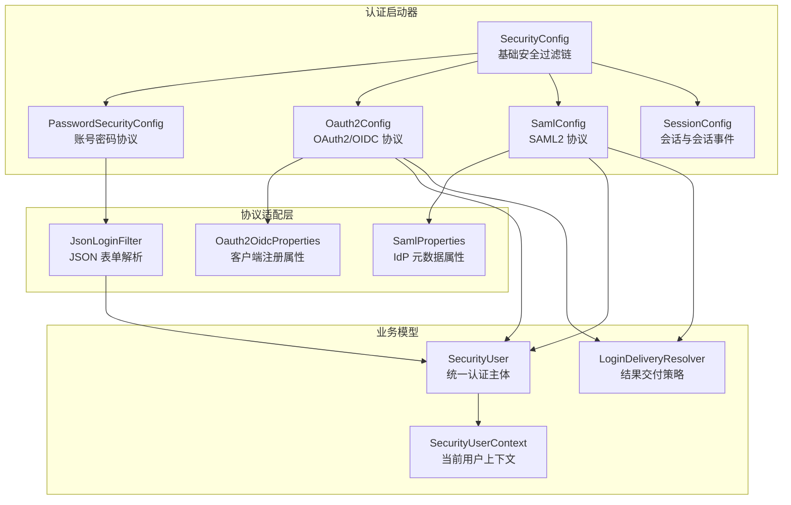
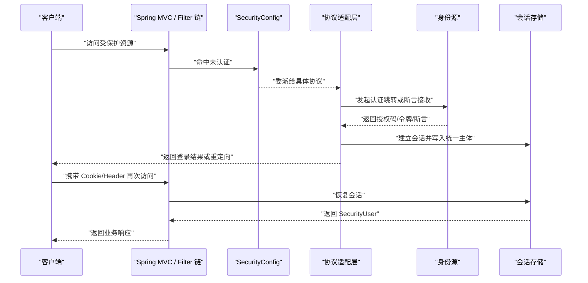
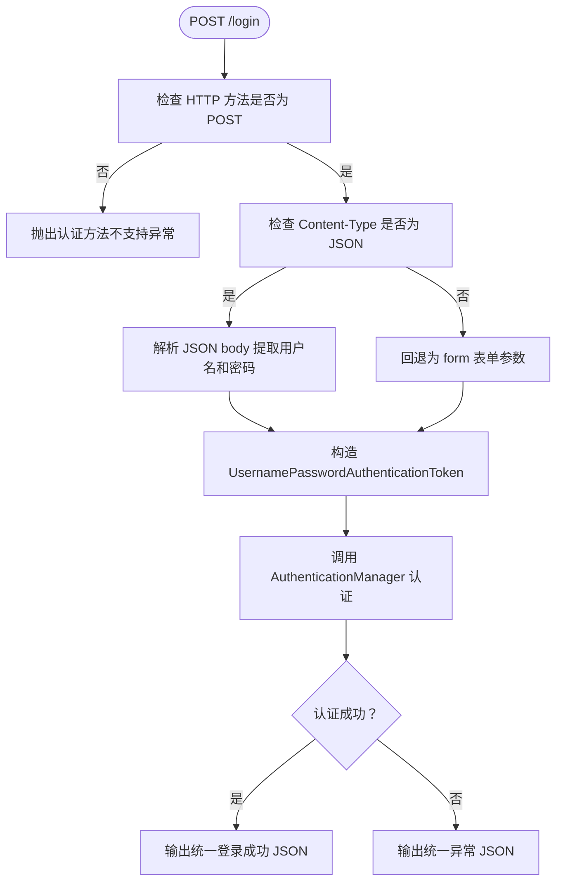
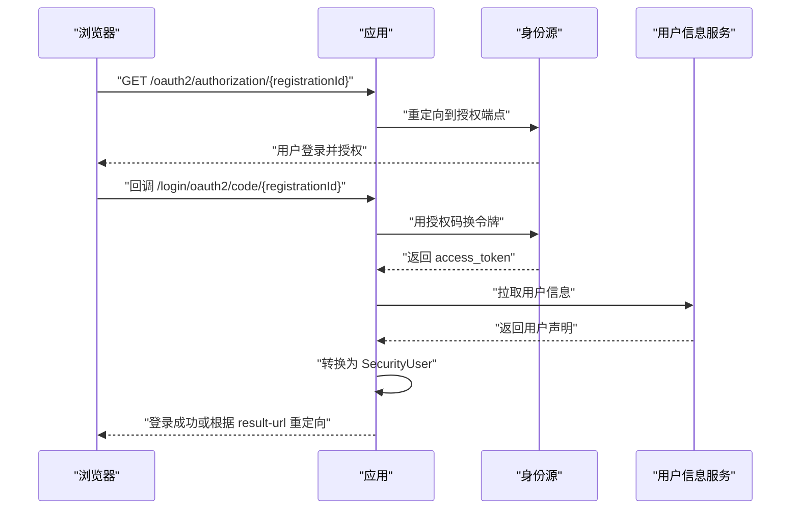
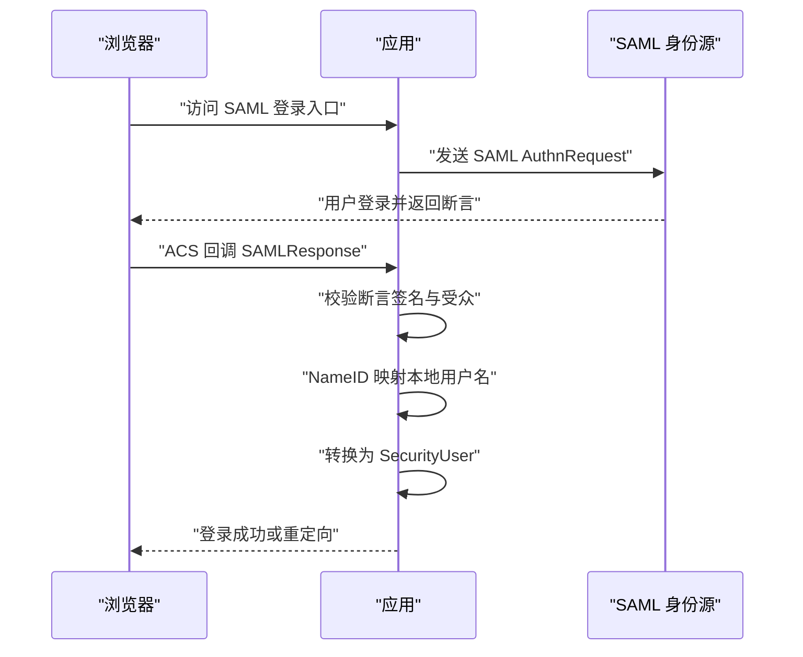
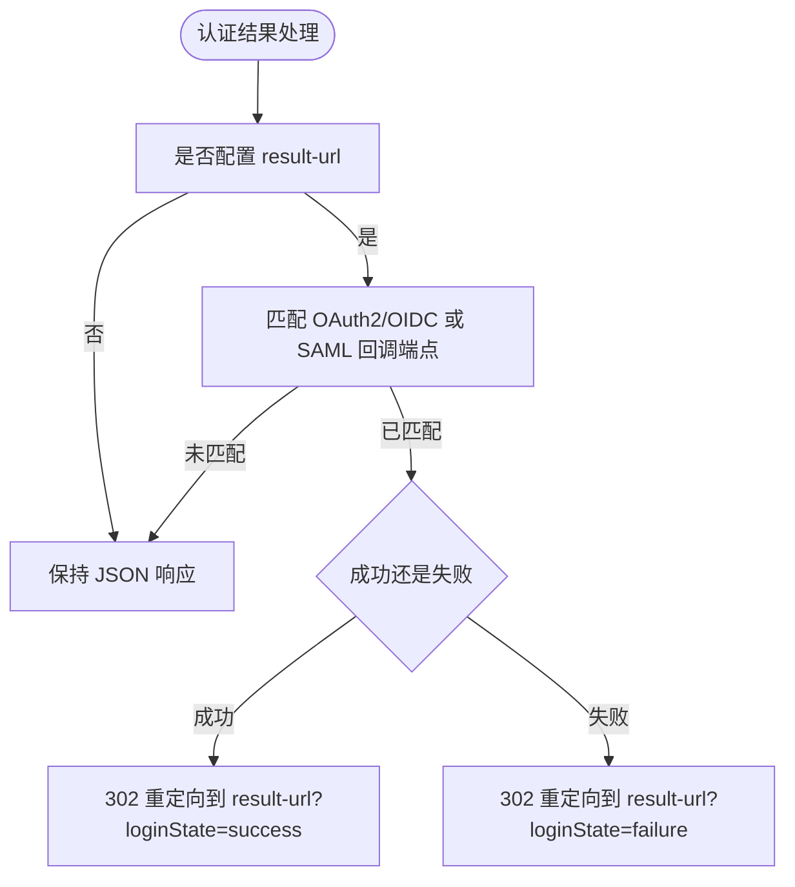
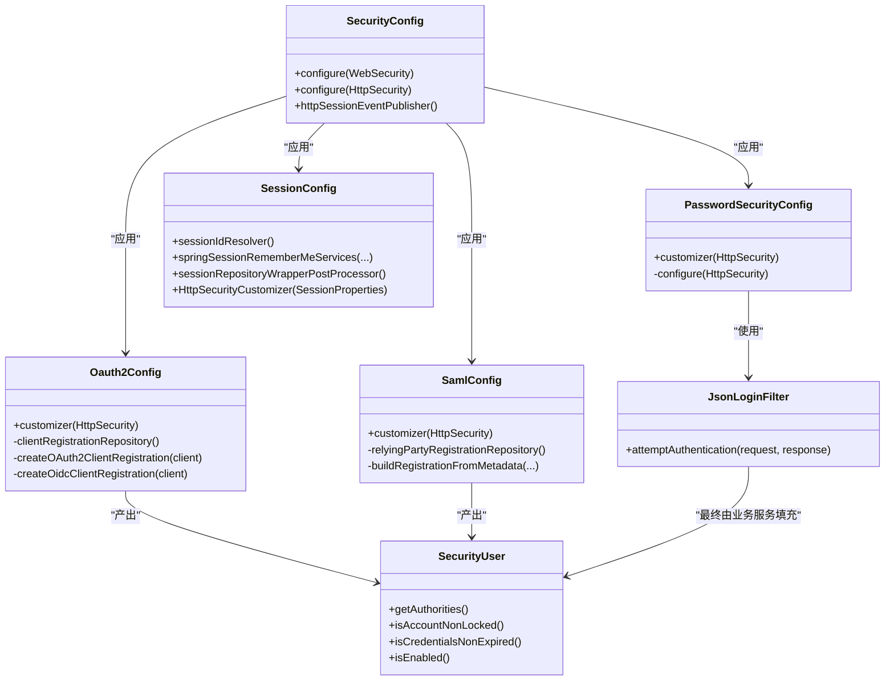

# 身份认证系统

<cite>
**本文引用的文件**   
- [README_Auth.md](file://README_Auth.md)
- [README-SSO.md](file://login-spring-boot-starter/README-SSO.md)
- [README.md](file://login-spring-boot-starter/README.md)
- [SecurityConfig.java](file://login-spring-boot-starter/src/main/java/com/cu/framework/authentication/config/SecurityConfig.java)
- [PasswordSecurityConfig.java](file://login-spring-boot-starter/src/main/java/com/cu/framework/authentication/password/config/PasswordSecurityConfig.java)
- [JsonLoginFilter.java](file://login-spring-boot-starter/src/main/java/com/cu/framework/authentication/password/filter/JsonLoginFilter.java)
- [Oauth2Config.java](file://login-spring-boot-starter/src/main/java/com/cu/framework/authentication/oauth2/Oauth2Config.java)
- [Oauth2OidcProperties.java](file://login-spring-boot-starter/src/main/java/com/cu/framework/authentication/oauth2/Oauth2OidcProperties.java)
- [SamlConfig.java](file://login-spring-boot-starter/src/main/java/com/cu/framework/authentication/saml/SamlConfig.java)
- [SamlProperties.java](file://login-spring-boot-starter/src/main/java/com/cu/framework/authentication/saml/properties/SamlProperties.java)
- [SessionConfig.java](file://login-spring-boot-starter/src/main/java/com/cu/framework/authentication/config/SessionConfig.java)
- [SessionProperties.java](file://login-spring-boot-starter/src/main/java/com/cu/framework/authentication/properties/SessionProperties.java)
- [SecurityUser.java](file://login-spring-boot-starter/src/main/java/com/cu/framework/authentication/model/SecurityUser.java)
- [SecurityUserContext.java](file://login-spring-boot-starter/src/main/java/com/cu/framework/authentication/SecurityUserContext.java)
- [LoginDeliveryResolver.java](file://login-spring-boot-starter/src/main/java/com/cu/framework/authentication/response/LoginDeliveryResolver.java)
- [SAML2_SP_Metadata配置指南.md](file://docs/说明文档/SAML2_SP_Metadata配置指南.md)
- [oidc接入踩坑记录.md](file://docs/说明文档/oidc接入踩坑记录.md)
</cite>

## 目录
1. [简介](#简介)
2. [项目结构](#项目结构)
3. [核心组件](#核心组件)
4. [架构总览](#架构总览)
5. [详细组件分析](#详细组件分析)
6. [依赖关系分析](#依赖关系分析)
7. [性能与并发特性](#性能与并发特性)
8. [故障排查](#故障排查)
9. [结论](#结论)

## 简介
本文件面向 Kewen Framework 的身份认证子系统，围绕 `login-spring-boot-starter` 模块，系统性说明其支持的三类认证协议：**账号密码登录**、**OAuth2/OIDC 单点登录**、**SAML2 单点登录**。文档覆盖以下重点：
- 多协议认证流程：从请求进入、协议适配、身份验证到会话管理。
- 安全配置核心类：`SecurityConfig`、`PasswordSecurityConfig`、`Oauth2Config`、`SamlConfig` 的职责与定制方式。
- 会话与安全策略：最大会话数控制、防并发登录、会话过期处理、Remember-Me、Header/Cookie 双模式 Session ID。
- 配置示例与常见问题：结合仓库中的 SSO 文档与踩坑记录给出可操作建议。
- 统一主体模型：所有协议最终写入 Spring Security 上下文的是统一的 `SecurityUser` 或其协议子类型，业务侧无需按协议分支。

该子系统基于 Spring Security 构建，同时通过注解驱动的 RBAC 能力（见 `auth-core` 与 `auth-rbac-*` 模块）完成菜单权限与数据权限扩展；但本文聚焦认证与会话层，不展开权限判定细节。

**章节来源**
- [README_Auth.md:1-40](file://README_Auth.md#L1-L40)
- [README.md:1-40](file://login-spring-boot-starter/README.md#L1-L40)

## 项目结构
Kewen Framework 的认证能力主要分布在以下位置：
- `login-spring-boot-starter`：认证入口、过滤器链、协议适配、会话配置、响应处理器、模型与上下文。
- `auth/auth-core`、`auth/auth-rbac-*`：RBAC 权限模型、注解与持久化实现，提供用户角色部门等权限能力。
- `sample/login-boot-sample`：最小可用登录示例，用于快速验证三种协议行为。
- `docs/说明文档`：SAML Metadata 与 OIDC 对接经验文档。

**图表来源**
- [SecurityConfig.java:1-144](file://login-spring-boot-starter/src/main/java/com/cu/framework/authentication/config/SecurityConfig.java#L1-L144)
- [PasswordSecurityConfig.java:1-54](file://login-spring-boot-starter/src/main/java/com/cu/framework/authentication/password/config/PasswordSecurityConfig.java#L1-L54)
- [JsonLoginFilter.java:1-55](file://login-spring-boot-starter/src/main/java/com/cu/framework/authentication/password/filter/JsonLoginFilter.java#L1-L55)
- [Oauth2Config.java:1-200](file://login-spring-boot-starter/src/main/java/com/cu/framework/authentication/oauth2/Oauth2Config.java#L1-L200)
- [Oauth2OidcProperties.java:1-200](file://login-spring-boot-starter/src/main/java/com/cu/framework/authentication/oauth2/Oauth2OidcProperties.java#L1-L200)
- [SamlConfig.java:1-200](file://login-spring-boot-starter/src/main/java/com/cu/framework/authentication/saml/SamlConfig.java#L1-L200)
- [SamlProperties.java:1-149](file://login-spring-boot-starter/src/main/java/com/cu/framework/authentication/saml/properties/SamlProperties.java#L1-L149)
- [SessionConfig.java:1-124](file://login-spring-boot-starter/src/main/java/com/cu/framework/authentication/config/SessionConfig.java#L1-L124)
- [SecurityUser.java:1-161](file://login-spring-boot-starter/src/main/java/com/cu/framework/authentication/model/SecurityUser.java#L1-L161)
- [SecurityUserContext.java:1-37](file://login-spring-boot-starter/src/main/java/com/cu/framework/authentication/SecurityUserContext.java#L1-L37)
- [LoginDeliveryResolver.java:1-114](file://login-spring-boot-starter/src/main/java/com/cu/framework/authentication/response/LoginDeliveryResolver.java#L1-L114)

**章节来源**
- [README.md:1-40](file://login-spring-boot-starter/README.md#L1-L40)
- [README_Auth.md:1-40](file://README_Auth.md#L1-L40)

## 核心组件
本节按“基础安全”“协议适配”“会话管理”“统一主体”四个维度梳理核心类及其职责。

### 基础安全配置：SecurityConfig
`SecurityConfig` 是所有协议的公共基座：
- 启用 `SecurityProperties`，注入成功处理器、异常处理器、对象映射器。
- 放行静态资源 `/static/**`、`/js/**`、`/css/**`、`/image/**`、`/**/**.html`。
- 汇总所有 `UrlSecurityCustomizer` 提供的白名单路径，其余请求必须认证。
- 禁用 CSRF，登出使用共享成功处理器，未认证与无权限走统一的异常处理器。
- 通过 `ObjectProvider<HttpSecurityCustomizer>` 依次应用自定义配置，允许协议配置类覆盖默认行为。
- 暴露 `HttpSessionEventPublisher`，使 Spring 容器能感知会话销毁事件。

这意味着后续 `PasswordSecurityConfig`、`Oauth2Config`、`SamlConfig`、`SessionConfig` 都以 `HttpSecurityCustomizer` 或 Bean 形式接入同一过滤链。

**章节来源**
- [SecurityConfig.java:1-144](file://login-spring-boot-starter/src/main/java/com/cu/framework/authentication/config/SecurityConfig.java#L1-L144)

### 账号密码协议：PasswordSecurityConfig 与 JsonLoginFilter
`PasswordSecurityConfig` 负责将 JSON 登录配置应用到 `HttpSecurity`：
- 读取 `cu.security.login.password` 前缀下的 `login-url`、`username-parameter`、`password-parameter`。
- 通过 `JsonLoginAuthenticationFilterConfigurer` 挂载登录过滤器。
- 登录成功由 `SecurityAuthenticationSuccessHandler` 输出统一 JSON。
- 登录失败由 `SecurityAuthenticationExceptionResolverHandler` 转为统一异常响应。

`JsonLoginFilter` 继承 Spring Security 的 `UsernamePasswordAuthenticationFilter`：
- 仅接受 POST。
- Content-Type 为 `application/json` 或 `application/json;charset=UTF-8` 时从请求体解析用户名和密码。
- 非 JSON 回退为 form 表单参数。
- 构造 `UsernamePasswordAuthenticationToken` 交由 `AuthenticationManager` 认证。

**章节来源**
- [PasswordSecurityConfig.java:1-54](file://login-spring-boot-starter/src/main/java/com/cu/framework/authentication/password/config/PasswordSecurityConfig.java#L1-L54)
- [JsonLoginFilter.java:1-55](file://login-spring-boot-starter/src/main/java/com/cu/framework/authentication/password/filter/JsonLoginFilter.java#L1-L55)
- [README.md:40-120](file://login-spring-boot-starter/README.md#L40-L120)

### OAuth2/OIDC 协议：Oauth2Config 与 Oauth2OidcProperties
`Oauth2Config` 通过 `http.oauth2Login(...)` 装配 OAuth2/OIDC 登录：
- 设置授权端点 baseUri、回调处理 URL、令牌端点客户端、用户信息端点服务。
- 使用内存版 `ClientRegistrationRepository`，按配置列表构建各 IdP 客户端。
- OAuth2 模式走手动配置的 `authorization-uri`、`token-uri`、`user-info-uri`。
- OIDC 模式通过 `issuer-uri` 自动发现，并额外校验 ID Token。
- 最终用户主体由 `RoutingOAuth2UserService` 与 `SecurityUserOAuth2UserService` 转换为统一 `SecurityUser`。

`Oauth2OidcProperties` 是配置载体：
- 全局配置包括本地授权入口 `sso-authorization-uri`、回调处理 URL `login-processing-url`、客户端列表。
- 每个客户端支持协议类型、客户端 ID/密钥、认证方法、重定向模板、scopes、OIDC discovery、JWK Set URI、SSL 忽略等。
- 用户名映射字段 `user-name-attribute-name` 决定从 IdP 拉取的用户信息中哪个字段对应本地用户名。

**章节来源**
- [Oauth2Config.java:1-200](file://login-spring-boot-starter/src/main/java/com/cu/framework/authentication/oauth2/Oauth2Config.java#L1-L200)
- [Oauth2OidcProperties.java:1-200](file://login-spring-boot-starter/src/main/java/com/cu/framework/authentication/oauth2/Oauth2OidcProperties.java#L1-L200)
- [README-SSO.md:1-120](file://login-spring-boot-starter/README-SSO.md#L1-L120)
- [oidc接入踩坑记录.md:1-120](file://docs/说明文档/oidc接入踩坑记录.md#L1-L120)

### SAML2 协议：SamlConfig 与 SamlProperties
`SamlConfig` 通过 `http.saml2Login(...)` 装配 SAML2 SP：
- 创建 `OpenSamlAuthenticationProvider`，并通过 `SecurityUserSamlAuthenticationConverter` 把断言转换为本框架统一主体。
- 构建 `RelyingPartyRegistrationRepository`，支持从 IdP metadata.xml 自动解析 entityId、SSO 地址、绑定方式、验签证书。
- 可选加载 SP 签名 keystore，用于对 AuthnRequest 和 LogoutRequest 签名。
- 注册 SAML 单点登出端点，并添加 `Saml2MetadataFilter` 暴露 SP metadata 端点。

`SamlProperties` 提供 SAML 相关配置：
- 登录处理 URL `/login/saml2/sso/{registrationId}`。
- 多个 registration 列表，每个包含 metadata 资源、SP entity ID、displayName。
- SP 签名 keystore 配置，包括 keystore 资源、别名及密码。
- SLO 请求与响应处理地址。

**章节来源**
- [SamlConfig.java:1-200](file://login-spring-boot-starter/src/main/java/com/cu/framework/authentication/saml/SamlConfig.java#L1-L200)
- [SamlProperties.java:1-149](file://login-spring-boot-starter/src/main/java/com/cu/framework/authentication/saml/properties/SamlProperties.java#L1-L149)
- [SAML2_SP_Metadata配置指南.md:1-120](file://docs/说明文档/SAML2_SP_Metadata配置指南.md#L1-L120)

### 会话管理：SessionConfig 与 SessionProperties
`SessionConfig` 集中处理会话与 Remember-Me：
- 注册 `HeaderCookieHttpSessionIdResolver`，优先从 `Authorization` Header 取 session ID，否则回退 Cookie。
- 当启用 `cu.security.remember-me.enabled=true` 时注册 `SpringSessionRememberMeServices`。
- 若存在 `JdbcIndexedSessionRepository`，包装会话仓库以发布会话创建/删除事件。
- 通过 `HttpSecurityCustomizer` 设置 `maximumSessions`、`maxSessionsPreventsLogin`，并在会话过期时返回 401 JSON。

`SessionProperties` 定义会话策略：
- `maximumSessions`：最大会话数，默认 10。
- `maxSessionsPreventsLogin`：达到上限时阻止新登录；否则踢掉最旧会话。

**章节来源**
- [SessionConfig.java:1-124](file://login-spring-boot-starter/src/main/java/com/cu/framework/authentication/config/SessionConfig.java#L1-L124)
- [SessionProperties.java:1-22](file://login-spring-boot-starter/src/main/java/com/cu/framework/authentication/properties/SessionProperties.java#L1-L22)

### 统一主体模型：SecurityUser 与 SecurityUserContext
`SecurityUser` 实现 `UserDetails` 与 `AuthenticatedPrincipal`：
- 承载用户基本信息、手机号、邮箱、头像、昵称等。
- 携带权限集合 `userAuthorities`。
- 支持凭证过期时间、账号锁定截止时间、启用状态。
- 提供账户是否锁定、凭证是否过期的判断逻辑。

`SecurityUserContext` 提供静态方法获取当前用户：
- 从 `SecurityContextHolder` 取 `Authentication`。
- 要求 principal 是 `SecurityUser`，否则抛出 `NoLoginException`。
- 因为三种协议都产出统一主体，业务代码无需按协议分支。

**章节来源**
- [SecurityUser.java:1-161](file://login-spring-boot-starter/src/main/java/com/cu/framework/authentication/model/SecurityUser.java#L1-L161)
- [SecurityUserContext.java:1-37](file://login-spring-boot-starter/src/main/java/com/cu/framework/authentication/SecurityUserContext.java#L1-L37)

## 架构总览
下图展示请求进入后的主路径：基础安全过滤链汇聚协议配置，协议适配器把外部身份源转换成本框架统一主体，最后由会话管理器维护登录态。

**图表来源**
- [SecurityConfig.java:60-144](file://login-spring-boot-starter/src/main/java/com/cu/framework/authentication/config/SecurityConfig.java#L60-L144)
- [PasswordSecurityConfig.java:25-54](file://login-spring-boot-starter/src/main/java/com/cu/framework/authentication/password/config/PasswordSecurityConfig.java#L25-L54)
- [Oauth2Config.java:80-200](file://login-spring-boot-starter/src/main/java/com/cu/framework/authentication/oauth2/Oauth2Config.java#L80-L200)
- [SamlConfig.java:60-200](file://login-spring-boot-starter/src/main/java/com/cu/framework/authentication/saml/SamlConfig.java#L60-L200)
- [SessionConfig.java:20-124](file://login-spring-boot-starter/src/main/java/com/cu/framework/authentication/config/SessionConfig.java#L20-L124)

## 详细组件分析

### 账号密码登录流程
账号密码登录适合前后端分离场景：没有内置登录页，直接返回 JSON；前端拿到 Cookie 后携带后续请求。

**图表来源**
- [JsonLoginFilter.java:18-55](file://login-spring-boot-starter/src/main/java/com/cu/framework/authentication/password/filter/JsonLoginFilter.java#L18-L55)
- [PasswordSecurityConfig.java:25-54](file://login-spring-boot-starter/src/main/java/com/cu/framework/authentication/password/config/PasswordSecurityConfig.java#L25-L54)

关键要点：
- 登录 URL 默认为 `/login`，可通过 `cu.security.login.password.login-url` 修改。
- JSON 字段名默认是 `username`、`password`，可通过 `username-parameter`、`password-parameter` 修改。
- 未登录访问受保护接口会返回统一 JSON，而不是 401 HTTP 状态码；调用方应读业务码而非只看 HTTP 状态。

**章节来源**
- [README.md:120-220](file://login-spring-boot-starter/README.md#L120-L220)
- [JsonLoginFilter.java:18-55](file://login-spring-boot-starter/src/main/java/com/cu/framework/authentication/password/filter/JsonLoginFilter.java#L18-L55)
- [SecurityConfig.java:60-144](file://login-spring-boot-starter/src/main/java/com/cu/framework/authentication/config/SecurityConfig.java#L60-L144)

### OAuth2/OIDC 单点登录流程
OAuth2 与 OIDC 共用同一条 `oauth2Login` 过滤器链：
- 用户访问 `/oauth2/authorization/{registrationId}` 跳转到 IdP。
- IdP 回调 `/login/oauth2/code/{registrationId}`。
- 系统用授权码换取 access_token，再拉取用户信息。
- OIDC 额外校验 ID Token，并按需拉取 userinfo。
- 最终主体被转换为 `SecurityUser`，写入会话。

**图表来源**
- [Oauth2Config.java:80-200](file://login-spring-boot-starter/src/main/java/com/cu/framework/authentication/oauth2/Oauth2Config.java#L80-L200)
- [Oauth2OidcProperties.java:1-200](file://login-spring-boot-starter/src/main/java/com/cu/framework/authentication/oauth2/Oauth2OidcProperties.java#L1-L200)
- [README-SSO.md:120-260](file://login-spring-boot-starter/README-SSO.md#L120-L260)

关键配置项：
- 全局：`sso-authorization-uri`、`login-processing-url`、`clients`。
- 客户端：`registration-id`、`client-id`、`client-secret`、`protocol-type`、`authorization-uri`、`token-uri`、`user-info-uri`、`user-name-attribute-name`、`jwk-set-uri`、`ignore-ssl`。
- OIDC 推荐配置 `issuer-uri`，系统自动发现端点；也可手动配置各端点。

常见问题：
- OIDC Discovery URL 不能带 `.well-known/openid-configuration`，否则会被重复拼接。
- 某些 IdP 的 JWKS 需要携带 `client_id`，可通过配置 `jwk-set-uri` 覆盖。
- `ignore-ssl` 只影响 userinfo 请求，不影响 Discovery 和 JWK 拉取。

**章节来源**
- [README-SSO.md:120-260](file://login-spring-boot-starter/README-SSO.md#L120-L260)
- [oidc接入踩坑记录.md:120-456](file://docs/说明文档/oidc接入踩坑记录.md#L120-L456)
- [Oauth2OidcProperties.java:1-200](file://login-spring-boot-starter/src/main/java/com/cu/framework/authentication/oauth2/Oauth2OidcProperties.java#L1-L200)

### SAML2 单点登录流程
SAML2 作为企业级单点登录标准，支持 IdP 发起和 SP 发起两种模式：
- 用户访问 SAML 登录入口，应用生成 SAML 认证请求。
- IdP 返回断言，应用校验签名、Audience、NameID。
- NameID 对应本地用户名，系统据此查找 `SecurityUser`。
- 成功后写入会话，并可暴露 SP metadata 供 IdP 自动发现。

**图表来源**
- [SamlConfig.java:60-200](file://login-spring-boot-starter/src/main/java/com/cu/framework/authentication/saml/SamlConfig.java#L60-L200)
- [SamlProperties.java:1-149](file://login-spring-boot-starter/src/main/java/com/cu/framework/authentication/saml/properties/SamlProperties.java#L1-L149)

关键配置项：
- 登录处理 URL：`/login/saml2/sso/{registrationId}`。
- IdP metadata 资源：`classpath:saml/idp-metadata.xml`。
- SP entity ID：需与 IdP 配置一致。
- SP 签名 keystore：可选，用于对 AuthnRequest 和 LogoutRequest 签名。
- SLO 地址：`/logout/saml2/slo`。

SP metadata 端点：
- 默认路径 `/saml2/service-provider-metadata/{registrationId}`。
- 通过 `Saml2MetadataFilter` 暴露，便于 IdP 自动导入 SP 配置。

**章节来源**
- [SamlConfig.java:60-200](file://login-spring-boot-starter/src/main/java/com/cu/framework/authentication/saml/SamlConfig.java#L60-L200)
- [SAML2_SP_Metadata配置指南.md:1-200](file://docs/说明文档/SAML2_SP_Metadata配置指南.md#L1-L200)
- [SamlProperties.java:1-149](file://login-spring-boot-starter/src/main/java/com/cu/framework/authentication/saml/properties/SamlProperties.java#L1-L149)

### 认证结果交付策略
对于单点登录，框架提供可选的前端回跳地址：
- 配置 `cu.security.login.sso.result-url` 后，OAuth2/OIDC 与 SAML2 的成功与失败都会 302 重定向到该地址，并附加 `loginState=success` 或 `loginState=failure`。
- 未配置时，回调仍保持原有 JSON 响应行为。
- 账号密码登录始终返回 JSON，不受 `result-url` 影响。

`LoginDeliveryResolver` 根据当前请求命中的认证端点决定交付策略：
- 匹配 OAuth2/OIDC 回调 URL 模板。
- 匹配 SAML 登录处理 URL 模板。
- 如果命中且配置了 `result-url`，则执行重定向。

**图表来源**
- [LoginDeliveryResolver.java:1-114](file://login-spring-boot-starter/src/main/java/com/cu/framework/authentication/response/LoginDeliveryResolver.java#L1-L114)
- [README.md:40-120](file://login-spring-boot-starter/README.md#L40-L120)

**章节来源**
- [LoginDeliveryResolver.java:1-114](file://login-spring-boot-starter/src/main/java/com/cu/framework/authentication/response/LoginDeliveryResolver.java#L1-L114)
- [README.md:40-120](file://login-spring-boot-starter/README.md#L40-L120)

## 依赖关系分析
认证子系统内部依赖关系如下：

**图表来源**
- [SecurityConfig.java:1-144](file://login-spring-boot-starter/src/main/java/com/cu/framework/authentication/config/SecurityConfig.java#L1-L144)
- [PasswordSecurityConfig.java:1-54](file://login-spring-boot-starter/src/main/java/com/cu/framework/authentication/password/config/PasswordSecurityConfig.java#L1-L54)
- [JsonLoginFilter.java:1-55](file://login-spring-boot-starter/src/main/java/com/cu/framework/authentication/password/filter/JsonLoginFilter.java#L1-L55)
- [Oauth2Config.java:1-200](file://login-spring-boot-starter/src/main/java/com/cu/framework/authentication/oauth2/Oauth2Config.java#L1-L200)
- [SamlConfig.java:1-200](file://login-spring-boot-starter/src/main/java/com/cu/framework/authentication/saml/SamlConfig.java#L1-L200)
- [SessionConfig.java:1-124](file://login-spring-boot-starter/src/main/java/com/cu/framework/authentication/config/SessionConfig.java#L1-L124)
- [SecurityUser.java:1-161](file://login-spring-boot-starter/src/main/java/com/cu/framework/authentication/model/SecurityUser.java#L1-L161)

依赖特点：
- `SecurityConfig` 是中心节点，负责聚合白名单、异常处理、CSRF 关闭和自定义 `HttpSecurityCustomizer`。
- 三个协议配置类各自独立，互不耦合，避免协议间相互干扰。
- `SecurityUser` 是最终产物，业务层通过 `SecurityUserContext` 获取，不需要感知具体协议。
- 会话配置与协议配置解耦，通过 `SessionConfig` 的 `HttpSecurityCustomizer` 注入会话策略。

**章节来源**
- [SecurityConfig.java:60-144](file://login-spring-boot-starter/src/main/java/com/cu/framework/authentication/config/SecurityConfig.java#L60-L144)
- [README.md:1-40](file://login-spring-boot-starter/README.md#L1-L40)

## 性能与并发特性
会话层提供企业级安全特性：

| 特性 | 配置项 | 行为 |
|------|--------|------|
| 最大会话数 | `cu.security.session.maximum-sessions` | 默认 10，限制同一用户的并发会话数量 |
| 超限策略 | `cu.security.session.max-sessions-prevents-login` | `true` 阻止新登录；`false` 踢掉最旧会话 |
| 会话过期响应 | 内置 `expiredSessionStrategy` | 返回 401 JSON，提示“登录状态失效，请重新登录” |
| Remember-Me | `cu.security.remember-me.enabled` | 启用后注册基于 Spring Session 的 Remember-Me |
| Session ID 来源 | `HeaderCookieHttpSessionIdResolver` | 优先从 `Authorization` Header 取 token，否则回退 Cookie |
| 会话事件 | `SessionRepositoryWrapperPostProcessor` | 增强 JDBC 会话仓库，发布创建/删除事件 |

这些特性使得系统既能满足传统 Web Cookie 场景，也能满足移动端或微服务通过 Header 传递 token 的场景。

**章节来源**
- [SessionConfig.java:20-124](file://login-spring-boot-starter/src/main/java/com/cu/framework/authentication/config/SessionConfig.java#L20-L124)
- [SessionProperties.java:1-22](file://login-spring-boot-starter/src/main/java/com/cu/framework/authentication/properties/SessionProperties.java#L1-L22)

## 故障排查

### 账号密码登录问题
- **GET /login 返回 401**：starter 没有启用 `formLogin`，因此没有默认登录页。需要显式放行登录页或通过 `UrlSecurityCustomizer.permitAll()` 加入白名单。
- **Content-Type 不匹配**：`JsonLoginFilter` 对 `application/json;charset=utf-8` 不会走 JSON 分支，可能读不到字段导致 `BadCredentials`。建议使用 `application/json` 或大写 UTF-8。
- **密码编码器前缀问题**：数据库密码如果没有 `{bcrypt}` 等前缀，`DelegatingPasswordEncoder` 会报错。应补前缀或覆盖 `PasswordEncoder` Bean。
- **未登录响应形态**：未认证返回的是 HTTP 200 + 业务码 401，不是 HTTP 401。调用方应判断 `code` 与 `success`。

**章节来源**
- [README.md:120-220](file://login-spring-boot-starter/README.md#L120-L220)
- [JsonLoginFilter.java:18-55](file://login-spring-boot-starter/src/main/java/com/cu/framework/authentication/password/filter/JsonLoginFilter.java#L18-L55)
- [SecurityConfig.java:60-144](file://login-spring-boot-starter/src/main/java/com/cu/framework/authentication/config/SecurityConfig.java#L60-L144)

### OAuth2/OIDC 对接问题
- **Discovery URL 配置错误**：`issuer-uri` 应为 IdP 基础地址，不应包含 `.well-known/openid-configuration`，否则会被重复拼接。
- **JWKS 无法解密 JWT**：某些 IdP 的 JWKS 端点需要携带 `client_id`，可通过配置 `jwk-set-uri` 覆盖自动发现结果。
- **用户名映射字段选错**：`user-name-attribute-name` 应该指向本系统用户名，例如 `preferred_username`、`login`；不要误用 `sub`，因为 `sub` 通常是身份源数字 ID。
- **SSL 跳过范围**：`ignore-ssl` 只影响 userinfo 端点，不影响 Discovery 和 JWK 拉取。

**章节来源**
- [oidc接入踩坑记录.md:1-456](file://docs/说明文档/oidc接入踩坑记录.md#L1-L456)
- [Oauth2OidcProperties.java:1-200](file://login-spring-boot-starter/src/main/java/com/cu/framework/authentication/oauth2/Oauth2OidcProperties.java#L1-L200)
- [README-SSO.md:120-260](file://login-spring-boot-starter/README-SSO.md#L120-L260)

### SAML2 配置问题
- **SP Entity ID 不一致**：应用侧 `spEntityId` 必须与 IdP 侧配置的 Audience 一致，否则断言校验失败。
- **缺少 SP metadata**：需要确保 `Saml2MetadataFilter` 已注册，并提供 `/saml2/service-provider-metadata/{registrationId}`。
- **Keystore 配置缺失**：如果需要签名 AuthnRequest 和 LogoutRequest，需配置 `spSigningKeystore`。
- **NameID 与本地用户名不一致**：断言中的 NameID 必须等于本地用户名，否则认证以 `sso_local_user_not_found` 失败。

**章节来源**
- [SamlConfig.java:60-200](file://login-spring-boot-starter/src/main/java/com/cu/framework/authentication/saml/SamlConfig.java#L60-L200)
- [SAML2_SP_Metadata配置指南.md:1-200](file://docs/说明文档/SAML2_SP_Metadata配置指南.md#L1-L200)
- [SamlProperties.java:1-149](file://login-spring-boot-starter/src/main/java/com/cu/framework/authentication/saml/properties/SamlProperties.java#L1-L149)
- [README-SSO.md:1-120](file://login-spring-boot-starter/README-SSO.md#L1-L120)

### 会话与并发问题
- **会话过多报错**：检查 `maximumSessions` 与 `maxSessionsPreventsLogin`。达到上限时可阻止新登录或踢掉最旧会话。
- **移动端无法识别 Session**：确认前端是否在 `Authorization` Header 中携带 token，`HeaderCookieHttpSessionIdResolver` 会优先从 Header 解析。
- **会话过期响应不符合预期**：确认是否启用了 JDBC 会话存储，以及 `expiredSessionStrategy` 是否生效。

**章节来源**
- [SessionConfig.java:20-124](file://login-spring-boot-starter/src/main/java/com/cu/framework/authentication/config/SessionConfig.java#L20-L124)
- [SessionProperties.java:1-22](file://login-spring-boot-starter/src/main/java/com/cu/framework/authentication/properties/SessionProperties.java#L1-L22)

## 结论
Kewen Framework 的身份认证系统以 `SecurityConfig` 为中心，通过 `HttpSecurityCustomizer` 机制将账号密码、OAuth2/OIDC、SAML2 三种协议并列接入同一 Spring Security 过滤链。其设计优势在于：
- **协议解耦**：每种协议有独立配置类和属性，互不影响。
- **主体统一**：无论哪种协议，最终主体都是 `SecurityUser`，业务代码无需按协议分支。
- **企业级会话能力**：支持最大会话数、防并发登录、会话过期 JSON 响应、Remember-Me、Header/Cookie 双模式。
- **可观测与可扩展**：通过 `SecurityUserContext`、异常处理器、结果交付策略、RBAC 注解体系，形成完整的认证与权限闭环。

集成建议：
- 先引入 `login-spring-boot-starter` 与 `auth-rbac-spring-boot-starter`，完成最小可用登录。
- 根据业务选择 OAuth2/OIDC 或 SAML2，并正确配置 `user-name-attribute-name` 或 SAML NameID。
- 生产环境务必启用会话持久化、合理设置最大会话数，并关注会话过期与并发登录策略。
- 遇到 IdP 特殊行为时，优先通过配置覆盖，而不是修改框架通用逻辑。