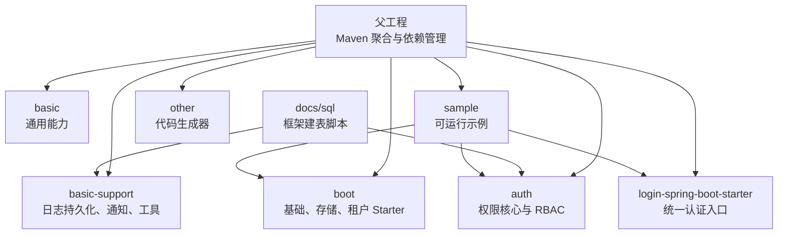
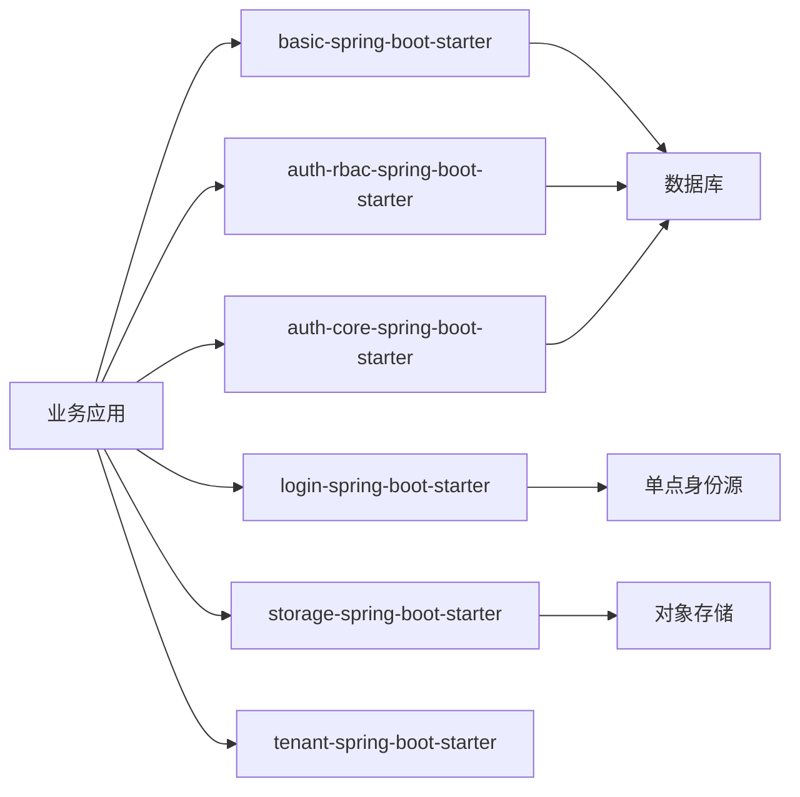
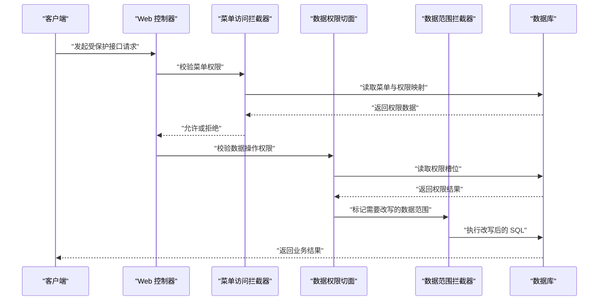

# 部署指南

<cite>
**本文引用的文件**   
- [pom.xml](file://pom.xml)
- [application.yml](file://sample/auth-core-boot-sample/src/main/resources/application.yml)
- [application.yml](file://sample/auth-rbac-boot-sample/src/main/resources/application.yml)
- [application.yml](file://sample/basic-boot-sample/src/main/resources/application.yml)
- [application.yml](file://sample/login-boot-sample/src/main/resources/application.yml)
- [application.yml](file://sample/storage-boot-sample/src/main/resources/application.yml)
- [application.yml](file://sample/tenant-boot-sample/src/main/resources/application.yml)
- [docs/application.yml](file://docs/application.yml)
- [docs/sql/auth-rbac.sql](file://docs/sql/auth-rbac.sql)
- [docs/sql/basic-support.sql](file://docs/sql/basic-support.sql)
- [auth-core README.md](file://auth/auth-core/README.md)
- [auth-core-spring-boot-starter README.md](file://auth/auth-core-spring-boot-starter/README.md)
- [auth-rbac-spring-boot-starter README.md](file://auth/auth-rbac-spring-boot-starter/README.md)
- [login-spring-boot-starter README.md](file://login-spring-boot-starter/README.md)
- [auth-rbac-boot-sample README.md](file://sample/auth-rbac-boot-sample/README.md)
- [auth-core-boot-sample README.md](file://sample/auth-core-boot-sample/README.md)
</cite>

## 目录
1. [简介](#简介)
2. [项目结构](#项目结构)
3. [环境准备要求](#环境准备要求)
4. [部署步骤](#部署步骤)
5. [核心组件与依赖关系](#核心组件与依赖关系)
6. [配置详解](#配置详解)
7. [生产环境优化](#生产环境优化)
8. [监控、日志与可观测性](#监控日志与可观测性)
9. [健康检查与服务发现](#健康检查与服务发现)
10. [故障恢复与备份策略](#故障恢复与备份策略)
11. [自动化部署与持续集成](#自动化部署与持续集成)
12. [常见问题排查](#常见问题排查)
13. [结论](#结论)

## 简介
本指南面向在本地、测试和生产环境中部署 Kewen Framework 的使用方。文档基于仓库中的父工程、示例应用、Starter 模块和参考配置文件整理，覆盖以下目标：
- 明确 Java、数据库、中间件等基础设施版本与依赖；
- 提供从零开始的安装、初始化、配置和启动流程；
- 说明权限、认证、存储、租户、基础支撑等核心能力的运行前提；
- 给出生产环境的 JVM、连接池、缓存、日志和运维建议；
- 补充监控、健康检查、服务发现、故障恢复、备份及 CI/CD 实践思路。

Kewen Framework 当前以 Spring Boot 2.7 生态为基础，提供多个 Starter 模块（基础能力、登录认证、RBAC 权限、存储、租户等），并通过 sample 示例演示典型用法。

**章节来源**
- [pom.xml:1-20](file://pom.xml#L1-L20)
- [login-spring-boot-starter README.md:1-30](file://login-spring-boot-starter/README.md#L1-L30)

## 项目结构
仓库采用多模块 Maven 结构，主要分组如下：
- `basic`：通用异常、过滤器、日志追踪、通用模型、工具类；
- `basic-support`：请求日志持久化、消息通知、分页工具、雪花 ID、基础支持端点；
- `boot`：Spring Boot Starter，包括基础能力、存储、租户、魔法样例等；
- `login-spring-boot-starter`：账号密码、OAuth2/OIDC、SAML2 登录统一入口；
- `auth`：权限框架核心、RBAC 实现及相关 Starter；
- `sample`：各场景可运行示例；
- `other`：代码生成器等辅助工具；
- `docs/sql`：权限框架与基础支撑的建表脚本；
- `scripts`：兼容性校验脚本。

**图示来源**
- [pom.xml:1-20](file://pom.xml#L1-L20)
- [docs/sql/auth-rbac.sql:1-20](file://docs/sql/auth-rbac.sql#L1-L20)
- [docs/sql/basic-support.sql:1-20](file://docs/sql/basic-support.sql#L1-L20)

**章节来源**
- [pom.xml:1-20](file://pom.xml#L1-L20)
- [docs/sql/auth-rbac.sql:1-20](file://docs/sql/auth-rbac.sql#L1-L20)
- [docs/sql/basic-support.sql:1-20](file://docs/sql/basic-support.sql#L1-L20)

## 环境准备要求

### Java 版本
父工程将编译源和目标设置为 Java 8，因此推荐部署 JDK 8 或兼容的后续版本。示例模块也显式声明 Java 8 编译器属性。

| 项目 | 要求 |
| --- | --- |
| Java 运行时 | 建议 JDK 8 及以上 |
| 构建工具 | Maven |
| 默认端口 | 示例使用 8080、8081、8082 |

**章节来源**
- [pom.xml:10-14](file://pom.xml#L10-L14)
- [sample/auth-core-boot-sample/pom.xml:12-17](file://sample/auth-core-boot-sample/pom.xml#L12-L17)
- [sample/basic-boot-sample/pom.xml:12-17](file://sample/basic-boot-sample/pom.xml#L12-L17)

### 数据库版本
项目使用 MyBatis-Plus 3.5.8 与 MySQL Connector/J 8.0.33。示例中 H2 以 MySQL 兼容模式运行，用于免数据库快速验证；MySQL profile 则指向真实 MySQL。

| 组件 | 版本或模式 |
| --- | --- |
| MyBatis-Plus | 3.5.8 |
| MyBatis | 3.5.16 |
| MySQL 驱动 | 8.0.33 |
| H2 | 由 Spring Boot 依赖管理，示例使用 MySQL 兼容模式 |

**章节来源**
- [pom.xml:11-14](file://pom.xml#L11-L14)
- [pom.xml:228-246](file://pom.xml#L228-L246)
- [sample/auth-core-boot-sample/src/main/resources/application.yml:51-70](file://sample/auth-core-boot-sample/src/main/resources/application.yml#L51-L70)
- [sample/auth-rbac-boot-sample/src/main/resources/application.yml:67-92](file://sample/auth-rbac-boot-sample/src/main/resources/application.yml#L67-L92)

### 中间件与外部依赖
| 依赖 | 用途 | 是否必填 |
| --- | --- | --- |
| MySQL | 用户、角色、菜单、权限、会话、请求日志、文件元数据等 | 视功能而定 |
| H2 | 开发、快速验证、内存库演示 | 可选 |
| P6Spy | SQL 跟踪（basic/storage 示例中使用） | 可选 |
| 七牛云存储 | 对象存储、上传下载、回调 | 启用存储功能时必填 |
| 第三方单点身份源 | OAuth2/OIDC/SAML2 | 启用对应 SSO 时必填 |
| 方糖消息推送 | 请求来源 IP 通知 | 启用通知时可选 |
| Redis | 会话共享、菜单权限缓存（可扩展） | 可选 |

**章节来源**
- [docs/application.yml:18-76](file://docs/application.yml#L18-L76)
- [sample/basic-boot-sample/src/main/resources/application.yml:58-79](file://sample/basic-boot-sample/src/main/resources/application.yml#L58-L79)
- [sample/storage-boot-sample/src/main/resources/application.yml:1-20](file://sample/storage-boot-sample/src/main/resources/application.yml#L1-L20)
- [sample/login-boot-sample/src/main/resources/application.yml:1-40](file://sample/login-boot-sample/src/main/resources/application.yml#L1-L40)

## 部署步骤

### 第一步：准备基础设施
1. 安装 JDK 8 或以上版本。
2. 安装并启动 MySQL；创建业务数据库和用户，授予相应权限。
3. 如需对象存储，注册七牛云并获取 AccessKey、SecretKey、Bucket、下载域名。
4. 如需单点登录，准备 OAuth2/OIDC 或 SAML2 身份源信息。
5. 如需请求日志持久化，准备好 `sys_request_log` 等基础表。

**章节来源**
- [docs/sql/basic-support.sql:1-79](file://docs/sql/basic-support.sql#L1-L79)
- [docs/application.yml:18-76](file://docs/application.yml#L18-L76)
- [sample/storage-boot-sample/src/main/resources/application.yml:1-20](file://sample/storage-boot-sample/src/main/resources/application.yml#L1-L20)

### 第二步：选择示例应用
Kewen Framework 提供多个示例应用，可按需部署：
- `basic-boot-sample`：基础能力、请求日志、通知；
- `auth-core-boot-sample`：权限接缝层示例；
- `auth-rbac-boot-sample`：完整 RBAC 权限示例；
- `login-boot-sample`：账号密码与单点登录示例；
- `storage-boot-sample`：文件存储示例；
- `tenant-boot-sample`：租户上下文示例。

**章节来源**
- [pom.xml:16-20](file://pom.xml#L16-L20)
- [sample/basic-boot-sample/pom.xml:1-25](file://sample/basic-boot-sample/pom.xml#L1-L25)
- [sample/auth-core-boot-sample/pom.xml:1-25](file://sample/auth-core-boot-sample/pom.xml#L1-L25)
- [sample/auth-rbac-boot-sample/pom.xml:1-30](file://sample/auth-rbac-boot-sample/pom.xml#L1-L30)
- [sample/login-boot-sample/pom.xml:1-25](file://sample/login-boot-sample/pom.xml#L1-L25)
- [sample/storage-boot-sample/pom.xml:1-20](file://sample/storage-boot-sample/pom.xml#L1-L20)
- [sample/tenant-boot-sample/pom.xml:1-20](file://sample/tenant-boot-sample/pom.xml#L1-L20)

### 第三步：初始化数据库
根据所选示例执行建表和种子数据：

| 示例 | 必需脚本 | 说明 |
| --- | --- | --- |
| `auth-rbac-boot-sample` | `docs/sql/auth-rbac.sql`、`sql/schema.sql`、`sql/seed-data.sql` | 权限框架 10 张表、视图、示例业务表和种子数据 |
| `basic-boot-sample` | `docs/sql/basic-support.sql` | 文件记录、分片、存储文件、请求日志表 |
| `storage-boot-sample` | `docs/sql/basic-support.sql` | 文件相关表 |
| `auth-core-boot-sample` | 示例自带 `sql/schema.sql`、`sql/seed-data.sql` | 不依赖框架默认 `sys_auth_data`，使用自有表 |
| `login-boot-sample` | Spring Session 会话表 | MySQL 下需手动执行会话建表脚本 |
| `tenant-boot-sample` | 无业务表 | 仅需可用 DataSource |

**章节来源**
- [sample/auth-rbac-boot-sample/README.md:14-38](file://sample/auth-rbac-boot-sample/README.md#L14-L38)
- [sample/auth-rbac-boot-sample/src/main/resources/application.yml:78-101](file://sample/auth-rbac-boot-sample/src/main/resources/application.yml#L78-L101)
- [sample/basic-boot-sample/src/main/resources/application.yml:34-56](file://sample/basic-boot-sample/src/main/resources/application.yml#L34-L56)
- [sample/storage-boot-sample/src/main/resources/application.yml:21-41](file://sample/storage-boot-sample/src/main/resources/application.yml#L21-L41)
- [sample/auth-core-boot-sample/README.md:110-150](file://sample/auth-core-boot-sample/README.md#L110-L150)
- [sample/login-boot-sample/src/main/resources/application.yml:178-207](file://sample/login-boot-sample/src/main/resources/application.yml#L178-L207)

### 第四步：修改配置文件
至少完成以下配置项：
- 服务器端口与应用名称；
- 数据库连接地址、用户名、密码、驱动；
- 连接池参数；
- 功能开关：存储、租户、请求日志、通知、权限缓存；
- 外部系统凭证：七牛云、方糖消息、单点身份源。

示例参考路径：
- 基础示例：`sample/basic-boot-sample/src/main/resources/application.yml`；
- RBAC 示例：`sample/auth-rbac-boot-sample/src/main/resources/application.yml`；
- 登录示例：`sample/login-boot-sample/src/main/resources/application.yml`；
- 存储示例：`sample/storage-boot-sample/src/main/resources/application.yml`；
- 租户示例：`sample/tenant-boot-sample/src/main/resources/application.yml`；
- 全量配置参考：`docs/application.yml`。

**章节来源**
- [sample/basic-boot-sample/src/main/resources/application.yml:1-33](file://sample/basic-boot-sample/src/main/resources/application.yml#L1-L33)
- [sample/auth-rbac-boot-sample/src/main/resources/application.yml:1-35](file://sample/auth-rbac-boot-sample/src/main/resources/application.yml#L1-L35)
- [sample/login-boot-sample/src/main/resources/application.yml:1-60](file://sample/login-boot-sample/src/main/resources/application.yml#L1-L60)
- [sample/storage-boot-sample/src/main/resources/application.yml:1-20](file://sample/storage-boot-sample/src/main/resources/application.yml#L1-L20)
- [sample/tenant-boot-sample/src/main/resources/application.yml:1-15](file://sample/tenant-boot-sample/src/main/resources/application.yml#L1-L15)
- [docs/application.yml:1-30](file://docs/application.yml#L1-L30)

### 第五步：构建应用
推荐使用 Maven 构建单个示例模块，避免触发整个仓库依赖。例如：
- 构建基本示例：`mvn -pl sample/basic-boot-sample package -DskipTests`；
- 构建 RBAC 示例：`mvn -pl sample/auth-rbac-boot-sample package -DskipTests`；
- 构建登录示例：`mvn -pl sample/login-boot-sample package -DskipTests`；
- 构建存储示例：`mvn -pl sample/storage-boot-sample package -DskipTests`；
- 构建租户示例：`mvn -pl sample/tenant-boot-sample package -DskipTests`；
- 构建 auth-core 示例：`mvn -pl sample/auth-core-boot-sample package -DskipTests`。

**章节来源**
- [sample/auth-core-boot-sample/README.md:130-145](file://sample/auth-core-boot-sample/README.md#L130-L145)
- [sample/auth-rbac-boot-sample/README.md:44-50](file://sample/auth-rbac-boot-sample/README.md#L44-L50)

### 第六步：启动应用
示例启动方式包括直接运行 Main Class 或使用打包后的可执行 Jar。常见入口如下：
- 基本示例：`com.cu.framework.sample.basic.BasicBootSampleApp`；
- RBAC 示例：`com.cu.framework.auth.sample.AuthRbacBootSampleApp`；
- 登录示例：`com.cu.framework.sample.login.LoginBootSampleApp`；
- 存储示例：`com.cu.framework.sample.storage.StorageBootSample.java`；
- 租户示例：`com.cu.framework.sample.tenant.TenantSampleApp`；
- auth-core 示例：`com.cu.framework.sample.authcore.AuthCoreBootSampleApp`。

部分示例默认使用 H2 内存库，无需真实数据库即可启动；切换 MySQL 时使用 `--spring.profiles.active=mysql`。

**章节来源**
- [sample/auth-rbac-boot-sample/pom.xml:95-121](file://sample/auth-rbac-boot-sample/pom.xml#L95-L121)
- [sample/login-boot-sample/pom.xml:38-64](file://sample/login-boot-sample/pom.xml#L38-L64)
- [sample/auth-core-boot-sample/pom.xml:63-96](file://sample/auth-core-boot-sample/pom.xml#L63-L96)
- [sample/auth-core-boot-sample/README.md:130-145](file://sample/auth-core-boot-sample/README.md#L130-L145)
- [sample/auth-rbac-boot-sample/README.md:44-50](file://sample/auth-rbac-boot-sample/README.md#L44-L50)

## 核心组件与依赖关系

### Starter 装配关系
Kewen Framework 通过 Spring Boot Starter 自动装配关键能力：
- `basic-spring-boot-starter`：基础异常、过滤、日志、工具；
- `auth-core-spring-boot-starter`：权限声明、数据范围、菜单访问拦截；
- `auth-rbac-spring-boot-starter`：RBAC 模型、菜单权限、角色部门；
- `login-spring-boot-starter`：统一登录入口；
- `storage-spring-boot-starter`：对象存储；
- `tenant-spring-boot-starter`：租户上下文。

**图示来源**
- [auth-core-spring-boot-starter README.md:1-20](file://auth/auth-core-spring-boot-starter/README.md#L1-L20)
- [auth-rbac-spring-boot-starter README.md:1-20](file://auth/auth-rbac-spring-boot-starter/README.md#L1-L20)
- [login-spring-boot-starter README.md:1-30](file://login-spring-boot-starter/README.md#L1-L30)
- [docs/application.yml:18-76](file://docs/application.yml#L18-L76)

**章节来源**
- [auth-core-spring-boot-starter README.md:1-35](file://auth/auth-core-spring-boot-starter/README.md#L1-L35)
- [auth-rbac-spring-boot-starter README.md:1-27](file://auth/auth-rbac-spring-boot-starter/README.md#L1-L27)
- [login-spring-boot-starter README.md:1-30](file://login-spring-boot-starter/README.md#L1-L30)

### 权限与 RBAC 数据流
权限框架的核心流程包括：
1. 从当前用户上下文加载用户权限；
2. 根据菜单路径判断菜单访问权限；
3. 根据数据操作注解判断行级权限；
4. 对查询语句进行数据范围改写；
5. 将权限结果返回给调用方或前端透视台。

**图示来源**
- [auth-core/README.md:1-15](file://auth/auth-core/README.md#L1-L15)
- [auth-core-spring-boot-starter README.md:1-20](file://auth/auth-core-spring-boot-starter/README.md#L1-L20)
- [auth-rbac-spring-boot-starter README.md:1-20](file://auth/auth-rbac-spring-boot-starter/README.md#L1-L20)

**章节来源**
- [auth/auth-core/README.md:1-15](file://auth/auth-core/README.md#L1-L15)
- [auth/auth-core-spring-boot-starter/README.md:1-35](file://auth/auth-core-spring-boot-starter/README.md#L1-L35)
- [auth/auth-rbac-spring-boot-starter/README.md:1-27](file://auth/auth-rbac-spring-boot-starter/README.md#L1-L27)

## 配置详解

### 基础配置
| 配置键 | 默认值或示例 | 说明 |
| --- | --- | --- |
| `server.port` | 8080 | 应用监听端口 |
| `spring.application.name` | sample | 应用名称 |
| `spring.profiles.active` | h2 | 激活配置环境 |
| `spring.datasource.url` | H2 或 MySQL JDBC URL | 数据源地址 |
| `spring.datasource.username` | sa 或业务用户 | 数据库用户名 |
| `spring.datasource.password` | 空或业务密码 | 数据库密码 |
| `spring.datasource.driver-class-name` | org.h2.Driver 或 com.mysql.cj.jdbc.Driver | 数据库驱动 |

**章节来源**
- [sample/basic-boot-sample/src/main/resources/application.yml:1-15](file://sample/basic-boot-sample/src/main/resources/application.yml#L1-L15)
- [sample/auth-rbac-boot-sample/src/main/resources/application.yml:1-15](file://sample/auth-rbac-boot-sample/src/main/resources/application.yml#L1-L15)
- [sample/auth-core-boot-sample/src/main/resources/application.yml:1-15](file://sample/auth-core-boot-sample/src/main/resources/application.yml#L1-L15)

### 数据库与连接池
H2 profile 通常用于开发验证；MySQL profile 用于真实部署。连接池使用 HikariCP，示例中包含超时、空闲时间、最大生命周期、最大连接数、最小空闲、验证超时等参数。

| 参数 | 作用 |
| --- | --- |
| `maximum-pool-size` | 最大连接数 |
| `minimum-idle` | 最小空闲连接数 |
| `connection-timeout` | 获取连接超时时间 |
| `idle-timeout` | 空闲连接存活时间 |
| `max-lifetime` | 连接最大生命周期 |
| `validation-timeout` | 连接有效性校验超时 |
| `auto-commit` | 自动提交 |
| `connection-test-query` | 连接检测语句 |

**章节来源**
- [sample/basic-boot-sample/src/main/resources/application.yml:18-56](file://sample/basic-boot-sample/src/main/resources/application.yml#L18-L56)
- [sample/auth-rbac-boot-sample/src/main/resources/application.yml:67-117](file://sample/auth-rbac-boot-sample/src/main/resources/application.yml#L67-L117)
- [sample/auth-core-boot-sample/src/main/resources/application.yml:51-70](file://sample/auth-core-boot-sample/src/main/resources/application.yml#L51-L70)

### 会话与会话持久化
登录示例和 RBAC 示例使用 `spring-session-jdbc` 将会话存入数据库。H2 profile 可通过嵌入式会话建表自动创建会话表；MySQL profile 需自行执行会话建表脚本。

| 配置项 | 说明 |
| --- | --- |
| `spring.session.store-type` | 会话存储类型，示例使用 jdbc |
| `spring.session.timeout` | 会话超时时间 |
| `spring.session.jdbc.initialize-schema` | 嵌入式库自动建表或手动建表 |
| `cu.security.session.maximum-sessions` | 同一用户最大并发会话数 |
| `cu.security.session.max-sessions-prevents-login` | 达到上限是否阻止新登录 |

**章节来源**
- [sample/login-boot-sample/src/main/resources/application.yml:14-33](file://sample/login-boot-sample/src/main/resources/application.yml#L14-L33)
- [sample/auth-rbac-boot-sample/src/main/resources/application.yml:14-35](file://sample/auth-rbac-boot-sample/src/main/resources/application.yml#L14-L35)
- [sample/login-boot-sample/src/main/resources/application.yml:169-177](file://sample/login-boot-sample/src/main/resources/application.yml#L169-L177)

### 权限与菜单配置
权限数据表可重命名，适用于使用自有权限表的场景。RBAC 示例使用默认 `sys_auth_data` 表；auth-core 示例则把权限槽映射到自定义表。

| 配置项 | 默认值或示例 | 说明 |
| --- | --- | --- |
| `cu.auth.auth-data-table.table-name` | `sys_auth_data` | 权限数据表名 |
| `cu.auth.auth-data-table.id-column` | `id` | 主键列 |
| `cu.auth.auth-data-table.business-function-column` | `business_function` | 业务功能列 |
| `cu.auth.auth-data-table.data-id-column` | `data_id` | 业务数据 ID 列 |
| `cu.auth.auth-data-table.operate-column` | `operate` | 操作类型列 |
| `cu.auth.auth-data-table.authority-column` | `authority` | 权限字符串列 |
| `cu.auth.auth-data-table.description-column` | `description` | 描述列 |
| `cu.auth.cache-auth` | `false` | 是否缓存菜单与权限数据 |

**章节来源**
- [sample/auth-core-boot-sample/src/main/resources/application.yml:35-49](file://sample/auth-core-boot-sample/src/main/resources/application.yml#L35-L49)
- [sample/auth-rbac-boot-sample/src/main/resources/application.yml:16-33](file://sample/auth-rbac-boot-sample/src/main/resources/application.yml#L16-L33)
- [auth-core-spring-boot-starter README.md:22-35](file://auth/auth-core-spring-boot-starter/README.md#L22-L35)
- [auth-rbac-spring-boot-starter README.md:18-27](file://auth/auth-rbac-spring-boot-starter/README.md#L18-L27)

### 存储配置
存储示例使用七牛云。必须配置 AccessKey、SecretKey、Bucket、下载域名；公开空间控制下载链接是否签名。

| 配置项 | 必填 | 说明 |
| --- | --- | --- |
| `cu.storage.access-key` | 是 | 七牛 AccessKey |
| `cu.storage.secret-key` | 是 | 七牛 SecretKey |
| `cu.storage.bucket` | 是 | 存储桶名称 |
| `cu.storage.download-domain` | 是 | 下载域名 |
| `cu.storage.is-public` | 否 | 是否公开空间 |
| `cu.storage.root-path` | 否 | 对象 Key 前缀 |
| `cu.storage.upload-callback-url` | 否 | 上传回调地址 |
| `cu.storage.region` | 否 | 七牛区域 |

**章节来源**
- [sample/storage-boot-sample/src/main/resources/application.yml:1-20](file://sample/storage-boot-sample/src/main/resources/application.yml#L1-L20)
- [docs/application.yml:33-76](file://docs/application.yml#L33-L76)

### 租户配置
租户示例仅开启租户上下文，不强制要求业务表。由于传递依赖 MyBatis-Plus，仍需要提供可用 DataSource。

| 配置项 | 默认值 | 说明 |
| --- | --- | --- |
| `cu.tenant.open` | `false` | 是否开启租户 |

**章节来源**
- [sample/tenant-boot-sample/src/main/resources/application.yml:1-15](file://sample/tenant-boot-sample/src/main/resources/application.yml#L1-L15)
- [docs/application.yml:78-83](file://docs/application.yml#L78-L83)

### 登录与单点登录配置
登录示例包含账号密码登录、OAuth2/OIDC、SAML2 三类协议。OAuth2/OIDC 必须至少配置一个客户端；SAML2 必须至少配置一个注册项。

| 配置项 | 说明 |
| --- | --- |
| `cu.security.login.password.login-url` | 账号密码登录接口路径 |
| `cu.security.login.oauth2.clients` | OAuth2/OIDC 客户端列表 |
| `cu.security.login.saml.registrations` | SAML2 注册项列表 |
| `cu.security.login.sso.result-url` | 单点登录成功或失败后的结果页地址 |
| `cu.auth.permit-url` | 免登录放行 URL |

**章节来源**
- [sample/login-boot-sample/src/main/resources/application.yml:35-167](file://sample/login-boot-sample/src/main/resources/application.yml#L35-L167)
- [docs/application.yml:100-211](file://docs/application.yml#L100-L211)
- [login-spring-boot-starter README.md:30-120](file://login-spring-boot-starter/README.md#L30-L120)

## 生产环境优化

### JVM 参数调优
示例未内置固定 JVM 参数，生产环境应根据容器资源、堆大小、垃圾回收器、JDK 版本调整。建议关注：
- 初始堆和最大堆比例；
- 新生代与老年代大小；
- 垃圾回收器选择；
- GC 日志输出路径；
- Metaspace 大小；
- 线程栈大小；
- 直接内存限制。

这部分属于通用部署建议，仓库中没有固定 JVM 参数模板。

[本节为通用指导，不直接分析具体源码文件]

### 数据库连接池优化
示例中的 HikariCP 配置可作为起点，生产环境应结合业务 QPS、慢查询、连接泄漏风险调整：
- 根据并发连接数设置 `maximum-pool-size`；
- 避免过小导致频繁创建连接；
- 避免过大导致数据库连接耗尽；
- 合理设置 `max-lifetime` 小于数据库侧连接超时；
- 使用连接检测语句验证连接有效性；
- 观察连接池活跃连接、等待线程、泄漏警告。

**章节来源**
- [sample/basic-boot-sample/src/main/resources/application.yml:18-56](file://sample/basic-boot-sample/src/main/resources/application.yml#L18-L56)
- [sample/auth-rbac-boot-sample/src/main/resources/application.yml:67-117](file://sample/auth-rbac-boot-sample/src/main/resources/application.yml#L67-L117)
- [sample/auth-core-boot-sample/src/main/resources/application.yml:51-70](file://sample/auth-core-boot-sample/src/main/resources/application.yml#L51-L70)

### 缓存策略优化
权限菜单和权限数据可通过 `cu.auth.cache-auth` 控制是否缓存。默认关闭，每次直接查库；开启后写入 `AuthMenuStore`，默认实现为内存缓存，可替换为 Redis 等分布式缓存。

| 配置项 | 默认值 | 生产建议 |
| --- | --- | --- |
| `cu.auth.cache-auth` | `false` | 高频读权限时可开启，并替换为分布式缓存实现 |
| 缓存失效 | 内存过期缓存 | 结合业务变更事件主动清理缓存 |

**章节来源**
- [sample/auth-rbac-boot-sample/src/main/resources/application.yml:24-29](file://sample/auth-rbac-boot-sample/src/main/resources/application.yml#L24-L29)
- [auth-rbac-spring-boot-starter README.md:18-27](file://auth/auth-rbac-spring-boot-starter/README.md#L18-L27)

### 存储与对象存储优化
七牛存储适合图片、文档等对象上传。生产环境建议：
- 使用 HTTPS 下载域名；
- 配置私有 Bucket 并通过签名链接访问；
- 合理设置上传回调；
- 控制直传大小与分片策略；
- 使用 CDN 加速静态资源；
- 监控存储空间、流量、错误率。

**章节来源**
- [sample/storage-boot-sample/src/main/resources/application.yml:1-20](file://sample/storage-boot-sample/src/main/resources/application.yml#L1-L20)
- [docs/application.yml:33-76](file://docs/application.yml#L33-L76)

### 会话与高可用
生产环境应避免单机 Session 绑定，建议使用：
- `spring-session-jdbc` 持久化到数据库；
- 或替换为 Redis 会话存储；
- 配合负载均衡时保证 Cookie 一致；
- 合理设置会话超时；
- 控制同一用户最大会话数。

**章节来源**
- [sample/login-boot-sample/src/main/resources/application.yml:14-33](file://sample/login-boot-sample/src/main/resources/application.yml#L14-L33)
- [sample/auth-rbac-boot-sample/src/main/resources/application.yml:14-20](file://sample/auth-rbac-boot-sample/src/main/resources/application.yml#L14-L20)

## 监控、日志与可观测性

### 应用日志
示例通过 Spring Logging 输出日志，并可按包级别调整日志级别。RBAC 示例还输出日志文件名和路径。

| 内容 | 示例位置 |
| --- | --- |
| 安全日志 | `org.springframework.security` |
| 权限框架日志 | `com.cu.framework.auth.core` |
| MyBatis 日志 | `org.springframework.jdbc.core` 或 Mapper 包 |
| 业务日志 | 业务 Controller/Service 包 |

**章节来源**
- [sample/auth-core-boot-sample/src/main/resources/application.yml:27-34](file://sample/auth-core-boot-sample/src/main/resources/application.yml#L27-L34)
- [sample/auth-rbac-boot-sample/src/main/resources/application.yml:10-14](file://sample/auth-rbac-boot-sample/src/main/resources/application.yml#L10-L14)

### SQL 跟踪
basic 和 storage 示例使用 P6Spy 作为 JDBC 驱动包装，便于观察实际 SQL。注意 MySQL profile 使用 `jdbc:p6spy:mysql://` 前缀和 `P6SpyDriver`。

| 配置项 | 说明 |
| --- | --- |
| `datasource.url` | 使用 `jdbc:p6spy:mysql://...` |
| `datasource.driver-class-name` | `com.p6spy.engine.spy.P6SpyDriver` |
| `logging.level` | 可配合业务 Mapper 包查看 SQL |

**章节来源**
- [sample/basic-boot-sample/src/main/resources/application.yml:58-79](file://sample/basic-boot-sample/src/main/resources/application.yml#L58-L79)
- [sample/storage-boot-sample/src/main/resources/application.yml:43-55](file://sample/storage-boot-sample/src/main/resources/application.yml#L43-L55)
- [sample/auth-rbac-boot-sample/README.md:38-44](file://sample/auth-rbac-boot-sample/README.md#L38-L44)

### 请求日志持久化
启用 `cu.request.persistent.database=true` 后，框架会将请求信息写入 `sys_request_log` 等表。该功能依赖 `basic-support.sql` 中的表结构。

| 配置项 | 默认值 | 说明 |
| --- | --- | --- |
| `cu.request.persistent.database` | `false` | 是否将请求日志持久化到数据库 |
| `cu.request.message.fang-tang` | `false` | 是否推送请求来源 IP 到方糖 |
| `cu.notify.fang-tang.enabled` | `false` | 是否启用方糖消息客户端 |

**章节来源**
- [sample/basic-boot-sample/src/main/resources/application.yml:7-16](file://sample/basic-boot-sample/src/main/resources/application.yml#L7-L16)
- [docs/sql/basic-support.sql:60-79](file://docs/sql/basic-support.sql#L60-L79)
- [docs/application.yml:12-28](file://docs/application.yml#L12-L28)

### 性能指标与外部监控
当前仓库未内置 Prometheus、Micrometer 等指标采集 Starter。若需接入监控系统，可在业务工程中引入 Spring Boot Actuator 和指标采集依赖，并按现有日志体系扩展埋点。

[本节为通用指导，不直接分析具体源码文件]

## 健康检查与服务发现

### 健康检查
仓库未展示 Actuator Health 配置。生产环境建议在业务应用中启用 Spring Boot Actuator，并提供自定义健康检查：
- 数据库连接健康检查；
- 外部存储连通性检查；
- 单点身份源连通性检查；
- 缓存连通性检查；
- 磁盘空间和日志目录可用性检查。

[本节为通用指导，不直接分析具体源码文件]

### 服务发现
父工程引入了 Spring Cloud 与 Spring Cloud Alibaba 依赖管理，但未在示例中展示 Eureka、Nacos、Consul 等服务发现配置。若需要微服务架构，可在业务工程中引入对应 Starter，并结合现有 Starter 的配置方式统一管理。

**章节来源**
- [pom.xml:39-56](file://pom.xml#L39-L56)

[本节除 Spring Cloud 依赖外，其余为通用指导]

## 故障恢复与备份策略

### 数据库备份
权限框架与基础支撑脚本均为幂等建表风格，但业务数据和种子数据需要独立备份。建议：
- 定期全量备份 MySQL；
- 开启增量备份；
- 备份权限表、用户表、角色表、菜单表、业务表、会话表、请求日志表、文件元数据表；
- 验证备份可恢复；
- 区分测试、预发、生产备份策略。

**章节来源**
- [docs/sql/auth-rbac.sql:1-148](file://docs/sql/auth-rbac.sql#L1-L148)
- [docs/sql/basic-support.sql:1-79](file://docs/sql/basic-support.sql#L1-L79)
- [sample/auth-rbac-boot-sample/src/main/resources/application.yml:88-117](file://sample/auth-rbac-boot-sample/src/main/resources/application.yml#L88-L117)

### 会话恢复
会话存储在数据库中时，数据库不可用会导致用户无法登录或保持登录状态。建议：
- 优先恢复数据库；
- 必要时清空过期会话；
- 生产环境建议改用 Redis 会话存储；
- 避免频繁重启导致会话丢失。

**章节来源**
- [sample/login-boot-sample/src/main/resources/application.yml:169-207](file://sample/login-boot-sample/src/main/resources/application.yml#L169-L207)

### 应用重启与灰度发布
示例应用可通过进程管理器（Systemd、Supervisor、Docker、Kubernetes）管理生命周期。灰度发布建议：
- 先停止旧实例；
- 启动新实例；
- 进行健康检查和冒烟测试；
- 逐步放量；
- 保留回滚包和数据库迁移脚本。

[本节为通用指导，不直接分析具体源码文件]

## 自动化部署与持续集成

### 构建阶段
CI 中可使用 Maven 构建指定模块并跳过测试或运行单元测试：
- `mvn -pl sample/auth-rbac-boot-sample clean package -DskipTests`；
- `mvn -pl sample/login-boot-sample clean test`；
- `mvn -pl sample/storage-boot-sample clean package`。

**章节来源**
- [sample/auth-rbac-boot-sample/pom.xml:95-121](file://sample/auth-rbac-boot-sample/pom.xml#L95-L121)
- [sample/login-boot-sample/pom.xml:38-64](file://sample/login-boot-sample/pom.xml#L38-L64)
- [sample/storage-boot-sample/pom.xml:1-38](file://sample/storage-boot-sample/pom.xml#L1-L38)

### 打包产物
示例模块使用 Spring Boot Maven Plugin 打包为可执行 Jar。不同示例的 Main Class 不同，应在 CI 中分别配置。

**章节来源**
- [sample/auth-core-boot-sample/pom.xml:63-96](file://sample/auth-core-boot-sample/pom.xml#L63-L96)
- [sample/auth-rbac-boot-sample/pom.xml:95-121](file://sample/auth-rbac-boot-sample/pom.xml#L95-L121)
- [sample/login-boot-sample/pom.xml:38-64](file://sample/login-boot-sample/pom.xml#L38-L64)

### 部署阶段
部署建议流程：
1. 拉取代码；
2. 安装 JDK 和 Maven；
3. 安装依赖；
4. 构建目标模块；
5. 执行数据库迁移；
6. 启动应用；
7. 执行健康检查；
8. 接入监控和告警。

[本节为通用指导，不直接分析具体源码文件]

## 常见问题排查

### 启动失败：缺少当前用户上下文
当 `auth-core-spring-boot-starter` 未提供 `AuthCurrentUserContextHolder` 实现时，启动会失败。这是权限框架加载当前用户的必要前置条件。

**章节来源**
- [auth-core/README.md:1-15](file://auth/auth-core/README.md#L1-L15)
- [auth-core-spring-boot-starter README.md:1-15](file://auth/auth-core-spring-boot-starter/README.md#L1-L15)

### 启动失败：缺少菜单权限处理
单独使用 `auth-rbac-spring-boot-starter` 时，若未提供菜单权限处理器或相关实现，也会启动失败。

**章节来源**
- [auth-rbac-spring-boot-starter README.md:1-20](file://auth/auth-rbac-spring-boot-starter/README.md#L1-L20)

### 登录失败：Content-Type 不匹配
`login-spring-boot-starter` 的 JSON 登录过滤器对 Content-Type 做精确匹配。前端发送 `application/json;charset=utf-8` 可能不会进入 JSON 分支，导致字段读取失败。

**章节来源**
- [login-spring-boot-starter README.md:120-200](file://login-spring-boot-starter/README.md#L120-L200)

### 权限表找不到
如果示例使用了自有权限表，但配置仍指向默认 `sys_auth_data`，会报表不存在。应同步修改 `cu.auth.auth-data-table.*` 配置。

**章节来源**
- [sample/auth-core-boot-sample/src/main/resources/application.yml:35-49](file://sample/auth-core-boot-sample/src/main/resources/application.yml#L35-L49)
- [sample/auth-core-boot-sample/README.md:70-110](file://sample/auth-core-boot-sample/README.md#L70-L110)

### 数据库编码问题
示例注释强调 SQL 脚本中有中文注释，需在 Spring Boot 初始化脚本时显式指定 UTF-8 编码，否则可能出现乱码或脚本执行失败。

**章节来源**
- [sample/basic-boot-sample/src/main/resources/application.yml:34-56](file://sample/basic-boot-sample/src/main/resources/application.yml#L34-L56)
- [sample/auth-rbac-boot-sample/src/main/resources/application.yml:88-101](file://sample/auth-rbac-boot-sample/src/main/resources/application.yml#L88-L101)

### 单点登录启动失败
OAuth2/OIDC 必须至少配置一个 `clients`；SAML2 必须至少配置一个 `registrations`。留空会导致自动配置启动失败。

**章节来源**
- [sample/login-boot-sample/src/main/resources/application.yml:60-167](file://sample/login-boot-sample/src/main/resources/application.yml#L60-L167)
- [docs/application.yml:140-211](file://docs/application.yml#L140-L211)

## 结论
Kewen Framework 以 Spring Boot Starter 为核心组织能力，通过示例应用覆盖权限、认证、存储、租户、基础支撑等典型场景。部署时应优先明确业务所需模块，再依次完成基础设施准备、数据库初始化、配置文件设置、构建和启动。生产环境需要重点优化 JVM、数据库连接池、缓存、日志和可观测性，并结合外部系统完成监控、健康检查、服务发现和灾备策略。