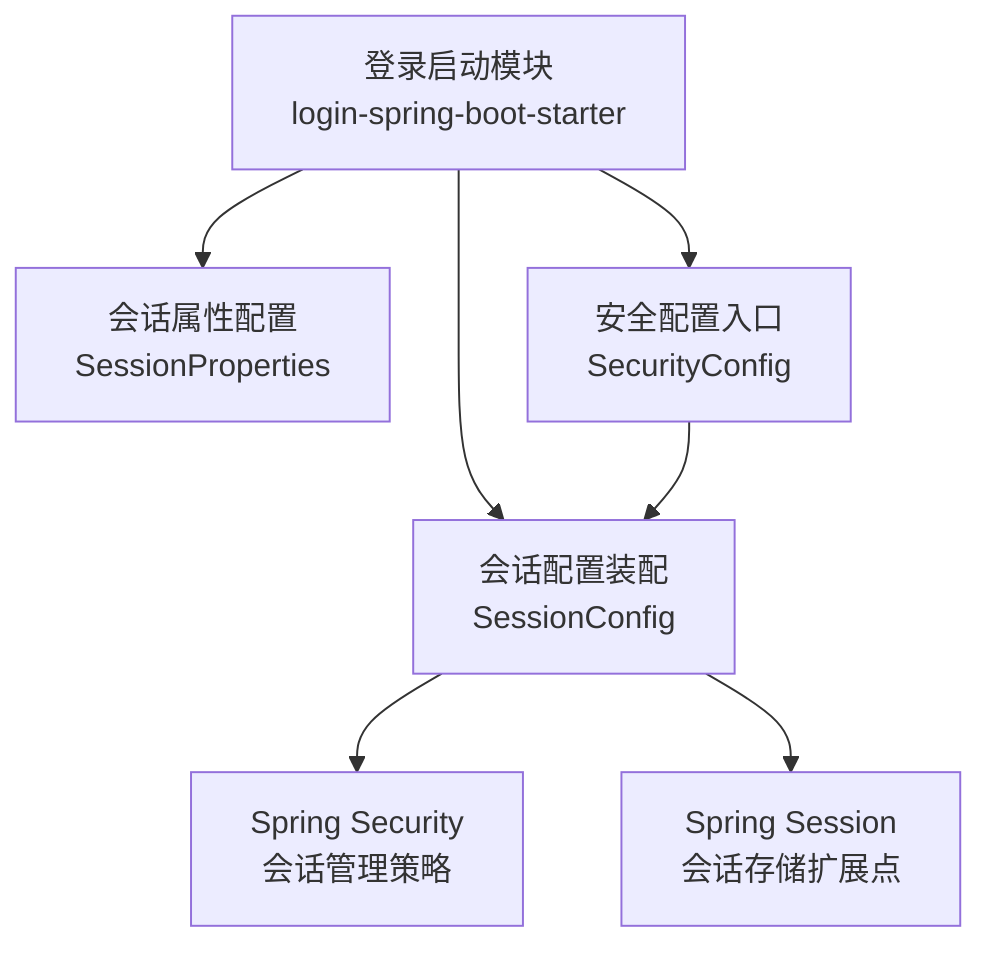
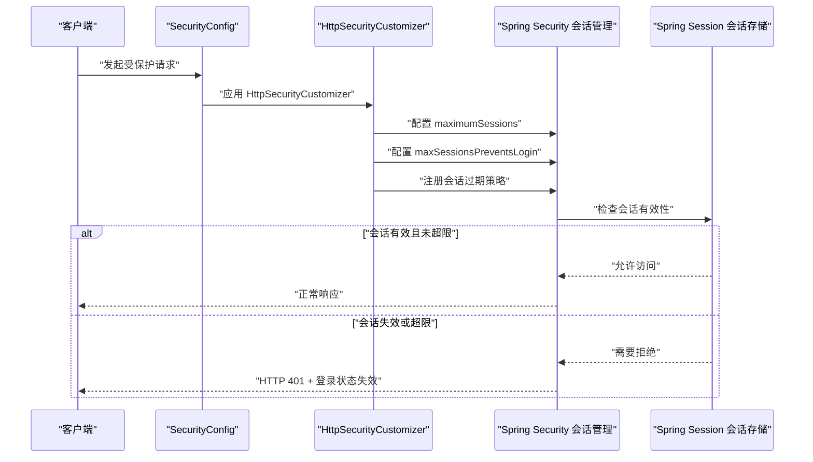
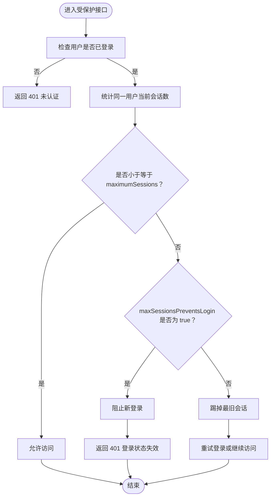
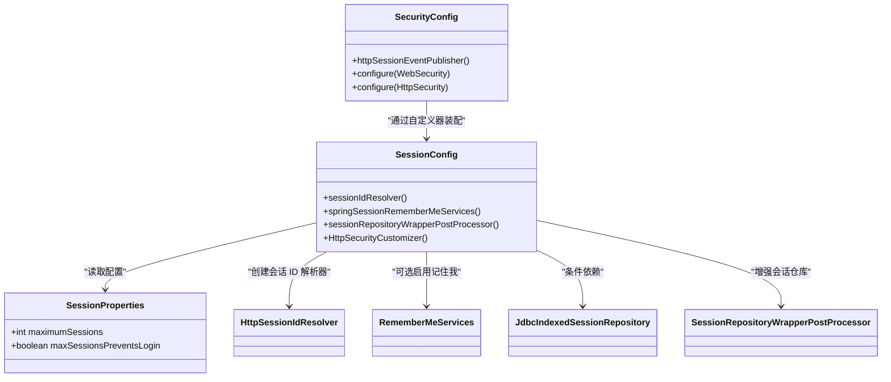

# 会话管理配置

<cite>
**本文引用的文件**   
- [SessionProperties.java](file://login-spring-boot-starter/src/main/java/com/cu/framework/authentication/properties/SessionProperties.java)
- [SessionConfig.java](file://login-spring-boot-starter/src/main/java/com/cu/framework/authentication/config/SessionConfig.java)
- [SecurityConfig.java](file://login-spring-boot-starter/src/main/java/com/cu/framework/authentication/config/SecurityConfig.java)
- [application.yml（登录样例）](file://sample/login-boot-sample/src/main/resources/application.yml)
</cite>

## 目录
1. [简介](#简介)
2. [项目结构与定位](#项目结构与定位)
3. [核心配置类 SessionProperties](#核心配置类-sessionproperties)
4. [会话控制机制与处理流程](#会话控制机制与处理流程)
5. [冲突处理策略对比](#冲突处理策略对比)
6. [不同部署环境的配置建议](#不同部署环境的配置建议)
7. [依赖关系分析](#依赖关系分析)
8. [性能考虑](#性能考虑)
9. [安全建议](#安全建议)
10. [常见问题排查](#常见问题排查)
11. [结论](#结论)

## 简介
本文面向 Kewen Framework 中基于 Spring Security 与 Spring Session 的会话管理配置，重点说明 `SessionProperties` 配置类的两个关键参数：

- **最大会话数量** `maximumSessions`：限制同一用户在当前应用中的同时在线会话数。
- **会话冲突处理策略** `maxSessionsPreventsLogin`：决定达到最大会话上限后，是阻止新登录，还是踢掉最旧的已登录会话。

文档还结合 `SessionConfig` 和 `SecurityConfig` 解释配置如何生效、会话过期时如何返回统一响应，以及在不同部署环境下的最佳实践。

## 项目结构与定位
会话管理相关代码集中在登录模块 `login-spring-boot-starter` 中：

**图表来源**
- [SessionProperties.java:1-22](file://login-spring-boot-starter/src/main/java/com/cu/framework/authentication/properties/SessionProperties.java#L1-L22)
- [SessionConfig.java:1-124](file://login-spring-boot-starter/src/main/java/com/cu/framework/authentication/config/SessionConfig.java#L1-L124)
- [SecurityConfig.java:1-144](file://login-spring-boot-starter/src/main/java/com/cu/framework/authentication/config/SecurityConfig.java#L1-L144)

**章节来源**
- [SessionProperties.java:1-22](file://login-spring-boot-starter/src/main/java/com/cu/framework/authentication/properties/SessionProperties.java#L1-L22)
- [SessionConfig.java:1-124](file://login-spring-boot-starter/src/main/java/com/cu/framework/authentication/config/SessionConfig.java#L1-L124)
- [SecurityConfig.java:1-144](file://login-spring-boot-starter/src/main/java/com/cu/framework/authentication/config/SecurityConfig.java#L1-L144)

## 核心配置类 SessionProperties
`SessionProperties` 是通过 Spring Boot 外部化配置绑定的会话属性类，配置前缀为 `cu.security.session`。它暴露两个字段：

| 配置项 | 类型 | 默认值 | 取值范围 | 作用 |
|---|---:|---:|---|---|
| `maximumSessions` | 整数 | `10` | 正整数；业务上通常取 `1`、`2`、`3` 等较小值 | 同一用户允许同时存在的最大会话数量 |
| `maxSessionsPreventsLogin` | 布尔值 | `false` | `true`、`false` | 达到最大会话数量后的冲突处理策略 |

### 配置绑定路径
该配置通过注解方式启用，并绑定到 Spring 容器中的 `SessionProperties` Bean，供 `SessionConfig` 读取：

- 配置键前缀：`cu.security.session`
- 子键：
  - `cu.security.session.maximumSessions`
  - `cu.security.session.maxSessionsPreventsLogin`

在登录样例的配置文件中，可以看到对 `cu.security.session` 这一配置前缀的注释性引用，说明框架支持按该路径进行外部化配置。

**章节来源**
- [SessionProperties.java:1-22](file://login-spring-boot-starter/src/main/java/com/cu/framework/authentication/properties/SessionProperties.java#L1-L22)
- [application.yml（登录样例）:1-5](file://sample/login-boot-sample/src/main/resources/application.yml#L1-L5)

## 会话控制机制与处理流程
`SessionConfig` 中定义了一个 `HttpSecurityCustomizer` Bean，用于把 `SessionProperties` 注入到 Spring Security 的会话管理中。其核心行为如下：

1. 从 `SessionProperties` 读取 `maximumSessions`，调用 `sessionManagement().maximumSessions(...)` 设置同一用户的最大并发会话数。
2. 从 `SessionProperties` 读取 `maxSessionsPreventsLogin`，调用 `maxSessionsPreventsLogin(...)` 设置冲突策略。
3. 注册 `expiredSessionStrategy`：当会话失效或超过限制被清理时，返回 HTTP `401` 状态码，并以 JSON 形式返回“登录状态失效，请重新登录”的错误结果。

**图表来源**
- [SessionConfig.java:60-124](file://login-spring-boot-starter/src/main/java/com/cu/framework/authentication/config/SessionConfig.java#L60-L124)
- [SecurityConfig.java:60-144](file://login-spring-boot-starter/src/main/java/com/cu/framework/authentication/config/SecurityConfig.java#L60-L144)

### 关键处理逻辑流程图

**图表来源**
- [SessionConfig.java:80-124](file://login-spring-boot-starter/src/main/java/com/cu/framework/authentication/config/SessionConfig.java#L80-L124)

**章节来源**
- [SessionConfig.java:60-124](file://login-spring-boot-starter/src/main/java/com/cu/framework/authentication/config/SessionConfig.java#L60-L124)

## 冲突处理策略对比
`maxSessionsPreventsLogin` 控制的是“当同一用户已达最大会话数”时的行为。

| 策略 | `maxSessionsPreventsLogin` | 行为说明 | 典型使用场景 |
|---|---:|---|---|
| 阻止新登录 | `true` | 新登录请求会被拒绝，现有会话不会被主动踢掉 | 高安全场景，避免频繁踢人导致用户体验波动，适合后台系统、管理员账号 |
| 踢掉最旧会话 | `false` | 新登录成功，最旧的会话被清理，实现“挤下线”效果 | 移动端优先、单设备优先体验，适合普通用户、移动办公场景 |

需要注意：

- `maximumSessions = 1` 配合 `maxSessionsPreventsLogin = false`，可以实现“同一用户只能在一个设备上保持活跃”，新设备登录会踢掉旧设备。
- `maximumSessions = 1` 配合 `maxSessionsPreventsLogin = true`，则新设备无法登录，必须先在旧设备上退出。
- 若 `maximumSessions` 设置过大，会弱化并发会话限制能力，降低安全性。

**章节来源**
- [SessionProperties.java:10-22](file://login-spring-boot-starter/src/main/java/com/cu/framework/authentication/properties/SessionProperties.java#L10-L22)
- [SessionConfig.java:80-124](file://login-spring-boot-starter/src/main/java/com/cu/framework/authentication/config/SessionConfig.java#L80-L124)

## 不同部署环境的配置建议
以下建议以 `cu.security.session` 为配置前缀，示例仅展示语义结构，不直接粘贴源码内容。

### 单机部署
- 特点：只有一个进程实例，会话数据通常由本地内存或本地数据库承担。
- 推荐配置：
  - `cu.security.session.maximumSessions = 1` 或 `2`
  - `cu.security.session.maxSessionsPreventsLogin = false`
- 理由：单机环境更容易出现同一用户多窗口、多标签页或多设备登录，采用“挤下线”更符合普通用户预期。

### 集群部署
- 特点：多个应用实例共享会话存储（如 Spring Session + Redis/JDBC）。
- 推荐配置：
  - `cu.security.session.maximumSessions = 1` 或 `2`
  - `cu.security.session.maxSessionsPreventsLogin = false`
- 理由：集群下更强调“全局唯一在线会话”，避免同一用户在多台机器上同时持有长期会话。

### 高安全后台系统
- 推荐配置：
  - `cu.security.session.maximumSessions = 1`
  - `cu.security.session.maxSessionsPreventsLogin = true`
- 理由：管理员账号、敏感系统更适合“不允许重复登录”，减少会话被意外挤掉的审计风险。

### 移动端优先系统
- 推荐配置：
  - `cu.security.session.maximumSessions = 1`
  - `cu.security.session.maxSessionsPreventsLogin = false`
- 理由：移动端常切换网络、重装应用、跨设备登录，“挤下线”能更快释放旧令牌与会话资源。

**章节来源**
- [SessionProperties.java:10-22](file://login-spring-boot-starter/src/main/java/com/cu/framework/authentication/properties/SessionProperties.java#L10-L22)
- [SessionConfig.java:80-124](file://login-spring-boot-starter/src/main/java/com/cu/framework/authentication/config/SessionConfig.java#L80-L124)

## 依赖关系分析
`SessionProperties` 本身只是配置载体，真正生效依赖于 `SessionConfig` 将其注入到 Spring Security 的会话管理链中。

**图表来源**
- [SessionProperties.java:1-22](file://login-spring-boot-starter/src/main/java/com/cu/framework/authentication/properties/SessionProperties.java#L1-L22)
- [SessionConfig.java:1-124](file://login-spring-boot-starter/src/main/java/com/cu/framework/authentication/config/SessionConfig.java#L1-L124)
- [SecurityConfig.java:1-144](file://login-spring-boot-starter/src/main/java/com/cu/framework/authentication/config/SecurityConfig.java#L1-L144)

**章节来源**
- [SessionProperties.java:1-22](file://login-spring-boot-starter/src/main/java/com/cu/framework/authentication/properties/SessionProperties.java#L1-L22)
- [SessionConfig.java:1-124](file://login-spring-boot-starter/src/main/java/com/cu/framework/authentication/config/SessionConfig.java#L1-L124)
- [SecurityConfig.java:1-144](file://login-spring-boot-starter/src/main/java/com/cu/framework/authentication/config/SecurityConfig.java#L1-L144)

## 性能考虑
- **会话数量不宜过大**：`maximumSessions` 越大，系统在会话计数、清理和校验上的开销越高。一般业务建议设置为小整数，如 `1`、`2`、`3`。
- **避免无界会话**：即使不限制并发会话数，也应配合会话超时策略，防止历史会话无限增长。
- **集群会话存储压力**：在集群环境中，大量并发会话会增加 Redis 或数据库会话存储的压力，应结合缓存容量和连接池评估配置。
- **记住我与会话的关系**：`SessionConfig` 提供了基于 Spring Session 的 `RememberMeServices` 配置入口，但需显式开启 `cu.security.remember-me.enabled`，不应把它当作会话并发控制的替代方案。

[本节为通用性能指导，不直接分析具体代码行]

## 安全建议
- **管理员账号建议限制单会话**：将 `maximumSessions` 设为 `1`，并根据安全策略选择 `maxSessionsPreventsLogin = true` 或 `false`。
- **敏感操作前校验会话有效性**：虽然框架会在会话过期时返回 `401`，前端仍应在敏感操作前检查登录状态，避免无效会话参与业务计算。
- **不要关闭会话事件监听**：`SecurityConfig` 中启用了 `HttpSessionEventPublisher`，有助于安全框架感知会话销毁生命周期。
- **注意 401 响应语义**：会话失效时返回的是标准未认证响应，前端应区分“未登录”和“登录状态失效”，必要时引导用户重新登录。

**章节来源**
- [SecurityConfig.java:60-144](file://login-spring-boot-starter/src/main/java/com/cu/framework/authentication/config/SecurityConfig.java#L60-L144)
- [SessionConfig.java:80-124](file://login-spring-boot-starter/src/main/java/com/cu/framework/authentication/config/SessionConfig.java#L80-L124)

## 常见问题排查
| 现象 | 可能原因 | 处理建议 |
|---|---|---|
| 登录后立即提示登录状态失效 | `maximumSessions` 过小或冲突策略导致旧会话被清理 | 确认 `maximumSessions` 是否符合业务需求；如需保留旧会话，改为 `maxSessionsPreventsLogin = true` |
| 同一用户多设备无法同时登录 | `maximumSessions = 1` | 根据业务放开至 `2` 或更大；或接受“挤下线”行为 |
| 多设备可以登录但越登越多 | `maximumSessions` 设置过大或未生效 | 检查 `cu.security.session.maximumSessions` 是否正确绑定 |
| 集群环境下会话不一致 | 会话存储未正确共享或配置错误 | 确认 Spring Session 后端为 Redis/JDBC 等共享存储，而不是每个节点独立内存 |
| 记住 me 功能未生效 | 未启用 `cu.security.remember-me.enabled` | 按需开启 remember-me 配置，并注意其与 session 的有效期差异 |

**章节来源**
- [SessionProperties.java:10-22](file://login-spring-boot-starter/src/main/java/com/cu/framework/authentication/properties/SessionProperties.java#L10-L22)
- [SessionConfig.java:20-124](file://login-spring-boot-starter/src/main/java/com/cu/framework/authentication/config/SessionConfig.java#L20-L124)
- [SecurityConfig.java:60-144](file://login-spring-boot-starter/src/main/java/com/cu/framework/authentication/config/SecurityConfig.java#L60-L144)

## 结论
Kewen Framework 的会话管理配置以 `SessionProperties` 为核心，通过 `SessionConfig` 将最大会话数和冲突策略注入 Spring Security。对于大多数企业系统，建议将 `maximumSessions` 设置为较小的正整数，并结合业务安全等级选择 `maxSessionsPreventsLogin`：

- 普通用户、移动端优先：`maximumSessions = 1`，`maxSessionsPreventsLogin = false`。
- 高安全后台、管理员账号：`maximumSessions = 1`，`maxSessionsPreventsLogin = true`。
- 需要一定多设备协作：`maximumSessions = 2` 或 `3`，并根据安全要求调整冲突策略。

合理配置这些参数，可以在安全性、可用性和性能之间取得平衡。