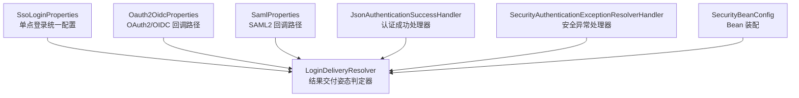
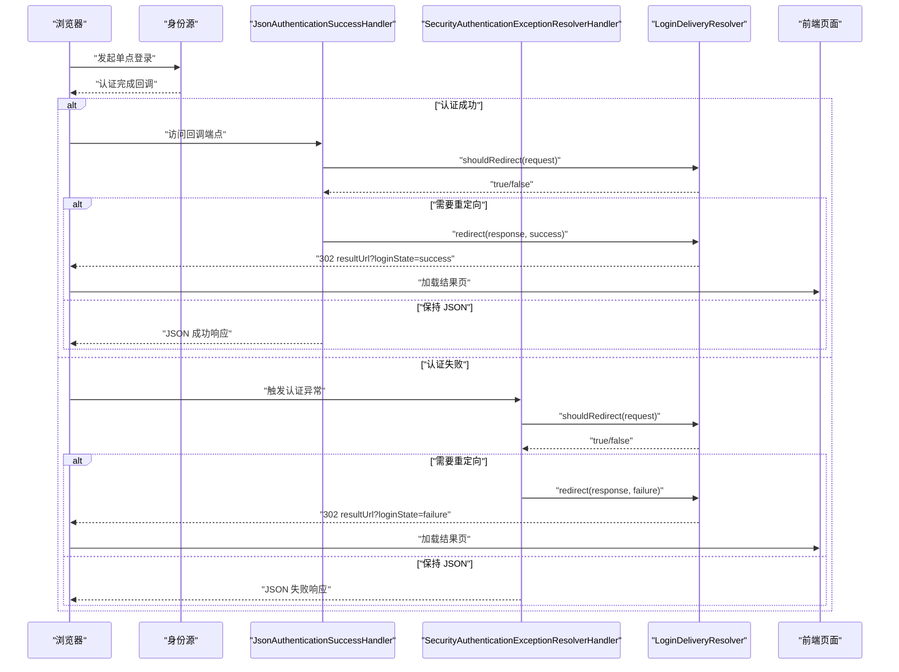
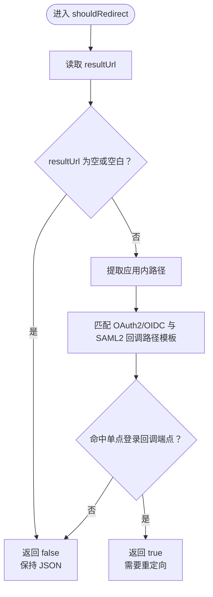
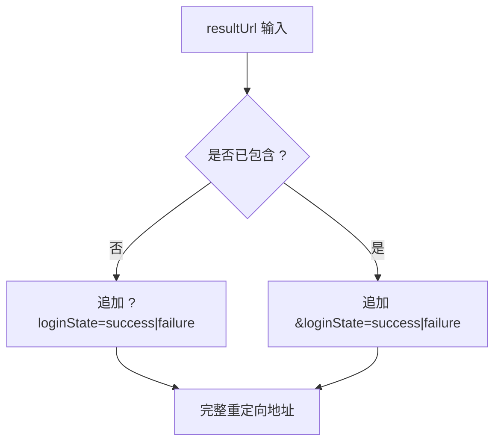
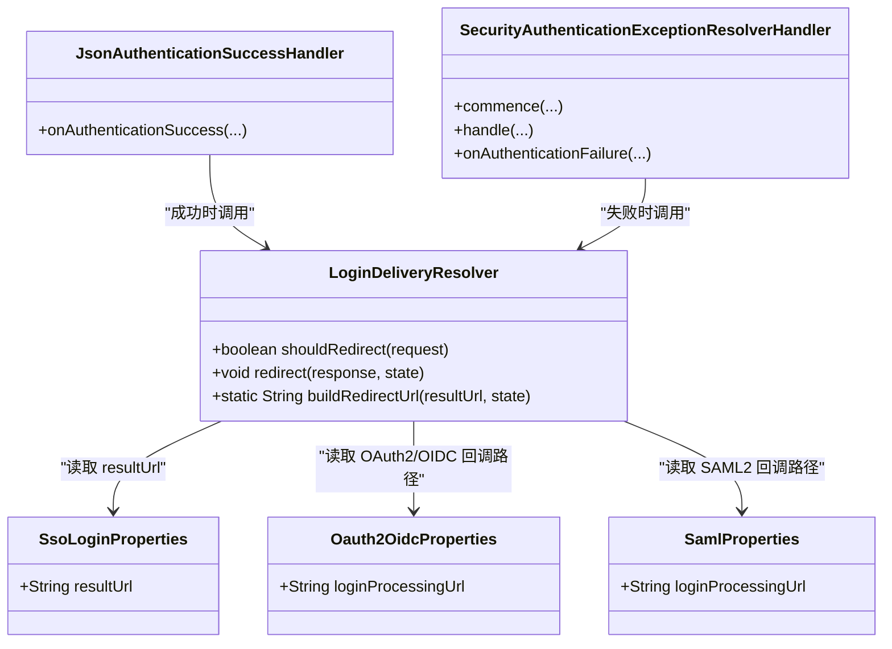

# 单点登录配置

<cite>
**本文引用的文件**   
- [SsoLoginProperties.java](file://login-spring-boot-starter/src/main/java/com/cu/framework/authentication/properties/SsoLoginProperties.java)
- [LoginDeliveryResolver.java](file://login-spring-boot-starter/src/main/java/com/cu/framework/authentication/response/LoginDeliveryResolver.java)
- [SecurityBeanConfig.java](file://login-spring-boot-starter/src/main/java/com/cu/framework/authentication/config/SecurityBeanConfig.java)
- [JsonAuthenticationSuccessHandler.java](file://login-spring-boot-starter/src/main/java/com/cu/framework/authentication/response/JsonAuthenticationSuccessHandler.java)
- [SecurityAuthenticationExceptionResolverHandler.java](file://login-spring-boot-starter/src/main/java/com/cu/framework/authentication/response/SecurityAuthenticationExceptionResolverHandler.java)
- [Oauth2OidcProperties.java](file://login-spring-boot-starter/src/main/java/com/cu/framework/authentication/oauth2/Oauth2OidcProperties.java)
- [SamlProperties.java](file://login-spring-boot-starter/src/main/java/com/cu/framework/authentication/saml/properties/SamlProperties.java)
- [application.yml](file://sample/login-boot-sample/src/main/resources/application.yml)
- [README.md](file://login-spring-boot-starter/README.md)
- [design.md](file://openspec/changes/archive/2026-10-17-add-sso-login-page/design.md)
- [tasks.md](file://openspec/changes/archive/2026-10-17-add-sso-login-page/tasks.md)
</cite>

## 目录
1. [引言](#引言)
2. [项目结构定位](#项目结构定位)
3. [核心配置类与统一属性](#核心配置类与统一属性)
4. [架构总览](#架构总览)
5. [结果页工作机制](#结果页工作机制)
6. [三类协议中的统一作用](#三类协议中的统一作用)
7. [地址解析规则与部署模式](#地址解析规则与部署模式)
8. [成功与失败状态约定](#成功与失败状态约定)
9. [前端页面处理逻辑](#前端页面处理逻辑)
10. [完整配置指南](#完整配置指南)
11. [依赖关系分析](#依赖关系分析)
12. [性能与行为特征](#性能与行为特征)
13. [故障排除](#故障排除)
14. [结论](#结论)

## 引言
本文聚焦 Kewen Framework 中单点登录的统一配置入口，重点说明 `SsoLoginProperties` 的 `resultUrl` 配置项如何为 OAuth2、OIDC、SAML2 三类协议提供一致的单点登录结果页能力。该配置决定认证流程结束后，浏览器是继续收到 JSON 响应，还是被整页重定向到前端页面；无论成功还是失败，都通过同一个回跳地址和固定查询参数区分结果。

## 项目结构定位
单点登录结果页能力集中在 `login-spring-boot-starter` 模块：
- 配置属性定义在 `authentication/properties`。
- 结果交付姿态判定逻辑在 `authentication/response`。
- Spring Bean 装配在 `authentication/config`。
- OAuth2/OIDC 回调路径来自 `authentication/oauth2` 的配置类。
- SAML2 回调路径来自 `authentication/saml/properties` 的配置类。
- 示例应用位于 `sample/login-boot-sample`，包含 `cu.security.login.sso.result-url` 的实际用法。



**图表来源**
- [SsoLoginProperties.java:1-24](file://login-spring-boot-starter/src/main/java/com/cu/framework/authentication/properties/SsoLoginProperties.java#L1-L24)
- [LoginDeliveryResolver.java:1-114](file://login-spring-boot-starter/src/main/java/com/cu/framework/authentication/response/LoginDeliveryResolver.java#L1-L114)
- [Oauth2OidcProperties.java:1-200](file://login-spring-boot-starter/src/main/java/com/cu/framework/authentication/oauth2/Oauth2OidcProperties.java#L1-L200)
- [SamlProperties.java:1-149](file://login-spring-boot-starter/src/main/java/com/cu/framework/authentication/saml/properties/SamlProperties.java#L1-L149)
- [SecurityBeanConfig.java:1-126](file://login-spring-boot-starter/src/main/java/com/cu/framework/authentication/config/SecurityBeanConfig.java#L1-L126)

**章节来源**
- [SsoLoginProperties.java:1-24](file://login-spring-boot-starter/src/main/java/com/cu/framework/authentication/properties/SsoLoginProperties.java#L1-L24)
- [SecurityBeanConfig.java:1-126](file://login-spring-boot-starter/src/main/java/com/cu/framework/authentication/config/SecurityBeanConfig.java#L1-L126)

## 核心配置类与统一属性
`SsoLoginProperties` 是 OAuth2、OIDC、SAML2 三类协议共用的单点登录配置入口，绑定前缀为 `cu.security.login.sso`。其核心字段是 `resultUrl`，即单点登录结果页地址。

| 配置项 | 绑定前缀 | Java 字段 | 默认值 | 作用 |
|---|---|---|---|---|
| `result-url` | `cu.security.login.sso` | `resultUrl` | 无 | 指定单点登录流程结束后浏览器要回到的前端页面 |

关键行为：
- 未配置时，OAuth2、OIDC、SAML2 的成功与失败响应保持原有 JSON 输出方式。
- 配置后，三类协议的登录成功和失败都会 302 回到同一个 `resultUrl`，并通过查询参数区分状态。
- 相对地址由容器按当前请求的 scheme、host、port 解析。
- 绝对地址原样使用，适合独立部署的前端。

**章节来源**
- [SsoLoginProperties.java:1-24](file://login-spring-boot-starter/src/main/java/com/cu/framework/authentication/properties/SsoLoginProperties.java#L1-L24)
- [LoginSsoPropertiesBindingTest.java:28-44](file://login-spring-boot-starter/src/test/java/com/cu/framework/authentication/properties/LoginSsoPropertiesBindingTest.java#L28-L44)

## 架构总览
`resultUrl` 不是直接交给某个协议处理器，而是通过一个统一的“结果交付姿态判定器”参与整个认证流程。Spring 容器在启动时注册该 Bean，并注入到认证成功处理器和安全异常解析处理器中。



**图表来源**
- [SecurityBeanConfig.java:83-108](file://login-spring-boot-starter/src/main/java/com/cu/framework/authentication/config/SecurityBeanConfig.java#L83-L108)
- [JsonAuthenticationSuccessHandler.java:30-54](file://login-spring-boot-starter/src/main/java/com/cu/framework/authentication/response/JsonAuthenticationSuccessHandler.java#L30-L54)
- [SecurityAuthenticationExceptionResolverHandler.java:36-76](file://login-spring-boot-starter/src/main/java/com/cu/framework/authentication/response/SecurityAuthenticationExceptionResolverHandler.java#L36-L76)
- [LoginDeliveryResolver.java:63-112](file://login-spring-boot-starter/src/main/java/com/cu/framework/authentication/response/LoginDeliveryResolver.java#L63-L112)

## 结果页工作机制
`LoginDeliveryResolver` 是本次文档的核心控制点。它不关心浏览器请求头，也不依赖认证成功后的 `Authentication` 对象是否可靠，而是依据“当前请求是否命中某类单点登录回调端点”来决定交付姿态。

判定流程如下：



**图表来源**
- [LoginDeliveryResolver.java:63-98](file://login-spring-boot-starter/src/main/java/com/cu/framework/authentication/response/LoginDeliveryResolver.java#L63-L98)

关键点：
- 账号密码登录端点 `/login`、登出端点、业务接口、静态资源都不会被当作单点登录回调。
- 即使配置了 `resultUrl`，非单点登录端点仍然返回 JSON。
- 只有当 `resultUrl` 非空且请求命中 OAuth2/OIDC 或 SAML2 的回调端点时，才发生整页重定向。

**章节来源**
- [LoginDeliveryResolver.java:1-114](file://login-spring-boot-starter/src/main/java/com/cu/framework/authentication/response/LoginDeliveryResolver.java#L1-L114)
- [design.md:41-49](file://openspec/changes/archive/2026-10-17-add-sso-login-page/design.md#L41-L49)

## 三类协议中的统一作用
### OAuth2 与 OIDC
OAuth2 与 OIDC 共用 `Oauth2OidcProperties`，其 `loginProcessingUrl` 默认对应 Spring Security 的 OAuth2 登录过滤器处理路径。框架把该路径作为单点登录回调匹配模板之一。

### SAML2
SAML2 的回调路径由 `SamlProperties` 的 `loginProcessingUrl` 提供，默认形式为 `/login/saml2/sso/{registrationId}`。该模板同样被 `LoginDeliveryResolver` 用于判断是否命中单点登录回调。

### 统一效果
三类协议共享同一个 `resultUrl`，不需要分别配置 OAuth2 结果页、OIDC 结果页、SAML 结果页。只要配置一次，所有单点登录协议的成功与失败都走同一条规则。

**章节来源**
- [Oauth2OidcProperties.java:1-200](file://login-spring-boot-starter/src/main/java/com/cu/framework/authentication/oauth2/Oauth2OidcProperties.java#L1-L200)
- [SamlProperties.java:1-149](file://login-spring-boot-starter/src/main/java/com/cu/framework/authentication/saml/properties/SamlProperties.java#L1-L149)
- [LoginDeliveryResolver.java:63-76](file://login-spring-boot-starter/src/main/java/com/cu/framework/authentication/response/LoginDeliveryResolver.java#L63-L76)

## 地址解析规则与部署模式
### 相对地址
当 `resultUrl` 是相对地址，例如 `/login.html` 时，最终由容器的 `sendRedirect` 基于当前请求的 scheme、host、port 解析。这适用于前后端同源部署的场景。

### 绝对地址
当 `resultUrl` 是完整 URL，例如 `https://front.example.com/login.html` 时，框架原样使用。这适用于前端独立部署在不同域名的场景。

### 已有查询参数
如果 `resultUrl` 本身已带查询参数，例如 `/login.html?tab=sso`，框架会在追加状态标记时使用 `&`，而不是重复添加 `?`。



**图表来源**
- [LoginDeliveryResolver.java:106-112](file://login-spring-boot-starter/src/main/java/com/cu/framework/authentication/response/LoginDeliveryResolver.java#L106-L112)

**章节来源**
- [SsoLoginProperties.java:10-24](file://login-spring-boot-starter/src/main/java/com/cu/framework/authentication/properties/SsoLoginProperties.java#L10-L24)
- [LoginDeliveryResolver.java:100-112](file://login-spring-boot-starter/src/main/java/com/cu/framework/authentication/response/LoginDeliveryResolver.java#L100-L112)
- [tasks.md:17-19](file://openspec/changes/archive/2026-10-17-add-sso-login-page/tasks.md#L17-L19)

## 成功与失败状态约定
框架定义了固定的状态参数名和两个取值：

| 含义 | 参数名 | 取值 |
|---|---|---|
| 单点登录成功 | `loginState` | `success` |
| 单点登录失败 | `loginState` | `failure` |

成功路径由认证成功处理器触发，失败路径由安全异常解析处理器触发。两者共用同一个 `LoginDeliveryResolver.shouldRedirect` 判据，因此成功与失败的跳转行为一致。

需要注意：
- URL 只携带状态标记，不携带会话标识、令牌或用户信息。
- 会话由 Cookie 维持。
- 前端应自行剥离状态参数，避免收藏地址或后退前进再次触发提示。

**章节来源**
- [LoginDeliveryResolver.java:42-58](file://login-spring-boot-starter/src/main/java/com/cu/framework/authentication/response/LoginDeliveryResolver.java#L42-L58)
- [LoginDeliveryResolver.java:100-112](file://login-spring-boot-starter/src/main/java/com/cu/framework/authentication/response/LoginDeliveryResolver.java#L100-L112)
- [JsonAuthenticationSuccessHandler.java:53-54](file://login-spring-boot-starter/src/main/java/com/cu/framework/authentication/response/JsonAuthenticationSuccessHandler.java#L53-L54)
- [SecurityAuthenticationExceptionResolverHandler.java:72-76](file://login-spring-boot-starter/src/main/java/com/cu/framework/authentication/response/SecurityAuthenticationExceptionResolverHandler.java#L72-L76)
- [design.md:65-67](file://openspec/changes/archive/2026-10-17-add-sso-login-page/design.md#L65-L67)

## 前端页面处理逻辑
前端页面的职责是消费 `loginState` 查询参数，并根据其值展示成功或失败信息。典型处理方式包括：
- 从 URL 查询参数读取 `loginState`。
- 若值为 `success`，显示登录成功提示或进入主界面。
- 若值为 `failure`，显示登录失败原因或引导重新登录。
- 读取完成后使用历史 API 移除查询参数，避免刷新或后退再次触发提示。

后端不负责拼接前端路由，也不负责解析前端地址结构；它只负责把 `loginState` 附加到 `resultUrl`。这样前后端解耦，同一后端配置可同时服务同源页面和独立部署前端。

**章节来源**
- [design.md:65-67](file://openspec/changes/archive/2026-10-17-add-sso-login-page/design.md#L65-L67)
- [tasks.md:17-19](file://openspec/changes/archive/2026-10-17-add-sso-login-page/tasks.md#L17-L19)

## 完整配置指南
### 基本步骤
1. 引入 `login-spring-boot-starter`。
2. 配置 OAuth2/OIDC 或 SAML2 的身份源。
3. 在 `cu.security.login.sso.result-url` 中填写结果页地址。
4. 让前端在结果页中读取 `loginState`。
5. 如需同源首页体验，可配合放行根路径和静态页面。

### 示例：同源页面
适用场景：前端静态页面与应用部署在同一域名下。

```yaml
cu:
  security:
    login:
      sso:
        result-url: /login.html
```

此时浏览器认证成功后会跳转到 `/login.html?loginState=success`，失败时跳转到 `/login.html?loginState=failure`。

### 示例：独立部署前端
适用场景：前端部署在独立域名或端口。

```yaml
cu:
  security:
    login:
      sso:
        result-url: https://front.example.com/login.html
```

此时框架不会展开 `{baseUrl}`，而是直接使用配置的完整地址。

### 示例：结果页自带查询参数
适用场景：结果页需要保留原有标签页、来源等参数。

```yaml
cu:
  security:
    login:
      sso:
        result-url: "/login.html?tab=sso"
```

最终重定向地址会是 `/login.html?tab=sso&loginState=success` 或 `/login.html?tab=sso&loginState=failure`。

### 示例：仅启用 OAuth2/OIDC
无需单独设置 OAuth2 或 OIDC 的结果页，它们共用 `sso.result-url`。

### 示例：仅启用 SAML2
SAML2 同样复用 `sso.result-url`，不需要额外配置 SAML 结果页。

### 示例：不启用结果页
如果希望保持原有 JSON 行为，不要配置 `cu.security.login.sso.result-url`，或将其留空。

**章节来源**
- [application.yml:47-67](file://sample/login-boot-sample/src/main/resources/application.yml#L47-L67)
- [README.md:55-63](file://login-spring-boot-starter/README.md#L55-L63)
- [SsoLoginProperties.java:10-24](file://login-spring-boot-starter/src/main/java/com/cu/framework/authentication/properties/SsoLoginProperties.java#L10-L24)

## 依赖关系分析
`LoginDeliveryResolver` 依赖三类配置：
- `SsoLoginProperties`：决定是否启用结果页重定向。
- `Oauth2OidcProperties`：提供 OAuth2/OIDC 回调路径模板。
- `SamlProperties`：提供 SAML2 回调路径模板。

`SecurityBeanConfig` 负责把它们装配进容器，并把 `LoginDeliveryResolver` 注入到：
- 默认的 JSON 认证成功处理器。
- 安全异常解析处理器。



**图表来源**
- [SsoLoginProperties.java:1-24](file://login-spring-boot-starter/src/main/java/com/cu/framework/authentication/properties/SsoLoginProperties.java#L1-L24)
- [LoginDeliveryResolver.java:1-114](file://login-spring-boot-starter/src/main/java/com/cu/framework/authentication/response/LoginDeliveryResolver.java#L1-L114)
- [Oauth2OidcProperties.java:1-200](file://login-spring-boot-starter/src/main/java/com/cu/framework/authentication/oauth2/Oauth2OidcProperties.java#L1-L200)
- [SamlProperties.java:1-149](file://login-spring-boot-starter/src/main/java/com/cu/framework/authentication/saml/properties/SamlProperties.java#L1-L149)
- [JsonAuthenticationSuccessHandler.java:30-54](file://login-spring-boot-starter/src/main/java/com/cu/framework/authentication/response/JsonAuthenticationSuccessHandler.java#L30-L54)
- [SecurityAuthenticationExceptionResolverHandler.java:36-76](file://login-spring-boot-starter/src/main/java/com/cu/framework/authentication/response/SecurityAuthenticationExceptionResolverHandler.java#L36-L76)

**章节来源**
- [SecurityBeanConfig.java:83-108](file://login-spring-boot-starter/src/main/java/com/cu/framework/authentication/config/SecurityBeanConfig.java#L83-L108)

## 性能与行为特征
- 判定逻辑轻量：读取配置、提取路径、Ant 语义路径匹配。
- 不依赖浏览器请求特征，避免误判。
- 不向 URL 传递敏感信息，只追加状态标记。
- 未配置 `resultUrl` 时零行为变更，对现有纯 JSON 消费者非破坏。
- 重定向发生在认证成功和失败两个分支，但判据统一，减少维护成本。

**章节来源**
- [LoginDeliveryResolver.java:13-22](file://login-spring-boot-starter/src/main/java/com/cu/framework/authentication/response/LoginDeliveryResolver.java#L13-L22)
- [LoginDeliveryResolver.java:78-98](file://login-spring-boot-starter/src/main/java/com/cu/framework/authentication/response/LoginDeliveryResolver.java#L78-L98)
- [design.md:22-30](file://openspec/changes/archive/2026-10-17-add-sso-login-page/design.md#L22-L30)

## 故障排除
### 现象：配置了 `result-url` 后仍返回 JSON
可能原因：
- 请求没有命中 OAuth2/OIDC 或 SAML2 的回调端点。
- 使用了账号密码登录端点 `/login`。
- 使用了业务接口、登出端点或静态资源。

排查方法：
- 确认浏览器实际访问的是身份源回调地址，而非 `/login`。
- 检查 OAuth2/OIDC 的 `login-processing-url` 与 SAML2 的 `login-processing-url` 是否与身份源回调一致。
- 查看 `LoginDeliveryResolver.shouldRedirect` 的判定条件：必须同时满足 `resultUrl` 非空且命中回调端点。

**章节来源**
- [LoginDeliveryResolver.java:78-98](file://login-spring-boot-starter/src/main/java/com/cu/framework/authentication/response/LoginDeliveryResolver.java#L78-L98)
- [README.md:61-67](file://login-spring-boot-starter/README.md#L61-L67)

### 现象：成功登录后地址栏出现 `loginState`
可能原因：
- 前端页面读取状态后没有剥离查询参数。

处理方法：
- 在结果页脚本中读取 `loginState` 后，使用历史 API 替换 URL，去掉该参数。
- 登录态判定不应依赖 `loginState`，而应调用 `/api/me` 或其他认证状态接口。

**章节来源**
- [design.md:65-67](file://openspec/changes/archive/2026-10-17-add-sso-login-page/design.md#L65-L67)

### 现象：独立部署前端无法接收回调
可能原因：
- `result-url` 未指向独立前端地址。
- 身份源侧登记的回调地址与后端回调端点不一致。
- 跨站 Cookie 或跨域策略影响会话。

处理方法：
- 将 `result-url` 设置为独立前端的完整地址。
- 确保 OAuth2/OIDC 或 SAML2 的回调端点在身份源后台登记正确。
- 根据部署环境调整会话 Cookie 和跨域策略，但这属于基础设施层面，不属于本配置类的职责。

**章节来源**
- [SsoLoginProperties.java:10-24](file://login-spring-boot-starter/src/main/java/com/cu/framework/authentication/properties/SsoLoginProperties.java#L10-L24)
- [application.yml:47-67](file://sample/login-boot-sample/src/main/resources/application.yml#L47-L67)

### 现象：结果页自带查询参数后出现双问号
可能原因：
- 手动拼接错误，或在已有 `?` 的地址上又追加了 `?loginState`。

处理方法：
- 直接使用框架的 `buildRedirectUrl` 行为：已有 `?` 时用 `&` 追加。
- 验证配置值是否包含查询参数，并确保前端能正确处理。

**章节来源**
- [LoginDeliveryResolver.java:106-112](file://login-spring-boot-starter/src/main/java/com/cu/framework/authentication/response/LoginDeliveryResolver.java#L106-L112)

### 现象：升级后三种协议行为突然变化
可能原因：
- 新增了 `cu.security.login.sso.result-url`。

处理方法：
- 如果希望保持旧行为，删除该配置项。
- 如果希望统一结果页，为该属性配置合适的地址。

**章节来源**
- [design.md:57-61](file://openspec/changes/archive/2026-10-17-add-sso-login-page/design.md#L57-L61)
- [tasks.md:17-19](file://openspec/changes/archive/2026-10-17-add-sso-login-page/tasks.md#L17-L19)

## 结论
`SsoLoginProperties.resultUrl` 是 Kewen Framework 单点登录的统一结果页入口。它把 OAuth2、OIDC、SAML2 三类协议的成功与失败响应收敛到同一种交付机制：要么保持 JSON，要么 302 到前端页面。是否跳转取决于 `resultUrl` 是否配置以及请求是否命中单点登录回调端点。相对地址适合同源部署，绝对地址适合独立部署前端；状态通过固定查询参数 `loginState` 传递，前端负责解析和清理。未配置时行为保持不变，使该能力具备平滑演进和非破坏性升级的优势。