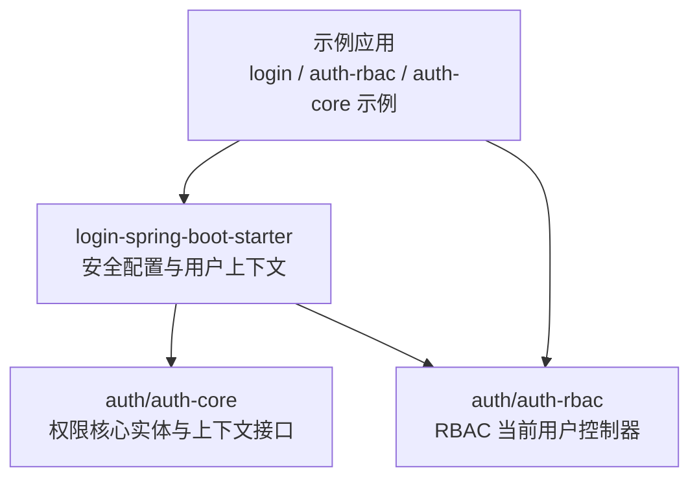
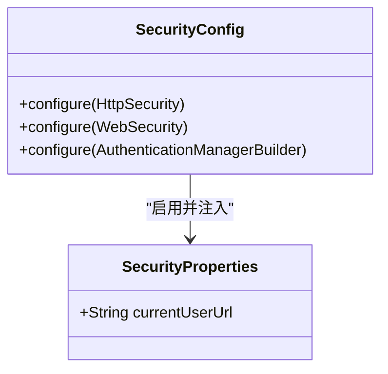
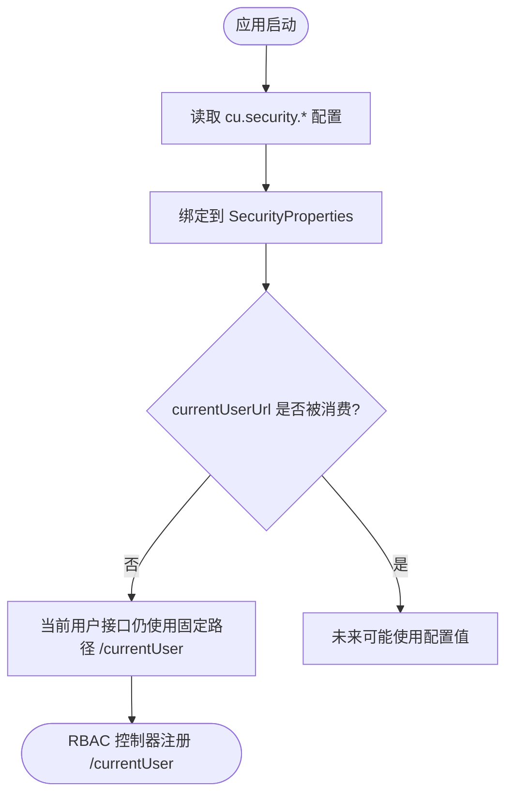
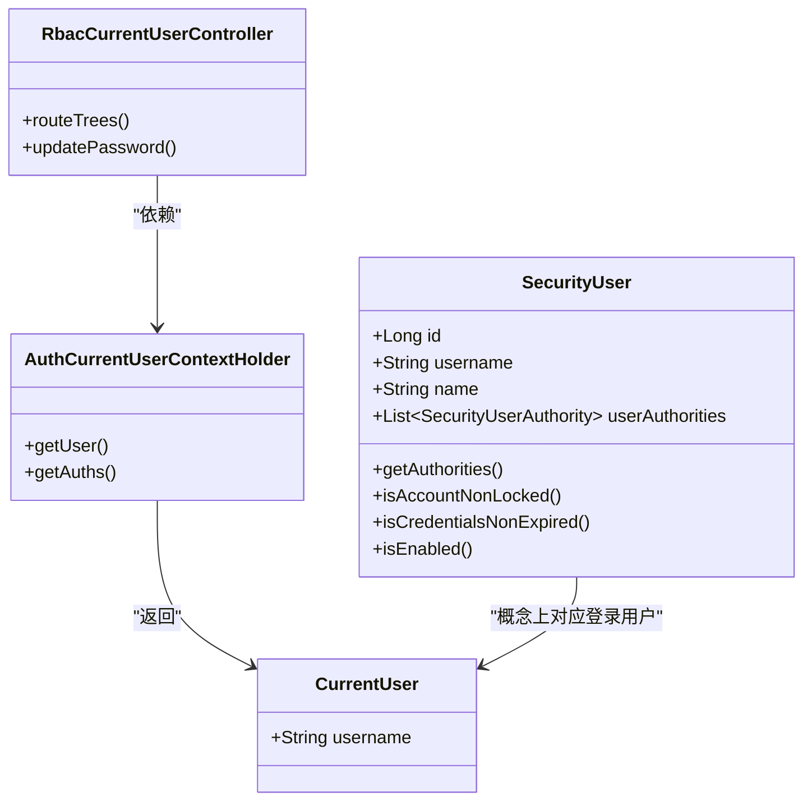
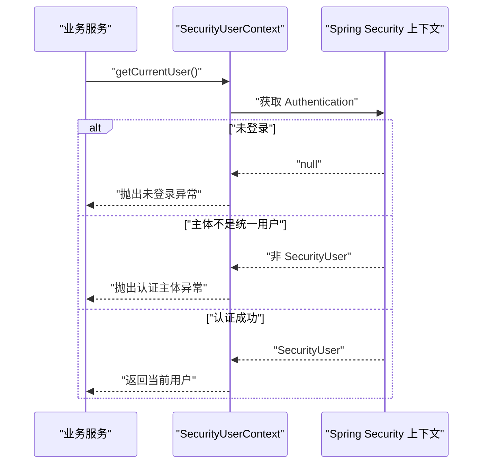
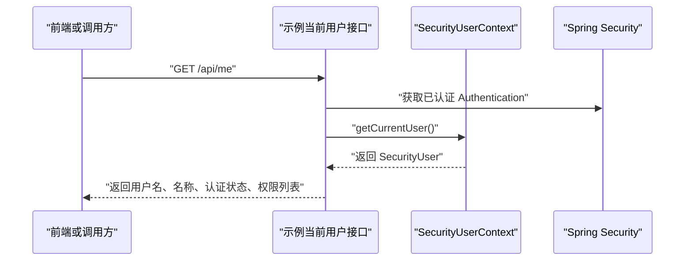
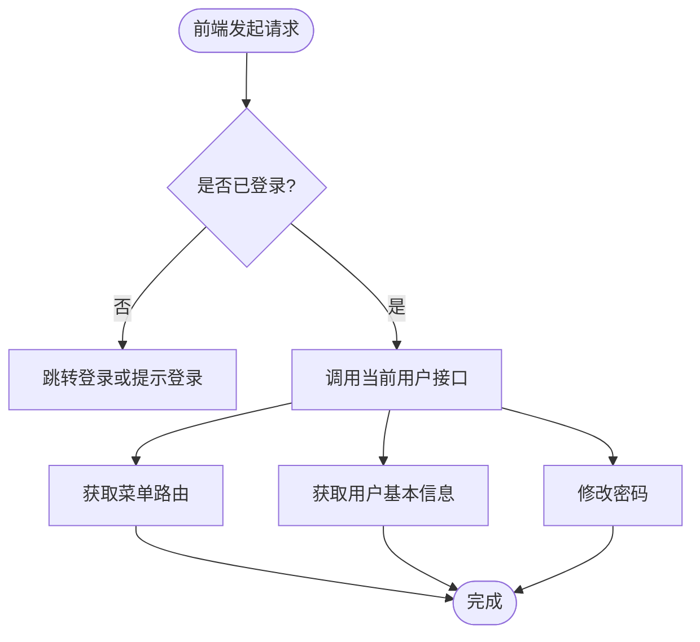
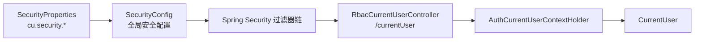

# 基础安全配置

<cite>
**本文引用的文件**   
- [SecurityProperties.java](file://login-spring-boot-starter/src/main/java/com/cu/framework/authentication/properties/SecurityProperties.java)
- [SecurityConfig.java](file://login-spring-boot-starter/src/main/java/com/cu/framework/authentication/config/SecurityConfig.java)
- [RbacCurrentUserController.java](file://auth/auth-rbac/src/main/java/com/cu/framework/auth/rbac/controller/RbacCurrentUserController.java)
- [SecurityUserContext.java](file://login-spring-boot-starter/src/main/java/com/cu/framework/authentication/SecurityUserContext.java)
- [SecurityUser.java](file://login-spring-boot-starter/src/main/java/com/cu/framework/authentication/model/SecurityUser.java)
- [CurrentUser.java](file://auth/auth-core/src/main/java/com/cu/framework/auth/core/entity/CurrentUser.java)
- [AuthCurrentUserContextHolder.java](file://auth/auth-core/src/main/java/com/cu/framework/auth/core/AuthCurrentUserContextHolder.java)
- [application.yml（文档参考）](file://docs/application.yml)
- [application.yml（RBAC 示例）](file://sample/auth-rbac-boot-sample/src/main/resources/application.yml)
- [SampleCurrentUserController.java](file://sample/login-boot-sample/src/main/java/com/cu/framework/sample/login/SampleCurrentUserController.java)
</cite>

## 目录
1. [简介](#简介)
2. [项目结构与定位](#项目结构与定位)
3. [核心配置类 SecurityProperties](#核心配置类-securityproperties)
4. [当前用户接口与 currentUserUrl](#当前用户接口与-currentuserurl)
5. [当前登录用户身份与权限模型](#当前登录用户身份与权限模型)
6. [在业务代码中获取当前用户](#在业务代码中获取当前用户)
7. [配置示例与调用示例](#配置示例与调用示例)
8. [常见使用模式](#常见使用模式)
9. [依赖关系分析](#依赖关系分析)
10. [性能与安全注意事项](#性能与安全注意事项)
11. [故障排查](#故障排查)
12. [结论](#结论)

## 简介
本文聚焦 Kewen Framework 的“基础安全配置”，重点说明 `SecurityProperties` 配置类及其 `currentUserUrl` 字段。需要特别注意：**当前实现中该配置项属于“未接线”状态，即框架不会读取它来动态改变接口路径；当前用户相关接口的实际访问路径是固定的 `/currentUser`**。

同时，本文解释当前用户接口的用途、返回的身份信息结构、权限信息来源，以及如何在业务代码中通过 HTTP 请求或 Java API 获取当前登录用户。

## 项目结构与定位
Kewen Framework 的安全能力由多个 starter 协作构成：

| 模块 | 职责 | 与本主题的关系 |
|---|---|---|
| `login-spring-boot-starter` | 提供登录认证、Spring Security 配置、统一用户上下文 | 定义 `SecurityProperties`、全局安全过滤链、`SecurityUserContext` |
| `auth/auth-core` | 提供权限核心实体与上下文接口 | 定义 `CurrentUser`、`AuthCurrentUserContextHolder` |
| `auth/auth-rbac` | 提供 RBAC 菜单、权限、当前用户扩展控制器 | 暴露固定路径 `/currentUser` 下的菜单与密码接口 |
| 示例工程 | 演示登录态检测、当前用户接口使用方式 | 展示前端如何判断会话、后端如何暴露当前用户信息 |



**图表来源**
- [SecurityConfig.java:1-144](file://login-spring-boot-starter/src/main/java/com/cu/framework/authentication/config/SecurityConfig.java#L1-L144)
- [RbacCurrentUserController.java:1-57](file://auth/auth-rbac/src/main/java/com/cu/framework/auth/rbac/controller/RbacCurrentUserController.java#L1-L57)
- [AuthCurrentUserContextHolder.java:1-25](file://auth/auth-core/src/main/java/com/cu/framework/auth/core/AuthCurrentUserContextHolder.java#L1-L25)

**章节来源**
- [SecurityConfig.java:1-144](file://login-spring-boot-starter/src/main/java/com/cu/framework/authentication/config/SecurityConfig.java#L1-L144)
- [RbacCurrentUserController.java:1-57](file://auth/auth-rbac/src/main/java/com/cu/framework/auth/rbac/controller/RbacCurrentUserController.java#L1-L57)

## 核心配置类 SecurityProperties
`SecurityProperties` 是 `login-spring-boot-starter` 提供的 Spring Boot 配置绑定类，前缀为 `cu.security`。它目前只暴露一个字段：

| 配置键 | 类型 | 默认值 | 是否生效 | 说明 |
|---|---:|---:|---:|---|
| `cu.security.current-user-url` | `String` | `/currentUser` | 否 | 注释明确标注“当前代码未读取，配置后不生效，接口路径固定为 `/currentUser`” |

关键行为如下：

- 该类被标记为 `@ConfigurationProperties("cu.security")`，因此所有以 `cu.security.` 开头的配置都会尝试绑定到该类的字段。
- `currentUserUrl` 有默认值 `/currentUser`。
- 当前没有业务代码从 `SecurityProperties` 中读取 `currentUserUrl`，所以修改这个配置键不会影响实际接口路径。
- 当前用户接口的实际根路径由 `auth/auth-rbac` 中的 `RbacCurrentUserController` 固定为 `/currentUser`。



**图表来源**
- [SecurityProperties.java:1-22](file://login-spring-boot-starter/src/main/java/com/cu/framework/authentication/properties/SecurityProperties.java#L1-L22)
- [SecurityConfig.java:1-144](file://login-spring-boot-starter/src/main/java/com/cu/framework/authentication/config/SecurityConfig.java#L1-L144)

**章节来源**
- [SecurityProperties.java:1-22](file://login-spring-boot-starter/src/main/java/com/cu/framework/authentication/properties/SecurityProperties.java#L1-L22)
- [SecurityConfig.java:1-144](file://login-spring-boot-starter/src/main/java/com/cu/framework/authentication/config/SecurityConfig.java#L1-L144)

## 当前用户接口与 currentUserUrl
### 实际接口路径
当前用户相关接口由 RBAC 模块提供，根路径固定为：

```
/currentUser
```

该控制器还暴露以下子接口：

| 方法 | 路径 | 作用 |
|---|---|---|
| GET | `/currentUser/routeMenus` | 根据当前用户权限集合，返回可访问的路由菜单树 |
| POST | `/currentUser/updatePassword` | 当前登录用户修改自己的密码 |

### `currentUserUrl` 的真实含义
虽然配置键名为 `current-user-url`，但它的语义更接近“期望的当前用户接口地址”，而不是“框架运行时使用的路由”。在当前版本中：

- 前端或外部系统通常把 `/currentUser` 当作当前用户接口的约定路径。
- 如果未来希望支持自定义路径，需要在引入 `currentUserUrl` 消费方的同时，同步调整控制器映射和过滤器放行逻辑。
- 在现有实现下，即使配置了 `cu.security.current-user-url=/api/me`，也不会让 `/currentUser` 失效，也不会新增 `/api/me` 作为框架级当前用户入口。



**图表来源**
- [SecurityProperties.java:1-22](file://login-spring-boot-starter/src/main/java/com/cu/framework/authentication/properties/SecurityProperties.java#L1-L22)
- [RbacCurrentUserController.java:1-57](file://auth/auth-rbac/src/main/java/com/cu/framework/auth/rbac/controller/RbacCurrentUserController.java#L1-L57)

**章节来源**
- [SecurityProperties.java:1-22](file://login-spring-boot-starter/src/main/java/com/cu/framework/authentication/properties/SecurityProperties.java#L1-L22)
- [RbacCurrentUserController.java:1-57](file://auth/auth-rbac/src/main/java/com/cu/framework/auth/rbac/controller/RbacCurrentUserController.java#L1-L57)

## 当前登录用户身份与权限模型
### 统一用户模型
登录成功后，Spring Security 上下文中的主体是 `SecurityUser`。它实现了 Spring Security 的 `UserDetails`，承载：

| 字段或能力 | 含义 |
|---|---|
| `id` | 用户主键 |
| `username` | 用户名 |
| `name` | 姓名 |
| `nickName` | 昵称 |
| `phone` | 手机号 |
| `email` | 邮箱 |
| `avatarFileId` | 头像文件标识 |
| `gender` | 性别 |
| `userAuthorities` | 用户权限列表 |
| `loginTime` | 本次登录时间 |
| `passwordExpiredTime` | 凭证过期时间 |
| `accountLockedDeadline` | 账号锁定截止时间 |
| `enabled` | 账号是否启用 |
| `getAuthorities()` | 返回 Spring Security 授权集合 |

### 权限上下文接口
`auth-core` 提供 `AuthCurrentUserContextHolder`，用于按权限视角获取当前用户：

| 方法 | 返回 | 说明 |
|---|---|---|
| `getUser()` | `CurrentUser` | 获取当前登录用户 |
| `getAuths()` | `Collection<FlatteningAuthority>` | 获取当前用户的基础权限集合；无用户或无权限时返回空集合 |

`CurrentUser` 是当前版本的一个简化用户实体，包含 `username` 等基础身份信息。



**图表来源**
- [SecurityUser.java:1-161](file://login-spring-boot-starter/src/main/java/com/cu/framework/authentication/model/SecurityUser.java#L1-L161)
- [CurrentUser.java:1-13](file://auth/auth-core/src/main/java/com/cu/framework/auth/core/entity/CurrentUser.java#L1-L13)
- [AuthCurrentUserContextHolder.java:1-25](file://auth/auth-core/src/main/java/com/cu/framework/auth/core/AuthCurrentUserContextHolder.java#L1-L25)
- [RbacCurrentUserController.java:1-57](file://auth/auth-rbac/src/main/java/com/cu/framework/auth/rbac/controller/RbacCurrentUserController.java#L1-L57)

**章节来源**
- [SecurityUser.java:1-161](file://login-spring-boot-starter/src/main/java/com/cu/framework/authentication/model/SecurityUser.java#L1-L161)
- [CurrentUser.java:1-13](file://auth/auth-core/src/main/java/com/cu/framework/auth/core/entity/CurrentUser.java#L1-L13)
- [AuthCurrentUserContextHolder.java:1-25](file://auth/auth-core/src/main/java/com/cu/framework/auth/core/AuthCurrentUserContextHolder.java#L1-L25)

## 在业务代码中获取当前用户
### 通过 Java API 获取
在已认证的服务端代码中，推荐使用 `SecurityUserContext.getCurrentUser()`：

- 它会从 Spring Security 上下文中取出当前 `Authentication`。
- 如果上下文为空，抛出“未登录”异常。
- 如果主体不是 `SecurityUser`，也抛出“认证主体不是统一认证实体”异常。
- 正常返回当前登录用户的 `SecurityUser`。

这种方式适合服务端内部逻辑，例如日志记录、数据权限范围计算、审计信息等。



**图表来源**
- [SecurityUserContext.java:1-37](file://login-spring-boot-starter/src/main/java/com/cu/framework/authentication/SecurityUserContext.java#L1-L37)
- [SecurityUser.java:1-161](file://login-spring-boot-starter/src/main/java/com/cu/framework/authentication/model/SecurityUser.java#L1-L161)

### 通过 HTTP 接口获取
当需要从前端或其他系统通过 HTTP 获取当前用户时，应调用框架暴露的当前用户接口：

| 场景 | 推荐接口 | 说明 |
|---|---|---|
| 仅判断是否登录、获取基本身份信息 | 示例工程的 `/api/me` | 示例工程中显式返回用户名、显示名、认证状态和权限列表 |
| 获取菜单路由 | `/currentUser/routeMenus` | 基于当前用户权限过滤后的菜单树 |
| 修改当前用户密码 | `/currentUser/updatePassword` | 需要旧密码和新密码 |

注意：示例工程中的 `/api/me` 是业务示例接口，不是框架强制要求的固定路径；而 `/currentUser` 是框架 RBAC 模块提供的当前用户根路径。



**图表来源**
- [SampleCurrentUserController.java:1-50](file://sample/login-boot-sample/src/main/java/com/cu/framework/sample/login/SampleCurrentUserController.java#L1-L50)
- [SecurityUserContext.java:1-37](file://login-spring-boot-starter/src/main/java/com/cu/framework/authentication/SecurityUserContext.java#L1-L37)

**章节来源**
- [SecurityUserContext.java:1-37](file://login-spring-boot-starter/src/main/java/com/cu/framework/authentication/SecurityUserContext.java#L1-L37)
- [SampleCurrentUserController.java:1-50](file://sample/login-boot-sample/src/main/java/com/cu/framework/sample/login/SampleCurrentUserController.java#L1-L50)
- [RbacCurrentUserController.java:1-57](file://auth/auth-rbac/src/main/java/com/cu/framework/auth/rbac/controller/RbacCurrentUserController.java#L1-L57)

## 配置示例与调用示例
### 配置示例
在应用的 `application.yml` 中，可以通过 `cu.security` 前缀设置安全相关配置。对于当前用户接口地址，当前写法如下：

```yaml
cu:
  security:
    current-user-url: /currentUser
```

参考文档配置中还明确标注：

- `current-user-url` 默认值为 `/currentUser`。
- 该配置项当前“未接线”，即代码未读取，配置后不生效。
- 接口路径固定为 `/currentUser`。

此外，RBAC 示例工程中也配置了该键：

```yaml
cu:
  security:
    current-user-url: /currentUser
```

### 调用示例
#### 判断登录态
前端可在页面加载时调用当前用户接口：

- 如果返回成功且包含用户信息，说明已登录。
- 如果返回需要认证的响应，则跳转到登录页。

在示例工程中，`SampleCurrentUserController` 的 `/api/me` 返回：

| 字段 | 含义 |
|---|---|
| `username` | 用户名 |
| `name` | 显示名称 |
| `authenticated` | 是否已通过认证 |
| `authorities` | 权限字符串列表 |

#### 获取菜单
前端可调用 `/currentUser/routeMenus`，根据当前用户权限生成侧边栏或导航菜单。

#### 修改密码
前端可调用 `/currentUser/updatePassword`，提交旧密码和新密码。



[本图为概念流程，不对应单一具体文件]

**章节来源**
- [application.yml（文档参考）:1-200](file://docs/application.yml#L1-L200)
- [application.yml（RBAC 示例）:1-117](file://sample/auth-rbac-boot-sample/src/main/resources/application.yml#L1-L117)
- [SampleCurrentUserController.java:1-50](file://sample/login-boot-sample/src/main/java/com/cu/framework/sample/login/SampleCurrentUserController.java#L1-L50)
- [RbacCurrentUserController.java:1-57](file://auth/auth-rbac/src/main/java/com/cu/framework/auth/rbac/controller/RbacCurrentUserController.java#L1-L57)

## 常见使用模式
| 模式 | 做法 | 适用场景 |
|---|---|---|
| 固定当前用户接口路径 | 使用 `/currentUser` 作为当前用户根路径 | 标准 RBAC 集成 |
| 前端登录态预检 | 页面加载时调用当前用户接口 | 登录页、主页、权限透视台等 |
| 服务端直接取当前用户 | 使用 `SecurityUserContext.getCurrentUser()` | 后台服务、定时任务包装器、数据权限拦截器 |
| 基于权限构建菜单 | 调用 `/currentUser/routeMenus` | 动态菜单、权限透视、菜单校验 |
| 用户自助改密 | 调用 `/currentUser/updatePassword` | 个人中心、安全设置页 |

最佳实践建议：

1. **不要把 `cu.security.current-user-url` 当作路由开关使用。** 当前版本中它只是占位配置，真正路径由 RBAC 控制器固定。
2. **前端统一约定当前用户接口路径。** 建议以 `/currentUser` 为主，如需额外封装，应在业务层明确说明。
3. **服务端优先使用 `SecurityUserContext`。** 避免在每个接口重复解析 `Authentication`。
4. **对未登录访问做明确处理。** 框架默认 `anyRequest().authenticated()`，未认证请求会进入统一的认证与拒绝处理器。
5. **不要在敏感接口直接信任前端传来的用户信息。** 必须从当前会话或令牌解析出的上下文获取。

**章节来源**
- [SecurityConfig.java:1-144](file://login-spring-boot-starter/src/main/java/com/cu/framework/authentication/config/SecurityConfig.java#L1-L144)
- [SecurityUserContext.java:1-37](file://login-spring-boot-starter/src/main/java/com/cu/framework/authentication/SecurityUserContext.java#L1-L37)
- [RbacCurrentUserController.java:1-57](file://auth/auth-rbac/src/main/java/com/cu/framework/auth/rbac/controller/RbacCurrentUserController.java#L1-L57)

## 依赖关系分析
`SecurityProperties` 本身非常轻量，但它位于安全配置的关键入口附近：



**图表来源**
- [SecurityProperties.java:1-22](file://login-spring-boot-starter/src/main/java/com/cu/framework/authentication/properties/SecurityProperties.java#L1-L22)
- [SecurityConfig.java:1-144](file://login-spring-boot-starter/src/main/java/com/cu/framework/authentication/config/SecurityConfig.java#L1-L144)
- [RbacCurrentUserController.java:1-57](file://auth/auth-rbac/src/main/java/com/cu/framework/auth/rbac/controller/RbacCurrentUserController.java#L1-L57)
- [AuthCurrentUserContextHolder.java:1-25](file://auth/auth-core/src/main/java/com/cu/framework/auth/core/AuthCurrentUserContextHolder.java#L1-L25)

耦合关系说明：

- `SecurityProperties` 与 `SecurityConfig` 存在配置绑定关系。
- `SecurityConfig` 负责注册用户详情服务、静态资源放行、全局认证规则、跨域 Bean 等。
- RBAC 模块通过独立控制器暴露 `/currentUser`，与 `SecurityProperties` 无直接代码耦合。
- 权限上下文通过 `AuthCurrentUserContextHolder` 解耦不同认证实现。

**章节来源**
- [SecurityProperties.java:1-22](file://login-spring-boot-starter/src/main/java/com/cu/framework/authentication/properties/SecurityProperties.java#L1-L22)
- [SecurityConfig.java:1-144](file://login-spring-boot-starter/src/main/java/com/cu/framework/authentication/config/SecurityConfig.java#L1-L144)
- [RbacCurrentUserController.java:1-57](file://auth/auth-rbac/src/main/java/com/cu/framework/auth/rbac/controller/RbacCurrentUserController.java#L1-L57)

## 性能与安全注意事项
### 性能
- 当前用户接口通常是轻量查询，主要用于前端初始化或权限渲染。
- 如果频繁调用，建议在客户端缓存当前用户信息和菜单，仅在登出、权限变更或主动刷新时重新获取。
- `SecurityUserContext` 直接从 Spring Security 上下文取值，不涉及数据库查询；权限数据应由上层服务或缓存策略控制。

### 安全
- 当前用户接口应要求登录，否则无法获得有效身份。
- 示例工程中特别说明：当前用户接口不应随意加入免登录放行列表，否则前端可能误判为已登录。
- 修改密码接口必须验证旧密码，并遵循最小权限原则。
- 不要将 `SecurityUser` 中的敏感字段（如密码）直接暴露给前端。

**章节来源**
- [SampleCurrentUserController.java:1-50](file://sample/login-boot-sample/src/main/java/com/cu/framework/sample/login/SampleCurrentUserController.java#L1-L50)
- [SecurityUser.java:1-161](file://login-spring-boot-starter/src/main/java/com/cu/framework/authentication/model/SecurityUser.java#L1-L161)

## 故障排查
| 现象 | 可能原因 | 排查建议 |
|---|---|---|
| 配置 `cu.security.current-user-url` 后路径未变化 | 当前代码未读取该字段 | 确认当前版本是否为“未接线”状态，改用固定路径 `/currentUser` |
| 调用 `/currentUser` 返回未登录 | 会话无效、Token 失效或未携带认证信息 | 检查登录是否成功、Session 或 Token 是否正确传递 |
| 前端能访问但业务服务取不到当前用户 | 服务端未继承正确安全上下文 | 在服务端使用 `SecurityUserContext.getCurrentUser()`，并确保接口受 Spring Security 保护 |
| 权限列表为空 | 当前用户未分配权限或权限数据未加载 | 检查 RBAC 权限数据、菜单权限及权限缓存配置 |
| 修改密码失败 | 旧密码错误或参数校验失败 | 检查请求体结构和旧密码是否正确 |

**章节来源**
- [SecurityProperties.java:1-22](file://login-spring-boot-starter/src/main/java/com/cu/framework/authentication/properties/SecurityProperties.java#L1-L22)
- [SecurityConfig.java:1-144](file://login-spring-boot-starter/src/main/java/com/cu/framework/authentication/config/SecurityConfig.java#L1-L144)
- [RbacCurrentUserController.java:1-57](file://auth/auth-rbac/src/main/java/com/cu/framework/auth/rbac/controller/RbacCurrentUserController.java#L1-L57)

## 结论
- `SecurityProperties` 是 Kewen Framework 安全配置的入口之一，前缀为 `cu.security`。
- `currentUserUrl` 当前是“未接线”配置，默认值为 `/currentUser`，但不会改变框架实际使用的当前用户接口路径。
- 当前用户接口的真实根路径是 `/currentUser`，由 RBAC 模块固定提供。
- 业务代码获取当前用户时，Java 层推荐使用 `SecurityUserContext.getCurrentUser()`，HTTP 层建议使用 `/currentUser` 或其子接口，以及示例工程提供的 `/api/me`。
- 后续若需要支持自定义当前用户路径，应同时改造配置读取逻辑、控制器映射和安全过滤器的放行策略，以避免“配置与实现不一致”。